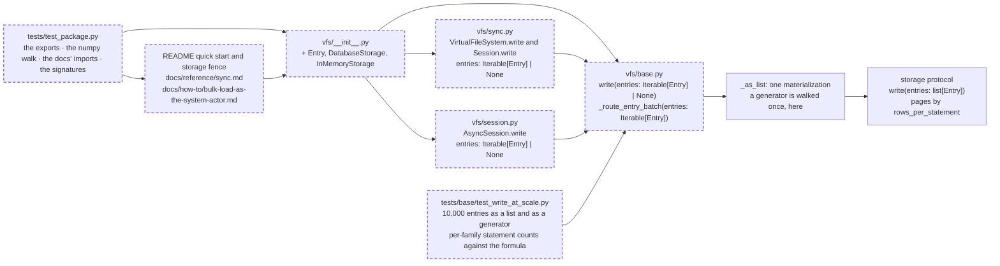

# ETL ergonomics: `Entry`, `DatabaseStorage` and `InMemoryStorage` import from `vfs`, `write` takes any iterable of entries, and a router-level pin names the statements a 10,000-entry write costs

A feature, small, that changes the public API (three exports and one annotation) and nothing else: not structural, no schema format change, no rights or engine code touched, parallel-safe, and the engine legs are not needed because no statement changes. It is the roadmap's story X2 under ruling D28, written on 2026-11-06 on the branch `claude/etl-ergonomics`, stacked on [the two-faces spec](../archive/2026-11-06-the-two-faces-named.md) that put the four face names on the package. It changes the public surface in two places and adds two pins: the three classes an ETL script constructs join the package's exports; `write` is typed as taking any iterable of `Entry`, which the router has accepted since the batch forms landed; a `slow` test counts the statements a 10,000-file write issues through `AsyncVirtualFileSystem` and asserts them against a formula whose only size-dependent terms are the chunk counts; and a subprocess pins that importing `vfs` loads no numpy. Nothing a verb does changes, and no statement the write path issues changes.

## The problem

Measured on the branch `claude/etl-ergonomics` at `5fcb69e`, 2026-11-06, with `grep -rn` for the code counts and a scratch script over SQLite for the statement counts, unless labelled otherwise.

- **The first script needs three import lines from three modules.** READ: the README's synchronous quick start imports `VirtualFileSystem` from `vfs` and `DatabaseStorage` from `vfs.storage.backends` (`README.md:33`); the storage fence imports `InMemoryStorage` from the same (`README.md:121`); `docs/reference/sync.md:13` imports `InMemoryStorage` from `vfs.storage.backends.memory`; `docs/how-to/bulk-load-as-the-system-actor.md:25` imports `Entry` from `vfs.models`. Four fences, three submodule paths, for the three classes every ETL script constructs. Ruling D28 in [the roadmap](../../standards/roadmap.md) answers "yes" to exporting them and leaves the work to story X2.
- **`write` says `Sequence[Entry]` and accepts any iterable.** READ: five signature sites carry `Sequence[Entry]`: `src/vfs/base.py:960` (the kernel's `write`), `src/vfs/base.py:2597` (`_route_entry_batch`), `src/vfs/session.py:146`, `src/vfs/sync.py:323` and `src/vfs/sync.py:808`. READ: the router materializes the batch once in `_as_list` (`src/vfs/base.py:1705`), whose docstring already says a generator must survive the validation pass; the params gate checks nothing about the `entries` kind (`src/vfs/params.py:546`). EXECUTED: `tests/base/test_dispatch.py:1597` (`test_generator_entries_survive`) passes a generator today and carries a `# ty: ignore[invalid-argument-type]` to do so, so the type checker refuses what the gate serves. The storage protocol takes `list[Entry]` (`src/vfs/storage/protocol.py:170`) and every builder walks the list more than once (`writes.py:155` builds the fetch set, then loops, then sorts), so the list is right there and only the public annotation lies.
- **No test pins the dependency walk against numpy, and numpy is present.** EXECUTED: `uv run python -c "import numpy; print(numpy.__version__)"` prints `2.4.2` in the dev environment, so a stray `import numpy` in `src/` would import and pass every test; `grep -rln numpy tests/ --include=*.py`, fixtures excluded, finds no test, and `pyproject.toml` names numpy nowhere. The [AGENTS.md](../../../AGENTS.md) rule "numpy is not a dependency and does not come back" is held today by reading, not by a count.
- **The 10,000-entry write is pinned only against itself.** READ: `tests/test_sync.py:504` compares the sync face's statement count with the kernel's for a 10,000-entry write and asserts both are positive; `tests/storage/database/test_writes.py:96` asserts a 100-entry write issues at most 10 statements; nothing states what a 10,000-entry write costs, so a change that doubled the pages per layer would pass both. EXECUTED, the scratch script `count2.py` over `sqlite+aiosqlite`, one warm write before the listener is armed so first touch's schema statements are outside the count, the files under 100 directories minted by `parents=True`: 100 entries cost 17 statements, 1,000 cost 17, 10,000 cost 42, 10,000 flat files with no directories cost 38, 20,000 cost 72. The shapes at 10,000: `BEGIN IMMEDIATE` 1; the grants read 2 (the gate's and the label's); the principal-revision read 1; the relabel read 1; the gate's target probe 1; the committed fetch 1; `SAVEPOINT`, `INSERT INTO vfs_entries` and `RELEASE SAVEPOINT` 10 each (one directory page and nine file pages); `INSERT INTO vfs_segments` 1; `INSERT INTO vfs_edges` 2; `INSERT INTO vfs_content` 1; the parent bump `UPDATE` 1. Every size-dependent term is a page count.
- **The page law is two helpers.** READ: the entry inserts go per depth layer, then per kind within the layer, in pages of `rows_per_statement(parameter_budget, rows)` with a savepoint around each page (`src/vfs/storage/backends/database/writes.py:436`, `:470`); `rows_per_statement` is `max(1, parameter_budget // max(len(row) ...))` (`dialects.py:745`). The segment, edge and content inserts go through `bulk_insert` (`dialects.py:838`), which on SQLite runs in the `"driver"` mode (`dialects.py:415`) and pages by `rows_per_statement(dialect.insertmanyvalues_max_parameters, ...)` (`dialects.py:867`); `host.parameter_budget` is that same dialect datum (`engine.py:217`). The two reads of entry rows chunk by `membership_budget` (`descent.py:82`, `descent.py:173`), and the parent bump chunks by it too. EXECUTED: SQLite's dialect declares `insertmanyvalues_max_parameters == 32700` and the host's `membership_budget` is 32,668, so at 10,000 entries every read is one chunk and the inserts are the only terms above one.

## Architecture

The package face, the five `write` signatures, and the two new test files. Dashed is what changes; the router's materialization and the storage seam are landed and drawn solid.

Page this changes: none; the architecture folder was retired on 2026-10-31, and the landing notes will say so in one line.

## Decisions

Each decision is a sentence whose body ends in its reason.

### 1. `Entry`, `DatabaseStorage` and `InMemoryStorage` are imported from `vfs` and listed in `__all__`; their modules keep their paths; no other name joins

`src/vfs/__init__.py` imports `Entry` from `vfs.models`, `DatabaseStorage` from `vfs.storage.backends.database.backend` and `InMemoryStorage` from `vfs.storage.backends.memory`, and `__all__` stays sorted with the three added. `vfs.models.Entry`, `vfs.storage.backends.DatabaseStorage` and `vfs.storage.backends.InMemoryStorage` remain the same objects at their old paths. `Observation`, `Edge`, `EditOperation` and the storage protocols do not join. The reason is ruling D28 and the shape of a first script: a developer constructs a filesystem, a storage and entries, and those are the three classes whose import lines the quick start spends; every further name is one more entry on the frozen list K9 will write, so the face takes what the first script needs and nothing it does not.

### 2. `write` takes `Iterable[Entry] | None` on the kernel, the sync face and both sessions; the router materializes once as today; the storage seam keeps `list[Entry]`

The five sites of The problem change from `Sequence[Entry]` to `Iterable[Entry]`, `_route_entry_batch` included; `vfs.session` and `vfs.sync` import `Iterable` under their `TYPE_CHECKING` blocks beside `Sequence`, which stays for the other batch parameters. `_as_list` is unchanged and remains the one place a generator is drained; the kernel's `write` docstring gains the sentence "*entries* is any iterable of `Entry`, walked once." `StorageBackend.write` and `DatabaseStorage.write` keep `list[Entry]`. The reason is that the gate already accepts any iterable and a generator already survives it, so the annotation is the only thing that refuses a pipeline's generator; and the storage builders read the batch three times, so a list is the true contract there, produced once by the router and never by the caller.

### 3. The parity test needs no change; the sync `write` twins move with the kernel's signature in the same edit

`tests/test_sync.py` compares each twin's parameter names, kinds, defaults and annotations with the original's after the family map, so the sync face's two `write` signatures and the kernel's change together or the parity test fails. The reason is that the parity test is the one place a signature drift between the faces must fail, as the facade spec decided, and this spec relies on it rather than adding a second check.

### 4. The 10,000-entry pin counts statements per family through `AsyncVirtualFileSystem` and asserts each family's count against a formula whose budgets come from the host and whose row widths come from the statements themselves

`tests/base/test_write_at_scale.py`, marked `slow`, builds a `DatabaseStorage` over a SQLite file under `tmp_path`, writes one warm file before the listener is armed so first touch's schema statements are outside the count, then writes 10,000 files under 100 directories minted by `parents=True` through `AsyncVirtualFileSystem.write`. A `before_cursor_execute` listener classifies every statement by the family its leading words name and records, for each `INSERT`, the number of columns in its column list. The expected counts, with `p = host.parameter_budget`, `m = host.membership_budget`, `per(w) = rows_per_statement(p, [a row of width w])`, `D = 100` directories, `F = 10_000` files and `A = D + F + 1` the written paths with the root: `BEGIN IMMEDIATE` 1; the grants read 2; the principal-revision read 1; the relabel read 1; the target probe `ceil(A / m)`; the committed fetch `ceil(A / m)`; `SAVEPOINT`, `INSERT INTO vfs_entries` and `RELEASE SAVEPOINT` each `ceil(D / per(w_e)) + ceil(F / per(w_e))` with `w_e` the entry insert's measured width; `INSERT INTO vfs_segments` `ceil((D + F) / per(w_s))`; `INSERT INTO vfs_edges` `ceil((D + F) / per(w_g))`; `INSERT INTO vfs_content` `ceil(F / per(w_c))`; the parent bump `UPDATE` `ceil(1 / m)`, one bumped parent, the root. The test asserts the per-family counts and that no statement fell outside the named families, so the total is asserted by construction. The reason is the D4 family the roadmap names: a count whose only size-dependent terms are page counts is the statement, in a test, that the write path is bounded by a budget and not by the batch; per-family counts make a regression name its table; the budgets read off the host so the engine legs can take the same formula under D4; and the widths are measured because the formula pins the paging law, not the column list, and a new column should move a page boundary, not break the test.

### 5. The generator pin writes the same 10,000 entries as a generator expression through the same helper and asserts the same per-family counts

The second node of `tests/base/test_write_at_scale.py` builds the entries as `(Entry(...) for i in range(10_000))`, writes them with `parents=True` through a fresh storage, and asserts the family counts equal the list's and that every one of the 10,000 file paths appears among the result's observations. The reason is acceptance 2 of story X2: a pipeline hands `write` a generator, and the one materialization in the router must cost the generator exactly what it costs the list, which only a count can say.

### 6. A subprocess pins that importing `vfs` loads no numpy; the exports, the docs' import lines and the four `write` signatures are pinned in the same file

`tests/test_package.py` holds `test_the_etl_names_are_exported_from_the_package` (the three names import from `vfs`, each `is` the class at its home path, all three are in `__all__`, and `__all__` equals its sorted self), `test_importing_vfs_loads_no_numpy` (`subprocess.run([sys.executable, "-c", "import sys, vfs; print('numpy' in sys.modules)"])` prints `False`), `test_write_takes_any_iterable_of_entries` (the `entries` annotation of `AsyncVirtualFileSystem.write`, `VirtualFileSystem.write`, `AsyncSession.write` and `Session.write` is the string `Iterable[Entry] | None`), and `test_the_docs_import_the_etl_names_from_the_package` (no fence under `docs/` or in the README imports `DatabaseStorage`, `InMemoryStorage` or `Entry` from a submodule). The reason is that numpy is installed in the developer's environment, so only a fresh interpreter shows what the package itself pulls in; and the three small pins belong beside it because all four say what the package face is.

### 7. The README's two fences, `docs/reference/sync.md` and the bulk-load how-to import the three names from `vfs`; the how-to says a generator is enough and shows one

`README.md:33` and `README.md:121` import `DatabaseStorage` and `InMemoryStorage` from `vfs`; `docs/reference/sync.md:13` imports `InMemoryStorage` from `vfs`; `docs/how-to/bulk-load-as-the-system-actor.md:25` imports `Entry` from `vfs`, and its sentence on ten thousand entries becomes "Batches of ten thousand entries in one call are supported, and any iterable will do: a generator costs the same statements as a list, because the router walks it once. The backend chunks the statements." with a fence beneath it that writes a generator of three entries through `etl` and asserts `success`. No other page changes. The reason is that the docs show the shortest true import, and the how-to is the page a pipeline author reads.

### 8. The pin runs on SQLite here; the engine legs join under story D4, which parametrizes this family over `ENGINE_LEGS`

`tests/base/test_write_at_scale.py` carries no engine mark. The reason is that the formula takes its budgets from the host, so the parametrization is the one-line change D4 names, and this spec is one landing.

### 9. The roadmap's X2 story and ruling D28 are not rewritten; the landing notes record the story as built

The reason is that the roadmap marks no landed story in its text today (X1's heading reads as it did before the facade landed), and the archive's status is the record.

### 10. This spec lands as one chunk on the branch `claude/etl-ergonomics` with its own pull request, stacked on the two-faces pull request

The reason is Clay's standing instruction of 2026-11-06 that each chunk after a pull request exists goes on a new branch and a new pull request.

## Intent

A pipeline author writes `from vfs import VirtualFileSystem, DatabaseStorage, Entry`, builds entries in a generator from whatever they are reading, and hands the generator to `write` with `parents=True`; the type checker accepts it, the router walks it once, and the statements issued are the ones a list would issue. A reviewer who wants to know what a 10,000-entry write costs reads one test whose formula names every statement family and whose only size-dependent terms are page counts under the host's budgets. A maintainer who adds a numpy import by accident sees a test fail rather than a wheel grow.

## Design

**The exports.** `src/vfs/__init__.py` gains `from vfs.models import Entry`, `from vfs.storage.backends.database.backend import DatabaseStorage` and `from vfs.storage.backends.memory import InMemoryStorage`, placed in the existing sorted import block, and the three names in `__all__` in sorted position. `vfs.base` already imports both storages, so no cycle is introduced.

**The annotation.** `Sequence[Entry]` becomes `Iterable[Entry]` at `base.py:960`, `base.py:2597`, `session.py:146`, `sync.py:323` and `sync.py:808`; `session.py` adds `Iterable` to its `TYPE_CHECKING` import; `sync.py` already imports it there; `base.py` imports `Iterable` at runtime already. The kernel's `write` docstring gains the one sentence of decision 2. `tests/base/test_dispatch.py:1603` drops its `ty: ignore` comment, and `ty check` stays at zero.

**The scale pin.** `tests/base/test_write_at_scale.py`: module constants `DIRECTORIES = 100`, `FILES = 10_000`, a `FAMILIES` tuple of `(name, prefix)` pairs in the order of decision 4, and the helper `_count(write) -> tuple[Counter[str], dict[str, int]]` that attaches the listener, runs the awaited write, and returns the family counts and the measured insert widths; `_expected(host, widths) -> Counter[str]` builds the formula of decision 4 with `math.ceil` and `rows_per_statement` imported from `vfs.storage.backends.database.dialects`; the two `slow` async tests of decisions 4 and 5. A statement matching no family fails the test by name. The listener is attached to `storage._host.engine.sync_engine` as the facade pin does.

**The package pins.** `tests/test_package.py` as decision 6; the docs check walks `README.md` and `docs/**/*.md` and asserts no line matches `from vfs\.(storage|models)\S* import .*\b(DatabaseStorage|InMemoryStorage|Entry)\b`.

**The docs.** As decision 7. The how-to's new fence runs under the root conftest's namespace, which binds `storage`; its `etl` is the one the page's first fence builds.

**Scale.** Nothing new grows with input in `src/`; the annotation is a type and `_as_list` is unchanged. The scale test holds 10,000 `Entry` objects twice, as the facade pin already does once; the `slow` mark keeps it out of the iterating loop.

## Scope

In: decisions 1 to 10. Files: `src/vfs/__init__.py`, `src/vfs/base.py`, `src/vfs/session.py`, `src/vfs/sync.py`, `tests/test_package.py` (new), `tests/base/test_write_at_scale.py` (new), `tests/base/test_dispatch.py` (one comment), `README.md`, `docs/reference/sync.md`, `docs/how-to/bulk-load-as-the-system-actor.md`, and this spec's landing notes.

Out: any change to what `write` does or to the statements it issues; a chunked or streaming read of the batch (the memo's side finding, unscheduled); the engine-leg parametrization and the shrunken-budget run (story D4); exports beyond the three (ruling D28 names three); the storage protocol's `list[Entry]`; the roadmap's text.

## Acceptance criteria

Counts and states, never clocks. Tests are in `tests/test_package.py` unless their path says otherwise.

1. `from vfs import Entry, DatabaseStorage, InMemoryStorage` succeeds; `vfs.Entry is vfs.models.Entry`, `vfs.DatabaseStorage is vfs.storage.backends.DatabaseStorage`, `vfs.InMemoryStorage is vfs.storage.backends.InMemoryStorage`; the three names are in `vfs.__all__`, and `vfs.__all__ == sorted(vfs.__all__)`. Test: `test_the_etl_names_are_exported_from_the_package`.
2. A fresh interpreter that imports `vfs` prints `False` for `'numpy' in sys.modules`. Test: `test_importing_vfs_loads_no_numpy`.
3. The `entries` parameter of `AsyncVirtualFileSystem.write`, `VirtualFileSystem.write`, `AsyncSession.write` and `Session.write` is annotated `Iterable[Entry] | None`; `tests/base/test_dispatch.py::test_generator_entries_survive` passes with no `ty: ignore` comment and `uv run ty check src/ tests/` reports zero diagnostics. Test: `test_write_takes_any_iterable_of_entries`, and the gate.
4. Every existing parity node of `tests/test_sync.py` passes unchanged. Test: `tests/test_sync.py`, the landed nodes.
5. A 10,000-file write under 100 directories with `parents=True` through `AsyncVirtualFileSystem` over a warm SQLite storage issues, per family, exactly the counts of decision 4's formula under the host's `parameter_budget` and `membership_budget`, every statement falls in a named family, and the result's `success` is `True`. Test: `tests/base/test_write_at_scale.py::test_a_ten_thousand_entry_write_issues_the_statements_the_formula_names`.
6. The same 10,000 entries as a generator expression issue the same per-family counts, and every one of the 10,000 file paths is among the result's observations. Test: `tests/base/test_write_at_scale.py::test_a_generator_of_ten_thousand_entries_costs_what_the_list_costs`.
7. No line of `README.md` or any `docs/**/*.md` imports `DatabaseStorage`, `InMemoryStorage` or `Entry` from `vfs.storage` or `vfs.models`; the bulk-load how-to holds a fence that writes a generator expression; `uv run pytest docs README.md -p no:cov -n 0` is green. Test: `test_the_docs_import_the_etl_names_from_the_package`, and the gate's docs step.
8. `scripts/ci.sh` is green at 100% coverage on the tree as committed; `ruff check`, `ruff format --check` and `ty check` at zero over `src/` and `tests/`.

## Landing notes

Filled at the landing.

## One line

The three classes an ETL script builds import from `vfs`, `write` is typed for the iterable it already accepted, a 10,000-entry write is pinned to a formula whose only size-dependent terms are page counts, and a fresh interpreter proves the package loads no numpy.
