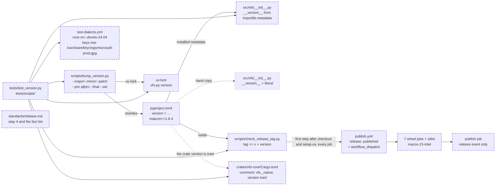

# The release plumbing: one version source, a bump script that speaks the lane, a publish matrix that can be dry-run and refuses the wrong tag, and a dialect workflow on the runner its sources list names

A fix to release engineering, not structural. It changes the public API in one additive way: `vfs.__version__` keeps its name and type and is read from distribution metadata instead of a literal. It changes no schema format, needs no engine legs (the dialect workflow file changes, no storage code does), touches no rights, and touches the engine's crate only in a comment. It is parallel-safe with every active kernel spec: none of them edits a workflow, `scripts/`, or `src/vfs/__init__.py`. It comes from no intention: it is the first four scope items of [the release-lane spec, 166](../active/166-the-release-lane-to-0-1-0/spec.md), which is the roadmap's story R1 in [the 0.1.0 roadmap](../../standards/roadmap.md), plus one fix to the SQL Server leg of the dialect workflow, which is half of story R2. Spec 166 stays active and keeps its remaining items (the matrix dry run, the yank, the README's install section, the first alpha's release notes, the cut, and the three-stage table in the release standard); the paragraph on scope below says why the split is here. It stands on no research memo: spec 166 recorded its facts against `ac5c515` on 2026-10-15, and every one of them is re-checked below against `1a9a768` on 2026-11-06. Two active specs touch one file this spec edits: [the release-lane spec, 166](../active/166-the-release-lane-to-0-1-0/spec.md) rewrites `context/standards/release.md` wholesale when it lands; this spec corrects that page's bump step and removes the facts it fixes from the page's fact list, and 166 rebases onto the corrected page. [Spec 157](../active/157-postgres-provisioning-for-host-apps/spec.md), active and unbuilt, adds a second Postgres URL to `test-dialects.yml`'s matrix; this spec changes only that workflow's `runs-on` and its ODBC step, so the edits do not collide and whichever lands second rebases onto the other.

## The problem

Measured on `main` at `1a9a768`, 2026-11-06, unless labelled otherwise.

- **The version lives in three files.** EXECUTED: `pyproject.toml` says `version = "0.0.22"`; `src/vfs/__init__.py` line 1 says `__version__ = "0.0.22"`; `uv.lock` carries `0.0.22` for `vfs-py`. The bump script rewrites the first two and never the third, so `uv.lock` goes stale on every bump. READ: `src/vfs/rendering/seam.py:314` already reads a distribution's version through `importlib.metadata.version`, so the pattern is in the tree.
- **The bump script cannot write a pre-release.** READ: `scripts/bump_version.py` matches `\d+\.\d+\.\d+` and nothing else, so `0.1.0a1` is unreachable, and once a pre-release is written by hand the script no longer finds the version at all. The lane spec 166 defines needs `0.1.0a1`, `0.1.0a2`, `0.1.0b1` and `0.1.0`.
- **The publish matrix has never run and cannot be dry-run.** READ: `.github/workflows/publish.yml` triggers only on `release: [published]`; there is no `workflow_dispatch`. EXECUTED: the workflow-runs listing for the repository holds no run of `publish.yml`. The first run of seven platform builds should not also be the first release anyone depends on.
- **Nothing checks the tag against the version.** READ: no step in `publish.yml` reads the project version. A release tagged `v0.1.0a2` on a `main` still at `0.1.0a1` would build seven wheels of `0.1.0a1` and have PyPI refuse the upload.
- **One runner is retired.** READ: `publish.yml` line 25 pins `macos-13` for the macOS x86_64 wheel; GitHub retired that image in December 2025. READ, the runner-images README on 2026-11-06: the Intel macOS 15 image's label is `macos-15-intel`.
- **The maturin floor admits versions that cannot bootstrap Rust.** READ: `pyproject.toml` says `maturin>=1.8,<2.0`; the sdist fallback on a platform without a wheel needs `>=1.8.4`, the first version whose build self-bootstraps a Rust toolchain.
- **The crate's comment names a module that does not exist.** READ: `crates/vfs-core/Cargo.toml` line 14 says maturin embeds the binding as `vfs._accel`; the module is `vfs._native` (`pyproject.toml`, `[tool.maturin] module-name`).
- **The SQL Server leg of the dialect workflow is red on every push.** EXECUTED: runs 97, 98 and 99 of `test-dialects.yml` (2026-10-30, 2026-10-31, 2026-11-06) each fail only in the `mssql` job, at the step "Install ODBC driver", before any test runs; the Postgres, MariaDB and Oracle jobs pass. The step's log ends `The repository 'https://packages.microsoft.com/ubuntu/24.04/prod noble InRelease' is not signed`, after `NO_PUBKEY EB3E94ADBE1229CF`, and the same log fetches `resolute-security` package lists, which is Ubuntu 26.04. READ, GitHub's changelog of 2026-09-17: the `ubuntu-latest` label moves from Ubuntu 24.04 to Ubuntu 26.04 gradually between 2026-10-19 and 2026-11-19. EXECUTED on 2026-11-06, in this session: the 24.04 feed's `InRelease` is signed by `EB3E94ADBE1229CF`, the key the workflow installs from `microsoft.asc`, and GnuPG on Ubuntu 24.04 verifies it; the 26.04 feed exists at `ubuntu/26.04/prod`, is signed by a different key, `EE4D7792F748182B` (`microsoft-2025.asc`), and carries `msodbcsql18`. EXECUTED on 2026-11-06: Microsoft's `prod.list` for 24.04 and for 26.04 each carry `signed-by=/usr/share/keyrings/microsoft-prod.gpg`, so apt verifies this feed against that one keyring and ignores the `microsoft.asc` the step writes under `/etc/apt/trusted.gpg.d/`; the step's key line has never taken part in the verification. INFERRED: the leg verified on the 24.04 image through the `microsoft-prod.gpg` that image ships, which holds `EB3E94ADBE1229CF`; the 26.04 image's keyring lacks that key, which is the `NO_PUBKEY` in the log; the job broke because the runner image changed under a sources list that names the 24.04 feed, and the last green run of all four legs was on a 24.04 image.
- **No test holds any of this.** EXECUTED: `grep -rn bump_version tests/` finds nothing; no test reads `vfs.__version__`; no test reads `publish.yml`.

## Architecture

The pieces of the release lane this spec touches. Solid is what exists today; dashed is what this spec adds or changes; dotted is what it retires. No architecture page exists since 2026-10-31, when the folder was retired, so this diagram is the only drawing of the lane.

Page this changes: none; the architecture folder was retired on 2026-10-31 and the landing notes will say so in one line.

## Decisions

Every choice this change needs, numbered, each with its reason. Spec 166's decisions 1 to 7 (the yank, the alpha lane, its three stages, the beta and final bars, the cadence, the classifier) are not restated: this spec builds the tooling those decisions need and changes none of them.

### 1. This spec carries spec 166's scope items 1 to 4 and the SQL Server runner pin, and nothing that needs a published artifact or a PyPI action

In: the version source, the bump script, the publish workflow's dispatch and tag check and runner, the maturin floor and the crate comment (166's items 1 to 4), and the dialect workflow's runner. Out, and still spec 166's: the matrix dry run (item 7), the yank (item 8), the README's install section (item 6), the first alpha's release notes (item 5, now release notes rather than a changelog section) and the cut (item 9), and the three-stage table in `release.md` (item 10). Reason: a spec is one landing by one developer, green at the end, and the items left out need Clay's hands on pypi.org and on a GitHub release or a published wheel to verify; the items taken in are verified by tests and by a CI run on the branch. Spec 166 stays active, unedited, as the spec of the lane itself; its own first landing will convert it to the new shape and record that criterion 6 (a changelog section) was overtaken on 2026-11-04, when `1a9a768` deleted `CHANGELOG.md` in favour of release notes. This spec discharges 166's acceptance criteria 8, 9 and 10 and the `ruff`, `ty` and coverage half of 11; the conversion of 166 drops them and keeps 1 to 7.

### 2. `pyproject.toml` is the only file that states the version; `vfs.__version__` reads the installed distribution's metadata at import

`src/vfs/__init__.py` imports `version` from `importlib.metadata` at the top of the file and binds `__version__ = version("vfs-py")`. Reason: a hand-kept copy drifts, and this one has: the number is kept in three places today and the bump script updates two. The seam in `rendering/seam.py` already reads versions this way, so the pattern has precedent in the tree. The import is a top-of-file import, as [AGENTS.md](../../../AGENTS.md) requires; nothing is read lazily.

### 3. The bump script parses with `packaging.version.Version` and gains `--pre {a,b,rc}`, `--final` and `--set`

The transitions, each pinned by a test:

| From | Flags | To |
|---|---|---|
| `0.0.22` | `--patch` | `0.0.23` |
| `0.0.22` | `--minor` | `0.1.0` |
| `0.1.0` | `--major` | `1.0.0` |
| `0.0.22` | `--minor --pre a` | `0.1.0a1` |
| `0.0.22` | `--major --pre b` | `1.0.0b1` |
| `0.1.0a1` | `--pre a` | `0.1.0a2` |
| `0.1.0a4` | `--pre b` | `0.1.0b1` |
| `0.1.0b2` | `--pre rc` | `0.1.0rc1` |
| `0.1.0b3` | `--final` | `0.1.0` |
| any | `--set 0.2.0.dev1` | `0.2.0.dev1` |

The refusals, each a message on stderr and exit status 2, with nothing written:

| From | Flags | Why refused |
|---|---|---|
| `0.1.0b1` | `--pre a` | the lane never moves backwards |
| `0.1.0rc1` | `--pre b` | the same |
| `0.1.0` | `--final` | already a final |
| `0.1.0` | `--pre a` | a final needs a part flag to say which number the lane opens |
| `0.1.0a1` | `--patch` | a pre-release continues with `--pre` or closes with `--final`; a part flag would silently abandon the lane |
| `0.1.0a1` | `--minor --pre a` | a pre-release takes no part flag, with or without `--pre`; `--set` is the way to abandon a lane |
| any | `--set not-a-version` | not PEP 440 |

`--major`, `--minor`, `--patch`, `--final` and `--set` are mutually exclusive; `--pre` combines only with a part flag or stands alone. `--set` is bound by PEP 440 alone and may move the version backwards; it is the escape hatch, and it prints `old → new` like every other transition. Reason: a regex over three integers cannot spell the lane; `packaging` is the library pip and uv agree with on what a version is and how versions order, so its `Version` is the parser, and its ordering is the refusal rule for the stage letter (the new version sorts after the old one and a stage letter never goes down). The other refusals are lane rules this table states: a final takes no `--final`, a final needs a part flag to open a lane, a pre-release takes no part flag. The two refusals spec 166 named (`b → a`, `--final` on a final) are kept; the other four close the choices 166 left to the build.

### 4. The bump script rewrites `pyproject.toml`, then runs `uv lock`, and touches nothing else

It prints `old → new` on stdout. It no longer edits `src/vfs/__init__.py` (decision 2 removed the literal) and it does not commit. Reason: `uv.lock` records the project's own version, so a bump without a lock leaves the tree inconsistent and the next `uv sync` rewrites the lock as a side effect of someone else's commit.

### 5. `packaging` joins the `dev` dependency group explicitly

Reason: the script imports it directly. It is present today only as a transitive dependency of the test tools, and a dependency the project calls by name is declared, not inherited; the lock is regenerated in the same landing, which `uv lock` does without pulling anything new.

### 6. The tag check is a standard-library script, `scripts/check_release_tag.py`, and `publish.yml` runs it as the first step of every job on a release event

The script takes the tag as its one argument, reads `[project] version` from `pyproject.toml` with `tomllib`, prints both, and exits 0 when the tag equals `"v" + version` and 1 otherwise; the pyproject path is an option so a test can point it at a scratch file. The workflow passes the tag through an environment variable, never by interpolating it into the command line. The step runs `uv run --no-project python scripts/check_release_tag.py` after `astral-sh/setup-uv` with `python-version: "3.13"`, so one command serves the Linux, macOS and Windows jobs; the publish job gets the same step. `--no-project` is what keeps `uv run` from syncing the project, which would build the extension before the check; `python-version: "3.13"` on `setup-uv` is what gives it an interpreter with `tomllib` on every runner, the Windows image's default being older than 3.11. Reason: a check that is a script is a check a unit test can drive for both verdicts, which spec 166's criterion 8 asked for as the alternative to a deliberate mismatched release; the standard library keeps it free of the project environment, so it runs before anything is built.

### 7. `publish.yml` gains `workflow_dispatch`; the publish job runs only on a release event; a dispatch leaves the wheels and the sdist as workflow artifacts

Reason: the matrix has never run, and the only way to run it today is to cut a release; a dispatch exercises all eight build jobs from `main` with nothing uploaded, which is spec 166's item 7 once this lands. The artifacts are already uploaded per job, so nothing else changes for a dispatch to be useful.

### 8. The macOS x86_64 wheel builds on `macos-15-intel`

Reason: `macos-13` is retired; `macos-15-intel` is the Intel macOS 15 label in the runner-images README on 2026-11-06 and carries no deprecation mark. The arm64 wheel stays on `macos-15`.

### 9. The maturin floor is `>=1.8.4,<2.0`; the crate's comment says `vfs._native`; the crate's own version stays `0.1.0`

Reason: maturin 1.8.4 is the first version whose sdist build bootstraps Rust, so a platform without a wheel can still install; the crate version is inert because maturin reads the project version, and the comment beside it now says so instead of naming a module that does not exist.

### 10. The dialect workflow pins `runs-on: ubuntu-24.04`, and its ODBC step writes Microsoft's two keys into the keyring the sources list names

The step fetches `microsoft.asc` and `microsoft-2025.asc`, dearmors each, and writes them together to `/usr/share/keyrings/microsoft-prod.gpg`, the path the downloaded `prod.list` names in its `signed-by`; the line that wrote `microsoft.asc` under `/etc/apt/trusted.gpg.d/` goes, because apt never read it for this feed. Reason: apt verifies a source that names `signed-by` against that keyring alone, so the job's own key must live there or the job depends on whatever keyring the runner image happens to ship, which is how the leg went red with no change to the tree; with both keys in the keyring the feed verifies whichever key Microsoft signs it with. The pin stays beside it: the sources list names the Ubuntu 24.04 feed, the runner image and the feed should agree, and `ubuntu-latest` stopped meaning 24.04 during a gradual migration; a pinned image makes the run deterministic for every job in the matrix, and the workflow run on the branch that carries this spec is the proof. The future direction, when the 24.04 image retires, is a step that picks the feed by the runner's own release from `/etc/os-release`; the 26.04 feed exists, is signed by the 2025 key and carries the driver. It is not taken now because a run can land on either image until the migration ends and only the image the run lands on gets tested.

### 11. `release.md` is trued up to the tree, not rewritten

Step 4 says the script rewrites `pyproject.toml` alone and runs `uv lock` itself, and lists the new flags; the fact list under "Before the first v2 release" loses the facts this spec fixes (the bump script, the macOS runner, the tag check, the maturin floor, the dispatch) and keeps the rest (musl, PyPI state, the README in the wheel, no changelog). The three-stage table and the entry rules are spec 166's item 10 and are not written here. Reason: a standard describes the tree that exists; this spec changes the tree in five of the page's facts and should leave the page true, while the lane's own rules belong to the spec that decided them.

### 12. The script tests live under `tests/scripts/`, mirroring `scripts/`; the version seam's test is `tests/test_version.py`

The script modules are loaded by file path with `importlib.util.spec_from_file_location`, as `tests/lint/shapes.py` already loads `scripts/unwrap_context.py`, because `scripts/` is not a package and does not become one. Reason: how we code's mirror rule, "a new source file is a new test file", applied to a folder the suite never covered.

### 13. The `uv lock` call is spied in the bump script's test; the live lock is pinned by a test that reads the tree

The script takes its subprocess runner as a module attribute the test replaces with a recorder, so the test needs no network and no real lock; a second test reads the repository's `uv.lock` and asserts the `vfs-py` package's version equals `pyproject.toml`'s. Reason: the guarantee spec 166's criterion 9 names ("`uv.lock` matches `pyproject.toml` after any bump") is a property of the tree after a bump, and the tree test holds it on every commit, while the spy proves the script issues the call that keeps it true.

## Intent

A developer who wants to cut `0.1.0a1` can: the version has one home, one command moves it along the lane and keeps the lock in step, the publish matrix can be proven on all seven platforms before any tag exists, and a release whose tag disagrees with the tree fails before a wheel is built. A developer who touches storage sees four green engine legs again, not three and a red one that never ran. Nothing a host sees changes: `import vfs; vfs.__version__` still answers the installed version.

## Design

**The version seam.** `src/vfs/__init__.py` gains `from importlib.metadata import version` at the top and `__version__ = version("vfs-py")` where the literal was. Nothing else in the package reads the number.

**The bump script.** `scripts/bump_version.py` keeps its name and its invocation through `uv run python scripts/bump_version.py`. Its public functions: `read_version(text) -> Version`, which finds the `[project]` table's `version` line; `next_version(current, *, part, pre, final, explicit) -> Version`, the pure transition table of decision 3, which raises `BumpRefused` (a `ValueError`) with the refusal's sentence; `write_version(path, new) -> None`, which rewrites exactly that line; and `main(argv) -> int`, which parses the flags, applies the transition to the project's `pyproject.toml`, runs `uv lock` through the module's `run` attribute (`subprocess.run` by default) in the repository root, prints `old → new`, and returns 0, or prints the refusal to stderr and returns 2. The `[project] version` line is matched as the first `version = "…"` line after the `[project]` header, so the `[tool.maturin]` table and the crate's manifest are never touched.

**The tag check.** `scripts/check_release_tag.py` holds `project_version(pyproject: Path) -> str` and `main(argv) -> int`. `main` takes the tag and an optional `--pyproject`, prints `tag <tag>, project version <version>`, and returns 0 on `tag == "v" + version`, 1 otherwise with one line saying which is which.

**The publish workflow.** `on:` gains `workflow_dispatch:`. Every job starts with checkout, then `astral-sh/setup-uv@v7` with `python-version: "3.13"`, then a step named "The tag names the project version" with `if: github.event_name == 'release'`, `env: TAG: ${{ github.event.release.tag_name }}` and `run: uv run --no-project python scripts/check_release_tag.py "$TAG"` under `shell: bash`. The publish job gains `if: github.event_name == 'release'`. The macOS x86_64 matrix row's runner becomes `macos-15-intel`.

**The dialect workflow.** `runs-on: ubuntu-24.04`, with a two-line comment saying the runner must match the feed the ODBC step names. The ODBC step becomes: fetch `microsoft.asc` and `microsoft-2025.asc`, dearmor each with `gpg --dearmor`, write the two together to `/usr/share/keyrings/microsoft-prod.gpg` through `sudo tee`; fetch the 24.04 `prod.list` into `/etc/apt/sources.list.d/mssql-release.list` as today; `apt-get update`; install `msodbcsql18` with `ACCEPT_EULA=Y`. A two-line comment says the keyring path is the one the list's `signed-by` names.

**The manifests.** `pyproject.toml`: `requires = ["maturin>=1.8.4,<2.0"]`; `"packaging>=24"` in the `dev` group. `crates/vfs-core/Cargo.toml`: the comment names `vfs._native` and says the crate version is inert because maturin reads the project version. `uv.lock` regenerated.

**The standard.** `context/standards/release.md` as decision 11 says.

Nothing here grows with input: the scripts read one file each and issue one subprocess call; no statement, loop or structure scales with a batch.

## Scope

In: decisions 1 to 13. Files: `src/vfs/__init__.py`, `scripts/bump_version.py`, `scripts/check_release_tag.py` (new), `.github/workflows/publish.yml`, `.github/workflows/test-dialects.yml`, `pyproject.toml`, `uv.lock`, `crates/vfs-core/Cargo.toml`, `context/standards/release.md`, `tests/test_version.py` (new), `tests/scripts/__init__.py`, `tests/scripts/test_bump_version.py` and `tests/scripts/test_check_release_tag.py` (new).

Out: everything spec 166 keeps under decision 1 (the dry run, the yank, the README, the release notes, the cut, the stage table in the standard); a nightly `devN` lane; trusted-publisher setup; the musl install; a self-adapting ODBC step that chooses the Microsoft feed by the runner's own release (decision 10 names it as the direction when the 24.04 image retires); any change to what a verb does.

## Acceptance criteria

Counts and states, never clocks.

1. `vfs.__version__ == importlib.metadata.version("vfs-py")`, and `src/vfs/__init__.py` holds no line assigning `__version__` a string literal. Tests: `tests/test_version.py::test_version_is_read_from_distribution_metadata` and `tests/test_version.py::test_the_package_states_no_version_literal`.
2. Every transition in decision 3's first table produces the version it names. Test: `tests/scripts/test_bump_version.py::test_each_transition_in_the_lane`, parametrized over the ten rows.
3. Every refusal in decision 3's second table raises `BumpRefused` from `next_version`, and through `main` writes nothing, prints one line to stderr and returns 2. Tests: `tests/scripts/test_bump_version.py::test_each_refusal_in_the_lane` (seven rows) and `tests/scripts/test_bump_version.py::test_a_refusal_writes_nothing_and_exits_2`.
4. `main` on a scratch `pyproject.toml` rewrites only the `[project]` version line (the file differs from its original in exactly one line, and a `[tool.maturin]` table in the scratch file is untouched), issues exactly one call to the module's `run` attribute, whose argument list is `["uv", "lock"]` with `cwd` the scratch root, and prints `0.0.22 → 0.1.0a1`. Test: `tests/scripts/test_bump_version.py::test_main_rewrites_pyproject_and_locks`.
5. The repository's `uv.lock` records, for the package `vfs-py`, the version `pyproject.toml` states. Test: `tests/scripts/test_bump_version.py::test_the_lock_carries_the_project_version`.
6. `check_release_tag.main(["v0.1.0a1", "--pyproject", scratch])` returns 0 when the scratch file says `0.1.0a1`; `["v0.1.0a2", …]` and `["0.1.0a1", …]` return 1, each printing one line that contains both the tag and the project version. Tests: `tests/scripts/test_check_release_tag.py::test_a_matching_tag_passes` and `tests/scripts/test_check_release_tag.py::test_a_mismatched_tag_fails`, the second parametrized over the two mismatches.
7. `publish.yml` parses as YAML; its `on` key, which PyYAML loads as the boolean `True`, holds both `release` and `workflow_dispatch`; every job's steps contain a step whose `run` names `scripts/check_release_tag.py` and whose `if` names `release`, placed before any `maturin-action` or `download-artifact` step; the `publish` job's `if` names `release`; no runner in the file is `macos-13` and one is `macos-15-intel`. Test: `tests/scripts/test_check_release_tag.py::test_the_publish_workflow_runs_the_check_first_in_every_job`.
8. `test-dialects.yml`'s job runs on `ubuntu-24.04`, and the step named "Install ODBC driver" writes to `/usr/share/keyrings/microsoft-prod.gpg`, names both `microsoft.asc` and `microsoft-2025.asc`, and does not name `trusted.gpg.d`. Test: `tests/scripts/test_check_release_tag.py::test_the_dialect_workflow_pins_its_runner_and_its_keyring`.
9. `pyproject.toml`'s build requirement is `maturin>=1.8.4,<2.0` and its `dev` group names `packaging`; `crates/vfs-core/Cargo.toml` does not contain `_accel`. Test: `tests/scripts/test_bump_version.py::test_the_manifests_say_what_the_lane_needs`.
10. `context/standards/release.md` does not say that the bump script updates `__init__.py`, and names `--pre`, `--final` and `--set`. Test: `tests/lint/test_code_shape.py::test_the_standards_agree_with_the_tree`, which gains `release.md` rows in its forbidden and required tables.
11. The Dialect tests run on the branch that carries this change (a pull request's run, or a `workflow_dispatch` on the branch) is green on all four jobs, the `mssql` job included, with its conformance suite executed. Evidence: the run id in the landing notes.
12. `scripts/ci.sh` is green at 100% coverage on the tree as committed; `ruff check`, `ruff format --check` and `ty check` at zero over `src/` and `tests/`.

## Landing notes

(Filled in on landing.)

## One line

One file states the version, one script moves it along the alpha-beta-final lane and locks it, the publish matrix can be dry-run and refuses a tag that disagrees with the tree, and the engine legs run on the image their sources list was written for.
