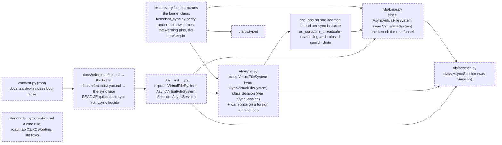

# The two faces named: `VirtualFileSystem` is the synchronous face, `AsyncVirtualFileSystem` is the kernel, both imported from `vfs`, and the synchronous face warns once when it blocks a loop that is not its own

A refactor of names and one small behaviour, decided by Clay on 2026-11-06 from [the API-shapes memo](../../research/2026-11-06-sync-and-async-api-shapes.md) and recorded here before any code is written. It changes the public API: the kernel class `vfs.base.VirtualFileSystem` becomes `AsyncVirtualFileSystem` and its session `AsyncSession`; the synchronous front `vfs.sync.SyncVirtualFileSystem` becomes `VirtualFileSystem` and its session `Session`; all four are exported from `vfs`, and the names `SyncVirtualFileSystem` and `SyncSession` disappear. It adds one runtime warning and one packaging file (`py.typed`). It changes no verb's contract, no schema format, no rights and no engine code; it needs no engine leg, because the sync face's mechanism is unchanged and its Postgres leg already ran. Every module keeps its path. It touches the same files as [the sync facade spec](../archive/2026-11-06-the-sync-facade.md) plus the kernel's own module, every test that names the kernel class, the docs and the standards; it is parallel-safe with nothing that names `VirtualFileSystem`, which is why it lands as one chunk on its own.

## The problem

Measured on the branch `claude/tender-clarke-j01e4i` at `9ca6b05`, 2026-11-06, unless labelled otherwise.

- **The names run against what every population expects.** READ, [the memo](../../research/2026-11-06-sync-and-async-api-shapes.md) sections 1 and 4 and [the FastAPI study](../../research/studies/2026-11-06-sync-and-async-api-shapes/01-fastapi-and-software-engineers.md): httpx, psycopg 3, pymongo, SQLAlchemy and the vendor SDKs put the plain name on the synchronous face and `Async` on the other; vfs today does the reverse (`vfs.VirtualFileSystem` is async, `vfs.sync.SyncVirtualFileSystem` is the front), and the `Sync` class prefix has almost no precedent (the Supabase family and nobody else). READ, [the pandas study](../../research/studies/2026-11-06-sync-and-async-api-shapes/03-pandas-and-data-engineers.md): a data engineer who types `from vfs import VirtualFileSystem` and then `fs.read(...)` without `await` gets a coroutine today.
- **Clay's rubric and answers.** READ, this session on 2026-11-06: scored on first contact, convention match, the language's own default (plain Python is synchronous, `await` is the marked form), failure legibility, type-checker catch, churn and kernel identity, the inverted naming won on every row that measures what developers expect to see; Clay chose: sync is plain; both faces imported from `vfs`; no `a`-prefixed twins on the sync face; the sync face warns once when it blocks a foreign running loop. Clay's earlier ruling stands: the kernel is async because it must be cloud native and agent native; the `Async` marker on the kernel class satisfies it without moving the kernel.
- **The dream of one name for both spellings is closed on evidence.** EXECUTED in [the mechanism study](../../research/studies/2026-11-06-sync-and-async-api-shapes/04-the-dual-mode-mechanism.md): every mechanism that chooses by a running loop returns a coroutine for the sync spelling in a real ipykernel cell, `ty` and `mypy` reject the `Result | Coroutine` type in both spellings, and the lazy result erases types to `Any`. The two spellings must differ by name, and they will differ by class.
- **The sync face can freeze a loop it does not own, silently.** EXECUTED, the FastAPI study's placement table: the facade called from an `async def` endpoint served 100 requests one at a time in 5.68 s with the server loop frozen for 5,683 ms, every answer correct, no warning, no traceback. EXECUTED, [the LangChain study](../../research/studies/2026-11-06-sync-and-async-api-shapes/02-langchain-and-ai-engineers.md): 200 facade reads on the agent's loop thread let a heartbeat tick zero times. No type checker can see it, because the sync call is a legitimate call.
- **The package ships no typing marker.** EXECUTED, the FastAPI study: `mypy` against the installed package reports `module is installed, but missing library stubs or py.typed marker`, so every argument about a checker catching a forgotten `await` holds only for `ty` and for `mypy` reading from source. EXECUTED: `ls src/vfs/py.typed` finds nothing.
- **The word kernel is spoken for.** READ: spec 179 is "the storage seam as the kernel" and spec 181 regroups the public surface "by kernel group", both from the retired ADR 087; a module named `vfs.kernel` holding the mount router would contradict them. The router's own docstring calls it "async router over one mount table".
- **What the rename touches.** EXECUTED: the word `VirtualFileSystem` appears 24 times in 9 files under `src/`, 397 times in 36 files under `tests/`, 22 times in the docs and README, 14 times in 3 standards pages and 49 times in 14 active numbered specs; `vfs.base` is imported by 7 source files and 16 test files.

## Architecture

The two faces after the rename, their modules, their exports, and the one new check. Dashed is what changes; the mechanism between the faces is the landed one and is drawn solid.

Page this changes: none; the architecture folder was retired on 2026-10-31, and the landing notes will say so in one line.

## Decisions

Every choice this change needs, numbered, each with its reason. The sync facade spec's decisions 1 to 14 stand except where a decision below renames what they built.

### 1. The synchronous face is `VirtualFileSystem` and `Session`; the kernel is `AsyncVirtualFileSystem` and `AsyncSession`

The kernel class in `vfs/base.py` and the session class in `vfs/session.py` are renamed in place; the two classes in `vfs/sync.py` take the plain names; `SyncVirtualFileSystem` and `SyncSession` cease to exist, with no alias left behind. Reason: Clay's decision from the rubric, resting on the memo's evidence that the plain-sync, `Async`-marked convention is what the FastAPI population's libraries and every vendor SDK use, that plain Python is synchronous and `await` is the marked form, and that a `Sync` class prefix has no precedent worth following; the kernel stays the async kernel Clay ruled it must be, and the `Async` in its name says so to the readers who need it, the MCP, LangGraph and FastAPI `async def` audiences. No alias, because two names for one class is the one thing the module-twin option was rejected for.

### 2. Both faces are imported from `vfs`; no module is renamed; `vfs.sync` and `vfs.base` keep their paths

`vfs/__init__.py` exports `VirtualFileSystem`, `AsyncVirtualFileSystem`, `Session` and `AsyncSession`; the documented imports are `from vfs import VirtualFileSystem` and `from vfs import AsyncVirtualFileSystem`. Reason: Clay's answer ("both from `vfs`"), and the memo's finding that the populations pick by import, which one place to look serves best. The module paths stay because they become internal once the top-level names exist, because `kernel` is spoken for by specs 179 and 181, because `facade` is already what `Session` calls itself, and because spec 181 regroups the public surface and should own any module naming when it is picked up.

### 3. The mechanism is unchanged: the sync face wraps the kernel through one loop on one daemon thread per instance, with the guards and the drain the sync facade spec landed

Reason: the memo settles the mechanism (fsspec, Dask, Starlette's `TestClient` and LangChain's own callback bridge use it; SQLAlchemy's inverse is closed by the async kernel), and the landed code's parity tests, deadlock refusal, closed fact, drain and run-on-Postgres evidence all carry over under the new names. A rename that also changed behaviour would make the code review read two changes at once.

### 4. The sync face gains no `a`-prefixed twins; a caller who needs both spellings holds both classes

Reason: Clay's answer ("two classes only"). The LangChain population's one-object need is met by holding an `AsyncVirtualFileSystem` for the coroutine half and a `VirtualFileSystem` for the function half; the docs state the one rule that makes that safe: the two must not share one storage whose engine binds to a loop (asyncpg), because the kernel touches it on the caller's loop and the sync face on its own. The Postgres-leg experiment that pins the rule is in the memo's unsettled list, not in this spec.

### 5. A sync verb or management method called on a thread whose running event loop is not the sync face's own serves the call and emits one `RuntimeWarning` per instance

The check sits in the two hops after the closed check and the own-loop refusal: `asyncio.get_running_loop()` inside a `try`, a `RuntimeError` meaning no loop and therefore no warning; a loop that is the instance's own is the existing deadlock refusal and never reaches the warning; any other running loop sets a once-flag on the instance and warns with `warnings.warn(f"VirtualFileSystem.{op} called on a thread whose event loop is running; the call blocks that loop until it returns. Use AsyncVirtualFileSystem from async code.", RuntimeWarning, stacklevel=3)`. The call then proceeds unchanged. Reason: Clay's answer ("warn once"); the FastAPI freeze and the LangChain stall are the one mistake no type checker can see, a warning names the async face at the site of the mistake, and once per instance keeps a notebook, where every cell has a running loop, to one line per facade rather than one per call. A refusal was rejected because it would break the notebook; silence was rejected because the freeze is silent already.

### 6. `src/vfs/py.typed` ships in the package

An empty marker file beside `__init__.py`; maturin includes it with the Python package. Reason: the forgotten-`await` argument that favours typed twins rests on type checkers seeing vfs's annotations, and `mypy` refuses to read an installed package without the marker; `ty` reads the source and is not affected. The wheel's listing is checked at the landing.

### 7. The root `conftest.py` closes both faces at a docs page's teardown

Its teardown finds every `AsyncVirtualFileSystem` in the page namespace and closes it on the page's loop as today, and every `VirtualFileSystem` and closes it with its own `close()`. Reason: the README and the reference pages will show the sync face under the name the teardown used to match for the async one; a sync face left open by a fence would otherwise leak its loop thread into the next page.

### 8. The docs lead with the sync face for scripts and notebooks and point async-native readers to the kernel; the reference splits by face

`docs/reference/api.md` documents `AsyncVirtualFileSystem` and says in its first paragraph that `VirtualFileSystem` is the synchronous face with the same verbs; `docs/reference/sync.md` documents `VirtualFileSystem` and `Session` under the new names and loses every `Sync` spelling; the README's quick start shows the sync snippet first and the async snippet beside it, both as fences Sybil runs; `docs/reference/session.md` documents `AsyncSession` and names `Session` as its sync twin. Reason: the memo's populations split by where they run, and the import line is the only thing that differs; showing both side by side is what the FastAPI docs do for `def` and `async def`.

### 9. The standards follow the names; the active numbered specs are not rewritten

`python-style.md`'s Async rule names `AsyncVirtualFileSystem` as the kernel and `VirtualFileSystem` as the synchronous face; the roadmap's X1 and X2 wording replaces `SyncVirtualFileSystem` with the new names; `tests/lint/test_code_shape.py` forbids `SyncVirtualFileSystem` in `python-style.md` and requires `AsyncVirtualFileSystem`. The 14 active numbered specs that say `VirtualFileSystem` meaning the kernel are left as written. Reason: standards state the tree and must be true; a numbered spec is converted on pickup, as the process page says, and links point backward, so an earlier document is not edited to match a later one.

### 10. The tests keep their files and mirror the renames; the parity test's family map inverts

`tests/test_sync.py` stays the sync face's test file (it mirrors `src/vfs/sync.py`, whose path is unchanged); its `FAMILY` map becomes `{"AsyncSession": "Session", "AsyncVirtualFileSystem": "VirtualFileSystem"}`; every other test file replaces the kernel's name mechanically. The warning gains its own pins and the marker its own. Reason: the mirror rule, and a rename whose tests moved files would hide the mechanical part of the diff.

### 11. This spec lands as one chunk after Clay's review of the sync facade's pull request, on the branch Clay names

Reason: Clay asked for the decision to be committed as a spec now and the coding deferred; the rename touches 60 files, so it must not ride inside the open pull request's review.

## Intent

A developer who types what the language suggests, `from vfs import VirtualFileSystem` and `fs.read(...)`, gets a `Result` in a script, a notebook cell, a thread pool and a FastAPI `def` endpoint. A developer writing async code types `from vfs import AsyncVirtualFileSystem` and `await fs.read(...)`, the name telling them which they hold, and their type checker catches a dropped `await` because the kernel's verbs return coroutines and the package now says it is typed. A developer who puts the synchronous face inside `async def` sees one warning that names the class they wanted, instead of a frozen server and no message. Nothing a verb does changes, and nothing in the mechanism that keeps an asyncpg engine on one loop changes.

## Design

**The renames.** `src/vfs/base.py`: `class VirtualFileSystem` becomes `class AsyncVirtualFileSystem`; its docstring's first line says "the asynchronous kernel; `VirtualFileSystem` is its synchronous face". `src/vfs/session.py`: `class Session` becomes `class AsyncSession`. `src/vfs/sync.py`: `class SyncVirtualFileSystem` becomes `class VirtualFileSystem` and `class SyncSession` becomes `class Session`; the module docstring's example reads `from vfs import VirtualFileSystem`. `src/vfs/__init__.py` imports and exports the four; `__all__` sorted as it is today. Every other `src/` reference follows (`vfs/base.py` builds sessions; the doubles in `tests/support/` subclass the kernel).

**The warning.** In `src/vfs/sync.py`, a private method `_warn_if_blocking_a_foreign_loop(self, op: str) -> None` called by `_result` and `_await` after their closed check and own-thread check; it reads `asyncio.get_running_loop()` in a `try`, returns on `RuntimeError`, returns when the loop is `self._loop`, returns when `self._warned` is already set, else sets it and warns with the text of decision 5 under `RuntimeWarning` at `stacklevel=3` so the warning points at the caller's line. `_warned` joins `__slots__`. The constant `FOREIGN_LOOP_WARNING` holds the message template beside the other detail strings.

**The marker.** `src/vfs/py.typed`, empty.

**The root conftest.** `_teardown` closes `AsyncVirtualFileSystem` instances on the page loop and `VirtualFileSystem` instances by calling `close()`; both found by `isinstance` over the namespace values, deduplicated by identity as today.

**The docs.** As decision 8; the README's quick start becomes two fences under one heading, "Synchronous, for scripts and notebooks" and "Asynchronous, for servers and agents", each writing and reading one file and asserting on the `Result`. The fences build their own instances under names other than `fs` and `storage`, which the conftest provides as the kernel over a scratch SQLite file.

**The standards and the lint.** As decision 9.

**The tests.** `tests/test_sync.py` gains `test_the_four_names_are_exported_and_the_old_ones_are_gone`, `test_the_plain_name_is_the_synchronous_face`, `test_a_sync_verb_on_a_foreign_running_loop_warns_once_and_serves` (an `async def` test, so the test's own loop is the foreign one; two verbs and one management call; `pytest.warns` on the first, `warnings.catch_warnings(record=True)` empty on the second), `test_no_warning_without_a_running_loop` and `test_the_own_loop_refusal_comes_before_the_warning`; `tests/test_version.py` gains `test_the_package_ships_its_typing_marker`. Every existing test keeps its node id.

**Scale.** Nothing grows with input; the warning check is one `get_running_loop()` call per hop, a dictionary lookup in the running interpreter, and the once-flag makes the `warnings.warn` call happen at most once per instance.

## Scope

In: decisions 1 to 11. Files: `src/vfs/base.py`, `src/vfs/session.py`, `src/vfs/sync.py`, `src/vfs/__init__.py`, `src/vfs/py.typed` (new), every file under `tests/` that names the kernel class, `tests/test_sync.py`, `tests/test_version.py`, `tests/lint/test_code_shape.py`, `conftest.py` (root), `README.md`, `docs/reference/api.md`, `docs/reference/sync.md`, `docs/reference/session.md`, `docs/tutorials/getting-started.md` and the how-to pages that name the class, `mkdocs.yml` if a page title changes, `context/standards/python-style.md`, `context/standards/roadmap.md`, `context/standards/how-we-code.md` where it cites the class by name.

Out: any module rename (`vfs.base`, `vfs.sync`, `vfs.session` keep their paths; spec 181 owns the regrouping); `a`-prefixed async twins on the sync face; the top-level exports of `Entry`, `DatabaseStorage` and `InMemoryStorage` (ruling D28, story X2); `Iterable[Entry]` on `write` and a chunked read (the memo's side findings); the Postgres loop-affinity experiments and the foreign-loop warning's noise count in a ten-cell notebook (the memo's unsettled list); rewriting the active numbered specs; any change to what a verb does.

## Acceptance criteria

Counts and states, never clocks. Tests are in `tests/test_sync.py` unless their path says otherwise.

1. `from vfs import VirtualFileSystem, AsyncVirtualFileSystem, Session, AsyncSession` succeeds, the four names are in `vfs.__all__`, and `grep -rn "SyncVirtualFileSystem\|SyncSession" src/vfs docs README.md context/standards` finds nothing. Test: `test_the_four_names_are_exported_and_the_old_ones_are_gone`.
2. `inspect.iscoroutinefunction(VirtualFileSystem.read)` is `False` and `inspect.iscoroutinefunction(AsyncVirtualFileSystem.read)` is `True`; `vfs.sync.VirtualFileSystem is vfs.VirtualFileSystem`; `vfs.base.AsyncVirtualFileSystem is vfs.AsyncVirtualFileSystem`; `src/vfs/base.py` and `src/vfs/sync.py` exist and `src/vfs/kernel.py` and `src/vfs/facade.py` do not. Test: `test_the_plain_name_is_the_synchronous_face`.
3. Every parity, lifecycle, deadlock, closed-fact, drain, session and 10,000-entry pin of the sync facade spec passes under the new names with its node id unchanged, the `FAMILY` map inverted. Tests: the existing `tests/test_sync.py` nodes, 27 functions, 155 collected.
4. Inside a running loop on the calling thread, the first sync verb on a fresh `VirtualFileSystem` emits exactly one `RuntimeWarning` whose message contains `AsyncVirtualFileSystem` and the verb's name and returns a `Result` with `success is True`; a second verb and a management call on the same instance emit no warning; a second instance warns once again. Test: `test_a_sync_verb_on_a_foreign_running_loop_warns_once_and_serves`.
5. With no running loop on the calling thread (a plain test function, and a `ThreadPoolExecutor` worker), 100 verbs emit no warning. Test: `test_no_warning_without_a_running_loop`.
6. A verb from the instance's own loop thread answers the `vfs.invalid` refusal and emits no warning. Test: `test_the_own_loop_refusal_comes_before_the_warning`.
7. `src/vfs/py.typed` exists, and the wheel `scripts/ci.sh` builds lists `vfs/py.typed`. Test: `tests/test_version.py::test_the_package_ships_its_typing_marker`; the wheel listing is recorded in the landing notes.
8. `docs/reference/api.md` names `AsyncVirtualFileSystem` in its first paragraph, `docs/reference/sync.md` names `VirtualFileSystem` and `Session` and not `Sync`, `docs/reference/session.md` names `AsyncSession`, the README's quick start holds a fence that calls `VirtualFileSystem(` with no `await` before a fence that calls `AsyncVirtualFileSystem(`, and `uv run pytest docs README.md -p no:cov -n 0` is green. Test: `test_the_docs_name_the_two_faces`; the docs run in `scripts/ci.sh`.
9. `context/standards/python-style.md` names `AsyncVirtualFileSystem` and does not name `SyncVirtualFileSystem`; `context/standards/roadmap.md` does not name `SyncVirtualFileSystem`. Test: `tests/lint/test_code_shape.py::test_the_standards_agree_with_the_tree`, with the rows updated.
10. After the docs run, no thread named `vfs-sync-loop` remains. Evidence: the landing notes record `threading.enumerate()` at the end of a docs run through a one-off script, since the root conftest is not importable from the suite.
11. `scripts/ci.sh` is green at 100% coverage on the tree as committed; `ruff check`, `ruff format --check` and `ty check` at zero over `src/` and `tests/`.

## Landing notes

(Filled in on landing.)

## One line

`VirtualFileSystem` is now the synchronous face and `AsyncVirtualFileSystem` the kernel, both from `vfs`, nothing else moves, the sync face warns once when it blocks a loop that is not its own, and the package says it is typed.
