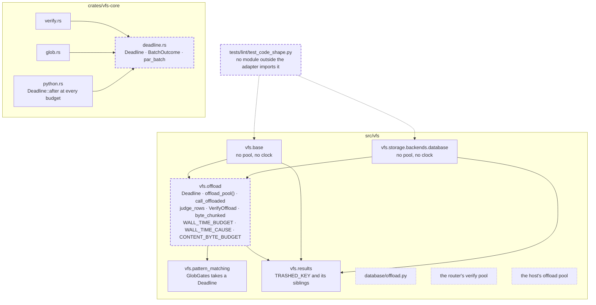

# Bounded work has one home: `vfs.offload` at package level holds the `Deadline` value, the one process pool, the hop, the row judge and the byte batcher; the router and storage import it downward; the Rust kernels share one deadline module; and a lint refuses any import of the database adapter from outside it

A refactor, structural: it adds the module `src/vfs/offload.py` and the Rust module `crates/vfs-core/src/deadline.rs`, removes `src/vfs/storage/backends/database/offload.py`, and retires two lifecycles, the router's verify pool and the engine host's offload pool, in favour of one process pool. It touches the engine (`cargo test -p vfs-core` and the wheel reinstall are criteria; `PROTOCOL_VERSION` stays at 13 because no binding signature changes) and needs the engine legs (it edits `reads.py`, `grep.py`, `glean.py`, `scope.py`, `labels.py`, `rights.py`, `pathterms.py`, `writes.py`, `backend.py` and `engine.py` under `storage/backends/database/`, though no SQL statement changes). It touches `rights.py` and `labels.py` to change how their deadline is carried and changes no rights rule, so the security lens runs in guidance mode and the grants conformance suite is a criterion. It changes no public API: `DatabaseStorage`'s three `*_wall_seconds` arguments keep their names and defaults. It is not parallel-safe: it edits `base.py`, `offload.py` and the storage read builders that [the two-channel scope spec](2026-11-07-storage-takes-scope-roots-and-arms-as-two-channels.md), active and being built, also edits, so it lands after that spec. It stands on two memos, [how runtimes bound work](../../research/2026-11-07-how-runtimes-bound-work-deadlines-cadence-and-pools.md) and [import direction and module size as fitness functions](../../research/2026-11-07-import-direction-and-module-size-fitness-functions.md), and on two earlier ones it does not reopen, [matcher offload](../../research/2026-08-18-matcher-offload.md) and [the close lifecycle](../../research/2026-08-25-close-lifecycle-and-shutdown-race-prior-art.md). No intention: the concern exists; this spec gives it a home.

## The problem

READ at `acf1735`, with the two-channel work uncommitted in the tree. The router imports its concurrency primitives from inside the database adapter: `src/vfs/base.py:114-122` imports `TRASHED_KEY` from `storage.backends.database.descent`, `byte_chunked` from `storage.backends.database.dialects`, `CONTENT_BYTE_BUDGET` from `storage.backends.database.grep`, and `OFFLOAD_WORKERS`, `WALL_TIME_BUDGET`, `WALL_TIME_CAUSE`, `call_offloaded` and `judge_rows` from `storage.backends.database.offload`. EXECUTED: `git log -S` dates the last three imports to commit `f89e5cb` of 2026-11-07 and the first to 2026-10-12. [How we code](../../standards/how-we-code.md), section 3, says the router depends on the `Supports*` protocols; no lint holds it, and EXECUTED, the stdlib import walk in [the import-direction study](../../research/studies/2026-11-07-import-direction-and-module-size-fitness-functions/experiments/01-import-linter-tach-and-a-stdlib-test/output-script.txt) lists five such imports today, the four above and the public export in `src/vfs/__init__.py:19`.

READ. The wall-time deadline is a bare `float` through 20 signatures (EXECUTED: `grep -rn 'deadline: float' src/vfs`), and `time.monotonic()` is read at 43 sites in 16 files, of which the five renderers under `src/vfs/rendering/` time their own work and the other eleven files all compute or check a deadline. The budget is recomputed from the deadline as `max(0.0, deadline - monotonic())` at six sites (`glob.py:359,385,435`, `offload.py:157,186,204`, `base.py:2105`). Four constants hold the value 64 under four names: `_RESIDUATIONS_PER_CHECK` (`base.py:158`), `PAIR_ROWS_PER_CHECK` (`glob.py:266`), `POSTURE_PATHS_PER_CHECK` (`rights.py:168`) and `PROGRAMS_PER_CHECK` (`glob.rs:223`), with a fifth helper `_past(deadline, position)` at `rights.py:1196`. The truncation record is minted by `_wall_record` in the router (`base.py:3478`), by six `WALL_TIME_CAUSE not in truncations` guards in `grep.py:281-392`, by `_record_wall` in `glean.py`, and inline at `reads.py:444`.

READ. Two thread pools of the same width and the same lifecycle exist: the router's `_verify_pool` (`base.py:456,735-737,2042-2051`) and the engine host's `_offload_executor` (`engine.py:202,227-239,378-380`), both `OFFLOAD_WORKERS = os.cpu_count()` wide, both shut without waiting at close, both serving a captured hop inline once shut, both re-minted on the next capture. The router's body-measure hop rides asyncio's default executor instead (`base.py:390-392`). The laws governing all of this are a ninety-line module docstring (`offload.py:1-80`) that enumerates "the tree's only deliberate threads" as four separate owners. In the crate, the parallel batch skeleton is written twice (`verify.rs:196-240`, `glob.rs:291-310`), `glob.rs:35` imports `BatchOutcome` from the sibling grep kernel, and a budget becomes an `Instant` two ways: `python.rs:124,144` inline through `Duration::from_secs_f64`, which panics on a budget past what a `Duration` holds, and `python.rs:240` through `deadline_after`, which does not.

EXECUTED, from the memo's studies on this machine. One native matcher call saturates all ten cores: twenty Python threads each submitting a 256 MiB batch at once reach the same aggregate throughput as one, at thirteen times the latency. A `Deadline` object's method costs about 30 ns an item over the inline check in CPython, and a loop that reads the clock once per chunk of 64 costs 1.07 times the bare loop. READ, the memo's synthesis: every runtime studied keeps the deadline absolute in one explicit value, every engine checks it between chunks in one helper that also mints the stop, and every pool owner keeps one lazily made pool per process or loop.

## Architecture

Dashed is what this spec adds; dotted is what it retires.

Page this changes: none; the architecture folder was retired on 2026-10-31, and the landing notes will say so in one line.

Terms. A **deadline** is an absolute instant on the monotonic clock before which a stage must finish, or none. The **wall** is the deadline a verb takes at its entry, `WALL_TIME_BUDGET` seconds ahead. A **hop** is one unit of CPU work handed to a worker thread and awaited. The **process pool** is the one `ThreadPoolExecutor` every hop in the process runs on.

## Decisions

### 1. `src/vfs/offload.py` is the one home of bounded work, and `src/vfs/storage/backends/database/offload.py` is deleted

The module holds `Deadline`, `WALL_TIME_BUDGET`, `WALL_TIME_CAUSE`, `CHECK_EVERY`, `OFFLOAD_WORKERS`, `CONTENT_BYTE_BUDGET`, `byte_chunked`, `offload_pool`, `shutdown_offload_pool`, `call_offloaded`, `judge_rows` and `VerifyOffload`. It imports `vfs.pattern_matching` (for `GlobGates` and the matcher protocol) and `vfs.results` (for the truncation record) and nothing above them, so it sits in the layer beside the pattern layer: below the storage seam, below the router. The router and the database adapter both import it downward, which is the rule [how we code](../../standards/how-we-code.md) section 3 states and the tree broke on 2026-11-07. The module docstring states the four laws the old docstring stated, in a quarter of the length, because the pool and the deadline are now types and not prose. Its test file is `tests/test_offload.py`, the mirror of its path; `tests/storage/database/test_offload.py` moves there with `git mv`, and its three nodes that pin `writes.py` behaviour (`test_large_bodies_are_measured_in_one_offloaded_hop`, `test_a_body_changed_during_the_hop_is_never_stored_under_another_hash`, `test_an_edit_call_matches_in_one_hop_with_a_budget_per_match`) move to `tests/storage/database/test_writes.py`.

### 2. `Deadline` is a frozen value holding an absolute monotonic instant or none, and it is the only reader of the clock

`Deadline.after(seconds: float)` reads `monotonic()` once and holds the instant; `Deadline.never()` holds none; `remaining() -> float | None` is `max(0.0, at - monotonic())` or `None`; `expired() -> bool` is one comparison and `False` for never; `truncation(guidance: str) -> ResultError` is `classified(ErrorKind.truncated, severity=Severity.warning, detail=f"at the {WALL_TIME_CAUSE}; {guidance}")`. Every signature that takes `deadline: float | None` today takes `deadline: Deadline`, so no site can forget the `None` case or recompute the budget its own way; the Rust kernels receive `deadline.remaining()` as their `budget`. The memo's five runtimes all keep the deadline absolute in one explicit value passed and never stored, and derive the remaining time at each hop; the one place vfs stores a deadline on an object, `GlobGates.native(deadline)`, keeps taking it as an argument. The clock is read in `vfs.offload` and in the five renderer modules under `src/vfs/rendering/`, which time their own work and are out of this spec's scope; a test pins that list.

### 3. The clock is read between chunks, through `Deadline.chunks`, and `CHECK_EVERY = 64` is the one default cadence

`Deadline.chunks(items: Sequence[T], size: int = CHECK_EVERY) -> Iterator[Sequence[T]]` reads the clock once before each chunk and stops yielding when the deadline has passed; a caller that must know whether every item was reached counts what it consumed, as the sites already do with `reached`. The four 64-valued constants and `rights.py`'s `_past` go; `_Walk` in the planner counts residuations through a `Deadline` it holds and reads the clock every `CHECK_EVERY` of them through `expired()`, because its items are not a sequence. The memo's engines all check at a loop bottom or between chunks and never per item (SQLite measured its loop-bottom placement at 1.5 percent; Lucene's chunk starts at 100 documents), and on this machine the chunked shape costs nothing where the per-item mask costs 1.7 times the loop. A stage may pass a different `size` only with a two-line comment saying how long one of its items can take; none does in this landing.

### 4. The truncation record is minted in one place, `Deadline.truncation(guidance)`

The router's `_wall_record`, glean's `_record_wall`, reads' inline record and grep's six guards all call it; grep keeps its list of causes so one call carries one record per cause, and `WALL_TIME_CAUSE` stays the single text. The stage's guidance text is the one parameter, as today. This departs from nothing landed; it is the shape [the chained-grep spec](../archive/2026-11-07-chained-grep-verifies-off-the-loop-under-a-wall.md) decision 5 began when it made the cause one constant.

### 5. One pool per process, lazily made, `OFFLOAD_WORKERS` wide, shared by the router and every storage host; the router's verify pool and the host's offload pool are removed

`offload_pool()` returns the process pool, making it on first call with `thread_name_prefix="vfs-offload"`; `shutdown_offload_pool(wait: bool = False)` shuts and clears it, for tests and for a host that wants a clean exit, and the next hop re-mints. `call_offloaded(executor, work)` keeps its signature, so tests inject counting executors as they do, and every production caller passes `offload_pool()`. `AsyncVirtualFileSystem.close()` and `EngineHost.close()` shut nothing; `EngineHost.offload_executor` and the router's `_verify_executor` go; the router's body-measure hop (`base.py:390-392`) rides the process pool through `call_offloaded` instead of `asyncio.to_thread`. The reason is the memo's third section: one native call already saturates the machine, so a second pool over the same rayon engine buys latency and not work; asyncio, anyio, trio and polars each own one pool per loop or process; and the one reason the router grew its own pool, keeping ten-second hops off asyncio's default executor and its `getaddrinfo`, argues against the default executor and not for two pools. The law that a hop captured before a shutdown is served inline stays in `call_offloaded`, and the close-lifecycle memo's rule that running work finishes into the void stays: `shutdown(wait=False)` is the only shutdown. This departs from [the chained-grep spec](../archive/2026-11-07-chained-grep-verifies-off-the-loop-under-a-wall.md) decision 4 (the router owns its verify pool) and from [the off-loop glob spec](../archive/2026-11-07-glob-matching-runs-off-the-loop-under-the-wall.md)'s use of it, and from the engine host's ownership that [matcher offload](../../research/2026-08-18-matcher-offload.md) first proposed; the laws they stated about queued work, cancellation and inline service are kept, in one place.

### 6. The width stays `os.cpu_count() or 1` and the wall is still measured from the verb's entry

The memo leaves the width open between the core count and "a few slots", and shows the difference is latency under contention rather than throughput; merging two pools into one already halves the process's threads over the rayon engine. A narrower width is a measured change for a later spec, on a CI runner as well as this machine. The wall is taken once at the verb's entry and the budget derived at worker start, which is the gRPC and trio rule and what every stage does today.

### 7. `crates/vfs-core/src/deadline.rs` owns `Deadline`, `BatchOutcome` and the parallel batch skeleton, and `python.rs` converts every budget through it

`Deadline` holds `Option<Instant>`; `Deadline::after(budget: Option<f64>)` is the checked conversion `deadline_after` makes today, so no budget can panic; `past()` is one comparison. `BatchOutcome<T>` moves here from `verify.rs`. `par_batch(items, &deadline, skipped, f)` is the one skeleton: a `par_iter` that reads the deadline before each item, stores `false` into an atomic `completed` and answers `skipped` for an item it did not run. `count_batch`, `hits_batch` and `judge_batch` call it; `PROGRAMS_PER_CHECK` stays in `glob.rs` because it is the per-program cadence inside one row, a kernel fact. No binding signature changes, so `PROTOCOL_VERSION` stays at 13; the structural review found the two kernels carrying the skeleton twice with two cadences and two conversions, and the memo's engines keep one helper.

### 8. `CONTENT_BYTE_BUDGET` and `byte_chunked` move to `vfs.offload`; `chunked`, `membership_budget` and `arm_budget` stay in `dialects.py`

The byte budget bounds what one hop holds, which is a fact about workers and not about a SQL dialect, and its callers are the router, grep, the reindex batchers and the blob pagers; the three that stay are SQL bind budgets, which are dialect facts. `embed.py`'s token-bounded batcher keeps citing `byte_chunked` as its sibling.

### 9. `TRASHED_KEY`, `DELETED_AT_KEY` and `TRASH_ROOT_KEY` move to `vfs.results.kinds` beside `ErrorKind` and are exported from `vfs.results`

They are the keys a `ResultError`'s `data` carries so a caller knows `restore` applies; the router reads them off a `Result`, and a `Result`'s data vocabulary belongs with the `Result`, as `vfs.target` already does in `envelope.py`. `descent.py` imports them from there.

### 10. A stdlib lint test holds the adapter's boundary: no module outside `vfs.storage.backends.database` imports from it, except `vfs` and `vfs.storage.backends`

`tests/lint/test_code_shape.py` gains one `ast` walk over `src/vfs` that builds the module-level import graph, `TYPE_CHECKING` imports included, and one test that fails on any import from the protected package by a module outside it other than `vfs` (`src/vfs/__init__.py`, the public `DatabaseStorage` export) and `vfs.storage.backends` (the package's `__init__` and `memory.py`, which construct a `DatabaseStorage`). The failure names file and line, as the other shape tests do. The memo weighed import-linter and chose the stdlib test for a two-rule gate that already runs as pytest, naming the condition for the tool later; the layer ladder and the size baseline are the next spec's.

## Intent

After this spec, every stage that bounds its work takes one `Deadline`, reads the clock through it between chunks, and mints its truncation through it; every hop in the process runs on one lazily made pool that no verb owns; the router imports nothing from the database adapter; the Rust kernels share one deadline module; and the gate refuses the next import that would cross the adapter's boundary. Every verb answers exactly what it answers today.

## Design

**`src/vfs/offload.py`** (new, about 260 lines). The module docstring states the four laws in prose a quarter of today's length. Then `WALL_TIME_BUDGET`, `WALL_TIME_CAUSE`, `CHECK_EVERY`, `OFFLOAD_WORKERS`, `CONTENT_BYTE_BUDGET`. Then `Deadline` (a frozen dataclass with `at: float | None`; `after`, `never`, `remaining`, `expired`, `chunks`, `truncation`). Then `byte_chunked` moved verbatim from `dialects.py`. Then `offload_pool`, `shutdown_offload_pool` and a module-level `_pool: ThreadPoolExecutor | None` under a `threading.Lock`. Then `call_offloaded`, `judge_rows` (taking `deadline: Deadline`, cutting the budget with `deadline.remaining()`) and `VerifyOffload` (its two methods taking `deadline: Deadline`), moved from the old module.

**`src/vfs/pattern_matching/glob.py`.** `GlobGates.native`, `scope_native` and `judge_scope` take `deadline: Deadline`; `judge_scope` iterates `deadline.chunks(rows)` and the per-64 mask and `PAIR_ROWS_PER_CHECK` go; the budget handed to the native set is `deadline.remaining()`. The `monotonic` import goes.

**`src/vfs/base.py`.** The imports from `storage.backends.database` go; `Deadline`, `offload_pool`, `call_offloaded`, `judge_rows`, `byte_chunked`, `CONTENT_BYTE_BUDGET`, `WALL_TIME_BUDGET` come from `vfs.offload` and `TRASHED_KEY` from `vfs.results`. `_verify_pool`, `_verify_executor` and the shutdown lines in `close()` go; every `pool` parameter in `_judged`, `_match_in_hand`, `_planned`, `_root_probes`, `_root_probe` and the dispatch builders goes, and each hop calls `call_offloaded(offload_pool(), work)`. `deadline = monotonic() + WALL_TIME_BUDGET` becomes `Deadline.after(WALL_TIME_BUDGET)` at its six sites; `_wall_record(guidance)` becomes `deadline.truncation(guidance)`; `_Walk` holds a `Deadline` and a count and reads `expired()` every `CHECK_EVERY`; `_RESIDUATIONS_PER_CHECK` goes; `_authored_entry` measures through `call_offloaded(offload_pool(), ...)`.

**`src/vfs/storage/backends/database/`.** `engine.py` loses `_offload_executor`, `offload_executor` and its shutdown lines. `backend.py` passes `offload_pool()` where it passed `host.offload_executor` (eleven sites) and builds `Deadline.after(gate.wall_seconds)` in `_scoped_refusals`. `reads.py`, `grep.py`, `glean.py`, `scope.py`, `labels.py`, `pathterms.py`, `rights.py` and `writes.py` take `deadline: Deadline`, check `deadline.expired()` between SQL chunks where they read the clock today, iterate `deadline.chunks` where they count items (`posture_chain`, `posture_refusals`, `scope_addressed`), and mint through `deadline.truncation`; `POSTURE_PATHS_PER_CHECK` and `_past` go; every `monotonic` import goes. `dialects.py` loses `byte_chunked`; `descent.py` imports the three keys from `vfs.results`; `memory.py` imports `WALL_TIME_BUDGET` from `vfs.offload`.

**`src/vfs/results/kinds.py` and `__init__.py`.** The three keys, with their two-line comment, and their export.

**`crates/vfs-core/src/deadline.rs`** (new, about 80 lines plus tests): `Deadline`, `BatchOutcome<T>`, `par_batch`. `verify.rs` and `glob.rs` import from it and lose their skeletons and `glob.rs:35`; `python.rs` calls `Deadline::after(budget)` at its four budget sites and loses `deadline_after`; `lib.rs` declares the module.

**`tests/lint/test_code_shape.py`.** `import_edges()` (the `ast` walk, about 60 lines, returning `(importer, imported, path, line, type_checking)` rows) and `test_no_module_outside_the_adapter_imports_it`.

**Tests first.** `tests/test_offload.py` gains the criteria's nodes and the moved nodes; `tests/lint/test_code_shape.py` gains the boundary test, seen failing on today's five imports before `base.py` changes; `crates/vfs-core/src/deadline.rs` gains its unit tests, seen failing before the module exists. Then the code, in the order: the Rust module and its callers; `vfs.offload` and `vfs.results`; the pattern layer; storage; the router; the deletions.

**Scale.** Nothing new grows with input: `Deadline.chunks` yields views over a sequence the caller already holds, one clock read per chunk; the process pool is bounded at `OFFLOAD_WORKERS` threads, half of today's ceiling on a host running one router over one storage; `par_batch` is the skeleton the kernels run today.

## Scope

In: decisions 1 to 10. Files: `src/vfs/offload.py` (new), `src/vfs/storage/backends/database/offload.py` (deleted), `src/vfs/base.py`, `src/vfs/pattern_matching/glob.py`, `src/vfs/results/kinds.py`, `src/vfs/results/__init__.py`, `src/vfs/storage/backends/memory.py`, and under `src/vfs/storage/backends/database/`: `backend.py`, `engine.py`, `reads.py`, `grep.py`, `glean.py`, `scope.py`, `labels.py`, `pathterms.py`, `rights.py`, `writes.py`, `dialects.py`, `descent.py`; `crates/vfs-core/src/deadline.rs` (new), `verify.rs`, `glob.rs`, `python.rs`, `lib.rs`; `tests/test_offload.py` (moved and extended), `tests/storage/database/test_writes.py`, `tests/lint/test_code_shape.py`, and every test that names `host.offload_executor`, `_verify_pool` or a `float` deadline; this spec's landing notes.

Out: the renderers' own elapsed-time reads under `src/vfs/rendering/`, which bound a render and could take a `Deadline` in a spec of their own; a narrower pool width, a measured choice for a later spec; the embedding provider's executor (`embedding/provider.py:136`), which runs a blocking HTTP client and is that provider's own; the layer ladder, the module-size baseline and the review rubric, which [the next spec](2026-11-07-the-gate-and-the-review-read-the-layer-map-and-the-size-baseline.md) carries; moving the planner and the in-hand verbs out of the router, which [the router spec](2026-11-07-the-router-keeps-routing.md) carries.

## Acceptance criteria

Counts and states, never clocks. Tests are in `tests/test_offload.py` unless their path says otherwise.

1. `Deadline.after(10.0).expired()` is `False` under a monotonic clock patched to its creation instant and `True` once the patched clock passes it by any amount; `Deadline.never().expired()` is `False` and its `remaining()` is `None` under any clock; `Deadline.after(5.0).remaining()` under a clock advanced by 2 is `3.0` and under one advanced by 7 is `0.0`. Test: `test_a_deadline_is_absolute_and_never_negative`.
2. `Deadline.after(1.0).chunks(range(1000))` under a clock that passes the deadline after the third read yields exactly 3 chunks of 64, and a counting clock records 3 reads; with `size=100` it yields 3 chunks of 100. Test: `test_chunks_read_the_clock_once_per_chunk_and_stop_at_the_deadline`.
3. `Deadline.after(1.0).truncation("narrow it")` is a `ResultError` of kind `truncated`, severity `warning`, whose `message` is "Truncated: at the wall-time budget; narrow it". Test: `test_the_truncation_record_has_one_text`.
4. `offload_pool()` called twice returns the same executor, with `OFFLOAD_WORKERS` max workers and threads named `vfs-offload-…`; after `shutdown_offload_pool()` the module holds none, and the next `offload_pool()` returns a new one. Test: `test_the_process_pool_is_lazy_shared_and_reminted`.
5. A `DatabaseStorage` grep, an `AsyncVirtualFileSystem` chained grep and a write of a body past the inline threshold each run their hop on a thread whose name starts `vfs-offload`, and `grep -rn 'ThreadPoolExecutor(' src/vfs` lists exactly one line, in `src/vfs/offload.py`. Tests: `test_every_hop_rides_the_process_pool`, `test_one_executor_is_constructed_in_the_package`.
6. After `AsyncVirtualFileSystem.close()` and after `DatabaseStorage.close()`, the process pool is unchanged and a chained grep or a storage grep on a fresh router or storage makes no new pool; a grep whose hop was captured before `shutdown_offload_pool()` finishes inline and returns every match. Tests: `test_close_leaves_the_process_pool_alone`, `test_a_hop_captured_before_shutdown_is_served_inline`. The eight nodes of today's `TestExecutorOwnership` that pin per-owner pools are replaced by these two and by `test_the_process_pool_is_lazy_shared_and_reminted`; `TestVerifyOffload`, `TestLoopResponsiveness`, `TestJudgeRows` and `TestAbandonment` pass with `Deadline` arguments.
7. `grep -rln 'monotonic' src/vfs` lists exactly `src/vfs/offload.py` and the five renderer modules `src/vfs/rendering/{docx,markdown,pdf,pptx,xlsx}.py`; `grep -rn 'deadline: float' src/vfs` lists nothing; `grep -rnE '_PER_CHECK|_past\(' src/vfs` lists nothing. Test: `test_the_clock_the_deadline_and_the_cadence_have_one_home`.
8. `tests/lint/test_code_shape.py::test_no_module_outside_the_adapter_imports_it` passes on the tree as committed and, run on `acf1735` with the test file copied in, fails naming `src/vfs/base.py:114`, `:115`, `:116` and `:117`.
9. `from vfs.results import TRASHED_KEY, DELETED_AT_KEY, TRASH_ROOT_KEY` succeeds, `vfs.storage.backends.database.descent` holds no definition of them, and `tests/base/test_mount_admin.py`'s restore-at-a-tombstoned-site nodes pass unchanged. Test: `tests/results/test_facts.py::test_the_tombstone_keys_live_with_the_result`.
10. `cargo test -p vfs-core` passes with new nodes `deadline::tests::after_a_huge_budget_is_no_deadline` (a budget of `1e300` gives a deadline that is never past), `deadline::tests::par_batch_skips_items_past_the_deadline` (a deadline already past yields `skipped` for every item and `completed` false), and `deadline::tests::par_batch_is_thread_count_invariant`; `verify.rs` and `glob.rs` hold no `AtomicBool` of their own and `glob.rs` imports nothing from `verify`; `python.rs` holds no `from_secs_f64`.
11. `tests/pattern_matching/test_matcher_parity.py` and `tests/pattern_matching/test_glob.py` pass unchanged, so the kernels answer as before; `PROTOCOL_VERSION` is 13 in `python.rs` and `native.py`.
12. Every node of `tests/support/grants_contract.py` and `tests/storage/database/test_rights.py` passes unchanged, and the posture gate's wall nodes (`TestPostureGate::test_a_gate_past_its_wall_refuses_the_call`) pass with the fake clock patched on `vfs.offload.monotonic`.
13. Every other existing test passes with only the edits the Design names (a `Deadline` where a `float` was, `offload_pool()` where an owner's pool was). `uv run pytest tests/storage/test_conformance.py -m "postgres or mariadb or mssql or oracle"` with all four `VFS_TEST_<ENGINE>_URL` variables set, through the `db_test` skill, exits 0. `scripts/ci.sh` and `cargo test -p vfs-core` are green, after `uv sync --all-extras --group dev --reinstall-package vfs-py`, on the tree as committed.

## Landing notes

Filled in on landing.

## One line

The deadline becomes a value, the pool becomes one per process, the hop and the row judge move to `vfs.offload` at package level with the Rust skeleton in one module beside them, and a lint refuses the next import that would reach into the adapter.
