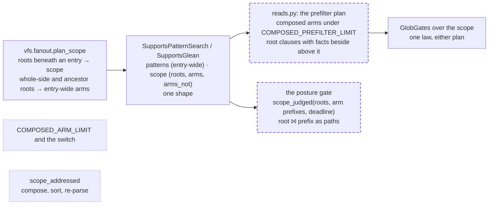

# Scope crosses the storage seam in one shape: roots strictly beneath an entry always ride beside the arms, the prefilter is storage's own plan choice, and the anonymous posture gate judges the same paths it judges today, built from the root and each arm's literal prefix as paths and never from composed text

A refactor of the storage seam's contract for `glob`, `grep` and `glean`: not structural (no module, class or protocol method is added or removed; the `scope` parameter exists), no public API change (the router's verbs and their parameters are unchanged), no schema change. It needs the engine legs (it edits `reads.py`, `scope.py`, `grep.py`, `glean.py`, `backend.py` and `rights.py` under `storage/backends/database/`, and the plan pins of the two-channel spec run again). It touches rights: the anonymous posture gate's computation changes while its judged set does not, so the security lens is mandatory and a leak test over both posture orders is a criterion. It depends on [the two-channel scope spec](2026-11-07-storage-takes-scope-roots-and-arms-as-two-channels.md), active and being built, whose `ScopeChannel`, scope fan, plan pins and posture hops it keeps; on [bounded work has one home](2026-11-07-bounded-work-has-one-home.md), whose `Deadline` the gate takes; and on [the router keeps routing](2026-11-07-the-router-keeps-routing.md), which moves the planner this spec simplifies into `vfs.fanout`. It lands after all three and is not parallel-safe with any of them. It stands on [how search APIs carry scope roots beside patterns](../../research/2026-11-07-how-search-apis-carry-scope-roots-beside-patterns.md). No intention: it decides the end state of a seam the two-channel spec opened.

## The problem

READ at `acf1735`, with the two-channel work uncommitted. After that spec lands, scope crosses the seam in one of two shapes chosen by a router constant: while an entry's owned roots times the call's arms stay within `_COMPOSED_ARM_LIMIT` (200) the router composes each root with each arm into pattern text and sends the product on the `patterns` channel, and past it the roots ride beside the uncomposed arms as `scope=` (its decision 3). Every backend must serve both shapes and the conformance suite must prove them equal: its criterion 5 runs 22 calls twice each, with the limit patched to 0 and to a billion, "and each call's rows and errors are equal under both". The protocol docstrings say scope crosses "in one of two shapes" (`protocol.py:48`, `:252`, `:304`).

READ. For an anonymous caller the storage side reconstructs the composed shape to decide where the posture gate judges: `scope_addressed` (`reads.py:943-971`) composes every root with every arm through `composed_pattern`, sorts the product, parses each composed pattern back through `address_channel` to find the deepest literal directory it names, and judges there, so that the judged paths "equal `addressed_by` over the composed patterns" whichever shape crossed (the two-channel spec's criterion 12). That spec's own Scale section prices it at about 8.8 µs a judged path, about 5.7 s of worker time at 10,000 roots and 64 path arms with distinct directories, paid by callers judged by posture.

READ, the memo. Five engines studied (zoekt, ripgrep, git, Lucene with OpenSearch, tantivy) carry roots as structured clauses beside the patterns and apply them during candidate generation; none composes pattern text from a root; the one that composes text at all, git's current-directory prefix, stores the root's length beside it as structured magic so the root can be told from the pattern again; and none offers two shapes for the same intent chosen by size. EXECUTED in the memo's study: ripgrep, which has no per-root channel, cannot apply `src/*.py` under two roots at all, which is the failure a roots field prevents.

## Architecture

Dashed is what this spec adds; dotted is what it retires.

Page this changes: none; the architecture folder was retired on 2026-10-31, and the landing notes will say so in one line.

Terms. A **whole-side root** is a root whose stored form in its entry is `/`: the entry's bind path or its trash view's head. An **ancestor root** is a root above a nested entry's bind path. An **arm's literal prefix** is the deepest directory its literal leading components name, the path `addressed_by` finds for it today.

## Decisions

### 1. Roots strictly beneath an entry's side always ride `scope.roots` beside `arms` and `arms_not`; whole-side and ancestor roots compose into the entry-wide channel as today; `COMPOSED_ARM_LIMIT` and `switched_entries` are removed

This departs from the two-channel spec's decision 3, which kept composing below the limit, and completes its decision 7. The seam then has one shape, which is the shape the memo's five engines share, and the conformance suite proves one law instead of the equality of two. Whole-side and ancestor roots still compose because they are bounded (at most two whole-side roots per entry and at most the bind depth of ancestors) and because the seam refuses a whole-side root (`admit_scope`'s rule stays). A root's literal path rides the entry-wide channel as it does today. The planner's cost becomes linear in the roots: one rewrite into entry coordinates per root and no product.

### 2. The prefilter is storage's own plan choice: under `COMPOSED_PREFILTER_LIMIT` roots times arms, the read builders compose arms themselves for the pattern statements; above it they build the scope fan with the facts beside it; the law is `GlobGates` over the scope in both cases

`COMPOSED_PREFILTER_LIMIT: Final = 200` lives in `reads.py` with a two-line comment naming the measurement it comes from (the two-channel spec's problem: the composed fan fetched 38,000 candidates where roots alone fetched 54,000 on its 50,000-row store), beside `ROOT_ARM_BINDS`. Below it `glob_rows`, the grep nominators and glean's channel compile `composed_pattern(root, arm)` for each pair into `pattern_arm`s, the tight prefilter the tree has today; above it they build the scope fan of the two-channel spec's decision 4 under its decision 5's profile flag. Either way every candidate is judged by `judge_rows` against the gates' scope pairs, so the choice of prefilter cannot change an answer, as Lucene's choice of leading clause cannot. Both statement shapes therefore stay, and both plan pins stay.

### 3. The anonymous posture gate judges exactly the paths it judges today, built structurally: for each root and each distinct literal prefix among the path arms, the path `root` joined with the prefix; and `root` itself when any name arm is present; sorted and deduplicated as today

This is the two-channel spec's decision 6 rule, that a performance change must not move where a rights gate is judged, kept by construction: a composed pattern `root/**/x.py` addresses `root`, and `root/src/**` addresses `root/src`, so the judged set is the roots joined with the arms' literal prefixes, which `address_channel` computes once per arm (at most A prefixes) rather than once per composed pair. `scope_judged(roots: Sequence[Path], prefixes: Sequence[str], *, names: bool, deadline: Deadline) -> list[str] | None` replaces `scope_addressed`: a path join per pair, chunked by the deadline, no `composed_pattern` and no re-parse. The memo's study shows the prior art builds the judged fact from the structured root and the pattern's literal prefix, as git keeps the prefix length beside its composed text, and never by composing text and parsing it back. The order and the empty-channel rule are unchanged: an empty entry-wide channel beside a scope adds no judgement at `/`. The cost falls from about 8.8 µs a judged path to a string join; the landing measures it on the same 10,000 by 64 shape and records it.

### 4. The protocol docstrings say one shape: `patterns` is the entry-wide channel, `scope` carries every root strictly beneath the entry with the arms, and a backend reads the law from the scope

`protocol.py:48`, `:252` and `:304`, `reads.py`'s `glob_rows` docstring, `grep.py:182`, `glean.py:5` and `:240`, `scope.py`'s module docstring and `base.py`'s fan-out docstrings lose the words "in one of two shapes" and "past the router's composition limit"; the two-channel spec's criterion 13 grep is replaced by `rg -n 'two shapes|composition limit' src` exiting 1.

### 5. The equality pin of the two-channel spec's criterion 5 becomes a prefilter-equality pin: the 22 calls run with `COMPOSED_PREFILTER_LIMIT` patched to 0 and to a billion, and each call's rows and errors are equal under both

The router has one shape, so the router-side patch is meaningless; the two storage plans must still answer alike, and that is what the pin proves. The conformance row `test_scope_channel_answers_as_composition` stays as the law pin against composition's answer, since composition is now the oracle and no longer a live shape.

### 6. The leak test runs both posture orders over both prefilter plans

An anonymous `src/**` over 201 roots, each private with its `src` public, and the same over the reverse postures, under each prefilter plan: the refusals and the rows are byte-equal to a named-caller reference filtered by the postures by hand, and no row beneath a private root appears. The gate touches rights, so the pin is the leak test the first-paragraph flag requires.

## Intent

After this spec, a scoped search crosses the storage seam one way, roots beside arms, with composition gone from the router except where it is bounded; storage picks its own prefilter from the roots and arms it holds and proves both plans answer alike; an anonymous caller is refused at exactly the paths it is refused today, computed as paths; and the docstrings, the planner and the conformance suite each describe one shape.

## Design

**`src/vfs/fanout.py`.** `plan_scope` loses the switch: for each root and each capable entry it reaches, a whole-side or ancestor root composes as today, and any other root appends `root.without_mount(key)` to the entry's channel; `switched_entries` and `COMPOSED_ARM_LIMIT` go, and `scope_channels` builds one `ScopeChannel` per entry with roots. Its docstring's composition paragraph shrinks to the two bounded cases.

**`src/vfs/storage/backends/database/reads.py`.** `COMPOSED_PREFILTER_LIMIT`; `glob_rows` composes `pattern_arm`s from the admitted scope when `len(roots) * len(arms) <= COMPOSED_PREFILTER_LIMIT` per side and builds the scope fan otherwise; `scope_judged` replaces `scope_addressed`, taking the admitted scope's roots per side, the prefixes `address_channel` computed once over the arms, whether any arm is a name arm, and the `Deadline`. **`scope.py`, `grep.py`, `glean.py`.** The same plan choice for the allow-list and the pushdown: composed arms below the limit, roots plus facts above it. **`backend.py`.** `_scoped_refusals` calls `scope_judged`; `_ScopedGate` carries the prefixes instead of the patterns to compose. **`rights.py`.** Unchanged in rule; takes the `Deadline` the bounded-work spec gave it.

**`src/vfs/storage/protocol.py`, `src/vfs/base.py`.** The docstrings of decision 4.

**Tests first.** `tests/test_fanout.py::test_every_root_beneath_an_entry_rides_its_scope` is seen failing on the switch; `tests/storage/database/test_reads.py::TestScopeChannel::test_the_prefilter_plan_switches_on_the_product` on the missing constant; `tests/storage/database/test_rights.py::TestPostureGate::test_the_scope_gate_builds_no_composed_text` on the live `composed_pattern` counter; the leak test and the prefilter-equality pin pass on the base and keep passing.

**Scale.** Planning: one rewrite per root, linear. SQL building: at most `COMPOSED_PREFILTER_LIMIT` composed arms per side, else R root clauses plus A facts, as the two-channel spec bounds it. The gate: R times P string joins, chunked under the wall, instead of R times A compositions and parses; the same judged set. Statements: unchanged from the two-channel spec, every chunk under the tightest engine's budgets.

## Scope

In: decisions 1 to 6. Files: `src/vfs/fanout.py`, `src/vfs/storage/protocol.py`, `src/vfs/base.py` (docstrings), and under `src/vfs/storage/backends/database/`: `reads.py`, `scope.py`, `grep.py`, `glean.py`, `backend.py`; `tests/test_fanout.py`, `tests/storage/database/test_reads.py`, `tests/storage/database/test_grep.py`, `tests/storage/database/test_glean.py`, `tests/storage/database/test_rights.py`, `tests/base/test_glob_namespace.py`, `tests/base/test_grep_namespace.py`, `tests/base/test_dispatch.py`, `tests/support/storage_contract.py`, and this spec's landing notes.

Out: judging the anonymous gate at the bare root instead of at the composed places, which changes a rights answer under nested postures and is a policy decision for a spec of its own if the posture semantics ever change; a per-dialect prefilter limit, which would be a profile field only when a leg shows the 200 is wrong for it; the SQLite statistics step, [its own spec](2026-11-07-sqlite-gathers-planner-statistics-after-each-write.md).

## Acceptance criteria

Counts and states, never clocks.

1. `tests/test_fanout.py::test_every_root_beneath_an_entry_rides_its_scope`: 10 roots strictly beneath one entry and 64 arms give that entry a `ScopeChannel` of 10 roots, no composed member, and a counter on `composed_pattern` reads 0; the same call with one whole-side root added reads 64 and the whole-side root is not among the scope's roots.
2. `tests/base/test_glob_namespace.py::test_a_scoped_glob_crosses_the_seam_once_in_one_shape`: a glob with a 64-arm pattern over 250 directories on a `RecorderStorage` makes one storage call per entry whose `scope.roots` holds the 250 roots and whose `patterns` is `()`, and the probe call is unchanged; `tests/base/test_dispatch.py::test_ten_thousand_roots_stay_two_calls` and `tests/base/test_grep_namespace.py::test_ten_thousand_roots_stay_two_calls` pass with `patterns == ()` and 10,000 scope roots.
3. `tests/storage/database/test_reads.py::TestScopeChannel::test_the_prefilter_plan_switches_on_the_product`: 10 roots and 20 arms make 200 `pattern_arm` calls and 0 `scope_root_arm` calls; 10 roots and 21 arms make 0 and 10. The grep and glean twins in `test_grep.py::TestScopeChannel` and `test_glean.py::TestScopeChannel` count the same on their nominators.
4. `tests/base/test_glob_namespace.py::test_both_prefilters_answer_alike[call]` and `tests/base/test_grep_namespace.py::test_both_prefilters_answer_alike[call]`: the two-channel spec's 12 and 10 calls, each run with `reads.COMPOSED_PREFILTER_LIMIT` patched to 0 and to `10**9`, each call's rows and errors equal under both, 44 runs; the router-side patch of criterion 5 of that spec is gone.
5. `tests/support/storage_contract.py::test_scope_channel_answers_as_composition` and its grep and glean twins pass on every backend unchanged: 144 cases per verb plus 16 trash-side cases.
6. `tests/storage/database/test_rights.py::TestPostureGate::test_the_scope_gate_builds_no_composed_text`: for 201 roots and the arms `src/**` and `*.py`, the judged paths equal `addressed_by` over the composed patterns as sets, `address_channel` is called once over the two arms, a counter on `composed_pattern` inside the backend reads 0, and both pure steps run on a thread whose name starts `vfs-offload`. `test_a_named_caller_builds_no_scope_paths` and `test_a_gate_past_its_wall_refuses_the_call` pass unchanged.
7. `tests/storage/database/test_rights.py::TestPostureGate::test_a_scoped_anonymous_call_leaks_nothing_under_either_posture_order`: decision 6's two posture fixtures under each prefilter plan, four runs; in each, every returned row lies beneath a root whose posture admits the rung, the refusals name exactly the roots the hand-filtered reference refuses, and the result equals the reference's rows.
8. `rg -n 'two shapes|composition limit' src` exits 1; `grep -rn 'scope_addressed\|COMPOSED_ARM_LIMIT\|switched_entries' src` lists nothing.
9. The two-channel spec's plan pins (`test_the_scope_fan_keeps_the_multi_index_or`, `test_the_roots_alone_plan_is_index_served`, `test_the_scope_fan_plan_is_index_served`) pass on every leg over the `plan_store` fixture, and its statement-budget pin `test_every_scope_statement_fits_the_budget` passes.
10. Every other existing test passes. `uv run pytest tests/storage/test_conformance.py -m "postgres or mariadb or mssql or oracle"` with all four `VFS_TEST_<ENGINE>_URL` variables set, through the `db_test` skill, exits 0. `scripts/ci.sh` is green on the tree as committed, and the landing notes record the measured worker time of the gate at 10,000 roots and 64 path arms beside the two-channel spec's figure.

## Landing notes

Filled in on landing.

## One line

Scope crosses the seam one way, roots beside arms, storage chooses and proves its own prefilter, and the anonymous gate is judged where it is today by joining paths instead of composing and re-parsing text.
