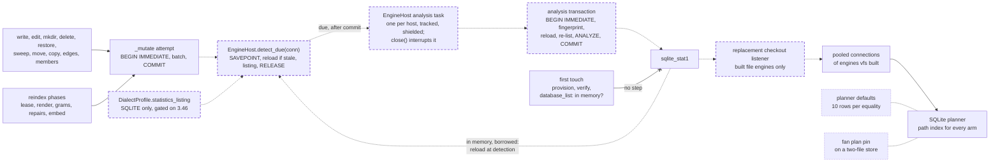

# SQLite gathers planner statistics after the writes that need them: each write detects, inside its own transaction, whether one of vfs's indexed tables grew or shrank about tenfold; once it commits, a host-tracked task analyzes those tables in a short transaction of its own, uncapped, out of the caller's reach; and stale connections are replaced or reloaded, never at the cost of an in-memory database

A fix to the database backend's SQLite path for 0.1.0a1. It touches `src/vfs/storage/backends/database/` (the mutation runner in `backend.py`, the engine host and its checkout listener in `engine.py`) and a dialect profile (`dialects.py`), so it needs the engine legs: the conformance suite (`tests/storage/test_conformance.py`) against Postgres, MariaDB, SQL Server and Oracle through the `db_test` skill, and those legs also confirm that no statistics statement runs on those four engines. It is structural: it adds a lifecycle, one background analysis task per engine host, which the host tracks and which `close()` interrupts, never waits on. It adds no module, public class, protocol method or seam. It changes no public API, no schema format (`sqlite_stat1` is SQLite's own table, not part of vfs's schema), no rights rule and no Rust. No intention. The research is [the statistics memo](../../research/2026-11-07-when-sqlite-gathers-planner-statistics.md). This spec carries the memo's finding and its trigger, but not its placement. [The spec review](../../reviews/2026-11-07-sqlite-gathers-planner-statistics-after-each-write-spec-review.md) showed, over three rounds, why each earlier placement fails:
- a step on its own connection after every commit re-takes the write lock;
- a step inside the mutation lets a short caller deadline starve the write;
- other open connections keep the statistics they loaded first;
- replacing a stale connection can discard an in-memory database;
- a cancelled analysis still holds the lock for its whole run.

It fixes the defect the drafter of [the two-channel scope spec](2026-11-07-storage-takes-scope-roots-and-arms-as-two-channels.md) found and named out of scope: a SQLite store with no statistics seeks the tombstone index for every arm of a scoped glob. That spec carries the defect into the 0.1.0a1 release-audit record, which [the release-audit spec](2026-11-07-the-release-audit-is-a-review.md) lands by its decision 8, and the record names it as fixed here. It depends on two specs that change the same files, and it lands after both: [glob matching runs off the loop under the wall](../archive/2026-11-07-glob-matching-runs-off-the-loop-under-the-wall.md), landed as `acf1735`, and [storage takes scope roots and arms as two channels](2026-11-07-storage-takes-scope-roots-and-arms-as-two-channels.md), "Fit to build" and not yet built. Four other active specs name `backend.py` or a dialect profile, and none of them is built. [Refresh, the incremental index verb](2026-10-31-refresh-the-incremental-index-verb.md), "Fit to build", changes `backend.py`'s reindex, not `_mutate` or `dialects.py`. The numbered specs 159, 174, 177 and 179, in the earlier shape, name `_mutate`; 152, 157, 175, 176, 178 and 180 name a dialect profile. Whichever of these lands later rebases onto this one.

## The problem

READ at `acf1735`. Nothing in `src/` runs `ANALYZE` or `PRAGMA optimize`. The SQLite profile's connection and file pragmas set no statistics (`src/vfs/storage/backends/database/dialects.py:389-424`). First touch provisions the meta, lock and grants rows and the root entry `/` (`src/vfs/storage/backends/database/engine.py:480-547`). Every glob arm carries the tombstone term `deleted_at IS NULL` (`reads.py`, `pattern_arm`; `descent.py:215-236`), and `ix_vfs_entries_deleted_at` indexes that column (`src/vfs/models/rows.py:493`). Every writing verb and every reindex phase commits through one runner, `_mutate` (`backend.py:1781-1810`). Its attempt opens one session, takes SQLite's write lock with `BEGIN IMMEDIATE` through the begin listener, runs the batch, and commits when it succeeds (`engine.py:622-656`). A built file engine pools connections in SQLAlchemy's default `AsyncAdaptedQueuePool` with no recycle (`engine.py:176`). On any SQLite `Engine` bind, built or borrowed, vfs installs one checkout listener (the session settings and sqlite-vec) and one begin listener (`engine.py:622-656`). The host tracks no background work today: `close()` shuts its offload pool without waiting and disposes the engine (`engine.py:358-385`), and the router bounds each storage's `close()` by `close_timeout`, 10 s by default (`src/vfs/base.py:433`, `:750`).

READ in SQLite's source (memo, section 1). A table with no statistics is assumed to hold about a million rows (`../sqlite/src/build.c:1333`). Each index equality is assumed to match 10 rows (`build.c:4585-4620`). A range with both bounds, which is what a prefix `LIKE` on `path` becomes, is assumed to match 1/64 of the index (`../sqlite/src/where.c:2231-2238`). So the planner reads `deleted_at IS NULL`, true of every live row, as the most selective arm.

EXECUTED (memo, section 4). The glob fan of 2,000 roots × 8 arms took 79.9 s with no statistics and 1.04 s after `ANALYZE`, at 56,001 rows. A fan of 50 roots × 8 arms took 434 ms against 17.6 ms at 11,201 rows, and 46.3 s against 17.8 ms at 1,036,001 rows. With no statistics at 1,036,001 rows, a roots glob with `kind="file"` seeks `ix_vfs_entries_kind` and takes 5.4 s, against 2.9 ms. `InMemoryStorage` has the same trap: 9.4 s against 694 ms. Three obvious fixes fail. An `ANALYZE` at provisioning records one row, and every verb then scans. A capped analysis understates low-cardinality columns: at 1,036,001 rows the default `PRAGMA optimize` sent the fan back to the tombstone index (45.3 s). Statistics taken at 1,037 rows and grown 100× made the fan a full SCAN, while full statistics taken at 11,201 rows still held the good plan after 9.25× growth.

EXECUTED by this spec's reviewer (the review's scratch folder):
- The listing `PRAGMA main.optimize = 0x10003` takes the write lock.
- A re-analysis stopped partway leaves the table no longer listed.
- Once `sqlite_stat1` exists, a later `ANALYZE` on one connection does not reach another open connection, which keeps planning, and listing, from what it loaded (`probe_xconn2.py`). A reload outside a write transaction takes the write lock.
- Replacing the only connection to an in-memory database discards it (`probe_memreplace.py`). SQLAlchemy gives `file::memory:?cache=shared` a `QueuePool`, because its file check looks only for `:memory:` and `mode=memory` (READ, `sqlalchemy/dialects/sqlite/pysqlite.py:569-575`).
- Cancelling the task that awaits an aiosqlite `ANALYZE` does not stop the statement: the write lock stays held until it finishes (`probe_cancel.py`).

READ by the reviewer: below SQLite 3.46 the listing names only tables the connection's planner used, at 25× (`pragma.c` at `version-3.45.3`). Debian 12, Ubuntu 24.04 and RHEL 9 ship SQLite 3.40.1, 3.45.1 and 3.34.1 (published package versions, not measured). Every CI interpreter links 3.50.4 or 3.53.1 (EXECUTED, memo 1.2).

EXECUTED for this draft, Apple M1 Pro, SQLite 3.50.4 and 3.53.1. The scripts are `exp_intxn.py`, `exp_reload.py`, `exp_round3.py`, `exp_round4_mem.py` and `exp_round4_task.py`, in the memo's scratch folder, with outputs `intxn_*.txt`, `reload.txt`, `r3_*.txt`, `r4_mem.txt`, `r4_task.txt` and `r4_task_detail.txt`.
- **Detection inside the writer's transaction.** It took one `BEGIN IMMEDIATE` per commit, and 0 of 300 statements was refused under a hammering rival. On an unchanged store it is 3 statements at 0.012 to 0.014 ms, at 11,201, 103,601 and 1,036,001 rows.
- **A crossing's analysis.** With every table due, it took 9.5, 83.8 and 901 ms at those sizes.
- **The fingerprint of `sqlite_stat1`.** One `SELECT group_concat(...)` reads lock-free in about 4 µs at every size. A stale connection's replacement costs 0.69 to 0.81 ms, then plans on `ix_vfs_entries_path` and lists nothing due.
- **Two stale writers** that both detect a crossing serialize, and the second, reloading under its own lock, analyzes nothing.
- **In-memory detection.** `PRAGMA main.database_list` gives an empty file name for `:memory:`, for `file::memory:?cache=shared` (under `AsyncAdaptedQueuePool`) and for `mode=memory`, and the file's path for a file. With the exemption keyed on that, a forced-stale checkout of each in-memory database fired 0 `invalidate` events and kept all 3 rows, while the file database fired 1.
- **A host-tracked analysis task.** With the caller cancelled 5 ms into a crossing's analysis, the committed write was durable and the statistics landed (`ix_vfs_entries_deleted_at` reads `103601 103601` and `1036001 1036001`). The analysis transaction rolled back 0 times. A rival writer got the lock once the analysis committed: 81 to 91 ms after the cancel at 103,601 rows, and 1,508 ms at 1,036,001, where five tables were due. Three crossings requested while one analysis ran coalesced into one more pass, which re-listed and analyzed nothing.

EXECUTED by this spec's reviewer and READ, for close and reporting. A close that awaits a running pass outlasts the router's `wait_for` around it, because cancelling the pass does not stop its statement: a 10 ms timeout returned after 231 ms, and the dispose never ran (`probe_close.py`). The router clears `_stranded_disposals` after its gather whatever the outcome (`src/vfs/base.py:745-756`), so that engine is never disposed. `close()`'s landed rule is that background work never holds it hostage (`engine.py:369-372`). The sync facade's close cancels every other task on its loop before it closes the router (`src/vfs/sync.py:652-657`). Internal commits run through `_mutate` and discard their Results' errors, such as the reindex lease release and heartbeat (`backend.py:1182`, `:1196`). EXECUTED for this draft (`exp_round5_close.py`, output `r5_close.txt`, 103,601 and 1,036,001 entry rows, whose uninterrupted passes took 93 to 108 ms and 1,176 to 1,722 ms). A close that calls the pass connection's `interrupt()` and awaits only the pass's end returned within a 10 ms `wait_for` after 0.5 to 1.2 ms. The write lock was free 0.7 to 1.9 ms after close began, the dispose ran, `sqlite_stat1` held 0 rows, and 0 tasks were pending. SQLite had already rolled the interrupted transaction back: the explicit `ROLLBACK` answered "no transaction is active". The sync facade's drain, with the pass's cancellation handler calling `interrupt()`, finished in 0.5 to 1.8 ms. The lock was free within 2.0 ms, the dispose ran, and 0 tasks were pending.

READ. `reindex` is invoked by the caller, and `SupportsReindex` declares it "never required for correctness" (`src/vfs/storage/protocol.py:459-468`), so statistics gathered only by reindex would never reach a store whose owner only globs. Three existing tests assume the no-statistics planner, or count every statement a write issues. The fan plan pin asserts "no SCAN" on a two-file store (`tests/storage/database/test_reads.py:510`). `TestWriteMechanics::test_batch_statement_count_is_bounded_by_tables_not_entries` bounds a 100-file write at 10 statements (`tests/storage/database/test_writes.py:96-112`). The trash suite's `_spy` drops only `BEGIN`, `COMMIT`, `PRAGMA`, `SAVEPOINT`, `RELEASE` and `ROLLBACK` (`tests/storage/database/test_trash.py:62`, `:1013-1018`).

## Architecture

Dashed is what this spec adds; dotted is what it retires.

The crossed edge from first touch to `sqlite_stat1` says that first touch writes no statistics (decision 8). First touch does read `database_list` once (decision 11). The `PRAGMA analysis_limit = 0` session setting of decision 7 is stamped at checkout and is not drawn. Page this changes: none. The architecture folder was retired on 2026-10-31, and the landing notes will say so in one line.

Terms. A **due table** is an own table with at least one index that SQLite's listing names: one of its indexes has no `sqlite_stat1` row while the table holds rows, or its size has moved about tenfold since its last analysis. A **crossing commit** is a mutation whose detection found a due table. The **analysis task** is the host's one background task that runs analysis passes. An **analysis pass** is one analysis transaction: it re-lists and analyzes what is due. The **fingerprint** is the text of every `sqlite_stat1` row joined in one value: the identity of the statistics a connection plans from. A store is **in memory** when `database_list` gives its schema an empty file name.

## Decisions

### 1. Detection runs inside the mutation's own write transaction: in `_mutate`'s attempt, after the batch returns a successful Result and before `session.commit()`, `EngineHost.detect_due(conn)` runs `SAVEPOINT vfs_statistics`, the listing and `RELEASE vfs_statistics`, records which own tables are due, and analyzes nothing; on a connection the replacement listener does not cover (an in-memory store, a borrowed engine, or one marked unknown), it first reads the fingerprint and reloads with `ANALYZE {schema}.sqlite_schema` when it moved

The attempt already holds the write lock, so detection adds no lock acquisition, and the reload, which outside a write transaction would take the lock, is free there (EXECUTED: one `BEGIN IMMEDIATE` per commit, and 0 of 300 detection statements refused under a hammering rival). Detection sees the transaction's own rows, so the sizes it checks are the sizes the commit will leave (INFERRED). Leaving the analysis out keeps each mutation as short as today plus about 0.013 ms on a built file engine (3 statements), and about 4 µs more where the fingerprint is read (4 statements). A failed or refused batch commits nothing, so it detects nothing. A cancellation during detection cancels the uncommitted mutation, as during any of its statements.

### 2. A crossing's analysis runs in the host's one analysis task, after the mutation commits: `_mutate` hands the due set to `EngineHost.request_analysis()` and returns its Result at once; the host starts the task if none is running, and otherwise asks the running task for one more pass; each pass opens its own session, takes `BEGIN IMMEDIATE`, reads the fingerprint and reloads if it moved, re-lists, runs one `ANALYZE` per due own indexed table, commits, and records the new fingerprint on its connection

The caller's call returns as soon as its write commits, so no caller waits on an analysis, and a cancelled caller still has its committed write. The task is not a child of the caller and is shielded from it, so a short caller deadline cannot stop it. The analysis finishes once and lands its statistics (EXECUTED: caller cancelled 5 ms in, `ix_vfs_entries_deleted_at` then read `1036001 1036001`, 0 rollbacks). The write lock is taken once per crossing, because a cancellation does not abort the statement and nothing else interrupts it (EXECUTED: the rival got the lock when the one analysis committed). At most one analysis per store per host is in flight. Crossings requested while it runs coalesce into one more pass, which re-lists after it and analyzes only what is still due (EXECUTED: three requests, one extra pass, 0 extra `ANALYZE`). Recording the fingerprint keeps the analysing connection from being replaced for nothing.

### 3. The step is declared as `DialectProfile.statistics_listing: str | None = None`; only `SQLITE` sets it, to `"PRAGMA {schema}.optimize = 0x10003"`, where `{schema}` is the quoted schema the mount's tables live in (`"main"` when none is given)

This is a decision SQLAlchemy takes no position on, which is the bar [AGENTS.md](../../../AGENTS.md) sets for a profile field. The four server engines maintain their own statistics, and vfs leaves them alone. PostgreSQL's autovacuum issues `ANALYZE` after 50 + 10% of a table's rows change, and its planner scales stored estimates to the table's current physical size (https://www.postgresql.org/docs/current/routine-vacuuming.html, https://www.postgresql.org/docs/current/planner-stats.html). SQL Server's `AUTO_UPDATE_STATISTICS` is on by default and refreshes a statistic after `MIN(500 + 0.20 n, SQRT(1000 n))` modifications (https://learn.microsoft.com/en-us/sql/relational-databases/statistics/statistics). Oracle's automatic collection gathers missing statistics, and statistics more than 10% stale, in every daily maintenance window (https://docs.oracle.com/en/database/oracle/oracle-database/23/tgsql/gathering-optimizer-statistics.html). MariaDB's InnoDB keeps persistent statistics and recalculates them after a tenth of a table's rows change, both on by default (https://mariadb.com/kb/en/innodb-persistent-statistics/). `GENERIC` and every other profile keep `None`, so an unknown dialect runs no step. The field holds only the listing; the follow-up statements are SQLite's, which is acceptable while SQLite is the only profile that fills it.

### 4. The step, and the replacement listener of decision 10, run only when `dialect.server_version_info >= (3, 46)`; below that they issue nothing at all; `statistics_enabled` is read inside the attempt, after the batch has run on the connection, and in the checkout listener, after SQLAlchemy's first-connect handler, when the dialect is initialized

Before 3.46 the listing has no every-table bit. It names a table only if that connection's planner used its statistics, and only at 25×, so the step would depend on which pooled connection served it (READ by the reviewer). SQLAlchemy models the library's version as `server_version_info` (READ, `../sqlalchemy/lib/sqlalchemy/dialects/sqlite/pysqlite.py:682-685`). It sets it in a first-connect handler that runs on the pool's first `connect`, before any checkout (READ, `../sqlalchemy/lib/sqlalchemy/engine/create.py:731-777`). Below 3.46, vfs serves today's planner defaults, and the two-channel spec's no-statistics plan pin keeps that state covered (decision 19). This is a common case: Debian 12, Ubuntu 24.04 and RHEL 9 system Pythons link 3.40.1, 3.45.1 and 3.34.1 (published package versions, not measured). A version floor, or a vfs-side growth check for those interpreters, belongs to its own spec.

### 5. SQLite decides which tables are due: vfs runs the listing on every commit and acts only on what it names, with no write counter of its own

Mask `0x10003` combines three bits: check every table whether or not this connection queried it (0x10000), consider `ANALYZE` (0x2), and only list (0x1). It names a table whose index lacks statistics while the table holds rows, or a table whose size moved about tenfold (READ, `../sqlite/src/pragma.c:2485-2514`, `2576-2610`). A counter in vfs would re-implement that rule, and it would be blind to other processes' writes. A detection on a connection with older in-memory statistics only over-reports a table as due. Each analysis pass re-lists against the file before it acts (decision 14).

### 6. A due table is analyzed with one `ANALYZE {schema}.{table}`; a listed table with no index is skipped, and which tables have one is read once per table per host by `PRAGMA {schema}.index_list({table})` and cached

One statement per table is SQLite's own form and the fewest statements. A table with no index gives the planner nothing to choose between. The three such own tables are single-row or tiny tables read by their integer primary key (`vfs_meta`, `vfs_lock`, `vfs_gram_epochs`; EXECUTED). They are listed on every commit and never leave the list. The tables built `WITHOUT ROWID` (`vfs_lex_postings`, `vfs_lex_df`, `vfs_lex_stats`) list their primary key in `index_list` and are analyzed like any indexed table (EXECUTED). The schema of a mount does not change after first touch, so the cache is never stale.

### 7. The step is never capped: the listing mask carries no 0x10 bit, vfs never issues the default mask, and the SQLite profile's session settings gain `PRAGMA analysis_limit = 0`

A capped sample understates a low-cardinality column, so above about 64 × the cap the tombstone, `kind` and `ext` indexes win again (EXECUTED, memo 4.3: 45.3 s at 1,036,001 rows under the default cap). Session settings are stamped at every checkout, borrowed connections included (`engine.py:622-656`). So a host application that set a limit on a shared connection cannot cap vfs's analysis.

### 8. No statistics step runs at provisioning; a store's first statistics come from its first committed write

A freshly provisioned store holds one entry row, and statistics taken then would plan every verb as a whole-table scan until the next tenfold growth (EXECUTED, memo 4.2). First touch writes outside `_mutate` (READ, The problem), so it detects nothing. The first write's detection names every indexed table that now holds rows.

### 9. On every engine, borrowed or built, the step analyzes only the mount's own tables: a listed statement is acted on only when it equals `ANALYZE {schema}.{table}` built with `dialect.identifier_preparer.quote_identifier` for a table in `host.tables.metadata`

A borrowed engine's file can hold the host application's tables, and the listing names every due table in the schema. SQLite prints each listed statement as `ANALYZE "%w"."%w"` (READ, `pragma.c:2611`). SQLAlchemy's `quote_identifier` always quotes and doubles an embedded quote too (EXECUTED: `"a""b"`). So whole statements compare exactly with no parsing, and every `ANALYZE` vfs issues is built the same way.

### 10. On an engine vfs built over a file, every pooled connection plans from the file's statistics: a replacement checkout listener reads the fingerprint, a lock-free `SELECT` over `sqlite_stat1`, compares it with the one recorded in the connection record's `info`, and replaces a stale connection by raising `DisconnectionError`; a fingerprint read that fails leaves the checkout in service

An analysis changes no schema, so an open connection never reloads the statistics on its own (EXECUTED by the reviewer). The fingerprint read takes no lock and costs about 4 µs at every store size. Replacing a stale connection costs 0.7 to 0.8 ms, at most once per pooled connection per crossing, in every process that runs vfs, since each process's checkouts run the same check. The replacement plans on `ix_vfs_entries_path` and lists nothing due (EXECUTED). Raising `DisconnectionError` in a checkout listener is SQLAlchemy's documented way to have the pool discard a record and hand out a fresh connection (READ, `../sqlalchemy/doc/build/core/pooling.rst:670-700`, `lib/sqlalchemy/pool/base.py:1360-1425`). A record's `info` is cleared when its connection is replaced (`pool/base.py:863`, `:891`), so an empty `info` marks a fresh connection, whose first statement loaded the statistics it records.

The fingerprint is the identity of the file's own statistics. A generation row in `vfs_meta` reads in about 2.3 µs (EXECUTED), but it would bump the schema format, carry a column unused on four engines, and miss an analysis some other tool runs. A fingerprint read that fails for any reason other than a missing `sqlite_stat1` leaves the connection in service and marks its fingerprint unknown, so the next checkout replaces it. The checkout itself never fails on the statistics check. The listener is a second checkout listener, installed with the engine vfs builds (decision 12). It replaces nothing until first touch has set `in_memory`; when `in_memory` is true it never replaces, and a connection with an empty `info` is never replaced, only recorded (decision 11).

### 11. A connection whose database is held in memory is never replaced, whatever the pool class: the host reads once, at first touch, whether `PRAGMA {schema}.database_list` gives the schema an empty file name, and an in-memory store reloads with `ANALYZE {schema}.sqlite_schema` inside its next detection instead

SQLite drops an in-memory database when its last connection closes, and a pool closes the old connection before it opens the replacement (EXECUTED by the reviewer: "no such table" after one replacement). A queue pool can hold one: SQLAlchemy gives `file::memory:?cache=shared` an `AsyncAdaptedQueuePool` (EXECUTED), and a borrowed engine can bring any pool. So the key is the database, never the pool class. `database_list` gives an empty file name for `:memory:`, `file::memory:?cache=shared` and `mode=memory` alike, and the path for a file (EXECUTED). With the replacement keyed on that, each in-memory database survived a forced-stale checkout with 0 `invalidate` events (EXECUTED). Its connections reload under the write lock at their next detection (decision 1), as a single-connection store does.

### 12. On an engine vfs did not build, vfs installs no replacement listener, so it never touches a host application's pool or its connections; a borrowed engine's connections that loaded older statistics keep planning from them until each next detects inside a write, where the reload is free under the lock

Replacing a host application's connections would discard state that application set outside its `connect` listeners. So vfs leaves the pool alone. The cost is plain: on a borrowed engine, a connection that only reads can keep planning from older statistics after another connection's analysis, until that connection next serves a vfs write, or until the host's own pool recycles it. vfs's checkout listener on a borrowed engine stays as it is today: it stamps the session settings and loads sqlite-vec, and replaces nothing. The borrowed-engine parameter's docstring says so.

### 13. Failure loses only the statistics, and is reported once, on a public verb's Result: a `SQLAlchemyError` or `OSError` in detection rolls back to the savepoint and the mutation commits; a failure in an analysis pass rolls that pass back, leaves `sqlite_stat1` as it was and the table still due, and marks its connection's fingerprint unknown; the host holds the error, and the next Result of a public mutating verb served by the same host carries it once, as a warning-severity `unavailable` error, `retryable=False`, whose detail names the background statistics pass and an earlier write; an internal commit never takes it

Rolling back leaves `sqlite_stat1` exactly as it was, so the next write's detection names the same table again and requests a new pass (EXECUTED: unchanged `sqlite_stat1`, table still listed). A rolled-back pass can leave its connection's in-memory statistics ahead of the file (EXECUTED: kept until `ANALYZE sqlite_schema`). Marking it unknown makes its next checkout replace it on a built file engine, or makes its next detection reload it elsewhere. The caller that triggered the pass has already returned, so the error rides on a later Result. Only a public mutating verb's Result takes it: `write`, `edit`, `mkdir`, `delete`, `restore`, `sweep`, `move`, `copy`, `mkedge`, `rmedge`, `grant`, `revoke`, `posture`, `add_member` and `remove_member`, at the point each returns. The internal `_mutate` callers never take it, because their Results' errors are discarded or folded into a phase. Those callers are the reindex lease claim, release and heartbeat (`backend.py:1154`, `:1182`, `:1196`), the render landings (`:1323-1332`), the signal publish and sweep (`:1353`, `:1357`), the re-convergence repair (`:1377`), the gram build, publish and reclaims (`:1389-1427`), the embed clear and landings (`:1450`, `:1492`), and the posture verb's relabel chunks (`:1685`), whose public Result takes it once at the end. `reindex`'s own Result does not take it either: that Result reports index work, and its warnings drive a retry of reindex. The warning rides on any principal's next public write to the same host, not only on a write by the principal whose write triggered the pass, because it is a fact about the store's health, not about anyone's data. Its detail names no path, principal or body: `"a background planner-statistics pass after an earlier write failed at {statement!r}: {origin}; that write is committed, this call is unaffected, and the next crossing write retries the pass"`. It is `retryable=False`, because nothing in this call is to be retried. Another process's host holds its own failures. If the rollback to the savepoint itself fails, the mutation fails, as on any of its own statements.

Close is decision 24.

### 14. A crossing is analyzed once, however many writers detect it: analysis passes serialize on the write lock across hosts and processes, and each re-reads the fingerprint under that lock, reloads if it moved, and re-lists before it analyzes

Within a host, one task runs passes one at a time (decision 2). Across hosts and processes, passes cannot overlap, because the lock is the file's. The one that runs second finds the fingerprint changed and reloads, which is free under its lock, and its re-listing names nothing (EXECUTED: the second of two stale writers analyzed 0 tables). Without that reload a stale second writer would analyze again (EXECUTED by the reviewer).

### 15. An analysis pass holds the write lock for one crossing's analysis, and that is accepted, sized and named; the direction past it is to split a large crossing's analysis across passes, with no cap

EXECUTED: a pass with every table due took 9.5 ms at 11,201 rows, 83.8 ms at 103,601 and 901 ms at 1,036,001 entry rows. A store with five tables due held 1,508 ms at 1,036,001. INFERRED, linear: about 9 to 15 s at ten million rows. A rival writer waits up to the profile's `busy_timeout` of 5,000 ms (`dialects.py:398`). Past that it sees `SQLITE_BUSY`, which vfs retries (`dialects.py:411`; `with_retry`, four attempts, `engine.py:138`). So past about five million rows, a rival writer may need a second attempt during a pass. Past about twenty million rows, a crossing's hold outlasts a rival's four attempts of 5 s each, and that rival's write returns `conflict`. This is part of the profile, and the direction is the same. A pass comes about once per sevenfold to tenfold growth. Every other commit adds about 0.013 ms and no lock acquisition, and no caller waits on a pass. The step's docstring states this profile and the direction: one table per pass for crossings above a declared size, so that each lock hold is one table's scan. That is its own spec.

### 16. `InMemoryStorage` takes the same path, and its statistics vanishing at `close()` does not matter

Its one `StaticPool` connection holds the rows and the statistics together (EXECUTED, memo 1.7). It is in memory, so it is never replaced (decision 11). Its analysis pass runs on that one connection inside the serialized session (`engine.py:694-738`), so other operations queue behind a pass as they queue behind any operation. `close()` interrupts a running pass (decision 24), then drops both, and a revived store starts empty and gathers statistics at its first write under decision 8.

### 17. `reindex` gains nothing of its own: it inherits the step because every one of its phases commits through `_mutate`

The lease claim, the heartbeat, the render landings, the gram build and publish, the segment and edge repairs, the signal publish and the embed landings all call `_execute_write` (READ, `backend.py:1132-1547`). A phase that grows the gram, segment or lexical tables requests a pass, and the pass runs while the next phase continues. The heartbeat's commits detect too, at about 0.013 ms each, against a 60 s beat and a 5 min lease (`indexing.py:124-125`).

### 18. `EngineHost` owns the step: `detect_due(conn) -> frozenset[str] | ResultError`, `request_analysis(due)`, `settle_statistics()` (awaited by tests), `stop_analysis()` (called by `close()`), the held error, the index cache, the in-memory flag and the replacement listener; `_mutate` calls the first two only when `statistics_enabled`

The engine host already owns the profile, the dialect, the session settings, the checkout listener, the provisioning SQL and `close()`. Keeping the step there keeps the backend's runner to two calls, and keeps the task's lifecycle beside the engine it uses.

### 19. The plan pins: the fan pin moves to a store of 115 directories × 25 files and asserts the index every branch seeks; the trash pin drops its own `ANALYZE`; the two-channel no-statistics leg stays, run after deleting `sqlite_stat1`'s rows; the two-channel SQLite `plan_store` pins drop their hand `ANALYZE`

On a two-file store with fresh statistics, a SCAN is the right plan. EXECUTED (`pin.txt`): the fan pin's two-arm shape with its ext facts seeks `ix_vfs_entries_path` from 30 to 11,201 rows. The pin keeps its `MULTI-INDEX OR` and no-`SCAN` assertions, and adds that every `SEARCH` branch names `ix_vfs_entries_path` and none names `ix_vfs_entries_deleted_at`. A store with no statistics remains a real state, below SQLite 3.46 or after anyone empties `sqlite_stat1`. So the two-channel spec's `TestScopeChannel::test_the_scope_fan_keeps_the_multi_index_or` keeps its no-statistics leg, a `MULTI-INDEX OR` and no `SCAN`, run after `DELETE FROM sqlite_stat1` on a fresh connection. Every pin that reads plans after a write awaits `settle_statistics()` first.

### 20. A test that bounds a verb's own statements leaves out the step's statements, through one predicate `is_statistics_statement(sql)` in `tests/support/statements.py`; an analysis pass's `BEGIN IMMEDIATE` carries the comment `/* vfs_statistics */`

The step is pinned by its own counts (criteria 4 to 18), so a verb's bound should hold for the verb alone. The predicate is true for:
- a statement that begins with `ANALYZE `;
- a `PRAGMA` naming `optimize` or `index_list`;
- a statement reading `sqlite_stat1`;
- any statement containing `vfs_statistics`: the savepoint statements, which the step issues by name through `exec_driver_sql`, and a pass's begin, which the begin listener tags when the session carries that execution option.

`test_batch_statement_count_is_bounded_by_tables_not_entries` filters with it, after `settle_statistics()`. The trash suite's `_spy` adds `ANALYZE` to `_CONTROL`, since it already drops every `BEGIN`, `PRAGMA` and savepoint statement. Any other test the full suite shows counting the step is filtered the same way, and the landing notes name it. The checkout fingerprint read runs on a raw DBAPI cursor, as the session settings do, so no statement listener sees it, and the criteria count it through the pool's `invalidate` events.

### 21. The engine legs run before landing, and a conformance test on each leg counts the statistics statements a write issues

The change touches `dialects.py`, `engine.py` and `backend.py`, so the `db_test` cycle runs. A count on each engine is the evidence that decision 3's `None` reaches the server profiles: zero statistics statements on Postgres, MariaDB, SQL Server and Oracle, and on SQLite the statements of decision 1.

### 22. The gram, segment and lexical plans after `reindex` are measured during the build and recorded in the landing notes; a regression found there is not fixed under this review: the spec gains a decision and a new dated spec review before the build continues

The memo could not run this experiment. The build runs it: the memo's `exp_verbs.py --reindex` on a 56,000-row store, once with the statistics vfs leaves and once with `sqlite_stat1` emptied. It records the `EXPLAIN QUERY PLAN` of every grep index-tier statement and every glean lexical-leg statement. A regression is a statement that, under vfs's statistics, either plans a full SCAN of a table holding more than 10,000 rows, or seeks a different index than it seeks without statistics where the table holds more than 10,000 rows. Criterion 20 pins that every table reindex fills is analyzed. This decision covers what those statistics do to the plans.

### 23. The release-audit record names the no-statistics fan defect as fixed by this spec

The two-channel spec carries the defect into the record as known. This spec is its fix, and the record lands after the fixes it reproduces (the release-audit spec, decision 8). The author of the record writes it as fixed here, and this spec's landing notes say so.

### 24. `close()` never waits on a pass's work: it cancels the analysis task, whose cancellation handler interrupts the running statement through aiosqlite's thread-safe `interrupt()`; close awaits only the pass's end, then always runs today's offload shutdown and dispose in a `finally`; an interrupted pass loses only its statistics, the table stays due, and the next write's detection asks again

`close()`'s landed rule is that background work never holds it hostage (`engine.py:369-372`), and the previous draft broke it by awaiting the pass. A cancellation alone does not stop a running statement (EXECUTED by the reviewer), but an interrupt does, and SQLite then rolls the transaction back itself. So close interrupts. EXECUTED (`r5_close.txt`): inside a 10 ms `wait_for`, close returned after 0.5 to 1.2 ms against passes of 93 to 1,722 ms. The write lock was free within 1.9 ms, the dispose ran, `sqlite_stat1` was unchanged, and 0 tasks were pending. The interrupt is issued by the pass's own cancellation handler, so every path that cancels the task stops it the same way. That covers `close()`. It covers the router's `wait_for` around `storage.close()`: close now finishes inside the timeout, and the dispose in its `finally` runs even when the timeout fires, so `_stranded_disposals` being cleared after the gather (`base.py:745-756`) can no longer forget an undisposed engine. It also covers the sync facade's drain, which cancels every task on its loop before it closes the router (`sync.py:652-657`). EXECUTED: drained in 0.5 to 1.8 ms, lock free within 2.0 ms, dispose ran, 0 tasks pending. A cancellation that lands while a statement is being handed to the driver can reach the thread before the statement starts, when an interrupt is still a no-op. So the handler re-issues `interrupt()` every millisecond until its rollback returns (INFERRED from SQLite's rule that an interrupt affects only running statements). A storage whose event loop ends without `close()` has its task cancelled by the loop's shutdown, and the same handler interrupts it. An interrupt does not end a pass that is still waiting in SQLite's busy handler for `BEGIN IMMEDIATE`, because that handler does not read the interrupt flag (READ by the reviewer, `../sqlite/src/main.c:1800-1810`; EXECUTED by the reviewer, `probe_busy_interrupt.py`). So a close that lands then can wait up to one `busy_timeout` (5 s) before the pass ends. That is inside the router's 10 s default `close_timeout`, the dispose in the `finally` runs either way, and the docstring of `close()` says so.

## Intent

After this spec, a SQLite store on 3.46 or later, on disk or in memory, plans every glob, `ls`, `stat` and read on the path index once it has been written to, at every size, without anyone calling `ANALYZE` or `reindex`. On an engine vfs built, that holds on every pooled connection and in every process. A scoped fan that took 46 s at a million rows takes milliseconds. A write that changes no table's size about tenfold adds three statements inside the lock it already holds, and every checkout adds one 4 µs read. The rare write that crosses a growth step returns as soon as it commits. One background pass then takes the lock once and lands the statistics, whatever happens to the caller. No in-memory database and no host application's connection is ever replaced, and closing a store interrupts a running pass in about a millisecond and always disposes the engine. The four server engines, and SQLite before 3.46, see no new statement.

## Design

**`src/vfs/storage/backends/database/dialects.py`.** `DialectProfile.statistics_listing: str | None = None`, documented as the SQLite growth listing the engine host acts on. The docstring names each server engine's own mechanism in one sentence and gives decision 15's scale profile in two. `SQLITE` sets `statistics_listing="PRAGMA {schema}.optimize = 0x10003"` and appends `"PRAGMA analysis_limit = 0"` to `session_settings`.

**`src/vfs/storage/backends/database/engine.py`.**
- **The fingerprint statement.** A module constant `STATISTICS_FINGERPRINT`: `SELECT group_concat(tbl || ' ' || coalesce(idx, '') || ' ' || stat, ';') FROM {schema}.sqlite_stat1`. A missing table reads as the empty fingerprint.
- **Host state.** `EngineHost` gains `statistics_enabled` (the listing set and `server_version_info >= (3, 46)`), `in_memory` (read once at first touch from `PRAGMA {schema}.database_list`), `_analysis: asyncio.Task | None`, `_again: bool`, `_held_error: ResultError | None` and the index cache.
- **`detect_due(conn)`.** `SAVEPOINT vfs_statistics`. On a connection the replacement listener does not cover, it reads the fingerprint and runs `ANALYZE {schema}.sqlite_schema` when the fingerprint differs from the record's, then records it. Then the formatted listing, filtered as decision 9 and by the index cache, then `RELEASE vfs_statistics`. On `SQLAlchemyError` or `OSError`: `ROLLBACK TO vfs_statistics`, `RELEASE vfs_statistics`, and the held error.
- **`request_analysis(due)`.** Starts `_analysis` with `asyncio.create_task`, held by the host so the caller's cancellation never reaches it, or sets `_again` when one is running. The task loops one pass at a time while `_again` was set during the pass.
- **A pass.** A session with `vfs_writer` and `vfs_statistics`; it records its driver connection (aiosqlite's) for `interrupt()`; the fingerprint, and a reload when it moved; the listing, filtered as decision 9; one `ANALYZE {schema}.{table}` per due table; commit; record the fingerprint in the record's `info`. On `SQLAlchemyError` or `OSError` the session rolls back on exit, the record's fingerprint is marked unknown, and the error is held as decision 13's warning. On `CancelledError` it calls `interrupt()` on its driver connection, re-issuing it every millisecond until its rollback returns, then re-raises.
- **`settle_statistics()`, `stop_analysis()` and `close()`.** `settle_statistics()` awaits `_analysis` when one is in flight, for tests. `stop_analysis()` cancels `_analysis` and awaits only its end, which decision 24's interrupt makes a rollback's length. `close()` calls `stop_analysis()` inside a `try` whose `finally` runs today's offload shutdown and dispose, and clears the slot. Its docstring says that close interrupts a running pass rather than waiting on it, that a pass still waiting in SQLite's busy handler for `BEGIN IMMEDIATE` cannot be interrupted, so a close that lands then can wait up to one `busy_timeout` (5 s), and that the dispose runs either way.
- **The replacement listener.** A second checkout listener, the fingerprint check of decision 10, installed in the built-engine branch of `__init__` and never on a borrowed engine. It replaces nothing while `in_memory` is unset or true or `statistics_enabled` is false, and it never replaces a connection whose `info` is empty.
- **The begin listener.** It writes `/* vfs_statistics */` when that option is set.
- **Docstrings.** They say what the step is for, why detection is inside the mutation and the analysis in a tracked task after it, why it is uncapped, why in-memory and borrowed engines are never replaced, and that the step is gated off below 3.46. The borrowed-engine (`session_factory`) parameter's docstring states decision 12's cost.

**`src/vfs/storage/backends/database/backend.py`.** `_mutate`'s attempt: after `result = await fn(session)` succeeds and when `self._host.statistics_enabled`, it runs `due = await self._host.detect_due(await session.connection())`, then commits. After `with_retry` returns, it calls `self._host.request_analysis(due)` when `due` is non-empty. `_mutate` never touches the held error. Each public mutating verb named in decision 13 passes its final Result through `self._host.take_statistics_warning(result)`, which appends the held error once and clears it. The docstring says the analysis runs after the write returns, out of the caller's reach.

**`tests/support/statements.py`** (new). `is_statistics_statement(sql: str) -> bool`, as decision 20.

**`tests/storage/database/test_statistics.py`** (new), class `TestPlannerStatistics`. Its large store is the memo's 11,201-row store, `/d{i:05d}/{a|b}/f{j:02d}.{py,ts,md,txt,rs}` over 400 roots × 25 files, built once per module through `DatabaseStorage.write` and copied per test. The tests that use it are marked `slow`. Its small crossing store is 2,875 files written to a fresh store. Every test awaits `storage._host.settle_statistics()` before it counts what an analysis did.
- `test_a_fresh_store_has_no_statistics`.
- `test_a_written_store_has_full_statistics` (slow).
- `test_the_glob_fan_and_the_kind_glob_seek_the_path_index` (slow).
- `test_an_unchanged_write_detects_inside_its_one_lock` (slow).
- `test_a_crossing_write_returns_then_one_pass_analyzes`.
- `test_two_writers_crossing_together_analyze_once`.
- `test_another_pooled_connection_is_replaced_after_a_second_crossing`.
- `test_a_shared_in_memory_store_is_never_replaced`.
- `test_a_borrowed_engine_gains_no_replacement_listener`.
- `test_a_failed_fingerprint_read_keeps_the_checkout`.
- `test_the_step_runs_uncapped` (slow).
- `test_a_borrowed_engine_analyzes_only_vfs_tables`.
- `test_a_failed_pass_keeps_the_write_and_the_next_public_write_reports_it`.
- `test_a_pass_failure_during_reindex_skips_the_internal_commits`.
- `test_a_cancelled_caller_still_lands_the_statistics`.
- `test_close_interrupts_a_running_pass_and_disposes`.
- `test_the_sync_facade_close_disposes_with_no_pending_task`.
- `test_below_sqlite_3_46_the_step_issues_nothing`.
- `test_in_memory_statistics_live_with_the_store` (slow).
- `test_reindex_leaves_every_filled_table_analyzed`.

Each assertion is a count of statements, of pool `invalidate` events, of listeners, of `sqlite_stat1` rows or of plan detail strings. Transaction brackets are read from the connection's `begin`, `commit` and `rollback` events.

**`tests/storage/database/test_dialects.py`**, class `TestDialectPolicy`: `test_only_sqlite_declares_a_statistics_listing`.

**`tests/storage/test_conformance.py`**: class `TestStatisticsStatements`, parametrized over the five engines through the URL fixtures the engine classes use, and deselected like them when an engine's URL is unset. One test: `test_a_write_issues_only_its_profiles_statistics_statements`.

**`tests/storage/database/test_reads.py`**: `TestPatternFan::test_multi_index_or_plan_survives_the_ext_facts`, as decision 19, on 115 roots × 25 files. **`tests/storage/database/test_trash.py`**: `_CONTROL` gains `"ANALYZE"`, and `TestScale::test_the_live_visible_read_seeks_an_index` loses its `ANALYZE` and awaits `settle_statistics()`. **`tests/storage/database/test_writes.py`**: the filter of decision 20. The two-channel spec's SQLite plan pins, as decision 19.

**Tests first.** These are seen failing first, because today no write gathers statistics, no task exists, and with no statistics the fan's branches seek `ix_vfs_entries_deleted_at`:
- `test_a_written_store_has_full_statistics`;
- `test_the_glob_fan_and_the_kind_glob_seek_the_path_index`;
- `test_an_unchanged_write_detects_inside_its_one_lock`;
- `test_a_crossing_write_returns_then_one_pass_analyzes`;
- `test_two_writers_crossing_together_analyze_once`;
- `test_another_pooled_connection_is_replaced_after_a_second_crossing`;
- `test_a_shared_in_memory_store_is_never_replaced`;
- `test_a_failed_fingerprint_read_keeps_the_checkout`;
- `test_a_failed_pass_keeps_the_write_and_the_next_public_write_reports_it`;
- `test_a_pass_failure_during_reindex_skips_the_internal_commits`;
- `test_a_cancelled_caller_still_lands_the_statistics`;
- `test_close_interrupts_a_running_pass_and_disposes`;
- `test_the_sync_facade_close_disposes_with_no_pending_task`;
- `test_in_memory_statistics_live_with_the_store`;
- `test_reindex_leaves_every_filled_table_analyzed`;
- `test_only_sqlite_declares_a_statistics_listing`;
- the SQLite case of the conformance count, and the moved fan pin.

These pass before and after, and pin what must not change:
- `test_a_fresh_store_has_no_statistics`;
- `test_a_borrowed_engine_gains_no_replacement_listener`;
- `test_a_borrowed_engine_analyzes_only_vfs_tables`;
- `test_below_sqlite_3_46_the_step_issues_nothing`;
- the four server cases of the conformance count.

**Scale.**
- **Every commit**, inside the lock it already holds: three statements, about 0.013 ms at a million rows. Where the replacement listener does not cover the connection, add one 4 µs fingerprint read.
- **Every checkout** on a built file engine: one fingerprint read over `sqlite_stat1`'s rows (14 to about 40, one per index), about 4 µs at every store size.
- **A crossing** costs one background pass: the lock taken once, for one `ANALYZE` per due indexed table, at most the schema's 20 indexed tables. The first listing of each table adds one `index_list` per host. The pass is linear in the due tables' rows: 0.90 to 1.51 s measured at 1,036,001 entry rows, about 9 to 15 s inferred at ten million (decision 15).
- **After a crossing**, each pooled connection of a built file engine, in each process, is replaced once at 0.7 to 0.8 ms.
- **What does not grow.** No statement grows with batch size, nothing binds, at most one task per host is alive, and memory is the listing's few rows, a fingerprint string per connection and a cache of 23 table names.

## Scope

In: decisions 1 to 24. Files: `src/vfs/storage/backends/database/dialects.py`, `engine.py`, `backend.py`; `tests/support/statements.py` (new); `tests/storage/database/test_statistics.py` (new), `test_dialects.py`, `test_reads.py`, `test_trash.py`, `test_writes.py`; `tests/storage/test_conformance.py`; the two-channel spec's SQLite plan pins as built; and this spec's landing notes.

Out:
- A SQLite version floor, or a growth check of vfs's own below 3.46 (decision 4).
- Splitting a large crossing across passes (decision 15).
- Refreshing a borrowed engine's read-only connections (decision 12).
- The partial tombstone index and seeded statistics, which the memo measured as complements (memo 4.7): each is a schema decision for its own spec.
- A statistics step on the server engines, which maintain their own (decision 3).
- Turso, which supports `ANALYZE` but not `PRAGMA optimize` (`../turso/COMPAT.md:109`, `:262`) and is not a supported dialect.

## Acceptance criteria

Counts and states, never clocks. Every SQLite test runs on SQLite 3.46 or later unless it patches the version. "Inside a transaction" means recorded between that connection's `begin` and `commit` events. A test counts what a pass did after awaiting `settle_statistics()`.

1. `tests/storage/database/test_statistics.py::TestPlannerStatistics::test_a_fresh_store_has_no_statistics`: after `first_touch()`, `sqlite_stat1` holds 0 rows whose `tbl` is `vfs_entries`, and first touch issued 0 statements for which `is_statistics_statement` is true.
2. `…::test_a_written_store_has_full_statistics`: on the 11,201-row store, `sqlite_stat1` holds one row for every row of `PRAGMA main.index_list("vfs_entries")` (13 at `acf1735`), and the row for `ix_vfs_entries_deleted_at` reads `11201 11201`.
3. `…::test_the_glob_fan_and_the_kind_glob_seek_the_path_index`: on that store, `EXPLAIN QUERY PLAN` of each statement recorded from `storage.glob` for the 50-root × 8-arm fan, and for the 50-root glob with `kind="file"`, has every `SEARCH vfs_entries` detail naming `ix_vfs_entries_path`. It has 0 details naming `ix_vfs_entries_deleted_at`, `ix_vfs_entries_kind` or `SCAN vfs_entries`.
4. `…::test_an_unchanged_write_detects_inside_its_one_lock`: a one-file write to that store issues exactly 1 `BEGIN IMMEDIATE` and exactly 3 statements for which `is_statistics_statement` is true. They are `SAVEPOINT vfs_statistics`, the listing and `RELEASE vfs_statistics`, all inside that transaction, and 0 of them is an `ANALYZE`. No analysis task starts, and the pool fires 0 `invalidate` events across the write and 100 following `stat` calls.
5. `…::test_a_crossing_write_returns_then_one_pass_analyzes`: a 2,875-file write to a fresh store returns with 0 `ANALYZE` issued and the analysis task running or done. After `settle_statistics()`, exactly 2 `BEGIN IMMEDIATE` were issued: the write's, with 0 `ANALYZE`, and the pass's `BEGIN IMMEDIATE /* vfs_statistics */`, opened after the write's `commit` event. The pass carries exactly 1 `ANALYZE "main"."vfs_entries"`, and 0 naming `vfs_meta`, `vfs_lock` or `vfs_gram_epochs`.
6. `…::test_two_writers_crossing_together_analyze_once`: two concurrent 2,875-file writes under different directories to one fresh file store, through two `DatabaseStorage` instances, issue exactly 1 `ANALYZE "main"."vfs_entries"` between their passes. After each instance has served a `glob`, two concurrent writes of 30,000 files each, a second crossing, again issue exactly 1 between them.
7. `…::test_another_pooled_connection_is_replaced_after_a_second_crossing`: instance Y serves a `glob` on a store whose statistics were taken at 2,875 files. Instance X then writes 30,000 more files, a second crossing whose pass commits. Y's next `stat` fires exactly 1 pool `invalidate` event. On the connection Y then checks out, the listing names 0 own tables, and `EXPLAIN QUERY PLAN` of the 50-root × 8-arm fan names `ix_vfs_entries_path` in every `SEARCH` detail. A further 100 `stat` calls on Y fire 0 `invalidate` events.
8. `…::test_a_shared_in_memory_store_is_never_replaced`: a `DatabaseStorage` on `sqlite+aiosqlite:///file::memory:?cache=shared&uri=true`, whose pool is an `AsyncAdaptedQueuePool`, has `in_memory` true and 0 replacement listeners. It writes 2,875 files. A checkout whose recorded fingerprint is forced stale fires 0 `invalidate` events, every written path's `read` returns its body, and the next one-file write's detection issues exactly 1 `ANALYZE "main".sqlite_schema`. A failed pass on it, forced as in criterion 13, also fires 0 `invalidate` events and loses 0 rows.
9. `…::test_a_borrowed_engine_gains_no_replacement_listener`: on a borrowed session factory over a file engine, the engine's pool carries exactly the checkout listeners it carries at `acf1735` (1, the session settings), so vfs adds 0 replacement listeners. After another instance's crossing pass commits, the borrowed engine's next 100 checkouts fire 0 `invalidate` events. Its next write's detection issues exactly 1 `ANALYZE "main".sqlite_schema`, and after that write the fan plan on that connection names `ix_vfs_entries_path`.
10. `…::test_a_failed_fingerprint_read_keeps_the_checkout`: on a built file engine, with the fingerprint read made to raise `sqlite3.OperationalError` once, the `stat` that checked out returns `success` true and fires 0 `invalidate` events. The next checkout of that connection fires exactly 1.
11. `…::test_the_step_runs_uncapped`: the listing statement's mask has its 0x10 bit clear, `PRAGMA analysis_limit` on a checked-out connection answers 0, and criterion 2's `deleted_at` row has two equal integers.
12. `…::test_a_borrowed_engine_analyzes_only_vfs_tables`: on a borrowed session factory whose database also holds a table `host_rows` with one index and 1,000 rows, a vfs write leaves 0 `sqlite_stat1` rows whose `tbl` is `host_rows`, and at least 1 whose `tbl` is `vfs_entries`.
13. `…::test_a_failed_pass_keeps_the_write_and_the_next_public_write_reports_it`: a `before_cursor_execute` listener raises `sqlite3.OperationalError` on a pass's second `ANALYZE`. The crossing write returns `success` true, one observation per entry, and 0 errors. After `settle_statistics()`, `sqlite_stat1` holds the same rows as before the write, and the pass's connection fires exactly 1 `invalidate` event at its next checkout. With the listener removed, the next one-file write returns `success` true and exactly 1 error, of kind `unavailable`, severity warning, `retryable` false, whose detail contains `background planner-statistics pass` and `an earlier write`. Its pass issues exactly 1 `ANALYZE "main"."vfs_entries"`, and the write after it carries 0 errors.
14. `…::test_a_pass_failure_during_reindex_skips_the_internal_commits`: the same listener fails the pass that a reindex phase's commit requests. Every internal commit after it, the heartbeat and the lease release among them, returns 0 errors, counted on the Results `_execute_write` returns for `op` `"reindex"`. The `reindex()` Result carries 0 statistics errors. The next public `write` carries exactly 1, and the one after it 0.
15. `…::test_a_cancelled_caller_still_lands_the_statistics`: a caller task runs the 2,875-file crossing write and then awaits further work. It is cancelled 5 ms after the pass's first `ANALYZE` is recorded, and it raises `CancelledError`. Every written path's `read` returns its body. After `settle_statistics()`, the `ix_vfs_entries_deleted_at` row has two equal integers equal to the entry count, the pass issued exactly 1 `BEGIN IMMEDIATE /* vfs_statistics */` and exactly 1 `ANALYZE "main"."vfs_entries"`, and its connection fired 0 `rollback` events.
16. `…::test_close_interrupts_a_running_pass_and_disposes`: on the 11,201-row store with `sqlite_stat1` emptied, a router mounted with `close_timeout=0.01` closes while a crossing's pass is running its first `ANALYZE`. `close()` returns without `TimeoutError`. The engine's pool then reports 0 checked-out connections and the engine's `dispose` ran once, counted by a patched `dispose`. The pass's connection fired exactly 1 `rollback` event and 0 `commit` events, `sqlite_stat1` holds 0 rows, and `asyncio.all_tasks()` holds 0 tasks besides the test's own. The next write after the store is reopened issues exactly 1 `ANALYZE "main"."vfs_entries"` in its pass.
17. `…::test_the_sync_facade_close_disposes_with_no_pending_task`: through `vfs.sync.SyncVirtualFileSystem` over the same store, a crossing write returns, and `close()` is called while its pass runs. After close, the facade's loop thread has ended, its loop had 0 pending tasks at shutdown (counted by a patched `asyncio.all_tasks` read in `_serve`'s `finally`), the engine's `dispose` ran once, and `sqlite_stat1` holds 0 rows. The drain stopped the pass: a patched aiosqlite `Connection.interrupt` was called at least once on the pass's connection, which then fired 0 `commit` events and exactly 1 `rollback` event.
18. `…::test_below_sqlite_3_46_the_step_issues_nothing`: with `server_version_info` patched to `(3, 45, 1)` on the host's dialect, a write issues 0 statements for which `is_statistics_statement` is true, no analysis task starts, the pool fires 0 `invalidate` events, and `sqlite_stat1` holds 0 rows for `vfs_entries`.
19. `…::test_in_memory_statistics_live_with_the_store`: on `InMemoryStorage`, the 10,000-file write leaves criterion 2's 13 rows, and 0 `invalidate` events fire. After `close()` and `first_touch()`, `sqlite_stat1` holds 0 rows.
20. `…::test_reindex_leaves_every_filled_table_analyzed`: after `reindex()` and `settle_statistics()` on a 2,875-file store with text bodies, every own table that has at least one row of `PRAGMA index_list` and at least one row holds at least one `sqlite_stat1` row. The count of tables that do not is 0.
21. `tests/storage/database/test_dialects.py::TestDialectPolicy::test_only_sqlite_declares_a_statistics_listing`: `SQLITE.statistics_listing` is set, and the other five profiles, `GENERIC` included, declare `None`.
22. `tests/storage/test_conformance.py::TestStatisticsStatements::test_a_write_issues_only_its_profiles_statistics_statements`, five cases. On Postgres, MariaDB, SQL Server and Oracle, a one-file write issues 0 statements for which `is_statistics_statement` is true. On SQLite it issues at least 3, all inside its first transaction.
23. The fan pin and the trash and two-channel pins:
    - `tests/storage/database/test_reads.py::TestPatternFan::test_multi_index_or_plan_survives_the_ext_facts` passes on the 115-root store with a `MULTI-INDEX OR`, 0 `SCAN` details, and every `SEARCH` detail naming `ix_vfs_entries_path`.
    - `tests/storage/database/test_trash.py::TestScale::test_the_live_visible_read_seeks_an_index` passes with no `ANALYZE` in its body: `grep -c 'text("ANALYZE")' tests/storage/database/test_trash.py` prints 0.
    - The two-channel spec's `TestScopeChannel::test_the_scope_fan_keeps_the_multi_index_or` passes both its no-statistics leg and its leg on the statistics vfs leaves.
24. `test_writes.py::TestWriteMechanics::test_batch_statement_count_is_bounded_by_tables_not_entries`, and every test in `test_trash.py` that uses `_spy`, pass with their numeric bounds unchanged.
25. The landing notes record decision 22's plans for every grep index-tier and glean lexical-leg statement on the reindexed 56,000-row store, with and without statistics, and name 0 regressions in decision 22's sense.
26. `git grep -n "ANALYZE\|optimize\|sqlite_stat1\|database_list" -- src/vfs` shows statistics statements only in `dialects.py` and `engine.py`.
27. `scripts/ci.sh` exits 0 on the tree as committed. The `db_test` cycle passes the conformance suite on Postgres, MariaDB, SQL Server and Oracle, criterion 22's four server cases included.

## Landing notes

Filled in on landing.

## One line

Each SQLite write detects, inside the lock it already holds, whether one of vfs's indexed tables grew or shrank about tenfold. It returns as soon as it commits, and one host-tracked background pass then takes the lock once and lands the statistics, uncapped, whatever happens to the caller. Connections of a file engine vfs built replace themselves when the statistics move; in-memory and borrowed connections reload at their next write instead. So the scoped glob plans on the path index at any size, and the server engines and older SQLite see no new statement.
