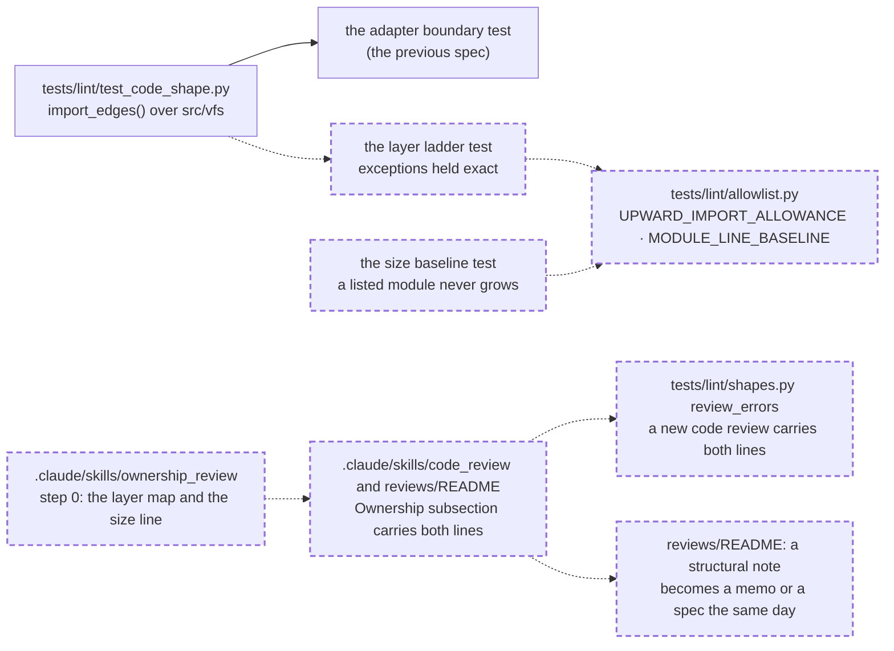

# The gate and the review read the layer map and the size baseline: the lint holds a layer ladder whose exceptions may only shrink and a per-module line baseline that may only fall, the code review's ownership lens states both for every touched module, and a structural note becomes a placeholder memo or a spec the day it is written

A process change that touches the gate (`tests/lint/`) and the review rubric (`.claude/skills/ownership_review/SKILL.md`, `.claude/skills/code_review/SKILL.md`, `context/reviews/README.md`, `context/standards/how-we-code.md`): not structural, no public API, schema, rights or engine change. It depends on [bounded work has one home](2026-11-07-bounded-work-has-one-home.md), active and not built, which lands the import walk this spec extends and removes four of the five adapter imports the walk finds today; it lands after that spec and after [the two-channel scope spec](2026-11-07-storage-takes-scope-roots-and-arms-as-two-channels.md), because its baseline records the module sizes of the tree it lands on. It stands on [import direction and module size as fitness functions](../../research/2026-11-07-import-direction-and-module-size-fitness-functions.md). No intention: it adds two checks a review already should make.

## The problem

READ at `acf1735`, with the two-channel work uncommitted. Eleven changes landed on 2026-11-07, each with a spec review and a code review, and no review flagged that the router had begun importing from the database adapter, that the router grew by 365 lines in one day, or that the offload concern had grown across five commits without a type. EXECUTED: [the review synthesis](../../research/studies/2026-11-07-import-direction-and-module-size-fitness-functions/00-brief.md) the structural review commissioned counted about 75 code-review findings, of which 27 were missing pins and 23 docstring drift; every one of the 11 ownership or placement findings was ranked Low, and three were written as "noted, not filed" ([the off-loop glob code review](../../reviews/2026-11-07-glob-matching-runs-off-the-loop-under-the-wall-code-review.md), its Ownership subsection: the "judge, then admit" loop has four spellings). The chained-grep code review saw the adapter import and accepted it as following an older import and deferring to two specs that are October drafts with open markers ([the chained-grep code review](../../reviews/2026-11-07-chained-grep-verifies-off-the-loop-under-a-wall-code-review.md), Ownership subsection).

READ. The ownership lens, `.claude/skills/ownership_review/SKILL.md`, asks who owns each block and hunts duplication; it does not ask which layer a touched module sits in and whether the diff's imports point downward, and it does not read a module's line count. The code-review checklist in `context/reviews/README.md` step 7 names the five lenses and step 9 the standards lines; neither names imports or size. `tests/lint/test_code_shape.py` holds three shape tests over `src/` and none over its import graph or its module sizes.

EXECUTED, from the memo's experiments. The stdlib import walk finds three imports from a lower declared layer to a higher one today: `src/vfs/base.py:101` (the router imports `vfs.session` at runtime), `src/vfs/results/preview.py:31` and `src/vfs/results/render.py:21` (the results layer imports `split_lines` from the pattern layer's grep module). The eight Python modules over 1,000 lines are `base.py` 3,710, `backend.py` 1,922, `rights.py` 1,542, `reads.py` 1,318, `writes.py` 1,285, `glean.py` 1,121, `dialects.py` 1,109 and `sync.py` 1,086; the router went 3,257 to 3,710 between 2026-11-06 and the working tree. READ, the memo: six public projects hold a layer ladder in CI with an exception list held exact that may only shrink, pylint's only size rule is a hard cap that projects raise rather than honour, and no lint tool ships a size ratchet.

## Architecture

Dashed is what this spec adds.

Page this changes: none; the architecture folder was retired on 2026-10-31, and the landing notes will say so in one line.

Terms. The **layer ladder** is the declared order of the package's layers, bottom first; an import from a lower layer to a higher one is **upward**. A **baseline** is a committed list the lint holds exact, that a landing may shrink and never grow.

## Decisions

### 1. The layer ladder is declared once, in `tests/lint/shapes.py`, bottom first: `vfs.paths`, `vfs.models`, `vfs.results`, `vfs.native` and `vfs.exceptions`; then `vfs.pattern_matching` and `vfs.offload`; then `vfs.storage.protocol`, `vfs.storage.replace`, `vfs.storage.grants` and `vfs.storage.ranking`; then `vfs.storage.backends`; then `vfs.base` with `vfs.permissions`, `vfs.authority`, `vfs.params`, `vfs.ops` and `vfs.paths` beneath it as it has them today; then `vfs.session`, `vfs.sync` and `vfs.skills`

A module may import its own layer and any lower one. The ladder is a tuple of tuples beside the other shape constants, so the review and the lint read one declaration; the memo's six projects all declare the ladder first. Modules not named sit in the layer of their package (`vfs.embedding` and `vfs.rendering` beside the storage seam, since the adapter consumes them). The test walks the import graph the previous spec built and fails on any upward runtime import, with file and line.

### 2. The ladder's exceptions are a baseline held exact in `tests/lint/allowlist.py`, `UPWARD_IMPORT_ALLOWANCE`, starting as the three edges the walk finds today, and an entry that no longer matches an import fails

This is the `OPEN_QUESTION_ALLOWANCE` shape the lint already has and dify's migration-baseline shape: the list can only shrink. The three are kept rather than moved in this spec because each is a design question of its own: `base` importing `session` is the public surface's cycle, which [the public-surface spec](../active/181-the-public-surface-regrouped-by-kernel-group/spec.md) regroups; `results` importing `split_lines` is a question of where line splitting belongs, which the first spec to touch the renderer answers. A spec that moves one deletes its entry in the same landing.

### 3. Module size is a baseline held in `tests/lint/allowlist.py`, `MODULE_LINE_BASELINE`, over a ceiling of 1,000 physical lines, read at this spec's landing; a listed module may never exceed its entry, an unlisted module may never exceed the ceiling, and an entry may be lowered and never raised

Physical lines as `wc -l` counts them, pylint's rule, because it is what every reader and `git show` sees. The ceiling is pylint's default, which eight modules exceed today; a hard cap would therefore breed pragmas, and the memo found no mature ratchet to borrow, so the baseline is the exact-list shape of decision 2 applied to a number. A landing that must add to a listed module removes or moves as much as it adds; the two specs that follow this one shrink the router by about 500 lines and the baseline follows them down. Rust files are not in the baseline: the crate has one generated table and the ratchet is for hand-written modules; a later spec may add them.

### 4. The ownership lens begins with the layer map and the size line, and the code review's Ownership subsection carries both, each one line, before the ownership table

`.claude/skills/ownership_review/SKILL.md` gains a step 0: for each module the diff touches, name its layer from the ladder, list every import the diff adds with the layer it points to, and state the module's line count before and after the change; an upward import or a growth of a listed module is a finding of kind `misplacement` at Medium, because the lint will refuse it and the author must answer. `.claude/skills/code_review/SKILL.md` section 4 and `context/reviews/README.md`'s template say the Ownership subsection opens with the two lines `Layer map: …` and `Size: …`. The two checks are the ones the structural review found missing: both signals were visible in every one of the eleven diffs and no lens asked for them.

### 5. `shapes.review_errors` requires both lines in a code review dated on or after this spec's landing

A code review under `context/reviews/` whose date is on or after the landing date, held as `LAYER_LINES_START` beside `PROCESS_START`, must hold under its `### Ownership` subsection a line beginning `Layer map:` and a line beginning `Size:`; an earlier review is read as written. The lint holds the review shape already, and a rubric line the lint cannot see is a rubric line a tired reviewer skips.

### 6. A structural finding ranked Low, or a Note, that names a duplication, a misplacement, an upward import or a growth becomes a placeholder memo or a spec the same day, linked from the Disposition

`context/reviews/README.md`'s ranking section says so, and `how-we-code.md` section 6 gains one line pointing at it. "Noted, not filed" produced today's drift: three such notes in one day's reviews named the four spellings of one loop and the adapter import, and none became work. A placeholder memo is the process's own shape for an undecided choice; a spec is the shape for a decided one. The reviewer does not write the memo or spec; the author does, before the landing, and the Disposition links it.

## Intent

After this spec, an import that points up the ladder or into the adapter, and a module that grows past its baseline, fail the gate with file and line; every code review states, for each touched module, its layer, the direction of the imports the diff adds, and its size before and after; and a structural note written in a review is a document in `context/` by the end of that day.

## Design

**`tests/lint/shapes.py`.** `LAYERS: tuple[tuple[str, ...], ...]` as decision 1 lists; `LAYER_LINES_START = "<landing date>"`; `MODULE_LINE_CEILING = 1000`; `layer_of(module: str) -> int` (the deepest prefix match, the package's layer when the module is unnamed); `review_errors` gains, for a code review dated on or after `LAYER_LINES_START`, the two-line check over the text of its `### Ownership` subsection.

**`tests/lint/allowlist.py`.** `UPWARD_IMPORT_ALLOWANCE: frozenset[tuple[str, str]]` holding `("vfs.base", "vfs.session")`, `("vfs.results.preview", "vfs.pattern_matching.grep")` and `("vfs.results.render", "vfs.pattern_matching.grep")`; `MODULE_LINE_BASELINE: dict[str, int]` holding every module over the ceiling at the landing with its count, recorded in the landing notes.

**`tests/lint/test_code_shape.py`.** `test_imports_point_down_the_ladder`: every runtime edge from `import_edges()` whose importer's layer is below its imported's layer is in the allowance, and every allowance entry matches an edge. `test_a_listed_module_never_grows_and_an_unlisted_one_stays_under_the_ceiling`: for each `.py` under `src/vfs`, its line count is at most its baseline entry when listed and at most the ceiling otherwise, and every baseline entry is at least its module's count.

**`.claude/skills/ownership_review/SKILL.md`.** A step 0 before "Decompose the code into concerns", about twelve lines, as decision 4 says. **`.claude/skills/code_review/SKILL.md`** section 4, item 4, and **`context/reviews/README.md`**'s code-review checklist step 7 and its template's `### Ownership` line: the two opening lines. **`context/reviews/README.md`** ranking section and **`context/standards/how-we-code.md`** section 6: decision 6's rule, one sentence each.

**Tests first.** `tests/lint/test_context_shape.py` gains the criteria's review-shape nodes over files under `tmp_path`, seen failing before `shapes.py` changes; the two code-shape tests are written against the live tree and seen failing before the allowlist entries exist (the ladder test on three edges, the size test on eight modules).

**Scale.** The walk is the previous spec's; the two tests add one dictionary lookup per edge and one `wc -l` per module.

## Scope

In: decisions 1 to 6. Files: `tests/lint/shapes.py`, `tests/lint/allowlist.py`, `tests/lint/test_code_shape.py`, `tests/lint/test_context_shape.py`, `.claude/skills/ownership_review/SKILL.md`, `.claude/skills/code_review/SKILL.md`, `context/reviews/README.md`, `context/standards/how-we-code.md`, and this spec's landing notes.

Out: moving the three upward imports (each its own spec, named in decision 2); a size baseline for the Rust crate; import-linter or tach as a dependency, which the memo names as the step when the contracts outgrow a handful; the spec-review checklist, which already checks the Design against the constitution and gains nothing here.

## Acceptance criteria

Counts and states, never clocks.

1. `tests/lint/test_code_shape.py::test_imports_point_down_the_ladder` passes on the tree as committed; with `("vfs.base", "vfs.session")` removed from the allowance it fails naming `src/vfs/base.py:101`; with a fourth entry added that matches no edge it fails naming that entry.
2. `tests/lint/test_code_shape.py::test_a_listed_module_never_grows_and_an_unlisted_one_stays_under_the_ceiling` passes on the tree as committed; with `src/vfs/base.py`'s baseline entry lowered by one it fails naming the file and both counts; with the entry raised by one it fails naming the entry as stale.
3. `tests/lint/test_context_shape.py::test_a_new_code_review_states_the_layer_map_and_the_size`: a `tmp_path` code review dated on `LAYER_LINES_START` whose Ownership subsection holds both lines gives `review_errors` an empty list; the same file missing `Size:` gives one error naming it; the same file dated the day before, missing both, gives none.
4. `grep -c 'Layer map:' .claude/skills/ownership_review/SKILL.md .claude/skills/code_review/SKILL.md context/reviews/README.md` reports at least 1 for each; `grep -c 'placeholder memo or a spec' context/reviews/README.md context/standards/how-we-code.md` reports at least 1 for each. Test: `tests/lint/test_code_shape.py::test_the_review_rubric_names_the_two_checks`.
5. `MODULE_LINE_BASELINE` lists exactly the modules over 1,000 lines on the tree as committed, with counts equal to `wc -l`, and the landing notes record the list.
6. `scripts/ci.sh` is green on the tree as committed, and the first code review written after the landing carries both lines.

## Landing notes

Filled in on landing.

## One line

The gate learns the layer ladder and the size baseline, both as lists that only shrink, and the code review's ownership lens states the layer map and the size line for every touched module, so the next upward import or growth is a finding before it is a habit.
