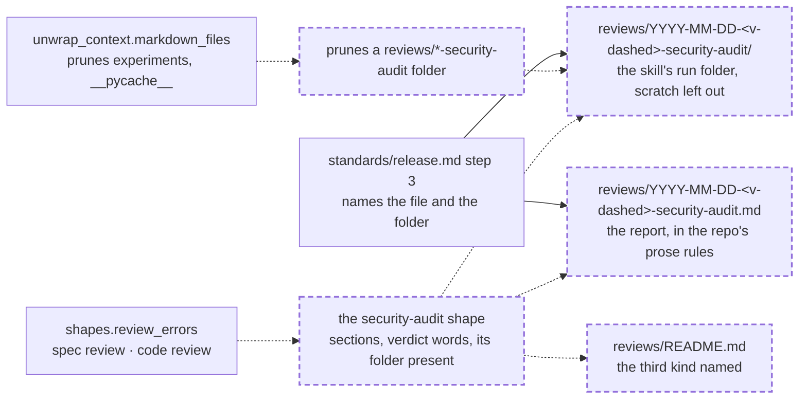

# The release audit is a review: `…-security-audit.md` gets a shape the lint knows, a dashed version in its name, and a run folder the prose checks leave alone

A process change that touches the gate (`tests/lint/`, `scripts/unwrap_context.py`) and one standard (`context/standards/release.md`): not structural, no public API, schema, rights or engine change. It comes from the 0.1.0a1 release: [release.md](../../standards/release.md) step 3 names a file and a folder that today's lint refuses, so the first release audit cannot be recorded as the standard asks. No intention and no research: the conflict is between two files in this repository, read below. It depends on nothing unlanded. The 0.1.0a1 audit record, the first file of the new shape, lands with it, after the fixes the record reproduces have landed (decision 8); [the grant-gate spec](2026-11-07-the-grant-gate-judges-the-subtree.md), active and not built, is the first of those fixes and cites the record by run id.

## The problem

READ at `3586750`. `release.md:76` says: "The audit writes one review file, `context/reviews/YYYY-MM-DD-<version>-security-audit.md`, and beside it a folder of the same name holding the skill's run folder with every path rewritten relative to the repository and both validators passing."

READ. Three lint rules refuse that today. First, `DATED_NAME_RE` (`tests/lint/shapes.py:37`) is `^\d{4}-\d{2}-\d{2}-[a-z0-9]+(?:-[a-z0-9]+)*\.md$`, so a name holding `0.1.0a1` fails `name_errors` (`shapes.py:211-218`) as "not named YYYY-MM-DD-descriptive-slug.md". Second, `review_errors` (`shapes.py:265-285`) answers "a review is named …-spec-review.md or …-code-review.md" for any other direct file of `context/reviews/`. Third, `markdown_files` (`scripts/unwrap_context.py:42-48`, shared by `shapes.py:29`) walks every `.md` under `context/` except `experiments/` and `__pycache__/`, so the run folder's Markdown files fall under the one-line-paragraph check (`test_paragraphs_are_one_line`), and, because the folder's name carries a date on or after 2026-10-29, under the header and link checks of `new_documents` too.

READ. The run folder holds machine-written files: briefs that quote the skill's fenced instructions and wrapped prose, JSON records, the parent's tools, and every agent's promoted evidence. Its Markdown is the skill's output, not prose written to this repository's rules, and the skill's own validators (`validate-findings.cjs`, `validate-coverage-ledger.cjs`) are what hold its shape.

READ. The earlier release review spelled a version with dashes: `context/reviews/2026-11-06-the-release-lane-to-0-1-0-code-review.md`.

## Architecture

The lint learns a third review kind and prunes its run folder from the prose walk. Dashed is what this spec adds.

Page this changes: none; the architecture folder was retired on 2026-10-31, and the landing notes will say so in one line.

Terms. A **release audit** is the full-audit run of the security-audit skill that [release.md](../../standards/release.md) step 3 requires. Its **run folder** is the skill's output directory: `run-metadata.json`, `architecture.md`, `findings.json`, `coverage-ledger.json`, the three reports, `tools/` and `agents/`.

## Decisions

### 1. The file is `context/reviews/YYYY-MM-DD-<version>-security-audit.md` with the version's dots written as dashes, so `0.1.0a1` gives `2026-11-07-0-1-0a1-security-audit.md`

The dated-name rule stays one rule for every document, and the release-lane review already spelled `0.1.0` as `0-1-0`. A version holds only digits, letters and dots under PEP 440's normal form, so dashes are a lossless spelling. `release.md` step 3 says so in one sentence.

### 2. `review_errors` accepts a third kind, a name ending `-security-audit.md`, with eight sections in order: Run, Security posture, Confirmed findings, Needs validation, Hardening notes, Positive source patterns, Coverage, Verdict

These are the sections the skill's Phase 6 asks `REPORT.md` to carry (`.claude/skills/security-audit/VALIDATION-AND-REPORTING.md`, the `REPORT.md` items 1 to 7), named as headings, plus the Verdict every review in this folder ends with. No section is optional: a clean audit writes "None." under Confirmed findings, which the skill allows.

### 3. The Verdict's first line begins "Clears the release" or "Blocks the release"

`release.md` makes a confirmed critical or high a stop before the bump, so the audit's one decision is whether the release may proceed. A run clears only when `run-metadata.json` says `run_status` is `complete` and `findings.json` holds no record whose `verdict` is `confirmed` and whose `severity.overall_severity` is `critical` or `high`; any other run blocks. An incomplete run blocks because the skill keeps an unvalidated candidate out of `findings.json` (`VALIDATION-AND-REPORTING.md`, Phase 3's budget rule), so a high it never validated would otherwise be invisible to the rule. The standing verdict is read as for every review: the last dated line of the Verdict, or its first line when no line is dated. A blocked audit is re-signed below its first verdict, as `YYYY-MM-DD, re-read on <commit>: Clears the release …`, by a fresh reader who checks each blocking fingerprint against its landed fix, so the release cut from that commit stands on a signed line. The lint reads the two JSON files with the standard library and refuses a first verdict word that disagrees with them; a re-signed line is the reader's, and the lint does not judge it.

### 4. A security-audit review must have its run folder beside it, holding `run-metadata.json`, `findings.json` and `coverage-ledger.json`

`release.md` asks for the folder, and these three files are what the skill's two validators read. The lint checks only presence, because the validators are Node scripts and Node is not a dependency of this project's gate.

### 5. `markdown_files` prunes a directory directly under `context/reviews/` whose name ends `-security-audit`

The run folder is a machine record whose shape the skill's validators hold. Pruning it in the one walk that `scripts/unwrap_context.py` and `tests/lint/shapes.py` share leaves the paragraph, header and link checks off it, and keeps them on everything else. The review file itself is a direct document and keeps every prose check. Only that one pattern, in that one folder, is pruned, and the lint also refuses such a directory when it has no sibling file of the same name plus `.md`; that sibling's name is held by `DATED_NAME_RE`, so the folder's name is too, and no other directory can hide from the lint by its name. This departs from AGENTS.md's rule that every document under `context/` is one line per paragraph, in the way `experiments/` already does: the run folder is a machine record, not a document.

### 6. The copy leaves out every `agents/*/scratch/` directory and rewrites absolute paths to repository-relative ones

Scratch held the target-controlled processes' working files, including multi-hundred-megabyte decompression fixtures and SQLite databases, and the skill already promoted the evidence worth keeping into `artifacts/`. The rewrite turns the run root into the folder's repository path and the target root into the repository root. After those two rewrites, every other absolute or home-relative path is replaced by a token naming its kind: `<home>/…` for the home directory (written out or as `~/`), `<session-tmp>/…` for the session's temporary directory under `/private/tmp/`, and `<tmp>/…` for `/tmp`. No other byte of a file changes. Both validators print PASS on the copy at landing, run from the repository root after the rewrite; the landing notes record their output beside the skill's folder hash, and the record's JSON is not edited after.

### 7. The review file is written from the run's `REPORT.md`, with the eight headings of decision 2, one line per paragraph, and links to `FINDINGS-DETAIL.md` and `NEEDS-VALIDATION.md` inside the run folder

`REPORT.md` already carries the content Phase 6 requires; the review file is that content under this repository's headings and prose rules, so a reader starts at one file and follows links into the record. `REPORT.md`'s numbered headings lose their numbers, and its fourth section, Finding summaries, is folded under Confirmed findings after the table.

### 8. The record lands after every fix it reproduces has landed, in the push that carries the release's last fix

The repository is public, and the record holds a bounded reproduction of each confirmed finding. Committing it while a finding is unfixed would publish a working recipe against code on `main`. The developer chose to fix the high and every medium before 0.1.0a1, so the record lands after those landings; the spec, the lint change and the standard's sentence land with the record in one commit, because the lint change has no other user. The fix specs cite the run by id until then. The three confirmed lows and the six needs-validation leads are published unfixed, by that same choice: the lows are one-bit oracles or cost growth under a non-default configuration, and each lead waits on a fact outside source; the developer is told so before the record lands.

## Intent

After this spec, a release audit is recorded where `release.md` says, as `context/reviews/2026-11-07-0-1-0a1-security-audit.md` with its run folder beside it, and `scripts/ci.sh` is green with both in the tree. The lint holds the review file to a shape and a verdict like the other reviews, requires the run folder beside it, and leaves the run folder's machine-written files to the skill's own validators.

## Design

**`tests/lint/shapes.py`.** `SECURITY_AUDIT_SECTIONS` (the eight names of decision 2) and `SECURITY_AUDIT_VERDICTS = ("Clears the release", "Blocks the release")` sit beside the other review constants. `review_errors` gains a branch for `path.name.endswith("-security-audit.md")`: section order through `section_order_errors` with no optional heading, the verdict check shared with the other kinds, an error when `path.with_suffix("")` is not a directory holding the three files of decision 4, and an error when the first verdict word disagrees with decision 3's rule read from `run-metadata.json` and `findings.json` through `json.loads`. `name_errors` also refuses a `-security-audit` directory under `reviews/` with no sibling `.md` (decision 5). The final error message names the three kinds.

**`scripts/unwrap_context.py`.** `markdown_files` prunes a directory when its parent is `root / "reviews"`, where `root` is the walk's own argument, and its name ends `-security-audit`, beside the `SKIPPED_DIRS` prune; `AUDIT_RUN_SUFFIX: Final = "-security-audit"` is its constant.

**`context/standards/release.md`.** Step 3's sentence names the dashed version, the eight-section shape, the verdict words, the re-sign of decision 3, and the copy rule of decision 6.

**`context/reviews/README.md`.** The file-names section gains the third kind in one sentence.

**The record.** `context/reviews/2026-11-07-0-1-0a1-security-audit.md` and `context/reviews/2026-11-07-0-1-0a1-security-audit/`, copied by a scratch script outside the repository that applies decision 6 and is not committed.

**Tests first.** `tests/lint/test_context_shape.py` gains the nodes of criteria 1 to 4, built on files under `tmp_path`. The seam is `monkeypatch`: the tests set `shapes.REPO` to `tmp_path` and `shapes.CONTEXT` to `tmp_path / "context"`, so `relative()` and `name_errors()` read the scratch tree. Criteria 1 to 3 are seen failing before `shapes.py` and `unwrap_context.py` change; criterion 4 is a pin that passes today and stays passing.

**Scale.** The walk prunes one more directory; nothing in the gate grows. Each release adds its run folder whole, about 7 MB on disk and 2 MB compressed for 0.1.0a1 (282 files, scratch left out); the walk does not descend into it, and no cap is set.

## Scope

In: decisions 1 to 8. Files: `tests/lint/shapes.py`, `scripts/unwrap_context.py`, `tests/lint/test_context_shape.py`, `context/standards/release.md`, `context/reviews/README.md`, the review file and run folder of decision 7, and this spec's landing notes.

Out: the fixes the audit calls for (their own specs, which land before this one by decision 8); running the skill's Node validators inside `scripts/ci.sh` (decision 4's reason); any change to the vendored skill under `.claude/skills/security-audit/`; the per-spec security lens of the code review, which writes no run folder.

## Acceptance criteria

Counts and states, never clocks. Tests are in `tests/lint/test_context_shape.py`.

1. A `tmp_path` reviews folder holding `2026-11-07-9-9-9-security-audit.md` with the eight sections in order, a Verdict whose first line begins "Blocks the release", and its folder with the three files holding a confirmed high, gives `review_errors` an empty list; the same file beginning "Clears the release" gives one error naming decision 3's rule, as does a "Clears the release" over a record with no high whose `run_status` is `incomplete`, and a "Clears the release" over a complete record with no high gives none; the same file with the Coverage section removed gives one error naming it; a Verdict beginning "Ship it" gives one error naming the two verdict words. Test: `test_a_security_audit_review_has_its_shape`.
2. The same file without its folder, or with the folder missing `findings.json`, gives one error naming the missing path; a `reviews/2026-11-07-9-9-9-security-audit/` directory with no sibling `.md` gives `name_errors` one error naming it. Test: `test_a_security_audit_review_needs_its_run_folder`.
3. `markdown_files(root)`, with `root` a `tmp_path` context, holding `reviews/2026-11-07-9-9-9-security-audit/REPORT.md` and `reviews/2026-11-07-other/notes.md` returns the second file and not the first, and a `research/x-security-audit/a.md` is still returned. Test: `test_the_walk_prunes_only_a_release_audit_run_folder`.
4. A pin that passes today and stays passing: a name ending `-security-audit.md` that holds a dot is refused by `name_errors`, and `2026-11-07-0-1-0a1-security-audit.md` matches `DATED_NAME_RE`. Test: `test_a_release_audit_name_spells_its_version_with_dashes`.
5. With the record committed, `test_reviews_have_their_shape`, `test_links_resolve`, `test_paragraphs_are_one_line` and `test_documents_are_dated_and_unnumbered` pass, and `grep -rE '/Users/|/private/(tmp|var)/|/tmp/|~/' context/reviews/2026-11-07-0-1-0a1-security-audit` exits 1, so the record's vfs fixture paths such as `/private/bob/plan.md` stay as written.
6. From the repository root, `node .claude/skills/security-audit/validate-findings.cjs context/reviews/2026-11-07-0-1-0a1-security-audit/findings.json` and the ledger validator on its `coverage-ledger.json` each print PASS and exit 0; no `scratch` directory exists under the folder.
7. `scripts/ci.sh` is green at 100% coverage on the tree as committed.

## Landing notes

Filled in on landing.

## One line

The release audit becomes a review the lint knows, named with a dashed version, carrying a verdict that clears or blocks the release, with the skill's run folder beside it and out of the prose checks.
