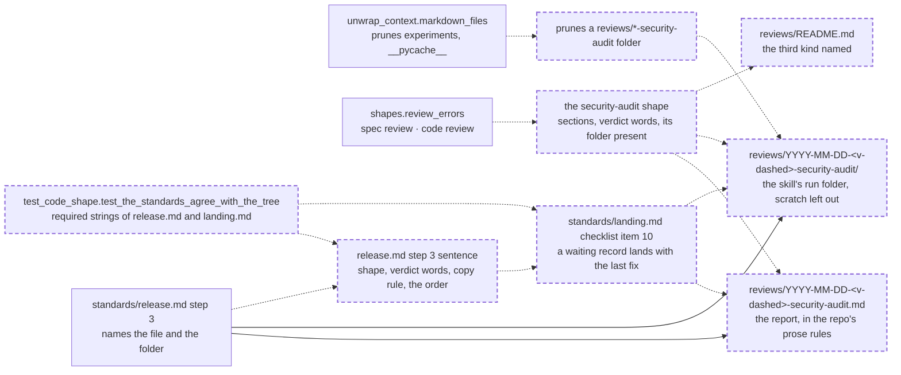

# The release audit is a review: `…-security-audit.md` gets a shape the lint knows, a dashed version in its name, and a run folder the prose checks leave alone

A process change that touches the gate (`tests/lint/`, `scripts/unwrap_context.py`) and two standards (`context/standards/release.md`, `context/standards/landing.md`): not structural, no public API, schema, rights or engine change. It comes from the 0.1.0a1 release: [release.md](../../standards/release.md) step 3 names a file and a folder that today's lint refuses, so the first release audit cannot be recorded as the standard asks. No intention and no research: the conflict is between two files in this repository, read below. Its build depends on nothing unlanded. Its landing waits: the 0.1.0a1 audit record, the first file of the new shape, lands with it, after the fixes the record reproduces have landed (decision 8), and at `f7539910` five of those fixes have no spec yet (The problem, its last two paragraphs). [The grant-gate spec](../archive/2026-11-07-the-grant-gate-judges-the-subtree.md), the fix of the audit's one high, which cites the record by run id, landed at `92190579`.

## The problem

READ at `3586750`, and again at `f7539910` with every line number below re-read. `release.md:76` says: "The audit writes one review file, `context/reviews/YYYY-MM-DD-<version>-security-audit.md`, and beside it a folder of the same name holding the skill's run folder with every path rewritten relative to the repository and both validators passing."

READ. Three lint rules refuse that today. First, `DATED_NAME_RE` (`tests/lint/shapes.py:39`) is `^\d{4}-\d{2}-\d{2}-[a-z0-9]+(?:-[a-z0-9]+)*\.md$`, so a name holding `0.1.0a1` fails `name_errors` (`shapes.py:234-250`) as "not named YYYY-MM-DD-descriptive-slug.md". Second, `review_errors` (`shapes.py:289-310`) answers "a review is named …-spec-review.md or …-code-review.md" (`shapes.py:305`) for any other direct file of `context/reviews/`. Third, `markdown_files` (`scripts/unwrap_context.py:42-48`, shared by `shapes.py:31`) walks every `.md` under `context/` except `experiments/` and `__pycache__/`, so the run folder's Markdown files fall under the one-line-paragraph check (`test_paragraphs_are_one_line`), and, because the folder's name carries a date on or after 2026-10-29, under the header and link checks of `new_documents` too.

READ. The run folder holds machine-written files: briefs that quote the skill's fenced instructions and wrapped prose, JSON records, the parent's tools, and every agent's promoted evidence. Its Markdown is the skill's output, not prose written to this repository's rules, and the skill's own validators (`validate-findings.cjs`, `validate-coverage-ledger.cjs`) are what hold its shape.

READ. The earlier release review spelled a version with dashes: `context/reviews/2026-11-06-the-release-lane-to-0-1-0-code-review.md`.

READ at `f7539910`. One spec has changed the lint since `3586750`, [the layer map and the size baseline](../archive/2026-11-07-the-gate-and-the-review-read-the-layer-map-and-the-size-baseline.md) at `b2a32c37`, and none of what it added touches the third kind. `review_errors` calls the new `layer_line_errors` (`shapes.py:313-326`) inside its `-code-review.md` branch alone (`shapes.py:297-303`), so a code review dated on or after `LAYER_LINES_START`, `2026-11-13` (`shapes.py:30`), opens its Ownership subsection with a "Layer map:" line holding `ladder` and a "Size:" line holding `allowlist`; a name ending `-security-audit.md` never reaches that branch, and the new branch sits beside it, leaving the rule as it is. The code review of this spec's own landing is such a review when it is dated on or after that day, and its two lines then open with "no module of `src/vfs` touched", because this spec changes none. Because this spec adds required strings to `tests/lint/test_code_shape.py` (the Design), which the ownership lens's diff reads, the Layer map line then closes "ladder unchanged, the file changed elsewhere: `test_the_standards_agree_with_the_tree` requires two more strings of `release.md` and one of `landing.md`", and the Size line closes "allowlist unchanged". Nothing else that landed reads what this spec adds: `test_code_shape.py` walks only from `SRC`, `CRATE` and `SECURITY_SKILL` (`test_code_shape.py:23-27`), so the run folder's Python files are never read, and `MODULE_LINE_BASELINE` (`tests/lint/allowlist.py:25-35`) keys only modules of `src/vfs`. Two tests hold the files this spec edits to fixed strings: `test_the_review_rubric_names_the_two_checks` holds `context/reviews/README.md` to the two lines' words and "placeholder memo or a spec", and `test_the_standards_agree_with_the_tree` holds `release.md` to eight required strings and four forbidden ones, none of which sits in step 3 or is needed by its new sentence; the one sentence each file gains removes no required string and adds no forbidden one. `landing.md` is read by the lint only for its existence (`test_code_shape.py:295`) and by the one-line-paragraph walk, since it sits under `context/`; it is no dated document, so the header, link and open-question checks do not read it, and it holds no string the new sentence would break. `test_context_shape.py` already uses the `monkeypatch` seam the Design names, in `test_a_new_code_review_states_the_layer_map_and_the_size`. EXECUTED: `uv run pytest tests/lint -q` gives 38 passed at `f7539910`, against 20 at `3586750`.

READ at `f7539910`, the fixes decision 8 waits on. The audit's one high and eight of its mediums have landed fixes, each spec citing run `vfs-run-1-2026-11-07` and the fingerprint it closes: the high, `src/vfs/storage/backends/database/rights.py:grant-refusal:addressed-path-gate-ignores-posture-holes-beneath`, by [the grant-gate spec](../archive/2026-11-07-the-grant-gate-judges-the-subtree.md) at `92190579`; `vfs:permissions:check_writable:subtree-override-not-consulted` by [a read-only rule gates the verbs that reach beneath](../archive/2026-11-07-a-read-only-rule-gates-the-verbs-that-reach-beneath.md) at `97c270a4`; `vfs:storage/backends/database/backend.py:_embed_step:refused-batch-head-of-line-no-split-or-quarantine` by [a refused embed batch is split](../archive/2026-11-07-a-refused-embed-batch-is-split-and-its-refused-chunks-set-aside.md) at `ae0be956`; `vfs.base._grep_rows_in_hand:inline-unbudgeted-verify` by [chained grep verifies off the loop](../archive/2026-11-07-chained-grep-verifies-off-the-loop-under-a-wall.md) at `f89e5cb5`; `vfs-core.verify.extend_context:per-hit-context-duplication` by [grep context regions never overlap](../archive/2026-11-07-grep-context-regions-never-overlap.md) at `e6998393`; `vfs-core.links.line_context:per-reference-whole-line-fold` by [the Markdown reference walk is linear](../archive/2026-11-07-markdown-reference-walk-is-linear.md) at `c9b7ebf2`; `vfs/storage/database/write-trusts-caller-authored-content-hash` by [storage measures every body it stores](../archive/2026-11-07-storage-measures-every-body-it-stores.md) at `b25bcd62`; `vfs/storage/replace.py:fuzzy-replacers-quadratic-inline-in-writer-transaction` by [the fuzzy edit match is linear and budgeted](../archive/2026-11-07-the-fuzzy-edit-match-is-linear-and-budgeted.md) at `4fc33072`; and `vfs.pattern_matching.glob._translate:backtracking-wildcards` by three, [glob matching on the linear engine](../archive/2026-11-07-glob-matching-runs-on-the-linear-engine.md) at `c544934a`, [glob matching off the loop under the wall](../archive/2026-11-07-glob-matching-runs-off-the-loop-under-the-wall.md) at `acf17350` and [scope roots and arms as two channels](../archive/2026-11-07-storage-takes-scope-roots-and-arms-as-two-channels.md) at `0867fbbe`. INFERRED: the run holds 17 confirmed records ([the spec review](../../reviews/2026-11-07-the-release-audit-is-a-review-spec-review.md), its probe 5), and decision 8 names them as the high, the mediums and three lows, so thirteen are mediums; eight medium fingerprints have landed fixes, so five confirmed mediums the developer chose to fix before 0.1.0a1 have no fix spec in this repository, and no document under `context/` names them, by decision 8's reason. Each needs its own spec, reviewed, built and landed, before the record lands; none of them changes this spec.

READ at `f7539910`, what landed specs ask of the record. [The two-channel spec](../archive/2026-11-07-storage-takes-scope-roots-and-arms-as-two-channels.md), in its Scope, carries SQLite's statistics-free seek of the tombstone index into the record as a known defect of the scope fan, and [the statistics spec](../archive/2026-11-07-sqlite-gathers-planner-statistics-after-each-write.md), landed at `2d263fb4`, asks in its decision 23 that the record name that defect as fixed there; the Design's record paragraph carries the line. Two fix specs cite evidence inside the run folder, under `agents/v15-p3/artifacts/evidence/` and `agents/v18-p3/artifacts/evidence/`, which decision 6 keeps, since it leaves out only `agents/*/scratch/`.

## Architecture

The lint learns a third review kind and prunes its run folder from the prose walk; two standards carry the order a record lands in, and the gate pins their sentences. Dashed is what this spec adds.

Page this changes: none; the architecture folder was retired on 2026-10-31, and the landing notes will say so in one line.

Terms. A **release audit** is the full-audit run of the security-audit skill that [release.md](../../standards/release.md) step 3 requires. Its **run folder** is the skill's output directory: `run-metadata.json`, `architecture.md`, `findings.json`, `coverage-ledger.json`, the three reports, `tools/` and `agents/`.

## Decisions

### 1. The file is `context/reviews/YYYY-MM-DD-<version>-security-audit.md` with the version's dots written as dashes, so `0.1.0a1` gives `2026-11-07-0-1-0a1-security-audit.md`

The dated-name rule stays one rule for every document, and the release-lane review already spelled `0.1.0` as `0-1-0`. A version holds only digits, letters and dots under PEP 440's normal form, so dashes are a lossless spelling. `release.md` step 3 says so in one sentence.

### 2. `review_errors` accepts a third kind, a name ending `-security-audit.md`, with eight sections in order: Run, Security posture, Confirmed findings, Needs validation, Hardening notes, Positive source patterns, Coverage, Verdict

These are the sections the skill's Phase 6 asks `REPORT.md` to carry (`.claude/skills/security-audit/VALIDATION-AND-REPORTING.md`, the `REPORT.md` items 1 to 7), named as headings, plus the Verdict every review in this folder ends with. No section is optional: a clean audit writes "None." under Confirmed findings, which the skill allows.

### 3. The Verdict's first line begins "Clears the release" or "Blocks the release"

`release.md` makes a confirmed critical or high a stop before the bump, so the audit's one decision is whether the release may proceed. A run clears only when `run-metadata.json` says `run_status` is `complete` and `findings.json` holds no record whose `verdict` is `confirmed` and whose `severity.overall_severity` is `critical` or `high`; any other run blocks. An incomplete run blocks because the skill keeps an unvalidated candidate out of `findings.json` (`VALIDATION-AND-REPORTING.md`, Phase 3's budget rule), so a high it never validated would otherwise be invisible to the rule. The standing verdict is read as for every review: the last dated line of the Verdict, or its first line when no line is dated. A blocked audit is re-signed below its first verdict, as `YYYY-MM-DD, re-read on <commit>: Clears the release …`, by a fresh reader who checks each blocking fingerprint against its landed fix, so the release cut from that commit stands on a signed line. The lint reads the two JSON files with the standard library and refuses a first verdict word that disagrees with them; a re-signed line is the reader's, and the lint does not judge it.

### 4. A security-audit review must have its run folder beside it, holding `run-metadata.json`, `findings.json` and `coverage-ledger.json`

`release.md` asks for the folder, and these three files are what the skill's two validators read. The lint checks only presence, because the validators are Node scripts and Node is not a dependency of this project's gate.

### 5. `markdown_files` prunes a directory directly under `context/reviews/` whose name ends `-security-audit`

The run folder is a machine record whose shape the skill's validators hold. Pruning it in the one walk that `scripts/unwrap_context.py` and `tests/lint/shapes.py` share leaves the paragraph, header and link checks off it, and keeps them on everything else. The review file itself is a direct document and keeps every prose check. Only that one pattern, in that one folder, is pruned, and the lint also refuses such a directory when it has no sibling file of the same name plus `.md`; that sibling's name is held by `DATED_NAME_RE`, so the folder's name is too, and no other directory can hide from the lint by its name. This departs from AGENTS.md's rule that every document under `context/` is one line per paragraph, in the way `experiments/` already does: the run folder is a machine record, not a document.

### 6. The copy leaves out every `agents/*/scratch/` directory and rewrites absolute paths to repository-relative ones

Scratch held the target-controlled processes' working files, including multi-hundred-megabyte decompression fixtures and SQLite databases, and the skill already promoted the evidence worth keeping into `artifacts/`. The rewrite turns the run root into the folder's repository path and the target root into the repository root. After those two rewrites, every other absolute or home-relative path is replaced by a token naming its kind: `<home>/…` for the home directory (written out or as `~/`), `<session-tmp>/…` for the session's temporary directory under `/private/tmp/`, and `<tmp>/…` for `/tmp`. No other byte of a file changes. Both validators print PASS on the copy at landing, run from the repository root after the rewrite; the landing notes record their output beside the skill's folder hash, and the record's JSON is not edited after.

### 7. The review file is written from the run's `REPORT.md`, with the eight headings of decision 2, one line per paragraph, and links to `FINDINGS-DETAIL.md` and `NEEDS-VALIDATION.md` inside the run folder

`REPORT.md` already carries the content Phase 6 requires; the review file is that content under this repository's headings and prose rules, so a reader starts at one file and follows links into the record. `REPORT.md`'s numbered headings lose their numbers, and its fourth section, Finding summaries, is folded under Confirmed findings after the table. One kind of addition is allowed, and only one: a line that a landed spec's decision requires of the record, written under the Run section, saying that it is an addition to the run's report and naming the spec that requires it. Such a line is the record author's, not the skill's; it is no confirmed record, and `findings.json` does not change. A landed spec can learn of a defect beside the audit that the record should name, and the record is the one place a later reader looks for what the release knew; nothing else may be added, so the review file stays the run's report. Today there is one such line: the statistics-free tombstone-index seek, a known defect of the scope fan found beside the audit, which [the two-channel spec](../archive/2026-11-07-storage-takes-scope-roots-and-arms-as-two-channels.md) carried into the record and [the statistics spec](../archive/2026-11-07-sqlite-gathers-planner-statistics-after-each-write.md), in its decision 23, asks the record to name as fixed there.

### 8. A release audit's record never lands while a confirmed finding at medium or above that it reproduces has no landed fix; it lands in the push that carries the last of those fixes, and until then the release's notes and the fix specs cite the run by id

The repository is public, and the record holds a bounded reproduction of each confirmed finding: `FINDINGS-DETAIL.md` copies one for every confirmed medium, high and critical (`VALIDATION-AND-REPORTING.md`, Phase 6). Committing it while such a finding is unfixed would publish a working recipe against code on `main`. The rule holds for every release, not only this one. [release.md](../../standards/release.md) step 3 requires only a critical or a high to be fixed before the bump, so a later release may ship with a medium left unfixed by the developer's choice. Such a release's record then waits: it lands with the last of those fixes, and until that push the release's notes and the fix specs cite the run by id, as the 0.1.0a1 fix specs do now. The cost is plain: such a release ships before its record is in the repository, so for a while its audit can be read only by its run id, not in the tree. In that case the review file is written and its verdict signed before the bump, beside the run folder outside the repository, and both land unchanged with the last fix; until then the release stands on a signed line no one but its reader has seen, and the lint holds its shape and its first verdict word only when it lands. This general rule is the session lead's ruling of 2026-11-12, extending to every release the conservative choice the developer made for 0.1.0a1.

For 0.1.0a1 the developer chose to fix the high and every medium before the release, so its record lands after those landings, in the push that carries the release's last fix. The spec, the lint change and the two standards' sentences land with the record in one commit, because the lint change has no other user. Confirmed lows and needs-validation leads may be published unfixed, in every release: a low is ranked low because its demonstrated damage is small, and a lead is no confirmed finding, only a trace that waits on a fact outside source. For 0.1.0a1 that means the three confirmed lows and the six leads: the lows are one-bit oracles or cost growth under a non-default configuration, and each lead waits on a fact outside source; the developer is told so before the record lands. The lint does not pin this order. It cannot know which findings have landed fixes, so the order is kept in prose: `release.md` step 3 at the release, and `landing.md`'s checklist at the landing that carries a waiting record's last fix. The gate pins only that both sentences are present, through required strings in `test_the_standards_agree_with_the_tree`, never that they are obeyed.

## Intent

After this spec, a release audit is recorded where `release.md` says, as `context/reviews/2026-11-07-0-1-0a1-security-audit.md` with its run folder beside it, and `scripts/ci.sh` is green with both in the tree. The lint holds the review file to a shape and a verdict like the other reviews, requires the run folder beside it, and leaves the run folder's machine-written files to the skill's own validators. `release.md` and `landing.md` say when a record may land against the findings it reproduces, for every release, and the gate holds both sentences present.

## Design

**`tests/lint/shapes.py`.** `SECURITY_AUDIT_SECTIONS` (the eight names of decision 2) and `SECURITY_AUDIT_VERDICTS = ("Clears the release", "Blocks the release")` sit beside the other review constants. `review_errors` gains a branch for `path.name.endswith("-security-audit.md")`: section order through `section_order_errors` with no optional heading, the verdict check shared with the other kinds, an error when `path.with_suffix("")` is not a directory holding the three files of decision 4, and an error when the first verdict word disagrees with decision 3's rule read from `run-metadata.json` and `findings.json` through `json.loads`. `name_errors` also refuses a `-security-audit` directory under `reviews/` with no sibling `.md` (decision 5). The final error message names the three kinds.

**`scripts/unwrap_context.py`.** `markdown_files` prunes a directory when its parent is `root / "reviews"`, where `root` is the walk's own argument, and its name ends `-security-audit`, beside the `SKIPPED_DIRS` prune; `AUDIT_RUN_SUFFIX: Final = "-security-audit"` is its constant.

**`context/standards/release.md`.** Step 3's sentence names the dashed version, the eight-section shape, the verdict words, the re-sign of decision 3, the copy rule of decision 6, and the order of decision 8: the record never lands while a confirmed medium, high or critical it reproduces has no landed fix; it lands in the push that carries the last of those fixes; until then the release notes and the fix specs cite the run by id; and a release that ships with a medium unfixed by choice ships before its record is in the repository. The sentence holds the words "never lands while" and the verdict word "Blocks the release" as written here, because the gate requires both.

**`context/standards/landing.md`.** Checklist item 10 gains one sentence at its end, verbatim: "A push that carries the last landed fix of every confirmed medium, high or critical a release audit reproduces also carries that audit's record, when the record is not yet in the tree, in a commit of its own unless a spec lands it; the fix specs cite the run by id, so `git grep <run id> context/specifications/archive` lists the fixes landed so far." The item stays one line. Nothing else in the lint reads `landing.md` beyond its existence and the one-line walk (The problem), so the sentence trips no required or forbidden string.

**`tests/lint/test_code_shape.py`.** `test_the_standards_agree_with_the_tree` adds "never lands while" and "Blocks the release" to its required strings for `release.md`, and gains a required entry for `landing.md` holding "that audit's record". Each string is absent from its file today and present once the sentence is written, so the pin is red before the standards change and green after; "security-audit.md" is no pin, since step 3 already holds it. A required string pins the sentence's presence, never its truth, which is all the gate can do for an order it cannot read.

**`context/reviews/README.md`.** The file-names section gains the third kind in one sentence.

**The record.** `context/reviews/2026-11-07-0-1-0a1-security-audit.md` and `context/reviews/2026-11-07-0-1-0a1-security-audit/`, copied by a scratch script outside the repository that applies decision 6 and is not committed. Its first verdict is "Blocks the release", because the run holds a confirmed high, and the re-sign of decision 3 checks that fingerprint against the grant-gate spec's landing at `92190579`. The re-sign line is written before the landing commit by a reader who did not write the record, named in the landing notes, and rides in that commit, so the record lands with its standing verdict beginning "Clears the release" and the bump of `release.md` step 4 follows it. Its Run section carries the one addition decision 7 allows today, marked as an addition: the statistics-free tombstone-index seek, a known defect of the scope fan, fixed by [the statistics spec](../archive/2026-11-07-sqlite-gathers-planner-statistics-after-each-write.md), as that spec's decision 23 asks; the defect was found beside the audit, so it is no confirmed record and `findings.json` does not change.

**Tests first.** `tests/lint/test_context_shape.py` gains the nodes of criteria 1 to 4, built on files under `tmp_path`. The seam is `monkeypatch`, as `test_a_new_code_review_states_the_layer_map_and_the_size` already uses it for `LAYER_LINES_START`: the tests set `shapes.REPO` to `tmp_path` and `shapes.CONTEXT` to `tmp_path / "context"`, so `relative()` (`shapes.py:134-135`) and `name_errors()` read the scratch tree. Criteria 1 to 3 are seen failing before `shapes.py` and `unwrap_context.py` change; criterion 4 is a pin that passes today and stays passing. Criterion 8's three required strings are added to `test_the_standards_agree_with_the_tree` and seen failing before `release.md` and `landing.md` change. Each new node's docstring names what it guards: the `run_status` check dropped, a severity dropped from the blocking set, the folder or file check dropped, the orphan check dropped, the prune anchored at the module's `CONTEXT` or widened past `reviews/`, and a dot admitted by `DATED_NAME_RE`.

**Scale.** The walk prunes one more directory; nothing in the gate grows. Each release adds its run folder whole, about 7 MB on disk and 2 MB compressed for 0.1.0a1 (282 files, scratch left out); the walk does not descend into it, and no cap is set. Against the reference deployment no multiplier applies: the change runs per lint run and per release, never per verb call, write, index visit, batch or corpus. What it does ride is the number of releases, each adding one review file and one run folder to the repository, and per release one directory entry the walk prunes, three existence checks and two small JSON reads per lint run; the folder's other files cost the gate nothing, and the clone grows by about 2 MB compressed per release.

## Scope

In: decisions 1 to 8. Files: `tests/lint/shapes.py`, `scripts/unwrap_context.py`, `tests/lint/test_context_shape.py`, `tests/lint/test_code_shape.py`, `context/standards/release.md`, `context/standards/landing.md`, `context/reviews/README.md`, the review file and run folder of decision 7, and this spec's landing notes.

Out: the fixes the audit calls for (their own specs, which land before this one by decision 8); running the skill's Node validators inside `scripts/ci.sh` (decision 4's reason); any change to the vendored skill under `.claude/skills/security-audit/`; the per-spec security lens of the code review, which writes no run folder.

## Acceptance criteria

Counts and states, never clocks. Tests are in `tests/lint/test_context_shape.py`, except criterion 8's, in `tests/lint/test_code_shape.py`.

1. A `tmp_path` reviews folder holding `2026-11-07-9-9-9-security-audit.md` with the eight sections in order, a Verdict whose first line begins "Blocks the release", and its folder with the three files holding a confirmed high, gives `review_errors` an empty list; the same file beginning "Clears the release" gives one error naming decision 3's rule, as does a "Clears the release" over a record with no high whose `run_status` is `incomplete`, and a "Clears the release" over a complete record with no high gives none, and a "Clears the release" over a complete record whose one confirmed record has `overall_severity` `critical` gives one error naming decision 3's rule; the same file with the Coverage section removed gives one error naming it; a Verdict beginning "Ship it" gives one error naming the two verdict words. Test: `test_a_security_audit_review_has_its_shape`.
2. The same file without its folder gives one error holding the words "run folder" and the folder's path, words today's refusal does not hold; with the folder missing `findings.json`, one error naming `findings.json`; a `reviews/2026-11-07-9-9-9-security-audit/` directory with no sibling `.md` gives `name_errors` one error naming it. Test: `test_a_security_audit_review_needs_its_run_folder`.
3. `markdown_files(root)`, with `root` a `tmp_path` context, holding `reviews/2026-11-07-9-9-9-security-audit/REPORT.md` and `reviews/2026-11-07-other/notes.md` returns the second file and not the first, and a `research/x-security-audit/a.md` is still returned. Test: `test_the_walk_prunes_only_a_release_audit_run_folder`.
4. A pin that passes today and stays passing: a name ending `-security-audit.md` that holds a dot is refused by `name_errors`, and `2026-11-07-0-1-0a1-security-audit.md` matches `DATED_NAME_RE`. Test: `test_a_release_audit_name_spells_its_version_with_dashes`.
5. With the record committed, `test_reviews_have_their_shape`, `test_links_resolve`, `test_paragraphs_are_one_line`, `test_new_documents_carry_no_header_lines`, `test_no_document_holds_an_open_question` and `test_documents_are_dated_and_unnumbered` pass, and `grep -rE '/Users/|/private/(tmp|var)/|/tmp/|~/' context/reviews/2026-11-07-0-1-0a1-security-audit` exits 1, so the record's vfs fixture paths such as `/private/bob/plan.md` stay as written.
6. From the repository root, `node .claude/skills/security-audit/validate-findings.cjs context/reviews/2026-11-07-0-1-0a1-security-audit/findings.json` and the ledger validator on its `coverage-ledger.json` each print PASS and exit 0; no `scratch` directory exists under the folder.
7. `scripts/ci.sh` is green at 100% coverage on the tree as committed.
8. `test_the_standards_agree_with_the_tree` fails on today's `release.md` and `landing.md`, which hold none of "never lands while", "Blocks the release" and "that audit's record", and passes with step 3's new sentence and checklist item 10's. Test: `tests/lint/test_code_shape.py::test_the_standards_agree_with_the_tree`.

## Landing notes

Built on 2026-11-13 in the working tree over `245fd6e5`, by a sub-agent of the session lead (Claude Opus 5.5) who wrote the lint change, the standards' sentences and the record from this spec's text and its two spec reviews, and left it uncommitted for a code review by an agent who did not write it. No text above these notes was changed by the build; the file as signed has a SHA-256 beginning `7f83723c8726`, checked before the build began. The order of work was decision 8's gate first, then the five new or widened lint nodes, run red on the unedited lint, then `scripts/unwrap_context.py` and `tests/lint/shapes.py`, the mutations, the two standards and the reviews README, then the copy of the run folder, the review file and these notes. Nothing under `src/` or `crates/` changed. The landing was then held on 2026-11-14 for two of the run's leads (the hold, under "Flagged to Clay"); the session lead committed the parked tree as one work-in-progress commit and rebased it onto `c39238ab`, the fix of those two leads, as `51d25481`, and the record and these notes were brought up to date there.

Decision 8's gate, run before anything was copied. The run is `vfs-run-1-2026-11-07`, read from `run-metadata.json` (`run_status` `complete`, source commit `3586750`). Its `findings.json` holds 24 records: 17 confirmed (1 high, 13 medium, 3 low, none critical), 6 needs-validation and 1 rejected (EXECUTED, `json` over the run's file). Every confirmed high and medium has a landed fix on local `main`: each fixing spec is under `specifications/archive/`, cites the run by id and names the fingerprint it closes (EXECUTED, `git grep vfs-run-1-2026-11-07 context/specifications/archive` lists 14 specs at `245fd6e5` and 15 at `c39238ab`, the commit-point spec the fifteenth, and `git grep -F` of each fingerprint), and each landing commit is the commit that added that spec to the archive (EXECUTED, `git log --diff-filter=A`). The table names each record by fingerprint only.

| Fingerprint | Severity | Fixed by | Landed at |
|---|---|---|---|
| `src/vfs/storage/backends/database/rights.py:grant-refusal:addressed-path-gate-ignores-posture-holes-beneath` | high | [the grant-gate spec](../archive/2026-11-07-the-grant-gate-judges-the-subtree.md) | `92190579` |
| `vfs-core.links.line_context:per-reference-whole-line-fold` | medium | [the Markdown reference walk is linear](../archive/2026-11-07-markdown-reference-walk-is-linear.md) | `c9b7ebf2` |
| `vfs-core.verify.extend_context:per-hit-context-duplication` | medium | [grep context regions never overlap](../archive/2026-11-07-grep-context-regions-never-overlap.md) | `e6998393` |
| `vfs.base._grep_rows_in_hand:inline-unbudgeted-verify` | medium | [chained grep verifies off the loop](../archive/2026-11-07-chained-grep-verifies-off-the-loop-under-a-wall.md) | `f89e5cb5` |
| `vfs.pattern_matching.glob._translate:backtracking-wildcards` | medium | [glob on the linear engine](../archive/2026-11-07-glob-matching-runs-on-the-linear-engine.md), [glob off the loop](../archive/2026-11-07-glob-matching-runs-off-the-loop-under-the-wall.md), [scope roots and arms as two channels](../archive/2026-11-07-storage-takes-scope-roots-and-arms-as-two-channels.md) | `c544934a`, `acf17350`, `0867fbbe` |
| `vfs.rendering.docx:note-reference-inline-expansion` | medium | [a docx note is written once and a span is clamped](../archive/2026-11-13-a-docx-note-is-written-once-and-a-span-is-clamped.md) | `65767dd5` |
| `vfs.rendering.docx:table-gridspan-expansion` | medium | the same docx spec | `65767dd5` |
| `vfs.rendering.xlsx:dimension-driven-row-iteration-unclocked` | medium | [an xlsx sheet is read under the clock and its tables stream](../archive/2026-11-13-an-xlsx-sheet-is-read-under-the-clock-and-its-tables-stream.md) | `245fd6e5` |
| `vfs.rendering.xlsx:region-table-quadratic-materialization` | medium | the same xlsx spec | `245fd6e5` |
| `vfs.rendering:ooxml-part-decompression-unbounded` | medium | [an Office container is measured before it is opened](../archive/2026-11-13-an-office-container-is-measured-before-it-is-opened.md) | `6b92ba81` |
| `vfs/storage/database/write-trusts-caller-authored-content-hash` | medium | [storage measures every body it stores](../archive/2026-11-07-storage-measures-every-body-it-stores.md) | `b25bcd62` |
| `vfs/storage/replace.py:fuzzy-replacers-quadratic-inline-in-writer-transaction` | medium | [the fuzzy edit match is linear and budgeted](../archive/2026-11-07-the-fuzzy-edit-match-is-linear-and-budgeted.md) | `4fc33072` |
| `vfs:permissions:check_writable:subtree-override-not-consulted` | medium | [a read-only rule gates the verbs that reach beneath](../archive/2026-11-07-a-read-only-rule-gates-the-verbs-that-reach-beneath.md) | `97c270a4` |
| `vfs:storage/backends/database/backend.py:_embed_step:refused-batch-head-of-line-no-split-or-quarantine` | medium | [a refused embed batch is split](../archive/2026-11-07-a-refused-embed-batch-is-split-and-its-refused-chunks-set-aside.md) | `ae0be956` |
| `vfs:storage/backends/database/rights.py:grant_rows:uncapped-foreign-grant-rows-inflate-grantee-clause-fan` | low | no fix spec cites the run; published unfixed | none |
| `vfs:storage/backends/database/signals.py:collect_graph:centrality-prior-counts-hidden-edges` | low | no fix spec cites the run; published unfixed | none |
| `vfs:storage/database:search-budget-counts-hidden-rows` | low | no fix spec cites the run; published unfixed | none |
| `publish.yml:release-ref-not-bound-to-main-environment-pypi` | needs validation | a lead; published unfixed | none |
| `vfs/storage/database/labels:mint-reads-posture-outside-revision-lock-stale-everyone-level` | needs validation | a lead; published unfixed | none |
| `vfs/storage/database/topology-subtree-authorized-before-collection` | needs validation in the run; confirmed after it, open on all four engines over a row two levels beneath a root | [a mutation is authorized for the rows it acts on at its commit point](../archive/2026-11-14-a-mutation-is-authorized-for-the-rows-it-acts-on-at-its-commit-point.md) | `c39238ab` |
| `vfs/storage/database/write-arbitration-absorb-without-reauthorization` | needs validation in the run; confirmed after it, open on SQL Server and Oracle and closed by the engine on Postgres and MariaDB | the same commit-point spec | `c39238ab` |
| `vfs:models/rows.py:_string:principal-columns-unpinned-collation-mysql-family` | needs validation | a lead; published unfixed | none |
| `vfs:storage/backends/database:posture-region-sql-relies-on-unpinned-path-collation-oracle-generic` | needs validation | a lead; published unfixed | none |

So the gate passed: no confirmed medium, high or critical the record reproduces is without a landed fix, and the record may land in the push that carries `245fd6e5`, the last of those fixes. That was the gate at the build; the hold below then added two leads to it, and both now have a landed fix, `c39238ab`, so the record lands after that commit. The rejected record, `vfs:storage/backends/database/links.py:publish_links:target-resolution-ignores-author-rights`, is no finding.

Tests first. With the four new nodes and the three new required strings written and `tests/lint/shapes.py`, `scripts/unwrap_context.py` and the two standards untouched, `uv run pytest tests/lint -q -n 0 -p no:cov` gave 4 failed and 38 passed. `test_the_standards_agree_with_the_tree` failed on all three new strings: `release.md` does not say "never lands while" nor "Blocks the release", and `landing.md` does not say "that audit's record". `test_a_security_audit_review_has_its_shape` failed on its first assertion, today's one error "a review is named …-spec-review.md or …-code-review.md" where none was expected. `test_a_security_audit_review_needs_its_run_folder` failed because that same error holds neither "run folder" nor the folder's path. `test_the_walk_prunes_only_a_release_audit_run_folder` failed because the walk returned the run folder's `REPORT.md`. `test_a_release_audit_name_spells_its_version_with_dashes`, criterion 4's pin, passed, as the spec says it does today.

What was built, by decision. 1: no regex changed; `DATED_NAME_RE` already refuses a dot, `release.md` step 3 says the dots are written as dashes, and the record is `2026-11-07-0-1-0a1-security-audit.md`. 2: `SECURITY_AUDIT_SECTIONS`, the eight names in order, and a third branch of `review_errors` for a name ending `-security-audit.md`, through `section_order_errors` with no optional heading; its refusal of an unknown name now names the three kinds. 3: `SECURITY_AUDIT_VERDICTS`, `AUDIT_VERDICTS` and `AUDIT_CLEARING_SEVERITIES` (`informational`, `low`, `medium`, spelled as the skill's schema spells them) and `audit_run_clears`, which reads `run-metadata.json` and `findings.json` with `json.loads` and clears only a run whose `run_status` is exactly `complete` and whose every confirmed record is at a clearing severity, so `critical`, `high` and any value the schema does not spell, a mis-cased `High` among them, block; `audit_run_errors` refuses a first verdict line that does not begin with the word the run gives; a dated re-sign line is not judged. After the code review's L1, the reading fails closed with an error, never an exception: a file that is not JSON or is nested past the decoder's recursion limit (from the code review's L5), a `run-metadata.json` that is not an object or holds no `run_status`, a `findings.json` that is not an array, a record that is not an object or whose verdict the schema does not spell, and a confirmed record with no `severity.overall_severity` each raise `AuditRunFaultError` inside the lint, which `audit_run_errors` turns into one error naming the file and the fault, "a run the lint cannot read never clears", whichever verdict word the file begins with; every record is read, not only those up to the first that blocks. 4: `AUDIT_RUN_FILES`, the three files; `audit_run_errors` gives one error naming the run folder's path when it is absent and one per missing file. 5: `AUDIT_RUN_SUFFIX: Final = "-security-audit"` in `scripts/unwrap_context.py`; `markdown_files(root)` prunes a directory with that suffix only when the folder being walked is `root / "reviews"`; `shapes.AUDIT_RUN_SUFFIX` is borrowed from the script, and `name_errors` refuses a `-security-audit` directory under `reviews/` with no sibling file of its name plus `.md`. 6: the copy, below. 7: the review file, below. 8: the gate above, the `release.md` paragraph and the `landing.md` sentence, held present by criterion 8's strings.

Per criterion, each node green on the tree as built. 1: `tests/lint/test_context_shape.py::test_a_security_audit_review_has_its_shape`: no error for "Blocks the release" over a confirmed high; one error naming the rule ("a run clears only when run_status is complete …") for "Clears the release" over that high, over an incomplete run with no high, over a run whose `run_status` is `in_progress` or the empty string (the skill writes `in_progress` before a run ends), over a complete run whose one blocking record is a confirmed critical, and over one whose blocking record is a confirmed `High`, a severity the schema does not spell; none for "Blocks the release" over each of those; none for "Clears the release" over a complete run whose records are a confirmed medium, a confirmed low, a confirmed informational, a rejected record at high and a lead with no severity; one error for "Blocks the release" over a complete run with no high, and none over an incomplete one; exactly "missing section '## Coverage'" with Coverage removed; one error naming both verdict words for "Ship it.". 2: `::test_a_security_audit_review_needs_its_run_folder`: one error holding "run folder" and `context/reviews/2026-11-07-9-9-9-security-audit/` with no folder; for each of the three files missing alone, one error naming that file and the folder; for each of twelve unreadable shapes, a `run-metadata.json` that is not JSON, is a list or holds no `run_status`, and a `findings.json` that is empty, is 100,000 opening brackets, is an object, holds a string as its second record after a confirmed high, a record with no verdict or the verdict `Confirmed`, or a confirmed record whose severity is null, a bare string or an empty object, one error naming the file and its fault and saying the run never clears, under "Clears the release" and under "Blocks the release" alike; no `name_errors` with the file and its folder both present, beside a folder `2026-11-07-other/x-security-audit/` and a folder `2026-11-07-9-9-9-security-audit-notes/`, neither of which the walk prunes; one `name_errors` error naming the orphan folder, and one naming `notes-security-audit` once the folder is renamed. 3: `::test_the_walk_prunes_only_a_release_audit_run_folder`: `markdown_files(root)` on a scratch `context/` returns `reviews/2026-11-07-9-9-9-security-audit.md`, `reviews/2026-11-07-other/notes.md`, `reviews/2026-11-07-other/x-security-audit/b.md`, `research/x-security-audit/a.md`, `research/reviews/2026-11-07-9-9-9-security-audit/c.md` and `reviews/2026-11-07-9-9-9-security-audit-notes/d.md`, and not `reviews/2026-11-07-9-9-9-security-audit/REPORT.md`. 4: `::test_a_release_audit_name_spells_its_version_with_dashes`: `2026-11-07-0.1.0a1-security-audit.md` gives exactly the dated-name refusal, and the dashed name matches. 5: with the record in the tree, `test_reviews_have_their_shape`, `test_links_resolve`, `test_paragraphs_are_one_line`, `test_new_documents_carry_no_header_lines`, `test_no_document_holds_an_open_question` and `test_documents_are_dated_and_unnumbered` pass, `markdown_files()` returns no file of the run folder, and `grep -rE '/Users/|/private/(tmp|var)/|/tmp/|~/' context/reviews/2026-11-07-0-1-0a1-security-audit` exits 1. 6: from the repository root, `node .claude/skills/security-audit/validate-findings.cjs context/reviews/2026-11-07-0-1-0a1-security-audit/findings.json` prints "PASS: 24 findings valid" and exits 0, and `node .claude/skills/security-audit/validate-coverage-ledger.cjs context/reviews/2026-11-07-0-1-0a1-security-audit/coverage-ledger.json` prints "PASS: 31 coverage units valid" and exits 0; `find` names no `scratch` directory under the folder. 7: `scripts/ci.sh` green, below. 8: `tests/lint/test_code_shape.py::test_the_standards_agree_with_the_tree` passes with step 3's new paragraph and item 10's sentence. The lint tier collects 42 nodes, the 38 of `245fd6e5` and the four new ones; `test_the_standards_agree_with_the_tree` is widened, not new, and the code review's round widened criteria 1 to 3's nodes and added none.

The mutations, each applied by an edit, run over `tests/lint/test_context_shape.py` (20 nodes) and undone, the last of each file restored by `cp` from a copy in the session scratchpad and checked with `cmp`. The `run_status` check dropped: 1 failed (criterion 1's node). `critical` dropped from the blocking set: 1 (the same). `high` dropped: 1 (the same). The verdict filter dropped, so a rejected record or a lead at high blocks: 1 (the same). The folder check dropped: 1 (criterion 2's). `findings.json` dropped from the required files: 1 (criterion 2's). The rule judged over a line that begins neither word: 1 (criterion 1's, on "Ship it."). Coverage made optional: 1 (criterion 1's). The orphan check dropped: 1 (criterion 2's). The prune anchored at the module's `CONTEXT`: 1 (criterion 3's). The prune widened past `reviews/`: 1 (criterion 3's). A dot admitted by `DATED_NAME_RE`: 1 (criterion 4's). Every docstring names the mutations its node guards; none of these survived, but the code review's five did, which the next paragraph answers.

After the code review, which ended "Does not land yet" on H1, H2 and H3 and named L1 to L4, the three nodes of criteria 1 to 3 were widened and `audit_run_clears` was made to fail closed; each new assertion was seen failing under its mutant before it counted, under the same protocol (the file copied to the session scratchpad, the mutant applied by an edit, `cmp` showing it differ, `tests/lint` run, the copy put back with `cp`, `cmp` showing it identical), and each mutant failed exactly one node of 42. Written before the code, the widened nodes failed 2 of 42 on the lint as first built: criterion 1's on the mis-cased `High`, which cleared, and criterion 2's on the first unreadable file, whose `JSONDecodeError` raised out of the lint; criterion 3's widened node passed, its two new entries being pins against mutants the lint as built already refused. H1: `run_status` read as "not `incomplete`": criterion 1's node. H2: `coverage-ledger.json` dropped from `AUDIT_RUN_FILES`, and `run-metadata.json` dropped: criterion 2's node, each. H3: the prune applied under any folder named `reviews`, and to a name holding the suffix anywhere: criterion 3's node, each; the orphan glob widened to a name holding the suffix anywhere, and to any depth under `reviews/`: criterion 2's node, each. L1: the JSON decode left uncaught; the object check on `run-metadata.json`, the array check on `findings.json`, the `run_status` check and the record object check each removed; the verdict check weakened to the key's presence; the severity check removed, and narrowed to the object test alone; an unknown severity read as clearing (the blocking set back to `critical` and `high`); `informational` dropped from the clearing severities; and the records read with `any`, which stops at the first that blocks: criterion 2's node for each of those but two, criterion 1's for the unknown severity and for `informational`. No line the round added is unreached by a node that fails without it. On the reviewer's re-read, its L5: a file nested 100,000 deep raised `RecursionError` out of the lint, and the rule's message still named only critical and high; the new shape and the message's new tail, "every confirmed record is informational, low or medium", failed criteria 2's and 1's nodes before the fix (2 of 42), and the catch narrowed back to `ValueError` fails criterion 2's node (1 of 42).

The copy, decision 6. Before it ran: the source `<home>/security-audit-skill/vfs/run-1/` held 624 files and 170,554,417 bytes; its 70 `agents/*/scratch/` directories held 341 files and 163,666,112 bytes; one Finder `.DS_Store` at its root held 6,148 bytes; the 282 files left were all text by `file` (119 JSON, 75 Markdown, 52 text, 32 Python, 3 JSON Lines, 1 sandbox profile), 6,882,157 bytes, the largest `coverage-ledger.json` at 390,269, with no database, archive or binary among them, and no directory named `scratch` anywhere but `agents/*/`. The copy was made by a scratch script outside the repository, not committed, that writes only under the new folder and refuses to write over it: it leaves out every `agents/*/scratch/` directory and the `.DS_Store`, keeps each file's mode, and rewrites in order the run root to `context/reviews/2026-11-07-0-1-0a1-security-audit` (53 times), the target root to `.` (191), the home directory to `<home>/` (6, all one Rust toolchain path in two evidence files), `~/` to `<home>/` (1, in `run-metadata.json`), the session's temporary directory to `<session-tmp>` (2, in two tools), `/private/tmp/` to `<tmp>/` (0) and `/tmp/` to `<tmp>/` (17), 270 rewrites in 109 of the 282 files. No source file held a token before the rewrite, so each token reads back to one path. After it: 282 files, 6,876,026 bytes; no file is git-ignored (`git ls-files --others --exclude-standard` lists all 282).

The byte-level proof, run by a second scratch script that reads both trees and writes nothing. The two trees hold the same 282 paths; 173 files are byte-identical and 109 differ; every mode matches. In each of the 109, the copy with `<session-tmp>`, `<home>/`, `<tmp>/` and the folder's repository path turned back into the paths they replaced equals the source with only the target root written as `.` and `~/` written as the home directory, the two rewrites a token cannot undo by text, byte for byte. No line was added or removed: `difflib` counts 246 changed lines of 76,768 in those files, and `diff -r -x scratch -x .DS_Store` over the two trees counts the same 246 lines out and 246 in, with no file only in one tree. The skill's folder hash, `folder_sha256(SECURITY_SKILL)` as `tests/lint/test_code_shape.py` computes it, is `ac796659de231c3ab76f6ee012836072bdc82928fb019199925c9062800e16c1`, equal to `SECURITY_SKILL_SHA256`, and `skills-lock.json` holds `computedHash` `98b97aad2873b3b9a8e064007c25e7827b493ba27fda8bfbdb41dab586767973`; the validators' output is under criterion 6 above. The record's JSON is not edited after.

The review file, decision 7. `context/reviews/2026-11-07-0-1-0a1-security-audit.md` is the copy's `REPORT.md` under the eight headings: `diff` of the two files shows the numbered headings without their numbers, the heading "4. Finding summaries" removed so its paragraph and its seventeen subsections follow the table under Confirmed findings, the two links pointed into the run folder (`FINDINGS-DETAIL.md` and `NEEDS-VALIDATION.md`), the additions and the Verdict, and no other line. The first addition is one paragraph under Run, beginning "Addition to the run's report", naming the statistics spec's decision 23, which requires it, and the two-channel spec, which carried it: the statistics-free tombstone-index seek is named as fixed by the statistics spec, landed at `2d263fb4`, and as no record of the run. The second addition, written after the hold, is one paragraph under Run of the same kind, required by the commit-point spec's decision 14, which asks the audit's records to cite what its Landing notes record per engine and per node: it says the two leads were confirmed on the four engines by that spec's tests against the code before its fix and are fixed at `c39238ab`, says in one sentence each what was wrong and what each engine did before and after the fix, points at that spec for the defects beside them, the windows in which rights change inside a call among them (corrected on the reader's re-read, which found the first wording crediting those windows to the topology lead), and says four of the six leads remain; it states no reproduction step, assigns neither lead a severity, and leaves `findings.json`, `NEEDS-VALIDATION.md` and every other file of the run folder as the run wrote them, so the report's own counts (17 confirmed: 1 high, 13 medium, 3 low; 6 needs validation; 1 rejected) stand as the run's, and the lint's verdict rule reads the same JSON. The Verdict's first line begins "Blocks the release" and names the confirmed high's fingerprint, as decision 3 gives it for this run. The re-sign of decision 3 is the dated line of 2026-11-14 on `245fd6e5`, written by a fresh reader, an Opus sub-agent of the session lead who did not write the record or this build, after it ran the grant-gate spec's ten contract nodes on the memory and SQLite legs (20 passed), ran a probe of its own through the public router, and checked each of the thirteen confirmed mediums against its archived fix spec, that spec's code review and its landing commit's ancestry; it checks the high's fingerprint against the grant-gate spec's landing at `92190579`, and rides in this commit. The lint does not judge a re-signed line. That line was written before the hold and says the six needs-validation leads remain unfixed; two of them are now fixed, so the line is stale in that clause, and a new dated line below it is its reader's to write, not this build's to edit. The reader wrote it: the dated line of 2026-11-14 on `c39238ab`, beginning "Clears the release", is now the record's standing verdict, its last dated line.

Departures from the signed text, none of which changes a decision, a default or the scope. First, `release.md` step 3 gains one paragraph of ten short sentences, not one sentence: the Design lists six things the sentence names, and one idea to a sentence keeps the standard readable, as AGENTS.md's "Explaining work to people" asks; the paragraph holds "never lands while" and "Blocks the release" as written, and says the lows and the leads may be published unfixed, as decision 8 does. Second, the lint refuses a disagreeing first verdict in both directions, so "Blocks the release" over a run that clears is refused too; decision 3 says the lint refuses a first verdict word that disagrees with the two files, and criterion 1 names only the other direction, so criterion 1's node holds both. Third, the rule is judged only when the folder holds its three files and the first line begins one of the two words, so a missing folder, a missing file or an unknown word gives one error, not two. Fourth, the root `.DS_Store` is left out: it is the Finder's metadata, written on 2026-11-13 after the run, no output of the skill, and ignored by the developer's global `.gitignore`; the 282 files are the count the first spec review gives. Fifth, the target root is written `.`, so a path under it reads `./src/…` and the bare root reads `.`; in 24 hunter briefs the bare root ends a sentence and so reads "at ..". Sixth, the 17 `/tmp/` rewrites are not host paths: 13 are `/tmp/draft.md`, a path inside vfs's own namespace in a lead's reproduction, and 4 sit inside relative paths under an agent's left-out scratch folder, which now read `scratch<tmp>/…`; they were rewritten because decision 6 names `<tmp>/…` for `/tmp` and criterion 5's grep refuses `/tmp/` anywhere, as the first spec review's executed copy did, which counted them among the paths to replace. The code review judged this an honest reading of signed text that contradicts itself (decision 6 names `<tmp>/…` for `/tmp` and forbids every other byte change, while criterion 5's grep refuses the substring anywhere and also says vfs fixture paths stay as written), and found the record truthful and reversible: each token reads back to one path, and the rewritten lines are inside reproductions' inputs, not their results. It gives amendment text for a later change of the spec and the release standard, not for this landing: decision 6 gains "A path inside vfs's own namespace in a reproduction, and a relative path, is no host path and is not rewritten"; criterion 5's grep becomes `grep -rE '/Users/|/private/(tmp|var)/|(^|[^A-Za-z0-9_./<-])/tmp/|~/'`; and the copy script's `/tmp/` rule gains the same negative look-behind. Seventh, other absolute paths that name no home, session or temporary directory stay as written, since decision 6 names three kinds and they are none of them: system paths such as `/usr/bin/python3`, `/bin/ps` and `/dev/null`, and vfs fixture paths such as `/home/alice` and `/private/bob/plan.md`. Eighth, the review file keeps `REPORT.md`'s title line and has no opening paragraph, since the run's report has none and decision 7 allows no addition but the one under Run. Ninth, from the code review's round, by the session lead's ruling on its L1: the lint reads the run folder fail-closed beyond decision 3's words, so a confirmed record at a severity the skill's schema does not spell blocks the release as a critical or high does, and a file the lint cannot read as the schema shapes it is one error whatever the verdict word, never an exception out of the lint run; over a run the validators passed, the rule is decision 3's exactly.

Flagged to Clay. The three confirmed lows and four of the six leads in the table above are published unfixed, as decision 8 allows; the other two leads were confirmed after the run and are fixed at `c39238ab` (the hold, below). The four leads still open are `publish.yml:release-ref-not-bound-to-main-environment-pypi`, `vfs/storage/database/labels:mint-reads-posture-outside-revision-lock-stale-everyone-level`, `vfs:models/rows.py:_string:principal-columns-unpinned-collation-mysql-family` and `vfs:storage/backends/database:posture-region-sql-relies-on-unpinned-path-collation-oracle-generic`; the commit-point spec names the second in its Out as needing its own fix after an engine run. No specification landed since `245fd6e5` names any of the three lows (EXECUTED, `git grep` of their fingerprints in the archive and in `research/` at `c39238ab`). The lows are `vfs:storage/backends/database/rights.py:grant_rows:uncapped-foreign-grant-rows-inflate-grantee-clause-fan`, `vfs:storage/backends/database/signals.py:collect_graph:centrality-prior-counts-hidden-edges` and `vfs:storage/database:search-budget-counts-hidden-rows`. No fix spec cites the run for the third; [the scan-tier spec](../archive/2026-11-12-the-scan-tier-reveals-nothing-about-rows-a-caller-cannot-read.md), landed at `328f736a`, closes its scan-tier half without citing the run, and its decision 9 leaves the index-side cuts to a placeholder memo, so the gram-index half of this low, a one-bit oracle on a hidden row's terms, is published open: the index side's cuts still count hidden rows at HEAD, and the finding is a confirmed low, published unfixed. Also flagged: decision 6's `/tmp` rule and criterion 5's grep reach a path inside vfs's own namespace, which no host path rule names, and four relative paths under a left-out scratch folder; the sixth departure rewrote them as both say, and the code review's amendment text, quoted there, is the owner's to take into a later spec change. And the record is public once pushed: it carries the bounded reproduction of every finding above, the fixed ones and the unfixed lows.

The code review found that the fact each of the leads `vfs/storage/database/write-arbitration-absorb-without-reauthorization` and `vfs/storage/database/topology-subtree-authorized-before-collection` waits on is engine concurrency, which the project's own test containers can supply, and the session lead sent both to be staged on the four server engines; the outcome is the line that follows.

Outcome: on 2026-11-14 the session lead held this record's landing. A fix spec was written, reviewed and built, [a mutation is authorized for the rows it acts on at its commit point](../archive/2026-11-14-a-mutation-is-authorized-for-the-rows-it-acts-on-at-its-commit-point.md). Its tests ran against the code before the fix on Postgres, MariaDB, SQL Server and Oracle and confirmed both leads: the first was admitted before the fix on SQL Server and Oracle and refused by the engine itself on Postgres and MariaDB, and the second, a delete, move, sweep or copy over a row landed two levels beneath its root after its gate, was admitted before the fix on all four. The fix landed as `c39238ab`, after which each of those calls is refused on all four engines. The windows in which rights change inside a call, a revoke inside a delete, move, copy or sweep and a posture tightening inside a delete or move, are no part of either lead: the same spec found and fixed them beside the leads, each admitted on all four engines before the fix and refused or redriven after it. The record lands after that commit, with both leads recorded as confirmed and fixed in a second addition under its Run section, which that spec's decision 14 requires. Nothing about either is kept outside the repository any longer.

What did not run. The other CI legs, 3.11, 3.12 and 3.14, are CI's on the push. Maturin's sdist was not built, as neither spec review checked it; the wheel reads only `src/`. `uv run ruff check scripts/` reports 8 errors in `scripts/bump_version.py` and `scripts/check_release_tag.py`, which this build did not touch and `scripts/ci.sh` does not lint; `scripts/unwrap_context.py` is at zero under `ruff check`, `ruff format --check` and `ty check`. No Docker was started.

Engine legs: not needed. The change touches no storage code: no module of `src/vfs` changed, and no SQL statement, builder, batch loop, dialect profile or row.

Architecture pages: unchanged; the architecture folder was retired on 2026-10-31.

Reviews: [the first spec review](../../reviews/2026-11-07-the-release-audit-is-a-review-spec-review.md), whose standing verdict is "Fit to build" by its line of 2026-11-12, and [the second spec review](../../reviews/2026-11-12-the-release-audit-is-a-review-spec-review.md), whose standing verdict, its last dated line, on the digest beginning `7f83723c8726`, is "Fit to build". [The code review](../../reviews/2026-11-14-the-release-audit-is-a-review-code-review.md) ended "Does not land yet" on 2026-11-14, on H1, H2, H3 and M1; its Ownership lines open with "no module of `src/vfs` touched", as The problem says, and its Disposition holds the author's answer to H1 to H3 and L1 to L4 and the session lead's taking of M1, for the reviewer's re-read.

The rebase, checked on `51d25481`. None of the five landings between `245fd6e5` and `c39238ab` edited a file this build changed (`git diff --stat 245fd6e5 c39238ab` over `tests/lint/`, `scripts/unwrap_context.py`, the two standards, the reviews README and this spec touches only `tests/lint/allowlist.py`, which this build does not edit), and `shapes.py` and `unwrap_context.py` are byte-identical to the build's last copies in the session scratchpad (`cmp`). What they added under `context/` is four code reviews, two spec reviews, one memo and four archived specs; none is named `-security-audit.md` and no directory under `reviews/` ends `-security-audit` but the record's, so the third review kind, the run-folder prune and the orphan rule each meet only the record, and the new code reviews pass through the code-review branch, which this build did not change. No rule had to be told about any of them.

Gates, after the hold, on `51d25481` with the second addition, this paragraph's notes and the code review's M1 entry in place; `scripts/ci.sh` ran before this paragraph was updated, and the lint tier and the unwrap check were run again after it: `uv run ruff check src/ tests/` and `uv run ruff format --check src/ tests/` at zero; `uv run ty check src/ tests/` at zero; `uv run pytest tests/lint -q -n 0` 42 passed; `uv run python scripts/unwrap_context.py --check` exits 0; both validators PASS (24 findings, 31 coverage units); criterion 5's grep exits 1; `scripts/ci.sh`: install, lint, format, types PASS, tests 5,295 passed and 11 skipped at 100% coverage over 14,301 statements (`scripts/unwrap_context.py` is outside `[tool.coverage.run] source`, which is `src/vfs`, so coverage does not count it), docs examples 44 passed, and the wheel 9 MB under the 50 MB budget.

Brought onto `main` unlanded, 2026-11-14. The developer asked that the work parked in the session's two worktrees be brought onto the local `main` branch and the worktrees deleted. So this build rides in one commit on `main` while this spec stays under `active/`. That commit is not this spec's landing: it carries no `Spec:` trailer and no review trailer, and the code review's standing verdict is still "Does not land yet". What holds the landing is that review's M2. Its lead, `vfs/storage/database/labels:mint-reads-posture-outside-revision-lock-stale-everyone-level`, was staged on the four server engines on 2026-11-14, after the review's third read, and it is confirmed on Postgres and MariaDB: a row created while an administrator tightens a posture stored label 5 where the standing posture gives 0, with the posture at the path the write creates or at a directory the same write creates, for a granted caller and for the system actor. SQL Server and Oracle passed. It has no fix. [Its placeholder spec](2026-11-14-a-row-minted-across-a-posture-change-carries-the-label-the-standing-posture-gives.md) records it and waits on [a placeholder memo](../../research/2026-11-14-a-mint-must-prove-its-label-against-a-posture-change-committed-inside-its-window.md). Three things in this build are therefore stale and are left as their authors wrote them: the table row above that calls this lead "a lead; published unfixed", the sentence under "Flagged to Clay" that counts it among four leads still open, and the record's own text, which names it only as a lead. It is a confirmed defect with no landed fix. Whether the record may be pushed before that fix is the developer's ruling under decision 8, and this commit does not make it. Still owed before this spec lands: the label fix; a third addition under the record's Run section that cites it; a new dated line from the record's reader; the code review's L7 text in the two paragraphs above; the reviewer's re-read, to a standing verdict that begins "Lands"; and this spec's move to the archive. The lane commit `5f4a1d8c` that the code review's third read names is this commit without that read's own text and without this paragraph, rebased over three documentation commits, `3dcc8ebf`, `e48ce762` and `3c6c5ff8`, which touch no file of this build. On the rebased tree `scripts/ci.sh` exits 0 with 5,295 passed and 11 skipped at 100% coverage over 14,301 statements, 44 docs examples and a 9 MB wheel; it ran before this paragraph was written, and the lint tier (42 passed) and `unwrap_context.py --check` (exit 0) were run again after it.

**Changelog:** None — internal

## One line

The release audit becomes a review the lint knows, named with a dashed version, carrying a verdict that clears or blocks the release, with the skill's run folder beside it and out of the prose checks, and it lands only once every medium or worse it reproduces is fixed, an order `release.md` and `landing.md` both state.
