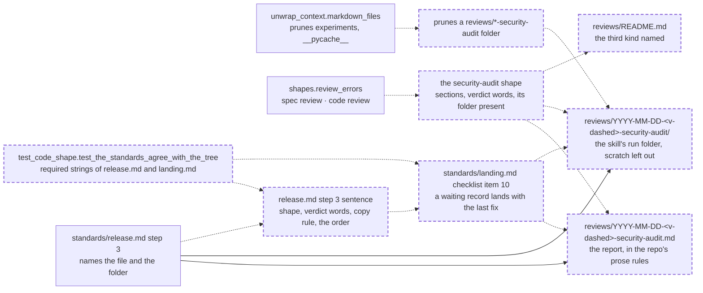

# The release audit is a review: `…-security-audit.md` gets a shape the lint knows, a dashed version in its name, and a run folder the prose checks leave alone

A process change that touches the gate (`tests/lint/`, `scripts/unwrap_context.py`) and two standards (`context/standards/release.md`, `context/standards/landing.md`): not structural, no public API, schema, rights or engine change. It comes from the 0.1.0a1 release: [release.md](../../standards/release.md) step 3 names a file and a folder that today's lint refuses, so the first release audit cannot be recorded as the standard asks. No intention and no research: the conflict is between two files in this repository, read below. Its build depends on nothing unlanded. Its landing waits: the 0.1.0a1 audit record, the first file of the new shape, lands with it, after the fixes the record reproduces have landed (decision 8), and at `f7539910` five of those fixes have no spec yet (The problem, its last two paragraphs). [The grant-gate spec](../archive/2026-11-07-the-grant-gate-judges-the-subtree.md), the fix of the audit's one high, which cites the record by run id, landed at `92190579`.

## The problem

READ at `3586750`, and again at `f7539910` with every line number below re-read. `release.md:76` says: "The audit writes one review file, `context/reviews/YYYY-MM-DD-<version>-security-audit.md`, and beside it a folder of the same name holding the skill's run folder with every path rewritten relative to the repository and both validators passing."

READ. Three lint rules refuse that today. First, `DATED_NAME_RE` (`tests/lint/shapes.py:39`) is `^\d{4}-\d{2}-\d{2}-[a-z0-9]+(?:-[a-z0-9]+)*\.md$`, so a name holding `0.1.0a1` fails `name_errors` (`shapes.py:234-250`) as "not named YYYY-MM-DD-descriptive-slug.md". Second, `review_errors` (`shapes.py:289-310`) answers "a review is named …-spec-review.md or …-code-review.md" (`shapes.py:305`) for any other direct file of `context/reviews/`. Third, `markdown_files` (`scripts/unwrap_context.py:42-48`, shared by `shapes.py:31`) walks every `.md` under `context/` except `experiments/` and `__pycache__/`, so the run folder's Markdown files fall under the one-line-paragraph check (`test_paragraphs_are_one_line`), and, because the folder's name carries a date on or after 2026-10-29, under the header and link checks of `new_documents` too.

READ. The run folder holds machine-written files: briefs that quote the skill's fenced instructions and wrapped prose, JSON records, the parent's tools, and every agent's promoted evidence. Its Markdown is the skill's output, not prose written to this repository's rules, and the skill's own validators (`validate-findings.cjs`, `validate-coverage-ledger.cjs`) are what hold its shape.

READ. The earlier release review spelled a version with dashes: `context/reviews/2026-11-06-the-release-lane-to-0-1-0-code-review.md`.

READ at `f7539910`. One spec has changed the lint since `3586750`, [the layer map and the size baseline](../archive/2026-11-07-the-gate-and-the-review-read-the-layer-map-and-the-size-baseline.md) at `b2a32c37`, and none of what it added touches the third kind. `review_errors` calls the new `layer_line_errors` (`shapes.py:313-326`) inside its `-code-review.md` branch alone (`shapes.py:297-303`), so a code review dated on or after `LAYER_LINES_START`, `2026-11-13` (`shapes.py:30`), opens its Ownership subsection with a "Layer map:" line holding `ladder` and a "Size:" line holding `allowlist`; a name ending `-security-audit.md` never reaches that branch, and the new branch sits beside it, leaving the rule as it is. The code review of this spec's own landing is such a review when it is dated on or after that day, and its two lines then open with "no module of `src/vfs` touched", because this spec changes none. Because this spec adds required strings to `tests/lint/test_code_shape.py` (the Design), which the ownership lens's diff reads, the Layer map line then closes "ladder unchanged, the file changed elsewhere: `test_the_standards_agree_with_the_tree` requires two more strings of `release.md` and one of `landing.md`", and the Size line closes "allowlist unchanged". Nothing else that landed reads what this spec adds: `test_code_shape.py` walks only from `SRC`, `CRATE` and `SECURITY_SKILL` (`test_code_shape.py:23-27`), so the run folder's Python files are never read, and `MODULE_LINE_BASELINE` (`tests/lint/allowlist.py:25-35`) keys only modules of `src/vfs`. Two tests hold the files this spec edits to fixed strings: `test_the_review_rubric_names_the_two_checks` holds `context/reviews/README.md` to the two lines' words and "placeholder memo or a spec", and `test_the_standards_agree_with_the_tree` holds `release.md` to eight required strings and four forbidden ones, none of which sits in step 3 or is needed by its new sentence; the one sentence each file gains removes no required string and adds no forbidden one. `landing.md` is read by the lint only for its existence (`test_code_shape.py:295`) and by the one-line-paragraph walk, since it sits under `context/`; it is no dated document, so the header, link and open-question checks do not read it, and it holds no string the new sentence would break. `test_context_shape.py` already uses the `monkeypatch` seam the Design names, in `test_a_new_code_review_states_the_layer_map_and_the_size`. EXECUTED: `uv run pytest tests/lint -q` gives 38 passed at `f7539910`, against 20 at `3586750`.

READ at `f7539910`, the fixes decision 8 waits on. The audit's one high and eight of its mediums have landed fixes, each spec citing run `vfs-run-1-2026-11-07` and the fingerprint it closes: the high, `src/vfs/storage/backends/database/rights.py:grant-refusal:addressed-path-gate-ignores-posture-holes-beneath`, by [the grant-gate spec](../archive/2026-11-07-the-grant-gate-judges-the-subtree.md) at `92190579`; `vfs:permissions:check_writable:subtree-override-not-consulted` by [a read-only rule gates the verbs that reach beneath](../archive/2026-11-07-a-read-only-rule-gates-the-verbs-that-reach-beneath.md) at `97c270a4`; `vfs:storage/backends/database/backend.py:_embed_step:refused-batch-head-of-line-no-split-or-quarantine` by [a refused embed batch is split](../archive/2026-11-07-a-refused-embed-batch-is-split-and-its-refused-chunks-set-aside.md) at `ae0be956`; `vfs.base._grep_rows_in_hand:inline-unbudgeted-verify` by [chained grep verifies off the loop](../archive/2026-11-07-chained-grep-verifies-off-the-loop-under-a-wall.md) at `f89e5cb5`; `vfs-core.verify.extend_context:per-hit-context-duplication` by [grep context regions never overlap](../archive/2026-11-07-grep-context-regions-never-overlap.md) at `e6998393`; `vfs-core.links.line_context:per-reference-whole-line-fold` by [the Markdown reference walk is linear](../archive/2026-11-07-markdown-reference-walk-is-linear.md) at `c9b7ebf2`; `vfs/storage/database/write-trusts-caller-authored-content-hash` by [storage measures every body it stores](../archive/2026-11-07-storage-measures-every-body-it-stores.md) at `b25bcd62`; `vfs/storage/replace.py:fuzzy-replacers-quadratic-inline-in-writer-transaction` by [the fuzzy edit match is linear and budgeted](../archive/2026-11-07-the-fuzzy-edit-match-is-linear-and-budgeted.md) at `4fc33072`; and `vfs.pattern_matching.glob._translate:backtracking-wildcards` by three, [glob matching on the linear engine](../archive/2026-11-07-glob-matching-runs-on-the-linear-engine.md) at `c544934a`, [glob matching off the loop under the wall](../archive/2026-11-07-glob-matching-runs-off-the-loop-under-the-wall.md) at `acf17350` and [scope roots and arms as two channels](../archive/2026-11-07-storage-takes-scope-roots-and-arms-as-two-channels.md) at `0867fbbe`. INFERRED: the run holds 17 confirmed records ([the spec review](../../reviews/2026-11-07-the-release-audit-is-a-review-spec-review.md), its probe 5), and decision 8 names them as the high, the mediums and three lows, so thirteen are mediums; eight medium fingerprints have landed fixes, so five confirmed mediums the developer chose to fix before 0.1.0a1 have no fix spec in this repository, and no document under `context/` names them, by decision 8's reason. Each needs its own spec, reviewed, built and landed, before the record lands; none of them changes this spec.

READ at `f7539910`, what landed specs ask of the record. [The two-channel spec](../archive/2026-11-07-storage-takes-scope-roots-and-arms-as-two-channels.md), in its Scope, carries SQLite's statistics-free seek of the tombstone index into the record as a known defect of the scope fan, and [the statistics spec](../archive/2026-11-07-sqlite-gathers-planner-statistics-after-each-write.md), landed at `2d263fb4`, asks in its decision 23 that the record name that defect as fixed there; the Design's record paragraph carries the line. Two fix specs cite evidence inside the run folder, under `agents/v15-p3/artifacts/evidence/` and `agents/v18-p3/artifacts/evidence/`, which decision 6 keeps, since it leaves out only `agents/*/scratch/`.

## Architecture

The lint learns a third review kind and prunes its run folder from the prose walk; two standards carry the order a record lands in, and the gate pins their sentences. Dashed is what this spec adds.

Page this changes: none; the architecture folder was retired on 2026-10-31, and the landing notes will say so in one line.

Terms. A **release audit** is the full-audit run of the security-audit skill that [release.md](../../standards/release.md) step 3 requires. Its **run folder** is the skill's output directory: `run-metadata.json`, `architecture.md`, `findings.json`, `coverage-ledger.json`, the three reports, `tools/` and `agents/`.

## Decisions

### 1. The file is `context/reviews/YYYY-MM-DD-<version>-security-audit.md` with the version's dots written as dashes, so `0.1.0a1` gives `2026-11-07-0-1-0a1-security-audit.md`

The dated-name rule stays one rule for every document, and the release-lane review already spelled `0.1.0` as `0-1-0`. A version holds only digits, letters and dots under PEP 440's normal form, so dashes are a lossless spelling. `release.md` step 3 says so in one sentence.

### 2. `review_errors` accepts a third kind, a name ending `-security-audit.md`, with eight sections in order: Run, Security posture, Confirmed findings, Needs validation, Hardening notes, Positive source patterns, Coverage, Verdict

These are the sections the skill's Phase 6 asks `REPORT.md` to carry (`.claude/skills/security-audit/VALIDATION-AND-REPORTING.md`, the `REPORT.md` items 1 to 7), named as headings, plus the Verdict every review in this folder ends with. No section is optional: a clean audit writes "None." under Confirmed findings, which the skill allows.

### 3. The Verdict's first line begins "Clears the release" or "Blocks the release"

`release.md` makes a confirmed critical or high a stop before the bump, so the audit's one decision is whether the release may proceed. A run clears only when `run-metadata.json` says `run_status` is `complete` and `findings.json` holds no record whose `verdict` is `confirmed` and whose `severity.overall_severity` is `critical` or `high`; any other run blocks. An incomplete run blocks because the skill keeps an unvalidated candidate out of `findings.json` (`VALIDATION-AND-REPORTING.md`, Phase 3's budget rule), so a high it never validated would otherwise be invisible to the rule. The standing verdict is read as for every review: the last dated line of the Verdict, or its first line when no line is dated. A blocked audit is re-signed below its first verdict, as `YYYY-MM-DD, re-read on <commit>: Clears the release …`, by a fresh reader who checks each blocking fingerprint against its landed fix, so the release cut from that commit stands on a signed line. The lint reads the two JSON files with the standard library and refuses a first verdict word that disagrees with them; a re-signed line is the reader's, and the lint does not judge it.

### 4. A security-audit review must have its run folder beside it, holding `run-metadata.json`, `findings.json` and `coverage-ledger.json`

`release.md` asks for the folder, and these three files are what the skill's two validators read. The lint checks only presence, because the validators are Node scripts and Node is not a dependency of this project's gate.

### 5. `markdown_files` prunes a directory directly under `context/reviews/` whose name ends `-security-audit`

The run folder is a machine record whose shape the skill's validators hold. Pruning it in the one walk that `scripts/unwrap_context.py` and `tests/lint/shapes.py` share leaves the paragraph, header and link checks off it, and keeps them on everything else. The review file itself is a direct document and keeps every prose check. Only that one pattern, in that one folder, is pruned, and the lint also refuses such a directory when it has no sibling file of the same name plus `.md`; that sibling's name is held by `DATED_NAME_RE`, so the folder's name is too, and no other directory can hide from the lint by its name. This departs from AGENTS.md's rule that every document under `context/` is one line per paragraph, in the way `experiments/` already does: the run folder is a machine record, not a document.

### 6. The copy leaves out every `agents/*/scratch/` directory and rewrites absolute paths to repository-relative ones

Scratch held the target-controlled processes' working files, including multi-hundred-megabyte decompression fixtures and SQLite databases, and the skill already promoted the evidence worth keeping into `artifacts/`. The rewrite turns the run root into the folder's repository path and the target root into the repository root. After those two rewrites, every other absolute or home-relative path is replaced by a token naming its kind: `<home>/…` for the home directory (written out or as `~/`), `<session-tmp>/…` for the session's temporary directory under `/private/tmp/`, and `<tmp>/…` for `/tmp`. No other byte of a file changes. Both validators print PASS on the copy at landing, run from the repository root after the rewrite; the landing notes record their output beside the skill's folder hash, and the record's JSON is not edited after.

### 7. The review file is written from the run's `REPORT.md`, with the eight headings of decision 2, one line per paragraph, and links to `FINDINGS-DETAIL.md` and `NEEDS-VALIDATION.md` inside the run folder

`REPORT.md` already carries the content Phase 6 requires; the review file is that content under this repository's headings and prose rules, so a reader starts at one file and follows links into the record. `REPORT.md`'s numbered headings lose their numbers, and its fourth section, Finding summaries, is folded under Confirmed findings after the table. One kind of addition is allowed, and only one: a line that a landed spec's decision requires of the record, written under the Run section, saying that it is an addition to the run's report and naming the spec that requires it. Such a line is the record author's, not the skill's; it is no confirmed record, and `findings.json` does not change. A landed spec can learn of a defect beside the audit that the record should name, and the record is the one place a later reader looks for what the release knew; nothing else may be added, so the review file stays the run's report. Today there is one such line: the statistics-free tombstone-index seek, a known defect of the scope fan found beside the audit, which [the two-channel spec](../archive/2026-11-07-storage-takes-scope-roots-and-arms-as-two-channels.md) carried into the record and [the statistics spec](../archive/2026-11-07-sqlite-gathers-planner-statistics-after-each-write.md), in its decision 23, asks the record to name as fixed there.

### 8. A release audit's record never lands while a confirmed finding at medium or above that it reproduces has no landed fix; it lands in the push that carries the last of those fixes, and until then the release's notes and the fix specs cite the run by id

The repository is public, and the record holds a bounded reproduction of each confirmed finding: `FINDINGS-DETAIL.md` copies one for every confirmed medium, high and critical (`VALIDATION-AND-REPORTING.md`, Phase 6). Committing it while such a finding is unfixed would publish a working recipe against code on `main`. The rule holds for every release, not only this one. [release.md](../../standards/release.md) step 3 requires only a critical or a high to be fixed before the bump, so a later release may ship with a medium left unfixed by the developer's choice. Such a release's record then waits: it lands with the last of those fixes, and until that push the release's notes and the fix specs cite the run by id, as the 0.1.0a1 fix specs do now. The cost is plain: such a release ships before its record is in the repository, so for a while its audit can be read only by its run id, not in the tree. In that case the review file is written and its verdict signed before the bump, beside the run folder outside the repository, and both land unchanged with the last fix; until then the release stands on a signed line no one but its reader has seen, and the lint holds its shape and its first verdict word only when it lands. This general rule is the session lead's ruling of 2026-11-12, extending to every release the conservative choice the developer made for 0.1.0a1.

For 0.1.0a1 the developer chose to fix the high and every medium before the release, so its record lands after those landings, in the push that carries the release's last fix. The spec, the lint change and the two standards' sentences land with the record in one commit, because the lint change has no other user. Confirmed lows and needs-validation leads may be published unfixed, in every release: a low is ranked low because its demonstrated damage is small, and a lead is no confirmed finding, only a trace that waits on a fact outside source. For 0.1.0a1 that means the three confirmed lows and the six leads: the lows are one-bit oracles or cost growth under a non-default configuration, and each lead waits on a fact outside source; the developer is told so before the record lands. The lint does not pin this order. It cannot know which findings have landed fixes, so the order is kept in prose: `release.md` step 3 at the release, and `landing.md`'s checklist at the landing that carries a waiting record's last fix. The gate pins only that both sentences are present, through required strings in `test_the_standards_agree_with_the_tree`, never that they are obeyed.

## Intent

After this spec, a release audit is recorded where `release.md` says, as `context/reviews/2026-11-07-0-1-0a1-security-audit.md` with its run folder beside it, and `scripts/ci.sh` is green with both in the tree. The lint holds the review file to a shape and a verdict like the other reviews, requires the run folder beside it, and leaves the run folder's machine-written files to the skill's own validators. `release.md` and `landing.md` say when a record may land against the findings it reproduces, for every release, and the gate holds both sentences present.

## Design

**`tests/lint/shapes.py`.** `SECURITY_AUDIT_SECTIONS` (the eight names of decision 2) and `SECURITY_AUDIT_VERDICTS = ("Clears the release", "Blocks the release")` sit beside the other review constants. `review_errors` gains a branch for `path.name.endswith("-security-audit.md")`: section order through `section_order_errors` with no optional heading, the verdict check shared with the other kinds, an error when `path.with_suffix("")` is not a directory holding the three files of decision 4, and an error when the first verdict word disagrees with decision 3's rule read from `run-metadata.json` and `findings.json` through `json.loads`. `name_errors` also refuses a `-security-audit` directory under `reviews/` with no sibling `.md` (decision 5). The final error message names the three kinds.

**`scripts/unwrap_context.py`.** `markdown_files` prunes a directory when its parent is `root / "reviews"`, where `root` is the walk's own argument, and its name ends `-security-audit`, beside the `SKIPPED_DIRS` prune; `AUDIT_RUN_SUFFIX: Final = "-security-audit"` is its constant.

**`context/standards/release.md`.** Step 3's sentence names the dashed version, the eight-section shape, the verdict words, the re-sign of decision 3, the copy rule of decision 6, and the order of decision 8: the record never lands while a confirmed medium, high or critical it reproduces has no landed fix; it lands in the push that carries the last of those fixes; until then the release notes and the fix specs cite the run by id; and a release that ships with a medium unfixed by choice ships before its record is in the repository. The sentence holds the words "never lands while" and the verdict word "Blocks the release" as written here, because the gate requires both.

**`context/standards/landing.md`.** Checklist item 10 gains one sentence at its end, verbatim: "A push that carries the last landed fix of every confirmed medium, high or critical a release audit reproduces also carries that audit's record, when the record is not yet in the tree, in a commit of its own unless a spec lands it; the fix specs cite the run by id, so `git grep <run id> context/specifications/archive` lists the fixes landed so far." The item stays one line. Nothing else in the lint reads `landing.md` beyond its existence and the one-line walk (The problem), so the sentence trips no required or forbidden string.

**`tests/lint/test_code_shape.py`.** `test_the_standards_agree_with_the_tree` adds "never lands while" and "Blocks the release" to its required strings for `release.md`, and gains a required entry for `landing.md` holding "that audit's record". Each string is absent from its file today and present once the sentence is written, so the pin is red before the standards change and green after; "security-audit.md" is no pin, since step 3 already holds it. A required string pins the sentence's presence, never its truth, which is all the gate can do for an order it cannot read.

**`context/reviews/README.md`.** The file-names section gains the third kind in one sentence.

**The record.** `context/reviews/2026-11-07-0-1-0a1-security-audit.md` and `context/reviews/2026-11-07-0-1-0a1-security-audit/`, copied by a scratch script outside the repository that applies decision 6 and is not committed. Its first verdict is "Blocks the release", because the run holds a confirmed high, and the re-sign of decision 3 checks that fingerprint against the grant-gate spec's landing at `92190579`. The re-sign line is written before the landing commit by a reader who did not write the record, named in the landing notes, and rides in that commit, so the record lands with its standing verdict beginning "Clears the release" and the bump of `release.md` step 4 follows it. Its Run section carries the one addition decision 7 allows today, marked as an addition: the statistics-free tombstone-index seek, a known defect of the scope fan, fixed by [the statistics spec](../archive/2026-11-07-sqlite-gathers-planner-statistics-after-each-write.md), as that spec's decision 23 asks; the defect was found beside the audit, so it is no confirmed record and `findings.json` does not change.

**Tests first.** `tests/lint/test_context_shape.py` gains the nodes of criteria 1 to 4, built on files under `tmp_path`. The seam is `monkeypatch`, as `test_a_new_code_review_states_the_layer_map_and_the_size` already uses it for `LAYER_LINES_START`: the tests set `shapes.REPO` to `tmp_path` and `shapes.CONTEXT` to `tmp_path / "context"`, so `relative()` (`shapes.py:134-135`) and `name_errors()` read the scratch tree. Criteria 1 to 3 are seen failing before `shapes.py` and `unwrap_context.py` change; criterion 4 is a pin that passes today and stays passing. Criterion 8's three required strings are added to `test_the_standards_agree_with_the_tree` and seen failing before `release.md` and `landing.md` change. Each new node's docstring names what it guards: the `run_status` check dropped, a severity dropped from the blocking set, the folder or file check dropped, the orphan check dropped, the prune anchored at the module's `CONTEXT` or widened past `reviews/`, and a dot admitted by `DATED_NAME_RE`.

**Scale.** The walk prunes one more directory; nothing in the gate grows. Each release adds its run folder whole, about 7 MB on disk and 2 MB compressed for 0.1.0a1 (282 files, scratch left out); the walk does not descend into it, and no cap is set. Against the reference deployment no multiplier applies: the change runs per lint run and per release, never per verb call, write, index visit, batch or corpus. What it does ride is the number of releases, each adding one review file and one run folder to the repository, and per release one directory entry the walk prunes, three existence checks and two small JSON reads per lint run; the folder's other files cost the gate nothing, and the clone grows by about 2 MB compressed per release.

## Scope

In: decisions 1 to 8. Files: `tests/lint/shapes.py`, `scripts/unwrap_context.py`, `tests/lint/test_context_shape.py`, `tests/lint/test_code_shape.py`, `context/standards/release.md`, `context/standards/landing.md`, `context/reviews/README.md`, the review file and run folder of decision 7, and this spec's landing notes.

Out: the fixes the audit calls for (their own specs, which land before this one by decision 8); running the skill's Node validators inside `scripts/ci.sh` (decision 4's reason); any change to the vendored skill under `.claude/skills/security-audit/`; the per-spec security lens of the code review, which writes no run folder.

## Acceptance criteria

Counts and states, never clocks. Tests are in `tests/lint/test_context_shape.py`, except criterion 8's, in `tests/lint/test_code_shape.py`.

1. A `tmp_path` reviews folder holding `2026-11-07-9-9-9-security-audit.md` with the eight sections in order, a Verdict whose first line begins "Blocks the release", and its folder with the three files holding a confirmed high, gives `review_errors` an empty list; the same file beginning "Clears the release" gives one error naming decision 3's rule, as does a "Clears the release" over a record with no high whose `run_status` is `incomplete`, and a "Clears the release" over a complete record with no high gives none, and a "Clears the release" over a complete record whose one confirmed record has `overall_severity` `critical` gives one error naming decision 3's rule; the same file with the Coverage section removed gives one error naming it; a Verdict beginning "Ship it" gives one error naming the two verdict words. Test: `test_a_security_audit_review_has_its_shape`.
2. The same file without its folder gives one error holding the words "run folder" and the folder's path, words today's refusal does not hold; with the folder missing `findings.json`, one error naming `findings.json`; a `reviews/2026-11-07-9-9-9-security-audit/` directory with no sibling `.md` gives `name_errors` one error naming it. Test: `test_a_security_audit_review_needs_its_run_folder`.
3. `markdown_files(root)`, with `root` a `tmp_path` context, holding `reviews/2026-11-07-9-9-9-security-audit/REPORT.md` and `reviews/2026-11-07-other/notes.md` returns the second file and not the first, and a `research/x-security-audit/a.md` is still returned. Test: `test_the_walk_prunes_only_a_release_audit_run_folder`.
4. A pin that passes today and stays passing: a name ending `-security-audit.md` that holds a dot is refused by `name_errors`, and `2026-11-07-0-1-0a1-security-audit.md` matches `DATED_NAME_RE`. Test: `test_a_release_audit_name_spells_its_version_with_dashes`.
5. With the record committed, `test_reviews_have_their_shape`, `test_links_resolve`, `test_paragraphs_are_one_line`, `test_new_documents_carry_no_header_lines`, `test_no_document_holds_an_open_question` and `test_documents_are_dated_and_unnumbered` pass, and `grep -rE '/Users/|/private/(tmp|var)/|/tmp/|~/' context/reviews/2026-11-07-0-1-0a1-security-audit` exits 1, so the record's vfs fixture paths such as `/private/bob/plan.md` stay as written.
6. From the repository root, `node .claude/skills/security-audit/validate-findings.cjs context/reviews/2026-11-07-0-1-0a1-security-audit/findings.json` and the ledger validator on its `coverage-ledger.json` each print PASS and exit 0; no `scratch` directory exists under the folder.
7. `scripts/ci.sh` is green at 100% coverage on the tree as committed.
8. `test_the_standards_agree_with_the_tree` fails on today's `release.md` and `landing.md`, which hold none of "never lands while", "Blocks the release" and "that audit's record", and passes with step 3's new sentence and checklist item 10's. Test: `tests/lint/test_code_shape.py::test_the_standards_agree_with_the_tree`.

## Landing notes

Filled in on landing.

## One line

The release audit becomes a review the lint knows, named with a dashed version, carrying a verdict that clears or blocks the release, with the skill's run folder beside it and out of the prose checks, and it lands only once every medium or worse it reproduces is fixed, an order `release.md` and `landing.md` both state.
