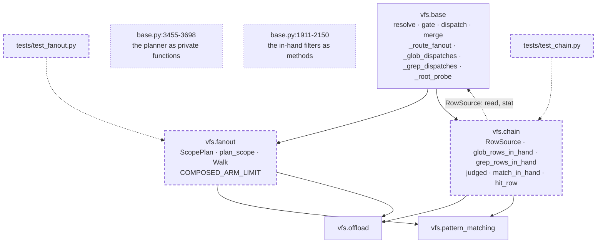

# The router keeps routing: the fan-out planner moves to `vfs.fanout` as pure functions, the rows-in-hand filters move to `vfs.chain` behind a row-source protocol, and `base.py` loses about five hundred lines without changing one answer

A refactor, structural: it adds the modules `src/vfs/fanout.py` and `src/vfs/chain.py` and moves code into them from `src/vfs/base.py`; it adds no public class, protocol method or lifecycle, changes no public API (`glob(observations=…)` and `grep(observations=…)` keep answering through the router until [the public-surface spec](../active/181-the-public-surface-regrouped-by-kernel-group/spec.md) moves chaining onto the result type), no schema, no rights rule and no engine; the engine legs are not needed because no storage file changes. It is the first slice of what [the storage-seam spec](../active/179-the-storage-seam-as-the-kernel/spec.md) and the public-surface spec, both October drafts and not started, named as `src/vfs/chain.py`; it takes that slice as they described it and leaves the rest. It depends on [the two-channel scope spec](2026-11-07-storage-takes-scope-roots-and-arms-as-two-channels.md), active and being built, which edits the planner, and on [bounded work has one home](2026-11-07-bounded-work-has-one-home.md), active and not built, whose `Deadline` and process pool the moved code takes; it lands after both and is not parallel-safe with either. It stands on [import direction and module size as fitness functions](../../research/2026-11-07-import-direction-and-module-size-fitness-functions.md) for the measurement and on the ownership rule in [how we code](../../standards/how-we-code.md) for the move; no further study would change a move of code that already has no `self`.

## The problem

READ at `acf1735`, with the two-channel work uncommitted. `src/vfs/base.py` is 3,710 lines and its one class spans lines 419 to 3455 with about 110 methods. EXECUTED ([the trend](../../research/studies/2026-11-07-import-direction-and-module-size-fitness-functions/experiments/02-module-size-trend/output.txt)): it was 3,257 lines on 2026-11-06 and grew by 365 in the eleven landings of 2026-11-07, five of which touched it. Two coherent concerns account for most of that growth and neither needs the router's state.

READ. The fan-out planner, `base.py:3455-3698`: `_ScopePlan`, `_Walk`, `_WallReached`, `_plan_scope`, `_switched_entries`, `_addresses_whole_side`, `_root_literal`, `_scope_channels`, `_root_members`, `_composed_members`, `_residual_renders`, `_glob_reaches`, `_walks`, `_scoped` and `_COMPOSED_ARM_LIMIT`. `_plan_scope`'s own docstring calls it "a pure function of the mount-table facts the router resolved on the loop and the pattern text, so it runs on a worker"; it takes owners, keys, skip paths, roots, patterns, exclusions, reach, literals and a deadline, and returns plain data. It is tested today only through router calls (the two-channel spec's criterion 11 counts compositions inside a router glob).

READ. The rows-in-hand filters, `base.py:1911-2150`: `_glob_rows_in_hand`, `_grep_rows_in_hand`, `_judged`, `_match_in_hand` and `_hit_row`, with `_CHAINED_REFINE_GUIDANCE` and `_CHAINED_GLOB_REFINE_GUIDANCE`. They judge rows the caller holds against glob gates, read absent content or kind through `self.read` and `self.stat`, batch bodies by bytes, match them on a worker under a wall and mint truncations; of the router's state they use only those two verbs and, before the bounded-work spec lands, its pool. The storage protocol's docstring says "chained rows are filtered by the router without reaching storage at all", so the router has become a second matching engine for rows in hand. The public `glob` and `grep` call them directly after the params gate and the open check (`base.py:1410-1413`, `:1514-1517`).

READ. The off-loop glob code review's ownership lens noted and did not file that "the judge, then admit loop has four spellings" across the router's `_judged`, grep's `_gated`, glean's `_Gates.judge` and `glob_rows` inline ([the review](../../reviews/2026-11-07-glob-matching-runs-off-the-loop-under-the-wall-code-review.md), Ownership subsection).

## Architecture

Dashed is what this spec adds; dotted is what leaves the router.

Page this changes: none; the architecture folder was retired on 2026-10-31, and the landing notes will say so in one line.

Terms. A **row source** is anything that answers `read` and `stat` over observations in the caller's coordinates; the router is one. The **planner** is the walk that turns a fan-out's roots, patterns and exclusions into each entry's members and scope channel.

## Decisions

### 1. `src/vfs/fanout.py` holds the planner as public functions, and the router calls `plan_scope` from `_planned`

`_ScopePlan` becomes `ScopePlan`, `_plan_scope` becomes `plan_scope`, `_Walk` becomes `Walk`, `_COMPOSED_ARM_LIMIT` becomes `COMPOSED_ARM_LIMIT`, and the helpers `_switched_entries`, `_addresses_whole_side`, `_root_literal`, `_scope_channels`, `_root_members`, `_composed_members`, `_residual_renders`, `_glob_reaches` and `_walks` move with their names under the module's Internal helpers banner; `_WallReached` moves as the private control-flow signal it is; `_scoped` stays in the router, since it shapes a dispatch keyword. The function has no `self`, takes plain data and returns plain data, and the bounded-work spec already gives it a `Deadline`; a module of its own lets `tests/test_fanout.py` pin the walk directly, where today every planner pin is a router call. The module imports `vfs.pattern_matching` for the algebra, `vfs.offload` for the deadline and `vfs.paths`; it sits in the router's layer and the router imports it downward.

### 2. `src/vfs/chain.py` holds the rows-in-hand filters as async functions over a `RowSource` protocol, and the public `glob` and `grep` call them after the gate

`glob_rows_in_hand(source, observations, *, arms, ext, ext_not, globs_not, kind, max_count, authority) -> Result` and `grep_rows_in_hand(source, observations, *, pattern, …, authority) -> Result` take the arguments the methods take today, plus `source: RowSource`, a `Protocol` with `read(*, observations, columns, authority)` and `stat(*, observations, columns, authority)` that `AsyncVirtualFileSystem` satisfies. `_judged` becomes `judged`, `_match_in_hand` becomes `match_in_hand`, `_hit_row` becomes `hit_row`, and the two guidance constants move. `_observation_rows` and `_cap_rows` stay on the router and their results are passed in: the router runs the params gate, the open check and `_observation_rows` as today, calls the function, and returns its result through `_cap_rows` for glob. This is the module the storage-seam and public-surface drafts named, with the behaviour unchanged, so the later spec that moves chaining onto the result type moves a function and not a method. A pure filter over rows in hand is not routing: it resolves no path and dispatches to no entry.

### 3. Every behaviour is unchanged, and every existing router test passes with only its patch target moved

The tests under `tests/base/test_glob_namespace.py` and `tests/base/test_grep_namespace.py` that patch `vfs.base.compile_verifier`, `vfs.base.call_offloaded`, `vfs.base.CONTENT_BYTE_BUDGET`, `vfs.base.WALL_TIME_BUDGET` or `vfs.base.match_texts` patch the same names on `vfs.chain`; those that count `composed_pattern` inside `_plan_scope` count it on `vfs.fanout`. No assertion changes. A move that changed an answer would be a different spec.

### 4. The planner gains direct pins in `tests/test_fanout.py`, and the in-hand filters direct pins in `tests/test_chain.py` over a fake row source

The direct pins are the criteria below: the planner's purity (equal inputs give equal plans, and no router exists in the test), its wall stop, and its switch at the composition limit; the in-hand filters' read of absent content through the source and nothing else. The router tests keep pinning the whole path.

### 5. `COMPOSED_ARM_LIMIT` moves with the planner and is removed by the one-shape spec that follows

[The one-shape spec](2026-11-07-scope-crosses-the-seam-in-one-shape.md) removes the switch; this spec moves the planner as the two-channel spec leaves it, so that spec edits one small module instead of the router.

### 6. The size baseline's entry for `base.py` falls to its new count at this landing

[The gate-and-review spec](2026-11-07-the-gate-and-the-review-read-the-layer-map-and-the-size-baseline.md) holds the baseline; this landing lowers the router's entry and adds no entry, because neither new module is near the ceiling.

## Intent

After this spec, the router resolves, gates, dispatches and merges, and nothing else: the walk that plans a scoped fan-out is a pure module with its own tests, the filters over rows in hand are a module that takes a row source, and `base.py` is about five hundred lines shorter with every verb answering exactly as before.

## Design

**`src/vfs/fanout.py`** (new, about 280 lines). Module docstring: what a plan is, the composition and residuation rules in two sentences, and that the walk is pure. Then `COMPOSED_ARM_LIMIT` with its two-line comment; `ScopePlan`; `Walk` and `_WallReached`; `plan_scope`; then the Internal helpers banner and the nine helpers in their present order.

**`src/vfs/chain.py`** (new, about 260 lines). Module docstring: rows in hand are filtered, never dispatched; the source protocol. Then `CHAINED_REFINE_GUIDANCE` and `CHAINED_GLOB_REFINE_GUIDANCE`; `RowSource`; `glob_rows_in_hand`; `grep_rows_in_hand`; `judged`; `match_in_hand`; `hit_row`.

**`src/vfs/base.py`.** Lines 1911 to 2150 and 3455 to 3698 go, less `_scoped`, `_reaches_beneath`, `_is_tombstoned_site`, `_wall_record`'s replacement and `_closed_error`, which stay. `glob` and `grep` call `glob_rows_in_hand(self, rows, …)` and `grep_rows_in_hand(self, rows, …)` where they called the methods; `_planned` calls `plan_scope`; `_glob_dispatches`, `_grep_dispatches` and `_scope_skips` read `ScopePlan` fields as they read `_ScopePlan`'s. Imports: `vfs.fanout` and `vfs.chain` at the top, the moved names gone.

**Tests first.** `tests/test_fanout.py` and `tests/test_chain.py` are written first and seen failing on the missing modules; the router tests' patch targets are changed in the same commit as the move, because a patch of a name that no longer exists fails loudly.

**Scale.** A move; no loop, statement or structure changes.

## Scope

In: decisions 1 to 6. Files: `src/vfs/fanout.py` (new), `src/vfs/chain.py` (new), `src/vfs/base.py`, `tests/test_fanout.py` (new), `tests/test_chain.py` (new), `tests/base/test_glob_namespace.py`, `tests/base/test_grep_namespace.py`, `tests/base/test_dispatch.py` (patch targets only), `tests/lint/allowlist.py` (the baseline entry), and this spec's landing notes.

Out: moving chaining onto the result type and the `vfs.chain` public functions the public-surface spec describes; the one spelling of the "judge, then admit" loop across the router and the three storage sites, a placeholder memo of its own once this spec and the one-shape spec leave the four sites in two modules; the root probes and the dispatch builders, which are dispatch and stay; the seam's shape, which [the one-shape spec](2026-11-07-scope-crosses-the-seam-in-one-shape.md) decides.

## Acceptance criteria

Counts and states, never clocks.

1. `tests/test_fanout.py::test_plan_scope_is_a_pure_function`: two calls of `plan_scope` with equal arguments, built from literal paths and patterns with no router, return equal `ScopePlan`s, and a counter on `composed_pattern` reads the same count both times.
2. `tests/test_fanout.py::test_the_walk_stops_at_its_wall_and_keeps_undecided_skips`: with a `Deadline` under a fake clock that passes after the first chunk of residuations, `plan_scope` returns `completed` false, the roots planned before the stop, and every skip path not yet decided kept.
3. `tests/test_fanout.py::test_an_entry_past_the_composition_limit_rides_its_roots_as_a_scope`: 201 owned roots and one arm give that entry a `ScopeChannel` of 201 roots and no composed members; 200 give 200 composed members and no scope.
4. `tests/test_chain.py::test_chained_grep_reads_absent_content_through_the_source_only`: a fake `RowSource` whose `read` records its calls serves `grep_rows_in_hand` over three rows of which one lacks content; `read` is called once with that one row and `columns == frozenset({"content"})`, `stat` is never called, and the result holds the two matching rows in order.
5. `tests/test_chain.py::test_chained_glob_stats_only_the_rows_without_a_kind`: a fake source whose `stat` records its calls serves `glob_rows_in_hand` with `kind="file"` over rows of which two carry no kind; `stat` is called once with exactly those two.
6. `wc -l src/vfs/base.py` is at most 3,250 on the tree as committed, and `tests/lint/allowlist.py`'s `MODULE_LINE_BASELINE` entry for it equals that count; `grep -c 'def ' src/vfs/base.py` is at least 14 lower than at the commit before this landing.
7. `grep -rn 'rows_in_hand\|plan_scope\|_Walk\b' src/vfs/base.py` lists only the call sites in `glob`, `grep` and `_planned`, and `grep -rn 'from vfs.base' src/vfs/fanout.py src/vfs/chain.py` lists nothing.
8. Every node of `tests/base/test_glob_namespace.py`, `tests/base/test_grep_namespace.py` and `tests/base/test_dispatch.py` passes with only a patch target changed from `vfs.base` to `vfs.chain` or `vfs.fanout`, and `git diff` of those files shows no assertion changed. `scripts/ci.sh` is green on the tree as committed.

## Landing notes

Filled in on landing.

## One line

The planner and the in-hand filters leave the router for two small modules with their own tests, the router goes back to resolving, gating, dispatching and merging, and no verb answers differently.
