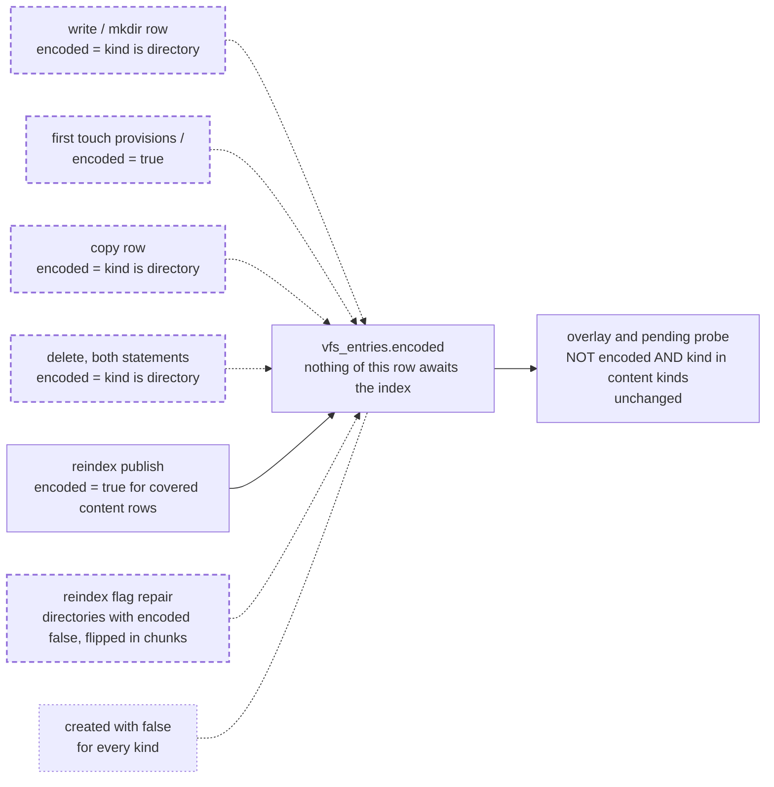

# A directory is never awaiting the index: the entry row's `encoded` flag means "nothing of this row awaits the gram index", a directory is created with it true and keeps it true through delete, copy and restore, and reindex repairs the directories earlier stores wrote with it false

A fix to the database backend's provisioning, write, trash, topology and reindex paths (`src/vfs/storage/backends/database/engine.py`, `writes.py`, `trash.py`, `topology.py`, `indexing.py`, `backend.py`) and the entry table's docstrings (`src/vfs/models/rows.py`): no public API change, no schema format change (the column and its index are unchanged; what a directory row holds in the column changes), no rights rule and no Rust. It touches `storage/backends/database/`, so it needs the engine legs through the `db_test` skill. It changes a stored value's meaning, so this spec is reviewed for the regressions and downstream effects a changed invariant can carry before it is built. No intention and no research: the facts are read from the source and measured below. It depends on no decision of another spec, but it shares files with specs ahead of it and lands after them. [The statistics spec](2026-11-07-sqlite-gathers-planner-statistics-after-each-write.md), "Fit to build" and being built in the working tree, rewrites `backend.py`, `engine.py`, `scope.py` (its decision 27 wraps the `NOT encoded` term at `scope.py:263`, beside which this spec rewrites the docstring), `test_trash.py`, `test_writes.py` and `test_conformance.py`, and its decision 27 shows that this change does not alter the planner's choice; this spec lands after it and rebases onto it. [The lexical fetch fix](2026-11-08-the-lexical-fetch-spells-its-arms-as-a-tuple-membership.md), under review, rewrites `glean.py`'s tail fetch; whichever of it and this spec lands second rebases its `glean.py` docstring edit. [Bounded work has one home](2026-11-07-bounded-work-has-one-home.md) and [scope crosses the seam in one shape](2026-11-07-scope-crosses-the-seam-in-one-shape.md), active and not built, also name `backend.py`, `scope.py` and `glean.py`; they land after this spec or rebase their docstring edits onto it.

## The problem

READ at `79752e7`. `vfs_entries.encoded` is a boolean, not null, default false (`src/vfs/models/rows.py:445`). The flag algebra (`src/vfs/storage/backends/database/indexing.py:32-37`) states its invariant as "`encoded=True` implies the entry's grams are present in the current epoch", and reindex's publish phase is the only writer that sets it true, for the entries whose chunks the epoch covers (`indexing.py:476-486`). A content write resets it (`writes.py:1205`), a bytes rendering resets it (`render.py:360`), and the delete claim demotes it as it stamps `deleted_at` (`trash.py:446-450`, `:484`), so a restored row is pending again. The index tier's candidate fetch requires it (`grep.py:573`, `glean.py:611`), and the scan tier's overlay is the `NOT encoded` rows of the content kinds (`scope.py:263`, `reads.py:685`).

READ. A directory has no body and no chunks: `chunk_dirty` reads only the content kinds (`indexing.py:323`), the gram and lexical builds read only `chunked` rows (`indexing.py:410`), and the pending probe requires `chunked` (`indexing.py:726`), which a directory never is. So a directory's `encoded` starts false at creation (`writes.py:1198-1216` writes `"encoded": False` for every staged row, directories included, and `_provision` inserts the root `/` with no value, so it takes the column default, false: `engine.py:534-546`), is never flipped by publish, and stays false for the life of the row. The flag reads "awaiting the index" for a row that nothing will ever index. The index comment on `ix_vfs_entries_encoded_kind` (`rows.py:485-487`) says so in other words: the `encoded = 0` set is mostly directories, and `kind` is in the key to reject them.

EXECUTED on a reindexed 56,001-row store (`detail.sqlite` in the session scratchpad): 6,001 directories with `encoded` false, 1 file with it false, 50,000 files with it true. A directory's searchable surface, its path and name, lives in the entry row and the segment postings, which every write maintains in the same transaction; a directory is answered by glob, ls, stat and the path terms of grep and glean with nothing pending.

EXECUTED, the limit of this change: with every directory set to `encoded` true and statistics re-gathered, the overlay fetch's plan is unchanged (`SCAN vfs_entries USING INDEX ix_vfs_entries_path`), because SQLite's statistics hold one average per index column and a column with one pending row and 56,001 others still averages to half the table. This spec corrects the flag's meaning; it does not change a plan, which is [the statistics spec](2026-11-07-sqlite-gathers-planner-statistics-after-each-write.md)'s decision 27.

READ. `topology.py:103` copies `_COPIED_COLUMNS` from each source row of a copied subtree, and `encoded` is not among them, so a copied row takes the column's default, false. The delete demotes `encoded` in two statements, the root claim's `assign` in `_tombstone_roots` (`trash.py:454`) and the descendants' `UPDATE` in `_tombstone_descendants` (`trash.py:484`), for every row claimed, directories included. Two more docstrings state the old meaning: `lexical.py:11-13` ("`encoded=True` implies the entry's terms are in the current lexical epoch") and `grep.py:417` ("No published epoch means no encoded entries"). The reindex re-convergence passes (`backend.py:1280-1302`) repair segment and edge drift by collecting the drift in a read transaction and applying only the found rows under guards.

## Architecture

Dashed is what this spec adds; dotted is what it retires.

Page this changes: none; the architecture folder was retired on 2026-10-31, and the landing notes will say so in one line.

Terms. A **content kind** is a kind whose rows carry a body: file, chunk and version. The **overlay** is the set of `NOT encoded` rows of the content kinds, which grep and glean search from live text.

## Decisions

### 1. `encoded` means "nothing of this row awaits the gram index"; for a content row that is "its grams are in the current epoch", as today, and for a directory it is always true

The flag's one reader is the index tier, which trusts the index for a row that is encoded and searches live text for one that is not; both readers already restrict themselves to the content kinds, so a directory's value has never changed an answer. A value that is false forever for a row nothing will index describes nothing, and it misleads every reader of the data, the statistics row among them. "Nothing awaits the index" is true of every directory and of every content row whose grams the epoch holds, so it is the one meaning both kinds satisfy. The flag algebra's invariant keeps its content-row half word for word and gains the directory clause.

### 2. A created row's `encoded` is `kind == "directory"`: the row dict in `writes.py` sets it so for both the staged file and the staged directory, the same dict serving mkdir, the parents a write mints, and a write at a tombstoned path

One dict builds every created row (`writes.py:1198`), so one expression settles creation, revival and parent minting at once. A content row still starts false, because its grams are not in the epoch until publish. The one other creation site is the root: `_provision`'s insert of `/` (`src/vfs/storage/backends/database/engine.py`) sets `encoded=True`, so a fresh store holds no directory awaiting the index and its first reindex reports no repair.

### 3. A copied row's `encoded` is `kind == "directory"`: the copy's row values set it beside the copied columns

A copied content row's grams are not in the epoch under its new identity, so it starts false as today; a copied directory holds nothing to index, so it starts true. Leaving the column to its default would carry the old meaning into every copied directory.

### 4. The delete demotes `encoded` only for content kinds: both of its statements, the root claim's `assign` in `_tombstone_roots` and the descendants' `UPDATE` in `_tombstone_descendants`, set `encoded` to `CASE WHEN kind = 'directory' THEN true ELSE false END`

The demotion exists so a restored content row is pending again and the next reindex covers it (`trash.py:446-450`). A directory has nothing to re-cover, and a trashed directory flipped false would be the one reachable state where the invariant of decision 1 fails. The `CASE` spells a boolean value on every engine; SQL Server has no boolean expression in a value position, which `reads.py:680` already works around the same way. Both statements take it, because a deleted directory's nested directories are claimed by the descendants' statement and its root by the claim.

### 5. Reindex repairs the directories an earlier store wrote with `encoded` false: a re-convergence pass collects their ids in a read transaction and flips them under per-row guards in chunks of `membership_budget`, reporting the count in the `reindex` Result's warnings as drift, like the segment and edge passes

Stores written by the alphas on PyPI hold directories with the old value, and so does every store in this repository's fixtures until this lands. The repair is one more drift pass in the shape the two existing passes have: a plain read diffs the table against the truth, only found drift opens a writer transaction, and the write is applied under guards in bounded chunks, so a store of a million directories is repaired in chunks and never in one statement. Reporting it as drift tells the operator the store predates this rule; a second reindex reports 0. The pass reports one warning, never one per row: `classified(ErrorKind.internal, severity=Severity.warning, detail=f"{n} directories predated the rule that a directory never awaits the gram index; repaired", retryable=False, data={"directories": n})`, with no path; `internal` because the rows are the store's own state that this build's rule finds behind, as the segment and edge passes classify their drift; `retryable=False` because nothing is left to do; and no warning at all when `n` is 0.

### 6. The `encoded` column's docstring in `rows.py`, the index comment, the flag algebra paragraph in `indexing.py`, `lexical.py`'s module docstring, `grep.py`'s `_index_doc_ids` docstring and the overlay docstrings in `scope.py` and `glean.py` say the new meaning; the index comment no longer says the `encoded = 0` set is mostly directories

A reader of the schema or of the index tier learns what the flag means from these places, and the index comment would otherwise state a fact this spec makes false. `lexical.py`'s invariant gains decision 1's directory clause, and `grep.py`'s reads "no published epoch means no content row is encoded".

### 7. The statistics step's plan for the overlay fetch is out of scope here and unchanged by this spec

EXECUTED in The problem: the plan does not move when directories are flagged true, because the statistics format averages over distinct values. The plan is [the statistics spec](2026-11-07-sqlite-gathers-planner-statistics-after-each-write.md)'s decision 27, and the partial index over pending content rows that spec names as the direction is indifferent to how directories are flagged.

## Intent

After this spec, every directory row in a store carries `encoded` true from its creation, through copy and delete and restore, and the flag reads the same way for every row: nothing of this row awaits the gram index. A store written before this rule is brought to it by its next reindex, which reports how many directories it repaired, and reports 0 the time after. No answer of any verb changes: the overlay, the pending probe and the index tier read only the content kinds, as today.

## Design

**`src/vfs/storage/backends/database/writes.py`.** The created-row dict sets `"encoded": staged.kind == "directory"`; its docstring gains one sentence on the flag's meaning for a directory.

**`src/vfs/storage/backends/database/engine.py`.** `_provision`'s insert of the root `/` sets `encoded=True`, with a two-line comment.

**`src/vfs/storage/backends/database/topology.py`.** The copy's row values gain `"encoded": row["kind"] == "directory"` beside the copied columns, with a two-line comment.

**`src/vfs/storage/backends/database/trash.py`.** Both delete statements set `encoded=case((entry.c.kind == "directory", true()), else_=false())`: the root claim's `assign` in `_tombstone_roots` and the descendants' `UPDATE` in `_tombstone_descendants`; the docstring's demotion sentence says "for the content kinds".

**`src/vfs/storage/backends/database/indexing.py`.** A `FlagRebuildState` in `indexing.py`, shaped like `segments.py`'s `SegmentRebuildState`, with a `clean` property; `collect_flag_drift(session, tables, state)` selecting the ids of rows with `kind = 'directory' AND NOT encoded` through the existing read runner; and `repair_flag_drift(session, tables, profile, membership_budget, state)` flipping them in `chunked(ids, membership_budget)` under `entry_id` membership, `kind = 'directory'` and a `NOT encoded` guard, counting rows. `backend.py`'s `_reindex_phases` runs it through `_reconverge` after the edge pass, with decision 5's one warning. The module docstring's flag algebra paragraph gains decision 1's clause. **`lexical.py` and `grep.py`.** The two docstrings of decision 6.

**`src/vfs/models/rows.py`.** The column's comment and the index comment say the new meaning.

**`tests/storage/database/test_writes.py`, `test_topology.py`, `test_trash.py`, `test_indexing.py`.** The criteria's nodes, each reading the row through a session and asserting the stored value. **`tests/storage/test_conformance.py`.** One helper in the shape of `_encoded_kind_index_serves_the_overlay(env_var)`, which already reads `storage._host.tables` on each server leg, called by one node per engine leg and one SQLite node, so every engine proves creation, copy, delete and restore leave a directory true; the behaviour contract in `tests/support/storage_contract.py` is unchanged, since it never reads a column.

**Tests first.** Every node below fails on the live tree, where directories are created false, except the repair's second-run row, which passes trivially until the first-run row exists.

**Scale.** The repair pass reads the drifted ids in one statement whose result grows with the store's unrepaired directories, once per store in its life, and writes them in chunks of `membership_budget`; no statement grows with the count. Everything else is one expression in a row dict or one `CASE` in an existing `UPDATE`.

## Scope

In: decisions 1 to 7. Files: `src/vfs/storage/backends/database/engine.py`, `writes.py`, `topology.py`, `trash.py`, `indexing.py`, `backend.py`, `src/vfs/models/rows.py`, `lexical.py`, `grep.py`, `scope.py` and `glean.py` (docstrings); `tests/storage/database/test_writes.py`, `test_topology.py`, `test_trash.py`, `test_indexing.py`, `tests/storage/test_conformance.py`; and this spec's landing notes.

Out: the overlay fetch's plan under statistics (the statistics spec's decision 27); the partial index over pending content rows (its own spec); the per-chunk `encoded` flag on `vfs_chunks` (`rows.py:584`), which describes a chunk's own grams and is right as it is; a three-valued flag or a renamed column, which would bump the schema format for a meaning one sentence states.

## Acceptance criteria

Counts and states, never clocks.

1. `tests/storage/database/test_writes.py::TestWriteMechanics::test_a_directory_is_created_encoded`: on a fresh store, before any write, the row for `/` holds `encoded` true; after `mkdir` of `/d` and a `write` of `/e/f.txt` with `parents=True`, the rows for `/d` and `/e` hold true and the row for `/e/f.txt` holds false.
2. `tests/storage/database/test_topology.py::TestCopy::test_a_copied_directory_is_encoded_and_a_copied_file_is_not`, a new class: after `copy` of a directory holding one indexed file (reindex run first), the copied directory row holds true and the copied file row holds false.
3. `tests/storage/database/test_trash.py::TestTombstone::test_a_deleted_directory_keeps_encoded_and_a_deleted_file_loses_it`: after `delete` of `/d` holding `/d/f.txt` and `/d/sub/`, all tombstoned, the rows for `/d` and `/d/sub` hold true and the row for `/d/f.txt` holds false; after `restore`, the same.
4. `tests/storage/database/test_indexing.py::TestReindex::test_reindex_repairs_directories_written_before_the_rule`: with three directory rows set to false through a session, `reindex` returns exactly one warning, kind `internal`, severity warning, `retryable` false, `data == {"directories": 3}`, no path, the rows hold true, and a second `reindex` returns 0 such warnings.
5. `tests/storage/test_conformance.py::test_a_directory_is_never_awaiting_the_index_on_sqlite`, `::test_a_directory_is_never_awaiting_the_index_on_postgres`, `::test_a_directory_is_never_awaiting_the_index_on_mariadb`, `::test_a_directory_is_never_awaiting_the_index_on_mssql` and `::test_a_directory_is_never_awaiting_the_index_on_oracle`, each through one helper reading `storage._host.tables`: after `mkdir`, `copy`, `delete` and `restore` of a directory, its row holds true at each step.
6. The flag algebra paragraph in `indexing.py` and the column comment in `rows.py` contain the phrase "awaits the gram index": `grep -c "awaits the gram index" src/vfs/storage/backends/database/indexing.py src/vfs/models/rows.py` prints 1 for each.
7. `scripts/ci.sh` exits 0 on the tree as committed, and the `db_test` cycle passes the conformance suite on Postgres, MariaDB, SQL Server and Oracle, criterion 5's row included.

## Landing notes

Filled in on landing.

## One line

The `encoded` flag now means that nothing of the row awaits the gram index, which is true of every directory, so a directory is created, copied, deleted and restored with it true, the next reindex repairs the stores written before, and no verb's answer changes.
