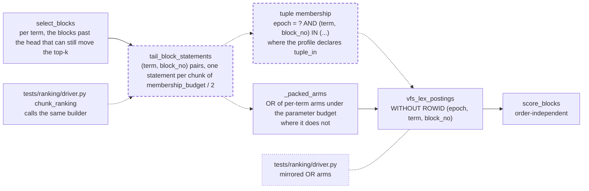

# The lexical fetch spells its arms as a tuple membership: glean's second-round posting fetch asks for its (term, block) pairs in one row-value `IN` where the engine accepts one, never as OR arms, because SQLite's planner loses a later OR arm's rows once the table has statistics

A fix to the database backend's glean lexical leg (`src/vfs/storage/backends/database/glean.py`) and the ranking harness driver that mirrors it (`tests/ranking/driver.py`): no public API, schema, rights or Rust change; it changes the text of one SQL statement on the dialects that declare `tuple_in`, so it needs the engine legs through the `db_test` skill. It closes a wrong-results defect found by [the statistics spec](../active/2026-11-07-sqlite-gathers-planner-statistics-after-each-write.md)'s decision 22 measurement, carried here because the defect is SQLite's and reachable today without that spec: any store whose `sqlite_stat1` holds rows, which `ANALYZE` by hand or by another tool produces, returns wrong glean rankings. No intention and no research: the defect is reproduced below in fifteen lines of stdlib SQLite, and the fix is a spelling the profile already declares and `indexing.py` already uses. It depends on nothing unlanded and lands before the statistics spec, which otherwise makes the defect routine; the statistics spec gains one line in its dependencies naming this spec as landing before it, and its decision 19, which drops hand `ANALYZE`s from plan pins, does not extend to this spec's hand `ANALYZE`, which keeps the focused pin independent of the background pass's timing. [Refresh, the incremental index verb](../active/2026-10-31-refresh-the-incremental-index-verb.md), "Fit to build" and not built, rewrites the same two statements of `_chunk_ranking` to take the live set as `epoch IN (S)`; this spec lands first, and under a live set the builder takes `(epoch, term, block_no)` triples, chunked at `max(1, membership_budget // 3)`, with the OR form's arms carrying `epoch IN (S)` as refresh's decision says; refresh's Design carries the same line and rebases onto this spec. The other active specs that touch `glean.py` ([scope crosses the seam in one shape](../active/2026-11-07-scope-crosses-the-seam-in-one-shape.md), [bounded work has one home](../active/2026-11-07-bounded-work-has-one-home.md), [a directory is never awaiting the index](../active/2026-11-08-a-directory-is-never-awaiting-the-index.md)) edit its docstrings and records, not these statements, and rebase with a one-line note.

## The problem

READ at `79752e7`. Glean's lexical leg scores a query in two rounds. Round one fetches the first `HEAD_BLOCKS` posting blocks of every query term (`glean.py:532-537`). Round two fetches the further blocks that could still change the top-k, which `select_blocks` names per term (`glean.py:544`); `_chunk_ranking` builds one arm per term and chunk of block numbers, `epoch = ? AND term = ? AND block_no IN (...)` (`glean.py:546-549`), and `_packed_arms` (`glean.py:556-568`) groups the arms into statements under the parameter budget, each statement an `OR` of its arms (`glean.py:551-552`). `tests/ranking/driver.py:171-180` mirrors the same arms into one `OR` for the harness's driver path. `vfs_lex_postings` is a `WITHOUT ROWID` table whose primary key is (epoch, term, block_no) (`src/vfs/models/rows.py`, EXECUTED through `sqlite_schema`).

EXECUTED at `79752e7`, SQLite 3.50.4 and 3.53.1, the two versions the CI interpreters link (`repro_or.py` in the session scratchpad). On a `WITHOUT ROWID` table with that key, the statement `WHERE epoch = 1 AND term = 'the' AND block_no IN (8, 9, 10, 11) OR epoch = 1 AND term = 'is' AND block_no IN (8, 9, 10)` returns all 7 rows when `sqlite_stat1` is empty, planned as one primary-key search on `epoch`, and 4 rows once `ANALYZE` has run, planned as `MULTI-INDEX OR` with one primary-key search per arm: every row of the second arm is lost. The loss needs, besides statistics, a later arm whose `IN` list holds more than one element (lengths 1 and 1, and 3 and 1, return every row; 1 and 3, 2 and 2, 3 and 3 and 4 and 4 lose the later arm) and whose term sorts before an earlier arm's term (EXECUTED by this spec's reviewer, `trigger.py`: ascending arms lose 0 rows in every shape, descending lose in 100 of 150); the arms follow the query's token order, so any query whose overflowing terms are not in sorted order can lose blocks. Without statistics the same statement on the harness store also plans `MULTI-INDEX OR` and returns every row (EXECUTED by the reviewer), so the plan shape alone is not the trigger. A rowid table with the same columns under a unique constraint or a plain index returns every row in every shape. Spelled as `epoch = 1 AND (term, block_no) IN (VALUES (...), ...)` or as a `UNION ALL` of the arms, the statement returns every row with statistics present, planned as a primary-key search on `(epoch, term)`.

EXECUTED on the ranking harness corpus (214 entries, 1,500 chunks, `pinstore/with.sqlite` in the session scratchpad): with statistics, round two for the golden query `q09` sends exactly that statement with the parameters `(1, 'the', 8, 9, 10, 11, 1, 'is', 8, 9, 10)` and receives the four `the` blocks and none of the three `is` blocks. The chunk at rank 11 then scores 8.063196 instead of 8.332406, `/docs/plans/grover_proposal.md` falls out of the ordered top ten, and `tests/ranking/test_harness.py::TestDeterminism::test_the_ordered_top10_pin_holds_on_sqlite`, `::test_the_hybrid_ordered_top10_pin_holds_on_sqlite` and `::test_the_hybrid_ordered_top10_pin_holds_in_memory` fail. With `sqlite_stat1` empty the same fetch returns all seven blocks and every pin holds. `score_blocks` itself is order-independent: the same 35 blocks shuffled three ways score every chunk identically (EXECUTED).

READ. `DialectProfile.tuple_in` declares which engines accept a row-value constructor inside an `IN` list (`src/vfs/storage/backends/database/dialects.py:178-182`): `SQLITE`, `POSTGRESQL`, `MARIADB` and `ORACLE` declare it, `MSSQL` and `GENERIC` do not. `indexing.py:694-697` already spells a guarded flip as `tuple_(entry.c.entry_id, entry.c.version).in_(chunk)` where the profile declares it, chunked at half the membership budget because each pair costs two binds. EXECUTED: SQLAlchemy renders the tuple membership as `(term, block_no) IN (VALUES (?, ?), ...)` on SQLite and `(term, block_no) IN ((?, ?), ...)` on PostgreSQL, MySQL and Oracle.

## Architecture

Dashed is what this spec adds; dotted is what it retires.

Page this changes: none; the architecture folder was retired on 2026-10-31, and the landing notes will say so in one line.

Terms. The **head fetch** is round one, the first `HEAD_BLOCKS` blocks of each term. The **tail fetch** is round two, the blocks `select_blocks` names past the head. A **tuple membership** is a row-value `IN`: `(a, b) IN ((x, y), ...)`.

## Decisions

### 1. Where the profile declares `tuple_in`, the tail fetch is one or more statements of the form `epoch = ? AND (term, block_no) IN (pairs)`, the pairs chunked at `max(1, membership_budget // 2)`, and no statement carries an `OR`

The defect lives in SQLite's `MULTI-INDEX OR` plan over the `WITHOUT ROWID` key; a statement with no `OR` cannot take that plan. The tuple membership is the spelling the profile already declares and `indexing.py` already uses, it renders on every engine that declares it, and on SQLite it plans as one primary-key search on `(epoch, term)` with a bloom filter over the pairs (EXECUTED). Each pair binds two values, so half the membership budget keeps every statement inside the `IN`-list cap of the least generous engine that declares the form, Oracle's 1,000 elements, as `indexing.py` does. A `UNION ALL` of the arms also returns every row (EXECUTED) but compiles one select per term and gains nothing over the form the profile already carries. PostgreSQL, MariaDB and Oracle take the tuple form too, though they have no defect to fix, for the reason `indexing.py` took it: one spelling wherever the profile allows it, so the leg reads the same way on every engine that declares the fact and the OR form survives only where the fact is absent. That is a choice with no plan evidence yet behind it on those three engines, so the `db_test` cycle records `EXPLAIN` of one builder statement on PostgreSQL, MariaDB and Oracle in the landing notes, showing primary-key access on `(epoch, term)` or deeper; a plan that scans the postings table on one of them reopens this decision before landing.

### 2. Where the profile does not declare `tuple_in`, the tail fetch keeps today's OR arms through `_packed_arms`

SQL Server has no row-value constructor inside `IN`, and its planner is not the one with the defect; the generic floor claims nothing. Changing a statement an engine plans correctly, for a defect it does not have, would be a change with no evidence behind it.

### 3. One builder, `tail_block_statements(postings, epoch, wanted, profile, parameter_budget, membership_budget) -> list[Select]`, spells the tail fetch for both forms, and `tests/ranking/driver.py` calls it instead of mirroring the arms

The driver duplicated the arm construction line for line and would have kept the defect after the leg lost it, so the harness could no longer referee the leg. One builder, called by the leg and the driver, is the only way the pin and the code cannot drift apart. The builder takes the `wanted` block numbers per term as the leg computes them today and returns the statements to execute, so `_chunk_ranking` keeps its shape: head fetch, score, select, tail fetch, score.

### 4. A pin in `tests/storage/database/test_glean.py` reproduces the defect on a store with statistics, and the three ranking pins stay as the referee

The ranking pins caught the defect, and they catch any shape of it; they stay unchanged. The focused pin names the mechanism so a future reader of a failure knows where to look: it gathers statistics by hand, because this spec lands before the step that gathers them, and it builds the exact trigger. Its corpus gives two terms 300 documents each (three blocks, two past a one-block head), the anchor in each term's last block, and queries the term that sorts later first (`zeta alpha anchor`), because the loss needs a later arm of more than one block whose term sorts before an earlier arm's; it wraps `glean_module.select_blocks` to record the tail each term wants and `glean_module.score_blocks` to count, per term index, the blocks of its second call beyond its first, and asserts the wanted tail is two blocks per term before asserting every wanted block was scored; on the unfixed leg it scores 2 of 4 (EXECUTED by this spec's reviewer, `pinprobe.py`).

## Intent

After this spec, glean's lexical leg returns the same ranking on a SQLite store with planner statistics as on one without, on every store size, because its tail fetch never takes the plan that loses rows; the server engines issue the same statements they issue today where they do not declare the tuple form, and the tuple form where they do; and the ranking harness drives the leg through the leg's own builder.

## Design

**`src/vfs/storage/backends/database/glean.py`.** A public function `tail_block_statements(postings, epoch, wanted, profile, parameter_budget, membership_budget)`, where `wanted: Mapping[str, Sequence[int]]` maps each term to the block numbers to fetch; the builder selects the five columns `term`, `block_no`, `doc_ids`, `tfs`, `dls`, which both callers' `as_blocks` read. Where `profile.tuple_in`, it flattens the pairs in term order and returns one `select(*columns).where(postings.c.epoch == epoch, tuple_(postings.c.term, postings.c.block_no).in_(chunk))` per chunk of `max(1, membership_budget // 2)` pairs. Otherwise it builds today's arms, `and_(postings.c.epoch == epoch, postings.c.term == term, postings.c.block_no.in_(nos))` per chunk of `membership_budget` block numbers, packs them with `_packed_arms` under `parameter_budget`, and returns one `select(*columns).where(or_(*statement))` per pack. Its docstring names the SQLite defect in words, as the reason the two forms exist. `_chunk_ranking` computes `wanted` from `select_blocks` as today and executes the builder's statements. The module docstring's two-round paragraph says the tail fetch is a tuple membership where the engine accepts one. `tuple_` joins the `sqlalchemy` import.

**`tests/ranking/driver.py`.** `chunk_ranking` computes `wanted` the same way and executes `tail_block_statements(...)`; the mirrored arm construction goes. **`tests/ranking/pins.py`.** `assert_top10_pin(storage, *, analyzed: bool = False)` runs `ANALYZE` through `storage._host.engine.begin()` after `load_corpus` when `analyzed` is true; the three sibling pins pass `analyzed=True`.

**`tests/storage/database/test_glean.py`.** `TestRounds::test_the_tail_fetch_returns_every_terms_blocks_under_statistics`, built as decision 4 says: two terms of 300 documents each, `HEAD_BLOCKS` patched to 1, the anchor in each term's last block, the query `zeta alpha anchor`, `ANALYZE` run on a session before the query, `select_blocks` wrapped to record the tail each term wants and `score_blocks` wrapped to count the blocks its second call scores beyond its first, per term index. `TestRounds::test_a_term_past_the_head_blocks_is_fetched_by_key_in_round_two` spies `tail_block_statements` in place of `_packed_arms` and asserts it was called once with one term wanting one block (`{"common": [1]}`), its ranking assertion unchanged. `TestProbes::test_round_two_arms_pack_under_the_parameter_budget` stays, since `_packed_arms` stays for the engines without the tuple form, and a sibling row `test_the_tail_fetch_takes_the_tuple_form_where_declared` calls the builder with the `SQLITE` and `MSSQL` profiles, `parameter_budget=8` and `membership_budget=4`, compiles each statement with `sqlalchemy.dialects.sqlite.dialect()` or `mssql.dialect()` and `compile_kwargs={"render_postcompile": True}`, and asserts the SQLite text carries `IN (VALUES` and no ` OR `; compiled for `MSSQL` at `parameter_budget=8` the arms are 2 statements of one arm each (5 and 6 binds), neither containing ` OR ` or `VALUES`, and at `parameter_budget=16` the same arms pack into 1 statement that contains ` OR ` and no `VALUES`.

**Tests first.** The focused pin and the three sibling ranking pins are red before the builder exists: the ranking pins because `ANALYZE` has not been run on their stores today, so the siblings `TestDeterminism::test_the_ordered_top10_pin_holds_on_sqlite_with_statistics`, `::test_the_hybrid_ordered_top10_pin_holds_on_sqlite_with_statistics` and `::test_the_hybrid_ordered_top10_pin_holds_in_memory_with_statistics` pass `analyzed=True` and assert the same pin. These siblings stay after the statistics spec lands, when the hand `ANALYZE` becomes redundant and harmless.

**Scale.** The tail fetch issues one statement per `membership_budget // 2` pairs, so a query of T terms each wanting B tail blocks issues `ceil(T × B / (membership_budget // 2))` statements, each inside the bind and `IN`-list caps of the engine; the OR form keeps today's packing under the parameter budget. Nothing grows with the corpus; the pairs are bounded by `select_blocks`, as today.

## Scope

In: decisions 1 to 4. Files: `src/vfs/storage/backends/database/glean.py`, `tests/ranking/driver.py`, `tests/ranking/pins.py`, `tests/storage/database/test_glean.py`, `tests/ranking/test_harness.py`, and this spec's landing notes.

Out: reporting the defect upstream to SQLite, which the developer may do with `repro_or.py`; the statistics step itself, which is [the statistics spec](../active/2026-11-07-sqlite-gathers-planner-statistics-after-each-write.md); any other `OR` fan in vfs, all of which run over rowid tables, which the reproduction shows unaffected (the scope fans in `reads.py` and `scope.py`, the rights predicates in `rights.py`, the relabel terms in `labels.py`).

## Acceptance criteria

Counts and states, never clocks.

1. `tests/storage/database/test_glean.py::TestRounds::test_the_tail_fetch_returns_every_terms_blocks_under_statistics`: with `sqlite_stat1` holding rows for `vfs_lex_postings`, `HEAD_BLOCKS` patched to 1, two terms of 300 documents each and the query `zeta alpha anchor`, the recorded tail is exactly 2 blocks per term, and the blocks scored beyond the head are exactly those 4; the count of wanted blocks not scored is 0 (2 on the unfixed leg).
2. `tests/storage/database/test_glean.py::TestProbes::test_the_tail_fetch_takes_the_tuple_form_where_declared`: for two terms wanting 3 and 4 blocks with `parameter_budget=8` and `membership_budget=4`, the builder's statements compiled for `SQLITE` with `render_postcompile` are 4 statements carrying 2, 2, 2 and 1 pairs, 7 in all, each containing `IN (VALUES` and none containing ` OR `; compiled for `MSSQL` at `parameter_budget=8` they are 2 statements of one arm each (5 and 6 binds), neither containing ` OR ` or `VALUES`; at `parameter_budget=16` the same arms pack into 1 statement that contains ` OR ` and no `VALUES`.
3. `tests/ranking/test_harness.py::TestDeterminism::test_the_ordered_top10_pin_holds_on_sqlite_with_statistics`, `::test_the_hybrid_ordered_top10_pin_holds_on_sqlite_with_statistics` and `::test_the_hybrid_ordered_top10_pin_holds_in_memory_with_statistics`: `assert_top10_pin(storage, analyzed=True)` holds; the three existing pins hold unchanged.
4. `tests/ranking/driver.py` contains no call to `or_` and one call to `tail_block_statements`: `grep -c "or_(" tests/ranking/driver.py` prints 0.
5. `tests/storage/database/test_glean.py::TestRounds::test_a_term_past_the_head_blocks_is_fetched_by_key_in_round_two` passes with `tail_block_statements` called once with `{"common": [1]}` and its ranking assertion unchanged.
6. `scripts/ci.sh` exits 0 on the tree as committed, and the `db_test` cycle passes the conformance suite and `tests/storage/database/test_glean.py` on Postgres, MariaDB, SQL Server and Oracle; the landing notes record `EXPLAIN` of one builder statement on PostgreSQL, MariaDB and Oracle, each showing primary-key access on `(epoch, term)` or deeper and no scan of the postings table.

## Landing notes

Built 2026-11-09 over `79752e7`, tests first: the focused pin, the compile probe and the three analyzed ranking siblings were run red before the builder existed (the focused pin failed `assert (4 - 2) == 0`, 2 of 4 wanted blocks scored, the shape decision 4 predicts; the probe and the round-two spy failed on the missing builder; the siblings failed on the driver's import of it). Reviews: [the spec review](../../reviews/2026-11-08-the-lexical-fetch-spells-its-arms-as-a-tuple-membership-spec-review.md) and [the code review](../../reviews/2026-11-09-the-lexical-fetch-spells-its-arms-as-a-tuple-membership-code-review.md).

Per criterion. 1: `TestRounds::test_the_tail_fetch_returns_every_terms_blocks_under_statistics` passes; the recorded tail is `[2, 2]`, the blocks scored beyond the head are `Counter({0: 2, 1: 2})` (term indexes zeta, alpha), wanted minus scored is 0. 2: `TestProbes::test_the_tail_fetch_takes_the_tuple_form_where_declared` passes; counted through the compiled statements' parameter maps, the SQLite form is 4 statements of 2, 2, 2 and 1 pairs (5, 5, 5 and 3 binds, the epoch included), each containing `IN (VALUES` and none ` OR `; MSSQL at a budget of 8 is 2 statements of 5 and 6 binds with neither ` OR ` nor `VALUES`; at 16 it is 1 statement of 11 binds containing ` OR ` and no `VALUES`. 3: the three `_with_statistics` siblings pass beside the three existing pins, 13 nodes in `TestRounds`, `TestProbes` and `TestDeterminism` together on SQLite. 4: `grep -c "or_(" tests/ranking/driver.py` prints 0; the driver imports and calls `tail_block_statements` once. 5: the round-two spy records `[{"common": [1]}]` and its ranking assertion is unchanged. 6: the engine legs ran on this tree through the `db_test` cycle, fresh containers: Postgres 386 passed, MariaDB 376 passed and 8 skipped, SQL Server 386 passed, Oracle 381 passed, no failures. `scripts/ci.sh` ran on a snapshot of the tree as the two commits leave it (a temporary index over `79752e7` plus this change and the context documents, exported with `git archive`): install, lint, format and types PASS; the suite 4789 passed, 5 skipped, coverage 100 %; its one red was `tests/lint/test_context_shape.py::test_links_resolve` on this spec's link to the code review file, which did not exist yet; the final run on the committed tree is recorded at the end of these notes.

`EXPLAIN` of one builder statement, the tuple form with the pairs `('the', 8..11), ('is', 8..10)` on the harness corpus in a schema of its own, every engine returning all 7 rows. PostgreSQL 17: `Bitmap Heap Scan on vfs_lex_postings` over a `BitmapOr` of seven `Bitmap Index Scan on vfs_lex_postings_pkey`, each `Index Cond: (epoch = 1) AND (term = ...) AND (block_no = ...)`, the whole key. MariaDB: `SIMPLE | vfs_lex_postings | range | PRIMARY | PRIMARY | key_len 74 | rows 7 | Using where`. Oracle 23ai: `INLIST ITERATOR` over `TABLE ACCESS BY INDEX ROWID` and `INDEX UNIQUE SCAN` on the primary-key constraint, the access predicate `EPOCH=1 AND (TERM=... AND BLOCK_NO=... OR ...)`. No plan scans the postings table, so decision 1 stands as written.

Deviations from the Design: `_chunk_ranking` gains a `profile` parameter, which the leg passes from its own, because the builder needs the profile and the Design did not say how it reaches it; nothing else. The compile probe counts binds through `compiled.params` rather than by reading the text, because the text's placeholder spelling differs by driver and the count is what the criterion names. Flagged to the developer: nothing. Did not run: nothing; the four legs and the gate ran on this machine.

Architecture pages: unchanged.

`scripts/ci.sh` on the tree as committed, exported from a temporary index holding exactly the landing's files with this spec at its archive path: install, lint, format and types PASS; 4790 passed, 5 skipped, coverage 100 %; docs examples 44 passed; the wheel 11 MB under the 50 MB budget; all green. Of five runs on that snapshot, one missed a single line, `src/vfs/sync.py`'s cancel of a task born during the facade's shutdown, which `tests/test_sync.py::test_the_runner_sweeps_a_task_born_during_shutdown` covers only when its spawned task is still pending at the sweep; that line and test are untouched by this change and the timing is a pre-existing fact of `HEAD`.

**Changelog:** Fixed — glean's second-round posting fetch asks for its (term, block) pairs as one row-value membership on the engines that accept it, so a SQLite store with planner statistics returns the same ranking as one without.

## One line

Glean's second-round posting fetch asks for its (term, block) pairs as one row-value membership on the engines that accept it, so SQLite's planner can no longer drop a later OR arm's blocks once a store has statistics, and the ranking a store returns no longer depends on whether anyone has analyzed it.
