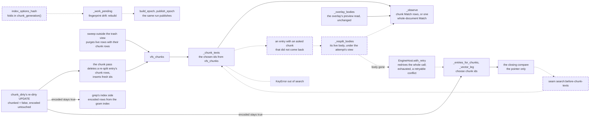

# Search survives a chunk row deleted under its read: the chunk generation joins the epoch fingerprint, so a re-split republishes in the same run, and a chunk the text read no longer finds answers from its entry's live body

A fix to ranked search and the index run's fingerprint on the database backend. It is structural in one place only: it adds one seam, `search:before-chunk-texts`; no module, public class, protocol method or lifecycle is added or removed, and the one new function, `_resplit_bodies`, is private to `search.py`. It changes no public API, no schema format and no Rust, so it does not touch the engine. It changes one stored value: the `options_hash` that `index_options_hash()` computes, which `build_epoch` writes into `vfs_gram_epochs` for every epoch it builds, gains the chunk generation as an input, so every existing store's first run after this lands rebuilds its index whole once (decision 2). It needs the engine legs: `_resplit_bodies` is a new statement, a join of `vfs_content` to `vfs_entries` under a membership list, that must run on every engine, and the race criterion commits a real rival on the four server legs. It touches rights in one place and changes no rule, view or grant path: the new body read keeps only the rows the call's view holds at the view's rung, with the same `Visibility.holds` every read builder uses, judged against the resolution the attempt compiled when it began, as every read verb's rows are; so on SQL Server and Oracle a grant revoked inside one call's window is seen from the next call, not by that read, which is the backend's existing per-attempt rule and not something this spec adds (decision 4). The security lens reads it in both reviews; criteria 9 and 10 pin that a partial caller's answer is unchanged and holds no row the call's resolution hides. It touches the gate's size baseline in one entry: `search.py` grows by 33 lines and its `MODULE_LINE_BASELINE` entry rises by 33 (decision 9). It comes from no intention and stands on no research memo: it was born from finding M2 of [the refresh spec's review of 2026-11-12](../../reviews/2026-11-12-refresh-the-incremental-index-verb-spec-review.md), and every fact it rests on was read or executed for this spec or its review and is recorded in the problem section. It was amended after [its first spec review](../../reviews/2026-11-13-search-survives-a-chunk-row-deleted-under-its-read-spec-review.md), whose Disposition answers each finding: the first draft demoted `encoded` on every re-split row, which took grep's gram index away for the hours of a post-bump build, and this text replaces that rule. It was amended again after the same review's re-read, which found decision 4 claiming more than the per-attempt rights rule gives (its M1) and four write-ins. The finding it was born from was true and narrower than the defect: the race it named is open on SQL Server and Oracle (both executed), and the same `KeyError` is also reached with no race at all, on every engine, after a chunk-generation change.

Landing order and shared files, READ in the working-tree copies on 2026-11-13, the committed code at `5d47a21a`. The queue is: [scope crosses the seam in one shape](../archive/2026-11-07-scope-crosses-the-seam-in-one-shape.md), built in the working tree with its move to the archive staged and not yet committed; [close leaves no SQLite side files](2026-11-12-close-leaves-no-sqlite-side-files.md); this spec; [the scan tier reveals nothing about rows a caller cannot read](2026-11-12-the-scan-tier-reveals-nothing-about-rows-a-caller-cannot-read.md); [the index publishes only what its build read](2026-11-13-the-index-publishes-only-what-its-build-read.md); [the full pass is named rebuild](2026-11-12-the-full-pass-is-named-rebuild-and-its-pipeline-leaves-the-backend.md); three rendering fixes dated 2026-11-13, "A docx note is written once and a span is clamped", "An Office container is measured before it is opened" and "An xlsx sheet is read under the clock and its tables stream"; [refresh, the incremental index verb](2026-10-31-refresh-the-incremental-index-verb.md); and last the record of [the release audit is a review](2026-11-07-the-release-audit-is-a-review.md). This spec is not parallel-safe with scope, the scan tier, the index-publish fix, the rebuild or refresh. This spec edits `src/vfs/storage/backends/database/indexing.py` (`index_options_hash` alone), `src/vfs/storage/backends/database/search.py` (`search_rows`' answer assembly, the new `_resplit_bodies` beside `_overlay_bodies`, the module docstring and `_observe`'s docstring), `tests/storage/database/test_indexing.py`, `test_search.py`, `test_vector_leg.py`, `test_races.py`, `tests/lint/allowlist.py` and `context/standards/mutant-ledger.md`. Scope crosses the seam edits `search.py`, `test_search.py`, `tests/lint/allowlist.py` (it sets `search.py`'s entry to the module's count at its landing, none above 1,248) and the mutant ledger (rows K1 and W4), all four of which this spec also edits, and it names this spec in its own first paragraph with those four files; this spec rebases onto that landing and raises by 33 the `search.py` entry that landing leaves. Close leaves no SQLite side files edits `engine.py`, `src/vfs/sync.py`, `tests/test_sync.py`, `tests/storage/database/test_statistics.py` and one tutorial page, none of which this spec edits, so the two are independent and this spec follows it by the queue's order alone. The scan tier spec lands next: it edits `scope.py`, `grep.py`, `search.py` (the `entries_for_scan` call and the `admitted` comprehension in `search_rows`' overlay block, not the answer assembly or `_overlay_bodies`, beside which `_resplit_bodies` sits), `test_search.py` (class `TestOverlay`, not this spec's `TestVanishedChunks`), `test_grep.py`, `test_statistics.py`, `tests/support/grants_contract.py`, `tests/lint/allowlist.py` (it lowers `search.py`'s entry by three) and the ledger (rows V1 to V3); it rebases onto this landing. The index-publish fix follows it, and of the files this spec edits it edits `indexing.py` (the lease block, which gains `lease_fenced`, `ReindexState`, `chunk_dirty`, whose up-front re-dirty `UPDATE` goes and whose pass commits in bounded slices through `ChunkCursor` and `stale_generation`, the chunk pass's collision handler, `build_epoch`, `current_epoch`, `publish_epoch` and `_flip_flags`; not `index_options_hash`, and it counts from this spec's 795 lines), `tests/storage/database/test_indexing.py` (not `TestChunkProvenance`), `test_races.py` (two classes beside `TestSearchChunkConsistency`), `tests/lint/allowlist.py` (the entries of `backend.py`, `dialects.py` and `engine.py`, not `search.py`'s) and the ledger (rows A1 to A12 appended, L2, L6 and P7 updated, P6 retired); it does not edit `search.py`, `test_search.py` or `test_vector_leg.py`. It moves the epoch pointer off the meta row to a table of its own and says itself that this spec's new nodes, which install `reindex:before-publish`, read the pointer through `indexing.current_epoch` or through helpers it moves; it rebases onto the scan tier's landing. The rebuild spec follows the fix: it moves the lease block out of `indexing.py` (not `index_options_hash`, which stays) and the lexical reads out of `search.py` into `lexical.py` (none of the lines this spec adds is in them), removes `search.py`'s entry once the file falls under the ceiling, re-targets ledger rows L12, A4, A6 and A8 to `maintenance.py` and adds rows I1 to I5, and renames `reindex` in every test file that says it, which includes all four test files this spec edits, the `reindex()` calls of its new nodes and the `reindex:before-publish` seam three of them install; it rebases onto the fix's landing. The three rendering fixes share only the mutant ledger with this spec, where each appends rows of its own. Refresh edits `indexing.py`, `search.py`, `test_indexing.py`, `test_search.py`, `test_races.py`, `tests/lint/allowlist.py` and `context/standards/mutant-ledger.md`, all of which this spec also edits; its new class `TestGenerationConsistency` in `test_races.py` does not collide with this spec's `TestSearchChunkConsistency`, and it takes none of this spec's seams, test classes or ledger rows; it rebases onto the landing before it. The release audit's record shares no file. When this spec was amended after its first review, four of those specs' working copies described its first draft (the demotion of `encoded`, a redrive for every missing chunk, three added lines, rows S1 to S3); the Disposition of this spec's review lists each such sentence for its author, and this spec edits none of them.

## The problem

READ at `5d47a21a`; `git diff --stat bba0999c 5d47a21a -- src tests` prints nothing and, when this section was written, `git status` showed no change under `src/` or `tests/` (EXECUTED), so the line numbers below hold at both commits; they cite committed code, read with `git show 5d47a21a:<path>` once the working tree holds an unlanded build. EXECUTED runs used Python 3.13 through `uv run`, scripts and a plain copy of the tree kept in the session scratchpad, and SQL Server 2025 from `docker/compose.test.yml`, brought up alone and fresh for each author's runs and torn down with its volume after them; the Oracle 23 runs cited are the spec review's, made the same way.

**How ranked search reads chunks.** READ. `search_rows` (`src/vfs/storage/backends/database/search.py:248`) reads the epoch pointer (`:327`), then chooses chunk ids in two legs. The lexical leg scores postings and resolves the winners through `_entries_for_chunks` (`:648`), which joins `vfs_lex_docs` to the entry row and requires `encoded` (`:688`), but never reads `vfs_chunks`. The vector leg (`_vector_leg`, `:721`) ranks live `vfs_chunks` rows by cosine distance. The overlay then scores the `NOT encoded` rows from their live bodies, and the closing compare re-reads the pointer and raises `StaleSnapshot` if it moved (`:458`). After that, `_chunk_texts` (`:1164`) reads the chosen ids from `vfs_chunks` (`:467`), and `_observe` cuts each `Match` from `sources.chunks[chunk_id]` (`:1211`) with no miss path. A chosen id that the text read did not return raises `KeyError`. Nothing catches it: `_execute` catches `StaleSnapshot` and driver errors only (`src/vfs/storage/backends/database/backend.py:1848`), and the storage protocol lets a raw exception from an in-process backend propagate (`src/vfs/storage/protocol.py:30`).

**What the closing compare covers.** READ. It compares the epoch pointer, and nothing else. It runs before the text read (`:458` against `:467`), so a change committed after it is never compared. It is also skipped when the overlay read empty at both reads (`:419` to `:423`). The pointer moves only at publish (`indexing.py:494` to `:505`). No pass that deletes chunk rows writes the meta row, so even a compare placed later would not see them.

**What deletes chunk rows.** READ, and EXECUTED by `grep` for `delete(` over `src/`: two sites. The chunk pass deletes the chunk rows of every entry it re-splits and inserts fresh rows (`indexing.py:335` to `:338`). The ids come from an identity or `AUTOINCREMENT` column (`src/vfs/models/rows.py`, the `vfs_chunks` table), so they are never reused. The purge deletes chunk rows together with their entry rows (`src/vfs/storage/backends/database/trash.py:599`); a sweep at any path outside the trash view purges live rows wholesale (`trash.py:376` to `:383`). A write, an edit, a delete, a move or a copy deletes no chunk row. A content write and a rendering demote `encoded` and `chunked` together (`writes.py:1207` to `:1208`, in the values an overwrite also clobbers; `render.py:360` to `:361`), and a delete demotes `encoded` (`trash.py:458`, `:490`). The chunk pass's generation re-dirty is the one path that clears `chunked` and leaves `encoded` true (`indexing.py:303` to `:311`).

**What `encoded` means, and who reads it.** READ. The flag algebra defines `encoded=True` on a content row as "nothing of the row awaits the gram index … its grams are present in the current epoch" (`indexing.py:32` to `:35`). Gram extraction is entry-grain: one pass over each entry's whole folded body, posted under the entry's surrogate id, and "no gram-path code reads" chunk rows (`indexing.py:15` to `:25`). So a re-split, which replaces chunk rows and leaves the body as it was, changes no gram. Two readers serve an entry from the published index only while it is `encoded`: search's lexical leg (`search.py:688`) and grep's index side (`grep.py:577`). Every `NOT encoded` row goes to the scan tier instead, which both verbs cut at the first `SCAN_TIER_BUDGET` (25,000, `scope.py:72`) rows in path order. EXECUTED, the first draft of this spec applied at run time (the re-dirty demoting `encoded` on every chunk-stale row, and any missing chunk raising `StaleSnapshot`), on SQLite over 21 files with the budget patched down to 5 and the query word in `/d/f18.txt` and `/d/f19.txt` alone: during the run after a generation bump, at `reindex:before-publish`, search answered nothing with the "overlay budget" truncation record and grep answered nothing with the "candidate budget" one, where the settled store answered both files from both verbs with no record. Today, in that window, grep answers both files and search raises.

**The defect with no race at all.** EXECUTED, on SQLite, with `vfs.storage.backends.database.indexing.chunk_generation` patched to return a new value after an indexed store of four files: `reindex()` succeeds with no error. The pointer stays at epoch 1. The chunk rows are now ids 5 to 8, while the published epoch's `vfs_lex_docs` still names ids 1 to 4. Every `search("tokens")` then raises `KeyError: 1` at `search.py:1211`, through `DatabaseStorage.search` and through `AsyncVirtualFileSystem.search` alike. READ, why: the re-split leaves `encoded` true, so `_work_pending` (`indexing.py:713`) finds no pending row. The chunk generation is not part of the epoch fingerprint (`index_options_hash`, `indexing.py:134` to `:137`, compared at `:720`). So the run builds nothing and publishes nothing, and the published epoch keeps naming deleted chunk ids until some later run happens to have other work. On a busy store, where other rows are pending, the same run already rebuilds and publishes (EXECUTED in the review); the stranded-forever state is a quiet store's. EXECUTED, the narrow case: one row's stored chunk generation set stale through a session, and the link generation bumped for every row. The run publishes nothing, one `vfs_lex_docs` id is stranded, and search raises `KeyError: 1`. READ, `git log`: `CHUNK_GENERATION` changed once, at `8722d510` (2026-08-25), one day before `INDEX_FORMAT_VERSION` became 4 at `aa8f51fe` (2026-08-26), and a format mismatch makes `_work_pending` true (`indexing.py:720`). INFERRED from those facts: every store on today's format was rebuilt whole after its last re-split, so no store holds the stranded state today, and the next generation bump would create it in every quiet store. READ: a bump is "deliberately" made "when a grammar crate or walker change alters chunk shapes" (`src/vfs/models/chunking.py:174` to `:176`), so it comes with a vfs release, not with a write.

**The race, engine by engine.** The window runs from the statement that chose a chunk id to the text read. A rival commit lands in it when the rival is a chunk pass that re-splits the entry or a sweep that purges it. EXECUTED, staged by wrapping `search._chunk_texts` so the rival commits first and the real read runs after it:

| Engine | Read isolation of a search | Rival sweep in the window | Rival rewrite and `reindex()` in the window | Window |
|---|---|---|---|---|
| SQLite | deferred `BEGIN` on every read op (`engine.py:1013` to `:1020`); WAL holds the snapshot taken at the first read | old answer, no error (EXECUTED) | old answer, no error (EXECUTED) | closed |
| Postgres | `REPEATABLE READ` stamped on every read op (`dialects.py:508`, `:660`; `backend.py:1867`) | READ: one snapshot | READ: one snapshot | closed |
| MariaDB | `REPEATABLE READ` (`dialects.py:576`) | READ: one snapshot | READ: one snapshot | closed |
| SQL Server | no `op_isolation` (`dialects.py:536`); the driver's `READ COMMITTED`, each statement sees the latest commit | `KeyError: 1` (EXECUTED) | `KeyError: 1` (EXECUTED) | open |
| Oracle | no `op_isolation` (`dialects.py:607`); `READ COMMITTED`, consistent per statement | `KeyError: 1` (EXECUTED in the spec review, staged by wrapping `_chunk_texts`; on the first draft's build the sweep answered the three-file set) | `KeyError: 1` (EXECUTED in the spec review, the same staging; on the first draft's build the rewrite answered the four-file set) | open |
| Generic floor | no pin (`dialects.py:631`) | READ: `search` is withheld from an unknown dialect's capabilities (`backend.py:318` to `:322`), so it is never served | the same | not served |

INFERRED, how often: today the chunk pass runs inside `reindex`, once a day at [the reference deployment](../../../AGENTS.md); refresh would run it every 15 minutes, with a floor of 1 minute. A sweep outside the trash view can run at any time.

**The other readers.** READ. Grep's index tier reads bodies with `contents.get` and skips a body that did not come back (`grep.py:361` to `:362`). Search's overlay keeps only the bodies and surrogate ids that came back (`search.py:1018`). Its preview read drops an overlay entry whose body is gone (`:470` to `:472`); a rewrite replaces the body under the same entry id, so the body is absent only when the entry was purged or no longer holds text (a bytes write, `writes.py:1018` to `:1023`; a rendering with no text, `render.py:370` to `:377`), and in each case leaving the entry absent is the truth. The overlay's own docstring records that a write landing between its count and its preview read "yields a preview from the newer body" (`search.py:1001` to `:1004`). The embed step's twin lookup and its vector write tolerate a vanished row: a missing twin is embedded, and a missing row's `UPDATE` matches nothing (`embed.py:248` to `:260`, `:287` to `:293`). The lexical build reads chunk pages under the index lease, so no chunk pass can run beside it. The visible-set helpers join `vfs_lex_docs` to the entry row and never read `vfs_chunks` (`search.py:892` to `:970`). So `_observe`'s lookup is the one reader that assumes a chosen chunk row still exists, and it serves both legs. EXECUTED: a vector-only hit (the test suite's `PlantedProvider`, query "meaning") whose chunk the text read did not return raises `KeyError: 2`. A partial caller (posture `none` at `/`, `bob` granted read on `/d`) whose chosen chunk did not come back raises `KeyError: 1`.

**What the fix costs, measured.** EXECUTED on a plain copy of the tree in the session scratchpad with the Design applied as written below (ruff, the format gate and `ty` clean on both files; `search.py` 1,281 lines, `indexing.py` 795), and with the node of each SQLite criterion (1 to 11) written in the shape it gives, run on that copy and on an unchanged copy. Every one of those nodes is red on the unchanged copy and green on the built one, with the counts each criterion states. On the built copy: an undisturbed search issues 8 statements, exactly one of which reads `vfs_chunks` and none `vfs_content`; a search that loses one chunk answers the same ranked list from one text read in 9 statements; a search that loses a chunk and its body once redrives, 2 text reads and 17 statements; one that loses both on every attempt ends in one retryable `conflict` after 4 text reads, with no exception. A chunk-generation bump publishes in the same run (pointer 1 to 2, 0 stranded ids), `encoded` stays true on every row through it, and a search at `reindex:before-publish` answers the settled store's ranked list with one more statement. A store built by the unchanged copy and then run once by the built one rebuilt whole (pointer 1 to 2) and wrote no chunk row, and its next run was a no-op. On SQL Server, with a real rival committed at the new seam: a sweep of `/notes.txt` redrove once (2 text reads) to the three-file answer, and a rewrite plus `reindex()` was answered from the rewritten body with no redrive (1 text read). The whole of `tests/storage`, `tests/base`, `tests/models` and `tests/test_sync.py` on the built copy, the probe nodes among them: 3,468 passed, 6 skipped, 4 failed, three of them the documentation checks of `tests/test_sync.py`, which read `README.md` and `docs/` that the copy does not hold, and one `tests/storage/database/test_statistics.py::TestPlannerStatistics::test_two_writers_crossing_together_analyze_once`, which passed when rerun alone. The review ran the first draft's folded `CASE` on SQLite and Oracle; that statement is no longer part of the design.

## Architecture

Dashed is what this spec adds; dotted is what it retires.

Page this changes: none; the architecture folder was retired on 2026-10-31, and the landing notes will say so in one line.

Terms. A **re-split** is the chunk pass replacing an entry's chunk rows with fresh ones under new ids. A chunk id is **stranded** when the published epoch's `vfs_lex_docs` names it and no `vfs_chunks` row holds it. The **window** is the span of one search call from the statement that chose a chunk id to the text read that fetches it. A **gone** entry is one of the answer's entries with at least one chunk id the text read was asked for and did not return. Its **live body** is the body its `vfs_content` row holds when `_resplit_bodies` reads it. A **whole-document match** is the one `Match` the overlay already gives an entry: bounds over the whole body, no `content`, the preview cut from the body. A **redrive** is the backend running the whole call again on a fresh session after `StaleSnapshot`, as `EngineHost.with_retry` already does.

## Decisions

### 1. The chunk generation is part of the epoch fingerprint: `index_options_hash` folds in `chunk_generation()`, so the run that re-splits every entry rebuilds and publishes in the same pass, and the re-dirty leaves `encoded` alone

A generation bump makes `_work_pending` true through the fingerprint compare it already runs (`indexing.py:720`), exactly as any options drift does today, so the run that re-splits every entry rebuilds the gram and lexical epochs whole and publishes them, and no chunk id stays stranded past that publish. The re-dirty does not touch `encoded`, because `encoded` means gram-index coverage, the gram index is entry-grain and reads no chunk row (`indexing.py:15` to `:35`), and a re-split changes no gram: an entry the pass re-splits is as covered after it as before. The published lexical epoch also still ranks every body correctly for the whole build, since a bump changes chunk boundaries and not bodies: the old chunks are pieces of the same text. So for the hours from the chunk pass's first commit to the publish, grep answers from its gram index and search ranks from the published epoch, both whole, and the overlay holds only what it holds today. Demoting `encoded` instead, as this spec's first draft and the refresh spec's decision 21 did, sends every re-split entry to the scan tier for the length of a whole build, where both verbs answer the first 25,000 rows in path order with a truncation record (EXECUTED in the problem section). The build cost is the same either way: one whole rebuild per bump. A row whose only drift is the link generation keeps its chunk rows under the fingerprint-skip law (`indexing.py:618` to `:622`), so the link generation stays out of the fingerprint. The problem section's narrow case, one row's stored chunk generation made stale while the code's is current, is then reachable on today's one-commit pass only by a write outside vfs; under the index-publish fix's sliced pass, a run that stops between slices also leaves it until the next run, whose fingerprint drift still rebuilds and publishes: a bump re-splits every live row in its run, and a row trashed at the bump is already `NOT encoded` (EXECUTED in the review); were it reached, decision 3 answers its stranded ids from the live body until the next publish replaces them.

### 2. The stored value that changes is `vfs_gram_epochs.options_hash`; every existing store rebuilds whole once at its first run after this lands; no format constant bumps and no repair pass runs

`build_epoch` stamps each epoch it builds with `index_options_hash()` (`indexing.py:455`), and `_work_pending` compares the published epoch's stamp with the current value (`:720`). A store published before this landing carries a hash computed without the chunk generation, so its first run after the landing finds drift and rebuilds whole once; the chunk generation itself is unchanged by the landing, so that run re-splits nothing. EXECUTED: a store built and run twice by the unchanged tree, then run by the built one, moved its pointer from 1 to 2 with no write to `vfs_chunks`, and the run after that was a no-op. `INDEX_FORMAT_VERSION` does not bump: its comment reserves it for fold, extraction-grain, gram-extraction and lexical-table changes (`indexing.py:100` to `:102`), none of which this is, and the hash mismatch alone forces the same rebuild a bump would, so a bump would add nothing. No repair pass is needed either: no store holds a stranded epoch today (the problem section), and the landing's one rebuild would replace one if it did. A drift pass that looked for stranded ids would be an anti-join over `vfs_lex_docs` and `vfs_chunks`, about 100,000,000 rows at the reference deployment, on the rebuild path at its 11,000,000-visits-a-day multiplier, for a state that cannot exist. The project is pre-release, so there is no legacy to protect ([AGENTS.md](../../../AGENTS.md), "Project stage").

### 3. A gone entry whose live body comes back answers as one whole-document match under its ranked score: one bounded read, issued only when a chunk is gone

A chunk is gone for one of two reasons. Either a chunk pass re-split its entry and the entry is still live, or a sweep purged the entry. In the first case the entry matched the query when it was ranked, and on a generation bump its body has not changed at all, so dropping it would hide a live, matching entry from a top-k answer and say nothing, a false negative; and redriving would not help, because during a bump's run every attempt ranks from the same published epoch and loses the same chunks, so the call would exhaust its four attempts into a `conflict` for the whole build (EXECUTED: the redrive-for-every-gone-chunk rule, row S2's mutant, fails criteria 4, 5, 6, 9 and 11). So the entry answers from its live body, in the shape the overlay already gives an entry it serves from a live body (`search.py:1032`, `:1206` to `:1209`). Its fields: the observation keeps its fused score and its place in the order, which were computed from one consistent published epoch; its one `Match` spans line 1 to the body's last line, carries no `content`, and takes the score the entry's best chunk would have carried on the entry's scale; its preview is cut from the live body by `select_preview` with the query's terms, as an overlay entry's is. On the race path a rewrite may have changed the body since the ranking, and the preview is then cut from the newer body, which is what the overlay's preview read already does for a write landing between its count and its preview read (`search.py:1001` to `:1004`). So on SQL Server and Oracle, inside one call's window, an answered entry may no longer hold the query's terms at all: it answers under the score it was ranked with and a preview of its newer body, exactly as an overlay entry can today (EXECUTED on Oracle in the spec review), and the next call ranks it from the newer state. Said plainly: a hit answered from its live body keeps the rank and score it earned from the chunk that is gone, so a body rewritten under the call can be answered first with a preview that holds no match (EXECUTED on Oracle in the spec review: `/notes.txt` overwritten with "A stream of nothing at all." and reindexed in the window answered first, score 1.0, from one text read, with that preview), as an overlay entry already can. The Result carries no record that a hit was served this way: the answer is whole and ranked, the match's shape (no `content`, whole-body bounds) already says the region is the document, as it says for an overlay entry, and a record on every search through an hours-long build would be noise a caller cannot act on. The read is `_resplit_bodies`: at most the answer's entries, at most `limit`, chunked by the dialect's membership budget, issued only when the text read returned less than it was asked for, so the undisturbed path issues no statement more than today.

### 4. The live-body read keeps only rows the call's view holds at the view's rung, judged by the resolution the attempt compiled when it began, and an entry it does not return redrives the whole call

`_resplit_bodies` joins each asked entry's `vfs_content` row to its entry row and keeps a row only when `view.holds(row, view.need)` is true, the authority every read builder applies (`rights.py:567` to `:569`), so the body read returns only rows the call's own resolution admits, at their place when it runs: an entry moved out of the view, purged, or emptied of text is absent and redrives (EXECUTED on Oracle in the spec review). The resolution is compiled once per attempt, as every read verb's is (`backend.py:1690` to `:1702`), so on SQL Server and Oracle a grant revoked inside one call's window is seen from the next call, not by this read; the overlay's preview read and grep's body read behave the same today (EXECUTED on Oracle in the spec review, for the overlay's preview read and for grep's body read on both its tiers), and a revision guard on the resolution is the per-operation snapshot pin's spec, named under Out. That is the guarantee, stated plainly: the rights a call is judged by are those in force when its attempt began, and within one attempt, on an engine whose reads are not snapshot-pinned, a body written after a revoke can be read by the caller the revoke removed (EXECUTED on Oracle in the spec review: a rival at the seam revoked bob's grant on `/d`, overwrote `/d/b.txt` and ran `reindex()`, and bob's search answered `/d/b.txt` with a preview of the new text; his next call saw nothing; on Postgres the snapshot hid the rival). This is the backend's existing per-attempt rule, not something this spec adds. Every entry the read is asked for already passed the view and the gates when it was ranked in the same attempt (`search.py:447`, `:697` to `:700`, `:781` to `:782`), so no row outside the attempt's resolution reaches it, and nothing a partial caller observes can change with a row that resolution hides. An asked entry that does not come back was purged, no longer holds text (a bytes write, a rendering with no text), or no longer sits where the attempt's resolution admits it; in each case the answer must be refilled from one later state, so the call raises `StaleSnapshot` before any `Match` is cut and `with_retry` runs it again on a fresh session (`engine.py:349`), under the protocol the call already runs for a moved pointer (`search.py:422`, `:459`). The redrive keeps its bounds: at most `retry_attempts` attempts (default 4, `engine.py:178`); no statement on the undisturbed path; exhaustion as the existing retryable `conflict` (decision 8), never an exception. A successful redrive carries no record, exactly as a successful pointer redrive carries none, because the answer it returns is whole. The overlay's preview read keeps its drop (`search.py:470` to `:472`), and this spec does not change it: there the body is absent only when the entry was purged or no longer holds text, and leaving the entry absent is the truth.

### 5. The check covers every chunk id the text read was asked for, from both legs, as one comparison in memory after the read

The vector leg ranks live `vfs_chunks` rows, so its ids sit in the same window and reach the same lookup (EXECUTED, `KeyError: 2`). An entry with any asked chunk missing is gone and answers whole, even if another of its chunks came back: a chunk pass deletes all of an entry's chunk rows in one statement, so a mix means the entry changed under the call, and one whole-document match is the honest shape. The ids asked for are bounded by the answer: at most `limit` entries, each with its fused chunks from either leg. The comparison issues no statement.

### 6. The `StaleSnapshot` context is the fixed phrase "an entry the answer carries is gone since it was ranked", naming no path and no id

On exhaustion the context becomes the detail of the public record, "search kept losing to concurrent changes: …" (`backend.py:1859`). The envelope's contract says a detail is a path-free phrase (`src/vfs/results/envelope.py:239`). Naming a chunk id or a path would put row identity into an error that a caller with a partial view reads. The phrase says what happened and nothing about which row.

### 7. The window is named by a seam, `search:before-chunk-texts`, awaited immediately before the text read

[How we code](../../standards/how-we-code.md) says a race window that no public call can reach is a named seam, and that a race is pinned by a test that commits a rival there (`src/vfs/storage/backends/database/seams.py:1`). The seam is a no-op await in production. The engine legs use it to commit a real sweep or a real chunk pass between the ranking and the text read.

### 8. Exhaustion uses the existing retry budget and the existing classification: no new kind, record, parameter or budget

A rival that purges an answered entry in the window of every attempt is the same operating condition as a pointer that never settles. The codebase already answers that with a retryable `conflict` after `retry_attempts` attempts, pinned by `tests/storage/database/test_search.py::TestOverlay::test_a_pointer_that_never_settles_classifies_conflict`. A second vocabulary for the same condition would make callers handle two spellings of one fact.

### 9. `search.py` grows by exactly 33 lines and its `MODULE_LINE_BASELINE` entry rises by 33; `indexing.py` grows by 4 and stays unlisted; no import is added; the reduction that carries the raised entry is the rebuild spec's decisions 7 and 8

EXECUTED, the Design applied as written to a plain copy at `5d47a21a` and formatted by `ruff format`: `search.py` goes from 1,248 lines to 1,281 and `indexing.py` from 791 to 795. In `search.py` the 33 are: the seam's await, the comment, the `gone` list, the `_resplit_bodies` call, the comparison and its `raise`, and the chunk rewrite, 7 lines, with the preview read's line rewritten in place; `_resplit_bodies` and its two separating blank lines, 24; the module docstring's sentence, 2. `_observe`'s docstring is reworded at its own line count. In `indexing.py` the 4 are `index_options_hash`'s docstring growing from one line to five; its `return` stays one line, at 110 columns. No import is added to either module: `index_options_hash` reads `chunk_generation`, which `indexing.py` imports today (`:67`); the new lines of `search.py` read `seam` (`:125`), `StaleSnapshot`, `chunked` (`:96`), `membership` (`:100`), `select` (`:71`), `RIGHTS_FIELDS` (`:113`) and, for typing, `Visibility` and `Sequence` under the `TYPE_CHECKING` block (`:131`, `:143`), all imported today. The gate's spec says a landing that adds to a listed module moves out as much as it adds, or raises the entry and links the active spec that carries the module's reduction ([the gate's spec](../archive/2026-11-07-the-gate-and-the-review-read-the-layer-map-and-the-size-baseline.md), decision 7). This spec takes the second closing. [The full pass is named rebuild](2026-11-12-the-full-pass-is-named-rebuild-and-its-pipeline-leaves-the-backend.md) moves the lexical reads, about 304 lines at `bba0999c` and none of the lines this spec adds, from `search.py` into `lexical.py` by its decision 7, and removes `search.py`'s entry by its decision 8 because the file then falls under the ceiling. The counts the next landings start from, with S the count scope crosses the seam leaves for `search.py` (at most 1,248): the scan tier spec starts from `search.py` at S + 33 and `indexing.py` at 795; the rebuild spec starts from `search.py` at S + 30, after the scan tier's three fewer, and `indexing.py` at 795, so `search.py` falls near 980 or below once its lexical reads leave, under the ceiling. No 33 lines of `search.py` have a better home today: the body read exists only for search's `Match` rows and sits beside the overlay's preview read, which it mirrors. The code review records the raised entry with this link as its answer.

### 10. Each law lands with its mutant as a row of the mutant ledger: S1, S2, S3 and S4

[Testing](../../standards/testing.md) says a pinned law names the one-line mutation that breaks it and lands it as a ledger row. S1: the chunk generation dropped from `index_options_hash`'s input, so a bump re-splits and publishes nothing; criteria 1, 2, 4 and 5 kill it (EXECUTED on the built copy: 4 failures; criterion 3 passes under it, because decision 3 answers the stranded ids from live bodies). S2: the live-body answer replaced by a redrive, `if len(resplit) < len(gone):` becoming `if gone:`, the first draft's rule; criteria 4, 5, 6, 9 and 11 kill it (EXECUTED: 5 failures). S3: the redrive deleted, the comparison and its `raise` removed, so an entry whose body is gone reaches `_observe` with its old chunk ids and raises `KeyError`; criteria 7 and 8 kill it (EXECUTED: 2 failures, `KeyError: 1`). S4: the view test deleted from `_resplit_bodies`, so the body read keeps a row the call's resolution does not admit at its place when the read runs; criterion 10 kills it (EXECUTED: 1 failure, the only one among the criteria's nodes).

## Intent

After this spec, a search on the database backend never raises for a chunk row that a chunk pass or a sweep removed. A chunk-generation change no longer strands the published index: the run that re-splits every entry rebuilds and publishes in the same pass, because the chunk generation is part of the fingerprint. For the hours that run takes, grep keeps answering from its gram index and search keeps ranking from the published epoch, both whole; an entry whose chunks the pass has replaced answers from its live body as one whole document under its ranked score. On SQL Server and Oracle, where each statement reads the latest commit, a search whose answered entry was purged in its window runs again and answers from the later state; one whose entry was re-split answers from the live body without running again. On SQLite, Postgres and MariaDB, whose read snapshot already closes the window, nothing changes on the race path. A search that loses no chunk issues the same statements it issues today. A row the call's resolution hides stays hidden: the body read applies the view the attempt compiled when it began, as every read verb does, so a revoke committed inside one call's window on SQL Server or Oracle takes effect from the next call. Every existing store rebuilds its index once, at its first run after the landing.

## Design

**Tests first.** Every node in the criteria is written and run red on the tree this spec builds on before any source line changes. The red result each one shows today is given with its criterion.

**`src/vfs/storage/backends/database/indexing.py`, `index_options_hash`.** The `return` becomes `return hashlib.sha256(f"{grams};{options_fingerprint()};chunks={chunk_generation()}".encode()).hexdigest()`, and the docstring grows from one line to five: the summary line "The options half of the epoch fingerprint; any change forces rebuild." as today, a blank line, then "The chunk generation is part of it: a bump re-splits every entry into fresh chunk ids, so the run that re-splits must also rebuild and publish." over two lines, and the closing quotes on a line of their own. `chunk_dirty`, its re-dirty statement and its docstring are unchanged; the stamps never touch `encoded`. `build_epoch` and `_work_pending` are unchanged: they already stamp and compare `index_options_hash()`.

**`src/vfs/storage/backends/database/search.py`, `search_rows`.** After `wanted` is built, the assembly reads, in this order: `await seam("search:before-chunk-texts")`; the text read as today; the one-line comment `# An entry whose ranked chunk is gone was re-split or purged: its live body answers it whole, or it redrives.`; `gone = [eid for eid, _ in ordered if any(cid >= 0 and cid not in texts for cid, _ in fused.chunks[eid])]`; `resplit = await _resplit_bodies(session, tables, profile, membership_budget, gone, view)`; `if len(resplit) < len(gone):` and `raise StaleSnapshot("an entry the answer carries is gone since it was ranked")`; `fused.chunks.update({entry_id: [(-1, fused.chunks[entry_id][0][1])] for entry_id in resplit})`; `answering` as today; and the preview read becomes `bodies = {**await _overlay_bodies(session, tables, profile, membership_budget, answering), **resplit}`. A negative chunk id is the overlay's whole-document chunk, which the text read never fetches; the rewritten chunk list hands `_observe` that id with the best chunk's fused score, so `_observe` cuts the whole-document match from `sources.bodies` exactly as it does for an overlay entry, and its ratio keeps the match on the entry's scale. The raise leaves `search_rows` before any `Match` is cut. `_execute`'s `_rows` runs the call inside `EngineHost.with_retry`, which discards the session and runs the whole lambda again: the view is resolved again, both legs rank again, the overlay is scored again, the closing compare runs again. The query vector and the backend's records are computed outside the attempt (`backend.py:629`), so a redrive calls no embedding provider. `_chunk_texts`, `_overlay_bodies` and `_observe`'s code are unchanged.

**`search.py`, the new `_resplit_bodies`.** Placed after `_overlay_bodies`, in the overlay group it mirrors: `async def _resplit_bodies(session: AsyncSession, tables: VFSTables, profile: DialectProfile, membership_budget: int, entry_ids: Sequence[EntryId], view: Visibility | None) -> dict[EntryId, str]`, one parameter a line as the formatter lays it out. Docstring: "The live bodies of the answer's entries whose ranked chunks are gone, each a row *view* admits where it sits.", a blank line, "At most the answer's entries, one read per membership chunk, none when no chunk is gone. An entry purged, holding no text, or moved out of the view is absent, and the caller redrives.", on the same two lines as before, so the count is unchanged. *view* is the attempt's view, compiled when the attempt began; the docstring says no more than that. Body: `entry, content = tables.entry, tables.content`; `columns = [content.c.entry_id, content.c.content, entry.c.path, *(entry.c[name] for name in sorted(RIGHTS_FIELDS))]`; `out: dict[EntryId, str] = {}`; then, for each `chunk in chunked(list(entry_ids), membership_budget)`: `joined = content.join(entry, entry.c.entry_id == content.c.entry_id)`, `stmt = select(*columns).select_from(joined).where(membership(content.c.entry_id, chunk, profile))`, `found = (await session.execute(stmt)).mappings()`, and `out.update({m["entry_id"]: _text(m["content"]) for m in found if view is None or view.holds(m, view.need)})`; then `return out`. An empty `entry_ids` runs no loop and issues no statement.

**`search.py`, docstrings.** The module docstring's sentence ending "a moved pointer raises :class:`StaleSnapshot` for the backend to redrive." gains two lines after it: "A carried chunk the text read no longer finds answers from its entry's live body in the overlay's whole-document shape; an entry whose body is gone too raises :class:`StaleSnapshot`.", reflowed so "redrive." begins the first of them. `_observe`'s docstring is reworded at its own five lines: "Every region carries its preview, cut from text already in hand: a chunk's own row, or a live body as a bounded read returned it. An overlay entry, or one whose chunks are gone, answers as one whole document — bounds over the whole body, no ``content`` (a file is not a chunk), the preview alone."

**`tests/lint/allowlist.py`.** `src/vfs/storage/backends/database/search.py`'s entry rises by 33 over the value the landing before this one leaves, which is 1,248 at `5d47a21a` and lower if scope crosses the seam has lowered it. `indexing.py` holds no entry and gains none.

**`tests/storage/database/test_indexing.py`, class `TestChunkProvenance`.** Criteria 1 and 2. Each stages the bump as `monkeypatch.setattr(indexing, "chunk_generation", lambda: real() + "-bumped")`, with `real` the function before the patch, which `index_options_hash` and `chunk_dirty` both read from the module; each reads rows through a connection and reads the published pointer with `indexing.current_epoch` on a session of `storage._host.session_factory()`, never the meta row's column, so the index-publish fix's move of the pointer leaves these nodes as they are, as `test_generation_change_redirties_and_resplits` does.

**`tests/storage/database/test_search.py`, new class `TestVanishedChunks`.** Criteria 3 to 10, on the file's six-file `CORPUS` unless a criterion names another store (EXECUTED in the spec review: on it the smallest answered chunk id is still `/notes.txt`'s, the counts are still 9 against 8, and the ranked list is unchanged). The test double for a vanished chunk wraps `search_module._chunk_texts` with `monkeypatch`, calls the real read, and removes the smallest chunk id from its result, on the first call or on every call; on `CORPUS` the removed id is `/notes.txt`'s chunk. The double for a vanished body wraps `search_module._resplit_bodies` the same way and empties its result. That is the shape `TestOverlay::test_an_overlay_entry_purged_before_the_preview_read_is_absent` already uses for a purged body. Statements are counted with the file's `_recorded` helper, which leaves the planner-statistics step's statements out. On SQLite the read snapshot hides a rival's commit (EXECUTED), so the doubles are how the window is reached there, and no criterion depends on winning a race. Exhaustion runs with `storage._host._retry_base_delay` set to `0.0`, as `test_a_pointer_that_never_settles_classifies_conflict` does. Criterion 10 builds its view as `tests/storage/database/test_ladder.py::test_the_view_answers_the_rung_the_caller_holds` does: `Resolution.compile` over bob's grant rows, then `Visibility(resolution, "read", tables, SQLITE, 900, 2_099)`.

**`tests/storage/database/test_vector_leg.py`, class `TestTheLeg`.** Criterion 11, with the file's `PlantedProvider` and the chunk double.

**`tests/storage/database/test_races.py`, new class `TestSearchChunkConsistency`.** Criterion 12. One function is parametrized over `ENGINE_LEGS` and over two rivals. `sweep` runs `storage.sweep(path=Path("/notes.txt"))`, which purges a ranked file, its body and its chunk rows in one commit. `rewrite` overwrites `/notes.txt` with "A stream of tokens, rewritten.\n", which still holds the query term, then runs `storage.reindex()`, so a chunk pass re-splits it and the run publishes. The rival runs on the existing `_self_clearing` handler installed on `search:before-chunk-texts`. `_chunk_texts` is wrapped to count its calls. The expectations are keyed on whether the leg's dialect profile declares an `op_isolation` pin, and the function ends with `_audit(storage)`.

**`context/standards/mutant-ledger.md`.** Rows S1, S2, S3 and S4 of decision 10, each with its intent, its anchor, its target file, its scope selection and its recorded killers, and with this spec's title as provenance.

**Scale, at the reference deployment.** Per verb call, about 150,000 a day with search under a tenth of them: on the undisturbed path no statement is added (EXECUTED: 8 statements on the probe store, as today); there is one membership test in memory per chunk id the text read was asked for, at most `limit` entries' fused chunks, and the seam is one no-op await. On the gone path, `_resplit_bodies` adds one statement per membership-budget slice of the answer's gone entries, and the gone entries are at most `limit`: one statement at the default limit of 10 (EXECUTED: 9 statements where 8), and one for as many gone entries as the dialect's membership budget admits, at most 1,000 at Oracle's `IN`-list floor. The bytes it reads are the bodies of at most `limit` answering entries, the same bound as the overlay's preview read beside it, which reads the overlay entries of the same answer; both keep each body until the answer is assembled, because the preview is cut from it. That is a suboptimal profile named honestly: a body is read whole to cut a preview window. The future direction, for both reads, is the preview cut from a ranged read so only the window crosses the wire. The redrive is reached only for an entry purged, emptied of text or moved out of the attempt's view inside one call's window, only on SQL Server and Oracle, and at most `retry_attempts` times (EXECUTED on SQL Server: 2 text reads for a sweep in the window). Per file write, about 1,050,000 a day: nothing changes. Per index visit, about 11,000,000 a day: nothing is added; the hash is computed once in `_work_pending` and once at the fingerprint insert per run, with no statement, and the re-dirty statement is unchanged. Per generation bump, a release-time event whenever a grammar crate changes chunk shapes: the re-split of every entry, about 10,000,000 entries and 100,000,000 chunks, is the bump's own cost and unchanged. The same run now rebuilds whole, about 10,000,000 file visits, which is the rebuild a busy store's run already does that day (the reference deployment rebuilds daily), so a bump adds no build. During the hours from the chunk pass's first commit to the publish, grep answers from its gram index and search ranks from the published epoch, both whole; a lexical hit whose entry the pass has re-split has lost its chunks, which after today's pass, one commit for the whole dirty set, is every lexical hit, while an entry the index-publish fix's sliced pass has not reached yet keeps its old chunks and vectors, so a search costs at most one more bounded body read at the default limit (EXECUTED in miniature: with the scan-tier budget lowered to 5 over 21 files, both verbs answered the settled store's answer with no record). The vector leg in that window is today's: a re-split chunk whose text is unchanged carries its vector (the chunk row is the embedding cache, `indexing.py:294` to `:298`), and one whose text changed has none until the embed step after the publish. Per landing: every existing store rebuilds once at its first run after this lands (decision 2), one full build per store, once. No statement this spec touches grows with batch size: `_resplit_bodies` and the text read are chunked by `membership_budget`, and nothing here is a designed cap.

## Scope

In: decisions 1 to 10. Source: `src/vfs/storage/backends/database/indexing.py` (`index_options_hash` and its docstring) and `src/vfs/storage/backends/database/search.py` (`search_rows`' answer assembly, the new `_resplit_bodies`, the module docstring and `_observe`'s docstring). Tests: `tests/storage/database/test_indexing.py`, `tests/storage/database/test_search.py`, `tests/storage/database/test_vector_leg.py` and `tests/storage/database/test_races.py`. Gate: `tests/lint/allowlist.py`, one entry raised by 33. Standards: four rows appended to `context/standards/mutant-ledger.md`. And this spec's landing notes.

Out: the overlay preview's drop of a body that did not come back, which is right as it is (decision 4). A per-operation snapshot pin on SQL Server and Oracle. That would close the window for every multi-statement read, not only search's, but it needs `ALLOW_SNAPSHOT_ISOLATION` set on each SQL Server database (a provisioning change) and a read-only transaction mode on Oracle, and it changes every read verb's locking, so it is a spec of its own with measurements; decisions 3 and 4 hold under any isolation. Beside that pin, a revision guard on the call's resolution, so that a grant revoked inside one call's window is seen by the reads that follow it in the same attempt: it belongs to the same spec, because without the pin each statement still reads its own commit and a guard on the resolution alone would leave the bodies unpinned, and because it changes the per-attempt rights rule every read verb shares, not search's alone (decision 4). The preview cut from a ranged read, the future direction named under Scale. A re-split that keeps the rows of pieces it would rebuild unchanged, which would make a generation bump cheaper and is the chunk pass's own next spec. A record on an answer served from a live body (decision 3). The live set, deltas and `refresh()`, which are refresh's, including how a refresh meets a generation bump, which its fingerprint-drift refusal already decides. The rename of `reindex` to `rebuild`, which is the rename's. A repair pass or a format bump (decision 2).

## Acceptance criteria

Counts and states, never clocks. No criterion depends on winning a race: on SQLite the window is reached by a double, and on the server legs by a seam that commits the rival before the text read runs. Each node is red on the tree this spec builds on, with the result given; each red result and each green count was EXECUTED for this spec, the nodes written in these shapes and run on an unchanged copy and on the built copy, unless the criterion says otherwise.

1. `tests/storage/database/test_indexing.py::TestChunkProvenance::test_a_chunk_generation_bump_republishes_in_the_same_run`: on a reindexed store of four files, with the chunk generation patched to a new value, `index_options_hash()` differs from its value before the patch, one `reindex()` succeeds, the published pointer moves from 1 to 2, and the published epoch's `vfs_lex_docs` names 0 chunk ids that no `vfs_chunks` row holds. Today the hash is unchanged by the patch, the pointer stays at 1 and 4 ids are stranded.
2. `tests/storage/database/test_indexing.py::TestChunkProvenance::test_a_chunk_generation_bump_leaves_encoded_alone`: during that run, a handler on `reindex:before-publish` reads the four file rows once, and each holds `encoded` true and `chunked` true. Today the run builds nothing, the seam never fires and the handler records nothing; under the first draft's demotion the handler records `encoded` false.
3. `tests/storage/database/test_search.py::TestVanishedChunks::test_search_after_a_chunk_generation_bump_answers_as_before`: after the bump and the `reindex()` of criterion 1, `search("tokens")` succeeds and answers the same paths with the same scores, in the same order, as before the bump. Today it raises `KeyError: 1`.
4. `tests/storage/database/test_search.py::TestVanishedChunks::test_a_search_during_a_generation_bump_ranks_from_the_published_epoch`: during the bump's `reindex()`, a handler on `reindex:before-publish` runs `search("tokens")`, which succeeds and answers the same paths with the same scores, in the same order, as before the bump; each observation's one match has `content` `None` and starts at line 1; `_chunk_texts` is called exactly once; and the call issues exactly one statement more than the same search on the settled store (9 against 8). Today the seam never fires and the handler records nothing; under row S2's mutant the call exhausts into a `conflict`.
5. `tests/storage/database/test_search.py::TestVanishedChunks::test_grep_and_search_stay_whole_through_a_generation_bump`: a reindexed store of 21 files, `/d/f00.txt` to `/d/f20.txt`, whose word `lantern` is in `/d/f18.txt` and `/d/f19.txt` alone, with `SCAN_TIER_BUDGET` patched to 5 on `search_module` and `grep_module`. On the settled store `search("lantern")` and `grep(pattern="lantern")` each answer those two files with no `truncated` record. With the chunk generation patched, a handler on `reindex:before-publish` runs both again: search answers the settled store's paths, scores, order and errors, and grep the settled store's paths and errors. Today the seam never fires and the handler records nothing; under the first draft both verbs answered no path and each carried a `truncated` record, "overlay budget" for search and "candidate budget" for grep.
6. `tests/storage/database/test_search.py::TestVanishedChunks::test_a_chunk_gone_before_its_text_read_answers_from_the_live_body`: on a reindexed store, an undisturbed `search("tokens")` issues exactly one statement that reads `vfs_chunks` and none that reads `vfs_content`. The same call with the chunk double removing `/notes.txt`'s chunk from the first text read succeeds, answers the undisturbed call's paths and scores in order, calls `_chunk_texts` exactly once, issues exactly one statement more than the undisturbed call (9 against 8), and carries the undisturbed call's errors; `/notes.txt`'s one match has `content` `None`, spans lines 1 to 1, and previews "A stream of **tokens**, **tokens**, **tokens**.", and every other observation's matches are unchanged. Today it raises `KeyError: 1`.
7. `tests/storage/database/test_search.py::TestVanishedChunks::test_a_chunk_gone_with_its_body_redrives_once`: with the chunk double and the body double each acting on the first call only, `search("tokens")` succeeds, answers the undisturbed call's paths and scores in order, calls `_chunk_texts` exactly 2 times, issues exactly twice the undisturbed call's statements and one more (17 against 8), and carries no error of kind `conflict` or `truncated`. Today it fails at the body double's patch, because `search_module` binds no `_resplit_bodies`; without that patch the call raises `KeyError: 1`.
8. `tests/storage/database/test_search.py::TestVanishedChunks::test_a_chunk_and_body_that_never_come_back_classify_conflict`: with both doubles acting on every call and the retry delay at 0, `search("tokens")` returns `success` false and exactly one error, of kind `conflict`, `retryable` true, `path` `None`, whose message ends "search kept losing to concurrent changes: an entry the answer carries is gone since it was ranked". `_chunk_texts` is called exactly 4 times and nothing raises. Today it fails at the body double's patch, as criterion 7 does.
9. `tests/storage/database/test_search.py::TestVanishedChunks::test_a_partial_callers_live_body_answer_keeps_its_view`: on an `InMemoryStorage` with files `/d/a.txt` ("tokens once\n"), `/d/b.txt` ("tokens tokens and more words here\n") and `/h/c.txt` ("tokens tokens tokens\n"), reindexed, posture `none` at `/` and `bob` granted read on `/d`, where a whole caller's search ranks `/h/c.txt` first, bob's search with the chunk double acting on the first text read succeeds, answers exactly bob's undisturbed paths and scores in order (`/d/a.txt`, `/d/b.txt`), holds no path under `/h`, and calls `_chunk_texts` exactly once. Today it raises `KeyError: 1`.
10. `tests/storage/database/test_search.py::TestVanishedChunks::test_the_live_body_read_keeps_only_rows_the_view_holds`: on the store of criterion 9, `search_module._resplit_bodies` asked for the entry ids of `/d/a.txt` and `/h/c.txt` under bob's view at rung `read` returns exactly one item, `/d/a.txt`'s id mapped to "tokens once\n"; under no view it returns both ids; asked for no id it returns `{}`. That is exactly decision 4's promise: the read judges each row at its place when it runs against the view it is handed, which is the attempt's; a grant revoked during the attempt is outside that promise and outside this node. Today it fails, because `search_module` binds no `_resplit_bodies`.
11. `tests/storage/database/test_vector_leg.py::TestTheLeg::test_a_vector_chunk_gone_before_its_text_read_answers_from_the_live_body`: with `PlantedProvider({"meaning": FILES["/notes/two.md"]})`, whose lexical leg finds no term, the chunk double removing the first asked id from the first text read leaves `search("meaning", limit=2)` successful with the undisturbed call's paths and scores in order, `/notes/two.md` first with one match whose `content` is `None`, and `_chunk_texts` called exactly once. Today it raises `KeyError: 2`.
12. `tests/storage/database/test_races.py::TestSearchChunkConsistency::test_a_chunk_removed_before_its_text_read_never_raises`, its nodes `[postgres-sweep]`, `[mariadb-sweep]`, `[mssql-sweep]`, `[oracle-sweep]` and the four `[…-rewrite]` nodes (the engine parametrization is the decorator nearest the function, so its id comes first): with the rival committed on `search:before-chunk-texts`, the rival succeeds and the search succeeds. On `mssql` and `oracle`, whose profiles declare no `op_isolation`: after the sweep the search answers the three files other than `/notes.txt` after exactly 2 text reads; after the rewrite it answers all four files after exactly 1 text read, and `/notes.txt`'s one match has `content` `None` and previews "A stream of **tokens**, rewritten." On `postgres` and `mariadb`, whose profiles pin `REPEATABLE READ`, both rivals leave the four-file answer after exactly 1 text read. `_audit` passes on every node. Today every node fails, because the seam does not exist and the rival never runs. EXECUTED on the built copy against SQL Server for both rivals, with these counts. EXECUTED in the spec review on Oracle and Postgres through the seam, with these counts. MariaDB is INFERRED from its per-op `REPEATABLE READ` pin (`dialects.py:576`), which Postgres shares.
13. `tests/lint/test_code_shape.py::test_a_listed_module_never_grows_and_an_unlisted_one_stays_under_the_ceiling` passes with `search.py`'s entry raised by exactly 33, and `git diff` from the build's base over `tests/lint/allowlist.py` shows that one line changed. `scripts/ci.sh` exits 0 on the tree as committed. The `db_test` cycle passes the four server legs, criterion 12's nodes included, so `_resplit_bodies`' statement runs live on Postgres, MariaDB, SQL Server and Oracle.

## Landing notes

Filled in on landing.

## One line

Search never raises for a chunk row removed under its read: the chunk generation is now part of the epoch fingerprint, so the run that re-splits every entry also republishes while grep and search stay whole on the published index, and a chunk the text read no longer finds is answered from its entry's live body, or, when that body is gone too, by running the call again from the later state.
