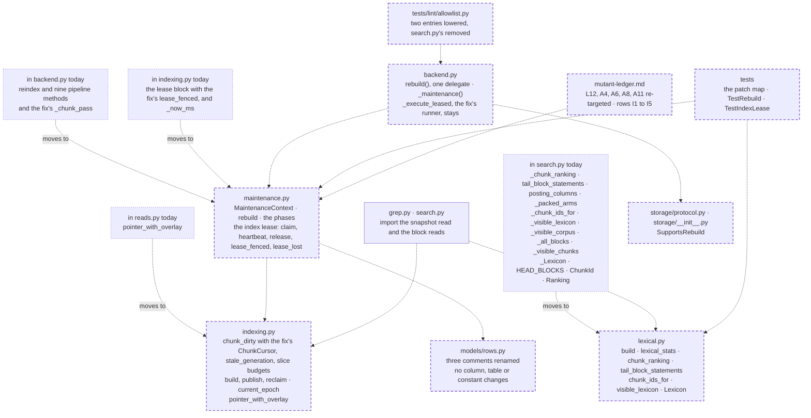

# The full pass is named `rebuild()` and its pipeline leaves the backend: `reindex` becomes `rebuild` across the tree, the lease is named for the index, and the index pipeline, the snapshot read and the lexical block reads move to the modules that own their tables, without changing one answer

A refactor, structural: it adds the module `src/vfs/storage/backends/database/maintenance.py` and moves code into it from `backend.py` and `indexing.py`; it moves one function from `reads.py` into `indexing.py` and nine functions, one result type and three names from `search.py` into `lexical.py`; and it renames the full index pass from `reindex()` to `rebuild()`, with every name beneath it. It changes the storage protocol by name only (`SupportsReindex` becomes `SupportsRebuild`, declaring `rebuild` alone; no method is added) and not the user-facing `VirtualFileSystem` surface, and no docs reference exists to regenerate (no page under `docs/` or `documentation/`, not the README and not `CONTRIBUTING.md` says `reindex`, EXECUTED at `5d47a21a`), so the public-API flag does not apply. It changes no schema and no format constant: [the index publishes only what its build read](2026-11-13-the-index-publishes-only-what-its-build-read.md), which lands immediately before it, moves the lease and the pointer to a row of their own whose columns name no verb and takes `SCHEMA_FORMAT_VERSION` to 25, and this spec renames three comments of `models/rows.py` and leaves both format constants where it finds them (decision 2). It does not touch the Rust engine and moves no protocol constant (decision 3). It needs the engine legs: the code it moves and most of the files it renames in are under `storage/backends/database/`, and the moved lease, fence and publish run on every engine. It changes no rights rule. It touches the gate in one declaration: in `tests/lint/allowlist.py`, the `MODULE_LINE_BASELINE` entries of `backend.py` and `reads.py` are lowered and that of `search.py` is removed, because it falls under the ceiling; `LAYERS` is unchanged (decision 8). No intention: no caller gains or loses an experience. It stands on no research memo: every fact below is read or executed on the tree, and the precedent for how a move is specified, mapped and reviewed is [the router keeps routing](../archive/2026-11-07-the-router-keeps-routing.md). Its spec review is [the review of 2026-11-13](../../reviews/2026-11-13-the-full-pass-is-named-rebuild-and-its-pipeline-leaves-the-backend-spec-review.md), which ended "Not yet" on two Highs and two Mediums with ten Lows; a second author, who took the spec over from the first, answered each in that file's Disposition, and the reviewer signed "Fit to build" on the draft whose SHA-256 begins `35e4fb254aa1`. The fix named above was then written to land ahead of this spec and overtook its decision 2; the correction pass for it was signed "Fit to build" by a second review in the same file (the draft whose SHA-256 begins `f97412c364f2`), with five write-ins, L13 to L17. The fix then changed again under its own review, slicing the chunk pass (its decision 14); this draft applies the five write-ins and the slicing's knock-ons, takes a new dated review, and lists every passage it changed under the Disposition's third dated note of 2026-11-13, headed "The pass for the fix's slicing". It is written against `5d47a21a`, whose `src/`, `tests/`, `crates/` and `examples/` are those of `f7539910` and `bba0999c` (EXECUTED: `git diff --stat f7539910 5d47a21a` over the four folders is empty), so every line cited below holds at all three commits. Labels, as in a review: EXECUTED means a command ran, on the live tree read-only or on a plain scratch copy named where it is used; READ means the file cited was read; INFERRED means reasoning.

Where it comes from. The name is the project owner's: Clay decided on 2026-11-09 that the full pass is `rebuild()`, and that decision was recorded first as decision 25 of [refresh, the incremental index verb](2026-10-31-refresh-the-incremental-index-verb.md), which carried it until 2026-11-12 and now cites this spec for it. The two moves are that spec's decisions 26 and 27 as its draft of 2026-11-12 wrote them. [Its review of 2026-11-12](../../reviews/2026-11-12-refresh-the-incremental-index-verb-spec-review.md) found, as its M1, that a feature, a 56-file rename and a 600-line move in one commit cannot be read as a move by the code review, and proposed this cut: the rename and the moves land first as their own refactor, and the feature follows. The session lead ruled that cut on 2026-11-12. This spec carries Clay's decision entire, and the two moves as pure moves; the refresh spec now holds the feature alone and is written against the tree this spec leaves. Of what this spec once carried beside the name, the rename of the lease columns and the schema bump, the fix took the second and made the first moot (decision 2); the verb's name stays Clay's decision, carried here.

Landing order and shared files, READ in the working-tree copies on 2026-11-13; each queued spec is cited by name, since several still take write-ins and each review records the copy it read. The queue, in landing order: [scope crosses the seam in one shape](../archive/2026-11-07-scope-crosses-the-seam-in-one-shape.md), landing now, its spec moved to the archive; [close leaves no SQLite side files](2026-11-12-close-leaves-no-sqlite-side-files.md); [search survives a chunk row deleted under its read](2026-11-12-search-survives-a-chunk-row-deleted-under-its-read.md); [the scan tier reveals nothing about rows a caller cannot read](2026-11-12-the-scan-tier-reveals-nothing-about-rows-a-caller-cannot-read.md); [the index publishes only what its build read](2026-11-13-the-index-publishes-only-what-its-build-read.md), called the fix below; this spec; the three rendering fixes, the office container check, the docx fix and the xlsx fix; [refresh](2026-10-31-refresh-the-incremental-index-verb.md); and last the release-audit record, [the release audit is a review](2026-11-07-the-release-audit-is-a-review.md). This spec builds on the tree the five ahead leave and is parallel-safe with none of them or with refresh. Scope's landing notes give its counts as built; the others are not built, and the fix's text has changed under review, so every count here that a landing ahead moves is stated as a quantity the build reads on the commit it starts from, with today's figure as an example marked with its source, never as a bare absolute (decision 8, criteria 7 and 8); every figure that depends on the fix's code is INFERRED from its text or measured on a reviewer's scratch build of it, and the build reads each on the commit it starts from.

Scope crosses the seam edits, of the files this spec edits: `src/vfs/base.py` (docstrings; this spec renames the word in two of them, at lines 977 and 1185); `src/vfs/storage/protocol.py` (docstrings; this spec renames the protocol class); under `storage/backends/database/`, `reads.py`, `grep.py`, `search.py` (its module docstring at lines 4 to 6 and `search_rows`' at 274 to 276; decision 12 here edits other sentences of the first) and `backend.py`; and `tests/base/test_dispatch.py`, `tests/storage/database/test_reads.py`, `test_rights.py`, `test_grep.py`, `test_search.py`, `tests/support/storage_contract.py`, `tests/lint/allowlist.py` and the mutant ledger (rows K1 and W4). It moves `address_channel`, `addressed_by`, `literal_prefix`, `scope_judged` and `_addressed_paths` from `reads.py` into a new `addressing.py`, none of which this spec moves; `kind_membership`, which the moved `pointer_with_overlay` reads, stays in `reads.py` (READ, its decision 6). Its two new files, `addressing.py` and `tests/storage/database/test_addressing.py`, are renamed in by this spec if they say the word. It sets the entries of `reads.py`, `backend.py` and `search.py` to their counts at its landing, none above 1,318, 1,997 and 1,248 (1,268, 1,996 and 1,248, with `grep.py` at 650, in its landing notes as built). Its landing-order paragraph says this spec edits every file it lists for this one, with `tests/lint/allowlist.py` and the ledger, moves code out of `reads.py`, `search.py` and `backend.py`, and lands after it on its line counts; all of that is true.

Close leaves no SQLite side files edits `storage/backends/database/engine.py`, whose docstrings at lines 283 and 929 at `5d47a21a` this spec renames the word in (286 and 941 once close lands, 286 and 942 once the fix adds its line to `_provision`, at 691 today, between them), `tests/storage/database/test_statistics.py`, which this spec renames the word throughout (the verb and the local that holds its result, two fixture docstrings, two node names, the beat-interval patch at line 644 and the op filter at 654) while the close spec edits three nodes of `TestPlannerStatistics`, `tests/lint/allowlist.py`, where it raises `engine.py`'s entry from 1,139 to 1,151 and `sync.py`'s from 1,086 to 1,098, and the ledger (rows F1 to F4); its `src/vfs/sync.py` and `tests/test_sync.py` do not say the word. Its landing-order paragraph says the two renames are this spec's, which is true.

Search survives a chunk row deleted edits `indexing.py` (`index_options_hash` and its docstring, which stay), `search.py` (`search_rows`' answer assembly, the new `_resplit_bodies` beside `_overlay_bodies`, the module docstring and `_observe`'s docstring; none of it in the spans this spec moves, and decision 12 here edits other sentences of that module docstring), `tests/storage/database/test_indexing.py`, `test_search.py`, `test_vector_leg.py`, `test_races.py`, `tests/lint/allowlist.py` and the ledger, every one of which this spec also edits. It raises `search.py`'s entry by 33 and grows `indexing.py` by 4, and names this spec's decisions 7 and 8 as the reduction that carries the raise (its decision 9). Its `_resplit_bodies` reads `RIGHTS_FIELDS`, so `search.py` keeps that import after this spec's move. It adds the seam `search:before-chunk-texts`, the class `TestVanishedChunks`, nodes of `TestChunkProvenance` and `TestSearchChunkConsistency`, and ledger rows S1 to S4, none of which this spec renames, moves or reuses; its new nodes call `reindex()` and install `reindex:before-publish`, which this spec's rename reaches with the rest of `tests/`. Its landing-order paragraph says this spec moves the lease block and not `index_options_hash`, moves the lexical reads and none of its lines, removes `search.py`'s entry once the file is under the ceiling, renames the word in all four of its test files, and rewrites L12 and adds I1; all true but the last clause, which this draft makes L12, A4, A6, A8 and A11 re-targeted and rows I1 to I5 (decision 11). Its queue has this spec following the scan tier and rebasing onto it; the fix now stands between them, and this spec rebases onto the fix's landing.

The scan tier reveals nothing edits `search.py` (`search_rows`' overlay block, which stays), `grep.py` (`grep_rows`' scan side; this spec changes only `grep.py`'s import of `pointer_with_overlay`), `tests/support/grants_contract.py`, `tests/support/plan_store.py` and `tests/support/storage_contract.py` (each says the word), `tests/storage/database/test_search.py`, `test_grep.py`, `test_statistics.py`, `tests/lint/allowlist.py` and the ledger, every one of which this spec also edits; its `scope.py` and `dialects.py` this spec does not edit. It lowers `search.py`'s entry by three from the value the search-survives landing leaves, keeps `grep.py`'s length, and takes ledger rows V1 to V3. Its first paragraph says this spec edits those files, removes `search.py`'s entry once the file is under the ceiling, and renames the word in every test file that says it, `grants_contract.py` and `plan_store.py` among them, all true; and that this spec's `search.py` arithmetic must start from the search-survives landing, which decision 8 now does. Its queue has this spec next after it; the fix now stands between them.

The fix edits, of the files this spec edits: `models/rows.py` (it drops `current_gram_epoch`, `reindex_holder`, `reindex_heartbeat` and their comment from `vfs_meta`, adds `vfs_index_state` and sets `SCHEMA_FORMAT_VERSION` to 25), and under `storage/backends/database/` `indexing.py` (the lease block, which gains `lease_fenced` and addresses the new row, `ReindexState`, which gains a required `token`, the chunk pass, which commits in slices through the new `CHUNK_SLICE_ENTRIES`, `CHUNK_SLICE_BYTES`, `ChunkCursor` and `stale_generation`, loses its up-front re-dirty and gains its collision handler, `build_epoch` with the seam `reindex:before-lexical`, `current_epoch`, `publish_epoch` and `_flip_flags`), `lexical.py` (the build's page and feed), `reads.py` (`pointer_with_overlay`'s statement, at its line count), `engine.py` (`_provision`) and `backend.py` (`reindex`, the five phases that gain the `token` parameter, the new private phase `_chunk_pass`, which `_gram_phases` calls and which runs each slice as a leased, fenced commit, and the new `_execute_leased`); and `tests/models/test_rows.py`, `tests/storage/database/test_indexing.py`, `test_lexical.py`, `test_render.py`, `test_embed.py`, `test_grep.py`, `test_races.py`, `test_dialects.py`, `test_edges.py`, `test_segments.py`, `test_statistics.py`, `tests/support/plan_store.py`, `storage_contract.py`, `lexical_fidelity.py`, `tests/ranking/driver.py`, `tests/lint/allowlist.py` (it raises the entries of `backend.py` by at most 56, `dialects.py` by at most 30 and `engine.py` by exactly 1) and the ledger (rows A1 to A12, L2 re-anchored, L6 re-proved, P6 retired, P7 re-anchored). Its `dialects.py`, `pages.py` and `tests/storage/database/test_pages.py` this spec does not edit. Its Design's last paragraph lists what this spec must change; decisions 1, 2, 4, 5, 8, 9, 10 and 11 and the Design take each item, verified against the fix's text and the code at `5d47a21a`. One of its figures is made exact here: what stays in `backend.py` of its growth is `_execute_leased` with its blank line and the one line `reindex`'s docstring gains, which stays on the delegate, 6 lines (EXECUTED by this spec's second review on a combined build), and no import name. Its landing-order paragraph says this spec's rename of the lease columns and its bump of the schema format are dropped, which is true.

The three rendering fixes land after this spec, in this order: an office container is measured before it is opened; a docx note is written once and a span is clamped; an xlsx sheet is read under the clock and its tables stream. Each shares the mutant ledger with this spec, where each appends rows and this spec edits target columns and appends rows. The first and the third also edit `src/vfs/rendering/seam.py`, whose one docstring sentence that says the word (line 169 at `5d47a21a`) this spec renames; neither edits that sentence (READ, their Scopes). This spec also renames the word in `src/vfs/rendering/registry.py:53`, a docstring none of the three edits. Each rebases onto this spec's landing, with no line in common.

Refresh lands after this spec and is written against the names and modules it leaves: of the files this spec edits it edits `models/rows.py`, `storage/protocol.py`, `maintenance.py`, `indexing.py`, `lexical.py`, `backend.py`, `grep.py`, `search.py`, `test_indexing.py`, `test_grep.py`, `test_search.py`, `test_lexical.py`, `test_races.py`, `tests/models/test_rows.py`, `tests/storage/test_protocol.py`, `tests/ranking/driver.py`, `tests/support/storage_contract.py` and `tests/lint/allowlist.py`. Its working text takes this spec's names and the size figures this draft states (about 720 for `maintenance.py`, at most 808 for `indexing.py`, 1,527 or 1,528 for `backend.py`). Its own `search.py` edits must fit inside the margin decision 8 states, 28 lines; its size table adds one line and ends at 973. The release-audit record lands last and shares no file: it edits `tests/lint/shapes.py`, `test_context_shape.py`, `test_code_shape.py`, `scripts/unwrap_context.py` and documents under `context/`, and this spec edits `tests/lint/allowlist.py` alone under `tests/lint/`. Two numbered specs: [the history pack spec, 180](180-history-pack-on-reindex-and-the-bounded-sweep/spec.md), adds a phase to the full pass under its old name and, built after this spec, adds it in `maintenance.py`; [the MCP adapter and CLI spec, 171](171-the-mcp-adapter-and-the-cli-tool/spec.md), does not name the verb, and the roadmap's 0.1.0 milestone gives it a `reindex` subcommand (`roadmap.md:772`), which this spec's edit of the roadmap renames.

## The problem

READ and EXECUTED at `5d47a21a`.

READ: the name. The full pass renders binaries, rebuilds the gram epoch and the lexical index, re-converges path segments, fs edges and the directory flag, computes the declared signals and fills embeddings; `reindex` names one of those phases. Clay's decision of 2026-11-09 renames it `rebuild`, for the reasons decision 1 carries. EXECUTED: the word appears in 26 files under `src/` (`grep -rliI reindex src`), in 30 files under `tests/` outside four kinds of record (decision 1), and in `examples/search_walkthrough.ipynb` (the notebook command of criterion 1 exits 1). Beyond the bare word and the names built on it, it is spelled `Reindex` (8 times), `reindexer` (67), `reindexed` (17), `reindexes` (3), `reindexers` (1), `post-reindex` and `never-reindexed`, in the `REINDEX_` constants, the two column names and the lost-lease datum's key, and in the tokenizer data `reindexHeartbeat` and `Reindex_Heartbeat`; the Design's table decides every one. The pass declares seven seams at `5d47a21a`, five in `backend.py` and two in the chunk pass (`indexing.py:332`, `:342`), and the fix adds an eighth in the build, `reindex:before-lexical` (READ, its decision 3), and makes the two chunk-pass seams fire once per slice (its decision 14); a seam is an unchecked string (READ `seams.py`: no registry), so a test that installs a name no code awaits runs no handler and says nothing. At `5d47a21a` the two lease columns are `reindex_holder` and `reindex_heartbeat` on `vfs_meta` (`models/rows.py:659`, `:660`) and `SCHEMA_FORMAT_VERSION` is 24 (`models/rows.py:139`); once the fix lands the lease and the pointer are `lease_holder`, `lease_heartbeat` and `current_gram_epoch` on `vfs_index_state` and the constant is 25 (READ, its decision 7), and `models/rows.py` says the word in three comments only (lines 107, 686 and 730 at `5d47a21a`).

READ: the pipeline. At `5d47a21a` the full pass is ten methods of `DatabaseStorage`, `backend.py:1184` to 1634: `reindex`, `_held_reindex_lease`, `_beat_reindex_lease`, `_reindex_phases`, `_render_step`, `_land`, `_signal_phase`, `_reconverge`, `_gram_phases` and `_embed_step`. EXECUTED with the review's `ast` probe (`probe.py`, run again here): the span is 451 lines; it reads no module-level name that `backend.py` defines; staying code calls none of its methods; it reads 56 imported names that no staying code reads, and 14 that staying code also reads (`AsyncSession`, `Awaitable`, `Callable`, `ErrorKind`, `Path`, `Result`, `ResultError`, `Severity`, `asyncio`, `call_offloaded`, `classified`, `offload_pool`, `partial`, `seam`); it reads nine attributes of `self`, and one of them, `_ranker`, has a public setter (`backend.py:300` to 302), so a caller can change it while a pass runs. The lease it holds is a block of `indexing.py`: the TTL and beat constants and `LEASE_LOST_DATA` (`indexing.py:125` to 132), the claim, heartbeat, release, `lease_lost_result`, `with_notes` and `lease_lost` (`:149` to 226), and `_now_ms` (`:598`), which only the claim and the heartbeat read (EXECUTED by grep). `backend.py` is held at 1,997 lines by `MODULE_LINE_BASELINE` (`tests/lint/allowlist.py:27`), and the refresh verb would add to it. The fix, which lands first, grows this span and this block (READ, its Design): the five phases take the run's `token`; the render landings, each chunk-pass slice, the publish and the embed step's migration and landings run through a new runner `_execute_leased`, a tenth attribute of `self` the span reads, which stays in `backend.py` beside `_execute_maintenance`; the span gains an eleventh method, `_chunk_pass`, which `_gram_phases` calls in place of `chunk_dirty` and which reads `stale_generation` once into a `ChunkCursor` and runs one leased, fenced commit of `chunk_dirty` per slice; and the lease block gains `lease_fenced`, which wraps a transaction body with the heartbeat. So the span reads three more imported names that no staying code reads, `lease_fenced`, `ChunkCursor` and `stale_generation`, 59 in all, and the same 14 shared (INFERRED from the fix's text; it is not built; the second review counted 57 on a build of the fix before its slicing, EXECUTED there).

READ: the snapshot read and the block reads. `pointer_with_overlay` (`reads.py:669` to 688) reads the index's epoch pointer, on the meta row today and on the index-state row once the fix lands, which the index owns; `reads.py` never calls it, and `grep.py` and `search.py` import it. `_chunk_ranking` (`search.py:535`), `tail_block_statements` (`:584`), `posting_columns` (`:628`), `_packed_arms` (`:633`) and `_all_blocks` (`:934`) read only `lex_postings` and the statistics, and read three names `search.py` defines: `HEAD_BLOCKS` (`:146`), `ChunkId` (`:164`) and `Ranking` (`:165`) (EXECUTED, the review's probe). `search.py` imports `lexical.py` (`:99`), so the three names must move with the reads or `lexical.py` would import `search.py`. Two more groups of `search.py` read the lexical tables to produce lexical facts: `_chunk_ids_for` (`search.py:508`), the chunk ids of an allow-list's entries, and the visible lexicon, `_visible_lexicon` (`:834`) with its result type `_Lexicon` (`:229`) and its helpers `_visible_corpus` (`:892`) and `_visible_chunks` (`:951`), which count `N`, the mean length and each term's `df` over the rows a partial caller can see. The refresh spec changes every one of them. `reads.py` is held at 1,318 lines and `search.py` at 1,248 at `5d47a21a`.

READ: the tests that reach the moved code patch names on the module that reads them today, and several of those test files already import the module that defines the name (`indexing`, `segments_module`, `phase`, `embed_module`, `render_module`). After the move a patch on the defining module binds and is never read. EXECUTED on a plain copy of `5d47a21a`: with all 20 patches of a moving pipeline name in five test files moved to the module that defines the name, 15 nodes fail and two stay green; moved one at a time, the patches of a node that holds three show a third that is green alone (decision 9). The fix adds nodes that reach the moved code through names (READ, its criteria 1, 4 to 13, 19 and 23 to 29): wrappers of `backend_module.publish_epoch` that capture the covered set, wrappers of `backend_module.chunk_dirty`, spies on `backend_module.lease_fenced` that count fenced transactions, a double on `indexing.heartbeat_reindex_lease`, patches of `indexing.CHUNK_SLICE_ENTRIES` and `indexing.CHUNK_SLICE_BYTES`, doubles on `indexing.build_lexical_epoch`, `indexing._flip_flags` and `indexing.bulk_insert`, calls of `indexing.claim_reindex_lease` to claim a lease, `lease_lost` on a run's result, instance patches of the runners, and handlers on the seams `reindex:before-lexical` and `reindex:before-chunk-split`; decision 9 places each.

## Architecture

Solid is a module that exists, dashed is what this spec adds (a new file, or names and rows it adds to an existing one), and dotted is what leaves its module. The arrows labelled "moves to" run from the code that leaves to its new home; the others run from a part to what it imports or pins.



Page this changes: none; the architecture folder was retired on 2026-10-31, and the landing notes say so in one line.

Terms. The **full pass** is the admin verb that rebuilds every derived table from the stored truth at O(corpus). The **pipeline** is its phases: the lease, render, chunk, the gram build and publish, reclaim, the segment, edge and flag re-convergence, the signals and the embed step. The **index lease** is the single-runner heartbeat lease that one pass holds at a time, on the index-state row once the fix lands. The **fence** is the fix's `lease_fenced`: a transaction body that ends with the lease's heartbeat. A **leased commit** is a transaction through the fix's `_execute_leased`. A **moved definition** is a function, method, class or constant that leaves one module and appears in another. A **binding** is a module's own name for an object; `monkeypatch.setattr(module, name, value)` replaces that module's binding and no other.

## Decisions

### 1. The full pass is `rebuild()`, and every name beneath it follows: Clay's decision of 2026-11-09, carried whole

Decided by Clay on 2026-11-09 and recorded first as decision 25 of [the refresh spec](2026-10-31-refresh-the-incremental-index-verb.md); this spec is where it lands, and the refresh spec cites it here. The verb renders binaries, rebuilds the gram epoch, re-converges segments, edges and the directory flag, fills embeddings, and will fold deltas and pack history; `reindex` names one of those phases, while `rebuild` names the contract, every derived table remade from the stored truth at O(corpus), and carries the cost in the word the way `refresh` will carry O(dirty). It is the word this domain uses for the full pass: Windows Search's control panel offers Rebuild, SQLite FTS5's command table pairs `rebuild` with `merge`, and SQL Server pairs `ALTER INDEX REBUILD` with `REORGANIZE`. The alternatives were weighed and set aside: `index` is a noun as often as a verb and a lookup in Python; `reconcile` carries no cost; `compact` names only the fold; `optimize` is the word Lucene retired because operators oversold it; `vacuum` and `gc` are `sweep`'s domain.

The reach. `SupportsReindex` becomes `SupportsRebuild` and declares `async def rebuild(self) -> Result`, and `vfs.storage` re-exports it in its place (`storage/__init__.py:19`, `:40`); the backend method is `rebuild()`, its phase runner `_rebuild_phases`, its state `RebuildState` (`indexing.py:141`), with the required first field `token` the fix gives it. Its seams are eight, and the rename changes none of how often each fires: `rebuild:before-render` and `rebuild:before-render-land`, once per bytes cut of the render stage, `rebuild:before-publish`, once per pass whose build mints an epoch, `rebuild:before-reclaim`, once per pass whose publish lands, and `rebuild:before-embed`, once per embed page, all in the phases that move; in `chunk_dirty`, which stays in `indexing.py`, `rebuild:before-chunk-split` and `rebuild:before-chunk-flip`, once per non-empty slice of the fix's sliced chunk pass (an empty read returns before either, as an empty dirty set does at `5d47a21a`, READ `indexing.py:330` to 332), `before-chunk-flip` standing immediately before that slice's flips (READ, the fix's decision 14); and in `build_epoch`, which stays there too, the fix's `rebuild:before-lexical`, once per build that has work, after its posting drain. Every `Result` the pass and its phases return carries `ops=("rebuild",)`, the op label it hands its runners is `"rebuild"`, and every record's detail says `rebuild` where it says `reindex` today, the read-time record of a binary awaiting its rendering (`reads.py:896`), the drift records of `segments.py` and `edges.py`, and the fix's publish-race detail, which reads `rebuild lost the index publish race for epoch {epoch}`, among them. The lease is named for the index it guards, because the refresh verb will hold it too: its columns are the fix's `lease_holder` and `lease_heartbeat` on `vfs_index_state`, which name no verb and keep their names (decision 2); the helpers become `claim_index_lease`, `heartbeat_index_lease` and `release_index_lease`, the fix's fence keeps its name `lease_fenced` and calls `heartbeat_index_lease`, the constants `INDEX_LEASE_TTL_MS` and `INDEX_LEASE_HEARTBEAT_SECONDS`, the context manager `_held_index_lease`, its beat `_beat_index_lease`, and the lost-lease datum's key `index_lease`. Text that names the lease says "the index lease", and text that names the verb says `rebuild`: `lease_lost_result`'s detail says `the index lease expired mid-run and was claimed by a rival; this run stopped`, the claim's refusal says `a rebuild is already running`, and the claim's docstring calls the refusal the "rebuild in progress" signal. Docstrings, comments and parameter documentation in `src/` that say `reindex` say `rebuild` (among them `params.py:220`'s `doc=` string).

The other forms. `reindexed` becomes `rebuilt`, `reindexes` `rebuilds`, `reindexer` and `reindexers` `rebuilder` and `rebuilders`, and `post-reindex` `post-rebuild`. In the tests, `TestReindex` and `TestReindexLoopResponsiveness` (`tests/storage/database/test_indexing.py:66`, `:1041`) become `TestRebuild` and `TestRebuildLoopResponsiveness`, `TestReindexLease` (`:851`) becomes `TestIndexLease`, the conformance suite's resolver `_reindexer_of` (`tests/support/storage_contract.py:113`) becomes `_rebuilder_of`, the grants suite's `_reindexer` (`tests/support/grants_contract.py:1410`) becomes `_rebuilder`, the parametrize id `"reindex"` of `tests/test_offload.py:695` becomes `"rebuild"`, and the node names follow. Three non-name spellings are test data, SQL text or a pin of absence, and are decided here. The tokenizer data of `tests/test_rerank.py:89` to `:94` becomes `rebuildHeartbeat`, `Rebuild_Heartbeat` and `{"rebuild", "heartbeat"}`, test data that names nothing. The statement filter of `tests/storage/database/test_embed.py:338` and `:339`, which the fix rewrites to `lease_heartbeat` and `lease_holder=`, names no verb and is not edited here; a mechanical substitution of today's text would write `rebuild_heartbeat`, a column that never exists. And a test that pins an old name's absence spells it from parts, never whole, as the verbs' rename's ledger rows N1 to N9 describe their old names in words; that rename's own absence pins spelled the old names whole, and its grep criterion excepted their four files by name, a list this spec would have to keep in step with every file the fix and refresh add: the fix's family pin in `tests/models/test_rows.py`, which asserts `vfs_meta` holds no `reindex_holder` or `reindex_heartbeat`, joins `"re"` to `"index_holder"` and `"index_heartbeat"`, and this spec's protocol node joins `"Supports"`, `"Re"` and `"index"`, so the pins keep their meaning and the grep of criterion 1 stays exact. The Design's table lists every spelling in the tree and its replacement. The search walkthrough notebook's code and markdown cells call and name `rebuild()`, and the two stored output lines that echo a renamed print label (`before reindex:` and `after reindex:`) are edited with their label; every other stored output, `never-reindexed` among them, is the record of a run that quotes stored documents and keeps its word.

Four kinds of text keep the word, because they are records and not names: the frozen ranking golden set under `tests/fixtures/ranking/vfs_native/`, valid only against its text; the keys of `tests/lint/allowlist.py`, which are paths of dated documents; `tests/results/test_preview.py`, whose `ROWS_PY` reproduces a study's example chunks "from the repository text they were cut from" and whose preview nodes at lines 100 to 104 take that record's column name as their data; and the notebook's other stored outputs. Pre-release, no caller needs the old name, so no alias is kept. Documents under `context/` that say `reindex` are history and keep their word, but for [the roadmap](../../standards/roadmap.md), a live page the code-shape lint reads, which says `rebuild` where it names the verb. [The mutant ledger](../../standards/mutant-ledger.md)'s rows keep theirs, but for the re-anchoring of decision 11; a recorded killer that names a node this spec renames reads with the new name, as the column is advisory. The active specs that name the verb, the numbered specs 147, 152, 159, 162, 167, 175, 179 and 180 among them, are built against the new name with their text unedited, and each one's landing notes say in one line that `reindex` in its text reads `rebuild`. `rebuild` and `reindex` are both seven letters, so the rename moves no line count except where a lease name grows and the formatter rewraps.

### 2. This landing changes no schema and no format constant; in `models/rows.py` it renames three comments

The rename is Clay's (decision 1); what it reaches in the schema is set by the fix, which lands immediately before this spec. The fix drops `current_gram_epoch`, `reindex_holder`, `reindex_heartbeat` and the lease comment from `vfs_meta`, adds `vfs_index_state` with `id`, `current_gram_epoch`, `lease_holder` and `lease_heartbeat` under a two-line comment that names no verb, and takes `SCHEMA_FORMAT_VERSION` from 24 to 25 (READ, its decision 7 and Design). Once it has landed no table, column, index or constraint carries the old word, so this spec renames none, bumps nothing, and leaves `SCHEMA_FORMAT_VERSION` at 25 and `INDEX_FORMAT_VERSION` at 4: a rename of Python names and a move of Python functions change neither the stored shape nor the index's rows. In `models/rows.py` it renames the word in the three comments that still say it, at lines 107, 686 and 730 at `5d47a21a` (the fs mirror's author stamp, the gram epochs' sweep and the lexical tables' rebuild), at their line counts. This replaces the decision this spec carried until the fix was written, which renamed the two lease columns on `vfs_meta` to `index_lease_holder` and `index_lease_heartbeat` under a bump from 24 to 25 because a tree whose helpers are named for the index while they write columns named for the old verb is half renamed; the fix's columns carry no verb, so nothing is left half renamed, and the bump is the fix's. A build that finds `SCHEMA_FORMAT_VERSION` at anything but 25 on the tree it starts from, or `vfs_index_state` without the columns `lease_holder`, `lease_heartbeat` and `current_gram_epoch`, is building on a queue this spec was not written against, and this spec is amended before that build goes on. The same holds when the tree lacks any of the fix's names that decisions 4, 5 and 10 and the Design move or read, shaped as they state them: `lease_fenced(tables, token, fn)` in `indexing.py`'s lease block, `DatabaseStorage._execute_leased(self, op, fn)`, `DatabaseStorage._chunk_pass(self, tables, lost, token)`, `ReindexState.token` as a required first field, `seam("reindex:before-lexical")` in `build_epoch`, and, in `indexing.py` beside `chunk_dirty`, `CHUNK_SLICE_ENTRIES`, `CHUNK_SLICE_BYTES`, `ChunkCursor` and `stale_generation(session, tables)`.

### 3. No protocol bump: no native signature changes

`PROTOCOL_VERSION` (`crates/vfs-core/src/python.rs:29`) and `EXPECTED_PROTOCOL` (`src/vfs/native.py:35`) stay at 14, and no file under `crates/` is edited. The seam's constant moves when the seam's shapes or semantics change (`python.rs:27` to 28), and a rename of Python names and a move of Python functions change neither. `tests/test_native.py::TestSeamGate::test_the_protocol_version_is_14` passes unchanged.

### 4. `src/vfs/storage/backends/database/maintenance.py` holds the pipeline as functions over one typed context, and `backend.py` keeps `rebuild()` as a delegate

The ten methods of `backend.py:1184` to 1634, and the fix's `_chunk_pass`, an eleventh phase method of the same span, leave the class and become module functions of the new module with their names (but for the renames of decision 1): `rebuild`, `_held_index_lease`, `_beat_index_lease`, `_rebuild_phases`, `_render_step`, `_land`, `_signal_phase`, `_reconverge`, `_gram_phases`, `_chunk_pass` and `_embed_step`. Each takes, in the place of `self`, a first parameter `context: MaintenanceContext`, and keeps every other parameter it has on the commit the build starts from, `tables` among them and, in `_rebuild_phases`, `_render_step`, `_land`, `_gram_phases`, `_chunk_pass` and `_embed_step`, the `token` the fix gives them. `_chunk_pass` reads the backend through `self._host`, `self._rows` and `self._execute_leased` (READ, the fix's Design), three attributes the context already carries, so it adds no field. `MaintenanceContext` is a frozen dataclass of ten fields, one for each attribute of the backend the span reads once the fix has landed, typed so the checker still holds every call site: `host: EngineHost`, `renderers: RendererRegistry`, `render_limits: RenderLimits`, `ranker: Callable[[], Ranker]`, `embed_concurrency: int`, `embed_timeout: float`, and the four runners as bound methods behind two private protocols, `execute`, `execute_maintenance` and `execute_leased` (the fix's runner, which stays in `backend.py` beside `_execute_maintenance`) typed `_Runner` (a call taking an op label and a session function that answers a `Result`) and `rows` typed `_RowsRunner`, generic in what its session function answers. The Design gives the block verbatim. The runners are protocols and not `Callable[..., Any]` because the pipeline reads eleven typed answers through `rows` (`page[-1].id`, `report.unrendered`, the cached renderings and vectors), and a loose type would turn each into `Any` with the checker green. EXECUTED on a scratch build: with the block as given, a read of a field `RenderRow` does not have, through `context.rows`, is refused by `ty`, and so are an integer passed where `context.execute` takes a session function and a ranker passed as a value; with `rows: Callable[..., Any]` the first passes unseen. `ty` does not refuse `rows=self._execute` at the context's construction (EXECUTED), so the protocol is held at its call sites and not at its one construction, which the Design gives verbatim. Those runs were on the nine-field context of the tree before the fix; `execute_leased` has the type `execute` has, and `_execute_leased(self, op, fn)` the signature `_execute_maintenance` has (READ, the fix's Design), so the same checks hold for it (INFERRED; criterion 10's `scripts/ci.sh` runs `ty` on the build).

`DatabaseStorage` gains `_maintenance(self) -> MaintenanceContext`, which builds one from its attributes, and its `rebuild()` keeps the verb's docstring (today `reindex`'s, with the word changed) and one statement, `return await rebuild(self._maintenance())`, so one context is built per pass, at its start. Every field but the ranker is read at the start of the pass: the host is one object the pass mutates in place as today (`embedding_identity`); the renderers, render limits, concurrency and timeout have no setter (READ `backend.py:262` to 267); and the runners are bound methods, so an instance patch of `_execute_maintenance` (`test_statistics.py:658`, `test_indexing.py:948`, `test_embed.py:177`) is seen by the pass or beat it then runs, each made before that pass starts (READ), and so is an instance patch of `_execute_leased`, which the fix's embed nodes that patch a landing or a migration make the same way (INFERRED from its Design; criterion 10 runs them). Only a patch of a private method made while a pass runs would see the difference, and no interface lets a caller make one. The ranker is different, and the context reads it where the method read it. Today the signal phase reads `self._ranker` when the phase starts (`backend.py:1425`), and the ranker has a public setter (`backend.py:300`), so a caller that sets a ranker while a pass is running is served by the running pass's signal phase. A context that held the ranker as a value would read it when the pass began instead, and that difference is observable. EXECUTED with a scratch probe that sets a ranker declaring one signal from a handler on the pass's `before-publish` seam, on a store whose ranker declared none: today the pass publishes that signal; a build whose context holds the ranker as a value publishes nothing; a build whose context holds a getter publishes it. So the field is the getter `ranker: Callable[[], Ranker]`, `_maintenance` passes `lambda: self._ranker`, and `_signal_phase` calls `context.ranker()` on the line where it reads `self._ranker` today: the read point is kept, and the move changes no answer. The context carries no verb name: the refresh spec adds that field, and here the op label is the literal `"rebuild"`.

The reason for the move is ownership and the size gate together: the phases are the index's maintenance and read nothing of the backend's verb surface, two verbs will share them, and `backend.py` is held at its exact count, so a verb added there must move out as much as it adds. The module is in the `vfs.storage.backends` unit of `LAYERS`, so the ladder is unchanged; it imports `indexing.py`, `render.py`, `embed.py`, `segments.py`, `edges.py`, `signals.py`, `seams.py`, `dialects.py` and the leaves the span imports today, all in the same unit or below.

### 5. The index lease moves with its holder: the lease block, the fix's fence among it, and `_now_ms` leave `indexing.py` for `maintenance.py`

The constants `INDEX_LEASE_TTL_MS`, `INDEX_LEASE_HEARTBEAT_SECONDS` and `LEASE_LOST_DATA` (`indexing.py:125` to 132), the functions `claim_index_lease`, `heartbeat_index_lease`, `lease_lost_result`, `with_notes`, `lease_lost` and `release_index_lease` (`:149` to 226 at `5d47a21a`), the fix's `lease_fenced`, which it places in the same block after the heartbeat, and `_now_ms` (`:598`) move to `maintenance.py`, beside `_held_index_lease`, `_beat_index_lease` and the phases, which are their only callers outside the tests (EXECUTED by grep at `5d47a21a`: `backend.py` alone imports them; READ, the fix's Design: `backend.py` alone imports `lease_fenced`). Their bodies are the fix's, the claim, heartbeat and release addressing `vfs_index_state`; `lease_fenced` calls `heartbeat_index_lease` under its new name. `indexing.py` then no longer reads `Awaitable` or `Callable`, which the fix adds to its `TYPE_CHECKING` import for `lease_fenced`, and drops them (EXECUTED by grep: no other line of `indexing.py` names either at `5d47a21a`). `indexing.py` keeps the chunk pass, `chunk_dirty`, with the fix's slice budgets `CHUNK_SLICE_ENTRIES` and `CHUNK_SLICE_BYTES`, its `ChunkCursor` and its probe `stale_generation`, which the moved `_chunk_pass` imports from it (the fix's refactor list places all four there, READ), and the build, the publish, the reclaim, the flag repair and `RebuildState`, which `build_epoch` and `publish_epoch` take. This gives `indexing.py` room for the refresh spec's delta build and keeps the lease's SQL beside the code that holds it.

### 6. `pointer_with_overlay` moves from `reads.py` to `indexing.py`, beside `current_epoch`, with its body unchanged

It reads the index's epoch pointer, which the fix moves to `vfs_index_state` and reads there in a statement of the same line count (READ, its Design), and an emptiness probe over `NOT encoded` rows; the body that moves is the fix's. `reads.py` never calls it; `grep.py` and `search.py` import it and import `current_epoch` from `indexing.py` already. `indexing.py` already imports `kind_membership` from `reads.py` (`indexing.py:86`), the one name the function reads besides the tables and `case`, so no cycle forms; it needs `case` in `indexing.py`'s `sqlalchemy` import (EXECUTED: ruff and ty require it on the scratch build over `5d47a21a`), which the fix's slice meter, a `case` in `chunk_dirty`'s size read, already brings there (READ, its Design), so the move adds the name only if the fix's build spells its meter another way. Scope crosses the seam leaves `kind_membership` in `reads.py`. The refresh spec changes this function into the index's snapshot read; moving it first keeps that change out of a move.

### 7. The lexical reads move from `search.py` to `lexical.py` with the three names they read: the block reads, the narrow rung's chunk lookup and the visible lexicon; `lexical.py` never imports `search.py`

Three groups move. The block reads: `_chunk_ranking` becomes the public `chunk_ranking`; `tail_block_statements` and `posting_columns` keep their public names, which the ranking harness driver and the tests read; `_packed_arms` keeps its private name, because only `tail_block_statements` calls it, and `_all_blocks` keeps its, because only the visible lexicon calls it. The narrow rung's lookup: `_chunk_ids_for` (`search.py:508`), the chunk ids of an allow-list's entries, becomes `chunk_ids_for`. The visible lexicon: `_visible_lexicon` (`search.py:834`) becomes `visible_lexicon`, its result type `_Lexicon` (`:229`) becomes `Lexicon`, and its two helpers `_visible_corpus` (`:892`) and `_visible_chunks` (`:951`) keep their private names. `HEAD_BLOCKS`, `ChunkId` and `Ranking` move with them, under `lexical.py`'s constants and shared types. The three functions `search.py` calls from their new home, `chunk_ranking`, `chunk_ids_for` and `visible_lexicon`, are public for that reason; `search.py` imports them with `ChunkId`, `Ranking` and `Lexicon` for its own annotations, and reads `HEAD_BLOCKS` nowhere after the move. The moved functions type their epoch as `int`, as every function of `lexical.py` does today, so `lexical.py` imports nothing from `indexing.py` or `search.py`; it gains `RIGHTS_FIELDS` from `rights.py`, `derived_hint` from `ranges.py`, `membership` from `membership.py` and `extension` from `vfs.native`, which the visible lexicon reads, all in the same unit or below. `search.py` keeps `RIGHTS_FIELDS` imported once the search-survives spec has landed, because its `_resplit_bodies` reads it. `search.py` keeps the statement that resolves ranked chunks to their entries under the call's scope pushdown and gates (`_entries_for_chunks`), the vector leg, the overlay and the assembly. The reason is ownership: `lexical.py` is the lexical index's storage half and holds its build and its statistics read already; every group that moves reads the lexical tables to produce lexical facts (blocks, an allow-list's chunk ids, statistics counted over a view), and the refresh spec teaches all of them the live set at once. A second reason is the size gate: the refresh spec edits each of these functions, and `search.py` is held at its exact count, so a move made later would land in the same diff as the change.

### 8. Two `MODULE_LINE_BASELINE` entries are lowered to the modules' new counts and the entry for `search.py` is removed; none is added or raised, `LAYERS` is unchanged, and the build reads `search.py`'s starting count before it moves a line

[The gate's spec](../archive/2026-11-07-the-gate-and-the-review-read-the-layer-map-and-the-size-baseline.md) holds each listed module at its exact `wc -l` count, so a module that shrinks takes its entry down in the same landing, and one that falls to the ceiling of 1,000 or below loses its entry. Two quantities decide `search.py`'s entry, and the build reads the first on the commit it starts from. B is `wc -l src/vfs/storage/backends/database/search.py` there. It is 1,248 at `5d47a21a`, and the queue's texts as read on 2026-11-13 take it to S + 30, with S the count scope crosses the seam leaves (at most 1,248; 1,245 on its Design-faithful build and 1,248 in its landing notes as built), because search survives raises it by 33 (its decision 9) and the scan tier lowers it by three (its decision 11), and neither close nor the fix edits `search.py` (READ, their Scopes): 1,278 in the example of scope's landing notes. R is the number of lines this landing removes from `search.py`: the moved definitions of decision 7 with the two banners that head only them ("The narrow rung" and "The visible lexicon"), the import lines only they read, and the banner decision 12 removes, less the import lines `search.py` gains from `lexical.py` and `indexing.py`. EXECUTED on a scratch build of the move over a plain copy of `5d47a21a`: R is 307 (1,248 to 941), and it is 306 once search survives has landed, because `_resplit_bodies` keeps the `RIGHTS_FIELDS` import line. The landing count is B − R: 972 in the example, 28 lines under the ceiling, which is also the worst the specs ahead allow (S = 1,248), and 969, 31 under, had scope left the 1,245 of its earlier build.

The margin of 28 lines, scope having kept `search.py` at 1,248 as built, is enough for this landing, and nothing more moves out of `search.py` to widen it, for three reasons. Each spec ahead pins its `search.py` delta in its own criteria (scope: an entry none above 1,248; search survives: raised by exactly 33; the scan tier: lowered by exactly three), so B is fixed by their texts before this build starts and moves only when one of them is amended. The groups left in `search.py` beside the verb, the vector leg, the overlay and the assembly, all read its private `_Gates` and `_Hit`, so moving one would make private types public, a design change and not a move. And a build that finds the margin gone stops before it moves a line: a build that finds B above 1,306, so that B − 306 would pass 1,000, is building on a queue this spec was not written against, and this spec is amended before that build goes on, as decision 2 says of the schema constant. Refresh, which lands next, inherits the same margin for its own `search.py` edits and states its own bound.

The other modules. On the scratch build over `5d47a21a`, before the fix existed, the move took `backend.py` from 1,997 to 1,521 (476 lines), `reads.py` from 1,318 to 1,293 (25), `indexing.py` from 791 to 725 (66 net), `lexical.py` from 219 to 539 and `grep.py` from 648 to 647, and `maintenance.py` held 659 (EXECUTED). This spec's second review then built the move over a build of the fix's earlier, unsliced Design (G = 27, below): `backend.py` went from 2,024 to 1,528, the six lines of the fix's growth that stay in it measured (`_execute_leased` with its blank line, 5, and the one line the fix adds to `reindex`'s docstring, which stays on the delegate), `indexing.py` lost 87 lines net (the lease block, `lease_fenced`, `_now_ms` and their imports out, `pointer_with_overlay` in), and `maintenance.py` held 695 (EXECUTED there). Each figure below is what the five landings ahead leave, read by the build on the commit it starts from, with the fix's own size decision as it now stands (its decision 12) and scope's landing notes as the dated examples of 2026-11-13; every figure that rests on the fix's code is INFERRED, because it is not built, and each is derived as the row says. This spec's third review measured the move over the fix's review build of its sliced Design at G = 50: `backend.py` from 2,047 to 1,528, `indexing.py` from 888 to 777 before `pointer_with_overlay` arrives (801 with it), `maintenance.py` 719 (EXECUTED there).

| Module | Start of this build | This landing | After it |
|---|---|---|---|
| `backend.py` | scope's entry (at most 1,997; 1,996 in its landing notes) plus G, the fix's growth (at most 56; about 52 by its decision 12's own derivation), at its raised entry: 2,048 in the example | −476 − G + 6 + 1: the 476 of the span at `5d47a21a`, all of G but the 6 lines measured above, `_chunk_pass` among what leaves, and +1 for `_maintenance`'s tenth keyword | 1,527 from 1,996, 1,528 from 1,997, whatever G is; its entry set to the count; at most 1,600 |
| `reads.py` | scope's entry (at most 1,318; 1,268 in its landing notes); the fix keeps the count | −25 | about 1,243; at most 1,300 |
| `search.py` | B, 1,278 in the example | −R, 306 | 972 (969 to 972); at most 1,000, unlisted |
| `indexing.py` | at most 895, the fix's bound over search survives' 795 (about 889 expected: 885 on its review's build of this design and a few lines for the exact meter) | −87, the net the second review measured: the lease block, `lease_fenced` and `_now_ms` and the imports only they read out, `pointer_with_overlay` in; the slicing's `CHUNK_SLICE_ENTRIES`, `CHUNK_SLICE_BYTES`, `ChunkCursor` and `stale_generation` stay | about 802, at most 808; unlisted |
| `lexical.py` | at most 220, the fix's bound (212 on its review's build) | +320 | about 532, at most 540; unlisted |
| `maintenance.py` | new | 695 measured at G = 27, plus G − 27, the rest of the fix's growth, which lies in the moved span (`_chunk_pass`, the slicing's call sites and the two import names `ChunkCursor` and `stale_generation`) | about 720 at G = 52, at most 724 at G = 56; unlisted |
| `grep.py` | scope's count (650 in its landing notes); the scan tier keeps its length | −1 | about 649; unlisted |
| `engine.py` | 1,152: close's 1,151 and the fix's 1, its entry equal | docstrings renamed in place | 1,152, entry unchanged |
| `models/rows.py` | at most 945, the fix's bound | three comments renamed in place | unchanged; unlisted |

The fix raises `backend.py`'s entry by G and names this move as the reduction that carries it (its decision 12). This landing carries it: it lowers the entry from scope's count plus G to scope's count less 469 (476 less the 7 lines that stay), 521 lines in the example (G = 52) and at least 469 whatever G is, which takes back the whole of the fix's raise and 469 lines more. `indexing.py` keeps about 190 lines of room under the ceiling, and `search.py` 28. The removal of `search.py`'s entry is the reduction the search-survives spec's raise links to, and criterion 7 counts it. Close raises two entries and the fix three, and none of the five ahead adds or removes one (READ, their Scopes), so `MODULE_LINE_BASELINE` holds nine entries when this build starts and eight when it ends. A lowered or removed entry tightens the gate; the code review names it and it is not a finding. The new module sits in an existing unit, so it is no first placement and `LAYERS` does not change.

### 9. Every existing test keeps its assertions, a name is patched on the module whose code reads it, and every patch a wrong module would leave green is held by a ledger row

This is [the router spec](../archive/2026-11-07-the-router-keeps-routing.md)'s decision 7, applied here. A test patches a module's binding of a name, and only code that looks the name up in that module sees the patch. After the move many names are bound in more than one module. Every name the moved code imports is bound where it is defined and again in `maintenance.py` or `lexical.py`, which import it: the pipeline's `chunk_dirty`, `EMBED_PAGE_ROWS`, `land_renderings` and the rest, and the lexical reads' `select_blocks`, `RIGHTS_FIELDS` and the rest. Every name `search.py` and `grep.py` import from the new homes (`chunk_ranking`, `chunk_ids_for`, `visible_lexicon`, `Lexicon`, `ChunkId`, `Ranking`, `pointer_with_overlay`) is bound where it is defined and where it is imported. And `score_blocks` is bound in `vfs.models.lexical`, `lexical.py` and `search.py`: `lexical.py`'s `chunk_ranking` scores the index side with it, and `search.py` scores the visible lexicon's blocks and the overlay. A patch goes on the module whose code reads the name for the call the test makes, and on both where the test means to replace every use; the Design's table gives the module for every name a test patches.

Two kinds of wrong target follow, and they behave differently. A patch left on a module that no longer binds the name raises `AttributeError` at the patch, so it is loud: that covers every one of the names `backend.py` stops importing (56 at `5d47a21a`, 57 with the fix's `lease_fenced`), the four `search.py` stops importing (`tail_block_statements`, `select_blocks`, `HEAD_BLOCKS`, `_packed_arms`), and the lease names `indexing.py` stops defining. A patch placed on the module that defines the name raises nothing, because the definition still binds it, and nothing the test runs reads that binding. Such a patch is loud when its node asserts what the patch changes (a call recorded, a count reached, an injected failure answered) and silent when its node's assertions hold without it. EXECUTED on a plain copy of `5d47a21a`, with all 20 patches of a moving pipeline name in `test_indexing.py`, `test_segments.py`, `test_signals.py`, `test_embed.py` and `test_render.py` moved to the module that defines the name (each file already imports that module, as `indexing`, `segments_module`, `phase`, `embed_module` and `render_module`): 15 nodes fail and two stay green, those of `test_embed.py:140` and `:626`. Moved one at a time, the three patches of `test_pages_advance_by_keyset_and_cut_by_bytes` show that its `RENDER_PAGE_ROWS` patch (`test_render.py:514`) is green alone, the node failing only through its other two. Together with the reviewer's run on `test_search.py:301`, four patches of the map stay green on a wrong module, and four ledger rows hold them (decision 11). Each row is a mutation that its node alone kills with the patch where the map puts it, and that survives with the patch on the defining module. I2: `chunk_ids_for` at `test_search.py:301`, whose node asserts that no allow-list resolution ran. I3 and I4: `EMBED_PAGE_ROWS` at `test_embed.py:140` and `:626`, whose nodes' assertions hold on one page as on many. I5: `RENDER_PAGE_ROWS` at `test_render.py:514`, whose node's counts hold at any page size while every bytes cut holds one row.

A fifth patch stays green on a wrong target and has no row: the `lexical_module` half of `score_blocks` at `test_search.py:553`, which referees the Rust scorer on the index side's blocks against the oracle. Dropped, the node stops refereeing the index side and stays green. No mutant can make that half its only witness (EXECUTED by the reviewer: the node's index holds three files scored at a depth of 1,000, so the engine never skips a block and agrees with the oracle under any bound; a mutant that zeroes every block bound in `chunk_ranking` passes all 53 nodes of `test_search.py` with the half present), so a row could not tell the half present from the half absent, and criterion 8 counts both halves instead. The test that counts `chunk_ranking`'s two scorer calls (`test_search.py:394` to `:407`) patches `score_blocks` on `lexical.py` alone, and a wrong target there fails its own `IndexError` on an empty list (READ `:411`).

The fix adds nodes that reach the moved code through names, and each is placed by the same rule (READ, its criteria and Design; INFERRED for what a wrong target does, since the fix is not built, and criterion 9 runs each). Its wrappers of `backend_module.publish_epoch`, which capture the covered set the publish receives (criteria 1 and 9 of the fix), go on `maintenance_module`, because the moved `_gram_phases` reads that binding: left on `backend_module` they raise, since staying code reads no `publish_epoch`; placed on `indexing`, the defining module, they bind and capture nothing, and each node asserts that the captured set holds a file exactly when the published epoch's `vfs_lex_docs` holds a row for it, which an empty capture breaks for every file with rows, so the wrong target is loud. Its doubles on `indexing.build_lexical_epoch`, `indexing._flip_flags` and `indexing.bulk_insert` stay on `indexing`, whose `build_epoch`, `publish_epoch` and `chunk_dirty` read them and do not move; `_flip_flags` is bound there alone, and a double placed on `lexical` or `dialects`, the defining modules of the other two, never runs, which fails each node's assertion that its staged write or collision happened. Its calls of `indexing.claim_reindex_lease` become `maintenance_module.claim_index_lease`, and left on `indexing` they raise. Its uses of `lease_lost` import it from `maintenance`. Its instance patches of `_execute_leased` and `_execute_maintenance` stay on the instance and are read when `_maintenance()` builds the pass's context (decision 4). The slicing adds five more sites (READ, the fix's criteria 24 to 29). Its spies on `backend_module.lease_fenced`, which count the chunk pass's fenced transactions, go on `maintenance_module`, the one module that binds `lease_fenced` after the move and the one whose `_chunk_pass`, `_land` and `_embed_step` call it; left on `backend_module` they raise, but for the node that sets its spy with `raising=False`, whose stale spy binds an attribute nothing reads, so the node counts no fenced transaction and fails its count of 2, which is loud all the same. Its double on `indexing.heartbeat_reindex_lease` becomes a double on `maintenance_module.heartbeat_index_lease`, which `lease_fenced` calls through `maintenance.py`'s own binding, and left on `indexing` it raises. Its wrappers of `backend_module.chunk_dirty` go on `maintenance_module`, as its refactor list says, because the moved `_chunk_pass` reads that binding; placed on `indexing`, the defining module, a wrapper binds and sees no call, which each node's count of slices or calls breaks. Its patches of `indexing.CHUNK_SLICE_ENTRIES` and `indexing.CHUNK_SLICE_BYTES` stay on `indexing`, whose `chunk_dirty` reads them in its size read and byte cut, and the moved `_chunk_pass` does not import them, so `indexing` binds them alone and a patch elsewhere raises. Its handler on the second slice's `reindex:before-chunk-split` installs `rebuild:before-chunk-split`. None of these is a silent wrong target, so the fix adds no row of decision 11's kind; criterion 9 records a wrong-target run for each `publish_epoch` and `chunk_dirty` wrapper, the new patches whose nodes this spec's map retargets to a module that is not the definer.

### 10. Each moved definition's body equals its old body under one table of substitutions, and the landing records the comparison

The review must be able to read the move as a move. So the bodies change in exactly these ways and no other: `self.` becomes `context.` for nine attributes of decision 4 (`self._host` to `context.host`, `self._renderers` to `context.renderers`, `self._render_limits` to `context.render_limits`, `self._embed_concurrency` to `context.embed_concurrency`, `self._embed_timeout` to `context.embed_timeout`, `self._execute` to `context.execute`, `self._execute_maintenance` to `context.execute_maintenance`, `self._rows` to `context.rows`), the fix's `self._execute_leased` becomes `context.execute_leased`, the ninth, and `self._ranker` becomes `context.ranker()`, the getter's call; a call of a moved method `self._x(a, b)` becomes `_x(context, a, b)`; the renames of decision 1, the def names of `_held_index_lease` and `_beat_index_lease`, the line of `lease_lost_result`'s detail, the publish-race detail and `lease_fenced`'s call of `heartbeat_index_lease` among them; `_chunk_ranking` to `chunk_ranking`, `_chunk_ids_for` to `chunk_ids_for`, `_visible_lexicon` to `visible_lexicon` and `_Lexicon` to `Lexicon`; the epoch annotation `Epoch` to `int` in the moved lexical reads, and in no other definition (`pointer_with_overlay` keeps `Epoch`, which `indexing.py` defines); and `reindex()`'s docstring stays on the backend's delegate while the moved `rebuild` takes the one-line docstring the Design gives. The build compares each moved definition with `ast`: the old body from the commit it starts from, with the table applied, unparsed by `ast.unparse`, against the new body unparsed the same way, docstrings set aside. A scratch script under the session scratchpad runs it and the landing notes record its output, one line per moved definition, each "equal". There are 36 moved definitions: the eleven methods of decision 4 (the fix's `_chunk_pass` among them), the seven functions (the fix's `lease_fenced` among them) and three constants of decision 5 with `_now_ms`, `pointer_with_overlay`, and the nine functions, one result type and three names of decision 7. The old bodies are the fix's, as it leaves them on the commit the build starts from, so the comparison sees the token plumbing, the fence, the leased runner and the slicing loop as part of each old body, and the move adds nothing to them; `_chunk_pass`'s reads of `self._rows` and `self._execute_leased` and `_gram_phases`' call of `self._chunk_pass` take the substitutions above, and nothing else in either changes. `MaintenanceContext`, its two protocols and `_maintenance` are new code, which the comparison does not see; the Design gives each of them verbatim.

### 11. The mutant ledger's rows L12, A4, A6, A8 and A11 are re-targeted to `maintenance.py` where their anchors move, and five new rows pin the rename's op label and the four patch targets a wrong module would leave green

L12 ("the reindex beat task reads any `conflict` as a taken lease") targets `backend.py`, where `_beat_reindex_lease` lives today; after the move the mutation's anchor is `_beat_index_lease` in `maintenance.py`, so its Target column says `src/vfs/storage/backends/database/maintenance.py` and its intent is unchanged. Four of the fix's rows A1 to A12 anchor code this spec moves, and their Target columns change the same way, intents and killers unchanged (READ, the fix's decision 13 and Design): A4, the fence voided in `lease_fenced`, from `indexing.py` to `maintenance.py`; A6, a lease-held commit locking the admin row again, whose first direction (`hold_revision` in `lease_fenced`) moves to `maintenance.py` while its second (in `publish_epoch`) stays in `indexing.py`, so its column names both; A8, the embed step taken out of the fence, from `backend.py` to `maintenance.py`; and A11, the slice bound voided, whose second direction (the fence taken off the slices after the first) is in `_chunk_pass` and moves to `maintenance.py`, while its first, third and fourth (the size read's limit, the byte cut and the meter's `case`) are in `chunk_dirty` and stay in `indexing.py`, so its column names both. The fix's Ledger paragraph names no target for A11 and A12; this spec takes each direction's target from the module its anchor is in, by the fix's Design. The fix's other rows stay where they are: A1 in `lexical.py`; A2, A3, A7, A9's first direction, A10 (the flips moved back after the chunk-row writes, in `chunk_dirty`) and A12 (the slice read's stale-generation term, in `chunk_dirty`'s size read) in `indexing.py`; A5, `_execute_leased`'s isolation, in `backend.py`, where that runner stays; A9's second direction in `dialects.py`; its L2, re-anchored to `build_epoch`'s scan, and L6, in modules this spec leaves; P7, which the fix re-anchors to `stale_generation`'s verdict, in `indexing.py`, where `stale_generation` stays (the inversion it records is in the probe's own `return`, not in `_chunk_pass`'s read of it); and P6, which the fix retires, with nothing to re-target. No other row's target is code that moves (EXECUTED: the ledger's rows naming `indexing.py` anchor the chunk pass and the build, which stay; none names `reads.py`'s `pointer_with_overlay` or `search.py`'s block reads; and the rows the other specs ahead add, F1 to F4, S1 to S4, V1 to V3 and their changes to K1 and W4, anchor code this spec does not move, READ). Under decision 10's table the moved anchors' spellings change with the bodies (`self._execute_leased` is `context.execute_leased`), and criterion 9 replays the five re-targeted rows on their new anchors. No existing node asserts the op label the pass answers under (EXECUTED: every `ops=("reindex",)` in `tests/` builds a fake Result; none is asserted), so a rename that left one `ops=("reindex",)` behind would pass the suite. One node closes that: `tests/storage/database/test_indexing.py::TestRebuild::test_the_full_pass_answers_as_rebuild`, which runs `rebuild()` on a dirty store, on the same store clean, and with the lease held by a rival, and asserts `ops == ("rebuild",)` on each of the three Results. Row I1 holds it: two mutations, `reclaim_epochs`' success return and `claim_index_lease`'s refusal each answering `ops=("reindex",)`, each killed by that node alone. Rows I2 to I5 hold decision 9: each names the mutation its node alone kills and the wrong module on which that node's patch lets the mutation survive. The provenance column of all five says "the full pass is named rebuild"; the Design gives the rows.

### 12. Prose that names a moved definition is corrected in this landing, and the banner whose group left is removed

Six places. `indexing.py`'s module docstring, whose last paragraph describes the index lease, says in its first sentence that `maintenance.py` holds the lease and runs the phases that claim, beat, fence and release it; the paragraph's other sentences stay. `search.py`'s module docstring cites `HEAD_BLOCKS` and `:func:`tail_block_statements``, which become `lexical.HEAD_BLOCKS` and `:func:`~vfs.storage.backends.database.lexical.tail_block_statements``; `search_rows`' docstring says "see :func:`_visible_lexicon`" (`search.py:290`), which becomes `:func:`~vfs.storage.backends.database.lexical.visible_lexicon``. `tests/ranking/driver.py`'s module docstring cites `vfs.storage.backends.database.search.tail_block_statements`, which becomes `...lexical.tail_block_statements`. `backend.py`'s docstring of `_execute_maintenance` names "the reindex phases", which becomes "the rebuild phases, in `maintenance.py`". And `search.py`'s banner "The two rounds" (`search.py:531`), whose rounds leave for `lexical.py`, is removed with no banner in its place, so `_entries_for_chunks`, the one function left beneath it, follows `search_rows`, its caller. It is removed and not renamed, because a new banner over one private function is a layout [AGENTS.md](../../../AGENTS.md)'s file organization does not allow; the banners `search.py` already holds over its private stages predate this spec, which adds no banner to the file and reorders none of its staying code. Every other docstring that names the verb is covered by decision 1.

## Intent

After this spec, the full pass is `rebuild()` everywhere a name or a sentence of the live tree says it, its lease is named for the index, the pipeline that two verbs will share lives in a module of its own beside the lease that guards it, the snapshot read lives with the index state it reads, and the lexical reads (the blocks, an allow-list's chunk ids, the visible lexicon) live with the lexical tables; `backend.py` and `reads.py` are smaller and held at their new counts, `search.py` falls under the ceiling, every patch a test makes sits on the module whose code reads it, and every verb answers exactly as before, the moment a running pass reads its ranker included.

## Design

**The move, complete against the probe.** Everything in the four tables leaves its module; nothing else moves. Line numbers are at `5d47a21a`; the bodies that move are the ones the fix leaves, and the parameters are theirs (the fix's `token` marked).

| From `backend.py` (`DatabaseStorage` method) | To `maintenance.py` (function) |
|---|---|
| `reindex` (`:1184`), body only; the docstring stays on the delegate | `rebuild(context)` |
| `_held_reindex_lease` (`:1221`) | `_held_index_lease(context, tables, token)`, `@asynccontextmanager` kept |
| `_beat_reindex_lease` (`:1238`) | `_beat_index_lease(context, tables, token, lost)` |
| `_reindex_phases` (`:1257`) | `_rebuild_phases(context, tables, lost, token)`, the fix's `token` |
| `_render_step` (`:1345`) | `_render_step(context, tables, lost, token)`, the fix's `token` |
| `_land` (`:1393`) | `_land(context, tables, rendered, report, token)`, the fix's `token` |
| `_signal_phase` (`:1418`) | `_signal_phase(context, tables, lost)` |
| `_reconverge` (`:1443`) | `_reconverge(context, lost, collect, repair, clean)` |
| `_gram_phases` (`:1463`) | `_gram_phases(context, tables, lost, token)`, the fix's `token` |
| the fix's `_chunk_pass`, beside `_gram_phases` | `_chunk_pass(context, tables, lost, token)` |
| `_embed_step` (`:1512`) | `_embed_step(context, tables, lost, token)`, the fix's `token` |

`_execute_leased`, which the fix adds after `_execute_maintenance`, stays in `backend.py` with the other runners, and the moved phases reach it as `context.execute_leased`.

| From `indexing.py` | To `maintenance.py` |
|---|---|
| `REINDEX_LEASE_TTL_MS`, `REINDEX_HEARTBEAT_SECONDS` and their comment (`:125` to 128) | `INDEX_LEASE_TTL_MS`, `INDEX_LEASE_HEARTBEAT_SECONDS` |
| `LEASE_LOST_DATA` (`:131`) | `LEASE_LOST_DATA`, its key `index_lease` |
| `claim_reindex_lease`, `heartbeat_reindex_lease`, `lease_lost_result`, `with_notes`, `lease_lost`, `release_reindex_lease` (`:149` to 226, with their banner) | `claim_index_lease`, `heartbeat_index_lease`, `lease_lost_result`, `with_notes`, `lease_lost`, `release_index_lease` |
| `lease_fenced`, which the fix places after the heartbeat in the same banner | `lease_fenced`, its call of the heartbeat renamed |
| `_now_ms` (`:598`) | `_now_ms`, under the Internal helpers banner |

| From `reads.py` | To `indexing.py` |
|---|---|
| `pointer_with_overlay` (`:669` to 688) | `pointer_with_overlay`, beside `current_epoch` under the banner "Phase B — build the next epoch (or decide there is nothing to do)" |

| From `search.py` | To `lexical.py` |
|---|---|
| `HEAD_BLOCKS` and its docstring (`:146` to 147) | `HEAD_BLOCKS`, with the constants |
| `ChunkId`, `Ranking` (`:164`, `:165`) | `ChunkId`, `Ranking`, with the shared types |
| `_chunk_ranking` (`:535`) | `chunk_ranking`, under a new banner "Block reads" |
| `tail_block_statements` (`:584`), `posting_columns` (`:628`) | the same names, the same banner |
| `_all_blocks` (`:934`) | `_all_blocks`, under the Internal helpers banner |
| `_packed_arms` (`:633`) | `_packed_arms`, under the Internal helpers banner |
| `_chunk_ids_for` and its banner "The narrow rung" (`:503` to 529) | `chunk_ids_for`, under the banner "Block reads" |
| `_Lexicon` (`:229`) | `Lexicon`, with the shared types |
| `_visible_lexicon` and its banner (`:829` to 889) | `visible_lexicon`, under its banner, "The visible lexicon — statistics over what a partial caller can see" |
| `_visible_corpus` (`:892`), `_visible_chunks` (`:951`) | the same names, under the Internal helpers banner |

**`maintenance.py`, in file order**, following AGENTS.md's file organization with no departure: the public surface grouped by concern, every private function under the one trailing Internal helpers banner, and the private types beside the class they support. First the module docstring, verbatim:

```python
"""The index maintenance pipeline and the index lease.

The phases a full pass runs and the lease one pass holds at a time, written
as functions over a :class:`MaintenanceContext` that the backend builds per pass.
"""
```

Then `from __future__ import annotations` and the imports. At runtime: `asyncio`; `asynccontextmanager` and `suppress` from `contextlib`; `dataclass`; `partial`; `time` from `time`; `TYPE_CHECKING`, `Any`, `Final`, `Protocol`, `TypeVar` and `cast` from `typing`; `or_`, `select` and `update` from `sqlalchemy`; `ULID`; `byte_chunked`; `call_offloaded` and `offload_pool`; `Path`; `failure` from `vfs.rendering.seam`; `ErrorKind`, `Result`, `ResultError`, `Severity` and `classified`; `BLOB_PAGE_BYTES` from `dialects.py`; and from `edges.py`, `embed.py`, `indexing.py`, `render.py`, `seams.py`, `segments.py` and `signals.py` the names the phases call today. Under `if TYPE_CHECKING:`: `AsyncIterator`, `Awaitable` and `Callable` from `collections.abc`; `CursorResult`; `AsyncSession`; `VFSTables`; `RendererRegistry`; `RenderLimits`; `EngineHost`; `Ranker`. EXECUTED: these are the lists `ruff check` and `ty check` pass on the scratch build, with nothing unused and nothing undefined. Then the constants and shared types: the type variable `T`; the lease constants with their two-line comment and `LEASE_LOST_DATA` with its comment, as they stand in `indexing.py` today but for their names; then the two runner protocols and the context, verbatim:

```python
class _Runner(Protocol):
    async def __call__(self, op: str, fn: Callable[[AsyncSession], Awaitable[Result]], /) -> Result: ...


class _RowsRunner(Protocol):
    async def __call__(self, op: str, fn: Callable[[AsyncSession], Awaitable[T]], /) -> T: ...


@dataclass(frozen=True)
class MaintenanceContext:
    """The backend as the pipeline reads it: the host, the render and rank settings, the four runners.

    ``ranker`` is a getter, not a value: the signal phase calls it when
    it starts, so a ranker set while a pass runs is the one that phase reads.
    """

    host: EngineHost
    renderers: RendererRegistry
    render_limits: RenderLimits
    ranker: Callable[[], Ranker]
    embed_concurrency: int
    embed_timeout: float
    execute: _Runner
    execute_maintenance: _Runner
    execute_leased: _Runner
    rows: _RowsRunner
```

Then two banners of public functions. "The verb" holds `rebuild`, whose docstring is the one line `"""The full pass over *context*: claim the lease, run the phases, fill the vectors, release."""`. "The index lease" holds `claim_index_lease`, `heartbeat_index_lease`, `lease_fenced`, `lease_lost_result`, `with_notes`, `lease_lost` and `release_index_lease`, in the order the fix leaves them. Then the one Internal helpers banner, holding every private function in order of first use: `_held_index_lease`, `_beat_index_lease`, `_rebuild_phases`, `_render_step`, `_land`, `_gram_phases`, `_chunk_pass`, `_reconverge`, `_signal_phase`, `_embed_step` and `_now_ms`. There is no banner "The phases": the eight phases are private, and AGENTS.md defers private functions to the end. Every body is the one the fix leaves, under decision 10's table.

**`backend.py`.** The ten methods and the fix's `_chunk_pass` go; `rebuild()` stands where `reindex()` stood, with the verb's docstring, the fix's added sentence among it, and the one statement of decision 4; `_execute_leased` stays beside `_execute_maintenance`; directly after `rebuild()` the class gains `_maintenance`, verbatim:

```python
    def _maintenance(self) -> MaintenanceContext:
        """The pipeline's view of this backend, built per pass; the ranker is read when the signal phase starts."""
        return MaintenanceContext(
            host=self._host,
            renderers=self._renderers,
            render_limits=self._render_limits,
            ranker=lambda: self._ranker,
            embed_concurrency=self._embed_concurrency,
            embed_timeout=self._embed_timeout,
            execute=self._execute,
            execute_maintenance=self._execute_maintenance,
            execute_leased=self._execute_leased,
            rows=self._rows,
        )
```

`backend.py` drops every import no staying code reads, `lease_fenced`, `ChunkCursor` and `stale_generation` among them, and gains `from vfs.storage.backends.database.maintenance import MaintenanceContext, rebuild`.

**`lexical.py`.** Constants and shared types first, as today, gaining `HEAD_BLOCKS` with its docstring among the constants and `ChunkId`, `Ranking` and `Lexicon` beside `TermStatistics`. Then the banners in this order: "Build" and "Term statistics", as today; "Block reads", holding `chunk_ranking`, `tail_block_statements`, `posting_columns` and `chunk_ids_for`; "The visible lexicon — statistics over what a partial caller can see", holding `visible_lexicon`; and Internal helpers, holding today's helpers first (`_chunk_batches`, `_doc_size`, `_df_rows`, `_block_rows`, which the build uses first) and then the four moved private functions in order of first use, `_packed_arms`, `_visible_corpus`, `_all_blocks` and `_visible_chunks`. It gains the imports the moved code reads: `ScoreBlock`, `decode_summary`, `idf`, `score_blocks` and `select_blocks` from `vfs.models.lexical`; `extension` from `vfs.native`; `membership` from `membership.py`; `RIGHTS_FIELDS` from `rights.py`; `derived_hint` from `ranges.py`; `and_`, `or_`, `func` and `tuple_` from `sqlalchemy`, and `Column` and `ColumnElement` with `Visibility` under `TYPE_CHECKING`.

**`indexing.py`.** The lease block with the fix's `lease_fenced`, its banner "The single-runner lease — claim, heartbeat, release", its constants and `_now_ms` go, and `Awaitable` and `Callable` leave its `TYPE_CHECKING` import; `pointer_with_overlay` stands beside `current_epoch`, reading `case` from the `sqlalchemy` import the fix's meter already extends; `ReindexState` is `RebuildState` where it stands, its required `token` first; `build_epoch` keeps the fix's seam, renamed `rebuild:before-lexical`; and the fix's `CHUNK_SLICE_ENTRIES`, `CHUNK_SLICE_BYTES`, `ChunkCursor`, `stale_generation` and sliced `chunk_dirty` stay where the fix puts them, their seams renamed.

**`search.py` and `grep.py`.** `grep.py` and `search.py` import `pointer_with_overlay` from `indexing.py`. `search.py` imports `chunk_ranking`, `chunk_ids_for`, `visible_lexicon`, `Lexicon`, `ChunkId` and `Ranking` from `lexical.py` and drops every import that no staying code reads, which ruff's unused-import rule names (`select_blocks`, `derived_hint` and `decode_summary` among them; `ScoreBlock` and `score_blocks` stay, because the overlay and the visible lexicon's scoring read them, and `RIGHTS_FIELDS` stays once search survives has landed). The banners "The narrow rung — allow-list entries to chunk ids" and "The visible lexicon — statistics over what a partial caller can see" leave with their groups, "The two rounds" is removed (decision 12), and nothing else in the file moves.

**The rename.** Decision 1 over the 26 files under `src/`, the 30 under `tests/` (at `5d47a21a`; every file a landing ahead adds that says the word joins them), the notebook and the roadmap. In `models/rows.py` the three comments of decision 2 alone; its columns, its tables and `SCHEMA_FORMAT_VERSION` are as the fix leaves them. In `storage/protocol.py` the class `SupportsRebuild` with `async def rebuild(self) -> Result: ...` and its docstring saying the backend with a built search tier exposes `rebuild`; in `storage/__init__.py` the import and the `__all__` entry. Every spelling of the word in the live tree, EXECUTED by `grep -rohiIE '[A-Za-z0-9_:-]*reindex[A-Za-z0-9_-]*' src tests examples context/standards/roadmap.md --exclude-dir=fixtures`, and what it becomes:

| Spelling today | After this landing |
|---|---|
| `reindex` (the verb, the op label, prose, record details, test names) | `rebuild` |
| `Reindex` (a comment or class prefix), `SupportsReindex`, `ReindexState`, `TestReindex`, `TestReindexLoopResponsiveness` | `Rebuild`, `SupportsRebuild`, `RebuildState`, `TestRebuild`, `TestRebuildLoopResponsiveness` |
| `reindex:before-render`, `-render-land`, `-publish`, `-reclaim`, `-embed`, `-chunk-split`, `-chunk-flip`, and the fix's `-lexical` | the same suffixes after `rebuild:` |
| `_reindex_phases` | `_rebuild_phases` |
| `reindexed`, `reindexes`, `reindexer`, `reindexers`, `post-reindex` | `rebuilt`, `rebuilds`, `rebuilder`, `rebuilders`, `post-rebuild` |
| `_reindexer_of` (`storage_contract.py`), `_reindexer` (`grants_contract.py`) | `_rebuilder_of`, `_rebuilder` |
| `claim_reindex_lease`, `heartbeat_reindex_lease`, `release_reindex_lease`, `_held_reindex_lease`, `_beat_reindex_lease`, `TestReindexLease` | `claim_index_lease`, `heartbeat_index_lease`, `release_index_lease`, `_held_index_lease`, `_beat_index_lease`, `TestIndexLease` |
| `REINDEX_LEASE_TTL_MS`, `REINDEX_HEARTBEAT_SECONDS` | `INDEX_LEASE_TTL_MS`, `INDEX_LEASE_HEARTBEAT_SECONDS` |
| `reindex_holder`, `reindex_heartbeat` (the columns at `5d47a21a`; the fix removes them, and writes its helpers, staged rivals and the SQL-text filter of `test_embed.py:338`, `:339` against `lease_holder` and `lease_heartbeat`) | nothing left to rename, but the fix's absence pin in `tests/models/test_rows.py`, which joins `"re"` to `"index_holder"` and `"index_heartbeat"` (decision 1) |
| `{"reindex_lease": "lost"}` (`LEASE_LOST_DATA`) | `{"index_lease": "lost"}` |
| "the reindex lease" (prose naming the lease) | "the index lease" |
| `SupportsReindex` in this spec's own absence pin (`tests/storage/test_protocol.py`) | joined from `"Supports"`, `"Re"` and `"index"` (decision 1) |
| `reindexHeartbeat`, `Reindex_Heartbeat`, `{"reindex", "heartbeat"}` (tokenizer data, `test_rerank.py:89` to `:94`) | `rebuildHeartbeat`, `Rebuild_Heartbeat`, `{"rebuild", "heartbeat"}` |
| `never-reindexed` (a stored notebook output), the fixtures, `allowlist.py`'s keys, `test_preview.py` | kept: records (decision 1) |

**The patch map.** EXECUTED at `5d47a21a`: every reference under `tests/` to a name this spec moves or renames by a move, by grep over `backend_module`, `indexing.`, `search_module.`, the backend's moved methods and the driver's import. Each row is a file and line, the name, and where it goes. The edited files import the new homes beside what they import today: `from vfs.storage.backends.database import maintenance as maintenance_module` in the seven storage test files that reach the pipeline, and `from vfs.storage.backends.database import lexical as lexical_module` in `test_search.py`. A call of a moved method `storage._x(tables, …)` becomes `maintenance_module._x(storage._maintenance(), tables, …)`.

| File | Lines | Name | After the move | The code that reads it |
|---|---|---|---|---|
| `tests/storage/database/test_indexing.py` | 194, 221 | `collect_flag_drift` (setattr) | `maintenance_module` | `_rebuild_phases` |
| the same | 920, 934, 963 | `REINDEX_HEARTBEAT_SECONDS` (setattr) | `maintenance_module`, as `INDEX_LEASE_HEARTBEAT_SECONDS` | `_beat_index_lease` |
| the same | 993 | `chunk_dirty` (setattr) | `maintenance_module` | `_chunk_pass`, once the fix has landed (`_gram_phases` at `5d47a21a`) |
| the same | 866, 923, 966 | `indexing._now_ms` (read) | `maintenance_module._now_ms` | the claim and the heartbeat |
| the same | 882 | `indexing._now_ms`, `indexing.REINDEX_LEASE_TTL_MS` (read) | `maintenance_module`, the second as `INDEX_LEASE_TTL_MS` | the claim |
| the same | 959 | `indexing.lease_lost`, `indexing.lease_lost_result` (read) | `maintenance_module` | `_beat_index_lease` |
| the same | 222, 912, 1013 | `storage._reindex_phases` (call) | `maintenance_module._rebuild_phases(storage._maintenance(), …)` | the module |
| the same | 925, 950, 969 | `storage._beat_reindex_lease` (call) | `maintenance_module._beat_index_lease(storage._maintenance(), …)`; at 950 after the instance patch of `_execute_maintenance` at 948, so the context carries the patched runner | the module |
| `tests/storage/database/test_segments.py` | 411, 429 | `collect_segment_drift` (setattr) | `maintenance_module` | `_rebuild_phases` |
| the same | 447 | `repair_segment_drift` (setattr) | `maintenance_module` | `_rebuild_phases` |
| the same | 430 | `storage._reindex_phases` (call) | `maintenance_module._rebuild_phases(storage._maintenance(), …)` | the module |
| `tests/storage/database/test_signals.py` | 194 | `publish_signal` (setattr) | `maintenance_module` | `_signal_phase` |
| the same | 207 | `storage._signal_phase` (call) | `maintenance_module._signal_phase(storage._maintenance(), …)` | the module |
| `tests/storage/database/test_embed.py` | 140, 311, 547, 626, 703 | `EMBED_PAGE_ROWS` (setattr) | `maintenance_module` | `_embed_step` |
| the same | 329 | `REINDEX_HEARTBEAT_SECONDS` (setattr) | `maintenance_module`, as `INDEX_LEASE_HEARTBEAT_SECONDS` | `_beat_index_lease` |
| the same | 376 | `chunk_dirty` (setattr) | `maintenance_module` | `_chunk_pass`, once the fix has landed |
| the same | 322 | `storage._embed_step` (call) | `maintenance_module._embed_step(storage._maintenance(), …)` | the module |
| `tests/storage/database/test_render.py` | 39 | `lease_lost` (import from `indexing`) | imported from `maintenance` | `_beat_index_lease` |
| the same | 469, 527, 610, 630 | `land_renderings` (setattr) | `maintenance_module` | `_land` |
| the same | 520, 601 | `backend_module.land_renderings` (read) | `maintenance_module.land_renderings` | `_land` |
| the same | 514, 726 | `RENDER_PAGE_ROWS` (setattr) | `maintenance_module` | `_render_step` |
| the same | 515 | `BLOB_PAGE_BYTES` (setattr) | `maintenance_module` | `_render_step` |
| the same | 731, 738 | `select_render_dirty` (read, setattr) | `maintenance_module` | `_render_step` |
| the same | 466, 606, 627 | `backend_module.ResultError` (read) | `backend_module`, unchanged; staying code reads it | the class |
| the same | 444 | `storage._render_step` (call) | `maintenance_module._render_step(storage._maintenance(), …)` | the module |
| the same | 455 | `storage._reindex_phases` (call) | `maintenance_module._rebuild_phases(storage._maintenance(), …)` | the module |
| `tests/storage/database/test_edges.py` | 521 | `storage._reindex_phases` (call) | `maintenance_module._rebuild_phases(storage._maintenance(), …)` | the module |
| `tests/storage/database/test_statistics.py` | 644 | `REINDEX_HEARTBEAT_SECONDS` (setattr) | `maintenance_module`, as `INDEX_LEASE_HEARTBEAT_SECONDS` | `_beat_index_lease` |
| the same | 654 | the op label `"reindex"` the spied runner filters on | `"rebuild"` | the phases' runner calls |
| `tests/storage/database/test_search.py` | 365, 371 | `tail_block_statements` (read, setattr) | `lexical_module` | `chunk_ranking` |
| the same | 372, 407 | `HEAD_BLOCKS` (setattr) | `lexical_module` | `chunk_ranking` |
| the same | 394, 405, 406 | `select_blocks`, `score_blocks` (read, setattr) | `lexical_module` alone | `chunk_ranking`; the test is unscoped, so no visible-lexicon call is counted |
| the same | 398 | `HEAD_BLOCKS` (read) | `lexical_module` | the test's filter |
| the same | 447, 449 | `_packed_arms` (call) | `lexical_module` | the module |
| the same | 456 | `tail_block_statements` (call) | `lexical_module` | the module |
| the same | 553 | `score_blocks` (setattr) | `search_module` and `lexical_module`, the same oracle on both | the overlay and visible scoring; `chunk_ranking` |
| the same | 282, 288, 301 | `_chunk_ids_for` (read, setattr on `search_module`) | `search_module`, as `chunk_ids_for`; `search.py` binds the name it imports and calls it | `search_rows` |
| the same | 688, 703 | `pointer_with_overlay` (read, setattr on `search_module`) | `search_module`, unchanged; `search.py` binds the name it imports | the two-read protocol |
| `tests/storage/database/test_grep.py` | 966, 993, 1010, 1029, 1039, 1054, 1065, 1081, 1092 | `pointer_with_overlay` on `grep_module` | `grep_module`, unchanged; at 966 the call compares a `(pointer, overlay_empty)` pair as today | the two-read protocol |
| `tests/ranking/driver.py` | 7, 31 | `posting_columns`, `tail_block_statements` (docstring, import) | from `lexical` | the harness |
| the fix's nodes in `test_indexing.py` and `test_races.py` (its criteria 1 and 9) | at the build | wrappers of `backend_module.publish_epoch` (read, setattr) | `maintenance_module` | `_gram_phases` |
| the fix's nodes in `test_indexing.py`, `test_render.py`, `test_embed.py` and `test_races.py` | at the build | `indexing.claim_reindex_lease` (call), `lease_lost` (import or read from `indexing`) | `maintenance_module.claim_index_lease`, `lease_lost` from `maintenance` | the module |
| the fix's direct calls of `_reindex_phases`, `_render_step`, `_land` and `_embed_step` with a token, in `test_indexing.py`, `test_render.py`, `test_edges.py`, `test_segments.py` and `test_embed.py` | at the build | `storage._x(tables, …, token)` (call) | `maintenance_module._x(storage._maintenance(), tables, …, token)` | the module |
| the fix's doubles in `test_indexing.py` and `test_races.py` | at the build | `indexing.build_lexical_epoch`, `indexing._flip_flags`, `indexing.bulk_insert` (setattr) | `indexing`, unchanged | `build_epoch`, `publish_epoch`, `chunk_dirty`, which stay |
| the fix's embed nodes in `test_embed.py` | at the build | `_execute_leased`, `_execute_maintenance` on the instance | the instance, unchanged; read when `_maintenance()` builds the context | the backend |
| the fix's slicing nodes in `test_indexing.py` (its criteria 24, 27 and 29) | at the build | spies on `backend_module.lease_fenced` (setattr, one with `raising=False`) | `maintenance_module` | `_chunk_pass`, `_land`, `_embed_step` |
| the same (its criterion 25) | at the build | a double on `indexing.heartbeat_reindex_lease` (setattr) | `maintenance_module`, as `heartbeat_index_lease` | `lease_fenced` |
| the fix's nodes that wrap `backend_module.chunk_dirty` | at the build | `chunk_dirty` (read, setattr) | `maintenance_module` | `_chunk_pass` |
| the fix's slicing nodes (its criteria 24 to 29) | at the build | `indexing.CHUNK_SLICE_ENTRIES`, `indexing.CHUNK_SLICE_BYTES` (setattr) | `indexing`, unchanged | `chunk_dirty`, which stays |
| the same (its criterion 26) | at the build | a handler on `reindex:before-chunk-split` | `rebuild:before-chunk-split` | `chunk_dirty`, once per non-empty slice |

The line numbers above are the test files' at `5d47a21a`; the fix's rows have none, because its nodes are written by its build, and the build of this spec finds them by the greps criterion 8 names. **Every name a test patches that is bound in two modules after the move**, where its patch goes, and what a patch on the other module does. Loud means a node fails; green means every node passes.

| Name | Bound after the move in | Patch goes on | A patch on the defining module or the old one |
|---|---|---|---|
| `chunk_ids_for` | `lexical.py` (defines it), `search.py` | `search_module` | `lexical_module` at 288: loud, the spy records nothing (EXECUTED by the reviewer); at 301: green under its mutant, row I2 (EXECUTED, the reviewer and this draft) |
| `pointer_with_overlay` | `indexing.py` (defines it), `grep.py`, `search.py` | `grep_module`, `search_module` | `indexing`: loud, every node asserts an exact call count (READ) |
| `score_blocks` | `vfs.models.lexical` (defines it), `lexical.py`, `search.py` | 394 to 406: `lexical_module`; 553: both | 394 to 406 on `search_module`: loud, `IndexError` on an empty list (READ); 553 without the `lexical_module` half: green, no row (decision 9) |
| `select_blocks` | `vfs.models.lexical`, `lexical.py` | `lexical_module` | `vfs.models.lexical`: loud, the recorded selection is empty (INFERRED) |
| `collect_flag_drift`, `chunk_dirty` | `indexing.py`, `maintenance.py` | `maintenance_module` | `indexing`: loud, three nodes of `test_indexing.py` fail (EXECUTED at `5d47a21a`, where `_gram_phases` read `chunk_dirty`; the moved `_chunk_pass` reads `maintenance.py`'s binding the same way); `test_embed.py:376` asserts the injected failure, and the fix's `chunk_dirty` wrappers count calls or slices (INFERRED loud; criterion 9 runs the wrappers) |
| `collect_segment_drift`, `repair_segment_drift` | `segments.py`, `maintenance.py` | `maintenance_module` | `segments_module`: loud, three nodes (EXECUTED) |
| `publish_signal` | `signals.py`, `maintenance.py` | `maintenance_module` | `phase`: loud (EXECUTED) |
| `EMBED_PAGE_ROWS` | `embed.py`, `maintenance.py` | `maintenance_module` | `embed_module`: loud at 311, 547 and 703 (EXECUTED); green at 140, row I3, and at 626, row I4 (EXECUTED) |
| `land_renderings`, `select_render_dirty` | `render.py`, `maintenance.py` | `maintenance_module` | `render_module`: loud at 469, 610 and 630, each its node's only patch (EXECUTED); at 527 and 738, which share a node with a page patch, loud because the spy records nothing and the node asserts its count (INFERRED) |
| `RENDER_PAGE_ROWS` | `render.py`, `maintenance.py` | `maintenance_module` | `render_module`: loud at 726 (EXECUTED); green at 514, row I5 (EXECUTED) |
| `BLOB_PAGE_BYTES` | `dialects.py` (defines it), `render.py`, `writes.py`, `topology.py`, `versions.py`, `maintenance.py` | `maintenance_module` | `render_module`: loud (EXECUTED) |
| `publish_epoch`, wrapped by the fix's nodes | `indexing.py` (defines it), `maintenance.py` | `maintenance_module` | `indexing`: loud, each node asserts the captured covered set against the epoch's `vfs_lex_docs` rows, which an empty capture breaks (INFERRED; criterion 9 runs it) |
| `build_lexical_epoch`, `bulk_insert`, doubled by the fix's nodes | `lexical.py` and `dialects.py` (define them), `indexing.py`, and others for `bulk_insert` | `indexing`, unchanged by the move | the defining module: loud, the staged write or collision never happens and each node asserts that it did (INFERRED from the fix's criteria 1 and 7) |

Bound in one module of `src/` after the move, so a stale patch raises: `INDEX_LEASE_HEARTBEAT_SECONDS`, `INDEX_LEASE_TTL_MS`, `LEASE_LOST_DATA`, `_now_ms`, `lease_lost`, `lease_lost_result`, `heartbeat_index_lease`, the fix's `lease_fenced` and `claim_index_lease` in `maintenance.py` (a spy set with `raising=False` on a stale module binds an attribute nothing reads, and its node fails its count); `_flip_flags`, which the fix's doubles patch, and the fix's `CHUNK_SLICE_ENTRIES` and `CHUNK_SLICE_BYTES` in `indexing.py`; `tail_block_statements`, `HEAD_BLOCKS` and `_packed_arms` in `lexical.py`. Bound in two modules and patched by no test today: `chunk_ranking`, `visible_lexicon`, `Lexicon`, `ChunkId` and `Ranking` (`lexical.py`, `search.py`); `MaintenanceContext` and `rebuild` (`maintenance.py`, `backend.py`); the fix's `ChunkCursor` and `stale_generation` (`indexing.py`, `maintenance.py`); the 14 names the span shares with staying backend code, and the names `lexical.py` newly imports from their definers; a later patch of any of them goes on the module whose code reads it.

Counts, EXECUTED at `5d47a21a` and stated after: `grep -c 'setattr(backend_module'` gives 6 in `test_indexing.py`, 3 in `test_segments.py`, 1 in `test_signals.py`, 7 in `test_embed.py`, 8 in `test_render.py` and 1 in `test_statistics.py`, 26 in all, and each gives 0 after; `grep -c 'setattr(maintenance_module'` gives the same six numbers after. `test_trash.py` (1), `test_rights.py` (7), `test_vector_leg.py` (1), `tests/base/test_glob_namespace.py` (0, and one `_counted` on `backend_module`) and `tests/base/test_grep_namespace.py` (1) patch names that stay and are not edited for the move. In `test_search.py`, `grep -c 'setattr(search_module'` gives 26 today and 21 after, and `grep -c 'setattr(lexical_module'` gives 6 after. The wrong targets are countable too, after: `grep -c 'setattr(lexical_module, "score_blocks"' tests/storage/database/test_search.py` gives 2 and `grep -c 'setattr(lexical_module, "chunk_ids_for"'` 0; `grep -c 'setattr(embed_module, "EMBED_PAGE_ROWS"' tests/storage/database/test_embed.py` gives 0; `grep -c 'setattr(render_module, "RENDER_PAGE_ROWS"' tests/storage/database/test_render.py` gives 0. The fix's references are counted the same way after: `grep -rcE 'backend_module\.(publish_epoch|chunk_dirty|lease_fenced)|setattr\(backend_module, "(publish_epoch|chunk_dirty|lease_fenced)"|indexing\.(claim|heartbeat)_(re)?index_lease|setattr\(indexing, "(claim|heartbeat)_(re)?index_lease"' tests` gives 0 in every file, and `grep -rcE 'setattr\(indexing, "(publish_epoch|chunk_dirty)"' tests` 0 (INFERRED counts before; the build records them).

**The new node and the ledger.** `TestRebuild::test_the_full_pass_answers_as_rebuild` in `tests/storage/database/test_indexing.py`, as decision 11 gives it. `context/standards/mutant-ledger.md`: the Target columns of L12, A4 and A8 become `src/vfs/storage/backends/database/maintenance.py`, A6's becomes `src/vfs/storage/backends/database/maintenance.py` (the first direction) and `src/vfs/storage/backends/database/indexing.py` (the second), A11's becomes `src/vfs/storage/backends/database/indexing.py` (the first, third and fourth directions) and `src/vfs/storage/backends/database/maintenance.py` (the second), and five rows are appended after the last row, in the ledger's six columns. I3 to I5 were each proven on a plain copy of `5d47a21a`, where the anchor is in `backend.py`, over the 2,868 nodes of `tests/storage`, `tests/base`, `tests/ranking` and `tests/test_offload.py` (2,868 passed before each mutation), and again on the scratch build with the anchor in `maintenance.py` over the row's file; the build applies each again on the tree as built under the safe-restore rule and records its own count and date.

| id | mutation (intent → anchor) | target | scope | recorded killers (advisory) | provenance |
|---|---|---|---|---|---|
| I1 | the full pass answers under the old op, two mutations: `reclaim_epochs`' success `Result(ops=("rebuild",))` reverted to `("reindex",)`; or `claim_index_lease`'s refusal reverted the same way | `src/vfs/storage/backends/database/indexing.py`, `src/vfs/storage/backends/database/maintenance.py` | `tests/storage/database/test_indexing.py` | `TestRebuild::test_the_full_pass_answers_as_rebuild` (recorded by the build, at least 1 failure each) | the full pass is named rebuild |
| I2 | the narrow rung is taken past its budget: in `search_rows`, `if allow is not None and len(allow) <= SCOPE_ID_BUDGET:` becomes `if allow is not None:` | `src/vfs/storage/backends/database/search.py` | `tests/storage/database/test_search.py` | `TestScope::test_a_wide_scope_takes_the_probe_rung_and_answers_identically` (1 failure, the only one of 2,840 nodes on the reviewer's export; with that node's `chunk_ids_for` patch on `lexical_module` it passes under the mutant; both re-run 2026-11-13 on the scratch build) | the full pass is named rebuild |
| I3 | a page forgets the vectors an earlier page stored: in `_embed_step`, `known.clear()` inserted on the line above `known.update(await context.rows("rebuild", lend))`, so a later page embeds again a text an earlier page embedded | `src/vfs/storage/backends/database/maintenance.py` | `tests/storage/database/test_embed.py` | `TestStep::test_a_later_page_borrows_a_vector_already_stored` (1 failure, the only one of 2,868; with that node's `EMBED_PAGE_ROWS` patch on `embed_module` every node passes; proven 2026-11-13) | the full pass is named rebuild |
| I4 | a recorded refusal stops the step's writes: in `_embed_step`, `pairs=outcome.vectors,` becomes `pairs=outcome.vectors if not refused_rows else [],`, so no page after the first refusal lands a vector | `src/vfs/storage/backends/database/maintenance.py` | `tests/storage/database/test_embed.py` | `TestRefusals::test_a_recorded_refusal_never_stops_the_step` (1 failure, the only one of 2,868; with that node's `EMBED_PAGE_ROWS` patch on `embed_module` every node passes; proven 2026-11-13) | the full pass is named rebuild |
| I5 | a full page of dirty rows lands as one cut: in `_render_step`, `byte_chunked(page, row_size, BLOB_PAGE_BYTES)` becomes `byte_chunked(page, row_size, BLOB_PAGE_BYTES if len(page) < RENDER_PAGE_ROWS else 1 << 60)` | `src/vfs/storage/backends/database/maintenance.py` | `tests/storage/database/test_render.py` | `TestPaging::test_pages_advance_by_keyset_and_cut_by_bytes` (1 failure, the only one of 2,868; with that node's `RENDER_PAGE_ROWS` patch on `render_module` every node passes; proven 2026-11-13) | the full pass is named rebuild |

**Tests first.** `test_the_full_pass_answers_as_rebuild` and `tests/storage/test_protocol.py::test_the_old_index_names_are_gone` are written first and seen failing on the old names. Before any source line moves, the build reads B, `wc -l src/vfs/storage/backends/database/search.py`, and stops if it is above 1,306 (decision 8), and reads `SCHEMA_FORMAT_VERSION` and `vfs_index_state`'s columns, and stops if they are not 25 and the fix's three (decision 2), and checks the fix's names of decision 2 the same way. The rename is applied and the suite run green. The move is applied with the patch map, and `tests/lint/test_code_shape.py::test_a_listed_module_never_grows_and_an_unlisted_one_stays_under_the_ceiling` is seen failing with "fewer than its entry" on `backend.py` and `reads.py` and "within the ceiling" on `search.py` before the two entries are lowered and the third removed. The mutations of rows I1 to I5 and the replays of L12, A4, A6, A8 and A11's second direction on their moved anchors are run last, each with its wrong-target run for I2 to I5 and for the fix's `publish_epoch` and `chunk_dirty` wrappers.

**Scale.** A rename and a move. No statement is added, removed or reshaped, and no loop or structure changes; the engine legs prove the moved lease, fence and publish on every engine. Per verb call, nothing: the readers import one name from a different module. Per index visit and per corpus, nothing: the phases issue the statements the fix leaves them issuing, its chunk pass one slice's statements a slice. Per pass, one `MaintenanceContext` is built, ten attribute reads, shared by every slice, and the signal phase makes one call of the ranker getter where it read an attribute.

**Countable today.** EXECUTED on 2026-11-13: the reviewer's scratch build of the whole move over a `git archive` export of `5d47a21a`, copied into this draft's scratchpad and changed in `src/` by this draft's Design alone (the context block and its getter, `_maintenance`, `maintenance.py`'s module docstring and layout, and the removal of the banner "The two rounds"; `lexical.py`'s helpers stand in the reviewer's order, which changes no count and no check). `ruff check`, `ruff format --check` and `ty check` over its `src/` are at zero. The line counts are decision 8's. The mid-pass ranker probe of decision 4 ran on the live tree, on the reviewer's build and on this one. A plain copy of `5d47a21a`, with the native extension copied in, passed 2,868 nodes of `tests/storage`, `tests/base`, `tests/ranking` and `tests/test_offload.py` before the wrong-target sweep of decision 9 and each mutation of I3 to I5, and was restored from its copies, checked with `cmp`, after each. It is evidence that each criterion counts something on this tree; the build writes its own code, tests first. All of it predates the fix: no build of the fix exists, so every figure here that the fix moves (the counts, the context's tenth field, the 35th and 36th definitions, the new patch sites) is INFERRED from its text, but for what this spec's second review ran on a build of the fix's earlier, unsliced Design (decision 8), and the criteria that count them run on the tree the fix leaves.

## Scope

In: decisions 1 to 12. Files: `src/vfs/storage/backends/database/maintenance.py` (new), `backend.py`, `indexing.py`, `reads.py`, `search.py`, `lexical.py`, `grep.py`; for the rename, every file under `src/` that says `reindex` (26 at `5d47a21a`, `src/vfs/models/rows.py`, `src/vfs/storage/protocol.py`, `src/vfs/storage/__init__.py` and `src/vfs/base.py` among them); every file under `tests/` that says it outside the four kinds of record (30 at `5d47a21a`, the files of the patch map, `tests/support/grants_contract.py` and `tests/support/plan_store.py` among them), and any file a landing ahead adds or edits so that it says it; `tests/storage/test_protocol.py` (the new node); `tests/models/test_rows.py` (the fix's absence pin, spelled from parts, decision 1); `examples/search_walkthrough.ipynb`; `tests/lint/allowlist.py` (two entries lowered, one removed); `context/standards/roadmap.md`; `context/standards/mutant-ledger.md` (the targets of L12, A4, A6, A8 and A11, rows I1 to I5); and this spec's landing notes. No column, table, index, constraint or format constant changes.

Out: every change the fix makes, which lands before this spec and which this spec moves as it finds it; a schema change of any kind (decision 2); the refresh verb, its delta segments, its generation counter, its schema columns and its engine methods, which [the refresh spec](2026-10-31-refresh-the-incremental-index-verb.md) carries; a verb name on `MaintenanceContext`, which that spec adds; an alias from `reindex` to `rebuild`; rewording the numbered active specs or any other active spec; reordering `search.py`'s staying code under AGENTS.md's file organization, which is not a move; moving the vector leg, the overlay or the assembly out of `search.py`, which would make its private types public (decision 8); any change under `crates/`; any change to a statement, a budget or an answer.

## Acceptance criteria

Counts and states, never clocks.

1. The old name is gone from the live code and kept in the records: `grep -rniI reindex src tests --exclude-dir=fixtures --exclude-dir=__pycache__ --exclude=allowlist.py --exclude=test_preview.py` prints nothing (it lists 56 files at `5d47a21a`); `uv run python -I -c "import json, sys; cells = json.load(open('examples/search_walkthrough.ipynb'))['cells']; sys.exit(any('reindex' in ''.join(cell['source']).lower() for cell in cells))"` exits 0 (it exits 1 today); `grep -rhoE '"rebuild:[a-z-]+"' src | sort -u` names the eight seams of decision 1, and the same grep over `tests` names no seam the grep over `src` does not; `git diff --stat` from the commit the build starts from over `tests/fixtures/` is empty, and over `tests/results/test_preview.py` is empty, and in the notebook's stored outputs the only changed lines are the two print labels of decision 1. Evidence: the outputs in the landing notes.
2. The schema is the one the fix leaves: on the tree as committed `SCHEMA_FORMAT_VERSION` is 25 and `INDEX_FORMAT_VERSION` 4, each its value on the commit the build starts from; `vfs_index_state` holds `id`, `current_gram_epoch`, `lease_holder` and `lease_heartbeat` and `vfs_meta` none of them; and `git diff` from that commit over `src/vfs/models/rows.py` changes exactly the three comment lines of decision 2. Tests: the fix's `tests/models/test_rows.py::TestBuildVFSTables::test_one_metadata_owns_the_whole_family`, with its two retired column names spelled from parts and its assertions unchanged, passes.
3. `SupportsRebuild` declares `rebuild` and no other method, is the only index-maintenance protocol `storage/protocol.py` declares, and `vfs.storage` exports it and not `SupportsReindex`. Test: `tests/storage/test_protocol.py::test_the_old_index_names_are_gone`, which spells the old name from parts (decision 1); the conformance row `tests/support/storage_contract.py::StorageContract::test_rebuild_builds_and_the_indexed_tier_serves`, renamed, passes on every backend.
4. `PROTOCOL_VERSION` and `EXPECTED_PROTOCOL` are 14, and no file under `crates/` changes. Test: `tests/test_native.py::TestSeamGate::test_the_protocol_version_is_14`, unchanged; evidence: `git diff --stat` over `crates/` empty.
5. The moved definitions are gone from their old modules and present in their new ones: `grep -cE 'def (reindex|rebuild|_held_[a-z_]+|_beat_[a-z_]+|_reindex_phases|_rebuild_phases|_render_step|_land|_signal_phase|_reconverge|_gram_phases|_chunk_pass|_embed_step)\(' src/vfs/storage/backends/database/backend.py` reports 1 (the delegate `rebuild`), where it reports 10 at `5d47a21a` and 11 once the fix adds `_chunk_pass` (INFERRED), and `grep -c 'def _execute_leased' src/vfs/storage/backends/database/backend.py` reports 1, the fix's runner, which stays; `grep -cE '^(async )?def (claim_|heartbeat_|release_)|^def (lease_lost|lease_fenced|with_notes|_now_ms)|LEASE_TTL|HEARTBEAT_SECONDS' src/vfs/storage/backends/database/indexing.py` reports 0, where it reports 10 at `5d47a21a` and 11 once the fix adds `lease_fenced` (EXECUTED by the second review on a build of the fix's earlier Design, whose lease block the slicing does not change), and `grep -cE '^CHUNK_SLICE_(ENTRIES|BYTES)|^class ChunkCursor|^(async )?def (stale_generation|chunk_dirty)\(' src/vfs/storage/backends/database/indexing.py` reports 5, the fix's slicing names, which stay; `grep -c 'def pointer_with_overlay' src/vfs/storage/backends/database/reads.py` reports 0 and the same in `indexing.py` reports 1; `grep -cE 'def (_chunk_ranking|tail_block_statements|posting_columns|_packed_arms|_all_blocks|_chunk_ids_for|_visible_lexicon|_visible_corpus|_visible_chunks)\(|^class _Lexicon|^HEAD_BLOCKS|^ChunkId|^Ranking' src/vfs/storage/backends/database/search.py` reports 0, where it reports 14 today, and `grep -cE 'database\.search|import search' src/vfs/storage/backends/database/lexical.py` reports 0. `maintenance.py` holds the banners "The verb", "The index lease" and "Internal helpers", in that order and no other, and every function under the first two has a name without a leading underscore.
6. The bodies are the old bodies: the `ast` comparison of decision 10 reports "equal" for each of the 36 moved definitions, and the landing notes hold its output.
7. The module sizes hold with lowered entries: `wc -l` reports at most 1,600 for `backend.py` and 1,300 for `reads.py`, each equal to its `MODULE_LINE_BASELINE` entry, and at most 1,000 for `search.py`, `maintenance.py`, `indexing.py` and `lexical.py`, none of which holds an entry; `MODULE_LINE_BASELINE` holds one entry fewer than on the commit the build starts from (eight, where nine stand at `5d47a21a` and no spec ahead adds or removes one), and `backend.py`'s entry is below the one scope crosses the seam leaves, so the fix's raise is carried. The landing notes record B, R and B − R for `search.py`, and for `backend.py` the entry it started from, the fix's growth G and the count it ends at (decision 8). Tests: `tests/lint/test_code_shape.py::test_a_listed_module_never_grows_and_an_unlisted_one_stays_under_the_ceiling` and `::test_imports_point_down_the_ladder`; evidence: `git diff` from the commit the build starts from over `tests/lint/allowlist.py` and `tests/lint/test_code_shape.py` shows exactly three changed lines, the entries of `backend.py` and `reads.py` each lower and the entry of `search.py` removed, and no change to `LAYERS`.
8. The patch map is countable. Its line numbers are at `5d47a21a`; the five landings ahead add tests to the same files, the fix among them in `test_races.py` too, so the build re-runs the map's greps on the commit it starts from and moves every hit that names a moving name, and the counts are stated against that commit: `grep -c 'setattr(backend_module'` in each of `test_indexing.py`, `test_segments.py`, `test_signals.py`, `test_embed.py`, `test_render.py` and `test_statistics.py` falls by 6, 3, 1, 7, 8 and 1 and by every patch of `publish_epoch`, `chunk_dirty` and `lease_fenced` the fix adds (to 0 where no landing ahead added a patch of a name `backend.py` keeps), and `grep -c 'setattr(maintenance_module'` reports at least those numbers in them; in `test_search.py`, `grep -c 'setattr(search_module'` falls by 5 and `grep -c 'setattr(lexical_module'` reports at least 6; the four wrong-target counts of the Design report 2, 0, 0 and 0, and its two counts of the fix's references 0 and 0; `git diff --stat` over `test_trash.py`, `test_rights.py`, `test_vector_leg.py`, `tests/base/test_glob_namespace.py` and `tests/base/test_grep_namespace.py` shows only the lines decision 1 renames, and in the storage test files the map names, every `assert` line the diff changes changes only by a rename of decision 1 or by the module the patch map gives.
9. The full pass answers as `rebuild`, and every patch target a wrong module would leave green is held: `tests/storage/database/test_indexing.py::TestRebuild::test_the_full_pass_answers_as_rebuild` passes; each mutation of rows I1 to I5, applied to the tree as built under the safe-restore rule, makes its row's node fail; for I2 to I5, with that node's patch moved to the module its row names, the node passes under the mutant; row L12, replayed against `_beat_index_lease`, is killed by `test_a_transport_conflict_is_not_a_taken_lease`; the fix's rows A4, A8 and A11's second direction, replayed on their anchors in `maintenance.py`, are killed by their recorded SQLite killers, and A6's first direction by its server-leg killers in criterion 11's run; and with each of the fix's `publish_epoch` and `chunk_dirty` wrappers placed on `indexing` instead of `maintenance_module`, its node fails. The landing notes record each count.
10. `uv run pytest --collect-only -q` collects two nodes more than on the commit the build starts from (the node of criterion 3 and the node of criterion 9), every existing node passing renamed and moved, and `scripts/ci.sh` is green on the tree as committed.
11. The four engine legs pass: `uv run pytest tests/storage/test_conformance.py tests/storage/database/test_races.py -m "postgres or mariadb or mssql or oracle"` with all four `VFS_TEST_<ENGINE>_URL` variables set, through the `db_test` skill, exits 0. Every conformance rebuild claims and releases the lease, so the legs run the moved claim, fence and release on each engine; the fix's `TestLeaseFence` and `TestBuildAgreement` nodes of `test_races.py`, renamed, run the moved fence, chunk pass and publish against real rivals on each; the beat and the refused claim run on SQLite only, through `TestIndexLease`. Evidence: its output in the landing notes.

## Landing notes

Filled in on landing.

## One line

The full pass is `rebuild()` across the tree, its lease is named for the index, and the pipeline, the snapshot read and the lexical block reads move to the modules that own their tables, with every patch on the module that reads it, so the refresh verb lands on a tree that already speaks its names and on modules that have room for it.
