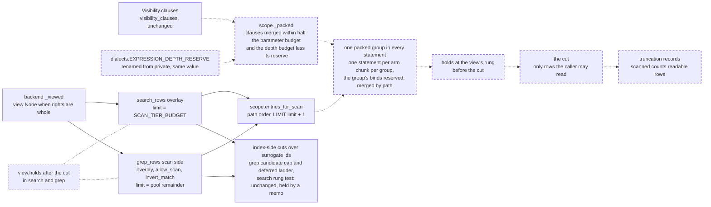

# The scan tier reveals nothing about rows a caller cannot read: the caller's compiled rights clauses ride the statements that cut the dirty rows, packed into as few as the budgets allow, so the cut, its record and the answer count only rows the caller may read

A fix to the scan tier that grep and ranked search share on the database backend (`src/vfs/storage/backends/database/scope.py`, `grep.py`, `search.py`). It touches rights: it moves where a partial caller's visibility predicate is applied, from Python after the cut to the SQL statements that make the cut, and it changes what a partial caller observes (a count, a truncation record, and which of its own readable rows answer), so the security lens is mandatory in both reviews and criterion 1 is a leak test over two stores that differ only in documents hidden from the caller. It changes no rights rule, no grant path, no `Visibility` method and no compile: the predicate is the clauses `visibility_clauses` already builds, merged into fewer statements. It needs the engine legs: the clauses ride a statement on every engine, criteria 2 and 3 are conformance rows, and criterion 7 reads each server engine's plan of the changed statement, all run on Postgres, MariaDB, SQL Server and Oracle through the `db_test` skill. It is not structural (no module, public class, protocol method or seam is added or removed), changes no public API (`VirtualFileSystem` and the storage protocol keep every signature; `entries_for_scan` gains one keyword), no schema, no stored byte and no Rust. It touches the gate's size baseline in one entry: `search.py` shrinks by three lines and its `MODULE_LINE_BASELINE` entry is lowered by three; `dialects.py`, also held, keeps its exact count (decision 11). It comes from no intention: the claim was made in passing by [the refresh spec](2026-10-31-refresh-the-incremental-index-verb.md), whose scale paragraph names it as outside its scope, and every fact here was read or executed for this spec or its review and is recorded in the problem section. The index-side cuts it does not fix are held by [a placeholder memo](../../research/2026-11-13-how-the-index-side-cuts-are-bounded-over-the-visible-set.md), on which this spec does not wait (decision 9). Landing order and shared files, READ in the working-tree copies on 2026-11-13 at `5d47a21a`: the queue is [scope crosses the seam in one shape](../archive/2026-11-07-scope-crosses-the-seam-in-one-shape.md), [close leaves no SQLite side files](2026-11-12-close-leaves-no-sqlite-side-files.md), [search survives a chunk row deleted under its read](2026-11-12-search-survives-a-chunk-row-deleted-under-its-read.md), this spec, [the index publishes only what its build read](2026-11-13-the-index-publishes-only-what-its-build-read.md), [the full pass is named rebuild](2026-11-12-the-full-pass-is-named-rebuild-and-its-pipeline-leaves-the-backend.md), three rendering fixes dated 2026-11-13, [refresh, the incremental index verb](2026-10-31-refresh-the-incremental-index-verb.md), and [the release audit is a review](2026-11-07-the-release-audit-is-a-review.md) last; this spec is not parallel-safe with any spec below that shares a file with it. Scope crosses the seam edits `scope.py`, `grep.py`, `search.py`, `tests/storage/database/test_grep.py`, `tests/storage/database/test_search.py`, `tests/support/storage_contract.py`, `tests/lint/allowlist.py` and `context/standards/mutant-ledger.md`, and runs the `plan_store` fixture's plan pins, whose file this spec edits. Its prefilter reaches `entries_for_scan` as more admissions, and this spec rebases onto that landing and adds its `view` keyword beside them. That landing is built in the working tree and not yet committed: it adds `src/vfs/storage/backends/database/addressing.py` and leaves `scope.py` at 349 lines, `search.py` at 1,248, `grep.py` at 650 and `reads.py` at 1,268 (READ, `wc -l` over the working tree), and this spec's line counts start from those. Close leaves no SQLite side files edits `tests/storage/database/test_statistics.py`, which this spec also edits in another class (`TestPlannerStatistics`, one new node); the two are independent and this spec follows it by the queue's order. Search survives a chunk row deleted edits `search.py` (the answer assembly, a new `_resplit_bodies` beside `_overlay_bodies`, the module docstring; not the overlay block this spec edits), `test_search.py` (its class `TestVanishedChunks`, which this spec's nodes do not touch), `tests/lint/allowlist.py` (it raises `search.py`'s entry by 33) and the ledger (rows S1 to S4), and its own first paragraph names this spec and these files; this spec rebases onto it, lowers by three the entry it leaves, and takes ledger rows V1 to V3. The rename edits `search.py` (it moves the lexical reads to `lexical.py`; the overlay block and `search_rows` stay), `grep.py`, `test_search.py`, `test_grep.py`, `test_statistics.py`, `storage_contract.py`, `tests/lint/allowlist.py` (it removes `search.py`'s entry once the file is under the ceiling) and the ledger, and it renames `reindex` in every test file that says it, which includes `tests/support/grants_contract.py` and `tests/support/plan_store.py`. The index publishes only what its build read, which lands right after this spec, edits `dialects.py` (a new function, `is_unique_violation`, beside `is_retryable`, on lines this spec does not touch), `tests/storage/database/test_grep.py`, `test_statistics.py` (two `TestPlannerStatistics` nodes), `tests/support/plan_store.py`, `tests/support/storage_contract.py`, `tests/lint/allowlist.py` and `context/standards/mutant-ledger.md`, all of which this spec also edits, by its Scope section. Refresh's Scope section names `grep.py`, `search.py`, `test_grep.py`, `test_search.py`, `tests/support/storage_contract.py`, `tests/lint/allowlist.py` and `context/standards/mutant-ledger.md` among its files, all of which this spec also edits. The three rendering fixes share only `context/standards/mutant-ledger.md` with this spec, by their Scope sections. The rename, the index-publish fix and refresh each name this spec in their working-tree copies; each rebases onto this landing. The release audit is a review shares no file.

## The problem

READ at commit `5d47a21a`, whose `src/` and `tests/` are unchanged since `f7539910` (EXECUTED, `git diff --stat f7539910 HEAD -- src tests` is empty); every line number below is that commit's, and the runs were made while the working tree still matched it (EXECUTED, `git status`). The scope landing built since then moves some of these lines; the first paragraph gives the counts it leaves. EXECUTED runs used Python 3.13 through `uv run` on SQLite, with scripts kept in the session scratchpad; some ran on the spec reviewer's build of the first draft (`src/` copied, the Design applied), named "the draft build" below; no Docker leg was run. Where a run lowers `SCAN_TIER_BUDGET` to 2 or 3 on the `search` and `grep` modules, it does so to keep the stores small; the defect does not depend on the number.

**The law.** READ. [The grants spec](../archive/058-row-level-permission-grants/spec.md) pins every read builder with "a test that plants a hidden row whose content would match and asserts it never appears, never changes a count, and never changes a visible row's score" (its Tests paragraph), and [rights at scale](../archive/150-rights-at-scale/spec.md) restates the rule it implements: hidden rows are absent, statistics are over the visible set. Nothing a caller can observe (a score, a statistic, a count, a truncation, an error) may change with the existence of a row it cannot read.

**Where the scan tier cuts.** READ. Both verbs serve the `NOT encoded` content rows from live bodies through one nominator, `entries_for_scan` (`scope.py:245`). It takes no view. Its statement is `SELECT … WHERE <content kinds> AND NOT encoded AND <arms or root fan> ORDER BY path LIMIT limit + 1` (`scope.py:313`; the ungated form at `:324`), the chunks merge by path, pruned to the lowest `limit + 1` (`:316` to `:318`), and the cut is `rows[:limit]` with an overflow flag (`:327` to `:329`). Search calls it with `limit=SCAN_TIER_BUDGET` (`search.py:425` to `:440`), applies the caller's view to the rows that came back (`:447`), and records `{"scanned": len(nominees.rows), "budget": SCAN_TIER_BUDGET}` on overflow (`:457`). Grep calls it with the pool's remainder (`grep.py:306` to `:321`), counts `scanned = len(nominated)` (`:322`), turns overflow into the "candidate budget" record (`:323` to `:324`), applies the view after (`:330` to `:332`), and puts `{"scanned", "index", "budget"}` on the record (`:394`). Grep runs the same nominator in three modes: the overlay of a gram-indexed pattern, `allow_scan` for a pattern with no gram, and `invert_match`; the last two pass `everything=True`, so their cut is over every content row, indexed or not (`grep.py:216`, `:314`). The cut is a SQL `LIMIT` in path order over rows the caller may not read; the view filters afterwards in Python. So hidden rows take slots in the cut, and every number derived from the cut counts them.

**What the rights module already offers.** READ. The rights module's docstring says SQL predicates are pushdowns "where a statement's shape needs one (a `LIMIT`, an aggregate, a subtree scan)" (`rights.py:38` to `:40`). `visibility_clauses` compiles a caller's rights into OR-clauses, each within half the membership budget in binds and at most one arm budget of units, 200 (`rights.py:480` to `:506`), exposed as `Visibility.clauses` (`:584`). The vector leg already rides it inside its `ORDER BY distance LIMIT k` statement, one statement per clause, merged (`search.py:775` to `:776`). Its exactness against the Python authority is pinned by `tests/storage/database/test_rights.py::test_the_clauses_admit_exactly_what_the_rights_admit` (`:163`), under bind budgets of 4, 9 and 2,099. The backend passes no view at all when the caller's read rights are whole (`backend.py:1702` to `:1703`).

**Was the order a decision.** READ. No. [The overlay spec](../archive/2026-11-09-the-overlay-counts-in-the-engine-and-the-scan-tier-shares-one-budget.md), which made the shared cut, says in its first paragraph that it changes "no rights rule", and none of its decisions names the order of cut and view. Its [first spec review](../../reviews/2026-11-09-the-overlay-counts-in-the-engine-and-the-scan-tier-shares-one-budget-spec-review.md) checked the flag "no … rights … change" and nothing more; its [code review](../../reviews/2026-11-10-the-overlay-counts-in-the-engine-and-the-scan-tier-shares-one-budget-code-review.md) rejected a data-isolation record because "the record's `data` carries three counts and no path", without asking whether the counts move with hidden rows. The older form of the question is on record as unanswered: grep's docstring says "the candidate budget still counts hidden candidates, so a partial caller can reach it sooner than a whole one" (`grep.py:195` to `:196`); [the permission ladder spec](../active/165-the-permission-ladder-list-and-contribute/spec.md) left "grep's candidate budget counts hidden candidates" open and out of its scope; and [the identity audit of 2026-10-28](../../research/studies/2026-10-28-the-0-1-0-roadmap-audits/05-identity-rights-and-the-trust-edge.md) found it still open, "a visible-set/statistics inconsistency". No decision with a reason, and no review that accepted the observable effect.

**What a partial caller observes.** EXECUTED. Two SQLite stores hold the same world: posture `none` at `/`, `bob` granted `read` on `/pub`, a few indexed files, readable dirty files under `/pub`. Store B also holds dirty files under `/hr`, which bob cannot read and which sort ahead of `/pub`. With the cut at 2, bob's calls on both stores were compared field for field: observations (paths, order, scores), errors (kind, severity, data, message), `lexical_stats` and `legs`. With one hidden dirty file in B, bob's grep lost its readable dirty file and gained a `truncated` warning carrying `{"scanned": 1, "index": 1, "budget": 2}`; store A answered the file with no record. With five hidden dirty files in B ahead of two readable ones, bob's search lost both readable files, gained the overlay-budget record `{"scanned": 2, "budget": 2}`, and reported `legs.lexical.hits` of 1 where A reported 3; bob's grep lost its readable dirty file; bob's `allow_scan` and `invert_match` greps answered nothing where A answered `/pub/indexed.md`. So both halves of the claim hold: a number and a record a partial caller sees change with the existence of rows it cannot read, and hidden rows crowd the caller's own readable rows out of an answer that then reports truncation. Search's `lexical_stats` stayed equal in every case, because the export reads the visible lexicon, not the overlay. The spec review re-ran these cases and 88 calls by partial callers of every kind (one clause, seventeen clauses, no rights, the owner floor, anonymous under a settled posture and under an in-flight cover and hole, the trash view, two scope roots): 56 differ between two such stores today; on the draft build 1 differs, through the index side (below).

**The fix, applied.** EXECUTED, first with the nominator replaced at run time, then on the draft build: every field of every scan-tier case above was equal between stores A and B, and B answered what A answered. On the grants contract's own world, with the cut at 2, five hidden dirty files and two readable ones, both local legs' shapes (the in-memory store, and a file store with the hash embedder) answered today with no readable dirty file and a record, and on the draft build with bob's search answering `/pub/fresh0.md` and `/pub/fresh1.md` first and then the two indexed files bob may read through the vector leg, `legs.lexical.hits` 2 and no record, and bob's grep answering exactly the two dirty files.

**What each form of the filter costs.** EXECUTED, the compile at each profile's real budget. The arms and the clause are residual filters on the `(encoded, kind)` seek, so every scan-tier statement visits every dirty content row, D of them, whatever its arms admit (the spec review, EXECUTED). Today a call issues one statement per arm chunk and visits D rows. Four named callers on one SQLite store, holding `read` on 20, 100, 300 and 800 folders, compile with their owner floor to 166, 811, 2,423 and 6,453 binds, about 8 binds a folder; that is 1, 2, 4 and 9 clauses on SQLite, Postgres and MariaDB, up to 1, 3, 7 and 18 on Oracle, whose clauses take half its 1,000-element membership budget. (a) One statement per clause visits D times the clause count. (b) The same clauses merged into statements whose summed binds stay within half the parameter budget and within the expression-depth budget less its reserve (936 binds on every profile) need 1, 1, 2 and 4 statements on SQLite, Postgres and MariaDB and 1, 1, 3 and 8 on SQL Server and Oracle. At 800 folders the spans' clauses hold 2,399 binds and pack three to a statement, and the owner floor is one clause of 4,054 binds on SQLite, wider than the cap and so a group of its own, where Oracle's and SQL Server's smaller clause budgets split it into several. INFERRED from that shape: at 1,000 folders about 5 statements on SQLite, Postgres and MariaDB and about 10 on SQL Server and Oracle, against about 11 and 22 clauses. The synthetic compile the spec review used, rights without an owner floor at 3 binds a folder, gives 1, 2, 11 and 51 clauses and 1, 1, 4 and 19 packed statements at 1, 100, 1,000 and 5,000 folders on all five profiles (EXECUTED). (c) The join to `Visibility.entries` is one statement, but its derived table enumerates every row the caller may see before the join; [the document-level security memo](../../research/2026-09-30-search-document-level-security-prior-art.md) measured that the join "still grows with visible rows", which at the reference deployment is up to 10,000,000 a call for a broad caller. (d) Choosing by the filter's size between a pre-filter and a post-filter, as Lucene's kNN query does: the only exact post-filter here streams every dirty row to Python and keeps the first readable ones, one statement and D visits but up to D rows shipped a call. At the dirty set this landing leaves (a daily rebuild, so up to about 50,000 rows by the end of a working day, and up to about 1,000,000 through the nightly batch), a call by a named caller with 1,000 folders visits 50,000 rows today, about 550,000 to 1,100,000 under (a) and about 250,000 to 500,000 under (b) by day; by night 1,000,000, about 11,000,000 to 22,000,000, and about 5,000,000 to 10,000,000 (the lower figure on SQLite, Postgres and MariaDB). A caller with 100 folders pays today's cost under (b) and two to three times it under (a). EXECUTED on SQLite at P of 800 over 10,000 files with statistics: the draft's form issued 9 scan-tier statements, the merged form 4, with the same answer; every merged statement planned as `SEARCH vfs_entries USING INDEX ix_vfs_entries_encoded_kind`, and one of the draft's nine, a clause of point grants alone, planned as `SEARCH vfs_entries USING INDEX ix_vfs_entries_path (path=?)`. EXECUTED: SQLite refuses an OR of about 2,000 terms as "Expression tree is too large (maximum depth 1000)", whether or not each clause is parenthesized, and runs one of about 800, so the depth budget, not only the bind budget, limits a merged statement.

**The plan.** EXECUTED on SQLite over 10,000 files in the plan store's shape, reindexed, statistics settled, bob granted `read` on twenty roots, one dirty file: the overlay statements a search and a 20-glob grep issue plan as `SEARCH vfs_entries USING INDEX ix_vfs_entries_encoded_kind (encoded=? AND kind=?)`, gated and ungated, and plan the same with bob's compiled clause ANDed in. The four server engines' plans of the changed statement have not been read; criterion 7 reads them.

**The neighbouring cuts.** Every budget, cap or early stop on a read path a partial caller reaches, and whether it counts rows before the view. (a) Grep's index-side candidate cap: the engine's candidate kernel caps the sorted surrogate doc ids at `SCAN_TIER_BUDGET` (`grep.py:453`) before any entry row is read; EXECUTED with the cap at 2, two hidden indexed matches with lower ids than bob's one readable match left bob with no answer and a `truncated` record, where the store without them answered the match. (b) Grep's deferred ladder: the price `_ladder_defers(chosen, meta, len(allow))` (`grep.py:445`) and the slice `allow[:SCAN_TIER_BUDGET]` with `len(allow)` as the nominated count (`:262`) read the scope's allow-list, which holds every entry in the scope, files awaiting the index included, since a written file already holds segment ids; EXECUTED by the spec review on the draft build with the cut at 2, the allow-list of one scoped grep counted 4 ids on one store and 9 on the other, of two that differ only in five hidden files awaiting the index, the ladder deferred on one and not the other, and only one answer carried a `truncated` record. The gram choice (`:484`) reads `doc_count` and changes an answer only through the cap. (c) Search's rung test, `len(allow) <= SCOPE_ID_BUDGET` (`search.py:346` for the lexical leg, `:786` for the vector leg), counts the same allow-list; EXECUTED with `SCOPE_ID_BUDGET` at 2 and `FUSION_K` at 1, three hidden files inside bob's glob scope moved his search to the wide rung and his one readable in-scope file was not answered. (d) Search's lexical depth `FUSION_K`, its deepening and its window record: under a partial view the scorer runs over the visible chunks only (`search.py:348` to `:354`); not this defect. (e) The vector leg's `LIMIT`: the clause already rides inside it (`:775` to `:776`); not this defect. (f) Glob: no count cut before the view; `max_count` cuts the served rows after it (`reads.py:439` to `:441`); its docstring records why its view stays in app code, "a clause beside the fan would demote its plan" (`:357` to `:358`); not this defect. (g) The wall: a time bound, not a count (decision 10).

**Whether the deferred ladder can come inside this spec.** EXECUTED on a 20,000-file SQLite store whose every body holds one common word, with a caller reading 10 files under `/big/mine` and none of the other 19,990 under `/big`. A grep scoped to `/big/**` builds an allow-list of 20,201 ids and does not defer; pricing it over what the caller can read needs every listed id's row, 21 statements at the 1,000-element floor and 20,201 row visits, where today the price reads a list's length. A grep scoped to `/big/mine/**` builds 10 ids, defers, and fetches no posting bytes; with deferral forbidden for it, it fetched the 60,009 posting bytes of the chosen grams, about 3 bytes a document. INFERRED from those figures at the reference deployment: a readable price or slice costs a row visit per listed id, about 2,000 statements a call for a scope over 2,000,000 files; never deferring for a partial caller fetches a common gram's postings on every narrow scoped grep, about 30 MB a call at 10,000,000 files, which the code's own cost model (`grep.py:137` to `:139`) prices near 1.65 s against about 0.75 ms to verify a 10-file scope. Neither is bounded, so the ladder stays with the two other index-side cuts (decision 9).

## Architecture

Dashed is what this spec adds; dotted is what it retires.

Page this changes: none; the architecture folder was retired on 2026-10-31, and the landing notes will say so in one line.

Terms. The **scan tier** is the set of content rows a verb reads from live bodies: the `NOT encoded` rows for search's overlay and grep's overlay, every content row for grep's `allow_scan` and `invert_match`. The **cut** is the path-ordered count at which `entries_for_scan` stops. A **partial caller** is one whose read rights are not whole, so the backend hands the verb a `Visibility`. A **clause** is one of the OR-clauses `visibility_clauses` compiles for that caller; a **packed group** is a run of consecutive clauses merged into one predicate for one statement. A **surrogate-id cut** is a cut over a list of entry ids that carries no path, made before any entry row is read. **D** is the number of dirty content rows the `(encoded, kind)` seek returns.

## Decisions

### 1. The scan tier's cut counts only rows the caller may read: `entries_for_scan` takes the call's view, and every statement it issues carries the caller's compiled clauses

The law says a count and a truncation may not move with a hidden row, and the cut is where both are made. The cut is the `LIMIT` of a SQL statement, which is exactly the shape the rights module's pushdowns exist for. Filtering after the cut cannot be repaired by fetching more, because any fixed overfetch is again a count that hidden rows can fill. The clauses are exact against the Python authority (pinned by `test_the_clauses_admit_exactly_what_the_rights_admit`), so the rows the `LIMIT` returns are the rows the caller may read, in path order, and the cut, its overflow flag and every number derived from them are taken over the visible set. One change in the shared nominator fixes both verbs and all three grep modes.

### 2. The filter is the compiled clauses packed into as few statements as the bind and depth budgets allow, on every dialect; not one statement per clause, not the range join, not a post-filter chosen by size

Every form keeps the law; they differ in cost, counted in the problem section. One statement per clause visits the dirty rows once per clause: 9 times for a named caller with 800 folders on SQLite, Postgres and MariaDB and 18 times on Oracle. Packing the same clauses into statements whose summed binds stay within half the parameter budget and within the depth budget less its reserve visits them once for a named caller up to about 100 folders, 4 times at 800 on three profiles and 8 on the other two (EXECUTED); it adds no compile, since the groups are unions of clauses the compile already made, and the depth cap is a fact SQLite enforces (EXECUTED). The cap counts binds, not terms: every term spends at least one bind, so a group within the cap is within the depth budget, and the `Clause` the compile already returns carries its binds and no term count; counting terms would need the compile to report them from `rights.py`, held at its exact count. The range join is one statement, but it enumerates every row the caller may see, which grows with the corpus, not with the dirty set. A post-filter visits the dirty rows once but ships up to all of them, hidden ones included, into Python on every call, 1,000,000 by night, and the threshold at which it beats the packed form is a ratio of transfer to visit cost that no run here has measured. So the packed form has the lowest per-call cost that is bounded by the dirty set on every engine. The bounded form at any grant count is a partial index over the rows awaiting the index keyed by path, so that a range join seeks only the dirty rows inside the caller's ranges; it is a schema change, named under Scale as the direction, as the overlay spec already named the partial index.

### 3. One statement per arm chunk per packed group; the group's binds are reserved from the arm chunk and the root fan; the statements merge by path and prune to the lowest `limit + 1`

A packed group spends up to half the parameter budget in binds, so the arms beside it must leave room or a statement would overdraw the engine's bind cap on the least generous engine (SQL Server's 2,099, Oracle's 1,000-element `IN` list). The arm chunk is sized with `arm_budget(profile, parameter_budget - spend, …)` and the root fan with `reserved=kinds.binds + spend`, where `spend` is the widest group's binds, so every statement stays inside the budget. The merge is the top-k merge the grants spec's fan rule names exact: every row of the global first `limit + 1` by path is admitted by some group and ranks at least as high there. The deadline is consulted before every statement, as it is between chunks today. No statement grows with caller input: a group is bounded by the two budgets, the arms by the chunk.

### 4. `holds` at the view's rung stays the authority, and it runs inside `entries_for_scan` on the merged rows before the cut; search and grep stop filtering by the view after it

The rights module makes the Python check the authority every fetched row passes, and the pushdown only narrows toward it. Running it before the cut keeps every counted row a held row; the cut's exactness rests on the clauses', which `test_the_clauses_admit_exactly_what_the_rights_admit` pins. With the check inside the nominator, both callers' after-the-fact filters are dead and go, which is what pays for decision 11's three lines.

### 5. The records keep their reason words, kinds, severities, guidance and data keys; `scanned` now counts rows the caller may read, and overflow means more such rows than the cut

A caller already reads these records; a new vocabulary for the same fact would be churn. What changes is only the set the numbers are taken over, which is the law's set.

### 6. A caller whose read rights are whole is served exactly as today

The backend passes no view then (`backend.py:1702`), the nominator builds no clause, and the statements, their count and their binds are today's. A view reaches the nominator only when the caller's read rights are not whole, so `view.clauses()` is a list there; `None` is read as no view. The fast path is the default open posture's, and nothing a partial caller gains may cost it. The guard this rests on is `TestOverlayGate::test_the_scan_path_statement_count_is_unchanged`, which also asserts that a whole caller's call issues exactly one scan-tier statement.

### 7. The ungated statement and the gated ones share one loop

Today the ungated form (`scope.py:320` to `:325`) is a second statement shape with no merge. Under packed groups it would need its own loop and merge; expressing its terms as one `where` beside the arms' lets one loop issue every statement, merge and prune. The statement each form issues for a whole caller is unchanged.

### 8. The depth reserve becomes public as `EXPRESSION_DEPTH_RESERVE`, the one name both the arm budget and the packing read

The packing's depth cap is the profile's `expression_depth_budget` less the same reserve the arm fan holds back for the predicates AND-chained above it (`dialects.py:726`, `:753`). A second constant with the same meaning in `scope.py` would be a duplicate that drifts; importing a private name across modules is the smell the house rules name. The rename changes two lines and no count.

### 9. The index-side cuts over surrogate ids stay as they are, and the placeholder memo holds them: grep's candidate cap, grep's deferred ladder (its price and its slice), and search's `SCOPE_ID_BUDGET` rung test in both legs

Each is a count over a list of entry ids taken before any entry row is read, and an id carries no path for a clause to judge. Taking any of them over readable ids needs each listed id's row, so the work grows with the list: a common gram's candidates, or a scope's every entry, a row visit each. The problem section measures it for the deferred ladder (21 statements and 20,201 row visits for a 20,000-file scope, about 2,000 statements a call for a 2,000,000-file scope at the reference deployment), and forbidding deferral instead costs a narrow scoped grep the common gram's postings, about 30 MB a call; for the candidate cap it is about a thousand statements a call where today it is about 25. That is a per-call cost in proportion to the corpus, which the production posture forbids at about 150,000 verb calls a day. These cuts break the same law by a different mechanism: they still count ids the caller cannot read, and a file awaiting the index holds such an id, so they can still move with hidden files written since the last pass. [The placeholder memo](../../research/2026-11-13-how-the-index-side-cuts-are-bounded-over-the-visible-set.md) names each cut, what was executed, the cost argument and the direction prior work points to: path-ordered ids that make a caller's rights a range the kernel can meet before it cuts, which the grants spec deferred to a design of its own. Grep's docstring keeps its sentence, narrowed to those cuts.

### 10. The wall is unchanged

The wall bounds time, and the time any call takes includes the engine's index work on rows the caller cannot read, on every verb; no order of filter and cut makes a time bound independent of them, and a test may never assert on time. This spec narrows it as a side effect: hidden rows no longer cross the wire into the scan tier or reach its judge hop.

### 11. `search.py` shrinks by three lines and its `MODULE_LINE_BASELINE` entry is lowered by three; `dialects.py` keeps its exact count; `grep.py` keeps its length; `scope.py` grows under the ceiling

The call site gains one line (`view=view,`) and the five-line `admitted` comprehension becomes one line once its view test goes (decision 4), a net of three fewer (EXECUTED on the draft build: 1,248 to 1,245 at `5d47a21a`). The entry falls by three from the value the landing before this one leaves (1,248 after scope crosses the seam, then raised by 33 by search survives a chunk row deleted). `grep.py` (650 after scope crosses the seam) is unchanged in length: the scan side loses its view test and the call gains `view=view,`. `scope.py` (349 lines after scope crosses the seam) grows by about thirty with the loop, the packing helper under its banner and two docstring sentences, unlisted and under 1,000. `dialects.py` changes two lines and no count (decision 8). `rights.py`, `reads.py`, `backend.py` and `base.py` are not edited.

### 12. Each law lands with its mutant as a row of the mutant ledger: V1, V2 and V3

V1: the packed group left out of the scan-tier statement, so the cut counts hidden rows again; criteria 1 to 4 kill it. V2: the group's binds not reserved (the arm chunk sized on the full parameter budget); criterion 5 kills it, by counting statements at a budget where the reservation changes the arm chunk. V3: the group loop stops after the first group, so a caller's rows under later groups vanish; criterion 4 kills it.

## Intent

After this spec, the scan tier's cut, its record and its answer are taken over rows the caller may read: a caller with partial read rights who greps or searches a store with files written since the last index pass gets, from the scan tier, the same rows and the same scan-tier counts whether or not the store also holds dirty files it cannot read, and its own readable dirty files are answered up to the cut, with a truncation record only when its own readable rows overflow the cut. The index side's cuts over surrogate ids, the candidate cap, the ladder's deferred allow-list slice and its price, and search's rung test, still count hidden ids, and a file awaiting the index holds such an id, so they can still move with hidden files written since the last pass; the placeholder memo holds that remainder. A caller whose rights are whole issues the same statements as today. A named caller whose rights pack into one statement, up to about 100 granted folders, pays what a call costs today; one with more pays one more pass over the dirty rows per packed group, 4 at 800 folders on SQLite, Postgres and MariaDB and 8 on SQL Server and Oracle.

## Design

**Tests first.** Every node in the criteria is written and run red on the tree this spec builds on before any source line changes; the red result each shows today is given with its criterion.

**`src/vfs/storage/backends/database/dialects.py`.** `_EXPRESSION_DEPTH_RESERVE` is renamed `EXPRESSION_DEPTH_RESERVE` at its definition and its one use in `arm_budget`; its comment and value are unchanged.

**`src/vfs/storage/backends/database/scope.py`, `entries_for_scan`.** It gains the keyword `view: Visibility | None = None`, with `Visibility` imported under the module's `TYPE_CHECKING` block and `Clause` imported at the top from `rights`, which the module already imports, and `and_` from SQLAlchemy and `EXPRESSION_DEPTH_RESERVE` from `dialects`. It reads `clauses = None if view is None else view.clauses()`; an empty list returns `ScanNominees([], False)`. The groups are `_packed(clauses, min(parameter_budget // 2, profile.expression_depth_budget - EXPRESSION_DEPTH_RESERVE))`, a private helper under the module's internal-helpers banner that walks the clauses in order and merges consecutive ones while their summed binds stay within the cap (a clause wider than the cap is its own group), each group one `Clause` of the `or_` of its predicates and the sum of their binds; every unit of a clause spends at least one bind, so a group within the cap is at most that many terms deep. `spend` is the widest group's binds, or 0 with no view; `rights` is `[None]` with no view, else each group's predicate. The gated form sizes the arm chunk with `arm_budget(profile, parameter_budget - spend, ARM_FIXED_BINDS + ride.binds + kinds.binds)` and passes `reserved=kinds.binds + spend` to `scope_fan`; the ungated form becomes one `where`, `and_(path != "/", *liveness_filters(...), ride)`, as decision 7 says. One loop runs every `where` against every group: the deadline consulted before each statement, `select(*columns).where(*base, where[, group]).order_by(path).limit(limit + 1)`, the overflow flag as today, the merge by path pruned to the lowest `limit + 1`. Then `rows` is the merged rows in path order that pass `view.holds(row, view.need)` (every row when there is no view), and the cut and overflow follow as today. The docstring gains two sentences: "Under a partial *view* every statement carries one packed group of the caller's compiled visibility clauses, merged within half the parameter budget and the depth budget, one statement per arm chunk per group, merged by path, and every merged row passes the view before the cut, so the cut counts only rows the caller may read. The groups are residual filters on the rows the dirty-row seek returns, never a join to the caller's visible entries."

**`src/vfs/storage/backends/database/search.py`, `search_rows`.** The `entries_for_scan` call gains `view=view,`; the `admitted` comprehension becomes `admitted = [m for m in nominees.rows if gated.admits(m, verdicts[m["entry_id"]])]`. The record at `:457` is unchanged. The docstring's sentence "Both legs and the overlay pass every row through the view." stays true and stays. Net three lines fewer.

**`src/vfs/storage/backends/database/grep.py`, `grep_rows`.** The `entries_for_scan` call gains `view=view,`; the scan side's loop drops its view test and becomes `candidates.setdefault(...)` for every admitted row. The index side's view test at `:281` to `:283` stays, since its rows come from ids. The docstring's last two sentences (`:192` to `:196`) become, at the same line count: "Under a partial *view* every candidate passes the view beside the structural gates, before any body is fetched, so the matcher never reads a row the caller cannot see. The scan tier's cut counts only rows the caller may read; the index side's cuts, over surrogate ids, still count hidden ones, files awaiting the index among them."

**`tests/lint/allowlist.py`.** `search.py`'s entry falls by three from the value the previous landing leaves.

**`tests/support/grants_contract.py`, `GrantsContract`.** Criteria 2 and 3, on the module's world, with `SCAN_TIER_BUDGET` patched to 2 on the `search` and `grep` modules through `monkeypatch`, the dirty bodies holding a word no indexed file holds (`quarantine`), so the index side nominates nothing and the scan tier alone is under test. Every conformance leg runs them, the four server legs through `db_test`.

**`tests/support/plan_store.py` and `tests/support/storage_contract.py`.** Criterion 7. `_measured` reads two more things after its existing readings, so none of them changes: with the posture `none`, a principal granted `read` on 300 of the store's roots and one dirty file written, the overlay statements the scan tier issues for a grep by the system actor and for one by that principal, each spelled with literal values through `_literal` (the statements recorded by wrapping the session the nominator is handed, for that one call) and planned through `_plan_text`. `PlanReadings` gains `overlay_whole` and `overlay_partial`, each a list of `(statement, plan)` pairs. A new function `entry_access(engine, plan)` returns the plan's accesses to `vfs_entries` as the engine names them: on SQLite the `EXPLAIN QUERY PLAN` detail lines naming `vfs_entries`; on Postgres each scan node on `vfs_entries` with its node type, its index and whether its index condition is an equality; on MariaDB the `type` and `key` of the `vfs_entries` row; on SQL Server the `PhysicalOp` and `Index` of each access to `vfs_entries` in the showplan, with whether its seek predicate is an equality; on Oracle the operation, options and object of each `DBMS_XPLAN` line on `VFS_ENTRIES`. "The same plan" means: every access in a partial statement's plan is one the whole caller's statement takes, or an equality seek of the path index (SQLite `SEARCH vfs_entries USING INDEX ix_vfs_entries_path (path=?)`, a Postgres or SQL Server seek of `ix_vfs_entries_path` on an equality, a MariaDB `key` of the path index with `type` `const`, `eq_ref` or `ref`, an Oracle `INDEX UNIQUE SCAN` of the path index), which visits at most the rows its equalities name. An access is the index it reads and whether it seeks or scans it: a Postgres bitmap or plain index scan of one index on one condition is one access, and a MariaDB `range` access of the path index whose ranges are all single points is an equality seek. The SQLite leg's reading of the whole caller's statement was read for this spec (EXECUTED, the `(encoded, kind)` seek); the server legs' are read at the build, and this criterion holds the partial caller's plan to the whole caller's whatever it is. A full scan of `vfs_entries` found in a whole caller's plan is written up the same day as a placeholder memo or a spec, linked from the landing notes, which also say that on that engine the Scale paragraph's cost of D rows a statement does not hold until it is fixed.

**`tests/storage/database/test_search.py`, class `TestOverlay`; `tests/storage/database/test_grep.py`, classes `TestOverlayGate` and `TestPushdownBindAccounting`; `tests/storage/database/test_statistics.py`, class `TestPlannerStatistics`.** Criteria 1, 4, 5 and 6. Each grants-contract and two-store node's docstring names V1's mutation, the fanned node's also V3's, and criterion 5's V2's. Statements are recorded with `before_cursor_execute`, as the files already do; on SQLite an overlay statement is recognised by its `unlikely(` term, as `test_the_overlay_fetch_keeps_its_seek_under_statistics` already does. A fanned view is made as `tests/storage/database/test_rights.py::test_without_a_range_source_the_arms_answer_as_the_join_did` makes one, with `EngineHost.parameter_budget` patched to 56 and the caller holding `read` on twenty folders. `TestOverlayGate::test_the_scan_path_statement_count_is_unchanged` gains the assertion that a whole caller's call issues exactly one scan-tier statement.

**`context/standards/mutant-ledger.md`.** Rows V1, V2 and V3 of decision 12, each with its intent, anchor, target file, scope selection and recorded killers, and this spec's title as provenance.

**Scale, at the reference deployment, against the tree as it is when this spec lands.** Only a partial caller's grep and search change. At this landing the index is rebuilt once a day (the refresh spec's partial passes land later), so the dirty set D grows through the working day to about 50,000 rows (0.5 % of 10,000,000 files a day, the organic change figure) and to about 1,000,000 through the nightly batch. Today a scan-tier call issues k statements, one per arm chunk, each visiting D rows; after, a partial caller's call issues k′ statements per packed group, each visiting D rows, where k′ equals k for any call of up to about 100 arms, and on SQL Server reaches about twice k for a wide group, whose reserved binds shrink the arm chunk from about 181 arms to about 100. The arms are residual filters on the `(encoded, kind)` seek, so every statement visits all D rows, and each ships at most `limit + 1` rows, readable ones only for a partial caller. The figures below are for a call of one arm chunk. The group count is 1 for any caller whose rights fit within 936 binds, which for a named caller with its owner floor is about 100 granted folders on every profile (EXECUTED: 811 binds at 100 folders), and that is today's cost exactly; it is 2 or 3 at 300 folders and 4 or 8 at 800 (EXECUTED, the larger figure on SQL Server and Oracle, whose smaller clause budgets split the owner floor), and about 5 or 10 at 1,000 (INFERRED from the 800-folder shape; the depth cap of 936 binds before the bind cap even on SQL Server). So a named caller with 1,000 folders visits about 250,000 to 500,000 rows a call by day, against 50,000 today, and about 5,000,000 to 10,000,000 by night, against 1,000,000. If such service identities issue 15,000 calls a day (the top 1 % of identities issuing 10 to 20 % of about 150,000 calls; the share holding 1,000 grants is the reference table's rights assumption), that is about 3,750,000,000 to 7,500,000,000 row visits a day against about 750,000,000 today, where one statement per clause would have cost about 8,250,000,000 on SQLite, Postgres and MariaDB and about 16,500,000,000 on Oracle. A caller with very many grants pays one more pass over the dirty rows for every 936 binds of its spans' rights, about every 300 folders, plus its owner floor's groups; that is the honest profile of this landing, and the direction below removes it. Each visited row evaluates its group's terms in the engine, up to one comparison per unit, the same total over all groups as one OR would cost. The Python side shrinks: hidden dirty rows no longer cross the wire, sit in the merge or reach the gates' judge hop, so that work is in proportion to the caller's readable dirty rows. Per file write, about 1,050,000 a day: nothing changes. Per index visit, about 11,000,000 a day: nothing changes. Per batch: no statement takes batch input. Bind budgets: decision 3 keeps every statement inside the dialect's budget, and criterion 5 counts it. The direction that makes the cost independent of the grant count is a partial index over the rows awaiting the index, keyed by path, so that a join from the caller's ranges seeks only the dirty rows inside them; at the refresh spec's cadence D also falls to the rows changed since the last pass. Neither is a designed cap, and nothing here is one.

## Scope

In: decisions 1 to 12. Source: `src/vfs/storage/backends/database/scope.py` (`entries_for_scan`, `_packed`, the docstring), `src/vfs/storage/backends/database/search.py` (`search_rows`' overlay block), `src/vfs/storage/backends/database/grep.py` (`grep_rows`' scan side and its docstring), `src/vfs/storage/backends/database/dialects.py` (one rename). Tests: `tests/support/grants_contract.py`, `tests/support/plan_store.py`, `tests/support/storage_contract.py`, `tests/storage/database/test_search.py`, `tests/storage/database/test_grep.py`, `tests/storage/database/test_statistics.py`. Gate: `tests/lint/allowlist.py`, one entry lowered by three. Standards: three rows appended to `context/standards/mutant-ledger.md`. And this spec's landing notes.

Out: the index-side cuts of decision 9, grep's candidate cap, its deferred ladder's price and slice, and search's `SCOPE_ID_BUDGET` rung test in both legs, held by [the placeholder memo](../../research/2026-11-13-how-the-index-side-cuts-are-bounded-over-the-visible-set.md). The wall (decision 10). Glob, whose only count cut is after the view. The range-join form and the post-filter form (decision 2). A partial index over the rows awaiting the index, the named direction. A full scan of `vfs_entries` by today's overlay statement on a server engine, if criterion 7's readings find one: a defect of every caller's statement, written up the same day as a placeholder memo or a spec and linked from the landing notes, not fixed here. Any change to `visibility_clauses`, `Visibility`, the rights cache or a grant verb. Any change to the records' reason words or keys. The edits the rename and refresh specs need to name this spec, which are their authors'. The refresh spec's live set and the rename of `reindex`.

## Acceptance criteria

Counts and states, never clocks. Each node is red on the tree this spec builds on, with the result given; where the red result was executed for this spec it was executed on the scratch staging the problem section describes, which each node reproduces in the suite.

1. `tests/storage/database/test_search.py::TestOverlay::test_two_stores_that_differ_only_in_hidden_dirty_rows_answer_alike` and `tests/storage/database/test_grep.py::TestOverlayGate::test_two_stores_that_differ_only_in_hidden_dirty_rows_grep_alike`, the grep node parametrized `[overlay]`, `[allow_scan]` and `[invert_match]`: two `InMemoryStorage` stores are built from the same seed (posture `none`, `bob` granted `read` on `/pub`, an indexed file, two readable dirty files under `/pub`); store B also holds five dirty files under `/hr`. With `SCAN_TIER_BUDGET` patched to 2, bob's call on each store answers equal observations (paths, order, scores), equal errors (kind, severity, data, message), and, for search, equal `lexical_stats` and `legs`. Today search and every grep mode differ (EXECUTED).
2. `tests/support/grants_contract.py::GrantsContract::test_hidden_dirty_rows_never_change_what_search_and_grep_show`, run on every conformance leg: on the module's world after a reindex, with the cut at 2 and two readable dirty files under `/pub`, bob's search and grep answer the same observations and records before and after the system writes three dirty files under `/hr`. Today the after-state differs on both local legs (EXECUTED); on the draft build it is equal on both (EXECUTED).
3. `tests/support/grants_contract.py::GrantsContract::test_readable_dirty_rows_are_never_crowded_out_by_hidden_ones`, run on every conformance leg: with the cut at 2, five hidden dirty files under `/hr` and two readable dirty files `/pub/fresh0.md` and `/pub/fresh1.md`, bob's search answers both fresh files as its first two observations, every observation is a path under `/pub`, `legs.lexical.hits` is 2, and it carries no `truncated` record; bob's grep answers exactly the two fresh files and carries no `truncated` record. Today search answers neither fresh file, `legs.lexical.hits` is 0 and it carries `{"scanned": 2, "budget": 2}`, and grep answers nothing with its count record, on both local legs (EXECUTED); on the draft build both legs pass (EXECUTED).
4. `tests/storage/database/test_search.py::TestOverlay::test_a_fanned_view_keeps_every_readable_dirty_row`: with `EngineHost.parameter_budget` patched to 56, bob holding `read` on twenty folders `/f00` to `/f19` compiles to more than one clause; with the cut at 3, five hidden dirty files under `/a0` to `/a4`, which sort ahead of the readable `/f00/r.md`, `/f01/r.md` and `/f02/r.md`, bob's search answers the three readable files, carries no `truncated` record, and issues exactly as many overlay statements as `_packed` makes groups of bob's clauses at that budget, which is more than one. Today it answers none, carries `{"scanned": 3, "budget": 3}`, and issues one overlay statement (EXECUTED: 17 clauses, 1 statement).
5. `tests/storage/database/test_grep.py::TestPushdownBindAccounting::test_the_packed_groups_binds_are_reserved_from_the_arm_chunk`: with `EngineHost.parameter_budget` patched to 56 and a grep by bob over forty globs, every scan-tier statement's `WHERE` carries exactly one packed group of bob's compiled clauses, every statement binds at most 56 parameters, and the statements number exactly the group count times `ceil(arms / arm_budget(profile, 56 - spend, ARM_FIXED_BINDS + ride.binds + kinds.binds))`, with `spend` the widest group's binds; the node also asserts that the same arithmetic without `- spend` gives a different count, so the budget is one at which the reservation changes the arm chunk. Today no scan-tier statement carries a clause (READ, `scope.py:313`). V2 fails it on the count (EXECUTED by the spec review in the drafted form: 80 statements against 40).
6. `tests/storage/database/test_statistics.py::TestPlannerStatistics::test_a_partial_callers_overlay_fetch_keeps_its_seek_under_statistics`, marked `slow`: on the large store with posture `none` and a caller granted `read` on twenty roots, after a dirty write, every overlay statement the caller's 20-glob grep issues carries the caller's packed group and plans as `SEARCH vfs_entries` on `ix_vfs_entries_encoded_kind`. Today the overlay statements carry no clause (READ, `scope.py:313`; EXECUTED, the recorded statements of the plan run).
7. `tests/support/storage_contract.py::StorageContract::test_a_partial_callers_scan_statement_plans_as_a_whole_callers`, marked `slow`, over the `plan_store` fixture on every leg with a plan backend (the SQLite file leg and the four server legs; the memory leg skips as the fixture already does): `overlay_partial` holds more than one statement (300 granted roots pack into two or three groups, EXECUTED in the compile above), each partial statement carries a rights term the whole caller's statements lack, and `entry_access` of each partial plan is the same plan as the whole caller's, as the Design defines it per engine. Today `overlay_whole` and `overlay_partial` do not exist and the partial statements carry no rights term (READ, `scope.py:313`).

The gate and the guards, which are not red nodes and are therefore not numbered: `tests/storage/database/test_grep.py::TestOverlayGate::test_the_scan_path_statement_count_is_unchanged`, with its added assertion of one scan-tier statement for a whole caller, and `::test_the_skip_path_statement_count_is_unchanged` pass, the guards decision 6 rests on; `tests/lint/test_code_shape.py::test_a_listed_module_never_grows_and_an_unlisted_one_stays_under_the_ceiling` passes with `search.py`'s entry lowered by exactly three and `dialects.py`'s unchanged, and `git diff` from the build's base over `tests/lint/allowlist.py` shows that one line changed; `scripts/ci.sh` exits 0 on the tree as committed; the `db_test` cycle passes the four server legs, criteria 2, 3 and 7's nodes included, and the landing notes record each engine's plan of the whole and the partial caller's overlay statements.

## Landing notes

Filled in on landing.

## One line

A partial caller's grep and search now cut the files awaiting the index with the caller's own compiled rights clauses packed inside the statements, so the scan tier's cut, its record and its count are taken over rows the caller may read, and dirty files it cannot see no longer crowd its own out of the scan tier; the index side's cuts over surrogate ids still count hidden ids, files awaiting the index among them, and a memo holds them.
