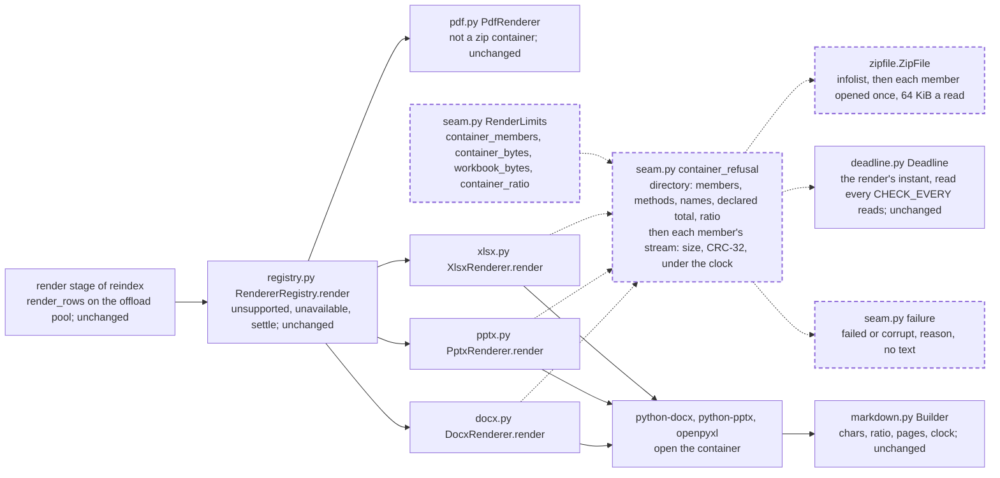

# An Office container is measured before it is opened: the docx, pptx and xlsx renderers read the zip directory first and refuse a container past its limits as a failed rendering

A fix to the document renderers (`src/vfs/rendering/`): not structural (no module, public class, protocol method, lifecycle or seam is added or removed); it changes the public API additively, because `RenderLimits`, exported from `vfs.rendering` and taken by `DatabaseStorage` as `render_limits`, gains four fields, and `vfs.rendering.seam` gains one public function and seven constants; no page under `docs/` or `documentation/` names `RenderLimits` or the seam (EXECUTED, `git grep` at `5d47a21a`), so no reference page changes. No schema change, no rights change, no Rust engine change, and the engine legs are not needed: no SQL statement, builder or batch loop changes, and a refused container lands through the render stage's existing landing as any `failed` or `corrupt` state does. It touches neither the gate's layer map nor its size baseline: beyond what it imports today, `seam.py` imports `binascii`, `copy`, `zipfile` and `io.BytesIO` from the standard library and `CHECK_EVERY` and `Deadline` from `vfs.deadline`, which sits beneath every layer, and every module it edits stays far under 1,000 lines; `seam.py` does not read the clock itself, so the clock-reader lint's list is unchanged. It closes the medium finding `vfs.rendering:ooxml-part-decompression-unbounded` of the 0.1.0a1 security audit (run `vfs-run-1-2026-11-07` at commit `3586750`, whose `src/vfs/rendering/` equals `5d47a21a`'s, as the sibling specs record), as far as decompression goes: after it, no read any of the three libraries makes of a member decompresses more than the size the container's directory declares for that member, because every declaration is first checked against its member's stream, and the declarations are bounded by the limits (decisions 11 and 16); what a library's parser spends on the bytes it is handed stays the library's own cost. The audit run that raised the finding, run `vfs-run-1-2026-11-07`, is held by the developer outside the repository until its record lands under [the release audit is a review](2026-11-07-the-release-audit-is-a-review.md). No intention, and no research memo this spec stands on: the facts are in the code and in the executed probes recorded under The problem, whose scripts are kept in the session scratchpads of this spec's authors and of its review, not in the repository. One placeholder memo, [how an entry refused under a render limit is retried once the limit is raised](../../research/2026-11-13-how-an-entry-refused-under-a-render-limit-is-retried-once-the-limit-is-raised.md), holds the retry question decision 10 leaves outside this spec; nothing here waits on it. It builds on [binary bodies and text renderings](152-binary-bodies-and-text-renderings/spec.md), active with its slices A and B built, whose renderer seam, `RenderLimits` and status table this spec extends; decision 10 names the one clause of its section 7 this spec widens. Its pinned mutations land as rows Z1, Z2 and Z3 of [the mutant ledger](../../standards/mutant-ledger.md), as [the testing standard](../../standards/testing.md) asks.

Neighbours and landing order. Two sibling specs answer the same audit's other rendering findings: [a docx note is written once and a span is clamped](2026-11-13-a-docx-note-is-written-once-and-a-span-is-clamped.md) and [an xlsx sheet is read under the clock and its tables stream](2026-11-13-an-xlsx-sheet-is-read-under-the-clock-and-its-tables-stream.md), both active and not built, both naming this spec as the one that lands first (READ, their opening paragraphs and Scope sections on 2026-11-13). This spec lands first of the three, the docx spec second and the xlsx spec third, and each rebases on the ones before it. This spec adds exactly 25 test nodes under `tests/rendering/` (15 in `test_seam.py`, 10 in `test_renderers.py`, counted from the criteria below), so the 96 there today become 121 when it lands, the count the two siblings rebase on. Shared with the docx spec: `src/vfs/rendering/docx.py`, where this spec adds two imports and three lines at the top of `render`, before `docx.Document` is called, and the docx spec owns everything below them; and the mutant ledger (this spec's rows Z1 to Z3, its G1 to G16 as its text stood on 2026-11-13). Shared with the xlsx spec: `src/vfs/rendering/xlsx.py`, the same two imports and three lines before `load_workbook`, the xlsx spec owning the lines after the open; `tests/rendering/test_renderers.py` (this spec adds the class `TestContainerCheck`, the xlsx spec its own classes); `tests/support/documents.py` (this spec adds three helpers under a banner of their own, the xlsx spec one keyword to `xlsx_bytes`); and the mutant ledger (its X1 to X14 as its text stood on 2026-11-13). `src/vfs/rendering/pptx.py` and `tests/rendering/test_seam.py` are this spec's alone among the three. In `seam.py` it adds the container constants, the four `RenderLimits` fields and `container_refusal` with its verifying pass, and rewrites the comments on `RENDER_RATIO` and `RENDER_SECONDS` and the `RenderLimits` docstring. `src/vfs/rendering/seam.py` is shared in one comment with the xlsx spec, which adds one sentence to the `RENDER_SECONDS` comment as this spec leaves it, and in one docstring word with [the rebuild spec](2026-11-12-the-full-pass-is-named-rebuild-and-its-pipeline-leaves-the-backend.md), which renames the word on line 169 at `5d47a21a` ("reindex", in the sentence on retrying an unavailable stamp); this spec edits neither line's neighbour, so the three rendering specs land in the order given and the rebuild spec in either order. The Builder in `src/vfs/rendering/markdown.py` and `tests/rendering/test_markdown.py` are the siblings'; this spec edits neither, and the xlsx spec's change to the order of `Builder.build`'s branches is in `markdown.py`, which this spec does not touch. The rebuild spec also renames "reindex" wherever a docstring or comment in `src/` says it, which in the rendering package reaches `src/vfs/rendering/registry.py:53` at `5d47a21a`, a file this spec does not edit; and it names `RenderLimits` as the type of a field it carries, which the added fields leave unchanged (READ, its opening and its rename paragraph). No line any of these specs edits is a line this spec edits (INFERRED from the files and lines each names), so the statement holds whichever of them lands first. The other queued specs dated 2026-10-31 to 2026-11-13 under `active/` edit nothing under `src/vfs/rendering/` or `tests/rendering/` (EXECUTED, the first draft's search of all eight for `vfs/rendering`, `tests/rendering`, the five renderer module names and `RenderLimits`, which found only the rebuild spec's field type), so this spec is parallel-safe with them. It lands before [refresh, the incremental index verb](2026-10-31-refresh-the-incremental-index-verb.md), which reuses the render stage and so will run these renderers on a schedule.

## The problem

READ at `5d47a21a`. Each Office renderer hands the stored bytes straight to its library as its first act: `docx.Document(BytesIO(source.data))` at `src/vfs/rendering/docx.py:50`, `pptx.Presentation(BytesIO(source.data))` at `src/vfs/rendering/pptx.py:38`, and `openpyxl.load_workbook(BytesIO(source.data), read_only=True, data_only=True)` at `src/vfs/rendering/xlsx.py:76`. Before that point vfs checks only that a renderer claims the media type and that its library is installed (`src/vfs/rendering/registry.py:101-105`); nothing looks at the bytes. The limits in `RenderLimits` (`src/vfs/rendering/seam.py:66-84`) all act later, in the Builder, which each renderer constructs only after its library has opened the container (`docx.py:54`, `pptx.py:45`, `xlsx.py:81`): the character budget and the output ratio are checked as each line of text is appended (`src/vfs/rendering/markdown.py:275-289`), and the clock is read at unit boundaries and table rows (`markdown.py:128-132`, `:198`). So nothing bounds how much a library reads and holds while it opens a container. The comment on `RENDER_RATIO` calls that ratio "the decompression-bomb guard" (`seam.py:44-45`); it bounds the rendering's text, not what a library decompresses to make it.

READ, the libraries the lock resolves (python-docx 1.2.0, python-pptx 1.0.2, openpyxl 3.1.5). An Office file is a zip container, and all three open it with the standard `zipfile` module over the bytes (`docx/opc/phys_pkg.py:76`, `pptx/opc/serialized.py:194`, `openpyxl/reader/excel.py:95`). python-docx reads every part reachable from the package's relationships, each once and whole, through `ZipFile.read` (`docx/opc/phys_pkg.py:83`, `docx/opc/pkgreader.py:65-82`). python-pptx reads every name the directory lists, whole, into one dictionary as it opens (`pptx/opc/serialized.py:194-195`). openpyxl reads the content types, workbook, styles, theme and properties whole (`openpyxl/reader/excel.py:134-187`), parses the shared strings whole (`:146`), and in read-only mode streams each worksheet through `ZipFile.open` (`openpyxl/worksheet/_read_only.py:57`).

READ, openpyxl 3.1.5 in read-only mode, part by part, which is what decision 7 rests on. It reads whole, through `ZipFile.read`, the content types (`reader/excel.py:134`), the workbook part (`reader/workbook.py:44`) and its relationships, each worksheet's relationships (`reader/excel.py:222-225`, `packaging/relationship.py:106-112`), the styles (`styles/stylesheet.py:204`), the theme (`reader/excel.py:187`), the core and custom properties (`:175`, `:181`), each external link the workbook names (`reader/workbook.py:60-64`, the renderer keeping openpyxl's default `keep_links=True`), and a chartsheet with its drawings (`reader/excel.py:190-209`). It decompresses the shared strings through `ZipFile.open` but keeps every string in one list for the life of the workbook (`reader/excel.py:139-147`, `reader/strings.py:10-24`). It streams each worksheet through `ZipFile.open`, once to find its dimensions and once to walk its rows (`worksheet/_read_only.py:46-57`, `:77`), and in read-only mode it skips a worksheet's comments, drawings, tables and pivots (`reader/excel.py:227-231`). It finds each worksheet through the workbook part's relationships (`reader/excel.py:214`) and the shared strings through the content types (`:140-144`), never by a member's name. Its own writer emits inline strings (`openpyxl/cell/_writer.py:22`), so a workbook openpyxl writes holds no shared-strings part, while one Excel writes does.

EXECUTED in this revision, through `RendererRegistry.bundled()` with `ZipFile.read` and `ZipFile.open` spied, on an ordinary openpyxl workbook of three sheets (2,000 rows of five typed columns, one sheet hidden), a bar chart and a comment, 17 members and 498,961 bytes declared: each of the three worksheets was opened twice and never read whole; the content types, workbook, its relationships, styles, theme, core properties and the first sheet's relationships were read whole; the drawing, its relationships, the chart, the comment, its drawing, the app properties and the package relationships were not touched; the rendering was `ok` with three units.

READ, the `zipfile` module on every supported Python (3.11.14, 3.12.12, 3.13.11 and 3.14.10 as installed). Opening an archive reads only its end record and its central directory, the list of every member with its declared uncompressed size, compressed size and compression method; no member's data is read until a member is opened. A member's reader counts down from its declared uncompressed size, cuts every decompressed block to what remains (`data = data[:self._left]`: 3.11 `zipfile.py:1068`; 3.12 `zipfile/__init__.py:1094`; 3.13 `:1117`; 3.14 `:1216`) and stops at zero, and it reads at most the declared compressed size of input (`_compress_left`). So no read of a member returns more bytes than the member declares, whatever its method. What the declaration does not bound is the work inside one call to the decompressor before that cut. For deflate the call is limited to the size of the read: a read in chunks stays small, but a whole-member read, which is what `ZipFile.read` does, passes the module's `MAX_N`, which is `1 << 31 - 1`, that is 2^30 bytes, on 3.11 to 3.13 (`zipfile.py:839`; `__init__.py:864`, `:887`) and 2^31 − 1 on 3.14 (`:970`). For bzip2 and LZMA, 3.11 to 3.13 call the decompressor with no output limit at all (`zipfile.py:1066` and its twins); 3.14.10 limits each call to the read's size (`:1186-1214`). zstd (method 93) exists only on 3.14.

READ by the author, `zipfile` on 3.13.11 (`lib/python3.13/zipfile/__init__.py` of the interpreter the repository's environment runs), the parts of the member reader decision 16 leans on. `ZipFile.open` takes a `ZipInfo` in place of a name and reads with that object's sizes, method and offset (`:1643-1645`); it checks the local header's signature and name against the directory, refuses overlapped entries, and refuses an encrypted member opened without a password (`:1666-1724`). The reader takes its countdown from the object's `file_size` (`:903`) and cuts each block to it (`:1117-1120`). A sized read asks the deflate decompressor for at most `max(n, 4096)` bytes per call and feeds it at most as many compressed bytes per call (`:1088-1112`, `:1124-1134`). The reader keeps a checksum only when the object has a `CRC` attribute, and then compares the declared CRC-32 once the stream ends (`:916-920`, `:1041-1049`). The spec review's re-read found the same open by `ZipInfo`, the same countdown and cut from that object's `file_size`, the same checksum kept only for an object with a `CRC`, and the same sized deflate read on 3.11.14, 3.12.12 and 3.14.10 (READ by the spec review: 3.11 `zipfile.py:855`, `:868-869`, `:994`, `:1068`, `:1568`; 3.12 `__init__.py:880`, `:893-894`, `:1020`, `:1094`, `:1612`; 3.14 `:986`, `:999-1000`, `:1126`, `:1216`, `:1743`), and executed the pass built from this spec on 3.13.11.

EXECUTED, what the libraries' parsers hold per byte they are handed. python-docx's open of a 16,545,998-byte document part, from a 685,058-byte docx, grew peak resident memory by 128,434,176 bytes, 7.8 times the part (EXECUTED by the spec review's re-read). In this revision, python-pptx's open and walk of ordinary decks from its own writer, each slide with a title, eight lines of body, a six-by-four table and notes, grew peak resident memory by 42,942,464 bytes for 500 slides (3,701,930 bytes of XML, 2,039 members) and by 168,214,528 bytes for 2,000 slides (14,542,707 bytes of XML, 8,039 members), 11.6 times the XML both times, in a fresh process each. No clock interrupts either open.

EXECUTED on each interpreter above and on 3.14.2, a one-member archive whose real stream is 64 MiB of zeros and whose directory declares 1,000 bytes: every method on every version returned exactly 1,000 bytes. A whole read held a peak of 141 MiB for deflate (a 65,232-byte member) and 141 to 149 MiB for bzip2 and LZMA; a read in 64 KiB chunks held 0.3 MiB for deflate on every version, but 141 to 149 MiB for bzip2 and LZMA on 3.11 to 3.13 and on 3.14.2, and 0.1 and 8.2 MiB only on 3.14.10. A declaration above the real stream is harmless: a member declaring 300 MiB over a real 64 MiB stream returned the 64 MiB and no error. Deflate's own ceiling, measured, is 1,029 to 1 (64 MiB of zeros compresses to 65,238 bytes).

EXECUTED by [the spec review](../../reviews/2026-11-13-an-office-container-is-measured-before-it-is-opened-spec-review.md), what the directory checks alone leave (its finding M1): two containers of 101,883 and 297,567 bytes, each with one member whose directory states a size smaller than its stream, passed every check decisions 4 to 8 make, and python-docx held 141 MiB and 558 MiB opening them. A pass that read each member in 64 KiB chunks against its declared size plus one byte and its CRC-32 refused both while holding 0.3 MiB; on an ordinary docx declaring 8,084,987 bytes it found nothing, held 0.4 MiB, and took 0.002 s against 0.018 s for python-docx's own open. The review also executed that a member whose directory size was lowered returned at most that size and then failed its CRC-32: the reader uses the directory's values, never the local header's.

EXECUTED, what ordinary documents look like. The 25 distinct Office containers the suite builds through `tests/support/documents.py` (every one the rendering tests, the render-stage tests and the conformance suite make): docx 17 to 19 members, largest member 438,131 bytes (`word/stylesWithEffects.xml`), at most 830,431 bytes declared in all, 22.6 times the container; pptx 38 to 46 members, at most 117,074 bytes declared, 3.4 times; xlsx 9 to 11 members, at most 20,627 bytes declared, 3.9 times; the highest single-member ratio 32.2. Larger documents generated with the same three libraries: a 300-page docx with 20 tables and 10 pictures (27 members, 8,903,303 bytes declared, 1.2 times); a 200-slide deck with notes and 50 pictures (889 members, 72,991,377 bytes, 1.0 times); a 2,000-slide deck with notes (8,039 members, about four a slide, 8,129,701 bytes, 2.0 times); a workbook with one 100,000-row, 12-column sheet (13 members, 55,529,868 bytes, the sheet alone 53,495,454 bytes, about 535 bytes a row, 7.8 times). Deliberately repetitive ones: 200,000 by 20 cells of zero (134,083,237 bytes, 17.0 times), 100,000 by 10 cells of one string (77,994,291 bytes, 31.5 times), 20,000 identical paragraphs (2,566,160 bytes, 60.2 times, one member at 266.6 times), 500 identical slides (875,327 bytes, 1.9 times). Every member of every container any of the three libraries wrote is deflated (method 8), every flag word is zero, and none of the three base fixtures or eight generated documents lists a name twice.

EXECUTED in this revision, what ordinary sheets declare, written by openpyxl's write-only writer at 26 columns, the width of the column letters A to Z. At 20,000 rows, in declared bytes a cell: small integers 34.1, floats 48.2, short words from a ten-word vocabulary 53.2, unique identifiers of 14 characters 61.3, datetimes 53.5, and a row mixing integers, floats, words, identifiers and dates 47.1. At Excel's full height of 1,048,576 rows: the unique identifiers declared 1,711,701,369 bytes (62.8 a cell) in a container of 89,527,117 bytes, 19.1 times; the mixed row declared 1,333,780,126 bytes (48.9 a cell) in 156,561,322 bytes, 8.5 times. Both exceed the first draft's 1 GiB default.

EXECUTED in this revision, a scratch prototype of decision 16's pass on ordinary documents (Apple M1 Pro, Python 3.13.11; wall times are facts here, never test thresholds). It refused none of them. The docx fixture (17 members, 826,206 bytes declared): 45 reads, the largest 65,536 bytes, a 0.25 MiB peak, 0.003 s against 0.003 s for python-docx's open. The pptx fixture: 76 reads, 0.11 MiB. The xlsx fixture: 18 reads, 0.09 MiB. A docx of 6,000 paragraphs and 20 tables (1,689,650 bytes declared): 58 reads, 0.27 MiB, 0.005 s against 0.008 s. A 2,000-slide deck with notes (8,039 members, 7,309,049 bytes declared): 16,091 reads, a 5.29 MiB peak that is the directory's own, 0.123 s against 0.299 s for python-pptx's open. A sheet of 100,000 rows and 12 columns (51,927,625 bytes declared): 810 reads, 0.35 MiB, 0.158 s against 4.892 s for openpyxl's load and walk of every row, about 330 MB of decompressed bytes a second.

EXECUTED, the directory's own cost. Opening an archive of 1,000 empty members read 54,932 of its 93,802 bytes, the end record and the directory; one of 65,535 members read 3,724,427 of 6,400,232 bytes and held a peak of 36 MiB, about 580 bytes a member, on 3.11 and on 3.14.

READ, what a failed rendering looks like today. A renderer's refusal is a `Rendering` with a status and a reason and no text, built by `failure` (`seam.py:221-224`), its reason cut to `MAX_RENDER_DETAIL_LENGTH` (`seam.py:192-195`); the output ratio guard already refuses as `failed` with a reason that states the numbers (`markdown.py:232-235`). The render stage lands it on the entry row as `render_status` with the reason in `render_detail` and no content row, counts it under `failed` in the reindex result's `rendering` extra whether it is `failed` or `corrupt` (`src/vfs/storage/backends/database/render.py:116-129`), and the skip law leaves it until the bytes or the renderer's generation change: the render stage selects only rows whose bytes hash or generation stamp misses (`render.py:150-177`), and a body whose bytes hash and generation match a settled row borrows that row's verdict, a failure included (`render.py:180-240`). A caller's `read` returns the row with `content` null and a warning of kind `unsupported`, detail "no text rendering (failed)", not retryable, with `render_status` in its data (`src/vfs/storage/backends/database/reads.py:875-910`); `stat` and `ls` project `render_status`; grep and search skip the entry. `render_detail` is a row-only column (`src/vfs/models/rows.py:90`): the operator reads it, the caller reads the status.

READ, the clock a render runs under. `Deadline` in `src/vfs/deadline.py` is one absolute instant whose `expired()` reads the clock; `CHECK_EVERY`, 64, is the house cadence of items between two reads (`deadline.py:43-74`). The lint names the only modules that read the clock themselves, `deadline.py` and the five renderer modules, and refuses a parameter typed `deadline: float` (`tests/lint/test_code_shape.py:72-75`, `:525-532`); `seam.py` is not among them.

EXECUTED, today's answers for the cases the criteria pin, through `RendererRegistry.bundled()` with the library entry points counted. The docx fixture with one member's declared size raised so the container declares 2^30 + 1 bytes: `ok`, the library called once. Each of the docx, pptx and xlsx fixtures rewritten with every member in bzip2: `ok`, the library called once; the docx in LZMA and in stored: `ok`. One member's method set to 99: `corrupt`, "docx: NotImplementedError: That compression method is not supported", the library called once. A member named twice in the directory: `ok`. The junk inputs of today's tests: `corrupt`, "docx: BadZipFile: File is not a zip file" and its pptx and xlsx twins, the same reason a `zipfile.ZipFile` over the same bytes raises.

## Architecture

Dashed is what this spec adds.

Page this changes: none; the architecture folder was retired on 2026-10-31, and the landing notes will say so in one line.

Terms. A **container** is the zip archive an Office file is. Its **directory** is the archive's end record and central directory, which list every **member** (a part of the document: an XML file, a picture) with its **declared size** (the uncompressed size the directory states), its compressed size, its compression **method** and its declared **CRC-32**, the checksum of its uncompressed bytes. The **declared total** is the sum of every member's declared size. A member's **stream** is the bytes its compressed data decompresses to. To **measure** a container is to read its directory and compare those values with their limits, reading no member; to **verify** it is then to read every member's stream once, in bounded chunks, and check it against the member's declared size and CRC-32. An **overrun** is a stream longer than its declared size.

## Decisions

### 1. One shared function, `container_refusal(data, limits, renderer, deadline, *, byte_limit) -> Rendering | None` in `seam.py`, is called by the docx, pptx and xlsx renderers at the top of `render`, after the clock starts and before the library is touched; it answers `None` when the container is within its limits and verified, and the renderer goes on as today

The three libraries open the same format the same way, each through `zipfile.ZipFile` over the bytes, so one function measures and verifies for all three and one test file pins it. The renderer is where the bytes meet the library, so the call belongs there and not in the registry: the registry does not know which renderer reads a zip container, and a host-supplied renderer that displaces a bundled one brings its own parser and its own reading of these bytes. The function lives in the seam because the seam owns the per-render limits and the refusal shape; a host renderer of an Office type may call it. The renderer passes `Deadline(at=started + limits.seconds)`, the same instant its Builder later runs to, so the seam receives the clock as a value and never reads it itself (The problem, the clock-reader lint), and it passes the byte limit of its own family as `byte_limit` (decision 7). The macro-enabled, template and slideshow Office types reach the same three renderers through the registry's supertype walk, so they are measured and verified too.

### 2. The directory checks read only the directory and come first: the check opens `zipfile.ZipFile(BytesIO(data))`, takes `infolist()` once, and opens no member until every directory check of decisions 4 to 8 has passed

The directory states every value the limits compare, and reading a member before they pass would spend the decompression the limits exist to bound. Opening an archive reads the end record and the central directory and nothing else (EXECUTED: 1,163 of 36,579 bytes for `docx_bytes(["a"])`, and the same 1,163 for a docx whose one paragraph is 100,000 characters long). The parse holds about 580 bytes a member while it runs, and each library pays the same parse again when it opens the container; a container refused by its directory costs that parse and nothing more. A container its directory admits is then verified, member by member, by decision 16, which reads each stream once.

### 3. A directory `zipfile` cannot parse is `corrupt`, with `failure_from(exc, renderer, "corrupt")`, and the library is not called

Each library constructs the same `zipfile.ZipFile` over the same bytes and would raise the same exception, so classifying it here changes no answer: today's junk inputs give "docx: BadZipFile: File is not a zip file" and its twins whether the check or the library raises (EXECUTED). Classifying at the check keeps one invariant with no exception: no library is ever handed a container the check did not measure and verify. The `except Exception` follows the renderers' own convention that a file the parser cannot open is malformed input, not a surprise.

### 4. A container whose directory lists more than `limits.container_members` members is refused; the default is `CONTAINER_MEMBERS = 65_535`

The count bounds the per-member work every library does, and the verifying pass's: python-pptx reads every member as it opens, python-docx walks every related part, and decision 16 opens every member once. Ordinary documents have 9 to 46 members (the suite's 25 containers) and 889 for a 200-slide deck with pictures; a deck has about four members a slide (EXECUTED: 8,039 for 2,000 slides), so a deck at the renderer's own unit cap of 10,000 slides (`RENDER_PAGES`) has about 40,000, and about 50,000 with a picture on every slide. 65,535 is the most members a zip directory can count without the ZIP64 extension, and it sits 1.3 times above that 50,000 and eight times above the 2,000-slide deck. The count is compared after the directory is parsed, so it does not bound the parse itself; the parse is linear in the container's own bytes, about 580 bytes a member, and each library pays it today.

### 5. A container with any member whose method is not stored or deflate is refused; `OOXML_METHODS = frozenset({zipfile.ZIP_STORED, zipfile.ZIP_DEFLATED})`

Every container the three libraries write deflates every member (EXECUTED, the 25 suite containers and eight generated documents; READ, python-docx writes with `ZIP_DEFLATED` at `docx/opc/phys_pkg.py:109`, python-pptx at `pptx/opc/serialized.py:242`, openpyxl at `openpyxl/writer/excel.py:291`), and the Office formats use only these two methods (INFERRED: the Open Packaging Conventions admit no other; no executed Office file here used another). Decision 16's one-chunk bound holds for these two methods on every supported Python and fails for the others: bzip2 and LZMA decompress without an output limit per call on 3.11 to 3.13 and on 3.14.2 (EXECUTED, 141 to 149 MiB held under a 64 KiB read), and zstd exists only on 3.14. A method `zipfile` does not know reaches today's library as `NotImplementedError` and lands `corrupt`; refusing it here names the member and the method instead. Restricting the set refuses no document the three libraries write, and makes the check's guarantee the same on every interpreter vfs supports, whatever its patch level. An Office file whose members a general archiver rewrote in bzip2, LZMA or zstd renders `ok` today and lands `corrupt` after this spec, and no limit a host can raise brings it back; that is the cost of the restriction, and no such file was found among the documents measured.

### 6. A container whose directory lists one member name twice is refused

`zipfile` resolves a name to the last entry that carries it, and python-pptx reads every name the directory lists (`pptx/opc/serialized.py:195`), so a name listed many times is one member read many times, and the declared total, which counts that member once per listing, would still not bound what is decompressed. Unique names are also what lets decision 16's verification stand for the libraries' reads: each name resolves to the one entry the pass verified. Part names in an Office package are unique (INFERRED: each is a key of the package's content-type and relationship tables; EXECUTED, none of the eleven containers checked for it repeats one), so the refusal costs ordinary documents nothing. The test is on exact names, which is how `zipfile` resolves them, so names that differ only in case are distinct members whose declared sizes the total already counts. The check keeps one set of names, one entry a member.

### 7. A container whose declared total exceeds its renderer's byte limit is refused; the total counts every member, because the directory cannot tell a part a library streams from a part it holds whole; the limit is `limits.container_bytes` for docx and pptx, default `CONTAINER_BYTES = 256 << 20`, 256 MiB, and `limits.workbook_bytes` for xlsx, default `WORKBOOK_BYTES = 1 << 32`, four GiB; there is no separate limit on one member

The total exists to bound what a library holds whole. python-pptx holds every member and python-docx every related part (The problem), so for them the total is exactly that bound. openpyxl in read-only mode is different: it streams each worksheet, holding about one chunk of it at a time, and holds whole every other part it reads, the shared strings among them, whose stream it decompresses in chunks but whose strings it keeps in one list (READ and EXECUTED, The problem). The large part of a large workbook is its worksheets, so a total over every member counts, for a big sheet, mostly bytes openpyxl never holds; the sheet's walk is bounded by the clock, by decision 16's pass and by the Builder's character budget, as every other render is.

The directory cannot tell the two kinds apart. openpyxl finds each worksheet through the workbook part's relationships and the shared strings through the content types (READ, The problem), both of them member contents, so `xl/worksheets/sheet1.xml` is a writer's convention and not what the reader follows. A rule that left worksheet-named members out of the total would let a part openpyxl reads whole, its workbook part or an external link, sit under such a name and escape the total (INFERRED from those reads). Reading the relationships to resolve the parts would put a second reader of the package format into the check, one that must agree with openpyxl's own at every version, and a part on which the two disagreed would escape the same way. So it cannot be done soundly from the directory, and the simplest sound rule is kept: one total over every member, for every format, with no name earning an exemption.

One rule, two defaults. What the bound protects differs by format, so its default does, while the rule stays the same. For xlsx the bound mostly counts worksheets that openpyxl streams, so its default is set where it refuses no full-height sheet of ordinary width. For docx and pptx the bound counts parts the library holds whole and parses into trees, so its default is set where it bounds a worker's memory. A single default cannot do both: the first draft's 1 GiB refused ordinary workbooks, and four GiB lets one docx or pptx render reach tens of GiB (below).

The xlsx default, `WORKBOOK_BYTES`, four GiB. A default of 1 GiB over every member refused ordinary full-height workbooks while protecting nothing their library holds: a sheet of 1,048,576 rows declares 1,711,701,369 bytes at 26 columns of unique identifiers and 1,333,780,126 bytes at 26 columns of mixed values (EXECUTED, The problem), and at the measured 48 to 63 bytes a cell 1 GiB stops a full-height sheet past 16 to 21 columns (INFERRED from those rates). At four GiB, a full-height sheet passes up to about 65 columns of unique identifiers, 84 of the mixed row (INFERRED from the two full-height rates) and about 114 of small integers (INFERRED from their 20,000-row rate of 34.1 bytes a cell and the 1.5 to 1.8 bytes a cell the two full-height sheets added over their own 20,000-row rates, the longer row numbers). The largest ordinary workbook the default refuses is therefore a full-height sheet wider than about 65 columns of 14-character identifiers, or sheets whose declared sizes sum past four GiB; its refusal is recovered as decision 10 says. Four GiB is also the most a member's 32-bit size field can state without the ZIP64 extension, as decision 4's count is the most the directory can count without it. The parts openpyxl holds whole, its shared strings among them, sit inside the same total, so four GiB is also their bound; a workbook whose whole-held parts approach it is not an ordinary one, and a host with small workers lowers `workbook_bytes`.

The docx and pptx default, `CONTAINER_BYTES`, 256 MiB. python-pptx holds every member at once and python-docx every related part (The problem), both parse each XML part into a tree several times its size, and no clock interrupts a library's open (decision 12): python-docx's open of a 16,545,998-byte document part grew peak resident memory by 7.8 times the part (EXECUTED by the spec review), and python-pptx's open and walk of ordinary decks of 500 and 2,000 slides grew it by 11.6 times their XML (EXECUTED, The problem). So the default for these two renderers is a bound on a worker's memory, at worst about 12 times the default when every declared byte is XML (INFERRED from the two multipliers). The largest ordinary declared totals measured are 72,991,377 bytes for a 200-slide deck with 50 pictures and 14,556,169 for a 2,000-slide deck with tables and notes, and 8,903,303 and 8,084,987 for the two largest docx files (The problem). 256 MiB is 3.7 times the largest, a deck whose bulk is pictures, which the library holds as bytes and does not parse; 18 times the largest deck that is all XML; and 30 times the largest docx. At the default, the worst a render can reach is about 2.0 GiB resident under python-docx and about 2.9 GiB under python-pptx (INFERRED: 7.8 and 11.6 times 256 MiB), where four GiB would allow about 31 and 46 GiB. The absolute limit binds from a stored body of about 2.7 MB, 256 MiB over the ratio of 100; below that the ratio's 64 MiB floor is the bound, about 0.5 to 0.75 GiB at worst (INFERRED, the same multipliers). A host sizing its workers allows about twelve times `container_bytes` for each Office render that may run at once on a worker, or sets `container_bytes` to a twelfth of what one render may use. What the default refuses that is ordinary: a docx or pptx declaring more than 256 MiB, which in practice is one carrying large embedded media, a deck with a video or a report of many full-resolution photographs, since media compress little and are held whole; a host that stores such files raises `container_bytes`, and an entry refused before the raise is recovered as decision 10 says. A document refused for its media would cost about its declared size to render, not the twelve times its XML would: two 60-photograph documents declaring about 330 MiB, a deck and a docx, grew peak resident memory by 1.07 and 1.08 times their declared totals (EXECUTED by the spec review). So a host that stores such files can raise `container_bytes` with little memory risk, so long as the documents are media and not XML.

The smallest honest shape is two fields, one for each way a library reads: `container_bytes` for a library that holds what it reads, `workbook_bytes` for the one that streams its large parts. `container_refusal` takes the limit that applies as a keyword argument, `byte_limit`, which each renderer passes from its own field, docx and pptx `limits.container_bytes` and xlsx `limits.workbook_bytes`; so the seam does not branch on a renderer's name, and a host renderer that calls it passes the field matching how its own library reads. A limit on the largest member adds no bound the total does not give, and it would refuse a document whose one large member is ordinary, a big sheet.

### 8. A container whose declared total exceeds `max(CONTAINER_RATIO_FLOOR, limits.container_ratio * len(data))` is refused; the defaults are `CONTAINER_RATIO = 100` and `CONTAINER_RATIO_FLOOR = 64 << 20`, 64 MiB

The byte limit alone would let a container of 1 MiB declare its way to 256 MiB or four GiB, far past the 1,029 to 1 that deflate reaches (EXECUTED), so the ratio bounds what a container may declare per byte it occupies. The ratio bounds declarations, and a declaration bounds decompression only once it is true, which decision 16 makes it: after the pass, no member's stream is longer than its declaration, so the ratio bounds the bytes decompressed per stored byte. The highest ratio of declared total to container measured past the floor is 31.5 (a sheet of one repeated string), so 100 is 3.2 times above it; full-height sheets measured 8.5 and 19.1 (The problem); the highest measured anywhere is 60.2 (20,000 identical paragraphs, 2.6 MB declared), and a single member reached 266.6, which is why the ratio is taken over the whole container, not per member. Below the floor the ratio is not applied, so no document declaring 64 MiB or less is refused by it: the suite's largest fixture declares 830,431 bytes, 77 times under the floor, and small documents carry the most compressible parts (styles at 32.2 times, content types at 44.6 times). The floor is a module constant, as `RENDER_RATIO_FLOOR` is, because a host adjusts the ratio, not the point it starts. A ratio above deflate's ceiling, about 1,032, refuses only containers whose directories overstate what their streams can hold, which a read cuts to the real stream anyway, so a host that raises it that far has turned the ratio off; the docstring says so.

### 9. The check refuses on the first fault found, in this order: the member count; then each member in directory order, its method and then its name; then the declared total; then the ratio; then the verifying pass of decision 16. A refusal by a limit is `failure("failed", detail)`, a refusal of a container the Office formats do not admit is `failure("corrupt", detail)`, and the detail strings are exactly these

The member count needs only the length of the list, so it is compared before the list is walked; the per-member checks run in one pass that also sums the total; the ratio is compared after the total because it depends on it; and the verifying pass runs last, because it is the one step that decompresses, and every directory check has bounded what it may decompress before it starts. The member-count, declared-total and ratio refusals, and the verifying pass's clock refusal, are `failed`, the state the output ratio guard already uses for a loud refusal by limit, because the document may be intact and only larger than this host processes. The method and duplicate-name refusals, and the verifying pass's overrun and checksum refusals, are `corrupt`, because the Office formats admit none of them and the seam calls a file its parser cannot accept malformed input (the renderers' `except` comments, `docx.py:51`, `pptx.py:39`, `xlsx.py:77`); a method `zipfile` does not know already lands `corrupt` today (EXECUTED, The problem). The index counts and retries both states alike (The problem), so the word on the row tells the operator which kind of refusal it is and changes no behaviour. The detail names the limit and by how much it was passed, or the member and what is wrong with it, prefixed by the renderer's name as `failure_from`'s are, with integers written plainly as the Builder's are, and `failure` cuts it to the row's column. The directory refusals: `"{renderer}: the container holds {count} members, {count - limit} past the {limit}-member limit"` (`failed`); `"{renderer}: member {name!r} uses compression method {method}, which the Office formats do not use"` (`corrupt`); `"{renderer}: member {name!r} is named twice in the container"` (`corrupt`); `"{renderer}: the container declares {total} uncompressed bytes, {total - limit} past the {limit}-byte limit"` (`failed`, the limit being the `byte_limit` the renderer passed); `"{renderer}: the container declares {total} uncompressed bytes, {total - allowed} past the {allowed} its {size} bytes allow at {ratio}x"` (`failed`). The verifying pass's refusals are decision 16's. The function never raises: every outcome is `None` or a `Rendering`, and the existing machinery lands it, counts it and reports it to the caller as it does any other `failed` or `corrupt` row.

### 10. The limits are four new fields of `RenderLimits`, `container_members`, `container_bytes`, `workbook_bytes` and `container_ratio`, defaulting to the constants above, each refused at construction when not positive, and each free to be raised or lowered by a host; raising one changes what is rendered after the raise, and an entry refused before it is retried only when its bytes or its renderer's generation change

`RenderLimits` is already the one value every render receives and that a host sets through `DatabaseStorage(render_limits=...)`, so the container limits ride with it and no signature changes. They are limits on what the renderer will process, not on what vfs stores: a refused body is still stored, versioned and read as bytes, and only its text rendering is withheld. This widens one clause of [binary bodies and text renderings](152-binary-bodies-and-text-renderings/spec.md), section 7, which says a host "may lower" the limits and never raise the output ratio: these four may also be raised, as `chars` and `pages` already may be in the code (`seam.py:77-84` refuses only a raised `ratio`), and the output ratio keeps its rule. The `RenderLimits` docstring is rewritten to say so.

The recovery for a body refused under a lower limit is exact, and it is not the raise. A host whose ordinary documents are larger raises the limit, and every body rendered after the raise is measured against the new value. A body refused before the raise keeps its `failed` row: its stamp is its bytes hash and its renderer's generation, which is the renderer's name, revision and library version (`seam.py:165-172`, `:282-285`), and a limit is part of neither, so the render stage does not select it again (`render.py:150-177`). Writing the same bytes again leaves the hash unchanged, and a copy of the bytes under another path borrows the refused verdict from its twin (`render.py:180-240`). The entry is rendered again, under the raised limit, when its bytes change, or when its renderer's generation changes: a new version of the library, a raised `revision`, or the extra installed after being absent. That is exactly how an entry cut under a lower `chars` or `pages` limit behaves today. How a raised limit should retry what it refused, for these four limits and the ones that exist today, is held by [the placeholder memo on retrying an entry refused under a render limit](../../research/2026-11-13-how-an-entry-refused-under-a-render-limit-is-retried-once-the-limit-is-raised.md), outside this spec.

### 11. What the check guarantees, stated in `container_refusal`'s docstring: when it answers `None`, every member is stored or deflated, is named once, and has a stream no longer than its declared size whose CRC-32 matches the declared one, so every read a library makes of a member decompresses at most that member's declared size, and one read of every member decompresses at most the declared total, which the limits bound; it does not bound what a library's parser spends on the bytes it is handed, nor a library reading one member more than once

The libraries open the same bytes through the same directory. Each resolves a name to the one entry that carries it (decision 6) and reads it with the size, method and offset the directory states, never the local header's (EXECUTED by the spec review), and deflate is deterministic, so the stream a library decompresses is the stream decision 16 verified. A whole read through `ZipFile.read`, whose one decompressor call is otherwise limited only by `MAX_N` (2^30 on 3.11 to 3.13, 2^31 − 1 on 3.14), therefore produces at most the member's declared size, because the stream ends there; the reader's cut at the declared size (READ on all four interpreters, The problem) bounds what it returns, and the verified stream bounds what it decompresses. So for the two admitted methods no decompression residual remains: on no supported Python does any read of a verified member decompress more than its declared size. The 141 MiB and 558 MiB the spec review measured came from streams longer than their declarations, which decision 16 refuses before any library opens the container.

Per supported Python, the evidence is this. The countdown and the cut were read on 3.11.14, 3.12.12, 3.13.11 and 3.14.10, and a chunked deflate read held 0.3 MiB on each (The problem). Opening by `ZipInfo`, the checksum skipped when the object has no `CRC` attribute, and the per-call bound of a sized deflate read were read on 3.13.11 by the author and on 3.11.14, 3.12.12 and 3.14.10 by the spec review's re-read, and executed on 3.13.11 by that re-read on a build of this spec (The problem). Criteria 11, 12 and 13 execute the pass on each of CI's four legs, 3.11 to 3.14, so an interpreter on which any of the three differs fails one of those nodes instead of passing silently: a checksum that is not skipped makes criterion 12's exact detail a `BadZipFile` one, and an opened size that is not honoured makes criterion 11's overrun go unseen.

What remains is the libraries' own cost on the bytes they are handed. A parser builds a tree or a list from what it reads (lxml trees in python-docx and python-pptx, openpyxl's list of shared strings), at a cost per byte that is the library's, bounded by the declared total and by the parser. A library that reads one member twice pays it twice: openpyxl in read-only mode opens each worksheet twice, both times streamed (EXECUTED, The problem), and python-docx and python-pptx read each part once (READ, The problem). The verifying pass itself decompresses each member once more, which decision 16 costs.

### 12. Three comments in `seam.py` are corrected to say what their limits do and do not cover: the comment on `RENDER_RATIO`, the comment on `RENDER_SECONDS`, and the `RenderLimits` docstring

The `RENDER_RATIO` comment calls it "the decompression-bomb guard", but it bounds only the rendering's text against the input's bytes; it becomes "Output characters per input byte past the floor: it bounds the rendering's text, never what a parser decompresses to make it. A hit is always a loud failure, never a cut." The `RENDER_SECONDS` comment says a render "may spend" that many seconds, but the clock is read only at unit boundaries, table rows and the container's verifying reads; it becomes "Wall seconds one render runs under: a container still being verified is refused, and a rendering stops at its next unit or table row and keeps its text as partial; a library's own open is not interrupted." The `RENDER_SECONDS` comment stays within two lines, so a later spec that adds to it rewrites it whole (AGENTS.md, code comments). The `RenderLimits` docstring becomes: "The caps one render runs inside. The text limits (``chars``, ``ratio``, ``pages``, ``seconds``, the embedded caps) act as the rendering is built; the container limits (``container_members``, ``container_bytes`` for a library that holds what it reads, ``workbook_bytes`` for one that streams its sheets, ``container_ratio``) act before an Office library opens its zip container, on what its directory declares, and every member's stream is then verified against its declaration. A host may raise or lower any of them but the output ratio, which may only be lowered; a raise does not retry an entry already refused. They bound what a renderer will process, never what vfs stores." The seam's module docstring gains one sentence: "An Office renderer measures its zip container's directory and verifies every member's stream against it before its library opens it (:func:`container_refusal`)." No other comment in the package claims to bound what a library reads or decompresses (READ, every module of `src/vfs/rendering/` at `5d47a21a`). None of these texts names the clock function, which the clock-reader lint reserves to the modules that read it.

### 13. No renderer's `revision` changes, so no generation changes and nothing is re-rendered at landing

Every container within the limits whose members match their declarations renders exactly as today (criterion 10), and only a container past the limits or failing verification answers differently; the project is pre-release, so no deployed corpus holds a rendering the check would now refuse. Bumping the docx, pptx and xlsx revisions would re-render every Office entry of a corpus once, a whole-corpus cost bought for nothing; the two sibling specs, landing after this one, raise the docx and xlsx revisions for their own output changes, and those re-renders pass through the check. The same rule means a host that later raises a container limit does not retry an entry refused under the lower one until its bytes or its generation change, exactly as a raised `chars` or `pages` limit behaves today (decision 10); how such entries should be retried is held by [the placeholder memo](../../research/2026-11-13-how-an-entry-refused-under-a-render-limit-is-retried-once-the-limit-is-raised.md).

### 14. The PDF renderer is not measured

A PDF is not a zip container, and pypdf bounds its own stream decompression (READ, `pypdf/filters.py:76-85` in pypdf 6.19.0: a 75,000,000-byte default output cap per filter, set through `pypdf.Configuration`). The check guards the one container format three of the bundled renderers share.

### 15. The tests build their cases from the existing fixtures with directory entries rewritten, never from large files, and count operations

A declared size, method or CRC-32 is a field of the directory, so a test sets it on a fixture of a few tens of kilobytes and asserts what the check answers, whether the library's entry point ran, how many members the check opened, how many bytes each of its reads returned, and how many times the clock was read; nothing reads a real clock and nothing builds a file larger than the fixtures already are. Three helpers in `tests/support/documents.py` make the cases: `declared(data, member, *, file_size=None, method=None, crc=None)` rewrites one central-directory entry's declared uncompressed size, method or CRC-32 and leaves the stream alone; `recompressed(data, method)` rewrites every member with another method through `zipfile`; `duplicated(data, member)` appends a second entry for one name. The limit-boundary tests set a declared total to exactly the limit and to the limit plus one, so a comparison turned the wrong way fails. A declaration above its member's stream passes the verifying pass (decision 16), which is what lets those boundary cases raise a declared size on a small fixture and still reach the comparison they pin. A clock is a fake one patched on `vfs.deadline.monotonic` that counts its own reads.

### 16. After the directory checks pass, a verifying pass reads every member once through `zipfile`, in reads of at most `CONTAINER_CHUNK = 64 << 10` bytes under the render clock, and refuses a member whose stream runs past its declared size or whose CRC-32 does not match; the clock is read before the first read and every `CHECK_EVERY`-th, and a container still being verified when the clock runs out is refused

Decisions 4 to 8 bound what the members declare, and a declaration bounds nothing until it is true. The spec review showed the gap and how it closes: two containers whose directories understate one member passed every directory check and made python-docx hold 141 MiB and 558 MiB, and a pass that read each member in chunks against its declaration refused both at a 0.3 MiB peak (EXECUTED by the spec review, The problem). This decision makes every declaration true before a library opens the container, which is what decision 11 guarantees.

The design. For each member, in directory order, the pass makes a copy of its `ZipInfo` with `copy.copy`, sets the copy's `file_size` to one more than the declared size and deletes its `CRC` attribute (`del probe.CRC`), and opens the copy with `archive.open`; zipfile keeps no checksum for an object without one, and the standard library's stub types `ZipInfo.CRC` as `int`, which admits no `None` (EXECUTED by the spec review's re-read: `probe.CRC = None` fails `ty`, and `del probe.CRC` passes it and skips the checksum the same way). It reads the stream in reads of `CONTAINER_CHUNK` bytes until a read returns nothing, counting the bytes and folding each chunk into `binascii.crc32`. The moment the count passes the declared size, the member is refused; at the stream's end, a computed CRC-32 different from the declared one is refused. The extra byte is what lets the pass see an overrun at all: the reader stops at the size it is given (READ, The problem), so a reader opened at the declared size would stop there, and the overrun would show only as a checksum mismatch, which a directory can be written to avoid by declaring the checksum of the cut stream (INFERRED from that reader). With the copy's size one past the declaration, the pass sees the extra byte whatever the checksum says, and so never decompresses more than the declared size plus one byte of any member. With the copy's `CRC` deleted, `zipfile` keeps no checksum of its own (READ, The problem), so the overrun and the mismatch stay two refusals with two exact details, and the pass's checksum is computed over the whole stream it read. A stream shorter than its declaration whose CRC-32 matches passes: it decompresses less than the limits counted, which is harmless (EXECUTED, The problem: a 300 MiB declaration over a 64 MiB stream returned the 64 MiB).

One bounded chunk at a time. A read of `CONTAINER_CHUNK` bytes asks the deflate decompressor for at most that many bytes per call and feeds it at most that many compressed bytes per call (READ on 3.13.11, The problem), and the pass keeps nothing from a chunk once it is counted and folded into the checksum. So it holds about one chunk of output, one of input and the decompressor's window: 0.09 to 0.35 MiB on the ordinary documents measured, 0.3 MiB on the hostile ones the review measured (EXECUTED, The problem). A stored member is copied out in the same reads.

Under the render clock. The pass counts its reads across the whole container, members included, and asks `deadline.expired()` before the first read and before every `CHECK_EVERY`-th, the house cadence of 64 (`vfs.deadline`). One gap between clock reads returns at most 64 reads of 64 KiB, 4 MiB of output, about 13 ms at the 330 MB a second measured (EXECUTED, The problem), and consumes at most the compressed bytes those reads take in, which for a stream that decompresses to almost nothing can be the whole member in one read (20,000,002 compressed bytes consumed in one read in 0.035 s, EXECUTED by the spec review's re-read); that input is part of the stored body, and the library would consume it the same way. So the gap is linear in what vfs already holds, and the cadence needs no size of its own. The deadline is the render's own instant (decision 1), so time the pass spends is time the Builder no longer has, as the house deadline law requires. A container still being verified when the clock runs out is refused as a timeout, `failed`, because the clock is a limit and the document may be intact; it cannot be `partial`, because no text exists yet.

The refusals and their exact details: an overrun, `"{renderer}: member {name!r} holds more than the {size} bytes the container declares for it"` (`corrupt`); a checksum mismatch, `"{renderer}: member {name!r} does not match the CRC-32 the container declares for it"` (`corrupt`); the clock, `"{renderer}: the container was not verified within {limits.seconds:g} seconds"` (`failed`). The two `corrupt` details are the pass's own, because a directory that misstates its member is malformed, which is how `zipfile`'s own "Bad CRC-32" lands through a library today. Any other exception raised while opening or reading a member, `zipfile`'s local-header and overlap checks, an encrypted member, a deflate stream that does not decode, or a container cut short, is `failure_from(exc, renderer, "corrupt")`, the same classification decision 3 gives the directory.

The cost at the reference deployment. The multiplier is one Office render. The render stage renders a bytes entry once per bytes hash and generation, lends a twin's verdict, and never renders on a verb call or an index visit, so the pass runs at most once per Office body written, a share of the reference deployment's 1,050,000 to 1,100,000 file writes a day, and once more per generation change. Each run decompresses every member once, so it costs in proportion to the container's decompressed size, bounded by the renderer's byte limit, by the ratio and by the clock. Measured on ordinary documents, it costs about what the library's own open costs or less: 0.003 s for the docx fixture against python-docx's 0.003 s, 0.123 s for a 2,000-slide deck against python-pptx's 0.299 s, 0.158 s for a 100,000-row sheet against openpyxl's 4.892 s (EXECUTED, The problem); the spec review measured 0.002 s against 0.018 s for a docx declaring 8,084,987 bytes. At the deployment's mean file of 0.3 to 0.7 MB, with a declared total a few times the stored size, a render pays a few milliseconds for the pass (INFERRED from the measured 330 MB a second); at the xlsx default of four GiB it would pay about 13 seconds, and at the docx and pptx default of 256 MiB under one second, both inside the 60-second clock (INFERRED, the same rate). It holds one chunk at a time and the directory, and it issues no statement.

## Intent

After this spec, a docx, pptx or xlsx body is measured and verified before python-docx, python-pptx or openpyxl sees it. The renderer first reads the container's directory, and refuses a container that lists more than 65,535 members, declares more uncompressed bytes than its renderer's limit (256 MiB for docx and pptx, whose libraries hold and parse what they read, and four GiB for xlsx, whose library streams its sheets), or declares more than 100 times its own size past 64 MiB, as a `failed` rendering whose reason names the limit and by how much it was passed; it refuses a container that uses a compression method Office files do not use or names a member twice as `corrupt`, naming the member. It then reads every member's stream once, in 64 KiB reads under the render clock, and refuses as `corrupt` a member whose stream is longer than its declared size or does not match its declared checksum, and as `failed` a container it could not verify within the render's seconds. When the check passes, no read the library makes of a member decompresses more than that member's declared size, and the declared sizes are bounded by the limits; what the library's parser does with the bytes it is handed stays the library's own cost, at worst about twelve times the docx and pptx limit, which the spec states so a host can size its workers. A refused container is never handed to the library. The operator sees the reason in the entry's `render_detail` and the refusal under `failed` in the reindex result; the caller sees `render_status` `failed` or `corrupt` and a read that says there is no text rendering, while the file itself stays stored and readable as bytes. A host whose documents are larger raises the limits through `RenderLimits`, and the raise applies to bodies rendered after it; a body already refused is rendered again when its bytes or its renderer's generation change. Every document within the limits renders exactly as it did, the check costs one pass over the directory and one decompression of the members per Office render, and nothing when no Office renderer runs.

## Design

**`src/vfs/rendering/seam.py`.** Imports gain `binascii`, `copy`, `zipfile`, `from io import BytesIO` and `from vfs.deadline import CHECK_EVERY`, with `Deadline` imported under the existing `TYPE_CHECKING` block because the seam uses it only as an annotation. Under the existing render constants, with a two-line comment each: `CONTAINER_MEMBERS: Final = 65_535`, `CONTAINER_BYTES: Final = 256 << 20`, `WORKBOOK_BYTES: Final = 1 << 32`, `CONTAINER_RATIO: Final = 100`, `CONTAINER_RATIO_FLOOR: Final = 64 << 20`, `CONTAINER_CHUNK: Final = 64 << 10` and `OOXML_METHODS: Final = frozenset({zipfile.ZIP_STORED, zipfile.ZIP_DEFLATED})`. `RenderLimits` gains `container_members: int = CONTAINER_MEMBERS`, `container_bytes: int = CONTAINER_BYTES`, `workbook_bytes: int = WORKBOOK_BYTES` and `container_ratio: int = CONTAINER_RATIO`, after `seconds`, and the four names join the positivity loop of `__post_init__`; the ratio rule is unchanged. A new banner group, `Container measurement`, placed after `Generation strings and bounded detail` because it uses `failure` and `failure_from`, holds `container_refusal(data: bytes, limits: RenderLimits, renderer: str, deadline: Deadline, *, byte_limit: int) -> Rendering | None`. Inside one `try`, `with zipfile.ZipFile(BytesIO(data)) as archive:` it takes `members = archive.infolist()`; then the count; then one loop over `members` comparing `member.compress_type` with `OOXML_METHODS`, testing `member.filename` against a `set[str]` of names seen, adding it, and adding `member.file_size` to the total; then the total against `byte_limit`; then `allowed = max(CONTAINER_RATIO_FLOOR, limits.container_ratio * len(data))` and the total against it; then, still inside the `with`, the verifying pass of decision 16 as one private helper under the module's `Internal helpers` banner, `_verify(archive, members, limits, renderer, deadline) -> Rendering | None`, which keeps one count of reads for the container and, per member, the bytes seen and the running checksum; then `None`. The one `except Exception as exc` around the whole returns `failure_from(exc, renderer, "corrupt")`, covering the directory parse of decision 3 and every open and read of decision 16. Each refusal is `failure` with decision 9's or decision 16's status and string. The docstring states decision 11's guarantee and what it leaves to the libraries, names the cost, and does not name the clock function. The comments and docstrings of decision 12 are rewritten; the `RENDER_SECONDS` comment is two lines at the 120-column limit, so a later spec that adds to it rewrites it whole within two lines. About 110 lines are added; the module stays near 425.

**`src/vfs/rendering/docx.py`, `pptx.py`, `xlsx.py`.** Each imports `container_refusal` from `vfs.rendering.seam` beside its existing seam imports and `Deadline` from `vfs.deadline`, and each `render` gains, directly after `started = monotonic()`: `refused = container_refusal(source.data, limits, self.name, Deadline(at=started + limits.seconds), byte_limit=limits.container_bytes)` in `docx.py` and `pptx.py`, and the same with `byte_limit=limits.workbook_bytes` in `xlsx.py`, then `if refused is not None: return refused`. Nothing else in the three modules changes.

**`tests/support/documents.py`.** The three helpers of decision 15, under a new `Container directories` banner: `declared` walks the central-directory signatures, matches the entry's name, and packs the new method (offset 10, two bytes), CRC-32 (offset 16, four bytes) or uncompressed size (offset 24, four bytes) into a copy; `recompressed` and `duplicated` read every member with `zipfile` and write a new archive.

**`tests/rendering/test_seam.py`.** A class `TestContainerRefusal` holding criteria 1 to 8 and 11 to 13. Member opens and whole reads are counted by wrapping `zipfile.ZipFile.open` and `zipfile.ZipFile.read` with counting spies, and the bytes each read of a member's stream returns by wrapping `zipfile.ZipExtFile.read`. The clock is a fake one patched on `vfs.deadline.monotonic` that counts its reads. The ratio's multiplying arm is reached by setting `vfs.rendering.seam.CONTAINER_RATIO_FLOOR` to 0 for those cases with `monkeypatch`. A test calls `container_refusal` with `Deadline.never()` unless it pins the clock.

**`tests/rendering/test_renderers.py`.** A class `TestContainerCheck` holding criteria 9, 10, 14 and 15. The libraries' entry points are counted by replacing `docx.Document`, `pptx.Presentation` and `openpyxl.load_workbook` with counting wrappers through `monkeypatch`; the renderers reach them as attributes of the module each holds, so the wrappers are what they call. Criterion 10's reference rendering replaces `container_refusal` in each renderer module with a function answering `None`.

**`context/standards/mutant-ledger.md`.** Three rows, appended after K12 with the killers the build proves, provenance "an Office container is measured before it is opened" on each, and each pinning test's docstring naming its mutation in words. Z1, "the container check is skipped or misdirected at a renderer's entry — each executed: the `container_refusal` call and its `return` deleted from `DocxRenderer.render`, from `PptxRenderer.render`, or from `XlsxRenderer.render`; and each renderer passing the other family's byte limit, `workbook_bytes` in docx or pptx and `container_bytes` in xlsx", target the three renderer modules, scope `tests/rendering/`, the deletions killed by criteria 9 and 14 and the swapped limits by criterion 15. Z2, "a container limit compared the wrong way or read from the wrong place — `>` becomes `>=` in the member-count, declared-total or ratio comparison of `container_refusal`, each a direction, and the ratio read from the module constant `CONTAINER_RATIO` in place of `limits.container_ratio`", target `src/vfs/rendering/seam.py`, scope `tests/rendering/test_seam.py`, killed by criteria 3, 6 and 7. Z3, "the verifying pass weakened — each a direction: the copy's size left at the declared size, so an overrun with a matching checksum passes; the overrun comparison `>` becomes `>=`; the checksum comparison deleted; the clock test deleted from the read loop; and the read size dropped, so each member is read whole", target `src/vfs/rendering/seam.py`, scope `tests/rendering/test_seam.py`, killed by criteria 11, 2, 12, 13 and 8 in that order.

**Tests first.** The three helpers are written, then the 25 nodes of the fifteen criteria, and every node is run red against today's tree before `seam.py` or a renderer changes: criteria 1 to 8 and 10 to 13 fail because `vfs.rendering.seam` has no container constants or `container_refusal`; criterion 9 fails on its assertions, because a bzip2 container renders `ok` and calls its library once today (EXECUTED, The problem); criterion 14 fails on its assertions, because today each library is called once on the overrun container and reads the member cut to its declared size: docx and xlsx render `ok`, and pptx lands `corrupt` with an `XMLSyntaxError`, the cut part no longer being well-formed XML (EXECUTED by the spec review); criterion 15 fails because `RenderLimits` has no `container_bytes` or `workbook_bytes` field.

**Scale.** The multiplier is one render: the render stage renders a bytes entry once per bytes hash and generation, skips twins and settled rows, and never renders on a verb call or an index visit, so the check runs at most once per Office body written, a share of the reference deployment's 1,050,000 to 1,100,000 file writes a day. Per render it adds one directory parse and one pass over the directory's entries, about 580 bytes held a member while it runs, about 10 KB for an ordinary document of 17 members and 4.7 MB for a 2,000-slide deck, and one set of names of the same length; then one decompression of every member in 64 KiB reads, holding one chunk at a time, in time proportional to the declared total and bounded by the limits and the 60-second clock (decision 16's measured costs). No statement is added, and a body no Office renderer claims, or whose library is absent, never reaches the check. What a library is handed per read is bounded by its member's verified declared size, and in all by the lesser of the renderer's byte limit (256 MiB for docx and pptx, four GiB for xlsx) and 100 times the container past 64 MiB; for docx and pptx, whose parsers multiply what they hold, that is at worst about 2.0 and 2.9 GiB resident per render at the default (decision 7).

## Scope

In: decisions 1 to 16 and criteria 1 to 15. Files: `src/vfs/rendering/seam.py`, `src/vfs/rendering/docx.py`, `src/vfs/rendering/pptx.py`, `src/vfs/rendering/xlsx.py`, `tests/support/documents.py`, `tests/rendering/test_seam.py`, `tests/rendering/test_renderers.py`, `context/standards/mutant-ledger.md` (rows Z1 to Z3), and this spec's landing notes.

Out: the parsers' own costs on the bytes they are handed (entity handling, tree memory, openpyxl's list of shared strings), which are the libraries' (decision 11); telling a streamed part from a part held whole by reading the package's relationships, which decision 7 declines; retrying an entry refused under a limit a host later raises, held by [the placeholder memo](../../research/2026-11-13-how-an-entry-refused-under-a-render-limit-is-retried-once-the-limit-is-raised.md) (decisions 10 and 13); a render that never reports, such as a worker killed for memory, which leaves its row with no verdict so that every later index pass selects it again, a coupling older than this spec that the same memo records and this spec does not change; the PDF renderer, which is not a zip container and whose library bounds its streams (decision 14); an encrypted zip member, which no Office file uses and which keeps `corrupt`, now raised when the verifying pass opens it and classified by `failure_from`, its detail quoting `zipfile`'s own message; host-supplied renderers, which may call `container_refusal` and are not made to; the Builder in `markdown.py`, the docx notes and spans, and the xlsx sheet walk, which are [the docx spec](2026-11-13-a-docx-note-is-written-once-and-a-span-is-clamped.md)'s and [the xlsx spec](2026-11-13-an-xlsx-sheet-is-read-under-the-clock-and-its-tables-stream.md)'s; the image renderer of the binary-bodies spec's slice C, not built; running renderers in a separate process, the binary-bodies spec's named fork for a native parser; rendering at write time, [render at write](159-render-at-write/spec.md), a draft that would call these same renderers and so carry the check with them.

## Acceptance criteria

Counts and states, never clocks: a clock in these tests is a fake one that counts its reads. Every node is in `tests/rendering/`. "The docx fixture" is `docx_bytes(["A wombat digs"])`, "the pptx fixture" `pptx_bytes([("Echidna", ["spines"])])` and "the xlsx fixture" `xlsx_bytes({"Budget": {"A1": "numbat"}})`, each from `tests/support/documents.py`; a container's count, total, sizes and checksums are read from its own `infolist()` and its members in the test, never written in as numbers. Unless a criterion says otherwise, `container_refusal` is called with `Deadline.never()`. A seam-level call passes `byte_limit=RenderLimits().container_bytes` unless a criterion names another. The nodes number 25: one each for criteria 1, 2, 3, 5, 6, 7, 8, 10, 12 and 13, four for criterion 4, two for criterion 11, and three each for criteria 9, 14 and 15.

1. `CONTAINER_MEMBERS == 65_535`, `CONTAINER_BYTES == 256 << 20`, `WORKBOOK_BYTES == 1 << 32`, `CONTAINER_RATIO == 100`, `CONTAINER_RATIO_FLOOR == 64 << 20`, `CONTAINER_CHUNK == 64 << 10` and `OOXML_METHODS == frozenset({0, 8})`; `RenderLimits()` carries the first four as `container_members`, `container_bytes`, `workbook_bytes` and `container_ratio`; each of the four set to 0 raises `ValueError` naming it; each set to four times its default is accepted. Test: `tests/rendering/test_seam.py::TestContainerRefusal::test_the_container_limits_are_the_declared_constants`.
2. `container_refusal` answers `None` for the docx, pptx and xlsx fixtures under `RenderLimits()` and for the docx fixture recompressed with every member stored. Test: `tests/rendering/test_seam.py::TestContainerRefusal::test_a_container_within_its_limits_is_not_refused`.
3. For the docx fixture of n members, `RenderLimits(container_members=n - 1)` gives a `Rendering` whose status is `failed`, whose text is `None` and whose detail is exactly `f"docx: the container holds {n} members, 1 past the {n - 1}-member limit"`, and `RenderLimits(container_members=n)` gives `None`. Test: `tests/rendering/test_seam.py::TestContainerRefusal::test_a_container_past_the_member_limit_is_refused`.
4. For the docx fixture with `word/document.xml` declared to use method m, for each m of 12, 14, 93 and 99, the answer is `corrupt` with the detail exactly `f"docx: member 'word/document.xml' uses compression method {m}, which the Office formats do not use"`. Test: `tests/rendering/test_seam.py::TestContainerRefusal::test_a_member_with_another_compression_method_is_refused` (four cases).
5. For `duplicated(docx fixture, "word/document.xml")` the answer is `corrupt` with the detail exactly `"docx: member 'word/document.xml' is named twice in the container"`. Test: `tests/rendering/test_seam.py::TestContainerRefusal::test_a_member_named_twice_is_refused`.
6. With `word/document.xml`'s declared size set so the docx fixture's declared total is `CONTAINER_BYTES + 1`, the answer with `byte_limit=RenderLimits().container_bytes` is `failed` with the detail exactly `"docx: the container declares 268435457 uncompressed bytes, 1 past the 268435456-byte limit"`; with `xl/workbook.xml`'s declared size set so the xlsx fixture's declared total is `WORKBOOK_BYTES + 1`, the answer for renderer `"xlsx"` with `byte_limit=RenderLimits().workbook_bytes` is `failed` with the detail exactly `"xlsx: the container declares 4294967297 uncompressed bytes, 1 past the 4294967296-byte limit"`; and with `byte_limit=32 << 20`, a docx declared total of `(32 << 20) + 1` is `failed` with the byte-limit detail and one of exactly `32 << 20` is `None` (the raised declaration lies above its stream, which the verifying pass admits). Test: `tests/rendering/test_seam.py::TestContainerRefusal::test_a_container_declaring_past_the_byte_limit_is_refused`.
7. With the docx fixture of length L declaring a total of `CONTAINER_RATIO_FLOOR + 1`, the answer is `failed` with the detail exactly `f"docx: the container declares 67108865 uncompressed bytes, 1 past the 67108864 its {L} bytes allow at 100x"`, and a declared total of exactly `CONTAINER_RATIO_FLOOR` is `None`; with `seam.CONTAINER_RATIO_FLOOR` set to 0 under `RenderLimits()`, a declared total of `100 * L + 1` is `failed` with the ratio detail and one of `100 * L` is `None`; and with `seam.CONTAINER_RATIO_FLOOR` set to 0 under `RenderLimits(container_ratio=50)`, a declared total of `50 * L + 1` is `failed` with the detail ending `at 50x` and one of `50 * L` is `None` (both ratios exceed the about 22 times its length that the fixture's other members already declare). Test: `tests/rendering/test_seam.py::TestContainerRefusal::test_a_container_declaring_past_its_ratio_is_refused`.
8. For the docx fixture under `RenderLimits(container_members=n - 1)`, refused by its directory, `container_refusal` opens no member and reads no member whole (the counting spies on `zipfile.ZipFile.open` and `zipfile.ZipFile.read` record 0 calls). For the docx fixture under `RenderLimits()`, it opens each of its n members exactly once (n calls of `zipfile.ZipFile.open`, 0 of `zipfile.ZipFile.read`), every read of a member's stream returns at most `CONTAINER_CHUNK` bytes, and the bytes returned for each member sum to that member's declared size. Test: `tests/rendering/test_seam.py::TestContainerRefusal::test_the_check_reads_the_directory_first_and_each_member_once_in_chunks`.
9. For each of the docx, pptx and xlsx fixtures recompressed with every member in bzip2, `RendererRegistry.bundled().render` answers status `corrupt`, text `None`, and a detail beginning `f"{name}: member "` and containing `"uses compression method 12"`, and that format's library entry point (`docx.Document`, `pptx.Presentation`, `openpyxl.load_workbook`) is called 0 times; for the fixture as built it answers `ok` and the entry point is called once. Test: `tests/rendering/test_renderers.py::TestContainerCheck::test_each_office_renderer_refuses_before_its_library_opens` (three cases, `docx`, `pptx`, `xlsx`).
10. Every Office fixture the rendering tests build renders exactly as it does with the check removed: for each of a fixed tuple of builder calls covering every option of `docx_bytes` (title, headings, table, header, footer, comment, picture, second section, an empty document), of `pptx_bytes` (notes, table, picture, grouped, nested, blank notes, a two-slide deck, a deck without text) and of `xlsx_bytes` (two sheets, a hidden sheet, typed values, an empty workbook), and for the three junk inputs of today's `test_a_bad_zip_is_corrupt` nodes, the `Rendering` from `RendererRegistry.bundled().render` equals the one made with `container_refusal` replaced by a function answering `None` in each renderer module. Test: `tests/rendering/test_renderers.py::TestContainerCheck::test_every_office_fixture_renders_as_it_did_without_the_check`. With it, the 96 existing nodes of `tests/rendering/` and the 41 of `tests/storage/database/test_render.py` pass unchanged, and `scripts/ci.sh` is green at 100% coverage on the tree as committed.
11. For the docx fixture with `word/document.xml`, whose stream is s bytes, declared at `s - 1`, the answer is `corrupt` with the detail exactly `f"docx: member 'word/document.xml' holds more than the {s - 1} bytes the container declares for it"`; the answer is the same when the member's declared CRC-32 is also set to the checksum of its stream's first `s - 1` bytes, so the refusal does not lean on the checksum; and in both cases no read of a member's stream returns more than `CONTAINER_CHUNK` bytes. Test: `tests/rendering/test_seam.py::TestContainerRefusal::test_a_member_whose_stream_runs_past_its_declared_size_is_refused` (two cases, `checksum-kept` and `checksum-matched`).
12. For the docx fixture with `word/document.xml`'s declared CRC-32 changed in its lowest bit, the answer is `corrupt` with the detail exactly `"docx: member 'word/document.xml' does not match the CRC-32 the container declares for it"`. Test: `tests/rendering/test_seam.py::TestContainerRefusal::test_a_member_whose_stream_fails_its_checksum_is_refused`.
13. With a fake clock on `vfs.deadline.monotonic` that answers 0.0 on its first read and 1e9 on every later one, `container_refusal(pptx fixture, RenderLimits(), "pptx", Deadline(at=60.0))` answers `failed` with the detail exactly `"pptx: the container was not verified within 60 seconds"`, the clock is read exactly twice, and exactly `CHECK_EVERY` reads of member streams were made (the fixture's 38 members take more than 64); with `Deadline.never()` in its place the answer is `None` and the clock is read 0 times. Test: `tests/rendering/test_seam.py::TestContainerRefusal::test_the_verifying_pass_reads_the_clock_on_the_cadence`.
14. For each of the docx, pptx and xlsx fixtures with its largest member, of stream length s, declared at `s - 1` and its declared CRC-32 set to the checksum of that stream's first `s - 1` bytes, `RendererRegistry.bundled().render` answers status `corrupt`, text `None`, and a detail beginning `f"{name}: member "` and containing `f"holds more than the {s - 1} bytes"`, and that format's library entry point is called 0 times. Today, as the spec review ran it, each library is called once on that container: docx and xlsx render `ok`, and pptx lands `corrupt` with an `XMLSyntaxError` detail, so all three cases fail on their assertions. Test: `tests/rendering/test_renderers.py::TestContainerCheck::test_each_office_renderer_refuses_an_overrun_before_its_library_opens` (three cases, `docx`, `pptx`, `xlsx`).
15. Each renderer measures against its own family's byte limit. For the docx and pptx fixtures, each of declared total T, `RendererRegistry.bundled().render` under `RenderLimits(container_bytes=T - 1)` answers `failed` with the detail exactly `f"{name}: the container declares {T} uncompressed bytes, 1 past the {T - 1}-byte limit"` and calls the library 0 times, and under `RenderLimits(workbook_bytes=T - 1)` answers `ok`; for the xlsx fixture the two are the other way round, `workbook_bytes=T - 1` refused with that detail and `container_bytes=T - 1` answering `ok`. Test: `tests/rendering/test_renderers.py::TestContainerCheck::test_each_office_renderer_measures_against_its_own_byte_limit` (three cases, `docx`, `pptx`, `xlsx`).

## Landing notes

Filled in on landing.

## One line

The docx, pptx and xlsx renderers now read their zip container's directory, refuse a container past host-adjustable limits on its members, methods, names, declared size and declared ratio, and then verify every member's stream against its declared size and checksum in bounded reads under the render clock, so no library is handed a container whose members decompress past what the limits allow.
