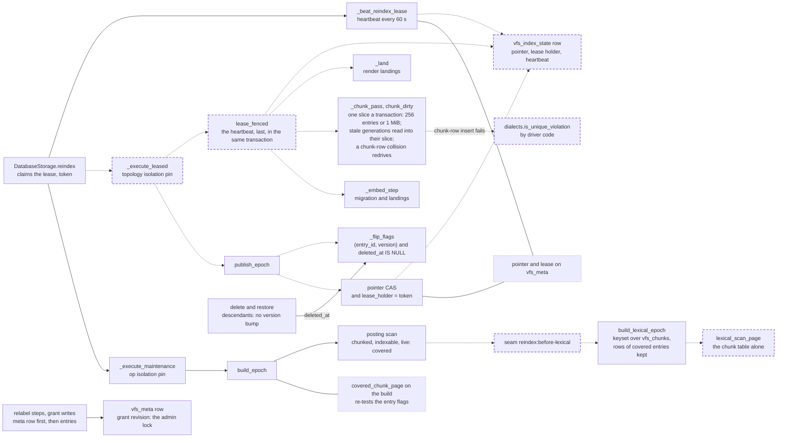

# The index publishes only what its build read: the lexical feed takes exactly the entries the posting scan covered, a flip lands only on a live row, and every lease-held commit is fenced by a lease that lives on a row of its own

A fix to the index run of the database backend (today the full pass, `reindex`). It is structural in six places and nowhere else: the chunk pass commits in slices of at most `CHUNK_SLICE_ENTRIES` entries or `CHUNK_SLICE_BYTES` of bodies, whichever comes first, through a new `ChunkCursor` and `stale_generation` in `indexing.py` and a private `_chunk_pass` on `DatabaseStorage` (decision 14); it adds one seam, `reindex:before-lexical`; one public function, `lease_fenced`, in the lease block of `indexing.py`; one public classifier, `is_unique_violation`, beside `is_retryable` in `dialects.py`; one private runner, `_execute_leased`, on `DatabaseStorage`; and one single-row table, `vfs_index_state`, which takes the epoch pointer and the lease off the meta row (decision 7). No module, public class, protocol method, verb, parameter or result shape is added or removed. It changes the schema and one format constant: `vfs_meta` loses `current_gram_epoch`, `reindex_holder` and `reindex_heartbeat`, `vfs_index_state` holds `current_gram_epoch`, `lease_holder` and `lease_heartbeat`, and `SCHEMA_FORMAT_VERSION` goes from 24 to 25, so a store provisioned before this lands refuses at first touch and is re-provisioned, which the pre-release posture allows; `INDEX_FORMAT_VERSION` is unchanged, and an epoch built after it holds the same rows an epoch built before it holds whenever no write lands inside the run. It changes the isolation of every lease-held commit that the fence guards on Postgres and MariaDB, from the profile's `op_isolation` (`REPEATABLE READ`) to its `topology_isolation` (`READ COMMITTED`); on SQLite, SQL Server, Oracle and the generic floor their options are unchanged (decision 8). It does not touch rights: no grant, view, gate or rights statement changes, the index tables hold no rights fact, and the meta row keeps the grant revision, which is the admin writes' lock. It needs the engine legs: the defects are reachable on SQL Server and Oracle where they are not on SQLite, the lock order it removes is a cycle only between concurrent server transactions, and seven criteria commit real rivals on the four server legs. It touches the gate's size baseline in three entries: `backend.py` grows by the count the build finds, at most 56 lines, `dialects.py` by at most 30 for the classifier, and `engine.py` by exactly 1, and each `MODULE_LINE_BASELINE` entry rises by that growth (decision 12). It comes from no intention and stands on no research memo; it leaves one defect it found outside its scope to [a placeholder memo](../../research/2026-11-13-what-marks-an-entry-for-re-splitting-when-its-path-changes-the-splitter.md). The session lead commissioned it on 2026-11-13 from three defects the author of [the refresh spec](2026-10-31-refresh-the-incremental-index-verb.md) reported while that spec was under [its review of 2026-11-13](../../reviews/2026-11-13-refresh-the-incremental-index-verb-spec-review.md), and amended it after [its own review](../../reviews/2026-11-13-the-index-publishes-only-what-its-build-read-spec-review.md), whose Disposition answers each finding; every fact it rests on was read or executed for this spec or its review and is recorded in The problem, labelled. All three reports are true. The third was narrower than the defect: a lapsed run's chunk pass strands the epoch of the run that holds the lease, which a compare-and-set on the holder cannot refuse. The search for siblings found three more: on Postgres a heartbeat inside the publish fails the whole run; today's publish closes a lock-order cycle with a relabel step on every server engine; and a lapsed embed step lands vectors of a retired model under the new model's identity, for good. A reviewer of the refresh spec found a fifth after this spec was signed: today's chunk pass writes chunk and edge rows before entry rows, the reverse of a purge's order, and deadlocks with a sweep (sibling 5, decision 14); and its review found that stamping first in one transaction over the whole dirty set holds every dirty entry's row for the whole pass, so decision 14 also commits the pass one bounded slice at a time.

Landing order and shared files, READ in the working-tree copies on 2026-11-13 at `5d47a21a`. The queue is: [scope crosses the seam in one shape](2026-11-07-scope-crosses-the-seam-in-one-shape.md); [close leaves no SQLite side files](2026-11-12-close-leaves-no-sqlite-side-files.md); [search survives a chunk row deleted under its read](2026-11-12-search-survives-a-chunk-row-deleted-under-its-read.md); [the scan tier reveals nothing about rows a caller cannot read](2026-11-12-the-scan-tier-reveals-nothing-about-rows-a-caller-cannot-read.md); this spec; [the full pass is named rebuild and its pipeline leaves the backend](2026-11-12-the-full-pass-is-named-rebuild-and-its-pipeline-leaves-the-backend.md); [refresh, the incremental index verb](2026-10-31-refresh-the-incremental-index-verb.md) last. The first four and the refactor are signed "Fit to build" and none is built; this spec is written against the tree the four ahead leave and uses today's names. Scope crosses the seam edits `backend.py` (its imports and `_scoped_refusals` only), `reads.py` (not `pointer_with_overlay`), `tests/support/storage_contract.py`, `tests/lint/allowlist.py` (it sets `backend.py`'s and `reads.py`'s entries to their counts at its landing, none above 1,997 and 1,318) and the ledger (rows K1 and W4); this spec edits the same two modules, a different test in the same contract file, the same allowlist and the same ledger, raises the `backend.py` entry that landing leaves and keeps `reads.py`'s count. Close leaves no SQLite side files edits `engine.py` (`STATISTICS_CLEAR`, `_analysis_pass` and `close`), `sync.py`, `tests/test_sync.py` and `tests/storage/database/test_statistics.py` (a test outside `TestPlannerStatistics`); this spec edits `engine.py`'s `_provision` and two tests of `TestPlannerStatistics`, and raises by exactly 1 the `engine.py` entry that landing leaves (that spec leaves `engine.py` at 1,151 with its entry at 1,151, so this spec takes it to 1,152 and raises the entry to 1,152). Search survives edits `indexing.py` (`index_options_hash` alone, which this spec does not touch; it leaves the module at 795 lines), `tests/storage/database/test_indexing.py` (class `TestChunkProvenance`, which this spec does not edit), `test_races.py` (class `TestSearchChunkConsistency`; this spec adds two classes beside it), `tests/lint/allowlist.py` and the ledger (rows S1 to S4); its new nodes install `reindex:before-publish`, whose behaviour this spec changes only for a publish whose run lost the lease, which none of them stages, and read the pointer through `indexing.current_epoch` or through helpers this spec moves to the new row. The scan tier edits `tests/support/plan_store.py`, `storage_contract.py` and `test_statistics.py`'s `TestPlannerStatistics` for its scan-tier statement, where this spec edits the chunk-page entries of the same three files (`chunk_page_statements`, `shipped_join_plan`, `test_the_chunk_page_plan_is_the_engines_own`, and two `TestPlannerStatistics` nodes about chunk pages), and the ledger (rows V1 to V3); none of the lines either edits is the other's. This spec rebases onto the scan tier's landing. The refactor renames `reindex` to `rebuild` everywhere and moves the pipeline this spec edits into `maintenance.py` (its own rename of the lease columns and its bump of the schema format are overtaken by decision 7 and dropped, as the Design's last paragraph says), comparing each moved body with its body on the commit it starts from; the Design's last paragraph lists what it must then change. Refresh relies on this spec for the invariants stated in [Intent](#intent), and the same paragraph lists what it must change to match.

## The problem

Labels: EXECUTED means a command ran for this spec, on the tree at `5d47a21a` unless it says a prototype; READ means read in the file cited; INFERRED means reasoning. The probes are plain scratch scripts under the session scratchpad (`specs-ready/build-agreement/`): `today_probe.py` and `lapse_probe.py` copied from the reporter, `fence_probe.py` and `rename_probe.py` copied from the reviewer, and `double_probe.py`, `lapse_harm_probe.py`, `mirror_probe.py`, `beat_in_publish_probe.py`, `embed_lapse_probe.py` and `rowcycle_probe.py` written here. The prototype is a plain copy of `src/` with this spec's Design applied, the lease row included, run by putting it first on `PYTHONPATH`; `proto_a5` is the same copy with row A5's mutation.

One full pass runs its phases as separate transactions, each through `_execute_maintenance` (`backend.py:1896`): the render landings, one a cut, the chunk pass (`chunk_dirty`, `indexing.py:240`), the build (`build_epoch`, `indexing.py:369`), the publish (`publish_epoch`, `indexing.py:474`), the reclaim, the segment, edge, flag and signal passes, and with an embedder the embed step's migration and landings (READ, `backend.py:1184` to 1634). The build reads the corpus twice. The posting scan is one streamed statement over the entries that are `chunked ∧ indexable ∧ live` with a body, and it records each scanned `(entry_id, version)` as `covered` (`indexing.py:413` to 433). The lexical build then reads the chunk table in keyset pages of 256 rows, each page joined to (or, on SQLite, probing) the entry table and re-testing `chunked`, `indexable` and `deleted_at` itself (`lexical.py:109` to 119, `pages.py:53` to 81). Nothing makes the two reads choose the same entries (READ). The publish flips `encoded` true on every covered pair, guarded by `(entry_id, version)` alone, in one of three spellings (`indexing.py:725` to 778), then compare-and-sets the epoch pointer on the meta row on the epoch the build started from, with no term on the lease (`indexing.py:494` to 504) (READ). The meta row holds, beside the pointer and the lease, the grant revision whose update is the admin writes' lock (`rows.py:650` to 671, `revision.py:53` to 71, READ).

What each read sees depends on the engine (READ, `dialects.py:452` to 673). Every maintenance commit takes `op_execution_options(profile, writer=True)`. On SQLite that is `BEGIN IMMEDIATE`: the build holds the write lock from its first statement, so no write lands between its two reads. On Postgres and MariaDB it is `REPEATABLE READ`: the two reads see one snapshot. On SQL Server, Oracle and the generic floor no isolation is pinned, so each statement reads the latest commit (SQL Server's default `READ COMMITTED` is the locking kind, which releases a row's lock once read). So the two reads can disagree only on SQL Server, Oracle and the generic floor (INFERRED from the options; EXECUTED below for the first two).

**Defect 1, the reads disagree: real on SQL Server and Oracle, unreachable on SQLite, Postgres and MariaDB.** A directory delete stamps its descendants with `deleted_at`, `trash_root_id` and `encoded` false and leaves their version alone (`_tombstone_descendants`, `trash.py:468` to 494, READ). Committed between the posting scan and the lexical pages, it leaves the descendant covered by the scan and dropped by the pages, and the publish's flip matches its unchanged version. EXECUTED with `today_probe.py VFS_TEST_<ENGINE>_URL lexical`, which wraps `indexing.build_lexical_epoch` so a rival `delete("/d")` commits on another connection before the pages run: on SQL Server and on Oracle, `/d/x.txt` came out `encoded` true, trashed, with grams in the new epoch and 0 `lex_docs` rows; after `restore("/d")` it was live and `encoded` true, `search("xylophone")` answered nothing and `grep` answered `/d/x.txt`; the next run that had other work rebuilt whole and healed it (a full build covers every `chunked ∧ indexable ∧ live` entry whatever its `encoded`, READ `indexing.py:416`). The review ran the same on MariaDB and Postgres and found the reads agreeing there, as the snapshot predicts. The split reproduced on SQLite only by a double that runs the rivals' statements in the build's own session (EXECUTED, `double_probe.py`): the descendant covered, 0 `lex_docs` rows, `encoded` true, and after the restore search `[]` and grep `["/d/x.txt"]`; and a trashed root restored in the same window (`_revive_roots`, which bumps the version, then `_revive_sets`, which does not) came out with 1 `lex_docs` row, no grams and `encoded` false, so the epoch's BM25 statistics counted a document the gram index does not hold. The reporter's claim that a same-body overwrite or a restore splitting the reads is harmless is true for the flags: each bumps the version or leaves the row uncovered, so its flip misses and the row stays scan-side (READ `writes.py:966` to 973, `trash.py:506` to 526); it is not harmless for the statistics, which is the restore case above.

**Defect 2, the publish marks a row the build no longer stands for: real on every engine.** The same delete committed at `reindex:before-publish`, after the build commits and before the publish runs, reaches the trashed descendant with its version unchanged, so the flip sets `encoded` true on a trashed row. EXECUTED with `today_probe.py sqlite publish second` and on SQL Server, and by the review on MariaDB: after the run `/d/x.txt` was trashed and `encoded` true; a later run with other work left it out of the new epoch (the scan reads only live rows) and left `encoded` true; after `restore("/d")` both `search` and `grep` answered nothing for its word; one more run with other work healed it. The reporter said "until a third run"; the exact statement is: until the next run that has some other entry to build, since a restored row that is already `encoded` pends no build by itself (`_pending_probe`, `indexing.py:781` to 791, READ). Between the trash and the restore the trash view's grep also misses the file once that later run has dropped its grams, because an `encoded` row is served only from the index (INFERRED from `grep.py:559` to 577, READ).

**Defect 3, a run whose lease was taken still publishes: real on every engine, and wider than reported.** The lease is an arbiter: a rival claims it once its heartbeat is five minutes stale (`claim_reindex_lease`, `indexing.py:154` to 172), the running run learns of it only when its beat task next finds the lease gone, and it checks that flag only between phases (`backend.py:1485`, `:1494`, READ). The module docstring says the epoch mint and the publish's compare-and-set "still arbitrate exactly as they do today" (`indexing.py:43` to 51); they do not. EXECUTED with `lapse_probe.py` on SQLite: run A built and waited at `reindex:before-publish`, the lease was forced stale, run B claimed, re-split `/e.txt` after a write and built; A then published and B lost the pointer race, and the published epoch's `lex_docs` named chunk id 1 where `/e.txt` held chunk id 4. In that probe the write bumped `/e.txt`'s version, so A's flip missed and nothing was marked wrongly. The harmful form needs a re-split with no version bump, which a chunk-generation change makes: EXECUTED with `lapse_harm_probe.py`, B running under a patched chunk generation (a newer chunker, the rolling-deploy case), whose generation law re-dirties and re-splits every entry with no bump (`indexing.py:303` to 311, READ). A published epoch 2, `/e.txt` stayed `encoded` true with `lex_docs` naming chunk id 1 where it held chunk id 4, and `search("echo")` raised `KeyError: 1`; a further run under B's generation with no other work changed nothing. On the tree the queue leaves, [search survives](2026-11-12-search-survives-a-chunk-row-deleted-under-its-read.md) answers such an entry from its live body instead of raising, and its fingerprint change makes the next run rebuild after a generation change (READ, its decisions 1 and 3), so the harm there is a stale ranking until the next run, not an exception; the published epoch still names chunk ids that no longer exist.

**Sibling 1, a lapsed run's chunk pass strands the epoch of the run that holds the lease: real on SQL Server and Oracle.** A compare-and-set on the holder refuses the lapsed run's publish and nothing else. EXECUTED with `mirror_probe.py`: run A read its dirty set and waited at `reindex:before-chunk-split` with no write made; the lease was forced stale; run B, a second handle on the same schema, claimed, chunked `/n.txt`, built, and waited at `reindex:before-publish`; A was released, and its chunk pass deleted `/n.txt`'s chunk rows, which were B's by then, inserted its own and committed; B published. On SQL Server and on Oracle the published epoch's `lex_docs` named chunk id 2 for `/n.txt` where it held chunk id 3, `/n.txt` was `encoded` true, and search raised `KeyError: 2`. On Postgres A's chunk pass did not see B's rows under its snapshot, its insert collided on `uq_vfs_chunks_entry_index`, and A's run ended with a public `unavailable` record carrying the driver's text ("duplicate key value violates unique constraint …"); B's epoch stayed whole. On MariaDB, per the review's run, A's chunk pass met a snapshot conflict, redrove, found nothing dirty and lost the pointer race, and B's epoch stayed whole. A guard in B's publish cannot see this: A's re-split of the same body under the same generation writes the same `chunk_source_hash`, `chunk_generation` and flags B's scan read (READ `indexing.py:343` to 352). Render landings have the same shape (they replace a bytes row's text and clear `chunked` and `encoded` with no bump, `render.py:339` to 362, READ), though a lapsed landing is refused by the stamp guard unless the two runs render under different generations (INFERRED).

**Sibling 2, a heartbeat inside the publish fails the run on Postgres.** Under `REPEATABLE READ`, an `UPDATE` of a row another transaction changed after the snapshot fails with a serialization error, and the publish's last statement updates the meta row the beat task updates every minute (`backend.py:1238` to 1255). EXECUTED with `beat_in_publish_probe.py … publish`, which commits the run's own heartbeat on another connection after the publish's flips and before its compare-and-set: on Postgres the run failed after 4 attempts, "reindex kept losing to concurrent changes: a retryable engine conflict outlived 4 attempts"; on Oracle the publish waited for the beat's row lock and landed in 1 attempt; on MariaDB 11.8 it landed in 1 attempt (EXECUTED by the review and here), because the publish issues only `UPDATE`s before its compare-and-set and so holds no read view when the beat commits. MariaDB's snapshot conflict does meet a statement that updates the beat's row after a read in the same transaction, which is where this spec's fence would sit inside the chunk pass (EXECUTED with `beat_in_publish_probe.py … chunk` against `proto_a5`: 4 attempts and the same conflict on MariaDB and on Postgres). At the reference deployment a publish flips every covered row, about 10,000,000, and so outlives a 60-second beat interval (INFERRED from [the reference deployment](../../../AGENTS.md#the-reference-deployment-the-scale-every-idea-is-filtered-through)), and a grant write, which bumps `grant_revision` on the same row (`revision.py:56`, READ), has the same effect.

**Sibling 3, today's publish closes a lock-order cycle with the admin writes: real on every server engine.** A relabel step, and every grant, membership or posture write, takes the meta row first (`hold_revision` or `bump_revision`, `labels.py:276`, `rights.py:1127`, READ) and then updates entry rows (`labels.py:378`, READ). Today's publish updates entry rows first, its flips, and the meta row last, its compare-and-set. EXECUTED with `fence_probe.py … publish` on today's tree, a relabel step on another connection taking the meta row and then updating an entry the publish had flipped, the publish's compare-and-set running once the engine reports the relabel blocked: on every engine one of the two was the deadlock victim and was redriven whole, 3 attempts in all where 2 would do. Which one is not a fixed fact of an engine: on Postgres the victim is whichever side has waited longer when the cycle closes, so either the publish or the relabel is redriven (EXECUTED by the review: with the compare-and-set issued as soon as the relabel was blocked, the relabel was the victim; with this staging, the publish, with the relabel at `READ COMMITTED` as well); in these stagings the publish was the victim on MariaDB and the relabel on Oracle and SQL Server (EXECUTED). A fence on the meta row at the end of the chunk pass and of every landing would add the same cycle to each (EXECUTED by the review on the first design of this spec: the chunk pass the victim on Postgres, the relabel on MariaDB and Oracle). The cycle exists because the lease and the pointer share a row with the admin lock.

**Sibling 4, a lapsed embed step lands a retired model's vectors under the new model's identity, for good.** The embed step's migration clears every vector and the stored identity when the configured model differs (`clear_embeddings`, `embed.py:201` to 208), and each landing writes a vector only where the column is still `NULL` and stamps the identity only while it is unclaimed (`write_vectors`, `embed.py:264` to 301, READ); neither is guarded by the lease. EXECUTED with `embed_lapse_probe.py` on SQLite, two handles with two models of one width: A, on the old model, paused at `reindex:before-embed` with a page of `NULL` rows in hand; the lease was forced stale; B, on the new model, claimed, cleared all six vectors and paused at its own seam; A landed three old-model vectors; B landed the other three and stamped the new identity. After both, and after one more run by B, the store held identity `scripted/new@4` with 3 rows in the old model's space and 3 in the new: no later run re-embeds a non-`NULL` row, so search's vector leg ranks those three rows by vectors from another space for as long as the model stays. On the prototype A's landing returned the lease-lost verdict, wrote nothing, and B's run left 6 new-model rows (EXECUTED).

**Sibling 5, today's chunk pass cycles with a sweep of an entry it is re-splitting: real on Postgres and SQL Server.** The reviewer of the refresh spec found it from statement order ([that spec's review](../../reviews/2026-11-13-refresh-the-incremental-index-verb-spec-review.md), H1 of its re-read): the chunk pass deletes a re-split entry's chunk rows, inserts the new ones, writes the extracted links' edge rows, and only then updates entry rows in its flips (`indexing.py:335` to 352, READ), while a purge deletes the entry row first and then its content, chunk and edge rows (`trash.py:580` to 604, READ). EXECUTED with `sweep_cycle_probe.py` on a `git archive 5d47a21a` copy: `/x.txt` reindexed and then rewritten, so the next chunk pass re-splits it; a double on `indexing.publish_links`, which runs after the pass's chunk-row delete and insert, starts `sweep(path=/x.txt)` on another connection and returns once the engine reports a wait. On Postgres the sweep's `DELETE FROM vfs_chunks` waited on the chunk pass and the chunk pass's `UPDATE vfs_entries SET chunked …` waited on the sweep, each naming the other in `pg_blocking_pids`; the engine aborted the sweep, which redrove (2 purge attempts, the chunk pass 1), in both runs. On SQL Server the same two statements waited on each other (`LCK_M_U`), and the engine aborted the chunk pass, which redrove whole (2 chunk-pass attempts, the purge 1), in both runs. So when the victim is the chunk pass, the whole pass repeats. Oracle and MariaDB were not run. The same order is today's and refresh's, since refresh runs this pass; decision 14 fixes it here, because this spec owns the lock order every lease-held commit keeps.

Every write path that changes whether or how an entry belongs in the index without bumping what the publish compares, READ in `src/vfs/storage/backends/database/`: the descendants' tombstone (`trash.py:468` to 494) and revive (`trash.py:529` to 543), reachable by any caller, defects 1 and 2; the render landing (`render.py:339` to 362), the chunk pass's generation re-dirty (`indexing.py:309` to 311) and its re-split (`indexing.py:335` to 340), reachable only from a run, so harmful only through a lapsed lease, defect 3 and sibling 1. The others change nothing the gram index or the lexical index reads: grams are cut from the body alone, and the lexical rows from the chunk rows, which a run's chunk pass cuts from the body and the extension (`indexing.py:632`, READ); a move rewrites a descendant's path and posture and leaves its version and its name (`topology.py:360` to 376), and a relabel writes `everyone_level` (`labels.py:378`, `:512`, `:532`), and rights are judged when a verb reads; the embed step writes vectors, which neither index reads but the vector leg does (sibling 4); the segment, edge and signal passes write their own tables; a purge removes the entry with its chunk rows, so a flip of it matches no row (`trash.py:580` to 604); the flag repair touches directories only (`indexing.py:583` to 589); every other entry update bumps the version (`writes.py:769` to 775, `:966` to 973, `serialized.py:203` to 229, `topology.py:308` to 318). One defect this search found is outside the compare and outside this spec: a move that changes a file's extension leaves its old split in place for good, because the chunk pass's fingerprint reads the body hash and the generation only (EXECUTED by the review and here with `rename_probe.py`); [a placeholder memo](../../research/2026-11-13-what-marks-an-entry-for-re-splitting-when-its-path-changes-the-splitter.md) holds it.

## Architecture

Dashed is what this spec adds; dotted is what it retires.



Page this changes: none; the architecture folder was retired on 2026-10-31, and the landing notes will say so in one line.

Terms. The **posting scan** is `build_epoch`'s one streamed statement that feeds the gram builder. The **covered set** is what it records: each scanned entry's `entry_id` with the version it read. The **lexical feed** is the chunk rows `build_lexical_epoch` hands the lexical builder. A **flip** is one of `_flip_flags`' guarded statements. The **index-state row** is the one row of `vfs_index_state`. The **fence** is the lease's heartbeat `UPDATE` on that row, run as the last statement of a transaction, whose zero-row answer means the run no longer holds the lease. A **lapsed run** is a run still working after another run claimed its stale lease. A **leased commit** is a transaction through `_execute_leased`. The **admin lock** is the meta row's grant revision, which every grant, membership, posture and relabel write updates first.

## Decisions

### 1. The lexical feed is the chunk table read by keyset, keeping exactly the rows whose entry the posting scan covered; the page reads no entry row

`_chunk_batches` pages `vfs_chunks` by `id > :last ORDER BY id LIMIT 256`, with no join, probe or entry term, and drops every row whose `entry_id` is not in the covered set before it reaches the batcher. The reason is that the second read must not choose its own rows: whatever commits between the reads, the lexical rows are then the chunks of the covered entries, and an entry is in both indexes or in neither. Their chunk rows are the ones cut from the body the scan read, because the scan reads only `chunked` entries, whose chunk rows the chunk pass wrote from that body under a version guard (READ `indexing.py:350`), and after the scan those rows change only by a chunk pass, which decision 6 keeps to the run that holds the lease, or by a purge, which removes the entry and so any flip of it. The keyset form keeps the order the lexical builder requires, strictly increasing chunk ids (`lexical.rs:103`, READ), with no sort. Its cost is the whole chunk table's pages, not the covered rows' (decision 12's Scale sentence gives it as a function of the uncovered share). Three forms were rejected. Keeping the page's entry terms beside the covered filter reads an intersection, and an entry trashed between the reads and restored before the publish is then flipped with grams and no lexical rows. Reading by membership slices of covered entry ids, which is [the refresh spec](2026-10-31-refresh-the-incremental-index-verb.md)'s form for a delta of a dirty set, returns chunk ids out of order: at the reference deployment that is about 100,000,000 ids to sort in memory, and two statements per slice of 1,000 entries at Oracle's floor, about 20,000 a rebuild, where the keyset reads what a full build reads anyway. The reporter's prototype, a page of ids and a second statement for the kept rows' text, doubles the page round trips (about 390,000 more a rebuild) to avoid carrying the text of chunks outside the covered set. This departs from [the chunk-page filter](../archive/2026-11-09-the-chunk-page-filter-takes-the-shape-each-planner-serves.md) for the build's page only: its page now reads no entry row, so no planner can put a filter on an entry side it does not have, and the embed step's page keeps that spec's shape unchanged. It also departs from that spec's decision 6, which rejected "the Python set of qualifying entry ids" because "it holds one 26-character id per covered entry, about 1.1 GB at the reference's 11,000,000 entries, and AGENTS.md makes a whole-corpus structure affordable in the rebuild only when bounded in memory; the probe holds nothing", and from its Intent's "the same statement count and no new client-side state". The set this feed reads is the covered dict `build_epoch` already holds for the whole build (`indexing.py:420`, READ), so it adds no residency: the 1.1 GB that decision weighed is paid today, a recorded suboptimality; a build partitioned by entry-id range is the direction that bounds it, each partition's covered set feeding that partition's lexical rows the same way (the gram-range partitioned passes `build_epoch`'s docstring names bound the posting accumulator, not this set, because each such pass scans every entry). That spec's own study measured this shape at 3.34 s on SQLite against 3.6 s for the probe and within noise on Postgres (READ, its decision 6 and Intent). The page count now follows the whole chunk table.

### 2. The build's isolation is not pinned on any engine; the reads agree by construction

The build keeps the options it runs under today. Pinning a snapshot would make the two reads agree on SQL Server and Oracle only at a cost no deployment of the reference size can pay, and it would leave defect 2 open, because the publish is its own transaction. On SQL Server, `SNAPSHOT` needs `ALLOW_SNAPSHOT_ISOLATION` set on each database, a provisioning change vfs does not own, and `REPEATABLE READ` or `SERIALIZABLE` hold a shared lock on every scanned entry row for the hours a 10,000,000-row build takes, escalating to a table lock that stops every writer. On Oracle, `SERIALIZABLE` holds one snapshot for those hours, which undo retention, a database setting, must cover or the build fails with ORA-01555 near its end. The generic floor has no isolation a profile can name. Decision 1 holds under every isolation, including the ones Postgres and MariaDB already pin, so nothing rests on them (EXECUTED by the review on MariaDB, Postgres and Oracle, both orders).

### 3. The window between the reads is a seam, `reindex:before-lexical`

`build_epoch` awaits `seam("reindex:before-lexical")` after the posting drain and before `build_lexical_epoch`, inside the build's transaction. The reason is that the window is otherwise reachable only by a wrapper around a module function, and the house names a race window by a seam (`seams.py:1`, READ). On SQLite a rival on another connection cannot commit there, because the build holds the write lock, so the SQLite criterion reaches the window by a double that runs the rivals' statements in the build's own session, as [search survives](2026-11-12-search-survives-a-chunk-row-deleted-under-its-read.md) does for its window. The suffix is `before-lexical`, the one [the refresh spec](2026-10-31-refresh-the-incremental-index-verb.md)'s criterion 32 needs, so the refactor's rename makes it `rebuild:before-lexical`.

### 4. Every flip lands only on a live row: `deleted_at IS NULL` joins `(entry_id, version)` in all three spellings, and the descendants' tombstone and revive keep their versions

`_flip_flags` adds the bind-free term `entry.c.deleted_at.is_(None)` to the VALUES join, the row-constructor `IN` and the executemany floor, for every flip it makes, the chunk pass's stamps included. The reason is that the posting scan's coverage predicate is `chunked ∧ indexable ∧ live`, and the version guards the first two, because every write a caller can make that clears `chunked` bumps it (The problem), but not the third, which two unversioned writes move. The term costs no bind and no statement. A delete and a restore that both land between the scan and the publish leave the row live, at its version, with the body and chunk rows the build read, and the flip lands, which is right; with a version bump the flip would miss and the next run would build the row again for nothing. Bumping the descendants' versions was rejected: it costs no statement, since the same `UPDATE` writes the row, but it changes what every caller observes, so an agent that read a file at version 1 has its next guarded write refused because a parent directory went to the trash and came back; it departs from the rule the move's descendant rewrite shares, that a descendant's version moves only when the descendant is written; and it would leave the publish trusting the next unversioned write as it trusts these. Adding `chunked` and `indexable` to the flip as well was rejected: with decision 6 no write a caller can make clears either without a bump, so the terms would guard no reachable state, and their ledger row would be one no test can kill. On the chunk pass's stamps the term means a descendant trashed between the pass's read and its flip keeps `chunked` false; its restore then finds it dirty, and the fingerprint-skip law re-stamps it without a split (`indexing.py:261` to 265, READ).

### 5. The publish's compare-and-set names the lease holder; the token is a required field; a miss is the publish race, not retryable

`publish_epoch` adds `tables.index_state.c.lease_holder == state.token` to both arms of its pointer CAS, which now updates the index-state row (decision 7). `ReindexState` gains `token: str` as its first field, with no default, so a state cannot be built without one (a `TypeError` at construction), and the CAS always compares the holder to a bound string, never to `NULL`: SQLAlchemy compiles `column == None` to `IS NULL` (EXECUTED by the review), which would let a state without a token publish whenever no run holds the lease. `_gram_phases` builds the state with the token the verb claimed with. A miss rolls back the flips with it, as a lost pointer race does today, because `_mutate` commits only a successful Result (READ `backend.py:1974` to 1984), and the built epoch is reclaimed as today. The detail becomes "reindex lost the index publish race for epoch {epoch}", because the CAS can now miss with the pointer unmoved; it stays `conflict` and not retryable, as today (`indexing.py:502` to 504). This is the full publish's half of the holder predicate that [the refresh spec](2026-10-31-refresh-the-incremental-index-verb.md)'s decision 14 claims; it lands here, ahead of refresh, because defect 3 is a defect of today's tree.

### 6. The lease fences the chunk pass, every render landing and the embed step's migration and landings: each ends with the lease's heartbeat in its own transaction, and a run whose lease was taken commits none of it

`indexing.lease_fenced(tables, token, fn)` returns a transaction body that runs *fn* and, when *fn* succeeds, runs `heartbeat_reindex_lease(session, tables, token)` in the same session as its last statement; a zero-row heartbeat answers the lease-lost verdict, carrying *fn*'s own advisory records, and the runner rolls the whole transaction back. `_gram_phases` wraps the chunk pass in it; `_land` wraps each of its three landing attempts in it and returns at once on the lease-lost verdict instead of retrying row by row; `_embed_step` wraps its migration (`clear_embeddings`) and each landing (`write_vectors`) in it. The reason is siblings 1 and 4: a compare-and-set on the holder refuses a lapsed run's publish, but a lapsed run's chunk pass and landings replace chunk rows and bodies that the holder's build has already read, and a lapsed embed landing writes vectors the holder's migration has just cleared, and nothing the holder does afterwards can see either. The fence is airtight on every engine because the fence and a rival's claim both update the index-state row: once the fence has run, a claim waits on that row's lock until the fenced transaction ends and then finds a fresh heartbeat; a claim that ran first leaves the fence matching nothing (EXECUTED by the review on MariaDB, Postgres and Oracle, and here on the prototype on the same three: "a reindex is already running (lease heartbeat 0s ago)"). The fence also refreshes the heartbeat it checks. It is the last statement, never the first, because a lock on the index-state row held for a whole chunk pass would stall the run's own beat for that long. A per-entry chunk stamp the publish could compare was rejected: it is a schema change on the entry table, and at Oracle's floor a third bind per covered pair takes the row-constructor flip from 500 pairs a statement to 333, about 10,000 more statements a rebuild. A chunk pass whose chunk-row insert meets another run's chunk rows on `uq_vfs_chunks_entry_index`, which only two overlapping chunk passes can do and so only a lapsed run, raises `StaleSnapshot` instead of the raw `IntegrityError`: the redrive re-reads its dirty set, finds the rival's rows, and its fence returns the lease-lost verdict, so no public Result carries the driver's text, which the review found reachable on Postgres in the overlapping order (INFERRED there and here; criterion 7 stages the collision on SQLite). The handler wraps that one `bulk_insert` and nothing else, and it recognises the collision alone: the chunk table's only unique keys are its identity key, which an insert never supplies, and `uq_vfs_chunks_entry_index`, so on that statement a unique violation is this collision and nothing else, and `dialects.is_unique_violation` tells a unique violation from every other integrity failure by the driver's code, never by message text where the driver offers a code: SQLite's extended code 2067 (`SQLITE_CONSTRAINT_UNIQUE`) or 1555 (`SQLITE_CONSTRAINT_PRIMARYKEY`), against 1299 for `NOT NULL`; SQLSTATE 23505 on Postgres (asyncpg's `sqlstate`), against 23502; the MySQL family's errno 1062 on MariaDB, against 1048, read before the SQLSTATE because aiomysql gives 23000 for both; python-oracledb's `code` 1 (ORA-00001) on Oracle, against 1400; and on SQL Server, whose driver gives SQLSTATE 23000 for every integrity class, the native error number the ODBC diagnostic carries in its closing parentheses, 2627 or 2601, against 515, because pyodbc exposes no other field (EXECUTED with `unique_probe.py` on SQLite, Postgres, SQL Server and MariaDB: the codes above for a repeated `(entry_id, chunk_index)` and a `NULL` `entry_id`; Oracle's READ from the driver-code reader at `dialects.py:1057` to 1069, not run). Any other integrity failure there, a `NOT NULL` from a vfs defect among them, re-raises and reaches the existing classification once, as today. The extracted links' insert needs no handler: it already arbitrates a colliding row by its own savepoints (`insert_arbitrated`, `edges.py:435` to 462, READ).

### 7. The pointer and the lease move off the meta row to a row of their own, `vfs_index_state`, so no lease-held commit locks the admin lock's row; the schema format goes to 25

`vfs_index_state` is a single-row table, `id` checked to 1, holding `current_gram_epoch`, `lease_holder` and `lease_heartbeat`; `vfs_meta` keeps the schema format, the mount identity, the embedding identity and the grant revision. The claim, heartbeat, release, fence, pointer read and publish compare-and-set all address the index-state row; first touch provisions it beside the meta row; `SCHEMA_FORMAT_VERSION` goes from 24 to 25. The reason is sibling 3: the admin writes take the meta row first and entry rows after it, every lease-held commit takes entry, chunk or content rows first and the lease or pointer row last, and while those share a row the two orders form a cycle, which today's publish already closes and a fence on the meta row would close in every chunk pass and landing. On the prototype the cycle is gone: with a relabel holding the meta row and blocked on an entry the phase had flipped, the chunk pass and the publish each committed in 1 attempt on MariaDB, Postgres, Oracle and SQL Server, and the relabel ran once on Oracle and SQL Server and, run at `READ COMMITTED`, on Postgres (EXECUTED, `fence_probe.py`); run at `REPEATABLE READ`, its second attempt on MariaDB and Postgres is its own snapshot conflict on the row the phase changed, the first-updater rule, which the same relabel meets today behind a chunk pass with no fence (EXECUTED on Postgres), not a deadlock. Two other choices were weighed. Keeping the lease on the meta row and making every lease-held commit take the meta row first, the relabel's order, removes the cycle but holds the admin lock for the whole of each chunk pass and publish: every grant, membership and posture write queues behind a publish of 10,000,000 flips, about 20,000 statements at Oracle's floor, and the run's own beat queues with them, so a phase longer than the five-minute TTL loses its lease to a claim that wakes behind it. Keeping the cycle and relying on the deadlock victim's redrive costs, when the victim is the lease-held side, the whole phase again: a chunk pass after the reference's nightly batch re-reads about 1,000,000 bodies and re-writes about 10,000,000 chunk rows, a publish re-issues its 20,000 flip statements, and after four attempts the run ends in a retryable `conflict` and the built epoch is reclaimed, hours of build lost to a posture change; which side the engine picks is not something vfs can choose or count on (on Postgres it is whichever side has waited longer when the cycle closes, and the stagings of sibling 3 saw both). The row of its own costs no statement: every lease and pointer statement moves to another row and stays one statement. The refactor next in the queue already renames the lease columns and bumps the format; the Design's last paragraph says what it now changes instead.

### 8. Every leased commit runs under the profile's topology isolation pin

`DatabaseStorage._execute_leased(op, fn)` runs *fn* through `_mutate` with `topology_execution_options(profile)`, the writer marker and `topology_isolation`, `READ COMMITTED` on Postgres and MariaDB and nothing pinned elsewhere; the render landings, the chunk pass, the publish and the embed step's migration and landings run through it. The reason is that the fence and the holder compare-and-set are locking statements on the row the run's own beat updates every minute, and under `REPEATABLE READ` an update of a row changed after the transaction's snapshot fails: on Postgres for the publish and the chunk pass's fence, on MariaDB 11.8 for the chunk pass's fence, which follows the pass's reads (EXECUTED with `proto_a5`, the prototype with this decision reverted: 4 attempts and "a retryable engine conflict outlived 4 attempts" for the chunk pass on both engines and for the publish on Postgres; on the prototype each ran once). The row of its own (decision 7) does not remove this, because the beat must keep beating on the row the fence reads for the fence to mean anything. Under `READ COMMITTED` the same statement waits for the beat's row lock and goes on (EXECUTED on Oracle today, and on the prototype on Postgres and MariaDB). Every guard these commits carry is a predicate in an `UPDATE`'s `WHERE`, written to be judged against the latest commit, which is how they already run on SQL Server and Oracle (`TestMSSQLChunkGuardRegression`, `test_conformance.py:510`, READ); Postgres re-checks a guarded row's `WHERE` on its newest version under `READ COMMITTED`, and MariaDB reads the latest committed version for an `UPDATE`, so each guard keeps its meaning (INFERRED from the engines' documented `UPDATE` semantics; EXECUTED by the review: criteria 8 and 10's nodes and the fence probe hold on both engines under it). The chunk pass's consistent read of its dirty set becomes a statement-level read on those two engines, which is what it already is on SQL Server and Oracle.

### 9. The lock order every lease-held commit keeps, and the one interleaving that remains, documented and bounded

After decisions 7, 8 and 14 every lease-held commit takes an entry's row before that entry's derived rows, which is the purge's order (`trash.py:580` to 604, entry, then content, blobs, versions, chunks, segments and edges), and the index-state row last. Commit by commit: a render landing takes the entry row (its stamp `UPDATE`), then content rows, then the index-state row (`render.py:339` to 379, READ); the chunk pass commits one slice at a time, of at most `CHUNK_SLICE_ENTRIES` entries or `CHUNK_SLICE_BYTES` of bodies, and each slice takes its own entries' rows (its flips, first by decision 14), then their chunk rows (delete, insert, vectors carried), then their edge rows (the extracted links), then the index-state row; the publish takes entry rows (its flips), then the index-state row; an embed landing takes chunk rows (vectors) and refusal rows, then, on its first page, the meta row's embedding identity, which no admin write touches after a chunk row and which no writer that holds the meta row first ever follows with a chunk row (READ, `rights.py`, `labels.py`, `revision.py`), then the index-state row, and it takes no entry row, so a purge that holds an entry and waits on its chunk rows waits for the landing and the landing waits on nothing the purge holds. No writer takes the index-state row before another row: the claim, beat and release are each one statement on it alone, and the pointer reads take no write lock. The serialized verbs' `vfs_lock` row is never taken by a lease-held commit. So no lock-order cycle on a fixed row remains between a lease-held commit and any other writer. One interleaving remains that no order on a fixed row can remove: two writers that each update several entry rows in separate statements, in different orders, the chunk pass's or the publish's flip statements against a write batch, a move or a relabel step. It exists today between every pair of such writers, the house names it (`lock_rows`' docstring: "a deadlock against a verb with its own claim order classifies retryable and rides the retry channel", `dialects.py:705` to 709, READ), and this spec neither adds nor widens it; moving Postgres and MariaDB to `READ COMMITTED` turns a publish's serialization failures behind a concurrent write into waits, a narrowing. Whether a given interleaving closes a cycle, and which side the engine aborts, is the engine's, not vfs's: with a writer updating `/y.txt` and then `/x.txt` against the chunk pass's two flip statements, one side was aborted and redriven on Postgres, Oracle and SQL Server in some stagings and today's snapshot redrove the chunk pass on Postgres and MariaDB in another, while on MariaDB the review's staging formed no cycle and on the prototype the writer-first staging ran each side once on Postgres and MariaDB (EXECUTED with `rowcycle_probe.py` here on Postgres, SQL Server and MariaDB, and by the review on Postgres, Oracle and MariaDB). What holds on every engine is that each side's work lands exactly once and that the redrive is bounded by the retry budget, four attempts by default (`retry_attempts`, `engine.py:178`), after which a victim ends in a retryable `conflict`, classified, never a raw error; when the victim is the lease-held side at the reference deployment it repeats the phase, at most three more times. Criterion 13 stages it on every server leg and asserts only those invariants.

### 10. The build, the reclaims and the segment, edge, flag and signal passes stay on `_execute_maintenance`, unfenced; all but the signal passes are inert, and the signal passes' harm is bounded and heals at the next run

The build writes only rows under an epoch no reader sees until a publish names it, and a lapsed build that commits is reclaimed by the next publish's sweep, as today; fencing it would add a statement and protect nothing. The reclaims delete by the live pointer, read in their own transaction, and a lapsed run's reclaim of its own built epoch cannot touch the holder's, since epochs are minted past every built number (`indexing.py:411` to 412, `:508` to 533, READ). The segment and edge repairs re-read and lock the rows they guard and apply per-row guards against recomputed truth (`segments.py:200` to 212, `edges.py:304` to 318, READ by the review), and the flag repair touches directories only, so a lapsed commit of any of them writes what the holder would. The signal passes are not inert: they write ranking priors that search reads, and a lapsed run's `publish_signal` can replace a prior's generation with values from the graph it collected before its lease was taken, and its `sweep_undeclared_signals` can drop a signal the holder's ranker declares, across a rolling deploy (`signals.py:138` to 178, READ by the review; INFERRED). Search then ranks with a stale or a missing prior until the holder's next full run, which recomputes every declared signal and publishes each under a fresh generation, and which after refresh lands is the daily rebuild, since refresh runs no signal pass; so the harm is a ranking prior out of date for at most one full-run interval, today the interval between two `reindex` calls and, once refresh lands, a day and never a wrong index membership or a lasting state; this is today's arbitration, kept, because unlike sibling 4 it heals itself, and fencing the signal publish and sweep with `lease_fenced` is the direction. The embed step is fenced (decision 6), because its writes are not inert for the vector leg and do not heal (sibling 4).

### 11. No pass repairs a store that already carries a wrong flag

A store built before this lands may hold a trashed content row marked `encoded`, or a live one marked `encoded` that an epoch lacks. The project is pre-release, with no store to migrate (AGENTS.md, "Project stage"), the schema format change of decision 7 re-provisions every existing store anyway, and both states heal on today's terms: the next run that has any entry to build covers every live `chunked ∧ indexable` entry whatever its flag, and a trashed row heals at its restore and the run after. After refresh lands, that run is the daily rebuild, since a wrongly `encoded` row is not dirty. A repair pass would add a corpus-wide read to every run for a state this spec makes unreachable.

### 12. No module crosses its bound: `indexing.py` ends at most at 895 lines, `lexical.py` at 220, `pages.py` at 81, `models/rows.py` at 945, `reads.py` at its count, `engine.py` grows by exactly 1, `backend.py` by at most 56 and `dialects.py` by at most 30, each of those three entries raised by exactly its growth

Counted from what the four landings ahead leave: `indexing.py` 795 (search survives' figure), `lexical.py` 219, `pages.py` 81, `models/rows.py` 929, `reads.py` at the entry scope crosses the seam leaves and held, `dialects.py` 1,112 and held, `engine.py` at 1,151 with its entry at 1,151, the figure close leaves it at, `backend.py` at the entry scope crosses the seam leaves, at most 1,997 and held. The review's formatter-clean build of the amended Design grew `indexing.py` by 40 (835 over 795), `backend.py` by 27, `engine.py` by 1 and `models/rows.py` by 10, and shrank `lexical.py` to 212 and `pages.py` to 80 (EXECUTED there). This Design's narrowed collision handler is two lines longer than the one measured (the `is_unique_violation` test and its re-raise), and decision 14's reorder moves lines without adding any but one docstring sentence: at most 845 before the slicing; decision 14's slices add `CHUNK_SLICE_ENTRIES` and `CHUNK_SLICE_BYTES` with their comments, `ChunkCursor`, `stale_generation` with the probe it takes out of `chunk_dirty` (whose re-dirty `UPDATE` goes), the slice's size read and byte cut, the cursor's terms in the dirty select and a docstring sentence; the review's formatter-clean build of the previous slicing measured 858 lines, 862 over search survives (EXECUTED there), and this text replaces its separate re-dirty function with the smaller probe and adds the byte cut and the stale term; the review's formatter-clean build of this design measured 881 lines, 885 over search survives (EXECUTED there), and the exact meter, a `case` over the content join in the size read, adds a few lines: at most 895. `backend.py`: at most 56. The review's formatter-clean build of the previous slicing grew it by 55 (EXECUTED there); this text replaces that `_chunk_pass`'s leased, fenced commit of the re-dirty, about four lines with its success check, with one read of `stale_generation` into the cursor, so the derived growth is about 52, and the bound keeps the review's 56 as its margin; the entry rising by the count the build finds, because the refactor that lands next moves every one of these methods but `_execute_leased` out of `backend.py` (its decision 4) and lowers the entry below today's. `dialects.py` gains `is_unique_violation` with its docstring and its five code constants beside `is_retryable`'s, about 25 lines, at most 30; its entry rises by exactly that growth, because the classifier's home is beside the other readers of driver codes (`is_retryable`, `is_value_too_large`, `is_permanent_defect`), and the `probe_entry_filter` paragraph is reworded within its own lines. `engine.py` gains the one `insert` of the index-state row in `_provision`, so this spec takes it from 1,151 to 1,152 and raises its entry from 1,151 to 1,152. `dialects.py`'s and `engine.py`'s raises are each held by a placeholder memo that names the module's reduction, written before the landing and linked from its notes: for `dialects.py`, [whether the driver-error classifiers leave the dialect module](../../research/2026-11-13-whether-the-driver-error-classifiers-leave-the-dialect-module.md), the classifiers and their codes, about 150 lines, moving to a module of their own under the ceiling; for `engine.py`, the memo [close leaves no SQLite side files](2026-11-12-close-leaves-no-sqlite-side-files.md) names in its decision 4, `whether-the-planner-statistics-step-leaves-the-engine-host`, the planner-statistics step moving to a module of its own, which whichever of the two specs is built first writes and the other links; this spec writes no second memo for the same reduction. `models/rows.py` loses the meta row's three columns, their two-line comment and the meta comment's clause on the pointer, and gains the table with its two-line comment, its `VFSTables` field and its constructor argument: at most 945. `reads.py` keeps its count by binding `state` on the line that binds `entry` today (the Design). `pages.py` rewords its docstring in place.

### 13. Each law lands with its mutant as a row of the mutant ledger: A1 to A12, with L2 re-anchored and L6 re-proved; every row names the engines that kill it and why any engine cannot

A1, the lexical feed choosing its own rows, two directions: the covered filter deleted from `_chunk_batches`; or `lexical_scan_page` given back `covered_chunk_page` with the entry terms `chunked`, `indexable` and `deleted_at IS NULL` and the covered filter deleted. Criterion 1 kills both on SQLite, the first also by `test_a_trashed_entry_leaves_the_next_epoch` and the second by criterion 14; criterion 9 kills the second on `mssql` and `oracle`, and on `postgres` and `mariadb` the snapshot makes the reads agree, so the row is inert there by construction. A2, the flip's liveness term dropped, three directions, one per spelling: criterion 3 kills each on SQLite by compiling all three, and criterion 2 the row-constructor one end to end; on the server legs criterion 9's descendant kills the spelling each profile runs. A3, `lease_holder == state.token` dropped from the CAS: criterion 4 kills it on SQLite and criterion 19 on every server leg; criterion 8 cannot, because its lapsed run stops at its chunk pass's fence before it publishes. A4, the fence voided, `lease_fenced` returning *fn*'s result without the heartbeat: criteria 5 and 6 kill it on SQLite and criterion 8 on every server leg. A5, `_execute_leased` taking `op_execution_options(profile, writer=True)`: criterion 10 kills it on `postgres` and criterion 11 on `postgres` and `mariadb` (EXECUTED against `proto_a5`); on SQLite, SQL Server, Oracle and the generic floor the two options are the same dictionary (EXECUTED by the review), so the row is inert there and says so. A6, a lease-held commit locking the admin row again, two directions: `hold_revision(session, tables)` called in `lease_fenced` before the heartbeat, or in `publish_epoch` before the CAS; criterion 12 kills each on every server leg; on SQLite one writer holds the database at a time, so no cycle can form and the row is inert there. A7, the chunk pass's collision handler deleted, so the `IntegrityError` escapes to the classifier: criterion 7's collision case kills it on SQLite; the server legs reach it only in the overlapping order, which no seam stages, so they do not carry it. A8, the embed step taken out of the fence, two directions: the landing (`write_vectors`) or the migration (`clear_embeddings`) run through `_execute_maintenance` outside `lease_fenced`; criterion 6 kills the first and criterion 22 the second, both on SQLite, where their two handles share one file; the server legs would stage the same two handles and add nothing, so they do not carry it. A9, the collision handler recognising too much, two directions: the `if not is_unique_violation(exc): raise` line deleted, so a `NOT NULL` failure redrives four times and leaves as a retryable `conflict`, which criterion 7's second case kills on SQLite; or one dialect's unique-violation code dropped from `is_unique_violation` (or a non-unique code added), which criterion 20 kills for every dialect from driver-shaped exceptions and criterion 21 on each server leg from the engine's own error. A10, the chunk pass's flips moved back after its chunk-row and edge-row writes, today's order (decision 14): criterion 23 kills it on SQLite from the order of the statements the pass issues, which is the same code on every dialect, so the server legs do not carry it. A11, the slice bound voided, four directions: the size read's `.limit(...)` deleted, so the whole dirty set is one slice, which criterion 24 kills; the fence taken off the slices after the first, which criterion 25 kills; or the byte cut deleted, so a slice keeps every row its size read returned, which criterion 27 kills; or the meter's `case` reduced to `size_bytes` for every row, so a rendered binary is metered by its bytes and not its text, which criterion 29 kills; both on SQLite, the slicing being the same code on every dialect, while the server legs' per-slice fence is criterion 8's, whose one-file pass is one slice. A12, the slice read's stale-generation term wrong, two directions: dropped when the probe finds stale rows, so a generation change re-splits nothing, which `TestChunkProvenance::test_generation_change_redirties_and_resplits` (`test_indexing.py:832`, READ) and criterion 26 kill; or applied when the probe finds none, so every steady-state pass reads an unindexed generation term, which criterion 28 kills; both on SQLite, the read being the same code on every dialect. Row P6 (the re-dirty `UPDATE` issued on every pass, `mutant-ledger.md:42`) is retired as stale: the re-dirty `UPDATE` is gone, so the scan-lock it guarded cannot happen, and its steady-state cost concern is A12's second direction; its killer `test_steady_state_reindex_issues_no_entry_update` stays and still passes, since no pass issues a steady-state entry `UPDATE`. Row P7 (the probe's verdict inverted, `:43`) keeps its intent and its killer and is re-anchored to `stale_generation`'s verdict as `_chunk_pass` reads it. L2's anchor, `entry.c.deleted_at.is_(None)` among `lexical_scan_page`'s entry terms, is removed by decision 1; its intent, a trashed entry's chunks indexed into the next epoch, now rests on the posting scan's liveness term, so the row is re-anchored to `entry.c.deleted_at.is_(None)` in `build_epoch`'s scan, its killer unchanged (EXECUTED by the review on its build). L6's anchor, the keyset pages of `_chunk_batches`, keeps its intent and its killer (EXECUTED by the review). No other row's anchor moves: P14 and P20 name `build_epoch`'s fold-and-feed and drain, which this spec does not edit, and L12 names the beat task's verdict, which is unchanged (READ `mutant-ledger.md:50`, `:56`, `:69`).

### 14. The chunk pass commits one slice at a time, at most `CHUNK_SLICE_ENTRIES` entries or `CHUNK_SLICE_BYTES` of bodies, whichever comes first, each slice its own leased, fenced transaction that stamps its entries before it writes a chunk or edge row, so it takes an entry's row before that entry's derived rows, the purge's order, and holds no more than one slice's rows; a chunk-generation change is read into the slices, never re-dirtied ahead of them

`chunk_dirty` issues its two guarded flips (the eligible and the ineligible stamps) immediately after the split hop and before the carried-embedding read, the chunk-row delete and insert, the carried vectors and the extracted links; the seam `reindex:before-chunk-flip` moves with the flips, still immediately before them. The reason is sibling 5: today the pass deletes and inserts chunk rows and writes edge rows before it updates any entry row, while a purge deletes the entry row first and then its chunk and edge rows, so a chunk pass and a sweep of an entry it is re-splitting each wait on the other, and when the engine aborts the chunk pass it repeats the whole pass, the cost decision 7 refused for the admin-lock cycle (EXECUTED, `sweep_cycle_probe.py`, below). With the flips first, the pass holds each matched entry's row before it asks for that entry's chunk or edge rows, so a sweep of it waits at its entry delete and never holds a row the pass asks for after; on the prototype of this reorder the chunk pass and the sweep each ran once on Postgres and SQL Server, twice each (EXECUTED). The outcome of the pass is unchanged: the flips and the chunk-row writes commit together or not at all, and a flip still misses an entry a write moved since the dirty read, as it does today; that entry's fresh chunk rows are then written for a row whose `chunked` the write cleared, so the next pass re-splits it, exactly as today. An entry a flip misses is not locked, and the pass then takes its chunk rows with its entry row unheld; a sweep of it holds the entry and waits on those chunk rows, while the pass asks for nothing the sweep holds, so that case serializes and does not cycle (INFERRED). The reorder alone adds no statement, but it holds a dirty entry's row from the flips to the commit, and while the pass is one transaction over the whole dirty set that is the rest of the whole pass: the review measured a one-file overwrite of a dirty entry issued just after the flips at 0.03 s today and 1.68 s reordered on Postgres with 2,000 dirty entries, 0.10 s and 7.21 s on SQL Server with 1,000, and 1.14 s on MariaDB with 1,000, growing with the dirty set (EXECUTED by the review), and here 1.20 s on Postgres with 2,000 on the reorder alone (EXECUTED, `hold_probe.py`). So the pass commits in slices. Each slice takes the next dirty entries past the last slice's highest entry id, at most `CHUNK_SLICE_ENTRIES` (256) of them and no more of them than fit `CHUNK_SLICE_BYTES` (1 MiB) of bodies, metered by the text the chunker will split (a rendered binary's by its stored rendering's length, below), and always at least one; it is its own leased, fenced transaction that reads that slice's rows with their bodies, splits them, runs its flips, then its chunk-row delete and insert, its carried vectors and its links, and ends with the fence. An entry's row is then held only for its own slice. An entry larger than the byte budget is a slice of one, never refused or skipped: the budget batches work, it caps no file and no corpus. The generation law does not re-dirty ahead of the slices. The run's lock-free probe (`stale_generation`, moved out of `chunk_dirty` with its docstring) still reads whether any `chunked` row has a stale chunk or link generation; when it finds one, each slice's read also takes the next entries past the cursor that are `chunked` with a stale generation, and that slice's flips stamp them with the current one, so an entry awaiting its slice keeps `chunked`, its old chunk rows and their vectors, which search's vector leg serves (pieces of the same text, as [search survives](2026-11-12-search-survives-a-chunk-row-deleted-under-its-read.md)'s decision 1 argues for the published lexical epoch), until its own slice replaces them atomically. On a run whose probe finds nothing the slices read `NOT chunked` alone, as the one-transaction pass does today, so the steady state carries no generation term. The slice read is a read, so the scan-lock reason the probe exists for, an unindexed `UPDATE` that scan-locks on engines that lock what they scan, does not apply to it, and the re-dirty `UPDATE` that reason guarded is gone. A stale entry's fingerprint-skip still fails on its generation (`indexing.py:618` to 624, READ), so its slice re-splits it. The cursor terminates on the union: a slice either advances the cursor to a strictly larger id or comes back short and ends the pass, and an entry a slice stamps is neither dirty nor stale afterwards, so it leaves the read (READ against the review's build; EXECUTED by the review for the dirty-only read). The order within a slice is the one this decision first gave, flips first. Measured on a prototype of the sliced pass (EXECUTED, `hold_probe.py`, the foreground overwrite issued just after the first slice's flips): on Postgres it took 0.76 s with 2,000 dirty entries and 0.78 s with 4,000, the first slice committing 0.39 s after the hook, so the wait no longer grows with the dirty set; of the 0.76 s, the part after the slice's commit is the write's own `REPEATABLE READ` redrive behind a row the slice changed, which today's pass meets at its end too. On SQL Server, with 1,000 dirty entries, the write took 1.41 s, the first slice committing 1.03 s after the hook (EXECUTED); a sliced pass over a larger dirty set was not run there, so that its wait stays at one slice's on SQL Server is INFERRED from the slice bound and the Postgres runs. On the same prototype with the slice bounded by `membership_budget` alone, which is about 32,000 entries on Postgres and 2,000 on SQL Server, the 2,000- and 4,000-entry passes on Postgres and the 1,000-entry pass on SQL Server were each one slice and the write waited 1.21 s, 2.13 s and 5.90 s (EXECUTED), which is why the slice has a declared size of its own: `membership_budget` bounds a statement's binds and differs by engine (1,000 on Oracle, 2,000 on SQL Server, tens of thousands on Postgres and MariaDB), and a lock-time bound must not grow with an engine's bind generosity, the same reason the render stage and the embed step page their work by a row count (`RENDER_PAGE_ROWS`, `EMBED_PAGE_ROWS`, READ). 256 is at most every engine's `membership_budget`, so a slice's every statement stays inside the bind and `IN`-list floors as today's do. The entry count alone does not bound a slice's time or its locks, which follow its chunk rows: the review measured a slice of 256 files of about 11 chunks at 0.49 s on Postgres and 2.0 s on SQL Server, 1.3 s of it in 10 insert statements, and of 256 files of about 31 chunks at 5.4 s on SQL Server, 3.9 s of it in 27 inserts, with `vfs_chunks` escalated to a table `X` lock (EXECUTED by the review, `slice_timing_probe.py`); at the reference deployment's mean file of 0.3 to 0.7 MB a slice of 256 files would be tens of thousands of chunk rows. So the slice is also cut by bytes: `CHUNK_SLICE_BYTES` of 1 MiB is about 500 chunk rows at the review's measured two kilobytes a chunk, which on that SQL Server is about a quarter of a second of inserts (about 0.46 ms a row: 1.3 s for 2,816 rows), and keeps a slice's chunk-row statements, which each touch at most a slice's rows, well under SQL Server's 5,000-lock escalation trigger. Slicing narrows escalation; it does not rule it out: an entry larger than the budget is a slice of one, and its own delete or insert can still take enough key locks on `vfs_chunks` to escalate for that slice, as can a slice whose entries' old chunk rows, which its delete removes, were cut from bodies much larger than the new ones (INFERRED from the trigger, `dialects.py:539` to 541, READ); today's one-transaction pass escalates `vfs_chunks` for the whole pass (the review's 5.4 s slice is a pass of 256 files). A slice is metered by the text the chunker will split: the size read joins each candidate's content row, as the body read does, and reads, for a row whose source is bytes, the length of its stored rendering, and for every other row its `size_bytes`, which is its body's length (`case((entry.c.source == "bytes", func.coalesce(func.length(content.c.content), 0)), else_=entry.c.size_bytes)`). This adds no statement and no bind: SQLAlchemy renders the length as `length` on SQLite, Postgres, MariaDB and Oracle and as `LEN` on SQL Server. The engine computes it row by row for at most 256 candidates a slice, and reads the rendering's text where the engine stores it out of line. That is bounded by 256 times `RENDER_CHARS` a slice and paid for rendered rows only. On the review's corpus of 1,000 rendered office files and PDFs it cut 9 slices where `size_bytes` cut 21 and the worst-case meter 1,000, and ran the pass in 0.82 s on Postgres where the worst case took 10.86 s (EXECUTED by the review). An entry whose text is larger than the budget is still a slice of one. The length function's per-row cost on MariaDB, SQL Server and Oracle, where it may read text the engine stores out of line, was not run (INFERRED); the builder records the size read's cost on each server leg in the landing notes. An earlier text metered a rendered binary at the most text its rendering could hold, `min(RENDER_CHARS, max(size_bytes * RENDER_RATIO, RENDER_RATIO_FLOOR))`, which made every rendered binary a slice of its own, 1,000 transactions for the review's 1,000 files (EXECUTED by the review); the stored rendering's length replaces it. A writer that meets a slice waits for it on Postgres, SQL Server and Oracle, and on MariaDB waits up to `innodb_lock_wait_timeout` (50 s by default) and redrives on 1205 within the retry budget, which a slice of a megabyte stays far below (INFERRED from the per-row times above; MariaDB's timeout path was not run). The review measured the foreground wait at one slice of 256 small files at 0.75 s on Postgres with 4,000 dirty, 0.86 s on MariaDB with 2,000, 1.13 s on Oracle with 1,000 and 2.18 s on SQL Server with 2,000, none growing with the dirty set (EXECUTED by the review).

A pass that commits in parts is correct because each slice is whole for its own entries and nothing reads the pass as one snapshot (READ, the code each point names). Between two slices, an entry of a committed slice is `chunked` with its new chunk rows and links, and an entry of a later slice is still dirty with its old chunk rows: each is a state the system serves today, the first after a chunk pass and the second after a write and before the next pass, and a dirty entry is `NOT encoded` (a write demoted it), so grep and search serve it from its live body, not its chunks. During a chunk-generation change an entry awaiting its slice keeps `chunked`, `encoded`, its old chunk rows and their vectors, so grep's and search's index sides serve it from the published epoch, and search's vector leg, which reads only `chunked` entries that carry a vector (`search.py:51`, READ), keeps serving its old chunks until its slice replaces them; an entry its slice has re-split is served by its new chunks, carrying the vectors its unchanged chunk texts had, and search survives answers its stranded lexical chunk ids from its live body. An earlier text of this decision re-dirtied every stale entry ahead of the slices, which took every entry not yet re-split out of the vector leg for the whole pass (EXECUTED by the review: 2 of 6 embedded entries reachable mid-pass, against 6 today); reading the stale entries into their slices instead keeps them all reachable (criterion 26). A crash, a lost lease or a failed slice between slices leaves the committed slices whole and the rest dirty, and the next run's pass starts its keyset from 0, finds only the entries still dirty and repeats no committed slice, because a committed slice's entries are `chunked`. An entry written again mid-pass is handled by the guarded flips as today: written after its own slice's dirty read, its flip misses and it stays dirty for the next run; written before, its new version is the one its slice reads; dirtied with an id past the cursor, a later slice of the same pass takes it, and with an id behind it, the next run. A link to an entry of a later slice resolves at once, because the link pass resolves a reference to any live entry by path whether or not that entry is `chunked` (`_resolve_candidates`, `links.py:149` to 165, READ), so there is nothing to heal. The carried vectors are carried within a slice only, keyed on `content_hash` over the slice's own re-split entries' old rows (`_carried_embeddings`, READ). A copy, a move, a rename and identical boilerplate re-embed nothing they did not before, the copy through the embed step's hash cache and the rest because each entry carries from its own old rows (EXECUTED by the review, `carry_probe.py` on SQLite with the slice patched to 1). The one case that now re-embeds is a chunk text that moved from one entry to another, both rewritten for the same pass, landing in different slices and held by no surviving row: the review's staging embedded 2 chunks where today embeds 1 (EXECUTED there), so it costs one provider embedding per such chunk, bounded by the pass's rewritten chunks. A sliced first pass leaves planner statistics describing an early slice for a while. On SQLite vfs's statistics step analyses when its growth listing names a table, which is when the table has grown about tenfold since its last analysis (`dialects.py:495` to 496, READ), so a store's first pass that commits its chunk rows in slices is analysed after the first slice and then again at each tenfold step: the review's chunk store, 2,200 chunk rows, was analysed at 561 (EXECUTED by the review), and the statistics describe at least a tenth of the table, never less, as they do for any growing table today. On the server engines vfs runs no analysis (`statistics_listing` is declared for SQLite alone, READ), and each engine's own automatic statistics follow committed rows by thresholds vfs does not set, so a sliced first pass can only bring their first analysis earlier than a one-transaction pass, whose rows they saw only at its commit; the builder records in the landing notes, on each server leg, the chunk table's row estimate the engine reports after a first sliced pass of the chunk store beside its true count (`pg_class.reltuples` on Postgres, `information_schema.TABLES.TABLE_ROWS` on MariaDB, `sys.dm_db_stats_properties` on SQL Server, `user_tab_statistics.num_rows` on Oracle). Downstream in the same run the build reads after the last slice committed, in its own transaction, and covers only `chunked` entries; the lexical feed takes the covered entries' chunk rows by id; the publish flips covered pairs; and the embed step reads `chunked` entries' chunks after the publish: none assumes the chunk pass was one transaction. Re-argued: feed agreement holds, because a covered entry's chunk rows were written in the slice that flipped it `chunked`, atomically, and after that change only by a chunk pass, fenced, or a purge; live flip holds per slice unchanged; fenced lease holds, every slice being fenced, so a lapsed run commits no slice after a rival's claim and the slices it committed while it held the lease are complete; lock order holds per slice, entry rows first, and no transaction holds more than one slice's.

The fence per slice costs one `UPDATE` of the index-state row, and a slice issues: the size read (entry ids and the meter of the next candidates, which picks the slice; the meter's content join adds no statement, as the review measured), the body read of the kept entries by id, one or two flips, the carried-vector read, the chunk delete, the insert pages (the same in number sliced or not: one COPY page on Postgres, about one statement per 280 rows on SQL Server), the carried-vector write, the link read, delete and insert, and the fence; about 12 a slice on Postgres and Oracle and about 21 on SQL Server for small files (the review counted 11 and 20 before the size read, EXECUTED there). So slicing adds about 9 fixed statements a slice. At the reference deployment's nightly 1,000,000 dirty entries, about 4 GB of text (INFERRED from AGENTS.md's 40 GB of text across 10,000,000 files), the entry budget cuts about 3,900 slices and the byte budget about 4,000, so the pass is at most about 8,000 slices and about 72,000 added statements, 0.07 a dirty entry; a refresh-sized pass of 2,500 entries is about 10 to 20 slices (INFERRED, counted on the code; not executed at that scale). The chunk pass rides the per-batch and per-run multipliers, not the per-index-visit one, and every statement stays bounded as before. A chunk-generation change re-splits the corpus, about 40 GB of text in at most about 80,000 slices, its length the pass's whole work as today; the stale term adds no statement to a slice. The beat task's cadence is unchanged: each slice's fence also refreshes the heartbeat, the beat's own statement waits at most for one slice's fence-to-commit window under the topology pin, and the `lost` flag is checked before every slice, so a taken lease stops the pass within one slice.

Taking the dirty set's entry rows by `lock_rows`, one statement per membership slice in sorted order before the first chunk-row write, as the refresh review proposed, gives the same order and the same time under lock, and costs one more statement per slice of the dirty set, 1,000 more for the nightly batch at Oracle's 1,000-element floor, and it also locks the entries a write has already moved, which the flip leaves free; it was rejected for those two reasons. Reversing the purge's order was rejected: the purge takes the entry row first so that a rival's guarded write misses and takes its own rows down with it, the rule its docstring states (`trash.py:571` to 578, READ).

## Intent

A full pass publishes an entry as indexed only when the build that publishes posted both its grams and its lexical rows, from the body it has now, and only while the run still holds the lease. Under any interleaving of writes with a run, on every engine, every entry a publish marks `encoded` is one whose grams and lexical rows that same build posted from the same body and chunk rows, and that is still live and unchanged in every respect the index depends on when the flag lands; every other entry stays dirty and the next run picks it up. A publish by a run that no longer holds the lease writes nothing, and neither does its chunk pass, any render landing, or any embed migration or landing it makes after the lease was taken. No lease-held commit waits in a cycle with an admin write. Nothing is added to the path of a verb call or a write.

The invariants, in words the refresh spec can cite. **Feed agreement:** a full build's lexical rows are the chunk rows, read after its posting scan, of exactly the entries that scan covered, every chunk row whose entry the scan covered and no other, chosen by the covered set and never by re-reading an entry's flags; the seam `reindex:before-lexical` stands between the two reads. **Live flip:** every flip `_flip_flags` makes, in each of its three spellings, lands only on a row that still exists, is still at the version its pair names and is live (`deleted_at IS NULL`) when the flip runs; the members a directory delete tombstones and a restore revives keep their versions; the liveness term, not a bump, is what refuses a tombstoned member, and a revived one is flipped when its version still matches. **Fenced lease:** every leased commit, each render landing, the chunk pass, the publish, and the embed step's migration and each landing, lands only while its run holds the lease: all but the publish end with the lease's heartbeat on the index-state row in the same transaction (`lease_fenced`), the publish's compare-and-set on that row names `lease_holder = :token` with a token that is always a bound string, and all of them run under the profile's topology isolation pin, so the fence and the guards read the latest commit and never fail against the run's own beat. **Lock order:** the pointer and the lease live on the index-state row, which no writer takes before another row and every leased commit takes last, and the meta row, the admin lock, is never taken by a leased commit before a row an admin write takes after it; and every leased commit that writes an entry's derived rows (its content, chunk or edge rows) and also writes that entry's row writes the entry's row first, the purge's order, each chunk-pass slice's flips running before that slice's chunk-row and edge-row writes; and no chunk-pass transaction holds more than one slice's entry and chunk rows, at most `CHUNK_SLICE_ENTRIES` entries or `CHUNK_SLICE_BYTES` of their bodies, or one entry when that entry alone is larger. Together: between the reads of a build whose publish lands and that publish, a covered entry's chunk rows change only by a purge, which removes the entry.

## Design

`models/rows.py`. `vfs_meta` drops `current_gram_epoch`, `reindex_holder`, `reindex_heartbeat` and the two-line comment above the lease columns, and the comment above `vfs_meta` drops its clause on the current-epoch pointer, which the new table's comment now carries. A new `index_state` table, `vfs_index_state`, follows it: `Column("id", Integer, primary_key=True, autoincrement=False)`, `Column("current_gram_epoch", Integer)`, `Column("lease_holder", String(ULID_LENGTH))`, `Column("lease_heartbeat", BigInteger)`, `CheckConstraint("id = 1", name="ck_vfs_index_state_single_row")`, `schema=schema`, with a two-line comment: the published epoch and the single-runner lease, on a row of their own so the admin lock's row is never one a lease-held commit takes. `VFSTables` gains `index_state: Table` after `meta`, and `build_vfs_tables` passes it. `SCHEMA_FORMAT_VERSION` becomes 25. `engine.py`'s `_provision` inserts `id=1` into `index_state` after the meta row.

`indexing.py`. The module docstring's last paragraph says in its first sentence that the lease is held on the index-state row, where it now says "a crash-safe lease on the meta row", keeps its second and third sentences, and replaces "The lease is an arbiter, never a guard correctness depends on …" with: the lease lives with the pointer on the index-state row, apart from the admin lock, and fences what the index rests on, so a run whose lease was taken commits no render landing, chunk pass, embed write or publish after it; the build and the reclaims stay arbitrated by the epoch mint and the live pointer. `ReindexState` gains `token: str` as its first field, with no default. The claim, heartbeat and release address `tables.index_state` and its `lease_holder` and `lease_heartbeat` columns, each still one statement; `current_epoch` reads `tables.index_state.c.current_gram_epoch`. In the lease banner, after `heartbeat_reindex_lease`:

```python
def lease_fenced(
    tables: VFSTables, token: str, fn: Callable[[AsyncSession], Awaitable[Result]]
) -> Callable[[AsyncSession], Awaitable[Result]]:
    """*fn*, then the lease's heartbeat as the same transaction's last statement.

    A run whose lease was taken commits nothing: the zero-row heartbeat
    answers the lease-lost verdict, carrying *fn*'s own records, and the
    runner rolls the whole transaction back. Once the heartbeat has run,
    a rival's claim waits on the index-state row until this transaction ends.
    """

    async def fenced(session: AsyncSession) -> Result:
        result = await fn(session)
        if not result.success:
            return result
        held = await heartbeat_reindex_lease(session, tables, token)
        return result if held.success else with_notes(held, list(result.errors))

    return fenced
```

`Awaitable` and `Callable` join the `TYPE_CHECKING` import of `collections.abc`. The chunk pass commits in slices (decision 14). `indexing.py` gains, beside the chunk pass, `CHUNK_SLICE_ENTRIES: Final = 256` and `CHUNK_SLICE_BYTES: Final = 1 << 20`, each with a two-line comment (the most entries, and the most body bytes, one chunk-pass transaction holds; they bound a foreground write's wait behind the pass and the slice's locks, never the dirty set, and an entry larger than the byte budget is a slice of one), a `@dataclass ChunkCursor` (`stale: bool = False`, `after: int = 0`, `next_after: int = 0`, `done: bool = False`), and `stale_generation(session, tables) -> bool`, which holds the generation law's lock-free existence probe, moved out of `chunk_dirty` with its docstring sentences; the re-dirty `UPDATE` it guarded is deleted. `chunk_dirty` takes `cursor: ChunkCursor` as a keyword and reads only its next slice, in two statements. The size read selects `entry.c.id` and `entry.c.size_bytes` of the content-kind, live entries past `cursor.after` that are `NOT chunked`, or, when `cursor.stale`, `NOT chunked` or `chunked` with a stale chunk or link generation (the four terms the probe reads), ordered by `entry.c.id` and limited to `min(membership_budget, CHUNK_SLICE_ENTRIES)`; the slice keeps the leading rows while their running meter stays within `CHUNK_SLICE_BYTES`, and always the first; a row's meter is the size read's one computed column, `case((entry.c.source == "bytes", func.coalesce(func.length(content.c.content), 0)), else_=entry.c.size_bytes)`, the stored rendering's length for a bytes-source row and the body's length for every other, so the size read selects from `tables.content_joined()`, as the body read does, and no constant is imported from `vfs.rendering`. The body read is today's dirty select, its columns and terms unchanged but its `NOT chunked` term the same disjunction, restricted to `membership(entry.c.id, kept, profile)`. Then `cursor.next_after` is the last kept row's `id` (or `cursor.after` when none) and `cursor.done` is whether the size read came back short of its limit with every row kept; an empty slice returns at once, as an empty dirty set does today. The cursor terminates because a slice either moves it to a strictly larger id or ends the pass, and an entry a slice stamps is neither dirty nor stale after its flip, so no later read of the pass or of the next run takes it again. Its docstring's residency paragraph says the dirty set is now materialized one slice at a time, the per-sub-batch flush it names as the direction. `backend.py` gains `_chunk_pass(self, tables, lost, token) -> Result`, which `_gram_phases` calls where it now calls `chunk_dirty`: it reads `stale_generation` once through `self._rows` into `cursor.stale`, then, until the cursor is done, runs one leased, fenced commit of `chunk_dirty` per slice, checking `lost` before each slice and setting `cursor.after = cursor.next_after` only after a slice succeeds, so a redriven slice re-reads from the same place; it folds the slices' link records into one, summing `sources`, `edges` and `unresolved` from their `data` into a record of today's text, so the run carries one unresolved-references record as it does today, and it returns that on its Result, or the first failing Result with what came before it. Within each slice, `chunk_dirty` moves its `seam("reindex:before-chunk-flip")`, the `provenance` dict and its two `_flip_flags` calls from after `publish_links` to immediately after the `call_offloaded` split hop, ahead of `_carried_embeddings`, the chunk-row deletes, the insert, `_carry_embeddings` and `publish_links`, whose order among themselves is unchanged (decision 14); its docstring's sentence on the flips adds that they run before any chunk or edge row is written, so the pass takes each entry's row before its derived rows, the purge's order. The two tests that stage at that seam, `TestMSSQLChunkGuardRegression::test_a_write_racing_the_chunk_window_keeps_the_entry_dirty` (`test_conformance.py:510`) and `test_races.py`'s `TestGenerationRedirtyLockScope::test_a_rival_row_update_passes_during_the_chunk_pass` (`:765`), keep their staging and their meaning, since the seam still stands immediately before the flips and after the dirty read. `chunk_dirty` also wraps its one chunk-row insert and nothing else:

```python
    if work.chunk_rows:
        try:
            await bulk_insert(session, chunks, work.chunk_rows)
        except IntegrityError as exc:
            if not is_unique_violation(exc):
                raise
            raise StaleSnapshot("a rival chunk pass wrote the same entries' chunk rows") from exc
```

`IntegrityError` and `StaleSnapshot` are already imported; `is_unique_violation` joins the import from `dialects`. `build_epoch` drops its `profile` parameter, which only the lexical build used; after the drain loop it awaits `seam("reindex:before-lexical")` and calls `build_lexical_epoch(session, tables, epoch, executor, covered)` with the scan's `covered` dict; its docstring's sentence on the lexical build becomes: the lexical index builds under the same epoch after the postings drain, from the chunk rows of exactly the entries the posting scan covered, chosen by that set and never by their flags, so both indexes hold one set of entries whatever commits between the reads. `publish_epoch`'s CAS updates `tables.index_state`, adds `lease_holder == state.token` to both arms, its miss detail is decision 5's, and its docstring adds that the CAS names the holder, so a run whose lease was taken publishes nothing. `_flip_flags` adds `entry.c.deleted_at.is_(None)` to the `where` list of `_values_flip_stmt`, to the row-constructor arm's `update(entry).where(guard, …)` and to the executemany arm's `where`, and its docstring adds: a flip lands only on a live row, since a delete's descendants and a restore's members change `deleted_at` with no version bump.

`lexical.py`. `build_lexical_epoch(session, tables, epoch, executor, covered: Container[str])` replaces `profile` by `covered` and passes it to `_chunk_batches`; its docstring's last sentence says the feed keeps the chunks of the covered entries alone. `lexical_scan_page(tables, *, after)` is `select(chunks.c.id, chunks.c.entry_id, chunks.c.content).where(chunks.c.id > after).order_by(chunks.c.id).limit(_SCAN_PAGE_ROWS)`, its docstring "the build scan's next keyset page past chunk id *after*: chunk rows alone, no entry row read". `_chunk_batches(session, tables, covered)` skips each row whose `entry_id` is not in `covered` before `batcher.add`. The module docstring's first paragraph says the stream is one keyset pass over the chunk table keeping the chunks of exactly the entries the gram scan covered; its invariant sentence is unchanged. The imports of `covered_chunk_page` and `DialectProfile` go; `Container` joins `AsyncIterator, Sequence`.

`reads.py`, `pages.py` and `dialects.py`. `pointer_with_overlay` binds `entry, state = tables.entry, tables.index_state` on the line that binds `entry` today, and its statement selects `state.c.current_gram_epoch` where `state.c.id == 1`, so the module keeps its count (the review measured the one-line spelling at 123 columns, which the formatter would wrap). `dialects.py` gains, after `is_retryable`, `is_unique_violation(exc: BaseException) -> bool`, reading `driver_origin(exc)` in this order: SQLite's extended code, true for 2067 or 1555; then an integer driver code where the driver leads with one (`_driver_code_of`), true for the MySQL family's errno 1062 or python-oracledb's `code` 1, which must come before the SQLSTATE because aiomysql also carries `sqlstate` 23000 for every integrity class (EXECUTED, `unique_probe.py` on MariaDB); then the SQLSTATE, true for 23505; and only where the SQLSTATE is the bare integrity class 23000 with no integer code, SQL Server's case, the native error number in the ODBC diagnostic's closing parentheses, true for 2627 or 2601; false for every other code; its docstring says it reads codes, and the diagnostic's native number only on the one driver that exposes nothing else. The codes are named constants beside `_SQLSTATE_GENERAL_ERROR`. `pages.py`'s module docstring says one scan reads the chunk table under an entry filter, the embed step's, and drops "and indexable for the build"; its example is unchanged. In `dialects.py`'s `probe_entry_filter` paragraph, "MariaDB, SQL Server and Oracle serve the join's build page as an index probe per row, Oracle's embed page hashes the entry table per page" is reworded to say the measurements were of the build page that read the filter before this change and of the embed page, within the paragraph's line count, so the held count does not move.

`backend.py`. `_execute_leased(self, op, fn)` sits after `_execute_maintenance`, one statement, `return await self._mutate(op, fn, topology_execution_options(self._host.profile))`, with a two-line docstring naming decision 8's reason in words. `reindex` passes its `token` to `_reindex_phases(tables, lost, token)` and `_embed_step(tables, lost, token)`; `_reindex_phases` passes it to `_render_step(tables, lost, token)` and `_gram_phases(tables, lost, token)`; `_render_step` passes it to `_land(tables, rendered, report, token)`. `_land` builds one local `fenced(batch)` that answers `self._execute_leased("reindex", lease_fenced(tables, token, partial(land, rendered=batch, report=report)))`, uses it for the cut, each single row and the quarantined row, and returns the outcome as soon as `lease_lost(outcome)` holds for the cut or a single row. `_gram_phases` builds `ReindexState(token=token)`, runs the chunk pass as `self._execute_leased("reindex", lease_fenced(tables, token, lambda session: chunk_dirty(...)))`, runs the build through `_execute_maintenance` without its `profile` argument, and runs the publish through `_execute_leased`; the reclaims are unchanged. `_embed_step` runs the migration as `self._execute_leased("reindex", lease_fenced(tables, token, lambda session: clear_embeddings(session, tables)))` and each landing as `self._execute_leased("reindex", lease_fenced(tables, token, land))`; a landing that answers the lease-lost verdict ends the step with it, as a failed landing does today. `reindex`'s docstring adds one sentence: every commit the index or the vector leg rests on is fenced by the lease. `lease_fenced` joins the import list from `indexing`; `topology_execution_options` is already imported.

Tests that change with the schema and the signatures. Every test that reads or writes the pointer or the lease through `tables.meta` addresses `tables.index_state` and its column names instead: helpers and staged rivals in `tests/storage/database/test_indexing.py`, `test_lexical.py`, `test_grep.py` and `test_embed.py`, `tests/support/lexical_fidelity.py` and `tests/ranking/driver.py` (EXECUTED: against the prototype these, `tests/models/test_rows.py`'s family pin, and the nodes below were the only failures in `tests/`, 54 failures and 13 errors, every one a missing column, a moved table, a new parameter or the build page's new shape). `_reindex_phases`, `_render_step`, `_land` and `_embed_step` take the token, so their direct callers pass one: `test_indexing.py`'s `TestReindex::test_a_lease_lost_after_the_flag_collect_stops_before_the_repair`, `TestReindexLease::test_a_preset_lost_flag_stops_at_the_phase_boundary` and `TestReindexLease::test_a_lease_lost_after_build_stops_before_publish`; `test_render.py`'s `TestLanding::test_a_lost_lease_stops_before_the_landing` and `TestLanding::test_a_preset_lost_flag_renders_nothing`; `test_edges.py`'s `TestEdgeRebuild::test_a_lease_lost_before_edge_repair_stops_the_run`; `test_segments.py`'s `TestSegmentPhaseBoundaries::test_a_lease_lost_after_collect_stops_before_the_repair`; and `test_embed.py`'s `TestStep` nodes that patch a landing or a migration. `TestStep::test_the_beat_keeps_ticking_through_a_slow_batch` counts heartbeat statements: its filter reads `lease_heartbeat` and `lease_holder=`, and it counts only the statements issued after the step's first page is read, so a fence ahead of the provider's wait is not counted as a beat (the fence and the beat are the same `UPDATE`). `TestReindexLease::test_a_preset_lost_flag_stops_at_the_phase_boundary` now asserts the file is not `chunked`, since a lost flag set before the pass stops it before its first slice, where today's one-transaction pass ran its chunk work before reading the flag, and its comment says so (EXECUTED by the review: the node's old assertion fails on the sliced build). Where a node's phases reach a fenced commit and the node asserts that work committed, it claims the lease first with `indexing.claim_reindex_lease` and passes the token it claimed with; the others pass any token. The chunk-page rows: `tests/support/plan_store.py`'s `chunk_page_statements` keys `build` to the new `lexical_scan_page(host.tables, after=…)`, and `shipped_join_plan` spells the retired build page itself, `covered_chunk_page` over the old three columns and three entry terms under the joined profile, because it is the red reference the SQLite filter pin reads; `tests/storage/database/test_pages.py`'s `_build_page` becomes the embed page (`embed.unembedded_page`), whose probe-or-join shape the node keeps pinning; `test_statistics.py`'s `chunk_store` fixture, after its one `reindex()`, empties `sqlite_stat1` with the module's `_empty_statistics` and settles a fresh analysis before it hands the store out, because the sliced pass commits its 2,200 chunk rows in several slices and the statistics step analyses after the first, which left `sqlite_stat1` at `561 11` for `ix_vfs_chunks_entry_id` (EXECUTED by the review); without that, `TestPlannerStatistics::test_the_chunk_store_makes_the_shipped_join_build_a_filter`, the landed red reference of the chunk-page pin, fails on the sliced build while passing today, and the pin beside it could no longer go red. `test_statistics.py`'s `TestPlannerStatistics::test_the_chunk_pages_build_no_filter_per_page` asserts the build plan reads `vfs_chunks` with no step on `vfs_entries` and keeps the embed page's one probe; `storage_contract.py`'s `test_the_chunk_page_plan_is_the_engines_own` asserts on every leg that the build statement names no `vfs_entries` and, on Postgres, that its plan is one range on `vfs_chunks_pkey`, and keeps its rule for the embed page.

New tests. `test_indexing.py` gains class `TestBuildAgreement` after `TestFlagAlgebra` and nodes in `TestFlagAlgebra`, `TestFlipArms` and `TestReindexLease`; `test_lexical.py` one node in `TestBuild`; `test_render.py` one node in `TestLanding`; `test_embed.py` one node in `TestStep`; `tests/models/test_rows.py`'s family pin gains `vfs_index_state`; `test_races.py` gains classes `TestBuildAgreement` and `TestLeaseFence` after `TestGrepEpochConsistency`, parametrized over `ENGINE_LEGS` and using `sibling` for a rival's handle; `test_dialects.py` gains one node. For the builder, the staging of criteria 12 and 13, which cross a writer's locks with the phase's: no node sleeps, reads a clock, or polls an engine's lock-wait view (inside pytest on MariaDB the review's poll of `information_schema.INNODB_TRX` saw the blocked writer only after a one-second settle). Instead the writer's first statement addresses one row by its key, the meta row by `id` (`hold_revision`) or an entry by `entry_id`, at a moment when the phase holds no lock on that row: for criterion 12 the meta row, which the phase never takes, after the phase's flips; for criterion 13 `/y.txt`, before the double's first flip call, because on MariaDB the row-constructor flip holds locks on rows beyond the one it updates, so a writer started between the two flip calls waits on its first statement while the double waits for it (EXECUTED: that staging never returned on MariaDB, today under `REPEATABLE READ` and on the prototype under `READ COMMITTED` alike). The writer sets an `asyncio.Event` when its first statement returns and then issues its second, which may wait; the double awaits the event and then lets the phase issue its next statements. Whichever request reaches the engine first, the same rows are held and asked for, so a cycle closes or the requests serialize, and the criteria assert only what holds either way; nothing in the staging depends on timing. A node that needs a rival blocked for any other reason uses a seam. Each node is named in Acceptance criteria, and each pin's docstring names the one-line mutation it kills, as the ledger row does.

Ledger. Rows A1 to A12 are appended after the last row with decision 13's intents, anchors, targets (`lexical.py` for A1, `indexing.py` for A2, A3, A4, A6's two directions, A7, A9's first direction and A10, `backend.py` for A5 and A8, `dialects.py` for A9's second direction), scope selections, the killers the build records when it applies each mutation under the safe-restore rule with the engines each runs on, and the provenance "the index publishes only what its build read". L2's anchor and recorded proof date change as decision 13 says; L6 gains its re-proof date; P7 is re-anchored to `stale_generation`'s verdict; P6 is marked retired with decision 13's reason, in the shape of the ledger's M1 row.

Scale. Per index visit, which the reference deployment pays about 11,000,000 times a day: the lexical feed issues one keyset page per 256 chunk rows of the whole table, where today's page counts only the covered entries' rows: about 390,000 × 1/(1 − u) pages a rebuild, with u the share of chunk rows whose entry the scan did not cover, the trashed entries' rows, which the trash keeps until a purge, and the old rows of entries rewritten since the chunk pass, which a write never deletes; after a nightly batch rewrites 1,000,000 files during the build u is about 10%, about 43,000 more pages and about 11% more chunk text over the wire, each uncovered row's text carried and dropped in memory (INFERRED by the review; on its store with u = 0.5, 8 pages became 14, EXECUTED there). It removes about 100,000,000 entry probes or join steps a rebuild. Memory stays one page and the batcher, and the covered set it tests against is the dict `build_epoch` already holds (decision 1); no cap is set, and a chunk-side liveness column is the direction if a deployment's trash share makes u large. Per publish: no statement is added; each flip gains one bind-free term; the CAS gains one bind and moves to another row; at Oracle's floor the row-constructor flip still carries 500 pairs a statement, about 20,000 statements for 10,000,000 covered rows, and SQL Server's VALUES flip stays within its measured bind budget (`statement_budget`, `indexing.py:746` to 753). Per chunk pass, per render landing and per embed migration and landing: one `UPDATE` of the index-state row, the fence; a render landing already issues one guarded `UPDATE` per row, and an embed landing one executemany per page, so the fence is a small share of either. Per write and per verb call: nothing; no write path, read builder or rights statement changes, the descendants' tombstone and revive are the same single statements per chunk of roots, and the pointer read is the same one statement on another row.

What the refactor and refresh must change. The refactor ([the full pass is named rebuild](2026-11-12-the-full-pass-is-named-rebuild-and-its-pipeline-leaves-the-backend.md)), which starts from this landing: its queue has five specs ahead, not four; its decision 2 no longer renames `reindex_holder` and `reindex_heartbeat` on `vfs_meta`, since they are gone and the index-state row's `lease_holder` and `lease_heartbeat` carry no old name, so it drops that rename, its format bump from 24 to 25, and its stop rule's "anything but 24" becomes "anything but 25", and its `rows.py` comment edit becomes the new table's comment, which names no verb; the seams are eight, `reindex:before-lexical` becoming `rebuild:before-lexical` in `build_epoch`, which stays in `indexing.py`, so its line 23, decision 1's seam list (five in `backend.py`, two in the chunk pass, one in the build) and criterion 1's grep count eight; `lease_fenced` is part of the lease block it moves into `maintenance.py`, calling `heartbeat_index_lease`, so its moved definitions are 35 and ledger rows A4 and A6's first direction take `maintenance.py` as their target; `_execute_leased` stays in `backend.py` beside `_execute_maintenance`, and the moved phases call it, so `MaintenanceContext` gains a tenth field, `execute_leased: _Runner`, and its body-comparison table gains `self._execute_leased` to `context.execute_leased`, and row A5 stays on `backend.py` while A8's target becomes `maintenance.py`; `_reindex_phases`, `_render_step`, `_land`, `_gram_phases` and `_embed_step` carry the `token` parameter into their moved forms; `ReindexState.token`, a required first field, becomes `RebuildState.token`; the detail becomes "rebuild lost the index publish race for epoch {epoch}"; its patch map gains the new nodes' wrappers of `backend_module.publish_epoch`, which move to `maintenance` because the moved `_gram_phases` reads that name, while the doubles on `indexing.build_lexical_epoch` and `indexing._flip_flags` stay; its starting counts are `backend.py` at this landing's entry, at most 56 above the one scope crosses the seam leaves, of which `_execute_leased` alone stays in `backend.py` and the rest, `lease_fenced`'s import name among it, which leaves with the lease imports, is in the moved span, `indexing.py` at most 895 before its cut, which loses `lease_fenced` too, and `lexical.py` at most 220 before its growth; and its claim that no ledger row's target is code that moves now excepts A4, A6 and A8, while A9 stays in `indexing.py` and `dialects.py`; its line 83's embed filter reads `lease_heartbeat` and `lease_holder=`, which carry no verb name; it then changes no schema at all, so its first paragraph's schema flag, its line 89's reasons for the rename and its line 256's meta comment go with its decision 2; and since that is a changed decision after "Fit to build", it takes a new dated review before its build; decision 14's `_chunk_pass` is a phase method like `_gram_phases` and moves with it into `maintenance.py`, taking `context` first and calling `context.execute_leased`, so the moved definitions are 36 and the body table gains it, while `CHUNK_SLICE_ENTRIES`, `CHUNK_SLICE_BYTES`, `ChunkCursor` and `stale_generation` stay in `indexing.py` with `chunk_dirty`; the two chunk-pass seams keep their names and now fire once per slice; and the patch maps of nodes that wrap `backend_module.chunk_dirty` move to `maintenance` as the `publish_epoch` wrappers do. Refresh ([refresh, the incremental index verb](2026-10-31-refresh-the-incremental-index-verb.md)): its decision 14, its Design's `publish_epoch` sentence, its size ceiling "`publish_epoch`'s CAS, holder predicate, stamp and detail 4" and ledger row D4 drop the full publish's holder predicate, `RebuildState.token` and the detail, which land here as decision 5 and row A3, keeping the generation increment and the stamp, and criteria 14 and 34's `[rebuild]` node then kill A3 as well; its compare-and-sets in decisions 13 and 14 update `vfs_index_state`, not `vfs_meta`, with `lease_holder = :token`, and its `index_generation` column belongs on that row, beside the pointer it is bumped with, so its readers' generation reads address it there and its schema format bump starts from 25; its line 232 says it relies on "exactly two invariants", and it now relies on four, the feed agreement, the live flip, the fenced lease and the lock order of [Intent](#intent), whose form for the full build is the keyset over the chunk table filtered by the covered set, not membership slices; its line 9's mention of `covered_chunk_page` was stale before this spec, since its own delta never read through it; its `_flip_flags` stamp rewrite (its Design, line 258) keeps the liveness term in the guard of the `encoded` assignment in all three spellings and states whether the `indexed_epoch` stamp, which it writes by `entry_id` alone, follows that term; its decision 26 rests the claim that only the holder's chunk pass replaces chunk rows on the fenced lease, not on the holder in a compare-and-set, because sibling 1 is a lapsed chunk pass committing before any publish; its `publish_delta` and delta chunk pass run through `_execute_leased`, the chunk pass through `lease_fenced`, so its lines 152 and 220, which name `execute_maintenance`, change with them, and `publish_delta` keeps its own holder predicate (D3); every leased commit it adds keeps decision 9's order, the index-state row last; its decision 19's seam list adds `refresh:before-lexical`; its criterion 36's full-pass node and this spec's criterion 9 test the same window, so refresh parametrizes its node for the refresh verb or cites criterion 9; its lines 3 and 252, which put `index_generation` on `vfs_meta`, put it on `vfs_index_state`; its line 5's history of "the lease columns renamed under the schema bump from 24 to 25" becomes this spec's move of the lease and the pointer to their own row at format 25; `index_lease_holder` at its lines 43, 152, 156, 226 and 234 becomes `lease_holder`; its line 188's "25, the value the refactor leaves" becomes the value this spec leaves; its line 264's `IndexSnapshot` "when the meta row is missing" becomes the index-state row; its delta chunk pass's chunk-row insert takes the same `is_unique_violation` handler as the full one; its delta chunk pass runs through the same `_chunk_pass`, sliced and fenced per slice, with its `regenerate=False` skipping the `stale_generation` probe, so its slices read `NOT chunked` entries alone; its `indexed_epoch` clear, an entry-row `UPDATE`, runs with each slice's flips, before that slice's chunk-row delete, so its chunk pass keeps decision 14's order; its decision 32's table and stamp paragraph drop the `lock_rows` wording this spec rejected and give the order per slice (the slice's entry rows by its flips and its `indexed_epoch` clear, then its chunk rows, then its edge rows, then the index-state row) and the render landing's (entry rows, then content rows, then the index-state row); its delta build reads after the pass's last slice, as the full build does; any of its criteria that count the chunk pass's transactions count one per slice, the pass running no separate re-dirty; its criteria that cite this spec's take the numbers here (criterion 9 for the window between the reads, 19 for the lapsed publish on the engines); and its size table replaces the fix's allowance of 10 lines in `indexing.py` and 25 in `lexical.py` with decision 12's figures, and adds the growth of `backend.py` that the refactor carries into `maintenance.py`, the new table in `rows.py` and the classifier in `dialects.py`.

## Scope

In: decisions 1 to 14. Source: `src/vfs/models/rows.py` (the meta table, the new `index_state` table, `VFSTables`, `build_vfs_tables`, `SCHEMA_FORMAT_VERSION`), `src/vfs/storage/backends/database/indexing.py` (the module docstring, `ReindexState`, the lease functions, `lease_fenced`, `chunk_dirty`'s collision handler, `build_epoch`, `current_epoch`, `publish_epoch`, `_flip_flags`, `_values_flip_stmt`), `lexical.py` (`build_lexical_epoch`, `lexical_scan_page`, `_chunk_batches`, the module docstring and imports), `reads.py` (`pointer_with_overlay`'s statement), `engine.py` (`_provision`), `pages.py` (the module docstring), `dialects.py` (the new `is_unique_violation` with its code constants, and the `probe_entry_filter` paragraph reworded within its lines) and `backend.py` (`reindex`, `_reindex_phases`, `_render_step`, `_land`, `_gram_phases`, `_embed_step`, the new `_execute_leased`, one import). Tests: `tests/models/test_rows.py`, `tests/storage/database/test_indexing.py`, `test_lexical.py`, `test_render.py`, `test_embed.py`, `test_grep.py`, `test_races.py`, `test_dialects.py`, `test_edges.py`, `test_segments.py`, `test_pages.py`, `test_statistics.py` (two `TestPlannerStatistics` nodes), `tests/support/plan_store.py`, `tests/support/storage_contract.py` (one node), `tests/support/lexical_fidelity.py` and `tests/ranking/driver.py`. Gate: `tests/lint/allowlist.py`, three entries raised by their counted growth. Standards: twelve rows appended to `context/standards/mutant-ledger.md`, rows L2, L6 and P7 updated and row P6 retired. And this spec's landing notes.

Out: a version bump on the descendants' tombstone and revive (decision 4). An isolation pin for the build on any engine (decision 2). A repair pass for stores already carrying a wrong flag (decision 11). Fencing the build, the reclaims and the segment, edge, flag and signal passes (decision 10). A migration of stores at schema format 24, which re-provision (decision 7; pre-release). The entry-row interleaving between multi-statement entry writers, which predates this spec and which it documents, stages and bounds (decision 9) but does not remove. Narrowing the publish's flip to rows not yet `encoded`, which would cut the publish's row writes and row locks from every covered row to the dirty set, and with them the time agent writes wait behind a publish and SQL Server's lock escalation to the entry table during one: [the refresh spec](2026-10-31-refresh-the-incremental-index-verb.md)'s decision 14 stamps every covered row in that statement, so the narrowing belongs to that spec or one after it. The lexical statistics a covered entry trashed between the reads still adds to the epoch: it is a scored document the index side never answers for, as every entry written after a build's scan already is, and it leaves at the next build. The chunk pass's fingerprint ignoring a move that changes a file's extension, so its old split stays in place: a defect of today's chunk pass outside this spec's compare, held by [the placeholder memo](../../research/2026-11-13-what-marks-an-entry-for-re-splitting-when-its-path-changes-the-splitter.md). Any change to `trash.py`, `serialized.py`, `render.py`, `embed.py`, `seams.py`, the Rust crate, a public signature or a result shape.

## Acceptance criteria

Counts and states, never clocks. No criterion depends on winning a race: a rival is committed at a seam, or by a double that runs real statements in two halves or after a named statement, and a double that crosses a rival's locks with the phase's waits on an event the rival sets after a statement that cannot wait (the Design's staging), never on a clock or a lock-wait view; where an engine decides an outcome, such as whether a cycle closes or which side it aborts, the criterion asserts only what holds whichever it decides. Each node is red on the tree this spec builds on, with the result given, except criteria 11, 13 and 28 and criterion 7's second case, which say why they are criteria while green today. Where a result is EXECUTED it was run for this spec or its review on `5d47a21a` with the probe named in The problem and, for green, on the prototype or the review's build; the rest is INFERRED from the code cited.

1. `tests/storage/database/test_indexing.py::TestBuildAgreement::test_a_write_between_the_two_reads_never_splits_an_entry`: on SQLite, a store of `/d/x.txt`, `/b.txt` and `/e.txt`, reindexed, with `/b.txt` then deleted and `/f.txt` written; a double on `indexing.build_lexical_epoch` runs, in the build's own session before delegating, the statements a delete of `/d` stamps (the root tombstoned and bumped, `/d/x.txt` given `deleted_at`, `trash_root_id` and `encoded` false with no bump) and a restore of `/b.txt` stamps (tombstone cleared, version bumped). After `reindex()` succeeds, for each of the four files the covered set the publish received (captured by a wrapper of `backend_module.publish_epoch`) holds it exactly when the published epoch's `vfs_lex_docs` holds a row for it; no `encoded` content row lacks either; `/d/x.txt` is `encoded` false; after `restore("/d")`, `search("xylophone")` and `grep("xylophone")` each answer exactly `/d/x.txt`. Today `/d/x.txt` is covered with 0 `lex_docs` rows and `encoded` true, `/b.txt` has 1 row and is not covered, and after the restore search answers nothing (EXECUTED, `double_probe.py`; green on the prototype and on the review's build).
2. `tests/storage/database/test_indexing.py::TestFlagAlgebra::test_a_directory_delete_at_the_publish_seam_leaves_its_descendant_pending`: on SQLite, `delete("/d")` committed at `reindex:before-publish` through the public verb; after the run `/d/x.txt` is `encoded` false; after a later `reindex()` with another file written and `restore("/d")`, `search` and `grep` each answer `/d/x.txt` for its word; after one more `reindex()` it is `encoded` true. Today it is `encoded` true after the run, and after the later run and the restore both verbs answer nothing (EXECUTED, `today_probe.py sqlite publish second`; green on the prototype).
3. `tests/storage/database/test_indexing.py::TestFlipArms::test_every_flip_spelling_lands_only_on_a_live_row`: through the module's `_RecordingSession`, `_flip_flags` over two pairs on the `POSTGRESQL` profile (the VALUES join), the `SQLITE` profile (the row-constructor `IN`) and the `GENERIC` profile (the executemany floor) each issues statements every one of which compiles with `deleted_at IS NULL` in its `WHERE`, and the statement and bind counts are unchanged from today's. Today no statement holds the term in any spelling (EXECUTED by the review).
4. `tests/storage/database/test_indexing.py::TestReindexLease::test_a_run_whose_lease_was_taken_publishes_nothing`: on SQLite with two handles on one file, run A waits at `reindex:before-publish`, the lease is made stale, run B claims under a patched chunk generation and waits at the same seam, A is released, then B. A returns one `conflict`, not retryable, whose message ends "reindex lost the index publish race for epoch 2", the pointer is not 2, B succeeds and publishes epoch 3, and the published epoch's `vfs_lex_docs` names for `/e.txt` exactly the chunk ids `vfs_chunks` holds for it. The same node also asserts that `ReindexState()` with no token raises `TypeError`; that the publish's compare-and-set, compiled on the SQLite, Postgres, MariaDB, SQL Server and Oracle dialects for a state with a token, compares `lease_holder` to a bound parameter and never to `IS NULL`; and that `publish_epoch` under a state whose token no run ever claimed, with the lease free, returns the publish-race `conflict` and leaves the pointer where it was. Today A succeeds, B loses the pointer race and the epoch names chunk id 1 for `/e.txt` where it holds chunk id 4 (EXECUTED, `lapse_harm_probe.py`), and a state builds with no token (READ, `indexing.py:141` to 146); green on the prototype.
5. `tests/storage/database/test_render.py::TestLanding::test_a_landing_after_the_lease_was_taken_commits_nothing`: on a mount with the PDF renderer and one bytes file, a handler on `reindex:before-render-land` commits on another connection a rival's lease (holder `RIVAL`, a fresh heartbeat); `reindex()` returns the lease-lost verdict (`lease_lost(result)` true), the file's `render_status` is still `pending`, no content row exists for it, and the lease's holder is still `RIVAL`. Today the landing commits, because the run's `lost` flag is unset, and the file is rendered (EXECUTED by the review).
6. `tests/storage/database/test_embed.py::TestStep::test_a_landing_after_the_lease_was_taken_commits_nothing`: on SQLite with two handles on one file, A embedding with one `ScriptedProvider` model and B with another of the same width and distinct vectors, A reindexes three files, three more are written, A's run waits at `reindex:before-embed` with a page in hand, the lease is made stale, B claims, migrates and waits at its own seam, A is released, then B. A returns the lease-lost verdict and lands no vector; after B, the stored identity is B's model and all six chunk rows carry B's vectors. Today A succeeds and lands 3 vectors of its model, and after B and one more run by B the store holds B's identity with 3 rows in A's space (EXECUTED, `embed_lapse_probe.py`; green on the prototype).
7. `tests/storage/database/test_indexing.py::TestReindexLease::test_a_rival_chunk_row_collision_redrives_and_is_classified`: on SQLite, a double on `indexing.bulk_insert` that, on its first call for the chunk table, inserts in the same session a chunk row with the dirty entry's id and `chunk_index` 0 before delegating; `reindex()` succeeds, the chunk pass ran twice, the result carries no `unavailable` record, and the entry's chunk rows are the split of its body. A second case in the same node: the double hands the real `bulk_insert` the chunk rows with `entry_id` set to `None`, on every call; `reindex()` fails with the one record the existing classification gives an integrity failure, the chunk pass ran exactly once, and no record is a retryable `conflict`. Today the first case's `IntegrityError` reaches `classify_failure` and the run ends in an `unavailable` record carrying "UNIQUE constraint failed" (EXECUTED by the review); the second case passes today and kills row A9's first direction, under which it redrives four times and ends in a retryable `conflict` (INFERRED from `engine.py:349` to 377).
8. `tests/storage/database/test_races.py::TestLeaseFence::test_a_lapsed_chunk_pass_never_strands_the_holders_epoch`, nodes `[postgres]`, `[mariadb]`, `[mssql]`, `[oracle]`: run A reads its dirty set and waits at `reindex:before-chunk-split`, the lease is made stale, run B on a sibling handle claims, chunks `/n.txt`, builds and waits at `reindex:before-publish`, A is released and runs until it finishes or reaches its own publish seam, B is released. A returns the lease-lost verdict without reaching its publish seam; B succeeds; `/n.txt` is `encoded` true and the published epoch's `vfs_lex_docs` names for it exactly the chunk ids `vfs_chunks` holds; `search("narwhal")` answers `/n.txt`. Today on `mssql` and `oracle` A's chunk pass commits after B's claim, the epoch names chunk id 2 where `/n.txt` holds chunk id 3, and search raises `KeyError: 2`; on `postgres` A's run ends in an `unavailable` record carrying the driver's duplicate-key text; on `mariadb` A reaches its publish seam and loses the pointer race (EXECUTED, `mirror_probe.py`, and by the review on `mariadb`); green on the prototype on `mssql` and `postgres` and on the review's build on `mariadb`, `postgres` and `oracle`.
9. `tests/storage/database/test_races.py::TestBuildAgreement::test_a_write_between_the_two_reads_never_splits_an_entry`, nodes `[postgres]`, `[mariadb]`, `[mssql]`, `[oracle]`: through the public verbs on a sibling handle, a handler on `reindex:before-lexical` commits `delete("/d")` (descendant `/d/x.txt`), a same-body overwrite of `/a.txt` and `restore("/b.txt")` (trashed before the run), and records that all three succeeded. After the run, for every content file the covered set the publish received holds it exactly when the published epoch's `vfs_lex_docs` holds a row for it, and no `encoded` content row lacks either; after `restore("/d")`, `grep` and `search` each answer `/d/x.txt`, `/a.txt` and `/b.txt` for their words. Today the seam does not exist, the handler never runs and records nothing, on every node; with today's wrapper in its place the split reproduces on `mssql` and `oracle` and not on `postgres` and `mariadb`, whose snapshot makes the reads agree, so those two nodes pin the seam and decision 1's form, and the defect is pinned by criterion 1 and the other two nodes (EXECUTED, `today_probe.py … lexical`, and by the review; green on the prototype on `mssql` and on the review's build on three engines).
10. `tests/storage/database/test_races.py::TestLeaseFence::test_a_heartbeat_inside_the_publish_never_fails_it`, nodes `[postgres]`, `[mariadb]`, `[mssql]`, `[oracle]`: a double on `indexing._flip_flags` commits the run's own heartbeat on a sibling handle after the publish's flips run; `reindex()` succeeds and the publish ran exactly once. Today `postgres` fails after 4 attempts with "a retryable engine conflict outlived 4 attempts" (EXECUTED), and `mariadb`, `mssql` and `oracle` pass today, the publish holding no read view on MariaDB and no snapshot on the other two (EXECUTED on `mariadb` and `oracle`), and pin that the runner change keeps them so; green on the prototype on `postgres` and `mariadb`.
11. `tests/storage/database/test_races.py::TestLeaseFence::test_a_heartbeat_inside_the_chunk_pass_never_fails_its_fence`, nodes `[postgres]`, `[mariadb]`, `[mssql]`, `[oracle]`: a double on `indexing._flip_flags` commits the run's own heartbeat on a sibling handle after the chunk pass's eligible stamps and before its fence; `reindex()` succeeds and the chunk pass ran exactly once. It passes today, because today's chunk pass has no fence to fail; it is a criterion because it is row A5's killer on `mariadb`, where criterion 10 cannot kill it, and on `postgres` (EXECUTED against `proto_a5`: 4 attempts and "a retryable engine conflict outlived 4 attempts" on both; green on the prototype on `postgres`, `mariadb` and `oracle`).
12. `tests/storage/database/test_races.py::TestLeaseFence::test_an_admin_lock_never_deadlocks_a_lease_held_commit`, nodes `[postgres-chunk]`, `[mariadb-chunk]`, `[mssql-chunk]`, `[oracle-chunk]`, `[postgres-publish]`, `[mariadb-publish]`, `[mssql-publish]`, `[oracle-publish]` (the engine parametrization is the decorator nearest the function, so its id comes first): a double on `indexing._flip_flags`, after the phase's flips (the chunk pass's eligible stamps, or the publish's `encoded` flip), starts on a sibling handle, under the topology pin, a relabel-shaped writer that takes the admin lock (`hold_revision`, the meta row by `id`), sets an event, and then updates the flipped entry's `everyone_level` by `entry_id`; the double awaits the event and lets the phase go on (the Design's staging). `reindex()` succeeds, the phase's work landed once, the writer succeeded and its value landed once, and the phase's and the writer's attempts total exactly 2, each one. Today every `publish` node is red, one of the two being the deadlock victim and redriven, 3 attempts in all, whichever side the engine picks (EXECUTED with `fence_probe.py … publish` on all four engines, whose lock-wait staging closes the same cycle; the writer at `READ COMMITTED` on `postgres`); the `chunk` nodes pass today, because today's chunk pass takes no row after its flips (EXECUTED on `mssql`; INFERRED elsewhere), and are row A6's first direction's killers, the review having found that direction deadlock on its build (EXECUTED there). On the prototype every phase ran once on all four engines and the writer ran once on `mssql` and `oracle` and, at `READ COMMITTED`, on `postgres` (EXECUTED); on `mariadb` the writer was run at `REPEATABLE READ`, where its second attempt is the snapshot conflict decision 7 names, so its single run at `READ COMMITTED` there is INFERRED.
13. `tests/storage/database/test_races.py::TestLeaseFence::test_an_entry_row_interleaving_lands_each_writer_once_within_the_retry_budget`, nodes `[postgres]`, `[mariadb]`, `[mssql]`, `[oracle]`: a double on `indexing._flip_flags` runs the chunk pass's eligible stamps for `/x.txt` and `/y.txt` as two real calls, `/x.txt` first; before the first, it starts a writer on a sibling handle, under the topology pin, that updates `/y.txt` by `entry_id`, sets an event, and then updates `/x.txt` by `entry_id`, and the double's calls wait on the event (the Design's staging). On every node, whatever the engine does with the interleaving: `reindex()` succeeds and the writer succeeds; both files are `chunked` with their chunk rows the split of their bodies, and both carry the writer's `everyone_level`; the two sides' attempts total at most 3, neither exceeds the retry budget's four, and no record on either side carries a driver's text. The node asserts no victim and no total of exactly 2 or 3, because whether a cycle forms and which side the engine aborts are the engine's to choose. It passes today, and is a criterion because decision 9 documents this interleaving as the one that remains and the lead's rule asks that a remaining cycle be staged and its redrive bounded. Observed, not asserted, with `rowcycle_probe.py` (EXECUTED): in this writer-first staging, today the chunk pass ran twice and the writer once on `postgres` and `mariadb`, and on the prototype each side once on both; with the writer between the flip calls and keyed by `entry_id`, the writer was redriven on `mssql`, today and on the prototype; the review's lock-wait staging redrove one side on `postgres` and `oracle` and none on `mariadb`. Every run stayed within the assertions above.
14. `tests/storage/database/test_lexical.py::TestBuild::test_the_build_page_reads_the_chunk_table_alone`: `lexical_scan_page(build_vfs_tables(), after=1_000)` compiled on the SQLite, Postgres, SQL Server and Oracle dialects names `vfs_chunks` and does not name `vfs_entries`, and it takes no profile. Today it requires a profile and joins or probes `vfs_entries` (EXECUTED by the review).
15. `tests/support/storage_contract.py`'s `test_the_chunk_page_plan_is_the_engines_own`, on `TestSqliteConformance` and on the four server legs' conformance classes: the build statement names no `vfs_entries`, and on Postgres its plan is one range on `vfs_chunks_pkey`; the embed page keeps the shape its profile declares. Today the build statement names `vfs_entries` on every leg (READ, `tests/support/plan_store.py:184`; green on the review's build on SQLite and Postgres).
16. `tests/models/test_rows.py::TestBuildVFSTables::test_one_metadata_owns_the_whole_family`: the family includes `vfs_index_state`, `vfs_meta` has no column named `current_gram_epoch`, `reindex_holder` or `reindex_heartbeat`, and `SCHEMA_FORMAT_VERSION` is 25. Today the family has no `vfs_index_state` (EXECUTED: the node failed against the prototype's tables, as the spec requires it to change).
17. `tests/storage/database/test_lexical.py::TestBuild::test_a_trashed_entry_leaves_the_next_epoch`, unchanged, passes, and fails under row L2's mutant on its new anchor; every row A1 to A12 is killed by its recorded killers on each engine decision 13 names, and L6 is killed on the new page, each mutation applied at the build under the safe-restore rule and its result recorded in the landing notes. Today L2's anchor is the lexical page's term and rows A1 to A12 have no code to mutate.
18. `tests/lint/test_code_shape.py::test_a_listed_module_never_grows_and_an_unlisted_one_stays_under_the_ceiling` passes with `backend.py`'s entry raised by exactly its growth, at most 56, `dialects.py`'s by exactly its growth, at most 30, and `engine.py`'s by exactly 1 over what close leaves, and `git diff` from the build's base over `tests/lint/allowlist.py` shows that three lines changed; `wc -l` gives `indexing.py` at most 895, `lexical.py` at most 220, `pages.py` at most 81 and `models/rows.py` at most 945, and `reads.py` its count before the build. `scripts/ci.sh` exits 0 on the tree as committed. The `db_test` cycle passes the four server legs, criteria 8 to 13, 15, 19 and 21 included.
19. `tests/storage/database/test_races.py::TestLeaseFence::test_a_run_whose_lease_was_taken_publishes_nothing`, nodes `[postgres]`, `[mariadb]`, `[mssql]`, `[oracle]`: criterion 4's staging with B on a sibling handle (A waits at `reindex:before-publish`, the lease made stale, B claims under a patched chunk generation and waits at the same seam, A released, then B): A returns one `conflict`, not retryable, ending "reindex lost the index publish race for epoch 2"; B publishes; the published epoch's `vfs_lex_docs` names for `/e.txt` exactly its current chunk ids. It is row A3's killer on the server legs, where criterion 8's lapsed run stops at its chunk pass's fence and never reaches its publish. Today A publishes and B loses the pointer race on every node, the compare-and-set being the same statement on every engine (INFERRED from criterion 4's SQLite result, EXECUTED; red today and green on the build on `postgres`, `mariadb` and `oracle`, EXECUTED by the review).
20. `tests/storage/database/test_dialects.py::test_a_unique_violation_is_told_from_every_other_integrity_failure`: `is_unique_violation` answers true and false, in pairs, for an `IntegrityError` wrapping each driver's own shape of a unique violation and of a `NOT NULL` failure: a real `sqlite3.IntegrityError` from SQLite (2067, 1299); an exception carrying `sqlstate` 23505 and 23502 (asyncpg); `args` of `(1062, …)` and `(1048, …)` with `sqlstate` 23000 (aiomysql); an argument whose `code` is 1 and 1400 (python-oracledb); and `args` of `("23000", "… (2627) (SQLExecDirectW)")`, `("23000", "… (2601) …")` and `("23000", "… (515) (SQLExecDirectW)")` (pyodbc), the shapes `unique_probe.py` printed on SQLite, Postgres, MariaDB and SQL Server (EXECUTED). Today `dialects` binds no `is_unique_violation` (READ). It kills row A9's second direction for each dialect.
21. `tests/storage/database/test_races.py::TestLeaseFence::test_a_chunk_row_collision_is_recognised_from_the_engines_own_error`, nodes `[postgres]`, `[mariadb]`, `[mssql]`, `[oracle]`: on a reindexed store, an insert of a chunk row through `dialects.bulk_insert`, the statement the handler wraps, repeating an existing `(entry_id, chunk_index)` raises an `IntegrityError` for which `is_unique_violation` is true, and the same insert with no `entry_id` one for which it is false. Today `dialects` binds no `is_unique_violation` (READ); the engines' errors were EXECUTED with `unique_probe.py` on Postgres, SQL Server and MariaDB, and Oracle's is READ from the reader the classifier reuses.
22. `tests/storage/database/test_embed.py::TestStep::test_a_migration_after_the_lease_was_taken_clears_nothing`: on SQLite with two handles on one file, the store embedded under one model by B's handle; A, configured with a new model, runs a reindex that waits at `reindex:before-reclaim`; the lease is made stale; B claims, runs to completion under the stored model and releases; A is released. A returns the lease-lost verdict, the stored identity is still the old model's and every chunk row keeps its vector. Today A, whose run never learns the lease was taken, migrates the store to its own model, clearing every vector and the identity and re-embedding under its model (INFERRED from `embed.py:201` to 208 and `backend.py:1531` to 1535, READ; the review's L13). It kills row A8's second direction, under which A's migration clears every vector and the identity and its first fenced landing then stops, leaving the store with no vector and no identity.
23. `tests/storage/database/test_indexing.py::TestReindex::test_the_chunk_pass_takes_its_entry_rows_before_any_chunk_or_edge_row`: on SQLite, a reindexed Markdown file `/a.md` whose body links to a live `/b.md` is rewritten with a new body that keeps the link, so the next chunk pass re-splits it and rewrites its extracted edge; the statements `reindex()` issues are recorded with `before_cursor_execute`, and within the chunk-pass slice that re-splits it the first `UPDATE` of `vfs_entries` that sets `chunked` comes before the first `DELETE` from or `INSERT` into `vfs_chunks` and before the first `DELETE` from or `INSERT` into `vfs_edges`. Today the chunk-row delete and insert and the edge writes come first and the flips last (READ, `indexing.py:335` to 352), so the node fails on today's tree. It kills row A10. The engine runs of decision 14 (Postgres and SQL Server, today and on the reorder's prototype) are the evidence for the cycle and its removal; the order this node pins is the same code on every dialect.
24. `tests/storage/database/test_indexing.py::TestReindex::test_the_chunk_pass_commits_one_slice_at_a_time`: on SQLite, with `indexing.CHUNK_SLICE_ENTRIES` patched to 2 and five dirty files, a spy on `backend_module.lease_fenced` that records the statements each fenced body issues counts exactly three fenced transactions in the chunk pass, the slices of 2, 2 and 1 files; in each slice the first `UPDATE` of `vfs_entries` comes before its first write to `vfs_chunks`; and every file ends `chunked` with the split of its body. Today the chunk pass is one transaction over all five (READ, `backend.py:1470` to 1481), so the node fails. EXECUTED on a prototype with the budget patched the same way (`slice_probe.py`): the three slices each flipping before their chunk-row writes and all five files `chunked`; that prototype also ran the separate re-dirty commit this text deletes, so it counted four. It kills row A11's first direction.
25. `tests/storage/database/test_indexing.py::TestReindexLease::test_a_lease_taken_between_slices_keeps_the_committed_slice_and_the_next_run_finishes`: on SQLite, with `CHUNK_SLICE_ENTRIES` patched to 2 and five dirty files, a double on `indexing.heartbeat_reindex_lease` that, on its second call (the second slice's fence), first sets the lease's holder to `RIVAL` in the slice's own session, as a rival's claim committed before the fence would leave it, and then delegates, so the fence matches no row (on SQLite no other connection can commit inside a slice, which holds the write lock); `reindex()` returns the lease-lost verdict, and the two files of the first slice are `chunked` with their splits while the other three are not, the second slice's flips and chunk rows rolled back with the rival's holder. Then one more `reindex()` runs two fenced chunk-pass transactions (two slices, of 2 and 1 files, none of them the first slice's files) and leaves all five `chunked`. Today the chunk pass commits all five in its one transaction before any second slice exists (READ), so the node fails at its first assertion. EXECUTED on a prototype with `slice_lapse_probe.py`, the membership budget patched to 2: the lease-lost verdict, `/f0.txt` and `/f1.txt` `chunked` and the other three not, then all five `chunked`; that prototype ran the separate re-dirty commit this text deletes, so its double acted on the third call and the next run counted three. It kills row A11's second direction.
26. `tests/storage/database/test_indexing.py::TestReindex::test_a_generation_change_keeps_every_entry_in_the_vector_leg_until_its_slice`: on SQLite with the hash embedder, six embedded files, the chunk generation patched to a new label with the splitter unchanged and `CHUNK_SLICE_ENTRIES` patched to 2, a handler on the second slice's `reindex:before-chunk-split` counts the entries the vector leg's statement can return: 6, and after the run 6. Today the pass is one transaction, so the seam fires once and the handler never counts; the earlier text of decision 14, the re-dirty run ahead of the slices, gives 2 (EXECUTED by the review, `vector_gap_probe.py`). It kills row A12's first direction with the provenance node.
27. `tests/storage/database/test_indexing.py::TestReindex::test_a_slice_is_cut_at_its_body_budget`: on SQLite with `CHUNK_SLICE_ENTRIES` at its value and `CHUNK_SLICE_BYTES` patched to 1,000, a spy on `backend_module.lease_fenced` counts the chunk pass's fenced transactions for four dirty files of 300 bytes each, 2 (three files and one), and for four dirty files of 2,000 bytes each, 4 (each larger than the budget, a slice of one, none refused), and every file ends `chunked` with the split of its body. Today the pass is one transaction for each set (READ), so the node fails. It kills row A11's third direction.
28. `tests/storage/database/test_indexing.py::TestReindex::test_a_steady_state_slice_reads_no_generation_term`: on a reindexed SQLite store with one file rewritten and no stale generation, the statements the chunk pass issues include no `SELECT` on `vfs_entries` other than the probe's that names `chunk_generation` in its `WHERE` clause. It passes today and on a correct build, where the chunk pass issues two `SELECT`s on `vfs_entries` that name `chunk_generation`, the probe, which names it in its `WHERE`, and the dirty or body read, which selects it as a column for the fingerprint-skip law; under row A12's second direction there are three such statements, the size read naming it in its `WHERE` (EXECUTED by the review), and the node fails. It is a criterion because it kills that direction.
29. `tests/storage/database/test_indexing.py::TestReindex::test_a_rendered_binary_is_metered_by_its_rendering`: on SQLite, three PDFs from `tests.support.documents.pdf_bytes` with one short line of text each, written as bytes entries and rendered by a first `reindex()`, then rewritten with new lines of the same lengths so the next run renders and re-splits all three, with `CHUNK_SLICE_BYTES` patched to a value no smaller than the three first renderings' stored lengths together and smaller than the least of the rewritten PDFs' `size_bytes`, both read from the store before the patch; a spy on `backend_module.lease_fenced`, set with `raising=False`, counts the fenced transactions of the second run: 2, the one landing of the three renderings and one chunk-pass slice, the three renderings fitting it. The node first asserts the window is non-empty, the renderings' total below the least `size_bytes` (88 and 681 characters and bytes in the review's run, EXECUTED by the review). Metered by `size_bytes` each PDF would be a slice of one, 4, which is row A11's fourth direction; metered by the most text a rendering can hold, the earlier text of decision 14, also 4 (EXECUTED by the review). Today `indexing` has no `CHUNK_SLICE_BYTES` and `backend` no `lease_fenced`, so the node fails at its patch (EXECUTED by the review).

## Landing notes

Filled in on landing.

## One line

A full pass now publishes an entry only when its build posted both its grams and its lexical rows from the body it still has: the lexical feed keeps exactly the entries the posting scan covered, a flip lands only on a live row, and every landing, chunk pass, embed write and publish commits only while its run still holds a lease that now lives with the pointer on a row of its own, so no lease-held commit can deadlock with an admin write or fail against its own heartbeat.
