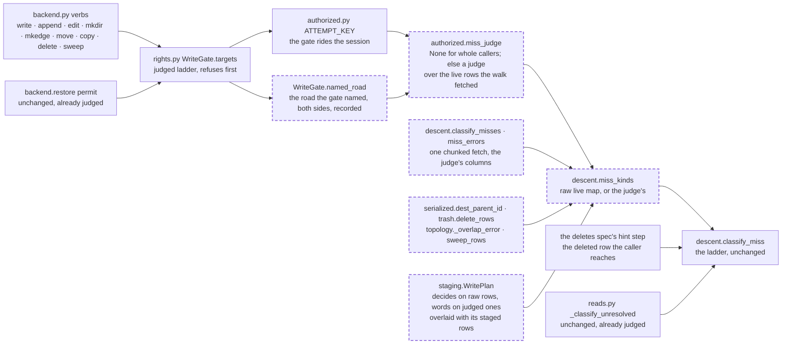

# A miss beneath a row the caller cannot read answers as a miss beneath nothing: every explanation a mutating verb gives after its gate walks the target's ancestors judged by the caller's rights, and a transfer's tombstoned occupant names its deletion only to a caller who may read it

A fix, amended on 2026-11-25 to `dev` at `27f3d24d` after [its spec review](../../reviews/2026-11-25-a-miss-beneath-a-row-the-caller-cannot-read-answers-as-a-miss-beneath-nothing-spec-review.md) stood at "Not yet"; it awaits that review's re-read and is not yet fit to build. It lands after the deletes spec, `agents/2026-11-24-a-deleted-row-gives-up-its-path/spec.md` on the open branch `origin/a-deleted-row-gives-up-its-path` (tip `d8c1d55d`), reviewed fit to build on 2026-11-24 and not built, and it is built on the tree that spec's three landings leave (decision 16). That spec frees a deleted row's name, so a transfer onto a path that holds only deleted rows lands and `_occupied`'s `exists` with the trashed hint goes, and it judges the trashed hint for the caller, asking the deleted side for the row the caller reaches at the path a refusal blames, at the `list` rung (READ, that file at `:178-188` and `:211-252`). So this spec is narrowed to what that spec does not cover: which live ancestor a mutating verb's miss names after its gate, and with what kind, judged by the caller's rights; and the write plan's wording of a refusal over the rows the batch itself staged. The title's second clause is met by the deletes spec, which removes the answer it speaks of. It touches rights in the sense the shape names: no grant, view, ladder or gate rule changes, but the wording of a mutating verb's refusal changes for a caller with partial rights after a race, so the security lens is mandatory in both reviews and criteria 1, 2 and 4 to 6 are leak tests. It needs the engine legs: it edits nine modules under `storage/backends/database/`, so the `db_test` cycle runs on the Postgres leg before landing (decision 15), and it adds no criterion of its own for that leg. It is not structural: `MissJudge` and `miss_kinds` are internal to `vfs.storage.backends.database`, exported nowhere, and `WriteGate` gains one attribute. It changes no public API, no schema, no stored byte and no Rust. It touches the gate's size baseline in two held entries, `rights.py` and `writes.py` (decision 12). It is not parallel-safe: the deletes spec edits `classify_misses`, `dest_parent_id` and the write plan this spec edits; [the rights compile spec](2026-11-14-the-rights-compile-is-the-same-at-every-world-size.md), active and not built, rewrites `rights.py` and its entry in `tests/lint/allowlist.py`; and the open vid branches (`origin/every-row-carries-a-vid` and those built on it) edit `staging.py`, `topology.py`, `trash.py` and `serialized.py` and move the `writes.py` entry; whichever lands later measures the entries again. It comes from no intention and stands on no research memo: the defect was named while [a mutation is authorized for the rows it acts on at its commit point](../archive/2026-11-14-a-mutation-is-authorized-for-the-rows-it-acts-on-at-its-commit-point.md) was reviewed, and every fact below was read or executed for this spec. That fix landed as `c39238a` and is archived, and the label fix that landed after it as `c92f1d3` moved `authorized.py` and `rights.py`.

## The problem

Every claim is labelled. EXECUTED runs at `dev` used Python 3.13 through `uv run` on the in-memory backend, from three scratch probes kept in the session scratchpad and not in the repository: `owner_probe.py` (the owner shape and the live-folder shape, every refusal's kind, path and data), `staged_probe.py` (one write batch that leans on a row it stages) and `compile_probe.py` (the walk's fetch compiled for the three profiles). The first draft's five probes ran on `lane/descent` at `a220182e`, a tree that is not in this repository; their results are reported below as run there and were not re-run at `dev`. No server engine was run: no Docker daemon is running here, so nothing below is evidence from Postgres. Line numbers are those of `dev` at `27f3d24d`; the deletes spec is cited at `d8c1d55d`.

**Two words first.** A *miss* is a refusal a verb gives because the path it was sent names no live row: `not_found` at the first component that is missing, or `wrong_kind` at an ancestor that is a file. A *miss explanation* is the walk that chooses those words: it reads the target's chain of ancestors, shallowest first, and stops at the first one that fails. A row is *hidden* from a caller when the caller may not list it: it holds no grant over it, does not own it, and its everyone label is below `list`. The *trashed hint* is the `data` a miss at a deleted row carries, `vfs.trashed: true` and `vfs.deleted_at`, the time of the delete, so that an agent knows `restore` applies (READ, `descent.py:115-117`, keys in `results/kinds.py:21-22`). The *deletes spec's hint step* is that spec's one statement a refusal issues to find the deleted row the caller reaches at the blamed path (READ, deletes spec `:233`, `:238`).

**The law.** READ. The house rule, which [the scan tier spec](../archive/2026-11-12-the-scan-tier-reveals-nothing-about-rows-a-caller-cannot-read.md) restates from the grants spec, is that nothing a caller can observe (a score, a statistic, a count, a truncation, an error) may change with the existence of a row it cannot read. For a miss the rule has a sharp form, which the gate's docstring states: a target or ancestor the caller cannot name answers `not_found` exactly as an absent one does (`rights.py:692-704`). The trashed hint has its own form: it "rides only on a tombstone the caller may read" (`rights.py:660-666`).

**Where the rule is kept today.** READ. Two ladders already keep it. The write gate, `WriteGate.targets`, fetches each target's chain with the rights columns and classifies a refusal against what the caller may name: `Visibility.seen_kinds` keeps the live rows the caller may list, the live directories on its road (a hidden directory that leads to a row the caller may name), and the root; `Visibility.tombstones(rows, "read")` keeps the tombstones the caller may read; and the gate then puts on its road every hidden directory, live or deleted, beneath which lies a deleted row the caller may name, the road through the trash view (`rights.py:645-671`, `:734-763`, the trash road at `:747-751`, the road the gate keeps at `:752`, the refusals at `:930`, `:944`). `WriteGate.missing` is the same ladder for one target, over the live road alone (`rights.py:857-869`). The read verbs classify their misses through `_classify_unresolved` over the same two maps (`reads.py:985-1022`). Restore's per-target `permit` answers a target the caller cannot see through `WriteGate.missing`, and rewords any ladder verdict that names an ancestor the same way (`backend.py:832-863`).

**Where it is not kept.** READ. After the gate passes, six places explain a miss again from rows they read themselves, and none of them consults the caller's rights:

- `classify_misses` (`descent.py:65-84`) selects `path`, `kind` and `deleted_at` for the targets and their ancestors (`:78`) and classifies against every live row and every tombstone it finds. It is reached from `miss_errors` (`descent.py:120-132`) in `edit_rows` (`writes.py:308`), from mkedge's missing endpoints (`edges.py:156`), from a transfer's missing source (`topology.py:172`), and from sweep's missing path (`trash.py:383`).
- `dest_parent_id` classifies a transfer's destination parents from a raw fetch (`serialized.py:256-275`, the classify at `:273`).
- `delete_rows` classifies a missing target from its raw snapshot (`trash.py:157-161`, `:183`, `:190`), and `_overlap_error` does the same for a move's duplicated or covered sources (`topology.py:259-273`).
- The write plan's own ladder words its refusals from the plan's raw read: `parent_gate` puts the trashed hint on a deleted ancestor (`staging.py:236-239`), `put_file` on a deleted directory at the target (`:291-294`), `put_dir` and `mkdir_rows` on a deleted row at the site (`staging.py:345-348`, `writes.py:267-269`). The plan builders are `write_rows`, `mkdir_rows`, `edit_rows` and `append_rows` (`writes.py:206`, `:256`, `:309`, `:357`).
- `_occupied` answers a transfer onto a tombstoned destination with `exists` and the trashed hint, the occupant's deletion time, whatever the caller may read (`topology.py:276-281`).

The missing check has two halves. The live half: the walk never asks whether the caller may list a live row before it steps through it or names its kind. The tombstone half: the walk never asks whether the caller may read a tombstone before it states its deletion time. The deletes spec takes the tombstone half: it removes `_occupied`'s hint, `put_file`'s deleted-directory refusal and the two site-tombstone refusals, because a name that holds only deleted rows is free (READ, its decision 4, `:178-188`), and it has every remaining refusal ask its hint step for the row the caller reaches (READ, its decision 7, `:238`). Its Scope names `classify_misses`, `dest_parent_id` and the staging plan, and names neither `_overlap_error` nor `delete_rows`'s classification (READ, `:545`). It leaves the live half as it is (INFERRED: no decision of it judges a live ancestor of a miss).

**Reachable without a race: one shape, ten call forms, at the draft's tree.** EXECUTED at `a220182e` by the draft's `state_probe.py`, not re-run at `dev`. The probe built twin worlds through the public verbs. In each, `alice` holds `read_write` on `/alice` and `bob` on `/bob`; the root posture is `none`, `/alice` is `none`. World one holds alice's hidden rows; world zero is identical without them. Three shapes: *sibling*, where alice's `/alice` holds a live directory with a child, a live file, a deleted file and a deleted directory with a child, and bob holds nothing there; *road*, the same with bob granted `read_write` on `/alice/pub`, so `/alice` is on his road; *owner*, where bob owns `/alice/proj/mine.txt` inside alice's private `/alice/proj`, his row was deleted first and alice then deleted `/alice/proj`, at a different time in each world. For every probe path the probe called 26 call forms as bob and as anonymous: read, stat, ls, tree, glob twice, grep, search, write with and without `parents`, edit by path and by observations, mkdir with and without `parents`, mkedge and rmedge with the path as target and as source, move and copy with the path as destination and as source, a directory moved onto it, delete, restore and sweep. The sibling and road shapes at posture `none`: 728 calls as bob on each backend and 364 as anonymous, every one identical across the twins, because the gate refuses first and its ladder is judged. The owner shape: 130 calls, 10 differing, each answering `not_found` at `/alice/proj` with `vfs.trashed` and the hidden folder's deletion time: write, write with `parents`, edit by path, edit by observations, mkedge from it, move from it, move onto it, a directory moved onto it, copy onto it, delete.

**The same shape at `dev`.** EXECUTED, `owner_probe.py`, one fresh world per call. `stat` and `restore` at `/alice/proj/mine.txt` as bob answer `not_found` at `/alice` with only `vfs.target`. `edit`, `write`, `delete`, move from it, move onto it, copy onto it and mkedge from it each answer one `not_found` at `/alice/proj` with `vfs.trashed` and the hidden folder's deletion time. A move that names the path as its source twice answers two such errors, through `_overlap_error`: an eleventh form, which the review found. The system actor's `edit` answers `not_found` at `/alice/proj` with the hint.

**A fourth shape: the caller's own deleted row beneath a hidden folder that is still live.** EXECUTED, `owner_probe.py`: the owner shape before alice deletes `/alice/proj`. As bob, `stat` answers `not_found` at `/alice`; `edit`, `delete`, move from it, move from it twice and mkedge from it answer `not_found` at `/alice/proj/mine.txt` with `vfs.trashed` and bob's own deletion time; move onto it and copy onto it answer `exists` there with the same hint; `write` revives the row and `restore` restores it. Nothing leaks here: every fact stated is bob's own row's. The hint is the guidance toward a `restore` that succeeds.

**What the deletes spec leaves.** INFERRED from its decisions 4 and 7. In the owner shape the hint at `/alice/proj` is asked of the deleted side for bob at `list`; bob may not list alice's folder and owns no row there, so no hint is given and the folder's deletion time reaches him by no form whose site uses that step. What stays is the live half. The walk still steps through every live row it fetched, read raw. Race-free that names nothing new, because the gate passed every hidden live ancestor on the chain as a road directory. After a race it does: a rival that, between the gate and the walk, deletes a hidden directory and writes a file at its name (a name the deletes spec frees) is named `wrong_kind` at that path with `kind: file`, a hidden row's kind. And a site the deletes spec's build leaves on its raw tombstones keeps stating a hidden deletion time.

**How small it is.** EXECUTED at `a220182e` and INFERRED. What the race-free form reveals today is one timestamp: when a deleted folder the caller may not list or read was deleted. Its path and kind are not new: the trash view shows the folder to bob as a bare directory, path and kind only, because his row lies beneath it (EXECUTED at `a220182e`, `listing_probe.py`). A cascade delete leaves an earlier-deleted descendant's own time and root (READ, `trash.py:480-489`), so the time is new only when the folder was deleted after the caller's row. No body, hash, size, owner or new path is revealed; anonymous learns nothing; the read verbs reveal nothing. What the race reveals is one kind, a hidden row's, to a caller whose gate passed through it.

**Reachable with a race: the code review's narrower sequence.** READ and INFERRED. The same six walks run after the gate. On an engine whose statements each read the latest commit, a rival can change a hidden ancestor between the gate and the walk, by deleting it or replacing a directory with a file, and the walk then states that row's kind or deletion. The fix's code review reached the defect this way, as its finding L8 (READ, line 176 of [that review](../../reviews/2026-11-14-a-mutation-is-authorized-for-the-rows-it-acts-on-at-its-commit-point-code-review.md)).

**What it costs today.** EXECUTED at `a220182e` by the draft's `cost_probe.py`, not re-run at `dev`. The raw walk issues one `SELECT` per chunk of targets with their ancestors: one target at depth 1, 3, 4 or 8 is one statement, and so is a batch of 1,200 missing targets three deep. The judged ladder run the way `WriteGate.missing` runs it costs 4 statements beneath a hidden directory, the fetch and three road reads, because a road read is per call. The review measured bob's edit at the owner path at 12 statements, 11 of them `SELECT`, and the system actor's at 3 (EXECUTED at `31664694`, in the review).

**What already pins it.** READ. Present behaviour that must not move:

- The judged ladders: `tests/support/grants_contract.py`, `test_a_hidden_row_reads_exactly_as_a_missing_one` (`:175`), `test_a_hidden_row_refuses_an_edit_as_missing` (`:397`), `test_a_write_under_a_hidden_directory_is_not_found` (`:440`), `test_a_deleted_row_stays_hidden_from_everyone_who_could_not_see_it` (`:581`), `test_restore_refusals_name_only_the_path_the_caller_sent` (`:643`) and `test_a_restore_never_names_a_deleted_parent_the_caller_cannot_see` (`:676`). The last is this defect's shape on restore, already fixed there.
- The whole caller's hints: `tests/storage/database/test_trash.py`, `test_a_tombstoned_row_reads_as_absent_with_the_trashed_hint` (`:157`) and `test_a_tombstoned_ancestor_is_not_found_for_every_parent_gate` (`:185`); `tests/support/storage_contract.py`, `test_a_delete_under_a_deleted_directory_is_not_found_at_the_directory` (`:930`). The deletes spec replaces `test_a_deleted_row_holds_its_address_against_a_transfer` (`:1024`), since a deleted row no longer holds its address.

No test calls a mutating verb as a partial caller after a hidden ancestor changed beneath its gate (READ, `grep` of `tests/` for the shape). No test compares a miss beneath a hidden row with a miss beneath nothing over every verb.

## Architecture

Dashed is what this spec adds or changes. Nothing is retired. The hint step is the deletes spec's and is drawn solid, since it lands first. No architecture page changes on landing: `context/architecture/` is not on `dev` (EXECUTED, `ls`), and the diagram is this spec's own.

## Decisions

### 1. The property: a miss a mutating verb explains after its gate, for a caller whose rights are partial, names a live row's path or kind only where the caller may name that row, and its trashed hint is the deletes spec's, judged for the caller

Reason: this is the gate's own rule, "hidden reads exactly as absent", carried past the gate. The read verbs, the gate and restore already keep it. Stated once: for a caller whose rights are not whole, the Result of any verb at a path at or beneath a live row the caller may not name is identical to the Result in a store without that row; and no Result states a field of a row the caller may not read. The twin form is what the criteria test, over every verb and every hidden shape, on every leg. Where a twin without the row cannot exist (bob's own row lies beneath the hidden folder), the twins differ only in the hidden row's own fields. The tombstone half of the property is kept by the deletes spec's hint step (decision 4); this spec pins it in criterion 2 and adds no term to it.

### 2. The walk names a live row only where the gate named it, and stops at the first live row it may not name, answering there exactly as where nothing exists

Reason: a single rule, the gate's own. Walking the chain shallowest first, a live row is a step when it is the root, a live row the caller holds `list` on, or a live directory the gate recorded on the caller's road (decision 3), the live road or the road through the trash view. Any other live row reads as absent: the walk stops there with `not_found` at that component, carrying `vfs.target` as today, and whatever hint the deletes spec's hint step gives for that path. A row the caller may name keeps today's words: `wrong_kind` at a live file ancestor. The gate passed the target over exactly these rows (READ, `rights.py:744-752`), so the walk words its refusal over what the gate named and nothing else; and the trash view already shows a trash-road directory's path and kind to the caller (EXECUTED at `a220182e`, `listing_probe.py`). In the fourth shape this keeps every executed answer: the walk steps through `/alice` and `/alice/proj` and answers at bob's own row with his own hint (INFERRED from the rule and the deletes spec's owner step, `:233`). In the owner shape it steps through `/alice` and stops at `/alice/proj`, which holds no live row: `not_found` there, with no hint once the deletes spec lands. After a race, a recorded directory that a rival replaced with a file is no step, so the walk answers `not_found` there and names no kind. The walk decides nothing: it only words a refusal the verb has already chosen to give. Rejected: the live road alone, the first draft's rule. In the fourth shape it stops at `/alice` and takes the caller's own hint from five forms, though `write` and `restore` succeed there (the review's M1, INFERRED from that rule). Rejected for the same reason: matching `stat` and `restore`, which answer at `/alice` in both shapes, because their ladder names the live road alone (READ, `rights.py:857-869`, `reads.py:1007`). The mutating verbs follow their gate, and aligning the read ladder with the gate's road is Out.

### 3. The road is the gate's own record: `WriteGate.targets` records the road it named, and the walk reads it, never the road again

Reason: the road costs statements, and the gate has already paid them. `targets` computes the road it judges by after the trash-road step, every path it names that the caller may not list (READ, `rights.py:752`). `WriteGate` gains one attribute, `named_road`, and `targets` adds that set to it. The walk counts a recorded path as named only while the fresh row there is a live directory, so a rival that replaced it with a file or deleted it after the gate gets no `wrong_kind` and no step. The record holds the root where the caller may not list it, and deleted directories on the trash road; neither changes an answer, since the judge names the root anyway and names only live directories. The gate fetched every chain the walk reads: the targets for write, append, edit, delete, sweep and mkdir; sources and destinations for the transfers; both endpoints for the edge verbs (READ, `backend.py:718`, `:765`, `:795`, `:894`, `:926`, `:971-972`, `:1423-1426`). A path the gate never fetched is not recorded, so it reads as absent, which is safe. One case is a parent minted by an earlier pair of the same batch. It is the caller's own row or one the caller moved, so it passes on `list` alone (INFERRED from `authorized.py:363-392` and the owner floor). Rejected: running `WriteGate.missing`'s road reads in the walk, 3 more statements beneath a hidden directory (EXECUTED at `a220182e`), plus one per owner arm. Rejected: a road derived only from the rows in the walk's own chain. It costs nothing and edits nothing in `rights.py`, but it names fewer directories than the gate did when the road's witness lies off the chain.

### 4. The trashed hint is the deletes spec's: every site words its hint through that spec's one hint step, and this spec adds no term to it

Reason: that spec asks the deleted side for the row the caller reaches at the blamed path, judged for the caller (READ, `:233`, `:238`), which is the tombstone half of decision 1; two judgments of one hint would drift apart. Where that spec's build leaves a site on its raw tombstones, this build moves the site onto that step, since that spec's Scope names `classify_misses`, `dest_parent_id` and the staging plan and names neither `_overlap_error` nor `delete_rows`'s classification (READ, `:545`); criterion 2 finds such a site. The rung is not this spec's: that spec judges the hint at `list` (READ, `:233`, `:238`), while the gate's docstring and the descent ladder ask at `read` (READ, `rights.py:660-666`), and a caller at `list` is shown a row's path and kind only (READ, `reads.py:980-982`). It is raised against the deletes spec in the flagged paragraph below. `_occupied`'s `exists` with the hint, `put_file`'s deleted-directory refusal and the site-tombstone refusals of `put_dir` and `mkdir_rows` leave with that spec's decision 4, so this spec changes none of them, and the first draft's `hinted` flag on `_occupied` is withdrawn with them.

### 5. The write plan decides on its raw rows and words its misses on the judged live map overlaid with the rows the batch staged, built at its first refusal

Reason: the plan is pure and holds no session (`staging.py:1-3`), and what it decides must not move: a hidden file ancestor still refuses, and an absent ancestor still mints under `parents`. Only the words of a refusal change. The plan's own walk reads the staged overlay first (READ, `staging.py:168-174`; `writes.py:186-188` says "committed-plus-staged"), so a row the batch staged is the caller's own and is named with its staged kind. `write_rows`, `mkdir_rows`, `edit_rows` and `append_rows` hand the plan `judge=miss_judge(session)`. The plan builds `miss_kinds(committed, judge)` at its first refusal and keeps it, so a call that refuses nothing judges no row for wording. `parent_gate` words a refusal as `classify_miss(target, {**judged, **{str(path): staged.kind for path, staged in self.staged.items()}}, hints)`, where `hints` is what the deletes spec's hint step gives, so a file or a directory staged earlier in the batch is named exactly as today, for every caller (EXECUTED at `dev`, `staged_probe.py`: `/bob/c.txt` then `/bob/c.txt/d.txt` answers `wrong_kind` at `/bob/c.txt` with `kind: file`, as bob and as the system actor; the system actor's directory `/bob/new` then `/bob/new/x/y.txt` answers `not_found` at `/bob/new/x`). `_fetch_committed` already selects `owner_id` and `everyone_level` (READ, `writes.py:434-435`). The occupant answers on a live row, `exists`, `wrong_kind` and `unchanged`, are unchanged: they say a row of some kind stands there, which the gate's creation rule admits; the fix's own code review recorded that as no finding (READ, its Landing notes).

### 6. The system actor, an admin write and every caller whose rights are whole see exactly what they see today

Reason: a whole caller may read every row, so the raw walk tells it nothing it may not know. The hint is the house's guidance toward `restore` (READ, `descent.py:22-32`). `miss_judge` returns `None` when no gate rides the session or the gate is whole; `judging` already draws the same line (READ, `authorized.py:263-268`). With `None`, every walk fetches exactly the columns it fetches on the tree it is built on and builds exactly that tree's maps. Criterion 8 holds the existing whole-caller nodes, and criterion 9 the batch that leans on its own staged rows.

### 7. Anonymous is judged as its gate judges it: no road, no owner floor, the labels alone

Reason: anonymous's view never derives a road (READ, `rights.py:556-558`, `:725`, and a view without a road returns only the root, `:629-630`), and its rights carry no owner arm (READ, `grants.py:612`). Its gate refuses `unauthenticated` at the addressed path before any walk runs wherever the posture gives everyone less than the verb's rung (READ, `rights.py:391-401`). The judge for anonymous therefore records no road and names only rows everyone may list. EXECUTED at `a220182e`: anonymous's answers were identical across the twins at every posture where rows are hidden.

### 8. The read verbs and restore are in the criteria and out of the code

Reason: they already keep the property. The point reads classify through `_classify_unresolved` over the view's maps (READ, `reads.py:985-1022`), and restore's `permit` rewords through `WriteGate.missing` (READ, `backend.py:832-863`). EXECUTED at `dev`: `stat` and `restore` in the owner shape name `/alice` and no deletion. Criterion 1 runs them anyway, so a later change to them cannot reopen the gap unseen. Traverse is outside the call forms: it explains no miss of its own, and its seeds resolve under the same view as the point reads (READ, `backend.py:375-427`).

### 9. One judge, one live map, one ladder: `descent.miss_kinds` is the only place a mutating verb builds the live map of a miss it explains after its gate; the restore ladder, the read verbs and the gate keep theirs (decision 8)

Reason: the raw live maps are built by hand in five places a mutating verb's post-gate walk uses today, `descent.py:75-83`, `trash.py:160`, `topology.py:155`, `serialized.py:270` and the plan's `kind_of` (`staging.py:168-174`), and each is a place a judged answer could be forgotten. `miss_kinds(rows, judge)` returns the raw live map when `judge is None` and the judge's otherwise. Every walk named in The problem calls it, and `classify_miss`, the pure ladder, is unchanged. The restore ladder (`trash.py:232-233`), the read verbs (`reads.py:1001-1012`) and the gate (`rights.py:645-671`) keep the maps they build; the rule for what a caller may name is then written twice, in `Visibility.seen_kinds` and in the judge, because the held size of `rights.py` is kept, and criteria 1 to 3 pin the two to one behaviour. `descent.py` cannot import the rights code, because `rights.py` imports `descent.py` (READ, `rights.py:87-94`). So `descent.py` declares the judge as a `Protocol`, holding the columns it needs and the live map it builds, and `authorized.py` supplies the one implementation.

### 10. The cost is no added statement on any path, and a miss explanation never costs more statements than its chain is deep

Reason: a miss is per verb call, and the explanation is the cheapest part of a refusal. The judged walk issues the statements the raw walk issues on the tree it is built on: one `SELECT` per chunk of targets with their ancestors (READ, `descent.py:77-78`), and the deletes spec's hint statements, which are that spec's. It adds two selected columns, `owner_id` and `everyone_level`, and only for a partial caller. It judges each fetched live row in memory with the rights the gate compiled, as `admit_targets` does (READ, `authorized.py:307-310`). The road comes from the gate's record (decision 3). So one target at depth *d* costs one statement for its chain, never more than *d*, and a batch costs one statement per chunk, as today. The plan judges rows only at its first refusal (decision 5), so a write that refuses nothing judges none. Rejected: any design whose statement count grows with the depth or with the rows judged.

### 11. Never assume SQLite: the judged fetch is the chunked membership select it already is, compiled for SQLITE, POSTGRESQL and GENERIC at a full chunk

Reason: `dev` serves SQLite and Postgres and gives every other dialect the generic floor (READ, `dialects.py:449-473`), and the floor's `in_list_budget` is 1,000 (READ, `dialects.py:452`), the cap SQLAlchemy does not model. The changed statements add columns and no bind (READ, `membership.py:43-46`). EXECUTED at `dev`, `compile_probe.py`: the fetch with the two rights columns, compiled at a full chunk of `membership_budget(profile, dialect.insertmanyvalues_max_parameters)`, binds exactly one parameter per path, the same count as the raw fetch: 32,668 on SQLite, 32,668 on Postgres and 1,000 on the floor, with the default dialect standing in for an unknown one. Criterion 11 pins this on each of the three profiles. No statement compares a timestamp or a label in SQL; the judgment is in memory.

### 12. No module is added; the judge lives in `authorized.py`, the live map in `descent.py`, and two held entries move by what the build measures, within the bounds below

Reason: `authorized.py` is the module whose job is "what a mutation proves between its gate and its commit". It already reads the attempt's gate from the session and imports the rights code (READ, `authorized.py:1`, `:59`, `:263-268`). Every module named here is in the `vfs.storage.backends` unit of `LAYERS` (READ, `tests/lint/test_code_shape.py:46-68`, the unit at `:54-62`), so no import crosses a rung. The import that would form a cycle, `descent.py` importing the rights code, is avoided by decision 9. Sizes by `wc -l` at `dev` (EXECUTED): `descent.py` 246, `authorized.py` 425, `rights.py` 1,539 (held, entry 1539), `writes.py` 1,415 (held, entry 1415), `staging.py` 563, `topology.py` 565, `serialized.py` 334, `trash.py` 668, `edges.py` 584. The deletes spec and the vid branches move several of these before this spec is built, so the bounds are counted from the tree this spec builds on: `rights.py` ends at most 2 lines above its count there and `writes.py` at most 4, each `MODULE_LINE_BASELINE` entry set to its file's count. Every other module stays under the 1,000-line ceiling (READ, `test_code_shape.py:76`). Reason for the bounds: `rights.py` gains one attribute and one line in `targets`; `writes.py` gains the judge at its four plan builders and at its one `miss_errors` call.

### 13. Each law lands with its mutant as a row of the mutant ledger: J1 to J11

Reason: the property holds by the judge being passed at each site, and a site that drops it is silent. Each row below Acceptance criteria names the one-line mutation and the node that kills it; the build proves each kill on a scratch copy under the safe-restore rule, and the ledger records the count. The letter J is free (EXECUTED, `grep` of [the mutant ledger](../../standards/mutant-ledger.md)).

### 14. The race the code review named is closed by the same walk and pinned at the fix's own seams and by a direct call of each post-gate walk

Reason: the walk judges the rows it fetches after the gate, so a rival that replaces or deletes a hidden ancestor between the gate and the walk is worded over the caller's rights too. On SQLite and in memory the rival is staged on the attempt's own session at the existing seams, `write:before-snapshot` and `mkedge:before-resolve` (READ, `writes.py:425`, `edges.py:151`). This is the house pattern for a window no public call reaches (READ, `seams.py:1-3`). The walks with no seam between gate and walk, delete's snapshot, sweep's point read and the transfer's three walks, are pinned by a direct call of the row function on a session that carries the verb's gate, as criterion 10 calls `classify_misses`. No new seam is added.

### 15. No engine-specific criterion; the conformance rows run on the Postgres leg wherever its URL is set, and the code review runs it through `db_test`

Reason: `dev` has one engine leg, Postgres, selected by `VFS_TEST_POSTGRES_URL` (READ, `context/standards/roadmap.md:21`), and `GrantsContract` runs on `TestPostgresConformance` beside the in-memory and SQLite classes (READ, `tests/storage/test_conformance.py:65`, `:102`, `:182`). The change adds columns to statements whose shape, chunking and binds are unchanged (decision 11). Its answers do not depend on isolation, except the race nodes, which stage the rival on the attempt's own session. The fix's own Postgres criteria already execute the commit-point windows; a Postgres-only race node would test that fix again, not this one.

### 16. The deletes spec lands first, and this spec is built on the tree its three landings leave

Reason: that spec rewrites the walks this spec edits: every lookup by path names its side, a refusal finds its hint in one step, the revive and the site-tombstone refusals leave the plan, and `sweep` becomes `destroy` (READ, its decision 16, `:366-375`). Built first, this spec would edit code that spec then removes, and its tombstone half would duplicate that spec's decision 7. Built after, it takes that spec's hint as given and judges only the live half. Where that spec's `destroy` keeps a post-gate walk, `sweep_rows`'s row and criterion 6's sweep case apply to it; where `destroy` answers a miss through restore's ladder, which decision 8 leaves unchanged, they are dropped, and the Landing notes say which. Rejected: reconciling the two specs on one rung for the hint here; the rung is the deletes spec's decision, and it is raised there.

Flagged to Clay. Six items are this spec's recommendations, made the decisions above; each stands unless the developer rules otherwise before the re-read. First, severity: the race-free reach on `dev` is one timestamp, a hidden deleted folder's deletion time, to a caller who holds a deleted row beneath it, through eleven mutating call forms (EXECUTED at `dev` for eight of them), and the deletes spec's hint step closes it; what this spec closes is a hidden row's kind after a race, and the wording of a batch that leans on its own staged rows. Second, decision 2 takes the gate's whole road, the live road and the road through the trash view, so the mutating verbs keep the caller's own hint in the fourth shape and answer past a trash-road directory where `stat` and `restore` answer at it; the review's M1 asked for this ruling. Third, decision 3 adds one attribute to `WriteGate` in `rights.py`, a held module, so the walk reuses the gate's road: two lines in place of three statements per miss. Fourth, the hint's rung: the deletes spec gives the hint at `list`, where the gate's docstring and today's ladders give it at `read` and the read verbs show a caller at `list` no deletion time; this is a question for that spec's build, not decided here. Fifth, the order: this spec waits on the deletes spec's three landings (decision 16). Sixth, this spec is tracked and is linked from the label fix's archived spec; it describes an unfixed weakness and stays out of the published documentation until it lands.

## Intent

After this spec, a caller with partial rights who writes, appends, edits, makes a directory or an edge, moves, copies, deletes or sweeps, and is refused because the path names no live row, is told exactly what its gate would tell it: no refusal names the kind of a live row the caller may not name, even when a rival changed that row between the gate and the refusal, and the trashed hint a refusal carries is the one the deletes spec judges for the caller. A batch that writes a file and a path beneath it in one call is told `wrong_kind` at the file, as today. Callers whose rights are whole, the system actor and admin writes see today's answers, hint and time included. The read verbs and restore, which already keep the property, are pinned so it cannot be lost there. Nothing costs a statement more.

## Design

**Tests first.** Every node in the criteria is written and run on the tree this spec builds on, the one the deletes spec's landings leave, before any source line changes. Each shows the result its criterion names: the pins pass there, the red nodes fail there. A node named red that passes there is reported in the Landing notes with its site.

**`src/vfs/storage/backends/database/descent.py`.** In the module constants: `class MissJudge(Protocol)` with `columns: tuple[str, ...]` (the entry columns the judge needs beyond `path`, `kind` and `deleted_at`) and `def kinds(self, rows: Mapping[str, Mapping[str, Any]]) -> dict[str, str]` (the live rows a walk may step through, `path → kind`). In the miss classification group: `def miss_kinds(rows: Mapping[str, Mapping[str, Any]], judge: MissJudge | None) -> dict[str, str]`. Its one-line docstring: every live row's kind when there is no judge; the judge's map otherwise. `classify_misses(..., *, judge: MissJudge | None)` selects `judge.columns` beside its own columns when a judge is given, and builds its live map through `miss_kinds`; its hint comes from the deletes spec's hint step, unchanged. `miss_errors(..., *, judge: MissJudge | None)` passes it through. `judge` is a required keyword, so every call site states its choice. The module docstring gains one sentence: a judged walk steps only through what the caller may name. About 25 lines.

**`src/vfs/storage/backends/database/rights.py`.** `WriteGate.__init__` gains `self.named_road: set[str] = set()` with a trailing comment on the same line: the road this gate named, which a later miss walk may name too. `WriteGate.targets` adds, right after the line that computes `road` (`rights.py:752` at `dev`), `self.named_road |= road`. Two lines; the entry rises by 2 over the count the build starts from.

**`src/vfs/storage/backends/database/authorized.py`.** In "The rows a verb finds after its gate" (`authorized.py:259`), `def miss_judge(session: AsyncSession) -> MissJudge | None`. It returns `None` with no gate on the session or a whole gate, as `judging` does, and otherwise `_JudgedMisses(attempt.gate)`. `_JudgedMisses` is a private frozen class beside it, with `columns = tuple(sorted(RIGHTS_FIELDS))`, the name `authorized.py` already imports (`:59`). Its `kinds` keeps the root, every live row the gate's view `shows`, and every live directory whose path is in `gate.named_road`. Its docstring states decision 2's rule in words, term by term. About 30 lines.

**Call sites.** Each gains `judge=miss_judge(session)` or builds its live map through `miss_kinds`:

- `writes.py`: `edit_rows`'s `miss_errors` (`:308`); the plan's `judge` in `write_rows` (`:206`), `mkdir_rows` (`:256`), `edit_rows` (`:309`) and `append_rows` (`:357`).
- `staging.py`: `WritePlan.__init__` (`:153-166`) takes `judge: MissJudge | None`. `parent_gate` (`:226-247`) words its refusal over the judged live map overlaid with the staged rows, as decision 5 says.
- `edges.py`: `mkedge_rows` at `:156`.
- `topology.py`: the source miss at `:172`; `_overlap_error` (`:259-273`) words its miss over `miss_kinds(committed, judge)`, with the committed rows fetched with the judge's columns.
- `serialized.py`: `dest_parent_id(..., *, judge: MissJudge | None)` (`:256-275`) fetches the judge's columns beside its four (`:269`), and `fetch_snapshot(..., extra: Sequence[str] = ())` (`:237`) gains the columns `delete_rows` needs.
- `trash.py`: `delete_rows`'s miss (`:157-161`, `:183`, `:190`), and `sweep_rows` at `:383` or its successor under decision 16. The restore ladder is unchanged (decision 8).

At `dest_parent_id`, `delete_rows` and `_overlap_error` the rows read still decide, as today: the chain test (`serialized.py:272`), `live.get` (`trash.py:181`, `:188`) and the membership test (`topology.py:267`) keep the raw map, and `miss_kinds` builds only the map a refusal is worded from. No call site gains a statement.

**Tests.** `tests/storage/database/test_descent.py` is the mirror of `descent.py`; the deletes spec adds it, and this spec adds its nodes there (or creates it, where that spec's build did not). The contract rows go in `tests/support/grants_contract.py`, which runs on the in-memory, SQLite-file and Postgres classes. The race nodes go in `test_writes.py` and `test_edges.py`, the judge's nodes in `test_authorized.py`, and the record's node in `test_rights.py`. The twin worlds are built by one helper in `grants_contract.py`, named in its module docstring, the way `_world` is (`:121`). The probe paths are each hidden row's own path and one absent name directly beneath it: in the sibling and road shapes `/alice` and the six rows beneath it, 14 paths; in the owner shape `/alice`, `/alice/proj` and the caller's row, with an absent name beneath each folder, 5 paths. The helper's docstring lists them.

## Scope

In: decisions 1 to 16. Source: `src/vfs/storage/backends/database/descent.py`, `authorized.py`, `rights.py` (`WriteGate.__init__`, `WriteGate.targets`), `writes.py` (`write_rows`, `mkdir_rows`, `edit_rows`, `append_rows`), `staging.py` (`WritePlan.__init__`, `parent_gate`), `edges.py` (`mkedge_rows`), `topology.py` (`transfer_rows`, `_overlap_error`), `serialized.py` (`fetch_snapshot`, `dest_parent_id`), `trash.py` (`delete_rows`, `sweep_rows` or its successor). Tests: `tests/storage/database/test_descent.py`, `tests/support/grants_contract.py`, `tests/storage/database/test_writes.py`, `test_edges.py`, `test_authorized.py`, `test_rights.py`. Records: `tests/lint/allowlist.py` (two entries), `context/standards/mutant-ledger.md` (rows J1 to J11).

Out:

- The trashed hint, its rung and its statements: the deletes spec's decision 7. The rung is raised against that spec (decision 4).
- `_occupied`'s `exists` with the hint, `put_file`'s deleted-directory refusal and the site-tombstone refusals of `put_dir` and `mkdir_rows`: the deletes spec's decision 4 removes them.
- The gate's own wording of a refusal; it is judged already.
- The occupant answers on a live row (`exists`, `wrong_kind`, `unchanged`) that write, mkdir and a transfer give. They say a row stands there, which the creation rule admits by design.
- The restore ladder's trash-root hint, already reworded by its `permit`.
- The read verbs' ladder, and aligning `stat`'s and `WriteGate.missing`'s live road with the gate's road through the trash view: a change to the read view, which belongs to a spec of its own.
- A posture relabel's holes, where a stored label is not trusted. The judge reads the gate's compiled rights, which already carry the holes, so it inherits their treatment unchanged.
- Any change to what a caller may list or read.

## Acceptance criteria

Counts and states, never clocks. "Twin worlds" means two stores built by the same calls, one with the hidden rows and one without, or differing only in a hidden row's own fields. "Equal" means equal `success`, equal errors by `model_dump(exclude={"source"})` in order, and equal observations by path, kind, status and deletion time. The 27 call forms are the 26 of The problem and a move that names the path as its source twice. Every `grants_contract.py` node runs on `TestMemoryConformance` and `TestSqliteConformance`, and on `TestPostgresConformance` when its URL is set. "The tree" is the one this spec builds on (decision 16).

1. `tests/support/grants_contract.py::GrantsContract::test_a_miss_beneath_a_row_the_caller_cannot_read_answers_as_a_miss_beneath_nothing`: the sibling and road twin worlds at posture `none`, the 27 call forms, each of the 14 probe paths, as bob and as anonymous. For every call the Result for a path at or beneath a hidden row equals, field for field, the Result for the same path beneath nothing. A pin: the 26 forms passed at `a220182e` (EXECUTED there, 728 calls as bob per backend and 364 as anonymous, 0 differ); the 27th form was not run in these shapes.
2. `…::test_a_miss_beneath_a_hidden_deleted_folder_names_no_fact_of_it`: the owner twin worlds at posture `none`, the 27 call forms, the 5 probe paths, as bob. Every call's Result is equal across the twins, and no error carries `vfs.trashed` or `vfs.deleted_at` at `/alice/proj`. Red at `dev`: seven of the draft's ten forms and the duplicated source give nine errors at `/alice/proj` with the hidden folder's deletion time (EXECUTED, `owner_probe.py`). On the tree it passes wherever the deletes spec's hint step reaches the site (INFERRED from its decision 7); a form that fails there names a site decision 4 moves onto that step.
3. `…::test_a_miss_at_the_callers_own_deleted_row_beneath_a_live_hidden_folder_keeps_its_hint`: the fourth shape, as bob. Edit by path, delete, move from it and mkedge from it each answer one `not_found` at `/alice/proj/mine.txt` whose data carries `vfs.trashed` and bob's own deletion time; `stat` answers one `not_found` at `/alice` whose data is `{"vfs.target": "/alice/proj/mine.txt"}`; `restore` succeeds. A pin: passes at `dev` (EXECUTED, `owner_probe.py`); on the tree INFERRED, since bob reaches his own row by the deletes spec's owner step (`:233`).
4. `tests/storage/database/test_writes.py::TestMissesAreJudged::test_an_edit_whose_hidden_ancestor_becomes_a_file_after_its_gate_names_no_kind`: bob holds `read_write` on `/alice/pub` and edits `/alice/pub/x.txt`. At `write:before-snapshot`, on the attempt's session, `/alice/pub/x.txt` is stamped deleted and `/alice`'s row is set to kind `file`. The edit answers one `not_found` at `/alice` whose data is `{"vfs.target": "/alice/pub/x.txt"}`. Red at `dev` and on the tree: `wrong_kind` at `/alice` with `kind: file` (INFERRED from `descent.py:65-84` and `:99-105`; the red run is its first execution).
5. `tests/storage/database/test_edges.py::TestMissesAreJudged::test_an_mkedge_whose_hidden_ancestor_becomes_a_file_after_its_gate_names_no_kind`: the same staging at `mkedge:before-resolve`, bob's edge from `/alice/pub/x.txt` to `/bob/f.txt`. The same answer, and red the same way.
6. `tests/storage/database/test_authorized.py::TestMissJudge::test_every_walk_after_the_gate_is_judged`, parametrized over the post-gate walks `[edit]`, `[mkedge]`, `[move-source]`, `[move-twice]`, `[move-onto]`, `[delete]`, `[sweep]` and `[write]`: on a session that carries bob's gate, built and remembered as `DatabaseStorage._gate` does and run over the verb's targets as the verb runs it, the row the walk will miss (the target, the source, or the destination's parent `/alice/pub`) is stamped deleted and `/alice`'s row is set to kind `file`, and the row function is then called. Each answers `not_found` at `/alice` whose data is only `vfs.target`, once per missed target (twice for `[move-twice]`). Red at `dev` and on the tree: `wrong_kind` at `/alice` with `kind: file` (INFERRED from the six walks of The problem).
7. `tests/storage/database/test_authorized.py::TestMissJudge::test_a_recorded_road_directory_is_named_only_while_it_is_a_live_directory`: a judge whose gate recorded `/alice` names `/alice` over a fetched live directory there; over a live file, or a tombstone, there it does not; a live directory the gate did not record and the caller may not list is not named; and `miss_judge` is `None` for the system actor and for a whole gate. Red at `dev`: no `miss_judge`.
8. The whole caller is unchanged; these existing nodes stay green unedited on the tree: `test_trash.py`'s `test_a_tombstoned_row_reads_as_absent_with_the_trashed_hint` and `test_a_tombstoned_ancestor_is_not_found_for_every_parent_gate`; `storage_contract.py`'s `test_a_delete_under_a_deleted_directory_is_not_found_at_the_directory`; `grants_contract.py`'s `test_a_restore_never_names_a_deleted_parent_the_caller_cannot_see`. And `grants_contract.py::GrantsContract::test_the_system_actor_is_told_the_hidden_folders_deletion`: in the owner world the system actor's edit at `/alice/proj/mine.txt` answers `not_found` at `/alice/proj` with `vfs.trashed` and the folder's deletion time. A pin: passes at `dev` (EXECUTED, `owner_probe.py`).
9. `tests/storage/database/test_writes.py::TestMissesAreJudged::test_a_row_the_batch_staged_is_named_in_a_later_targets_refusal`: as bob holding `read_write` on `/bob`, and as the system actor, one write of `/bob/c.txt` and `/bob/c.txt/d.txt` answers one `wrong_kind` at `/bob/c.txt` whose data holds `kind: file` and `vfs.target: /bob/c.txt/d.txt`; as the system actor, one write of the directory `/bob/new` and the file `/bob/new/x/y.txt` answers one `not_found` at `/bob/new/x`. A pin: passes at `dev` (EXECUTED, `staged_probe.py`).
10. `tests/storage/database/test_descent.py::test_a_judged_miss_issues_the_statements_a_raw_one_does`: in the owner world, on one session carrying bob's gate, the statements `classify_misses` issues with `judge=miss_judge(session)` and with `judge=None` are counted. One target gives equal counts; three targets three deep with `membership_budget` patched to 2 give equal counts; no judged statement reads the entries beneath a path (no road read). Red at `dev`: no `judge` keyword.
11. `tests/storage/database/test_descent.py::test_the_judged_walk_binds_one_per_path_on_every_profile[sqlite]`, `[postgresql]`, `[generic]`: the judged fetch compiled with that dialect over a full chunk at the profile's `membership_budget` binds exactly the chunk's paths, as the raw fetch does: 32,668, 32,668 and 1,000 (EXECUTED at `dev`, `compile_probe.py`, as a script). Red at `dev`: no judged fetch.
12. `tests/storage/database/test_descent.py::test_miss_kinds_without_a_judge_is_the_raw_live_map`: over a hand-built row map, `miss_kinds(rows, None)` equals the map today's comprehension builds, every live row's kind. Red at `dev`: no `miss_kinds`.
13. `tests/storage/database/test_rights.py::TestWriteGate::test_the_gate_records_the_road_it_named`, a new class: bob's gate over `/alice/pub/x.txt` records `/alice` in `named_road`, beside the root where the caller may not list it, and records no row he may list; in the owner shape his gate over `/alice/proj/mine.txt` records `/alice` and `/alice/proj`, the road through the trash view. Red at `dev`: no `named_road`.
14. `uv run pytest tests/lint -q -n 0 -p no:cacheprovider`: green with `rights.py`'s and `writes.py`'s entries at their measured counts within decision 12's bounds, and no other module over the ceiling.

Ledger rows the build adds to `context/standards/mutant-ledger.md`, each proven killed on a scratch copy:

- J1: `edit_rows` passes `judge=None` to `miss_errors`. Killers: criterion 4 and criterion 6 `[edit]`.
- J2: `mkedge_rows` passes `judge=None`. Killers: criterion 5 and criterion 6 `[mkedge]`.
- J3: the transfer's source miss passes `judge=None`. Killer: criterion 6 `[move-source]`.
- J4: `dest_parent_id` words its refusal over the raw live map. Killer: criterion 6 `[move-onto]`.
- J5: `delete_rows` words its refusal over the raw live map. Killer: criterion 6 `[delete]`.
- J6: `parent_gate` words its refusal over the plan's raw overlay. Killer: criterion 6 `[write]`.
- J7: `_overlap_error` words its miss over the raw live map. Killer: criterion 6 `[move-twice]`.
- J8: `sweep_rows`, or its successor under decision 16, passes `judge=None`. Killer: criterion 6 `[sweep]`.
- J9: `_JudgedMisses.kinds` names a recorded path whatever the fresh row there is. Killers: criteria 4 and 7.
- J10: `_JudgedMisses.kinds` drops the `named_road` term. Killers: criteria 3 and 7.
- J11: `parent_gate` words its refusal without the staged rows. Killer: criterion 9.

## Landing notes

Filled in on landing.

## One line

After the deletes spec lands, a mutating verb that explains a miss after its gate walks the target's live ancestors judged by the caller's own rights, using the road its gate already named, so no refusal names the kind of a live row the caller may not name, even after a race, while the trashed hint stays the deletes spec's, a batch's own staged rows keep their words, whole callers see what they see today, and no statement is added.
