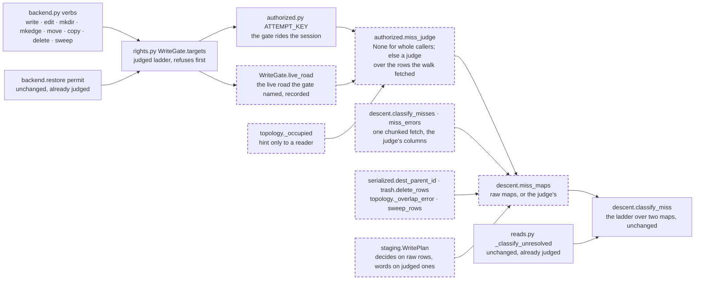

# A miss beneath a row the caller cannot read answers as a miss beneath nothing: every explanation a mutating verb gives after its gate walks the target's ancestors judged by the caller's rights, and a transfer's tombstoned occupant names its deletion only to a caller who may read it

A first draft, awaiting its spec review; it is not yet fit to build. It records one small permission-correctness defect and proposes its fix, so the defect is not lost while the fix that found it lands. It touches rights in the sense the shape names: no grant, view, ladder or gate rule changes, but the wording of a mutating verb's refusal changes for a caller with partial rights, so the security lens is mandatory in both reviews and criteria 1 to 7 are leak tests. It is not structural: no module, public class, protocol method, verb, parameter, seam or result shape is added or removed. It changes no public API, no schema, no stored byte and no Rust. It touches the gate's size baseline in two held entries, `rights.py` and `writes.py` (decision 12). It needs no new engine-leg criterion: every statement it changes keeps its shape and its binds (decision 11), and its conformance rows run on the server legs wherever their URLs are set. It comes from no intention and stands on no research memo: the defect was named while [a mutation is authorized for the rows it acts on at its commit point](2026-11-14-a-mutation-is-authorized-for-the-rows-it-acts-on-at-its-commit-point.md) was reviewed, and every fact below was read or executed for this draft. It is written against that spec's tree, `lane/descent` at `a220182e` (local `main` at `844ef423` plus that fix), and is meant to be built after that fix lands, since it edits the module that fix adds.

## The problem

Every claim is labelled. EXECUTED runs used Python 3.13 through `uv run` on the in-memory backend and on a SQLite file, from five scratch probes kept in the session scratchpad and not in the repository: `state_probe.py` (the twin worlds, every verb), `analyze.py` (its summary), `listing_probe.py` (what listing shows), `cost_probe.py` (statement counts through `before_cursor_execute`) and `compile_probe.py` (the fetch compiled for five dialects). No server engine was run. Line numbers are those of `a220182e`.

**Two words first.** A *miss* is a refusal a verb gives because the path it was sent names no live row: `not_found` at the first component that is missing, or `wrong_kind` at an ancestor that is a file. A *miss explanation* is the walk that chooses those words: it reads the target's chain of ancestors, shallowest first, and stops at the first one that fails. A row is *hidden* from a caller when the caller may not list it: it holds no grant over it, does not own it, and its everyone label is below `list`. The *trashed hint* is the `data` a miss at a deleted row carries, `vfs.trashed: true` and `vfs.deleted_at`, the time of the delete, so that an agent knows `restore` applies (READ, `descent.py:115-117`, keys in `results/kinds.py:21-23`).

**The law.** READ. The house rule, which [the scan tier spec](../archive/2026-11-12-the-scan-tier-reveals-nothing-about-rows-a-caller-cannot-read.md) restates from the grants spec, is that nothing a caller can observe (a score, a statistic, a count, a truncation, an error) may change with the existence of a row it cannot read. For a miss the rule has a sharp form, which the gate's docstring states: a target or ancestor the caller cannot name answers `not_found` exactly as an absent one does (`rights.py:692-704`). The trashed hint has its own form: it "rides only on a tombstone the caller may read" (`rights.py:660-666`).

**Where the rule is kept today.** READ. Two ladders already keep it. The write gate, `WriteGate.targets`, fetches each target's chain with the rights columns and classifies a refusal against what the caller may name: `Visibility.seen_kinds` keeps the live rows the caller may list, the live directories on its road (a hidden directory that leads to a row the caller may name), and the root; `Visibility.tombstones(rows, "read")` keeps the tombstones the caller may read (`rights.py:645-671`, `:734-763`, `:930`, `:944`); `WriteGate.missing` is the same ladder for one target (`rights.py:857-869`). The read verbs classify their misses through `_classify_unresolved` over the same two maps (`reads.py:961-996`). Restore's per-target `permit` answers a target the caller cannot see through `WriteGate.missing`, and rewords any ladder verdict that names an ancestor the same way (`backend.py:797-827`).

**Where it is not kept.** READ. After the gate passes, six places explain a miss again from rows they read themselves, and none of them consults the caller's rights:

- `classify_misses` (`descent.py:65-84`) selects `path`, `kind` and `deleted_at` for the targets and their ancestors (`:78`) and classifies against every live row and every tombstone it finds. It is reached from `miss_errors` (`descent.py:120-132`) in `edit_rows` (`writes.py:303`), from mkedge's missing endpoints (`edges.py:156`), from a transfer's missing source (`topology.py:172`), and from sweep's missing path (`trash.py:383`).
- `dest_parent_id` classifies a transfer's destination parents from a raw fetch (`serialized.py:257-276`, the classify at `:274`).
- `delete_rows` classifies a missing target from its raw snapshot (`trash.py:157-161`, `:183`, `:190`), and `_overlap_error` does the same for a move's overlapping sources (`topology.py:259-273`).
- The write plan's own ladder words its refusals from the plan's raw read: `parent_gate` puts the trashed hint on a deleted ancestor (`staging.py:253-259`), `put_file` on a deleted directory at the target (`:303-305`), `put_dir` and `mkdir_rows` on a deleted row at the site (`staging.py:338-341`, `writes.py:263-264`).
- `_occupied` answers a transfer onto a tombstoned destination with `exists` and the trashed hint, the occupant's deletion time, whatever the caller may read (`topology.py:276-281`).

The missing check is the same in each: the walk never asks whether the caller may list a row before it names the row's kind, and never asks whether the caller may read a tombstone before it states its deletion time.

**Reachable without a race: one shape, ten call forms.** EXECUTED, `state_probe.py`. The probe builds twin worlds through the public verbs. In each, `alice` holds `read_write` on `/alice` and `bob` on `/bob`; the root posture is `none`, `/bob` is `none`, and `/alice` takes each posture level in turn. World one holds alice's hidden rows; world zero is identical without them. Three shapes: *sibling*, where alice's `/alice` holds a live directory with a child, a live file, a deleted file and a deleted directory with a child, and bob holds nothing there; *road*, the same with bob granted `read_write` on `/alice/pub`, so `/alice` is on his road; *owner*, where bob owns `/alice/proj/mine.txt` inside alice's private `/alice/proj`, his row was deleted first (its time set to 2026-01-01) and alice then deleted `/alice/proj` (its time set to 2026-02-02 in world one and 2026-03-03 in world zero). For every probe path at and beneath each hidden row (14 paths in the first two shapes, 5 in the third) the probe calls 26 call forms as bob and as anonymous: read, stat, ls, tree, glob twice, grep, search, write with and without `parents`, edit by path and by observations, mkdir with and without `parents`, mkedge and rmedge with the path as target and as source, move and copy with the path as destination and as source, a directory moved onto it, delete, restore and sweep. Each Result is compared field for field across the twins: `success`, every error's `kind`, `message`, `path` and `data`, and each observation's path, kind, status and deletion time.

- Posture `none`, sibling and road shapes: 728 calls as bob on each backend and 364 as anonymous on the in-memory backend; **every one answers identically in the two worlds**. The gate refuses first and its ladder is already judged. So a miss at or beneath a hidden live directory, a hidden file (including a path that treats it as a directory), a hidden deleted file or a hidden deleted directory reveals nothing, on every verb, read or mutating, to a named caller or to anonymous.
- Posture `none`, owner shape: 130 calls on each backend, **10 differ**, the same 10 on both backends. Each is a call at bob's own deleted row: write, write with `parents`, edit by path, edit by observations, mkedge from it, move from it, move onto it, a directory moved onto it, copy onto it, delete. Each answers `not_found` at `/alice/proj` with `vfs.trashed: true`, `vfs.deleted_at` equal to the hidden folder's deletion time (2026-02-02 in one world, 2026-03-03 in the other) and `vfs.target` the path sent.
- The same path through `stat` and `restore` answers `not_found` at `/alice` with only `vfs.target` (EXECUTED, `listing_probe.py`). mkedge with the path as target, copy from it and mkdir answer through the gate and name only bob's own row with his own deletion time; rmedge from it and sweep of it succeed.
- Posture `list` at `/alice`: alice's rows are listable but not readable. In all three shapes as bob, and in the sibling shape as anonymous, **no answer carries a trashed hint for a row the caller may not read** (EXECUTED, the probe's leak check finds none).
- Postures `read`, `add`, `contribute` and `read_write` at `/alice`: every row there is readable by everyone, so nothing is hidden and the property has nothing to hold; the twins differ only by the rows bob may now see (EXECUTED, recorded, not a finding).

How the ten forms get there. READ. Bob's gate passes each because the target is a tombstone he may list and revive, judged "as a restore of the row" (`rights.py:938-942`), and his chain is "seen" because the gate puts a hidden directory, live or deleted, on the road through the trash view when a deleted row he may name lies beneath it (`rights.py:747-751`). The verb then explains the miss itself, raw: edit, mkedge and move-from through `classify_misses`, the transfers onto it through `dest_parent_id`, delete through its snapshot, and write through the plan's `parent_gate`. Each walk reaches the deleted `/alice/proj` and states its deletion.

**How small it is.** EXECUTED and INFERRED. What is revealed is one timestamp: when a deleted folder the caller may not list or read was deleted. The folder's path and kind are not new. The trash view already shows it to bob as a bare directory, path and kind only, because his row lies beneath it (EXECUTED, `listing_probe.py`: `stat /.vfs/trash/alice/proj` succeeds with `kind` and `path` alone). Who learns it: a named caller who owns, or holds a grant on, a deleted row whose ancestor is a deleted folder hidden from it. How: by any ordinary mutating call at its own deleted row. The time is new only when the folder was deleted after the caller's row. A cascade delete leaves an earlier-deleted descendant's own time and root (READ, `trash.py:480-489`); deleted together, the two times are equal and nothing is learned. No file body, no content hash, no size, no owner and no path is revealed. Anonymous learns nothing. The read verbs reveal nothing.

**Reachable with a race: the code review's narrower sequence.** READ and INFERRED. The same six walks run after the gate. On an engine whose statements each read the latest commit, a rival can change a hidden ancestor between the gate and the walk. One example: the rival deletes it, or replaces a directory with a file. The walk then states that row's kind or deletion. The fix's code review reached the defect this way. Its finding L8 is relayed by the session lead and is not in the worktree copy of the review file (EXECUTED, `grep` of that file at `a220182e` finds no L8). The `_occupied` half is in that spec's Landing notes, "Flagged to Clay" (READ). It is safe today only because the gate in front of it refuses a creation where the caller could not read the occupant: a creation passes where the caller's spans cover the path or the everyone label reaches `add`, and either admits `read` (READ, `grants.py:477-498`, `ops.py:143-167`; EXECUTED, no hint at `none` or `list`). It is safe by its caller, not on its own.

**What it costs today.** EXECUTED, `cost_probe.py`. The raw walk issues one `SELECT` per chunk of targets with their ancestors. One target at depth 1, 3, 4 or 8 is one statement, and so is a batch of 1,200 missing targets three deep, at SQLite's runtime membership budget of 32,668. The gate's refusal of bob's edit beneath a hidden directory costs 6 statements: the fetch, the road, the posture rows. The judged ladder run the way `WriteGate.missing` runs it costs 4 statements beneath a hidden directory: the fetch, then three road reads. It costs 1 where the chain holds no hidden directory, and 4 for the batch of 1,200, because a road read is per call, not per target. An edit at `/alice/file.txt/s/n.txt`, end to end, issues 11 statements as bob, refused at the gate, and 3 as the system actor, refused by the walk; the system actor's single-target walk also shows the session's `BEGIN`, which is not the walk's.

**What already pins it.** READ. Present behaviour that must not move:

- The judged ladders: `tests/support/grants_contract.py`, `test_a_hidden_row_reads_exactly_as_a_missing_one`, `test_a_hidden_row_refuses_an_edit_as_missing`, `test_a_write_under_a_hidden_directory_is_not_found`, `test_a_deleted_row_stays_hidden_from_everyone_who_could_not_see_it`, `test_restore_refusals_name_only_the_path_the_caller_sent` and `test_a_restore_never_names_a_deleted_parent_the_caller_cannot_see`. The last is this defect's shape on restore, already fixed there.
- The whole caller's hints: `tests/storage/database/test_trash.py`, `test_a_tombstoned_row_reads_as_absent_with_the_trashed_hint` and `test_a_tombstoned_ancestor_is_not_found_for_every_parent_gate`; `tests/support/storage_contract.py`, `test_a_deleted_row_holds_its_address_against_a_transfer` and `test_a_delete_under_a_deleted_directory_is_not_found_at_the_directory`.

No test calls a mutating verb as a partial caller at a deleted row beneath a hidden deleted folder (READ, `grep` of `tests/` for the shape). No test reaches `_occupied` as a partial caller. No test compares a miss beneath a hidden row with a miss beneath nothing over every verb.

## Architecture

Dashed is what this spec adds or changes. Nothing is retired.

## Decisions

### 1. The property: a miss a mutating verb explains after its gate, for a caller whose rights are partial, equals field for field the miss it would explain if every row the caller may not list were absent, and it carries the trashed hint only at a tombstone the caller may read

Reason: this is the gate's own rule, "hidden reads exactly as absent", carried past the gate. The read verbs, the gate and restore already keep it. Stated once: for a caller whose rights are not whole, the Result of any verb at a path at or beneath a row the caller may not list is identical to the Result in a store without that row; and no Result states a field of a row the caller may not read, a tombstone's deletion time included. The twin form is what the criteria test, over every verb and every hidden shape, on both backends. Where a twin without the row cannot exist (bob's own row lies beneath the hidden folder), the twins differ only in the hidden row's own fields.

### 2. The walk names a row only when the caller may name it, and stops at the first row it may not, answering there exactly as where nothing exists

Reason: a single rule, the one `WriteGate.missing` already applies, so the mutating verbs answer what `stat` and `restore` answer for the same path. Walking the chain shallowest first, a row is a step when it is the root, a live row the caller holds `list` on, or a live directory the gate recorded on the caller's live road (decision 3). Any other row reads as absent. The walk stops there with `not_found` at that component, carrying `vfs.target` as today, and the trashed hint only when the row is a tombstone the caller holds `read` on. A row the caller may name keeps today's words: `wrong_kind` at a live file ancestor, the hint at a readable tombstone. In the owner shape, the ten forms then answer `not_found` at `/alice` with only `vfs.target`. That is what `stat` and `restore` answer today (EXECUTED, `listing_probe.py`). The walk decides nothing: it only words a refusal the verb has already chosen to give. Rejected: stopping at the deleted folder itself, `not_found` at `/alice/proj` without the hint. It names the same path the trash view shows, but it disagrees with `stat` and `restore` for the same path, and one path should have one answer. Rejected: keeping the gate's trash-road walk, which would pass the deleted folder and name bob's own row with his own time. That is the gate's wording for mkedge-to, copy-from and mkdir. But it says the folder is live, so the agent would try `restore`, and restore refuses at `/alice`.

### 3. The road is the gate's own record: `WriteGate.targets` records the live road it named, and the walk reads it, never the road again

Reason: the road costs statements, and the gate has already paid them. `seen_kinds` returns the live rows and the live-road directories the caller may name (`rights.py:645-658`). `targets` gains one statement that adds the road directories to a set on the gate, before the trash-road augmentation at `:747-751`. The walk counts a recorded path as named only while the fresh row there is a live directory, so a rival that replaced it with a file or deleted it after the gate gets no `wrong_kind` and no hint. The gate fetched every chain the walk reads: the targets for edit, delete, sweep and write; sources and destinations for the transfers; both endpoints for the edge verbs. A path the gate never fetched is not recorded, so it reads as absent, which is safe. One case is a parent minted by an earlier pair of the same batch. It is the caller's own row or one the caller moved, so it passes on `list` alone (INFERRED from `authorized.py:351-379` and the owner floor). Rejected: running `WriteGate.missing`'s road reads in the walk. That is 3 more statements beneath a hidden directory (EXECUTED), more than the chain's depth for a target two deep, plus one per owner arm. Rejected: a road derived only from the rows in the walk's own chain. It costs nothing and edits nothing in `rights.py`, but it names fewer directories than `stat` does when the road's witness lies off the chain.

### 4. `_occupied` is safe on its own: a tombstoned occupant the caller may not read answers plain `exists`, with no hint and no time

Reason: `exists` says only that a row stands at the path, which the creation rule admits by design ("a creation is judged by coverage alone, never by what occupies the name", `rights.py:699-701`). The deletion time is a field of the row, and it is the caller's to see only when it may read the row. The occupant read gains the two rights columns when a judge exists, and `_occupied` takes `hinted: bool` from the judge. A whole caller and a reader keep today's answer. Rejected: answering `not_found` there, as the gate does for a tombstone the caller may list but not read (`rights.py:938-940`). It is safe too, but it would change the transfer ladder's `exists`-first order, which the conformance contract pins (`test_move_onto_an_occupied_destination_is_exists_before_kind`).

### 5. The write plan decides on its raw rows and words its misses on the judged ones

Reason: the plan is pure and holds no session (`staging.py:1`), and what it decides must not move: a hidden file ancestor still refuses, and an absent ancestor still mints under `parents`. Only the words of a refusal change. `write_rows`, `mkdir_rows` and `edit_rows` build the plan with `misses = miss_maps(committed, miss_judge(session))`, computed once from the read the plan already makes. `_fetch_committed` already selects `owner_id` and `everyone_level` (READ, `writes.py:326-334`). `parent_gate` words a refusal as `classify_miss(target, misses.kinds, misses.tombstones)`. `put_file`'s deleted-directory refusal and the two site-tombstone refusals carry the hint only when `misses.tombstones` holds the path. The occupant answers on a live row, `exists`, `wrong_kind` and `unchanged`, are unchanged: they say a row of some kind stands there, which the gate's creation rule admits. The fix's own code review recorded that as no finding (READ, its Landing notes).

### 6. The system actor, an admin write and every caller whose rights are whole see exactly what they see today

Reason: a whole caller may read every row, so the raw walk tells it nothing it may not know. The hint is the house's guidance toward `restore` (READ, `descent.py:22-32`). `miss_judge` returns `None` when no gate rides the session or the gate is whole. `judging` already draws the same line (`authorized.py:252-257`). With `None`, every walk fetches exactly the columns it fetches today and builds exactly today's maps. Criterion 8 holds the existing whole-caller nodes.

### 7. Anonymous is judged as its gate judges it: no road, no owner floor, the labels alone

Reason: anonymous's view never derives a road (`rights.py:556-558`, `:725`), and its rights carry no owner arm (`grants.py:611-612`). Its gate refuses `unauthenticated` at the addressed path before any walk runs wherever the posture gives everyone less than the verb's rung (`rights.py:391-401`). The judge for anonymous therefore records no road and names only rows everyone may list. EXECUTED: anonymous's answers are identical across the twins today at every posture where rows are hidden.

### 8. The read verbs and restore are in the criteria and out of the code

Reason: they already keep the property. The point reads classify through `_classify_unresolved` over the view's maps (`reads.py:961-996`), and restore's `permit` rewords through `WriteGate.missing` (`backend.py:813-826`). EXECUTED: zero differences on read, stat, ls, tree, glob, grep and search in every shape; traverse was not probed, and its seeds pass through the same view (READ, `backend.py:369-420`). Criterion 1 runs them anyway, so a later change to them cannot reopen the gap unseen.

### 9. One judge, one pair of maps, one ladder: `descent.miss_maps` is the only place a miss walk's maps are built

Reason: the raw maps are built by hand in six places today. They are `descent.py:75-83`, `trash.py:160-161`, `trash.py:232-233`, `topology.py:155-156`, `serialized.py:272-273` and the plan's `kind_of` and `tombstone_of`. Each is a place a judged answer could be forgotten. `miss_maps(rows, judge)` returns the raw maps when `judge is None` and the judge's otherwise. Every walk named in The problem calls it, and `classify_miss`, the pure ladder, is unchanged. `descent.py` cannot import the rights code, because `rights.py` imports `descent.py`. So `descent.py` declares the judge as a `Protocol`, holding the columns it needs and the maps it builds, and `authorized.py` supplies the one implementation.

### 10. The cost is no added statement on any path, and a miss explanation never costs more statements than its chain is deep

Reason: a miss is per verb call, and the explanation is the cheapest part of a refusal. The judged walk issues the statements the raw walk issues today: one `SELECT` per chunk of targets with their ancestors. It adds two selected columns, `owner_id` and `everyone_level`, and only for a partial caller. It judges each fetched row in memory with `Rights.admits`, as `admit_targets` does. The road comes from the gate's record (decision 3). So one target at depth *d* costs one statement, never more than *d*, and a batch costs one statement per chunk, as today. The bound is a property of the shape: the walk reads the chain once, bounded by `membership_budget`, and a statement per chain row is the most any walk could need. `_occupied` adds two columns to a point read it already issues, and the plan adds none. Rejected: any design whose statement count grows with the depth or with the rows judged.

### 11. Never assume SQLite: the judged fetch is the chunked membership select it already is, compiled for the five profiles at a full chunk

Reason: the in-list cap SQLAlchemy does not model binds on Oracle at 1,000 and SQL Server at 2,000. The changed statements add columns and no bind. EXECUTED, `compile_probe.py`: the judged fetch at a full chunk binds exactly one parameter per path, the same count as today's. That is 32,734 on SQLite, 32,735 on Postgres, 2,000 on SQL Server, 65,503 on MariaDB and 1,000 on Oracle; the bind caps here are the probe's inputs, and on SQLite the runtime's measured budget is 32,668. Criterion 10 pins this on every profile. No statement compares a timestamp or a label in SQL; the judgment is in memory.

### 12. No module is added; the judge lives in `authorized.py`, the maps in `descent.py`, and two held entries move by what the build measures, within the bounds below

Reason: `authorized.py` is the module whose job is "what a mutation proves between its gate and its commit". It already reads the attempt's gate from the session and imports the rights code (READ, `authorized.py:1-12`, `:49-56`). Every module named here is in the `vfs.storage.backends` unit of `LAYERS` (`tests/lint/test_code_shape.py:43-62`), so no import crosses a rung. The import that would form a cycle, `descent.py` importing the rights code, is avoided by decision 9. Sizes by `wc -l` at `a220182e`: `descent.py` 248, `authorized.py` 413, `rights.py` 1,540 (held, entry 1540), `writes.py` 1,294 (held, entry 1294), `staging.py` 473, `topology.py` 565, `serialized.py` 335, `trash.py` 668, `edges.py` 584. The bounds: `rights.py` ends at most 2 lines above its count and `writes.py` at most 4, each `MODULE_LINE_BASELINE` entry set to its file's count. Every other module stays under the 1,000-line ceiling. Reason for the bounds: `rights.py` gains one attribute and one line in `targets`; `writes.py` gains the plan's maps and the judge at its one `miss_errors` call.

### 13. Each law lands with its mutant as a row of the mutant ledger: J1 to J9

Reason: the property holds by the judge being passed at each site, and a site that drops it is silent. Each row below names the one-line mutation and the node that kills it; the build proves each kill on a scratch copy under the safe-restore rule, and the ledger records the count.

### 14. The race the code review named is closed by the same walk and pinned at the fix's own seams

Reason: the walk judges the rows it fetches after the gate, so a rival that deletes a hidden ancestor between the gate and the walk is worded over the caller's rights too. On SQLite and in memory the rival is staged on the attempt's own session at the existing seams, `write:before-snapshot` and `mkedge:before-resolve`. This is the house pattern for a window no public call reaches (READ, `seams.py:1`; the fix spec's decision 12). No new seam is added.

### 15. No server-specific criterion; the conformance rows run on the server legs wherever their URLs are set, and the code review runs them through `db_test`

Reason: the change adds columns to statements whose shape, chunking and binds are unchanged (decision 11). Its answers do not depend on isolation, except the race nodes, which on SQLite stage the rival on the attempt's own session. The fix's server criteria already execute the commit-point windows. A server-only race node would test that fix again, not this one.

Flagged to Clay. Six items are this draft's recommendations, made the decisions above; each stands unless the developer rules otherwise before the spec review. First, severity: the race-free reach is one timestamp, a hidden deleted folder's deletion time, to a caller who holds a deleted row beneath it, through ten mutating call forms; no body, no path, no kind, nothing for anonymous. The draft ranks it low and fixes it as a defect rather than carrying it in the Out list. Second, decision 2 makes the ten forms answer `not_found` at the first hidden live ancestor (`/alice`), as `stat` and `restore` do, rather than naming the deleted folder with no hint, which an agent might find more useful. Third, decision 3 adds one attribute to `WriteGate` in `rights.py`, a held module, so the walk reuses the gate's road: two lines in place of three statements per miss. Fourth, decision 4 keeps the transfer's `exists`-first order, so an unreadable tombstoned occupant answers plain `exists`, while the gate answers `not_found` at a tombstone the caller may list but not read; the two ladders differ in wording, and both are safe. Fifth, the code review's finding L8 is restated here from the session lead's relay, because the worktree copy of that review at `a220182e` does not hold it; its own text belongs in that review's Disposition when the fix lands. Sixth, this draft stays untracked and linked from nowhere until it is reviewed, because it describes an unfixed weakness.

## Intent

After this spec, a caller with partial rights who writes, edits, makes a directory or an edge, moves, copies, deletes or sweeps, and is refused because the path names no live row, is told exactly what it would be told if every row it may not list were absent. No refusal names the kind of a row it may not list, and no refusal states the deletion time of a row it may not read. A move or copy onto a deleted row it may not read says only that the name is taken. Callers whose rights are whole, the system actor and admin writes see today's answers, hint and time included. The read verbs and restore, which already keep the property, are pinned so it cannot be lost there. Nothing costs a statement more.

## Design

**Tests first.** Every node in the criteria is written and run on the tree this spec builds on before any source line changes. Each shows the result its criterion names: the pins pass today, the red nodes fail today.

**`src/vfs/storage/backends/database/descent.py`.** In the module constants: `class MissMaps(NamedTuple)` with `kinds: dict[str, str]` (the live rows a walk may step through, `path → kind`) and `tombstones: dict[str, datetime]` (the tombstones whose hint it may state, `path → deleted_at`). Beside it, `class MissJudge(Protocol)` with `columns: tuple[str, ...]` (the entry columns the judge needs beyond `path`, `kind` and `deleted_at`) and `def maps(self, rows: Mapping[str, Mapping[str, Any]]) -> MissMaps`. In the miss classification group: `def miss_maps(rows: Mapping[str, Mapping[str, Any]], judge: MissJudge | None) -> MissMaps`. Its one-line docstring: the raw maps, every live row and every tombstone, when there is no judge; the judge's otherwise. `classify_misses(session, entry, targets, profile, membership_budget, *, judge: MissJudge | None)` selects `judge.columns` beside its three when a judge is given, and builds its maps through `miss_maps`. `miss_errors(..., *, judge: MissJudge | None)` passes it through. `judge` is a required keyword, so every call site states its choice. The module docstring gains one sentence: a judged walk names only what the caller may name. About 30 lines.

**`src/vfs/storage/backends/database/rights.py`.** `WriteGate.__init__` gains `self.live_road: set[str] = set()`, commented as the live-road directories this gate named, which a later miss walk may name too. `WriteGate.targets` adds, right after `seen = await self.view.seen_kinds(session, rows)`, the line `self.live_road.update(path for path in seen if path in rows and not self.view.shows(rows[path]))`. Two lines; entry 1542.

**`src/vfs/storage/backends/database/authorized.py`.** In "The rows a verb finds after its gate", `def miss_judge(session: AsyncSession) -> MissJudge | None`. It returns `None` with no gate on the session or a whole gate, and otherwise `_JudgedMisses(attempt.gate)`. `_JudgedMisses` is a private frozen class beside it, with `columns = ("owner_id", "everyone_level")`. Its `maps` keeps, as `kinds`, the root, every live row the gate's view `shows`, and every live directory in `gate.live_road`; and, as `tombstones`, every tombstone the view `holds` at `read`. Its docstring states decision 2's rule term by term. About 35 lines.

**Call sites.** Each gains `judge=miss_judge(session)` or routes its hand-built maps through `miss_maps`:

- `writes.py`: `edit_rows`'s `miss_errors`, and the plan's `misses` in `write_rows`, `mkdir_rows` and `edit_rows`. `mkdir_rows`'s site-tombstone refusal at `:263-264` reads the hint from `plan.misses`.
- `staging.py`: `WritePlan.__init__` takes `misses: MissMaps`. `parent_gate`, `put_file` and `put_dir` word their refusals from it, as decision 5 says.
- `edges.py`: `mkedge_rows` at `:156`.
- `topology.py`: the source miss at `:172`; `_overlap_error` over `miss_maps(committed, judge)`; the occupant read with the judge's columns; and `_occupied(dest, occupant, *, target, hinted: bool)`.
- `serialized.py`: `dest_parent_id(..., *, judge: MissJudge | None)` and `fetch_snapshot(..., extra: Sequence[str] = ())`.
- `trash.py`: `delete_rows`'s snapshot maps, and `sweep_rows` at `:383`. The restore ladder is unchanged (decision 8).

No call site gains a statement.

**Tests.** `tests/storage/database/test_descent.py` is new, the mirror of `descent.py`, which has none today. The contract rows go in `tests/support/grants_contract.py`, which runs on the in-memory, SQLite-file and server legs. The race nodes go in `test_writes.py` and `test_edges.py`, the `_occupied` node in `test_topology.py`, the judge's node in `test_authorized.py`, and the record's node in `test_rights.py`. The twin worlds are built by one helper in `grants_contract.py`, named in its module docstring, the way `_world` is.

## Scope

In: decisions 1 to 15. Source: `src/vfs/storage/backends/database/descent.py`, `authorized.py`, `rights.py` (`WriteGate.__init__`, `WriteGate.targets`), `writes.py` (`write_rows`, `mkdir_rows`, `edit_rows`), `staging.py` (`WritePlan.__init__`, `parent_gate`, `put_file`, `put_dir`), `edges.py` (`mkedge_rows`), `topology.py` (`transfer_rows`, `_overlap_error`, `_occupied`), `serialized.py` (`fetch_snapshot`, `dest_parent_id`), `trash.py` (`delete_rows`, `sweep_rows`). Tests: `tests/storage/database/test_descent.py` (new), `tests/support/grants_contract.py`, `tests/storage/database/test_writes.py`, `test_edges.py`, `test_topology.py`, `test_authorized.py`, `test_rights.py`. Records: `tests/lint/allowlist.py` (two entries), `context/standards/mutant-ledger.md` (rows J1 to J9).

Out. Listed under "Out" below.

## Acceptance criteria

Counts and states, never clocks. "Twin worlds" means two stores built by the same calls, one with the hidden rows and one without, or differing only in a hidden row's own fields. "Equal" means equal `success`, equal errors by `model_dump(exclude={"source"})` in order, and equal observations by path, kind, status and deletion time. Every `grants_contract.py` node runs on `TestMemoryConformance` and `TestSqliteConformance`, and on the server classes when their URLs are set.

1. `tests/support/grants_contract.py::GrantsContract::test_a_miss_beneath_a_row_the_caller_cannot_read_answers_as_a_miss_beneath_nothing`: the sibling and road twin worlds at posture `none`, the 26 call forms of The problem, each of the 14 probe paths, as bob and as anonymous. For every call the Result for a path at or beneath a hidden row equals, field for field, the Result for the same path beneath nothing. A pin: passes today (EXECUTED, 728 calls as bob per backend and 364 as anonymous, 0 differ).
2. `…::test_a_miss_beneath_a_hidden_deleted_folder_names_no_fact_of_it`: the owner twin worlds at posture `none`, the 26 call forms, the 5 probe paths, as bob. Every call's Result is equal across the twins. Each of the ten forms at `/alice/proj/mine.txt` answers exactly one `not_found` at `/alice` whose `data` is `{"vfs.target": "/alice/proj/mine.txt"}`, the same error `stat` gives for that path. Red today: the ten answer `not_found` at `/alice/proj` with `vfs.trashed` and the hidden folder's `vfs.deleted_at`, and differ across the twins (EXECUTED).
3. `…::test_a_tombstone_the_caller_may_list_but_not_read_carries_no_hint`: the three shapes at posture `list` on `/alice`, every call form and probe path, as bob, and the sibling shape as anonymous. No error carries `vfs.trashed` or `vfs.deleted_at` for a row under `/alice` other than bob's own. A pin: passes today (EXECUTED).
4. `tests/storage/database/test_writes.py::TestMissesAreJudged::test_an_edit_whose_hidden_ancestor_is_deleted_after_its_gate_names_no_deletion`: bob holds `read_write` on `/alice/pub` and edits `/alice/pub/x.txt`. At `write:before-snapshot`, on the attempt's session, `/alice` and its subtree are stamped deleted. The edit answers one `not_found` at `/alice` with only `vfs.target`. Red today: the hint and `/alice`'s deletion time (INFERRED from `descent.py:65-84`; the red run is its first execution).
5. `tests/storage/database/test_edges.py::TestMissesAreJudged::test_an_mkedge_whose_hidden_ancestor_is_deleted_after_its_gate_names_no_deletion`: the same staging at `mkedge:before-resolve`, bob's edge from `/alice/pub/x.txt` to `/bob/f.txt`. The same answer, and red today the same way.
6. `tests/storage/database/test_topology.py::TestOccupied::test_a_tombstoned_occupant_names_its_deletion_only_to_a_reader`: `_occupied` over a tombstoned occupant row. With `hinted=False` it answers `exists` with no `vfs.trashed` and no `vfs.deleted_at`; with `hinted=True` it answers today's error. Red today: `_occupied` takes no `hinted`. A gate-level twin is criterion 3's transfer-onto rows, which pass today.
7. `tests/storage/database/test_authorized.py::TestMissJudge::test_a_recorded_road_directory_is_named_only_while_it_is_a_live_directory`: a judge whose gate recorded `/alice` on the road names `/alice` over a fetched live directory there; over a live file, or a tombstone, there it does not; and `miss_judge` is `None` for the system actor and for a whole gate. Red today: no `miss_judge`.
8. The whole caller is unchanged; these existing nodes stay green unedited: `test_trash.py`'s `test_a_tombstoned_row_reads_as_absent_with_the_trashed_hint` and `test_a_tombstoned_ancestor_is_not_found_for_every_parent_gate`; `storage_contract.py`'s `test_a_deleted_row_holds_its_address_against_a_transfer` and `test_a_delete_under_a_deleted_directory_is_not_found_at_the_directory`; `grants_contract.py`'s `test_a_restore_never_names_a_deleted_parent_the_caller_cannot_see`. And `grants_contract.py::GrantsContract::test_the_system_actor_is_told_the_hidden_folders_deletion`: in the owner world the system actor's edit at `/alice/proj/mine.txt` answers `not_found` at `/alice/proj` with `vfs.trashed` and the folder's deletion time. A pin: passes today (EXECUTED).
9. `tests/storage/database/test_descent.py::test_a_judged_miss_issues_the_statements_a_raw_one_does`: in the owner world, the `SELECT` statements `classify_misses` issues for bob's gate (judged) and for the system actor (raw) are counted. One target is 1 statement each; three targets three deep with `membership_budget` patched to 2 give equal counts on both; no judged statement reads the entries beneath a path (no road read). Red today: no `judge` keyword.
10. `tests/storage/database/test_descent.py::test_the_judged_walk_binds_one_per_path_on_every_profile[sqlite]`, `[postgresql]`, `[mssql]`, `[mariadb]`, `[oracle]`: the judged fetch compiled with that dialect over a full chunk at the profile's `membership_budget` binds exactly the chunk's paths, as the raw fetch does. Red today: no judged fetch.
11. `tests/storage/database/test_descent.py::test_miss_maps_without_a_judge_are_the_raw_maps`: over a hand-built row map, `miss_maps(rows, None)` equals the maps today's comprehensions build. Red today: no `miss_maps`.
12. `tests/storage/database/test_rights.py::TestWriteGate::test_the_gate_records_the_live_road_it_named`, a new class: bob's gate over `/alice/pub/x.txt` records `/alice` in `live_road`, and records neither a row he may list nor a directory on the trash road alone. Red today: no `live_road`.
13. `uv run pytest tests/lint -q -n 0 -p no:cacheprovider`: green with `rights.py`'s and `writes.py`'s entries at their measured counts within decision 12's bounds, and no other module over the ceiling.

Ledger rows the build adds to `context/standards/mutant-ledger.md`, each proven killed on a scratch copy:

- J1: `edit_rows` passes `judge=None` to `miss_errors`. Killer: criterion 2, the edit forms.
- J2: `mkedge_rows` passes `judge=None`. Killers: criterion 2, the mkedge form, and criterion 5.
- J3: the transfer's source miss passes `judge=None`. Killer: criterion 2, move-from.
- J4: `dest_parent_id` builds raw maps. Killer: criterion 2, move-onto, copy-onto and the directory onto it.
- J5: `delete_rows` builds raw maps. Killer: criterion 2, delete.
- J6: `parent_gate` words from the plan's raw rows. Killer: criterion 2, the two write forms.
- J7: `_JudgedMisses.maps` keeps every tombstone. Killers: criteria 2 and 7.
- J8: `_JudgedMisses.maps` drops the `live_road` term. Killer: criterion 7, the live-directory case.
- J9: `_occupied` ignores `hinted`. Killer: criterion 6.

### Out

- The gate's own wording of a refusal at a deleted row beneath a hidden deleted folder. mkedge-to, copy-from and mkdir walk past the folder on the trash road and name the caller's own row with its own time. That is safe, and it is not this property's breach.
- The occupant answers on a live row (`exists`, `wrong_kind`, `unchanged`) that write, mkdir and a transfer give. They say a row stands there, which the creation rule admits by design.
- The restore ladder's trash-root hint, already reworded by its `permit`.
- The read verbs' ladder.
- A posture relabel's holes, where a stored label is not trusted. The judge reads the gate's compiled rights, which already carry the holes, so it inherits their treatment unchanged.
- Any change to what a caller may list or read.

## Landing notes

Filled in on landing.

## One line

After its gate, a mutating verb that explains a miss now walks the target's ancestors judged by the caller's own rights, using the road its gate already named. So a refusal beneath a row the caller cannot see reads exactly like a refusal beneath nothing, and no refusal states a deletion time the caller may not read. Whole callers see what they see today, and no statement is added.
