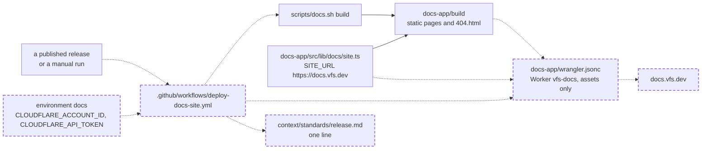

# A release or a manual run deploys the docs from this repository to docs.vfs.dev, and deploys nothing else

A placeholder spec. It records the decisions that can be made now for the owner's fourth requirement and it waits on three things: [the docs site spec](2026-11-14-the-docs-site-is-a-svelte-app-in-this-repository-built-from-the-design-system.md) landing, on which it depends and which is built on dev and not yet landed; the `vfs.dev` zone reaching the owner's Cloudflare account; and [the placeholder memo](../../research/2026-11-14-the-smallest-token-that-deploys-one-static-assets-worker-with-its-custom-domain.md), decision 5. It is not fit to build until the memo is answered, this spec is completed from it, and the completed spec is reviewed. It is a feature that is structural: it adds a deployment, a workflow and a deploy key to a public repository, so the security lens runs in both of its reviews. It changes no public API, no schema format and no engine code. There is no intention; it comes from the owner's requirements of 2026-11-14 and from the review that cut it out of the docs site spec. This spec was amended to dev on 2026-11-25, at `27f3d24d`: dev's build names the host, so decisions 1 and 6 and criterion 2 now say where the host is named and hold that the two names agree. Nothing has run for it: the memo's experiment has not been made, the `docs` environment and its secrets do not exist, and nothing has been deployed. No spec review exists for it yet, so the first one reads this amended text.

## The problem

READ, the owner on 2026-11-14: "4. I want to be able to "deploy" the docs from this repo as part of a release or seperate deployment and have them reach production without having to deploy anything else", and "2. I want vfs.dev to be a seperate repo not in this one that is private". He confirmed the address `docs.vfs.dev`, and said the same day: "I am actively moving the vfs.dev domain to cloudflare".

READ in [the docs site spec](2026-11-14-the-docs-site-is-a-svelte-app-in-this-repository-built-from-the-design-system.md), decisions 20 and 21, and at `27f3d24d`, where that spec is built and not yet landed: `scripts/docs.sh build` leaves a folder of static files in `docs-app/build`, with a `404.html` the static adapter writes (`scripts/docs.sh:7`, `docs-app/vite.config.ts:30-31`), built to be served from the root of its host, and nothing in this repository publishes it. READ at `27f3d24d`: the only documentation deployment is `.github/workflows/deploy-docs.yml`, which publishes the older site built from `docs/` to GitHub Pages; `.github/workflows/docs-site.yml` is the docs app's check, runs on a push to `main` and on a pull request, and deploys nothing. `documentation/maintainers/how-we-work.md:74` says `documentation/` is published "to docs.vfs.dev", which states the intent and not a deployment.

READ in [the spec review of the docs site spec](../../reviews/2026-11-14-the-docs-site-is-a-svelte-app-in-this-repository-built-from-the-design-system-spec-review.md), findings M1 and H3: the deployment is a landing of its own because its first run waits on the domain, and a deploy key whose permissions are chosen at the landing is a security choice reviewed by nobody. READ at `27f3d24d` in [the docs site spec](2026-11-14-the-docs-site-is-a-svelte-app-in-this-repository-built-from-the-design-system.md), decision 39, and in its build: the build names the host. `SITE_URL = "https://docs.vfs.dev"` is one constant in `docs-app/src/lib/docs/site.ts:7`, and every page's canonical link (`docs-app/src/routes/+page.svelte:24`, `docs-app/src/routes/[...route]/+page.svelte:18`), the sitemap (`docs-app/src/routes/sitemap.xml/+server.ts:8`) and `robots.txt` (`docs-app/src/routes/robots.txt/+server.ts:7`) are built from it, pinned by `docs-app/tests/build.test.ts:130-144`. READ in [the docs app memo](../../research/2026-11-14-a-svelte-app-built-from-the-design-system-renders-the-docs-and-the-api-export-as-static-pages.md), last section: no deployment has been made.

What is missing, then: a way to publish the built docs to the product's own domain from this repository alone, with a key that can do that and no more.

## Architecture

Solid is what exists once the docs site spec has landed. Dashed is what this spec adds. Nothing is retired.

Page this changes: none; the architecture folder was retired on 2026-10-31.

Terms. A **static-assets Worker** is a deployment on Cloudflare that serves a folder of files and runs no code. A **custom domain** is a hostname of a zone that the host joins to one Worker. The **deploy key** is the API token the workflow deploys with. A protected **environment** is a named set of secrets in the repository host that a job must be allowed into.

## Decisions

### 1. The site is hosted as a static-assets Cloudflare Worker named `vfs-docs`, with `docs.vfs.dev` as its custom domain

The owner is moving `vfs.dev` to Cloudflare, and the design system already ships this kind of configuration for its own preview: an assets-only Worker in a file of three settings. A subdomain is its own deployment, so publishing the docs touches nothing else, and the key that deploys it need reach nothing but the docs. The host is named in two places, and they must agree. This spec names it here, as the Worker's custom domain. The build already names it, as `SITE_URL` in `docs-app/src/lib/docs/site.ts`, the one constant every page's canonical link, the sitemap and `robots.txt` are built from (READ at `27f3d24d`, `site.ts:7`). That departs from this spec's draft of 2026-11-14, which said the build names no host; the docs site spec's decision 39 records the same departure from its own decisions 1 and 21, for that one constant and nothing else. A Worker on any other domain would serve pages that each name `docs.vfs.dev` as their one address, so a change of host is a change to both files in one commit, and criterion 2 fails when they differ.

### 2. `docs-app/wrangler.jsonc` configures the Worker and holds no code

It names the Worker, a compatibility date, the assets directory `./build` and the custom domain. It has no entry point, so nothing runs on a request. `.gitignore` gains `docs-app/.wrangler/`, the tool's local state.

### 3. A published release deploys the docs, and so does a manual run

`.github/workflows/deploy-docs-site.yml` runs on `release: published` and on `workflow_dispatch`. A release is when the docs must match the package; a manual run is the "separate deployment" of requirement 4, for a docs-only fix between releases. It checks out this repository, installs uv and bun as `docs-site.yml` does at `27f3d24d`, bun at the version it pins, 1.4.4, runs `scripts/docs.sh build`, and then has exactly one step that deploys, from `docs-app`.

### 4. The secrets are `CLOUDFLARE_ACCOUNT_ID` and `CLOUDFLARE_API_TOKEN`, held in an environment named `docs`, and the workflow reads the repository and nothing more

The job runs in the environment `docs`, as `publish.yml` runs in `pypi` (READ at `27f3d24d`, `.github/workflows/publish.yml:96`), so the secrets are reachable only from that job and the owner can require an approval there. The workflow declares `permissions: contents: read`. A pull request from a fork cannot reach either secret, because neither trigger is a pull request.

### 5. The deploy key's permissions, the deploy step's tool and the not-found setting are chosen by the placeholder memo, and this spec waits on it

What the key may do is the one security choice here, and it cannot be made well before one deployment has been tried: [the placeholder memo](../../research/2026-11-14-the-smallest-token-that-deploys-one-static-assets-worker-with-its-custom-domain.md) names the experiment, which finds the smallest set of permissions that deploys one Worker and keeps its custom domain, on the account and on the `vfs.dev` zone alone. The same experiment records the deploy tool and its version, which fixes the deploy step, and the Worker setting that serves `404.html` for an address that matches nothing. When the memo is completed, this decision is rewritten to state all three.

### 6. A deploy names no other repository and no other site

The workflow has no step that checks out or dispatches to another repository, and no host name appears in it: the host is named only in `docs-app/wrangler.jsonc`, as the Worker's custom domain, and in `SITE_URL`, which the build carries into the pages, and the workflow neither sets nor overrides either. The private site is not read, built or notified, which is requirement 2 and the last clause of requirement 4.

### 7. The release standard says that publishing a release also publishes the docs

`context/standards/release.md` gains one line, so the person cutting a release knows a second deployment follows and where to look when it fails.

### 8. The redirect from `vfs.dev/docs` and the retirement of the GitHub Pages site are not this spec's

The redirect lives in the private site's repository. The older site built from `docs/` stays published until `docs.vfs.dev` is live and has search; the docs site spec's scope names that later spec.

## Intent

After this spec, publishing a release of vfs, or starting one workflow by hand, puts the current docs at `docs.vfs.dev` within that workflow's run, and changes nothing else anywhere. The key that does it can deploy that one Worker and keep its domain, and nothing more.

## Design

The change lands as one commit, tests first. `tests/scripts/test_docs_site.py` gains the two checks of criteria 1 and 2 and the ignore check of criterion 3. Then `docs-app/wrangler.jsonc`, `.github/workflows/deploy-docs-site.yml`, the `.gitignore` line and the line in `context/standards/release.md`. The environment `docs` and its two secrets are made by the owner in the repository host's settings before the first run; the landing notes record that they exist and never their values. The first deployment is run by hand from `main` after the landing commit, and its result is recorded in the landing notes.

## Scope

In: decisions 1 to 8. Files: `docs-app/wrangler.jsonc` and `.github/workflows/deploy-docs-site.yml` (new); `tests/scripts/test_docs_site.py` (three checks); `.gitignore`; `context/standards/release.md`.

Out. Everything the docs site spec builds: the app, the export, the check workflow. The redirect from `vfs.dev/docs` and the private site. Retiring the site built from `docs/` and its workflow. Previews of a pull request's docs at an address of their own. Versioned docs.

## Acceptance criteria

1. `tests/scripts/test_docs_site.py::test_the_deploy_workflow_builds_then_deploys_only_the_docs`: parsed as YAML, `deploy-docs-site.yml` runs on a published release and on a manual run and on nothing else; declares `permissions: contents: read`; its job names the environment `docs`; a step running `scripts/docs.sh build` comes before the deploy step; exactly one step deploys, from `docs-app`; no step has a `repository` input; and the file holds no host name, so the build it runs takes the host from `SITE_URL` alone.
2. `tests/scripts/test_docs_site.py::test_the_worker_serves_the_build_and_runs_no_code`: parsed, `docs-app/wrangler.jsonc` names the Worker `vfs-docs`, points its assets at `./build`, names `docs.vfs.dev` as its one custom domain, and has no entry point; and that domain is the host of `SITE_URL` as `docs-app/src/lib/docs/site.ts` declares it, so the Worker and the build name one host.
3. `tests/scripts/test_docs_site.py::test_the_deploy_tool_leaves_nothing_tracked`: `.gitignore` ignores `docs-app/.wrangler/`.
4. The landing notes record, EXECUTED by the account's holder after the landing commit: one manual run of the workflow that exited 0; that `https://docs.vfs.dev/` answered 200 with the landing page; that an address matching no page answered 404 with the not-found page; and the deploy key's permission names, equal to the list the completed memo gives.

## Landing notes

Filled in on landing.

## One line

Once the domain is on Cloudflare and one trial deployment has named the smallest key, a release or a manual run publishes the built docs to `docs.vfs.dev` from this repository and touches nothing else.
