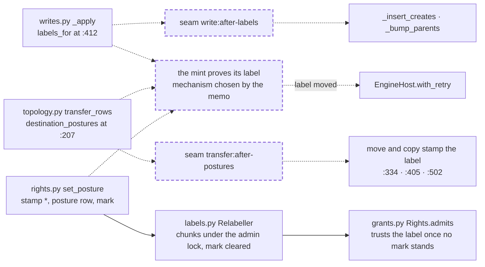

# A row minted across a posture change carries the label the standing posture gives: every mint proves its label against a posture change committed inside its window, on every engine and for the system actor

A placeholder spec. It records a confirmed defect and the decisions that can be made now. Its mechanism waits on [the placeholder memo](../../research/2026-11-14-a-mint-must-prove-its-label-against-a-posture-change-committed-inside-its-window.md), decision 4, and it is not fit to build until that memo is answered, this spec is completed from it, and the completed spec is reviewed. It is a fix that touches rights and needs the engine legs: no grant, view or ladder rule changes, but a stored label decides what a partial caller may read, so the security lens is mandatory in both reviews. It comes from the release audit run `vfs-run-1-2026-11-07`, whose needs-validation lead, fingerprint `vfs/storage/database/labels:mint-reads-posture-outside-revision-lock-stale-everyone-level`, was named open on Postgres and MariaDB under Out by [a mutation is authorized for the rows it acts on at its commit point](../archive/2026-11-14-a-mutation-is-authorized-for-the-rows-it-acts-on-at-its-commit-point.md), and was confirmed by an engine run on 2026-11-14. No intention: the work is one property across the mint paths. It describes a weakness that is not fixed, so it stays out of the public tree until the fix lands, as does its memo. It depends on nothing unlanded.

## The problem

Labels: READ means read in the file cited, at `3dcc8ebf`; EXECUTED means a command ran and the claim reports its output; INFERRED means reasoning. The engine results below were EXECUTED by the session lead on 2026-11-14 on the lane `lane/label` at `6644c60f`, which is `main` at `3dcc8ebf` plus one work-in-progress commit holding the reproducing node, and which is not on `main`. The author of this text ran no probe and no engine leg.

**What a label is.** READ. Each entry row stores `everyone_level`, a copy of the rank the deepest everyone posture on its path gives: `0` none up to `5` read_write (`src/vfs/storage/backends/database/labels.py:1-11`). The posture rows are the truth; the label is derived. A partial caller's read seeks the label through the `(everyone_level, path)` index instead of carrying every posture in its predicate. A mint stamps it when the row is created. A write, a mkdir and every parent a write creates take it from `labels_for` (`labels.py:152-164`), one plain read of the posture rows on the batch's ancestor prefixes, called at `src/vfs/storage/backends/database/writes.py:412` as the first statement of `_apply`; the inserts follow at `:413` and the guarded parent bumps at `:444`. A copy and a move take it from `posture_beneath` (`labels.py:167-180`): read at the gate for a partial caller (`src/vfs/storage/backends/database/authorized.py:185`, held on the attempt at `:186` and reused at `:199-205`) or at `src/vfs/storage/backends/database/topology.py:207` otherwise, and stamped at `topology.py:334`, `:405` and `:502`.

**What a posture change does.** READ. The posture verb bumps the mount revision first (`src/vfs/storage/backends/database/backend.py:1317`), stamps the everyone principal `*`, writes the posture row and plants a relabel mark (`src/vfs/storage/backends/database/rights.py:1099-1101`). Then the relabel rewrites the labels in the posture's region, one chunk per transaction, each under the admin lock (`labels.py:272-296`), and clears the mark with a revision bump on its last chunk (`:293-294`); the posture call drives it to the end (`backend.py:1326-1353`). While the mark stands, every reader compiles the region as a cover or a hole and ignores the label there. Once the mark is cleared, readers trust the label: `Rights.admits` passes a row whose label reaches the rung unless its path lies in a hole (`src/vfs/storage/grants.py:485-498`).

**The defect.** The mint's label read at `writes.py:412`, and the transfer path's at `topology.py:207` and `authorized.py:185`, has no guard that orders it against a posture write. The mint takes no lock that the posture write or the relabel takes, and nothing re-proves the label before the commit. The relabel's statements do not find a row an uncommitted mint inserted (INFERRED from each engine's documented visibility of uncommitted rows). So a mint that read the posture before the posture write committed, and commits after the relabel cleared its mark, keeps the old label, and no relabel rewrites it. Said simply: the row is labelled with a posture that no longer stands, and readers believe the label.

**The engine run.** EXECUTED by the session lead, the node `tests/storage/database/test_races.py::TestRightsAtCommit::test_a_row_minted_across_a_posture_tightening_is_no_more_open_than_the_standing_posture[<engine>-<shape>-<minter>]`, 24 legs: four server engines; three shapes, the tightened posture at the path the write creates (`at-path`), at a directory the same write creates (`at-minted-parent`), and at the existing parent the write bumps (`at-existing-parent`); two minters, a caller granted `read_write` on `/p` (`granted`) and the system actor (`system`). The rival tightens everyone to `none` and drives the relabel to its end at the seam `write:before-apply` (`writes.py:364`).

| Engine | `at-path` granted | `at-path` system | `at-minted-parent` granted | `at-minted-parent` system | `at-existing-parent` granted | `at-existing-parent` system |
|---|---|---|---|---|---|---|
| Postgres | fails | fails | fails | fails | passes | passes |
| MariaDB | fails | fails | fails | fails | passes | passes |
| SQL Server | passes | passes | passes | passes | passes | passes |
| Oracle | passes | passes | passes | passes | passes | passes |

Each failure is the label assertion with no relabel mark standing: `{'/p/new.txt': 5} != {'/p/new.txt': 0}` at `at-path`, and `{'/p/n': 5, '/p/n/new.txt': 5}` where the standing posture gives 0 at `at-minted-parent`. `at-existing-parent` passes on Postgres and MariaDB because the relabel rewrote the parent row, so the write's guarded parent bump met a snapshot conflict and the write ran again from a fresh snapshot.

**Why the commit-point fence does not close it there.** Writes on Postgres and MariaDB run at `REPEATABLE READ` (READ, `src/vfs/storage/backends/database/dialects.py:512`, `:582`). Every plain read in the attempt sees the snapshot of its first statement. So the fence's read of the stamps (`authorized.py:228-244`) comes from the same snapshot as the stale posture read and agrees with it by construction. The system actor is never fenced (READ, `authorized.py:140`).

**Why the SQL Server and Oracle passes are partial.** The rival commits at `write:before-apply`, which runs before the label read (READ, `writes.py:364`, `:412`). On those engines each statement reads the latest commit, so the label read already sees the tightened posture. For the granted caller the fence also sees `*` stamped and redrives (READ, `authorized.py:243`): a real pass. For the system actor it is not a real test: no seam sits between the label read and the insert, so the window was never entered. With a seam there, a failure in every shape is predicted, since under `READ COMMITTED` the guarded parent bump still matches after the parent's label was rewritten (INFERRED, the node's author). A granted caller there keeps a narrower window, a posture committed after the fence's read and relabelled before the mint's commit (INFERRED).

**The transfer path.** Move and copy stamp from a posture read taken at `READ COMMITTED` on every engine (READ, `dialects.py:513`, `:585`; `topology.py:207`), and the same ordering gap holds there (INFERRED; the audit's trace names it). It has not been staged on any engine.

**Restore and the relabel.** Restore keeps the stored label and writes no `everyone_level` (READ, `src/vfs/storage/backends/database/trash.py:511-549`); the relabel reaches tombstoned rows, which keep their path (READ, `labels.py:35-37`). So restore stamps nothing and is not a mint path (INFERRED). The relabel reads the posture rows under the admin lock (READ, `labels.py:298-310`), so it is the reference, not a mint.

**What a wrong label exposes.** As far as established. Once no mark stands, a named caller holding no grant at the minted path, a group member whose groups hold nothing there, and any other partial caller judged through `Rights.admits` pass a row whose stored label reaches the rung (INFERRED from `grants.py:491`): so `read`, `glob`, `grep` and `search` can return a row the standing posture closes to everyone. The node asserts those refusals, but its label assertion fails first on Postgres and MariaDB, so the reader exposure itself was not executed. An anonymous `read` stays refused, because it is judged from the posture rows and not from the label (reported by the node's author, not executed here). The other direction, a mint across a posture loosening, keeps the closed label it read, and the row stays hidden from callers the standing posture admits: an availability defect, not a leak (INFERRED). What repairs a wrong label today: `rebuild_labels` has no caller in `src/` (READ, a search of `src/`); a later posture write at the same path relabels its region from the posture rows and would rewrite it (INFERRED from `labels.py:298-310`).

## Architecture

Dashed is what this spec adds, its mechanism left to the memo. Nothing is retired.

Page this changes: none; the architecture folder was retired on 2026-10-31.

Terms. A **mint** is any statement that creates an entry row or gives a row a new path, and with it a label: a write's or mkdir's insert, the parents a write creates, a copy's insert, a move's rewrite. The **label read** is the read of the posture rows a mint stamps from. A mint's **window** is the span from its label read to its commit. The **standing posture** of a path is what the posture rows as they stand give it, `label_of` over them. A **mark** is a relabel's in-flight row in `vfs_relabels`; while one covers a path, readers ignore the label there.

## Decisions

### 1. The property: once no relabel mark stands over a path, every row at that path carries the label the standing posture rows give it, whatever was in flight when the posture changed

Said simply: a reader that trusts a label is never told a posture that no longer stands. Any mint whose window a posture change commits inside either stamps the label of the posture as it stands when the mint commits, or does not commit and runs again. The property covers both directions: a label more open than the standing posture (a leak) and one more closed (a row hidden from callers the posture admits). It is the property the commit-point spec's decision 1 leans on: that spec's judgments read stored labels and are as strong as them, and this spec makes them the posture's.

### 2. Every mint path is in scope, the transfer path and the system actor included

The write family's mints (write, mkdir, the parents a write creates) and the transfer path's (copy's inserts and move's rewrites, stamped from `posture_beneath`) all carry a label read with no ordering guard (The problem). The system actor is in scope even though its rights never change, because the label is not its rights: it is what every other caller's read is judged by later. Restore is not a mint, because it keeps the stored label and the relabel reaches tombstones; it is pinned so a later change that makes restore restamp is caught (criterion 6). The relabel itself and `rebuild_labels` read the posture rows under the admin lock and are the reference.

### 3. The fix is pinned on all four server engines, and two new seams sit between each label read and the statement that stamps it

The windows are open, if anywhere, on the server engines, and the engine decides which are open: Postgres and MariaDB by the snapshot, SQL Server and Oracle by the statement. So every criterion that stages a rival runs on all four legs, and the SQLite and in-memory legs pin that their windows stay closed. The existing seam `write:before-apply` sits before the label read, so on a read-committed engine it cannot enter the window (The problem). The write family gains `write:after-labels`, between `labels_for` and `_insert_creates` (`writes.py:412-413`); the transfer path gains `transfer:after-postures`, between `destination_postures` and the move or copy that stamps from it (`topology.py:207-208`). Each is one line, a no-op with no handler (`src/vfs/storage/backends/database/seams.py:40-51`).

### 4. The mechanism is chosen by the placeholder memo, and this spec waits on it

How a mint proves its label cannot be chosen yet: the four candidate directions differ in which engines they close, which locks they add and what each write pays, and none has been built or measured. The choice waits in [the placeholder memo](../../research/2026-11-14-a-mint-must-prove-its-label-against-a-posture-change-committed-inside-its-window.md), which states the directions, what is known of each one's cost and risk, and the experiment that decides. This spec is completed from its answer: the mechanism becomes a decision here with the rejected directions and their measurements, the Design is written, and criterion 7's bound is filled in. Until then the spec is not fit to build.

### 5. The mechanism is admitted only if it is bounded: a constant number of statements per mint attempt, never per row, no writer waiting on another writer, and no new lock cycle

About 1,050,000 file writes a day pass through a mint, about 50 a second through the nightly batch, and one statement landing on one hot row is a serialization point at that rate (READ, `AGENTS.md`, the reference deployment). A mechanism that makes writers wait on each other turns every write into a turn at one row. A posture write is an admin act, rare beside the writes, so it may wait for mints in flight; mints may not wait for each other. The lock orders that stand today, an admin write on the revision row then the `*` stamp, a relabel chunk on the revision row then entry rows, a topology verb on its serialize row then entry rows, a write on entry rows in path order, and the fence on no lock (READ, the memo), are the orders the mechanism must not cross; the completed spec states the order it adds and what holds it.

### 6. The reproducing node lands with the fix and not before

The node is red on two engine legs today, and the tree stays green (`AGENTS.md`, the project stage). So it waits on the lane, uncommitted to `main`, and lands in the fix's one commit with the code that turns it green. The tests-first rule still holds: the build runs every criterion's node on the unfixed tree first and records the result per engine and per node for the Landing notes, as the commit-point spec's decision 14 did.

### 7. The audit's record cites this fix when it lands

The release audit's record for the fingerprint above cannot land while the defect is open. When this fix lands, its Landing notes give the engine results before and after, per engine and per node, as EXECUTED, and the audit's record cites this spec and those notes, so the record can add its paragraph, as the commit-point spec's decision 14 had the audit's records cite its notes.

### 8. No repair verb is added; a row already wrong is rewritten by the next posture write over it

The design is pre-release and no deployment holds wrong labels to migrate (`AGENTS.md`, the project stage). A posture write at a path relabels its whole region from the posture rows (INFERRED from `labels.py:298-310`), which rewrites any label the defect left there. A caller for `rebuild_labels`, a whole-corpus write, belongs to the maintenance verbs' own spec and is not made here.

Flagged to Clay. Two items. First, decision 3 adds two seams, not one: the transfer path's posture read for the system actor sits after the existing `transfer:post-collect` (`topology.py:206-207`), so that seam cannot enter the transfer window on a read-committed engine, and a second seam is the only way to stage it. Second, the commit-point fence leaves a granted caller on SQL Server and Oracle a narrow window, a posture committed after the fence's read and relabelled before the mint's commit (INFERRED, The problem); this spec counts it inside its property and the memo's experiment stages it, so the SQL Server and Oracle `granted` passes are not read as proof that those engines are closed.

## Intent

After this fix, a caller who reads beneath a posture an admin just tightened sees nothing that posture closes, even for a file that was being written, copied or moved while the posture changed. The label a row carries is the posture's, on every engine, for every writer, the system actor included. A posture loosened while a file is written leaves that file readable by everyone the posture now admits. A write that nothing races costs what the memo's measurement says and no more than its bound.

## Design

The Design is written when the memo answers (decision 4). What is fixed now is below.

**Tests.** Every node in the criteria lives in `tests/storage/database/test_races.py::TestRightsAtCommit`, beside the commit-point spec's nodes, and uses that class's worlds and `_audit` (`tests/support/commit_worlds.py`). The existing node from the lane, with its helpers `_relabel_marks`, `_standing_labels`, `_Tightening`, `_TIGHTENINGS` and `_MINTERS`, is carried into the build unchanged except for the seam parametrization criterion 2 adds.

**Seams.** `write:after-labels` in `_apply`, one line after `writes.py:412`; `transfer:after-postures` in `transfer_rows`, one line after `topology.py:207`. `writes.py` is a held module at its baseline, 1,294 lines (READ, `tests/lint/allowlist.py:30`); the seam is one of the lines it gains, and the completed spec states the rest, where they live, and the entry's new count. `backend.py` (1,511) and `rights.py` (1,540) are held too (READ, `allowlist.py:27-28`); the completed spec states what each gains, and the mechanism's code lives outside them where it can, on the database adapter's rung of the ladder in `tests/lint/test_code_shape.py`.

**Scale.** Costed against [the reference deployment](../../../AGENTS.md#the-reference-deployment-the-scale-every-idea-is-filtered-through). The multiplier is per file write, about 1,050,000 a day, and per batch, 100 a night of 10,000 files: the mechanism runs once per mint attempt, so its cost is its statements times about a million a day and its contention is whatever it makes about 50 writers a second share. The posture write is per admin act, and its wait for mints in flight is bounded by the longest mint, a 10,000-file batch. Today's counts the cost pin is measured against are the commit-point spec's: a new file costs 10 statements by the system actor and 14 by a named caller, a 10,000-file batch with parents 39 and 43 (READ, that spec's Design, EXECUTED there on SQLite before its fence landed); the build re-measures them on the tree it starts from.

**Mutant ledger.** The build adds one row to `context/standards/mutant-ledger.md` per law criteria 1 to 8 pin, each naming the one-line mutation of the mechanism that breaks it and the node that kills it; the rows are named when the mechanism is.

## Scope

In: the write family's label read at `writes.py:412`; the transfer path's at `topology.py:207` and `authorized.py:185`; the two seams; the mechanism the memo chooses; the nodes below; the ledger rows; the `writes.py` baseline entry.

Out. The commit-point fence's own rule, which this spec reads and does not change. A repair verb or a caller for `rebuild_labels` (decision 8). The rights cache's key. The read verbs' per-attempt rule. The two integrity windows of [the delete and move placeholder memo](../../research/2026-11-14-a-child-committed-inside-a-delete-or-a-move-can-be-left-behind-its-parent-on-a-read-committed-engine.md). A first-touch check of MariaDB's snapshot isolation, which the commit-point spec's decision 18 names as its own change. A topology isolation pin for the generic floor.

## Acceptance criteria

1. `tests/storage/database/test_races.py::TestRightsAtCommit::test_a_row_minted_across_a_posture_tightening_is_no_more_open_than_the_standing_posture`, its 24 legs `[<engine>-<shape>-<minter>]` at the seam `write:before-apply`: every leg passes. Today (EXECUTED by the session lead, 2026-11-14): `postgres` and `mariadb` fail `at-path` and `at-minted-parent` for both minters, 8 legs, with stored label 5 where the standing posture gives 0; they pass `at-existing-parent`, 4 legs; `mssql` and `oracle` pass all 12.
2. The same node parametrized over the seam as well, with `write:after-labels` added beside `write:before-apply`: its 24 legs at the new seam pass. It shows the system actor's window on SQL Server and Oracle, which the first set never entered; today it is predicted to fail every `system` leg on `mssql` and `oracle` (INFERRED, the node's author) and the eight legs criterion 1 names on `postgres` and `mariadb` (INFERRED from criterion 1).
3. `…::TestRightsAtCommit::test_a_row_moved_or_copied_across_a_posture_tightening_is_no_more_open_than_the_standing_posture`, legs `[<engine>-<verb>-<minter>]` for `move` and `copy`, both minters, all four engines: at `transfer:after-postures` a rival tightens everyone to `none` at the destination's parent and drives the relabel to its end; the transfer is refused with `permission_denied` or a retryable `conflict` and leaves no row, or succeeds and every row it created or moved carries the standing posture's label with no mark standing; `_audit` passes. Today it is predicted red on all four legs for the system actor (INFERRED from `dialects.py:513`, `:585`).
4. `…::TestRightsAtCommit::test_a_row_minted_across_a_posture_loosening_is_no_more_closed_than_the_standing_posture`, legs `[<engine>-<shape>-<minter>]` as criterion 1's at both seams: the rival loosens everyone from `none` to `read_write`; every minted row carries label 5 once no mark stands, and a caller holding nothing but the posture reads the target. Today it is predicted red where criteria 1 and 2 are (INFERRED).
5. In criteria 1 to 4, wherever the call succeeds, a named caller with no grant at `/p` (`carol`), a member of a group that holds nothing at `/p`, and anonymous are each refused `read` of the target, and find none of the minted rows by `glob`, `grep` or `search` under `/p`, each refused or hiding as the node's `hidden` set allows; under the loosening of criterion 4, each of the three named and group callers reads the target.
6. `…::TestRightsAtCommit::test_a_restored_row_carries_the_label_the_standing_posture_gives`, legs `[<engine>]`: a file deleted, its parent's posture tightened and relabelled, then the file restored, carries the standing posture's label; today predicted green on all four (INFERRED from `trash.py:511-549`, `labels.py:35-37`).
7. A counted cost pin, `tests/storage/database/test_writes.py::TestLabelCost::test_a_mint_proves_its_label_in_a_constant_number_of_statements`, on SQLite and on the four legs: statements counted by a `before_cursor_execute` listener for one new file by the system actor and by a named caller, and for a 10,000-file batch with parents, each at most the count the build measures on the tree it starts from plus the bound the completed spec takes from the memo's measurement; the 10,000-file count exceeds the one-file count by no more than today's does, so nothing is added per row.
8. A lock-order pin, `tests/storage/database/test_races.py::TestRightsAtCommit::test_mints_posture_writes_relabel_chunks_and_a_purge_finish_without_a_deadlock`, legs `[<engine>]`: 16 concurrent writers of 50 files each under `/p`, one posture write at `/p` with its relabel run to its end, and one purge of a deleted tree, all beside each other; every call succeeds or returns a retryable `conflict`, no deadlock error reaches a caller, every row's label equals the standing posture's once no mark stands, and `_audit` passes; counted, never timed.
9. On SQLite and the in-memory backend, the nodes of criteria 1 to 4 and 6 pass in their single-writer form, the rival staged on the attempt's own session as the class's existing nodes do, pinning that those windows stay closed.

## Landing notes

Filled in on landing.

## One line

A file written, copied or moved while an admin tightens a posture can keep a label more open than the posture, confirmed on Postgres and MariaDB; every mint must prove its label, and how waits on a placeholder memo.
