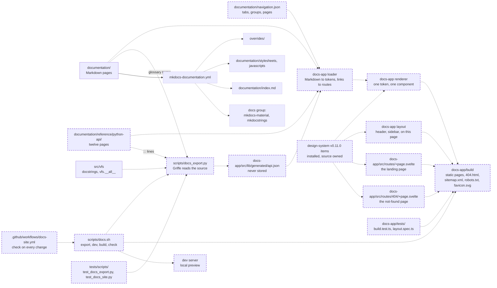

# The docs site is a Svelte app in this repository, built from the design system, previewed here and checked on every change

A feature that is structural and parallel-safe: it adds a top-level folder with its own toolchain, one export script, one workflow and two test files, and it retires the MkDocs build of `documentation/`. It changes no public API, no schema format, no rights rule and no engine code, so it needs no engine legs; five docstrings in three files gain a glossary marker and nothing else under `src/` moves. There is no intention. It comes from the owner's decision of 2026-11-14 to stop building the docs with MkDocs, and from his four requirements, quoted under The problem. It stands on three memos: [a Svelte app built from the design system renders the docs and the API export as static pages](../../research/2026-11-14-a-svelte-app-built-from-the-design-system-renders-the-docs-and-the-api-export-as-static-pages.md), the probe run for this spec's state check; [where the API reference sits on a Diátaxis site and how its pages are shaped](../../research/2026-11-14-where-the-api-reference-sits-on-a-diataxis-site-and-how-its-pages-are-shaped.md); and [how Diátaxis docs sites lay out navigation and group tutorials](../../research/2026-11-12-how-diataxis-docs-sites-lay-out-navigation-and-group-tutorials.md). It depends on no other spec. [The deployment spec](2026-11-14-a-release-or-a-manual-run-deploys-the-docs-from-this-repository-to-docs-vfs-dev.md) depends on this one and carries the hosting, the deploy workflow and the fourth requirement.

## The problem

READ, the owner on 2026-11-14: "I think this is the time where we should get rid of mkdocs and zensical and just build our own docs site. We already have a deisng system and will be hosting a website at vfs.dev, so I don't want to be reliant on mkdocs packages that are not being well maintained". His requirements, in his words: "1. I want to use the design system 2. I want vfs.dev to be a seperate repo not in this one that is private 3. I want to be able to preview the docs page locally in this repo 4. I want to be able to "deploy" the docs from this repo as part of a release or seperate deployment and have them reach production without having to deploy anything else". He confirmed the address `docs.vfs.dev` and that the docs app lives in this repository, and he approved the first draft of this spec.

READ at `7edd8901`: the repository holds two documentation sites. The published one is built from `docs/` by `mkdocs.yml` and `.github/workflows/deploy-docs.yml`, which installs `mkdocs-material` and deploys to GitHub Pages. The new one is built from `documentation/` by `mkdocs-documentation.yml` with Material for MkDocs, a theme folder `overrides/`, one hook, and `documentation/stylesheets/theme.css`. EXECUTED: that stylesheet is 1,136 lines, and 158 of them name Material's own `.md-` classes.

READ in the working tree over `7edd8901`, uncommitted and covered by no spec until this one: mkdocstrings and a second hook that writes API pages (`overrides/api_pages.py`), a Griffe extension for glossary markers (`overrides/docstring_markup.py`), a script and style rules that patch Material's sidebars, a glossary page (`documentation/reference/glossary.md`), `:term:` markers in five docstrings of three files, and a staged deletion of `documentation/introduction.md`.

READ in [the API reference memo](../../research/2026-11-14-where-the-api-reference-sits-on-a-diataxis-site-and-how-its-pages-are-shaped.md), section 10: fixes for Material for MkDocs end on 2027-05-05, its authors call MkDocs unmaintained since August 2024, and their successor does not run a site's hooks. Three of four sites studied on these tools have already left Material.

EXECUTED, recorded in [the probe's results](../../research/studies/2026-11-14-a-svelte-app-built-from-the-design-system-renders-the-docs-and-the-api-export-as-static-pages/experiments/results.txt): the 13 pages of `documentation/` hold 11,374 words and use fenced code in three languages (89 blocks), tables and two images. Outside `index.md` they use no admonition, content tab, footnote, definition list, task list, attribute list, snippet, diagram fence or raw HTML; `index.md` alone holds four lines of raw HTML, two attribute lists, Markdown inside HTML and front matter. The configuration turns on fifteen Markdown extensions.

READ in the design system at tag `v0.11.0` (`../design-system`, Apache-2.0): it is "the tokens, styles and Svelte components of every Pluto Systems product", served as a registry from which an app installs an item and owns its source. Its 75 items include `sidebar`, `breadcrumb`, `code-block`, `table`, `tabs`, `alert`, `collapsible`, `theme`, `marketing-bar` and `marketing-footer`. It has no item for long-form prose, for an "on this page" list, for a docs page layout or for search. The site at `vfs.dev` is a separate, private project that the owner is moving to the same components.

EXECUTED in the probe: a fresh SvelteKit app installed six design-system items in one command, read `documentation/` and a JSON export of the 22 names of `vfs.__all__`, and built 35 static pages. Code was highlighted during the build. The build failed on a link to a missing page and on a link to a missing anchor. The dev server served the same pages. The export read `src/vfs` with Griffe and did not import the package. It counted 298 public members, and 125 public functions and methods with no docstring.

What is wrong or missing, then: the docs are drawn by a tool whose fixes end in under six months and whose successor cannot run this site's build code; they are styled by a stylesheet written against that tool's markup and not by the design system's components; and nothing in this repository can build them as a site of the product's own.

## Architecture

Solid is what exists and stays. Dashed is what this spec adds. Dotted is what it retires. The host and the deploy workflow are drawn by the deployment spec.

Page this changes: none; the architecture folder was retired on 2026-10-31.

Terms. The **docs app** is the Svelte application under `docs-app/` that turns the pages and the export into a static site. The **export** is the JSON file the export script writes, in the shape decision 11 gives. An **API block** is a line of a Markdown page of the form `::: vfs.Name`, which the app replaces with that name's entry from the export. A **route** is the address a page is served at: `documentation/tutorials/use-the-cli.md` is served at `/tutorials/use-the-cli`. A design-system **item** is one installable unit of the registry: a component, a hook, a library file or the theme.

## Decisions

### 1. The docs will be served at `docs.vfs.dev`, an origin of their own, so the app is built to be served from the root of its host

The owner confirmed the address on 2026-11-14. A subdomain is its own deployment, and it keeps pages published from a public repository on a different origin from any signed-in area the product site gains later. What that decides here is small and fixed: every route starts at `/`, the app sets no base path, and no page names its own host, apart from the one address decision 39 puts in a page's head, the sitemap and the robots file. The hosting and the deployment themselves are decision 21's.

### 2. The app lives in this repository under `docs-app/`, and is a SvelteKit application prerendered to static files

Requirement 3 asks for local preview in this repository, which cannot hold if the app lives in the private repository. The stack is the design system's own, because its items are Svelte components: SvelteKit with the static adapter, Tailwind and Vite, run with bun. The versions are pinned exactly to those of the design system's test app at `v0.11.0`, on which the probe built: `svelte` 5.57.3, `@sveltejs/kit` 3.1.0, `@sveltejs/adapter-static` 4.0.0, `@sveltejs/vite-plugin-svelte` 7.3.1, `vite` 8.3.5, `tailwindcss` and `@tailwindcss/vite` 4.3.3, `typescript` 6.0.3, `svelte-check` 4.7.7 and `@playwright/test` 1.64.1; and `marked` 18.2.0. Bun is pinned to 1.4.4, the version the probe ran, in `package.json`'s `packageManager` and in the workflow, which installs with `bun install --frozen-lockfile`. `bun.lock` is committed. The folder holds no Python and is no part of the Python package: the wheel takes its Python from `src/` alone.

### 3. Design-system items are installed from the registry at a release tag, and their source is not edited

This is how the design system is meant to be used: an app installs an item and owns the source. The app installs from `v0.11.0`: `theme`, `sidebar`, `code-block`, `table`, `button`, `separator` and what those bring with them. The first build also installed `alert`, `breadcrumb`, `tabs` and `collapsible`, and nothing used them: decision 6 refuses every token an admonition or a content tab would be written with, the layout of decision 16 has no trail, and decision 37 folds its list with a plain `details` element, so no page can reach them, and they were source that every later tag's diff would carry. The landing removes the four folders, and a later spec that first draws one installs it with the same command. EXECUTED on a scratch copy of the app: no file outside the four folders imports them; the seven folders under `docs-app/src/lib/components/ui/` that belong to none of the ten, `input`, `kbd`, `sheet`, `skeleton`, `spinner`, `status` and `tooltip`, are each imported by one of the six; and with the four removed the build tests, the type check and the browser tests pass. The installed files stay as installed, so moving to a later tag is a re-run of the same command and a diff to read. A change the docs need in an item is made in the design system and installed from its next tag. This is not the copying AGENTS.md forbids under "Reference repos for research". That rule covers clones studied as prior art. The design system is a dependency: it is installed by its own command from its release tag's public address, `REGISTRY_URL=https://raw.githubusercontent.com/plutosystemsco/design-system/v0.11.0/static/r bunx --bun shadcn-svelte@1.7.1 add` followed by the item names and `-y`, never by copying files out of `../design-system`, and it is Apache-2.0 as vfs is. The installed files live under `docs-app/src/lib/` apart from `docs-app/src/lib/docs/`, which is the only app code written here. The tag and the command are written once, in `docs-app/README.md`.

### 4. What the design system lacks is written in the app from its tokens and primitives, in one folder, and named for the design system to adopt

Four pieces have no item today: styles for long-form prose, the "on this page" list, the docs page layout, and the pager at the foot of a page. They live under `docs-app/src/lib/docs/` and use only the theme's tokens and installed primitives, with no colour, size or typeface of their own. Waiting for the design system to grow them first would block the site on another repository. Offering them upstream afterwards is the design system's work and is out of scope.

### 5. Pages stay Markdown files in `documentation/`, and the app reads them at build time

The Markdown pages, the docstrings and the glossary are what survived every change of tool in [the API reference memo](../../research/2026-11-14-where-the-api-reference-sits-on-a-diataxis-site-and-how-its-pages-are-shaped.md), section 4. Keeping the pages plain Markdown, linked to each other by relative paths ending in `.md`, also keeps them readable on the repository host. The app reads the folder through the file system during the build and in the dev server; it holds no copy.

### 6. Markdown is parsed into tokens by `marked`, and each token is rendered by a component, never as a string of HTML

Rendering tokens through components is what puts a fenced block in the design system's `CodeBlock` and a table in its `Table`; a parser that emits HTML would bypass them. `marked` has no dependencies of its own and its lexer returned every token kind the pages use in the probe. By the lexer's own names the renderer accepts `space`, `heading`, `paragraph`, `text`, `escape`, `code` with a fence, `table`, `list`, `list_item`, `blockquote`, `strong`, `em`, `codespan`, `link`, `image`, `hr` and `br`. It refuses every other kind, among them `html`, `del`, `def` and `code` without a fence, and the build fails with the page or the object and the kind named, so nothing can quietly depend on something the renderer does not draw. The same check runs on every docstring of the export.

### 7. The landing page is a Svelte page, and `documentation/index.md` is removed

The landing page is the one page that is layout and not prose: a headline, two sentences, two buttons and a card for each tab after the first. Today it is Markdown wrapped around HTML that only Material understands, and it holds every raw HTML line, attribute list and front-matter block of the docs. Its words move unchanged into `docs-app/src/routes/+page.svelte`, drawn with installed items.

### 8. The navigation is one file, `documentation/navigation.json`, and the build fails when it and the folder disagree

The file carries the tab order and the page order that `mkdocs-documentation.yml` holds today, so that file can go. Its shape is `{"tabs": [{"title": "...", "groups": [{"title": "..." or null, "pages": ["/route", ...]}]}]}`. A group whose title is null is drawn with no heading, which is how a tab with ungrouped pages is written. A tab links to its first page. The landing page is on no list, and the wordmark links to it. A page's title is its one first-level heading, never repeated in the navigation. The build fails when a Markdown file under `documentation/` is on no list, when a list names a route with no file, when a route is listed twice, and when a page has no first-level heading or more than one. That keeps the strictness the MkDocs build had for a page left out of the navigation.

### 9. A route is the page's path without `.md`, and a heading's anchor is made by one rule

`documentation/reference/glossary.md` is served at `/reference/glossary`, with no trailing slash. A file named `index.md` is served at its folder's route. The loader rewrites each relative `.md` link to its route. A heading's anchor is its text in lower case with each run of characters other than `a` to `z` and `0` to `9` replaced by one hyphen, and hyphens at either end removed. A page with two headings of one anchor fails the build. The ids of decision 12 are not made by this rule. The export uses the same rule for glossary terms, and the prerender's missing-anchor failure of decision 19 catches the two if they ever differ.

### 10. Code is highlighted during the build by the design system's highlighter, and a page ships no highlighter

The installed `highlighter` item has a one-shot function made for this, and `CodeBlock.Content` takes its result. The probe's built pages carry the token classes and name no grammar file. A fence whose language the highlighter does not list renders as plain text, which is what `text` fences want.

### 11. The Python API is read from the source by one export script, with Griffe, and the export is never stored

`scripts/docs_export.py` loads `vfs` from `src/` with Griffe and writes `docs-app/src/lib/generated/api.json`. Griffe reads the source and does not import it. It is a library separate from MkDocs, under active development, and it sits behind this one script, so replacing it later touches one file. The export is `{"names": [...], "objects": {"Name": {"kind", "signature", "bases", "doc", "members": [{"name", "kind", "signature", "annotation", "value", "doc"}]}}}`. `names` is `vfs.__all__` in its own order. `kind` is `class`, `module`, `function` or `attribute`. `doc` is Markdown with every marker already replaced. A field with no value is null. The members of a class are its public attributes and functions in source order, with `__init__` folded into the class's own `signature`; the members of a module are the public functions and classes it defines. The export is ignored by git and remade by every preview and check, so a stale copy cannot exist; uv keeps its generated reference pages the same way, as [the API reference memo](../../research/2026-11-14-where-the-api-reference-sits-on-a-diataxis-site-and-how-its-pages-are-shaped.md) records in section 11. The script is a plain function over a source folder and a documentation folder, so a test can feed it a small package.

### 12. API pages are hand-written Markdown files that pull names in with `::: vfs.Name`, and every exported name is documented exactly once

All five sites on these tools in the memo's section 4 keep their API pages as files a person wrote, a sentence or two and the lines that pull docstrings in, and no site generates them. A page is a file under `documentation/reference/python-api/`. A page's title is its first-level heading. A name pulled in by an API block is a second-level heading with the id `vfs.Name`, followed by its signature and docstring, and each member is a third-level heading with the id `vfs.Name.member`. A heading inside a docstring is drawn as a bold line and gets no id. So a link names an object and not a page, and a name can move between pages without breaking a link. The export fails when a name of `vfs.__all__` is on no page, when it is on two, and when a page names something `vfs.__all__` does not export. Griffe's own project checks its list in both directions the same way.

### 13. A large class has a page to itself and small related names share one: twelve files for the 22 names

The memo's section 5 found that no site gives a one-member name its own page and that a page per member multiplies pages by fifteen to nineteen. The files, in the order the navigation lists them, are `index.md`, a hand-written index by topic with one line per name; `async-virtual-file-system.md`, `virtual-file-system.md`, `entry.md` and `path.md`, one class each; `sessions.md` for `AsyncSession` and `Session`; `results.md` for `Result` and `ResultError`; `authority.md` for `Authority` and `Principal`; `permissions.md` for `PermissionMap`, `PermissionsPayload` and `permissions`; `mounts.md` for `MountInfo`; `storage.md` for `DatabaseStorage` and `InMemoryStorage`; and `errors.md` for the six error classes. The grouping is this spec's reading of the product. Regrouping later is moving a line between two files, and decision 12's check holds through it.

### 14. A docstring's `:term:` marker becomes a link to the glossary, an unknown term fails the export, and a code role becomes inline code

The owner chose marked terms on 2026-11-14. The export reads the glossary's second-level headings as the terms, in either case, turns ``:term:`mount` `` and ``:term:`arms <arm>` `` into links to `/reference/glossary#mount` and `#arm`, and raises an error naming the object and the term when the glossary has no such heading. It raises and does not log, because a logged warning stopped one builder and not the next in the memo's section 9. A role that names code, such as ``:meth:`bind` ``, becomes inline code. The glossary page itself is unchanged in form: one second-level heading per term.

### 15. The Reference tab is grouped by kind of interface, and the API group is named "Python API"

The memo's sections 2 and 3: no source puts the API beside Reference, and the name "API" stops fitting once a command line sits next to it. After this spec the tab has three groups, in this order: Python API, Access Levels, Glossary. A command-line group, a settings group and an error-kinds group join when their pages exist, each one generated page with a heading per item; they are out of scope here.

### 16. The layout is a header of tabs, a left sidebar of the chosen tab's pages, the page, and an "on this page" list, and the two sidebars never move with the page

This is the shape [the navigation memo](../../research/2026-11-12-how-diataxis-docs-sites-lay-out-navigation-and-group-tutorials.md) recommended and the site already has. The header holds the wordmark, the tabs, a link to the repository and the theme switch from the `theme` item. The left sidebar is the design system's `sidebar`, which becomes a drawer on a phone. The "on this page" list shows a page's second-level and third-level headings. Two rules come from defects the owner reported on the MkDocs site on 2026-11-14 and are requirements here: the top of each sidebar stays where it is as the page scrolls, and scrolling inside a sidebar that is taller than the window never scrolls the page. Each sidebar starts directly under the header and sticks there, and each is its own scroll container that keeps its scroll to itself.

### 17. A local SVG image is placed inline, and every other image is refused until one is needed

The two diagrams are drawn for both themes and scope their styles to their own id. Inline, each takes the page's colours and typefaces in every browser; as an image a diagram cannot read the page's tokens. This is what the retired hook `overrides/inline_svg.py` did, moved into the loader. A page that names an image of another type fails the build, since no page has one and the app has no rule for it yet.

### 18. Local preview is one command, `scripts/docs.sh dev`, and the same script builds and checks

`scripts/docs.sh export` runs `uv run --only-group docs python scripts/docs_export.py`, which leaves the project out, so the export compiles no crate. `dev` runs the export and then the dev server, which reloads a page when its Markdown changes; a changed docstring is picked up by running `dev` again. `build` runs the export and the static build into `docs-app/build`. `check` runs `build`, then `bun run check`, the type check, then `bun run test`. Preview needs bun and uv and nothing outside this repository, which is requirement 3.

### 19. The app's checks are the framework's own where it has them, and tests where it does not

SvelteKit's prerender fails by default on a link to a missing page and on a link to a missing anchor, as the probe executed, so the app writes no link checker; one test feeds the build a broken copy of the pages to pin that the default is still in force. The export's rules are pinned in the Python suite, where they run on every change with no JavaScript tool. The app's own rules are pinned by the app's two test files. `build.test.ts` is run by `bun test ./tests/build.test.ts`. `layout.spec.ts` is run by `bun --bun playwright test` against `vite preview` of the built folder, in Chromium only, configured in `docs-app/playwright.config.ts`; the sidebar rules need a browser, and the design system tests its own components the same way. `docs-app/bunfig.toml` keeps `bun test` off `tests/layout.spec.ts`. The `test` script runs the first and then the second.

### 20. The build includes a not-found page, `404.html`, that is a whole page with scripts on and with scripts off

A static host needs a file to answer an address that matches no page, and a reader who follows a stale link meets that file before any other. So it is a page like every other: the route `docs-app/src/routes/404/+page.svelte` is prerendered, the build writes it as `404.html`, and its markup holds the header with every section, the status, one sentence, a link to the landing page and the footer. It reads the same with scripts on and with scripts off, which is the reader decision 39 builds a menu for. The static adapter's `fallback` is not used. The first build used it, and [the spec review of 2026-11-25](../../reviews/2026-11-25-the-docs-site-is-a-svelte-app-in-this-repository-built-from-the-design-system-spec-review.md) found what it writes: an empty shell that a script fills, which showed the header without its sections with scripts on, because the host has no data file for an unknown address, and nothing at all with scripts off; EXECUTED again for this decision, that file is 1,680 bytes. Three things follow from one file being served at every unknown address, however deep. The app sets `paths: { relative: false }`, so every built page names the build's own files from the root, as `/_app/...`, which decision 1's "served from the root of its host" allows; named from the page's own folder, as the first build named them, the stylesheet would be lost two folders down. The page carries `<meta name="robots" content="noindex">`, no canonical address and no place in the sitemap, the one exception to decision 39's "every page's head", because it has no address of its own. And the page holds what it shows, so the browser asks the host for no data file. `docs-app/src/routes/+error.svelte` stays, for the dev server and the preview, and the two routes draw one component, `docs-app/src/lib/docs/NotFound.svelte`. EXECUTED on a scratch copy of the app with those changes, in Chrome for Testing 158: served by a plain static host with status 404 at `/no-such-page` and at `/no/such/deep/page`, with scripts on and with scripts off, each of the four loads showed the title "Page not found · VFS Docs", the header stuck to the top, six section links, the sentence and the link home, with no page error and no request for a data file; the file is 22,022 bytes in the last build, and the build still writes 27 HTML files. Pinned by criteria 24 and 25. Which host setting serves that file is the deployment spec's.

### 21. The hosting and the deployment are a second spec, which waits on the domain

The first draft of this spec carried them, and its review found they are a second landing: the first deployment waits on the owner moving `vfs.dev` to Cloudflare, which has no date; no deployment has been tried; and the one security choice, what the deploy key may do, cannot be made well before one is. Landed together, a finished tree would wait uncommitted on the domain, or land with a workflow that fails on every release. So this spec ends at a build that is plain static files and names no host to deploy to, and [the deployment spec](2026-11-14-a-release-or-a-manual-run-deploys-the-docs-from-this-repository-to-docs-vfs-dev.md) carries requirement 4.

### 22. Every change to the pages, the app or the source is checked by `.github/workflows/docs-site.yml`

It runs `scripts/docs.sh check` on a pull request and on a push to `main` that touches `documentation/`, `docs-app/`, `src/vfs/`, `scripts/docs_export.py`, `scripts/docs.sh`, `pyproject.toml`, `uv.lock` or the workflow's own file. It declares `permissions: contents: read` and installs Chromium before the check. A docstring is a page's content now, so a change under `src/vfs/` is a change to the docs. The Python gate, `scripts/ci.sh`, is unchanged and needs no bun.

### 23. The MkDocs build of `documentation/` is retired with this spec, and the published site built from `docs/` is not

One renderer for one set of pages: keeping `mkdocs-documentation.yml` beside the app would mean every page is checked by two tools with two sets of rules. Removed: `mkdocs-documentation.yml`, `overrides/`, `documentation/stylesheets/`, `documentation/javascripts/`, and `mkdocs-material` and `mkdocstrings` from the `docs` dependency group, which becomes `griffelib>=2.4` alone and is included in the `dev` group so the export's tests run after the documented install. The site built from `docs/` by `mkdocs.yml`, its workflow and the examples the gate runs from `docs/` stay until `docs.vfs.dev` is live and has search; retiring them is a later spec.

### 24. The site makes no request to another host, and has no search yet

Fonts come from the design system's font packages and are served by the site, so a reader's browser contacts no third party, which is what the privacy plugin gave the MkDocs build. Search has no design-system item and no page here depends on it; it is its own spec, and the published site keeps its search until then.

### 25. The build started on the owner's word, before the review's re-read

Decided at the build. The spec review ended "Not yet", every finding was answered in its Disposition and in this text, and the reviewer's re-read was under way when the owner said on 2026-11-14 "We can just start building". The build followed the amended text. The re-read is still owed: the review's standing verdict is its first line until a reviewer signs again, and the landing needs that signature. The built tree was then committed to `main` as `08c372a`, marked in its subject as built and not yet landed, before either review had signed. That departs from the landing standard's rule that a review file never lands after the code, and from this spec's own "the change lands as one commit": the landing is a second commit, which carries both reviews, the landing notes, the move of this file and the changes of the Design's step 5. The decisions grew at the build, so the re-read became a new dated review, [the spec review of 2026-11-25](../../reviews/2026-11-25-the-docs-site-is-a-svelte-app-in-this-repository-built-from-the-design-system-spec-review.md), and its standing verdict is the one the landing needs.

### 26. The first install of the items takes `-o`, so the theme is written into the stylesheet

Decided at the build. Run as decision 3 first gave it, the install left `src/app.css` at one line and no token was defined. The design system's README says the first `add` brings the theme and needs the overwrite flag, and with `-o` the same command wrote the theme's 769 lines. `docs-app/README.md` gives the command with `-o` and says to leave it out afterwards.

### 27. The wordmark keeps the product's own typeface, served by the site

Decided at the build. VFS has no logo, so its name is the mark, set in Saira Stencil bold italic as it is on the site this replaces. The design system's README says each product brings its own identity. The face comes from `@fontsource/saira-stencil` 5.3.0, pinned, so the site still asks no other host for anything. Decision 4's rule, no typeface of their own, is about the four docs pieces and holds for them.

### 28. The "on this page" list is a sibling of the page's column, drawn by the root layout

Decided at the build, on the layout test's first run. Inside the page's column the list stuck to the header until the column ended above the footer, and then it moved: its top went from 72 pixels to above the window at the bottom of the longest page. As a sibling of that column it reaches the bottom of the page, as the left sidebar does, and never has to move.

### 29. A signature is highlighted as the definition it belongs to, and a long one is drawn one parameter to a line

Decided at the build. Highlighted alone, `name(...) -> None` is no Python statement and the grammar coloured the arrow as invalid code. The loader highlights `def name(...): ...` and cuts the two ends off again. A signature longer than 80 characters is broken after its opening bracket and after each top-level comma, so the constructor's eleven parameters read as a list.

### 30. An attribute's value is exported only when the class body assigns it

Decided at the build. Griffe lists an attribute a constructor assigns, `self.name = name`, with the right-hand side as its value, which printed `name = name` on the page. Such an attribute is a public member and is listed where it is assigned, with its value null. `tests/scripts/test_docs_export.py::test_an_attribute_set_in_the_constructor_exports_no_value` pins it.

### 31. Three smaller choices of the build

Decided at the build. A group that holds one page carries no title in `documentation/navigation.json`, so the Reference tab's Access Levels and Glossary groups are untitled: a title that repeats its only page read twice in the sidebar, and decision 15's three groups and their order are unchanged. The landing page takes its two buttons and its cards from the navigation, the first tab's first two pages and one card for each other tab, so a build over a fixture folder has no dead link. The build tests write their fixture folders into a temporary directory and name the pages, the export and the output folder to the build through `DOCS_DIR`, `DOCS_API` and `DOCS_OUT`; nothing but a test sets them.

### 32. Four changes the owner asked for on seeing the site

Decided at the build, on the owner's word of 2026-11-14 after he previewed the site. First, a navigation entry may carry its own name: an entry of `documentation/navigation.json` is a route, or `{"route": "...", "title": "..."}`, and the navigation shows that title where it is given. Decision 8 said a title is never repeated in the navigation; the Overview and History pages have sentence-long titles and are listed as "Overview" and "History", as they were before. The page keeps its own first-level heading, and the one-heading check still runs on it. Second, the list of a page's headings is titled "table of contents" and not "on this page"; its component is `TableOfContents.svelte`. Third, the header and the three columns share one centred width of 80 rem, so on a wide window the two panels sit in from the sides and the wordmark starts where the left panel does. Fourth, the current page's row in the left panel is told by its inset alone, with no coloured start edge; the row passes one class to the design system's menu button, and the installed source is unchanged, so decision 3 holds. Pinned by `docs-app/tests/build.test.ts`, "a navigation entry may carry its own name", and by three nodes of `docs-app/tests/layout.spec.ts`: "the two panels sit inside the page on a wide window" at 1920 by 1000 pixels, "the current page's row has no coloured edge", and "the list of a page's headings is titled table of contents". The same run found the header one pixel taller than the offset the panels stick at, because its line was added outside its height; the height now includes the line, and the two existing sidebar nodes hold it.

### 33. Every API name is led by what it is and followed by how it is declared, in the page and in the table of contents

Decided at the build, on the owner's word of 2026-11-14: "can we add in the meth attr and other labbeling as before". The MkDocs build put a short word before each name, and the first build of the app showed it for the exported name alone. The export gains a `labels` field on every object and every member, Griffe's own labels sorted: `async`, `classmethod`, `property`, `writable`, `dataclass`, `class-attribute`, `instance-attribute`, `module-attribute` are the eight in use today. So decision 11's shape reads `{kind, labels, signature, bases, doc, members: [{name, kind, labels, signature, annotation, value, doc}]}`. The app shows `class`, `meth`, `attr`, `func` or `mod` before a name, a function inside a class being a method, in the heading and in the table of contents, and each label after the name in the heading. Each word takes the code colour of the thing it names, a design-system token, so the app still has no colour of its own. Pinned by `tests/scripts/test_docs_export.py::test_labels_say_how_a_name_is_declared` and by the API block case of `docs-app/tests/build.test.ts`.

### 34. A hovered row gains an edge and the current row is heavier, because the row's fill cannot carry a state

Decided at the build, after the owner asked on 2026-11-14 for the hover colour of the left panel to be tested. EXECUTED in Chromium: the design system's fill for a hovered row and for the current row is `#E9E5DB` on a page ground of `#F3F0E8` in light mode, 1.10 to 1, and `#2C2821` on `#16140F` in dark mode, 1.26 to 1; the text on it is 15.25 to 1 and 12.87 to 1. With the coloured start edge removed by decision 32, the hovered row and the current row were the same picture. No light fill reaches 3 to 1 against a light ground, so the state is carried by shape: a hovered row gains a one-pixel edge in the design system's input colour, 3.54 to 1 in light mode and 3.92 to 1 in dark, and the current row's name is set in the medium weight. Both are classes passed to the installed menu button; its source is unchanged. The fill itself is the design system's token, and raising it is that repository's work. Pinned by three nodes of `docs-app/tests/layout.spec.ts`: "a hovered row has an edge a reader can see" in light and in dark mode, and "the current page's row differs from every other row by weight, not by colour alone".

### 35. No line of code in a page is wider than 64 characters, and printed output over that width is a list that only shrinks

Decided at the build, on the owner's word of 2026-11-14: "code blocks in the markdown documentation pages shouldn't be more than 64 chars in width, add a test for that". `tests/scripts/test_docs_site.py::test_no_code_block_in_a_page_is_wider_than_64_characters` reads every fenced block of every page. EXECUTED before the change: 38 lines in 7 pages were wider, 25 of them Python and 13 printed output. The 25 lines of code were re-wrapped. EXECUTED: of the 15 blocks that changed, 14 parse to the same syntax tree as before, and the fifteenth differs only in the line breaks of one docstring, whose words are the same. The 13 lines of output are a grants table of 73 characters, five error lines of up to 153, two lines of `grep` output and one line of a model's answer. Wrapping them by hand would show something the call does not print, so the test holds them as an exact count per page, `WIDE_OUTPUT`, which fails when a line is added and when one is removed without the count being lowered. How the owner wants printed output shown is his to say; the list is where that waits.

### 36. A hovered row has no edge, a link is the primary colour, and inline code sits on the code ground

Decided at the build, on the owner's word of 2026-11-14: "can you drop the boarder around the hover states? Hyperlinks should be blue, and in line code should have its own styling." The edge decision 34 gave a hovered row is removed, so a hovered row is told by the design system's fill alone; the heavier name on the current page's row stays, and is what tells it from a hovered one. A link in a page's text is the `primary` token and keeps its underline, so it is told from the text by more than colour: 6.17 to 1 against the page ground in light mode. Inline code sits on `--code-background`, the ground a code block has, with a small radius and padding, a step smaller than the text. The pager moved out of the article's prose styles, since its two links are navigation and keep the page's own colour. The owner also asked that code blocks in light mode be white or lighter than the page, not darker. That ground is the design system's token and is not overridden here, by decision 3: the research for the change is in the design system's own repository, `context/research/2026-11-14-a-white-code-ground-in-light-mode.md`, and the docs take the new ground by installing the theme from the tag that carries it. Pinned by four nodes of `docs-app/tests/layout.spec.ts`: "a hovered row is told by its fill alone, with no edge around it", "a link in a page is the primary colour and underlined" in light and in dark mode, and "inline code has the code ground behind it, as a code block has".

### 37. Three things the MkDocs build did are restored: a table of contents on a narrow window, a link on every heading, and a new tab for a link that leaves the site

Decided at the build, from [the gap memo](../../research/2026-11-14-what-the-mkdocs-build-of-the-docs-did-that-the-docs-app-does-not.md), which the owner asked for "so we can close them". Its five High gaps are closed: the two on API labels by decision 33, and three here. Below 1280 pixels, where the side column is hidden, the same list sits folded under the page's title in a `details` element, closed, which opens without a script; the memo found the list missing at every width below 1280, worst on the API pages, where it is the only index of a class's members. Every heading with an anchor, and every API name and member, holds a link to itself, shown when the heading is hovered or the link is focused, so a reader can copy a section's address. A link whose address names another site opens in a new tab with `rel="noopener"`, and names one hidden sentence, "Opens in a new tab", for a screen reader; the header's repository link carries the same and an arrow. The memo's eight Medium gaps are not closed by this decision: a back-to-top control, a skip-to-content link, the description and canonical address in a page's head, a sitemap, an icon in the browser tab, print rules, a module's attributes on its API page, and the two behaviours with scripts off. Pinned by two cases of `docs-app/tests/build.test.ts`, "a link that leaves the site opens in a new tab and says so" and "every heading of a page links to itself", and by three nodes of `docs-app/tests/layout.spec.ts`: "a window 390 pixels wide" and "a window 1100 pixels wide has a table of contents folded under the title", and "the folded table of contents is not shown beside the column".

### 38. Printed output is shown as printed and scrolls sideways; no block of code scrolls up and down

Decided by the owner on 2026-11-14, asked how the 13 lines of decision 35 should be shown, with four options: "let output scroll, but make sure there isn't a vertical scroll, only horizontal". This replaces the list of decision 35. A `text` fence, the one that shows what a call prints, is not bound by the 64 characters: its lines stay exactly as the program prints them, and a block wider than the column scrolls sideways inside itself. Every other fence is still bound, a fence with no language included. The second half is a rule of the page: a block of code in a page scrolls sideways only, so `prose.css` sets its scroll container to `overflow-y: hidden`, and the page itself is never wider than the window. Pinned by `tests/scripts/test_docs_site.py::test_no_line_of_code_in_a_page_is_wider_than_64_characters`, which no longer holds a count, and by the node "a block of printed output scrolls sideways, and never up and down" of `docs-app/tests/layout.spec.ts`, which reads every block of the widest tutorial on a phone.

### 39. The eight smaller things the MkDocs build did are restored, and the one half that is the design system's waits there

Decided by the owner on 2026-11-14, asked which of [the gap memo](../../research/2026-11-14-what-the-mkdocs-build-of-the-docs-did-that-the-docs-app-does-not.md)'s eight Medium gaps to close: "All eight, use phosophor icons". Each is closed as the memo's own section proposes. A button, "Back to top", shows once the first screen has scrolled away and the reader turns back up, and never while reading down. The first stop of the Tab key is a link, "Skip to content", out of sight until focused, that lands on the `main` element. Every page's head holds a description, which is the page's own first paragraph cut at a word within 160 characters and not the site's one sentence; a canonical address under `https://docs.vfs.dev`, the address the deployment spec names; and links to the pages before and after it. This departs from decision 1's "no page names its own host" and from decision 21's "names no host", for this one address and nothing else: it is one constant, `SITE_URL` in `docs-app/src/lib/docs/site.ts`, and a build served from any other address still names `docs.vfs.dev` as each page's one address, which is what a canonical address is for. The build writes `sitemap.xml`, the landing page and every listed page, and `robots.txt`, which names it; the old build had no `robots.txt`, and it is added because a sitemap nothing names is found only when submitted by hand. The browser-tab icon is `favicon.svg`, drawn at build time from the installed Phosphor set's `TreeStructure`, one tree of everything, so no path is copied into this repository; it is ink on a light tab and paper on a dark one, since an image cannot read the page's tokens. A printed page is its article alone at the paper's width, and a line of code wraps there, since paper cannot scroll. A module's page lists the attributes the module defines, and a class that the module lists and no page pulls in by name carries its own fields as fourth-level headings: `scripts/docs_export.py` gives every member a `members` list, empty for all but such a class. With scripts off, a phone has a `menu` under the header, plain HTML inside `noscript`, that lists the sections and the current section's pages, and the drawer's dead button is not drawn. One half of the last gap is not closed here: with scripts off a dark system still gets the light theme. The dark tokens are the design system's, under a class a script sets, and copying them into the app would make it a second source of them, against decision 3; the need is recorded in the design system's own repository as `context/research/2026-11-14-the-theme-with-scripts-turned-off.md`. Pinned by four cases of `docs-app/tests/build.test.ts`: "a page's head holds its description, its one address, and the pages before and after it", "the build writes a sitemap of every page, and a robots file that names it", "every page links the icon the build writes" and "a module's page shows its attributes, and the fields of a class no page pulls in by name"; by five nodes of `docs-app/tests/layout.spec.ts`: "the first Tab stop is a link that skips to the page's content", "a button that returns to the top shows once the reader scrolls back up", "printed, a page is its article alone at the paper's width", "with scripts off, a phone reaches every section and page from a menu under the header" and "with scripts on, the menu for scripts off is not on the page"; and by `tests/scripts/test_docs_export.py::test_a_module_lists_what_it_defines` and `::test_a_class_only_a_module_lists_carries_its_own_members`.

### 40. The code ground in light mode is the owner's change to make in the design system, and nothing here overrides it

Decided by the owner on 2026-11-14, asked which ground a code block takes in light mode: "I'll fix this in the design system"; and asked what a block does on a white card: "please mark this as something the design system needs to figure out". Both are recorded in that repository's `context/decisions.md` under 2026-11-14, the second as the placeholder memo `context/research/2026-11-14-code-on-a-white-card-once-the-code-ground-is-white.md`. This app sets no code colour of its own, by decision 3, so its code blocks and its inline code, which decision 36 put on the same ground, change together when the theme is reinstalled from the release that carries the new ground.

### 41. The page ends in a footer that says which build it is

Decided at the build. Under the page's column the root layout draws the wordmark, the site's one sentence, the short commit the build ran at when the workflow sets `GITHUB_SHA`, the day of the build, and a link to the repository, so a reader reporting a wrong page can say which build showed it. The day is read from the clock, so two builds of one tree differ by that one string, and no test reads it.

### 42. A browser test acts on a page only after the page's scripts have started, and a scroll in a test is one scroll the page has seen

Decided after [the spec review of 2026-11-25](../../reviews/2026-11-25-the-docs-site-is-a-svelte-app-in-this-repository-built-from-the-design-system-spec-review.md), whose finding M2 is that the node "a button that returns to the top shows once the reader scrolls back up" failed three whole runs in four, so the docs check failed with the code unchanged. EXECUTED on a scratch copy of the app in Chrome for Testing 158: as built, the node failed three whole runs of three. It has two causes, and each was run alone. The first is the one the review names: the helper `scrollTo` returned as soon as the scroll position had moved, so two scrolls could land in one frame and reach the page as one event. With that alone repaired, one whole run in five still failed. The second is that the node scrolled before the page's scripts had started, so the button's listener was not there to see the scroll down: with the start script held back a second and a half, a node that scrolled without waiting never saw the button, three runs of three, and a node that waited first saw it, three of three. So two rules hold for `docs-app/tests/layout.spec.ts`. A node with scripts on loads its page through one helper, `open`, which waits for a mark the page sets when its scripts have started: the root layout sets `data-scripts="on"` on the `html` element when it mounts, after every listener under it is attached, and that one line is the only app code written for a test. And `scrollTo` returns after the scroll's own event and the frame drawn after it. Decision 39's button is unchanged: a reader cannot scroll down three thousand pixels and back inside one frame, and one who scrolls before the scripts start sees the button from the second scroll event the page receives. EXECUTED with both rules and the two nodes of criterion 25: twenty whole runs of twenty passed 22 of 22, where 20 nodes ran before, the last five with the four folders of decision 3 removed. The Chromium that `@playwright/test` 1.64.1 pins, build 1248, could not be downloaded where this was run, so those runs are a condition of the landing, criterion 22. Pinned by criterion 26, which counts the page loads that wait.

## Intent

After this spec, a developer in this repository runs `scripts/docs.sh dev` and reads the docs in a browser, drawn with the design system's components: the same pages, a Reference tab whose Python API is twelve pages read from the docstrings, glossary terms in docstrings that link to the glossary, and two sidebars that stay still. A link to a page or a heading that does not exist, an exported name with no page, and a glossary term nobody defined each stop the build with a message that names the place. `scripts/docs.sh build` leaves a folder of static files that any static host can serve. MkDocs no longer builds these pages.

## Design

The build is one commit, `08c372a`, made by steps 1 to 4 below in that order, tests first in each, with only the end of step 4 asked to be green. The landing is a second commit, by decision 25, and it carries step 5.

Step 1, the export. `tests/scripts/test_docs_export.py` is written first, beside the tests of the other two scripts the suite pins, against small packages built in a temporary folder; it loads `scripts/docs_export.py` by path as `tests/lint/shapes.py:22` loads `scripts/unwrap_context.py`. Then `scripts/docs_export.py`: `export(source: Path, documentation: Path) -> dict` and a command-line entry that writes the JSON; the public names read from `__all__` with `ast`; the glossary terms read from the glossary page's second-level headings; `:::` lines collected from every page; one error class, `ExportError`, with the object or page and the reason in its message. The module follows this repository's layout rules: docstring, imports at the top, constants, public functions, internal helpers last. `pyproject.toml`: the `docs` group becomes `griffelib>=2.4`, and `dev` includes it. The five docstring markers, in `Entry`, `MountInfo`, `MountError`, `bind` and `glob`, land with this commit.

Step 2, the app without pages of its own. `docs-app/` is created from the design system's test app at `v0.11.0`: `package.json` with the pinned versions, `packageManager`, and the scripts `dev`, `build`, `check` and `test`; `vite.config.ts` with the static adapter and its `fallback`; `components.json`; `tsconfig.json`; `bunfig.toml`; `playwright.config.ts`; `src/app.html`; `src/app.css`. The items of decision 3 are installed. `.gitignore` gains `docs-app/.svelte-kit/`, `docs-app/src/lib/generated/`, `docs-app/test-results/` and `docs-app/playwright-report/`; `docs-app/build/` and `node_modules/` are ignored already. `docs-app/README.md` states the tag, the install command and the four commands. `scripts/docs.sh` is written. `tests/scripts/test_docs_site.py` gains criterion 19's check.

Step 3, the content path. `docs-app/tests/build.test.ts` is written first, with small fixture folders of pages and a fixture export. Then `docs-app/src/lib/docs/`: `content.server.ts` (the folder walk, the navigation's agreement with it, titles), `markdown.server.ts` (the lexer, the token check, link rewriting, anchors, highlighting, inline SVG, API blocks), `Markdown.svelte` (one token, one component), `ApiBlock.svelte`, `prose.css`. Routes: `src/routes/+layout.svelte` and `+layout.server.ts` (header, tabs, sidebar), `src/routes/+page.svelte` (the landing page), `src/routes/+error.svelte` (the not-found page), `src/routes/[...route]/+page.server.ts` and `+page.svelte` (every Markdown page). `documentation/navigation.json` is written from the navigation of `mkdocs-documentation.yml`. `documentation/reference/python-api/` gains its twelve files, `documentation/reference/glossary.md` lands with its links pointing at them, and `documentation/index.md` and `documentation/introduction.md` are removed. `tests/scripts/test_docs_export.py` gains its runs on the real `src/` and `documentation/`, criteria 1 and 3. The folder the loader reads is `documentation/` unless the environment names another, which is how a test feeds it fixtures.

Step 4, layout, checks and removals. `docs-app/tests/layout.spec.ts` is written first. Then `OnThisPage.svelte`, `Pager.svelte` and the page layout under `src/lib/docs/`; `.github/workflows/docs-site.yml`; and the removals of decision 23. `tests/scripts/test_docs_site.py` gains criteria 20 and 21's checks. `AGENTS.md` changes in four places. Commands gains the four docs commands. "Project stage" says `docs-app/` is the one other tree, with its own toolchain and tests. Tooling says: before a work branch's pull request to `dev`, when the branch touches `documentation/`, `docs-app/`, `scripts/docs_export.py`, `scripts/docs.sh` or a docstring under `src/vfs/`, run `scripts/docs.sh check`; `context/standards/tooling.md` and `docs-app/README.md` say the same. "Reference repos for research" gains: "A dependency installed as source by its own tool, as `docs-app/` installs design-system items, is not a reference repo; `docs-app/README.md` names the tag." `context/standards/tooling.md` gains a short section on the docs toolchain, bun, the pinned tag and the docs check, and its sentence on `--group docs` says the group holds Griffe for the export and is included in `dev`.

Step 5, what the spec review of 2026-11-25 asked for, carried by the landing commit, tests first. `docs-app/tests/build.test.ts` gains criterion 24's case, and criterion 13's case finds each script from the root of the built folder, since a built page now names it from there. `docs-app/tests/layout.spec.ts` gains the helper `open`, through which every node with scripts on loads its page, the `scrollTo` of decision 42, and the two legs of criterion 25. `tests/scripts/test_docs_site.py` gains criterion 26's check. Then the code: `docs-app/src/lib/docs/NotFound.svelte`; `docs-app/src/routes/404/+page.svelte`; `docs-app/src/routes/+error.svelte`, which draws the same component; `docs-app/vite.config.ts`, without `fallback` and with `paths: { relative: false }`; and the mark of decision 42 in `docs-app/src/routes/+layout.svelte`. The four folders decision 3 names leave `docs-app/src/lib/components/ui/`, and the install command in `docs-app/README.md` names the six items. `context/standards/tooling.md` and `docs-app/README.md` take step 4's sentence on when the docs check runs.

No ceiling binds a file here. The probe's trial loader, renderer and routes were about 150 lines together and its trial export about 130; the real ones add the checks and the layout.

## Scope

In: decisions 1 to 42. Files: `docs-app/` (new); `scripts/docs_export.py` and `scripts/docs.sh` (new); `tests/scripts/test_docs_export.py` and `tests/scripts/test_docs_site.py` (new); `documentation/navigation.json` and `documentation/reference/python-api/` (new); `documentation/reference/glossary.md` (new at this landing, with its links to the API pages); `documentation/index.md` and `documentation/introduction.md` (removed); `mkdocs-documentation.yml`, `overrides/`, `documentation/stylesheets/` and `documentation/javascripts/` (removed); `.github/workflows/docs-site.yml` (new); `pyproject.toml` and `uv.lock` (the `docs` group); `.gitignore`; `AGENTS.md` and `context/standards/tooling.md`; the five `:term:` markers in `src/vfs/base.py`, `src/vfs/exceptions.py` and `src/vfs/models/entry.py` (added at this landing: none is at `7edd8901`).

Out. The hosting, `docs-app/wrangler.jsonc`, the deploy workflow, the deploy key and the first deployment: [the deployment spec](2026-11-14-a-release-or-a-manual-run-deploys-the-docs-from-this-repository-to-docs-vfs-dev.md). The published site built from `docs/`, `mkdocs.yml`, `.github/workflows/deploy-docs.yml` and the examples under `docs/` that the gate runs: a later spec retires them once `docs.vfs.dev` is live and has search. Search: its own spec, with a design-system item. The redirect from `vfs.dev/docs` and anything else in the private site's repository. Adopting the four docs pieces into the design system: that repository's work. The command-line, settings and error-kinds reference pages. A page served as Markdown for agents, and an index of pages for them. Versioned docs. Rewriting the public docstrings for readers, and writing the 125 that are missing: content work, sized by this spec's export and not done by it. Renaming "entry" where the code means a mount: the vocabulary work the glossary started.

## Acceptance criteria

1. `tests/scripts/test_docs_export.py::test_the_export_holds_exactly_the_names_of_all`: run on the real `src/` and `documentation/`, the export's `names` equal `vfs.__all__`. Today (EXECUTED in the probe): 22 names, 21 classes and one module.
2. `tests/scripts/test_docs_export.py::test_the_source_is_read_and_never_imported`: a package whose module raises on import exports its names and docstrings.
3. `tests/scripts/test_docs_export.py::test_members_are_public_and_in_source_order`: a class with public and underscore-led members, written out of alphabetical order, exports the public ones in the order of the source. Today (EXECUTED): `AsyncVirtualFileSystem` exports 39 members, `Entry` 22, `Result` 33, `MountInfo` 9, `MountError` 1.
4. `tests/scripts/test_docs_export.py::test_a_term_marker_becomes_a_glossary_link`, parametrized over ``:term:`mount` ``, ``:term:`Mount` `` and ``:term:`arms <arm>` ``: each becomes a link to the term's anchor with the marker's own wording.
5. `tests/scripts/test_docs_export.py::test_a_term_the_glossary_lacks_refuses_the_export`: the export raises `ExportError` whose message names the object and the term, and writes no file.
6. `tests/scripts/test_docs_export.py::test_a_code_role_becomes_inline_code`, parametrized over `:func:`, `:meth:`, `:class:` and a name with a leading `~`.
7. `tests/scripts/test_docs_export.py::test_every_exported_name_is_on_exactly_one_page`, three legs: a name on no page, a name on two pages, and a page naming a name `__all__` lacks each raise `ExportError` naming the name and the page or pages.
8. `docs-app/tests/build.test.ts`, "the build writes one page per navigation entry": on the real pages, the built folder holds one HTML file for each route in `documentation/navigation.json`, the landing page and `404.html`, and no other HTML file.
9. `docs-app/tests/build.test.ts`, "a dead link fails the build" and "a dead anchor fails the build": each fixture's build exits non-zero and names the link. Today (EXECUTED in the probe): both fail with exit 1 by the framework's default.
10. `docs-app/tests/build.test.ts`, "the navigation and the folder agree", five legs: a page on no list, a listed route with no file, a route listed twice, a page with no first-level heading, and a page with two each fail the build naming the page.
11. `docs-app/tests/build.test.ts`, "a token the renderer does not draw fails the build", two legs: a fixture page with a raw HTML block fails naming the page and the kind, and a fixture export whose docstring holds one fails naming the object and the kind.
12. `docs-app/tests/build.test.ts`, "an API block renders the name and its members": a fixture page with one `:::` line builds a page with one `h2` whose id is `vfs.Name` and one `h3` per member whose id is `vfs.Name.member`, in source order, and a heading inside the docstring is a bold line with no id.
13. `docs-app/tests/build.test.ts`, "code is highlighted in the built page and no grammar is loaded": a built tutorial page carries highlighted token classes, and no script the page names holds a TextMate grammar, recognised by the key `scopeName`.
14. `docs-app/tests/build.test.ts`, "a built page asks no other host for anything": no built HTML or stylesheet names a script, stylesheet, font or image on another host.
15. `docs-app/tests/build.test.ts`, "a local diagram is inline": the built Overview page holds each diagram as `svg` markup and no `img` for it.
16. `docs-app/tests/layout.spec.ts`, "the top of each sidebar stays still as the page scrolls": on `/reference/python-api/async-virtual-file-system` at 1280 by 800 pixels, the top of each sidebar is the same at the top of the page, 10 pixels down and at the bottom.
17. `docs-app/tests/layout.spec.ts`, "scrolling a sidebar to its end does not scroll the page": on the same page at 1280 by 800 pixels, with the pointer over the "on this page" list, wheeling past its end leaves the page's scroll position unchanged.
18. `docs-app/tests/layout.spec.ts`, "the navigation is a drawer on a phone": at 390 by 844 pixels, below the design system's 768-pixel breakpoint, the sidebar is hidden until its button is pressed, and a link in it navigates.
19. `tests/scripts/test_docs_site.py::test_the_docs_app_is_no_part_of_the_package`: no file git tracks under `docs-app/` ends in `.py`; `[tool.maturin]` in `pyproject.toml` has `python-source = "src"` and no `include`; and `.gitignore` ignores `docs-app/build/`, `docs-app/.svelte-kit/`, `docs-app/src/lib/generated/`, `docs-app/test-results/`, `docs-app/playwright-report/` and `node_modules/`.
20. `tests/scripts/test_docs_site.py::test_the_check_workflow_runs_the_docs_check`: parsed as YAML, `docs-site.yml` runs on a pull request and on a push to `main` for the paths decision 22 names, declares `permissions: contents: read`, and runs `scripts/docs.sh check`.
21. `tests/scripts/test_docs_site.py::test_mkdocs_no_longer_builds_the_new_pages`: `mkdocs-documentation.yml`, `overrides/`, `documentation/stylesheets/`, `documentation/javascripts/`, `documentation/index.md` and `documentation/introduction.md` do not exist, and neither `mkdocs-material` nor `mkdocstrings` is in a dependency group.
22. `scripts/ci.sh` exits 0 with no bun on the path, and `scripts/docs.sh check` exits 0 with it; then five whole runs of `bun --bun playwright test` in a row, in the Chromium that `@playwright/test` 1.64.1 pins, each pass every node. The landing notes record the two exit codes and the five counts.
23. Every node a decision from 30 to 42 names as its pin, and no later decision withdraws or renames, exists under that name in `tests/scripts/test_docs_export.py`, `tests/scripts/test_docs_site.py`, `docs-app/tests/build.test.ts` or `docs-app/tests/layout.spec.ts`, and runs in `scripts/ci.sh` or in `scripts/docs.sh check`. Withdrawn: the two edge nodes of decision 34, by decision 36. Renamed: the node of decision 35, by decision 38.
24. `docs-app/tests/build.test.ts`, "the not-found file is a whole page, with the header's sections and the way home": on the real pages, `404.html` holds the title "Page not found · VFS Docs", one link for each tab of `documentation/navigation.json` inside the header's `nav` of sections, and a link to `/` named "Go to the docs home"; it holds the `noindex` robots line and no canonical link; every address in it that names a file under `_app/` starts with `/`; and `sitemap.xml` does not list `/404`. Today (EXECUTED on a scratch copy with step 5 applied): six section links, and the 22 cases of the file pass.
25. `docs-app/tests/layout.spec.ts`, "an address that matches no page shows the not-found page whole", two legs, with scripts on and with scripts off: the built `404.html`, answered with status 404 at `/no/such/page` as a static host answers it, shows that title, a header whose computed position is `sticky`, one section link for each tab and the first-level heading "This page does not exist"; `html[data-scripts="on"]` matches one element with scripts on and none with scripts off; the browser asks for no `__data.json`; and the link home lands on `/`.
26. `tests/scripts/test_docs_site.py::test_a_browser_test_loads_a_page_through_the_helper_that_waits`: read as text, every block of `docs-app/tests/layout.spec.ts` that calls `page.goto(` is the helper `open`, whose body waits for `html[data-scripts="on"]`, or a node whose context sets `javaScriptEnabled`. Today (EXECUTED by a scratch script): 17 loads that do not wait in the file as built, and none with step 5 applied, where three blocks load a page.

## Landing notes

Filled in on landing.

## One line

The docs become a static Svelte app in `docs-app/`, drawn with the design system, fed by the Markdown pages and an export of the docstrings, previewed with one command and checked on every change, with the deployment left to the spec that follows.
