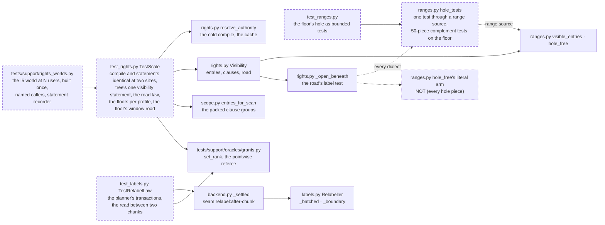

# The rights compile is the same at every world size: two worlds ten times apart pin one compile and one set of statements, a posture change's chunks and the read between them are pinned to their law, and the generic floor's road stops outgrowing its statement in a relabel window

A tests-first change with one fix inside it. It touches rights: the generic floor's road check while a posture change is in flight is rewritten (decision 11), so the security lens reads both reviews and criterion 13 is a leak test. It needs the engine legs: the world pins and the relabel law run on the four server legs (criteria 11 and 12). It is not structural: it adds one test support module, `tests/support/rights_worlds.py`, and one function to an existing module, `hole_tests` in `src/vfs/storage/backends/database/ranges.py`; no `src/` module, public class, protocol method, seam or lifecycle is added or removed. It changes no public API, no schema format and no Rust. It is roadmap story I5, "Scale pins for the rights compile", in [the 0.1.0 roadmap](../../standards/roadmap.md) (domain C), whose acceptance was written on 2026-10-28; this spec replaces that acceptance's two guessed numbers with the laws the state check measured, and says where and why. No intention: the story is the intent. Research: [grants at 100,000 users, measured](../../research/2026-10-02-grants-at-100k-users-measured.md), the memo whose design the tree now carries, plus this spec's own state check, recorded below as EXECUTED. Two placeholder memos opened the same day hold what this spec leaves out, with the state check's probes and their recorded outputs in their studies folders: [a posture change in flight compiles every posture row beneath it](../../research/2026-11-14-a-posture-change-in-flight-compiles-every-posture-row-beneath-it.md), ranked first, and [a listing pays a road check per hidden child directory](../../research/2026-11-14-a-listing-pays-a-road-check-per-hidden-child-directory.md). The probes this spec cites that neither memo carries (`probe_cold.py`, `probe_identity.py`, `probe_generic_relabel.py`, `probe_build_cost.py`) are scratch scripts that import vfs read-only, kept in the session scratchpad outside the repository. It depends on nothing unlanded. It is parallel-safe but for one shared file: on this branch the only other active specs that name `rights.py` or `labels.py` cite them and edit neither, and every spec that lands pins appends its own rows to [the mutant ledger](../../standards/mutant-ledger.md).

## The problem

Labels: READ means read in the file cited, at `e90ec653`; EXECUTED means a probe ran for this spec on SQLite through `uv run` against the unchanged tree, counting statements, binds, bound bytes and rows, never time; INFERRED is reasoning from those. No server engine ran: Docker was out of scope for the state check, so every per-engine claim is a statement compiled on that engine's SQLAlchemy dialect (EXECUTED) or an inference from one.

**Terms.** A *world* is a mount with a user count N: one private home per user, a fixed set of shared folders and groups. A *named caller* is a caller whose own rows are the same in every world. A *compile* is a caller's `Resolution` (`src/vfs/storage/backends/database/rights.py:179`): one `Rights` per rung, each a set of *spans* (path ranges the caller's own rows reach), turned into *pieces* (exact paths and open ranges, `src/vfs/storage/grants.py:530`) for SQL, plus one *owner arm* per member of the subject set (the rows that member owns, outside the spans). *c* is the number of covered prefixes a caller holds after `minimise` and the meet across members. A *visibility statement* is one that carries the caller's rights into SQL. The *road* is the set of hidden directories a listing shows as bare names because a row the caller may name lies beneath (`rights.py:615`). A *relabel window* is the time between a posture row's commit and the last chunk of its relabel, while the mark in `vfs_relabels` stands (`src/vfs/storage/backends/database/labels.py:200`). *Flat* means a count or a text is identical at two world sizes.

**The world the state check built.** EXECUTED (`world.py`, `probe_compile.py`). Root posture `read`. N users, each with a home `/home/<user>` at posture `none`, the user's own `read_write` row there, and two files the user owns. 100 shared folders `/shared/sNNN` at posture `none`, each granting `read` to three groups, `read_write` to one, and `read` to ten population users; the folder-to-group draw is seeded independently of N. 50 groups, five per population user. Four named callers: ann (an ordinary caller in groups 0 to 4), heavy (a member of all 50 groups), granted (a direct `read` row on all 100 folders), admin (`read_write` at `/`); the state check also asked a pair (ann and heavy as one subject set, acting through an agent), the system actor and anonymous. The population's grant and membership rows were inserted in bulk, then every entry was written through `write`, so every label was stamped by the write path. Worlds of 100, 1,000 and 10,000 users were built.

**Line 1 of the story: the compile, and its bound.** EXECUTED (`probe_compile.py`, `probe_cold.py`). Every named caller's compile is identical at 100, 1,000 and 10,000 users, field for field. ann holds c = 34: 68 spans, 34 points and 34 open ranges in the arms, one owner arm of 35 points and 69 open ranges, no holes; her one visibility statement binds 4,764 bytes on SQLite; the cold compile is 7 statements of at most 6 binds and the cache weighs it at 51,749 bytes, the same at every size. A synthetic caller of the same shape (c = 35, `probe_floors.py`) compiles its range join to 4,043 bytes of bound values on SQLite's dialect and 2,683 on Postgres's, where the arrays carry no JSON punctuation. heavy and granted hold c = 101: 202 arm pieces, 305 owner pieces, 14,048 bytes of JSON, a cold compile of 7 and 6 statements, 213,170 and 109,136 bytes of weight. The pair holds 66 spans and two owner arms of 138 pieces, 78,745 bytes, at both sizes. Anonymous compiles to nothing (5 statements, 288 bytes). admin compiles whole. So the story's "the same bound holds at 1,000 users" holds exactly: nothing in the compile reads the user count. Its "at most 64 path ranges" does not: an ordinary caller of this world carries 103 open ranges and 172 pieces. Its "a bound value of at most 4 KiB" fails too: ann's one visibility statement binds 4,764 bytes on SQLite and heavy's 14,097. Both numbers were guesses from October. The law the design truly keeps, EXECUTED for c = 34, 35, 101 and 1,001 (`probe_floors.py`): a single-member caller whose covered prefixes are disjoint siblings has 2c arm pieces (c points, c open ranges) and one owner arm of c + 1 points and 2c + 1 open ranges. The compile is a function of the caller's own rows and its member count, never of the user count, the other callers or the posture rows, outside a relabel window.

**Line 2 of the story: `ls /` and its visibility statement.** EXECUTED (`probe_compile.py`, `probe_statements.py`, `probe_identity.py`). `ls /` for every caller issues the same statement texts at 1,000 and 10,000 users: 5 statements for ann, none of them a visibility statement, because `/home` and `/shared` are visible by their label and `ls` fetches children by parent and judges them in Python (`src/vfs/storage/backends/database/reads.py:1083`). The verb that issues "one visibility statement" is `tree`: `tree /` and `tree /home` each issue exactly one, the range join of `visible_entries` (`ranges.py:96`), 28 binds, identical in text at both sizes; `tree /`'s text is identical across ann, heavy and granted, whose grants differ threefold, and only the bound values differ (4,764 against 14,097 bytes). The pair's text differs from ann's in its owner-arm branches: four `owner_id = ` terms against ann's two, one pair per member. Anonymous, admin and the system actor issue none. On fresh copies of both worlds, every verb called twice and the write last, all 100 statement lists of ann, heavy, granted, the pair and anonymous over `ls /`, `ls /shared`, `tree /`, `tree /home`, `glob /shared/**`, `grep` and `search` (both on the scan tier, no index built), `read`, `stat` and a write into a home were identical at 1,000 and 10,000 users in text, binds, bound bytes and count, with the same answers. For admin and the system actor all 40 counts were identical and no statement carried a rights term; their result-sized id lists grow with what they see, as they should.

**What does grow with the world: the road over hidden children.** EXECUTED (`probe_statements.py`, `probe_budget.py`). `ls /home` asks the road about every hidden child directory of `/home`, which in this world are the other users' homes: one `EXISTS` statement per chunk of candidates per owner test (pieces of the owner arm, 50 to a test, `rights.py:1303`) and one per chunk for the label test (`rights.py:1324`), each carrying the candidates as an `IN` list (`rights.py:1344`). On SQLite one chunk holds every candidate, so ann issues 10 statements at either size, but the candidate list grows from 1,003 to 10,003 paths. Under Oracle's 1,000-element `IN` list, emulated on SQLite, ann's `ls /home` grows from 14 statements at 1,000 users to 53 at 10,000, and heavy's from 22 to 101, each statement at most 1,000 binds. The count is exactly `6 + ceil(P / 50) × ceil(H / (B − 103)) + ceil(H / (B − 3))`, with H the hidden child directories, P the caller's owner pieces at the `list` rung and B the membership budget. `glob /home/**` pays the same road. This grows with the listed directory's hidden children, the directory's own size, not with the corpus beyond it; but in this world that directory is the user list. READ: `ls` and `glob` also fetch every child or every pattern candidate before the Python gate judges it (`reads.py:1083`, `reads.py:321`), so the rows they read follow the directory or the pattern, not the answer (INFERRED from the fetch statement's text, which carries no rights term and is the system actor's own).

**What grows with the world inside a relabel window.** EXECUTED (`probe_window.py`, `probe_floors.py`). A posture change at a path writes its posture row and a mark, and until the relabel settles every reader compiles that row's region (its cover less the covers of every posture row beneath it, `grants.py:369`) as a widened span set or a hole, reading every posture row beneath the mark (`labels.py:221`). In this world every home is a posture row, so a posture change at `/home` or `/` puts all of them into every partial caller's compile. With `/home` narrowed to `list` and held in flight, ann's compile carries 3,014 hole pieces at 1,000 users and 30,014 at 10,000; her `grep` goes from 7 statements to 14 and 81, her `glob /shared/**` from 9 to 49 and 409, each statement still bounded (at most 925 binds). The answers stay right. The window is short when the relabel runs to its end, but a relabel chunk that fails leaves the mark standing until the next `posture` call (`src/vfs/storage/backends/database/backend.py:1337`), and every partial read pays the world until then. This is the one place the compile grows with the corpus.

**A defect inside that window: the generic floor's road.** EXECUTED (`probe_generic_hole.py`). Where a dialect declares no range source (the generic floor that serves unknown engines), `hole_free` spells "not inside the hole" as one literal `NOT (… OR …)` over every hole piece (`ranges.py:137-158`), and `_open_beneath` puts it into the road's label test whole (`rights.py:1339`). Its binds grow with the posture rows beneath the pending mark: `hole_free` alone compiles to 503 binds over 100 of them, 5,003 over 1,000 and 50,003 over 10,000 (`probe_floors.py`), and the road statement that carries it held 2,007 binds over 400. Emulated on SQLite (SQLite's profile without its range source and with Oracle's `IN`-list cap, the suite's idiom), with 400 homes at posture `none` under `/h`, one folder `/h/u00007/pub` at posture `list` holding one file, and `/` narrowed to `none` and held in flight, ann's `ls /h` answers `unavailable`: "ls failed: Expression tree is too large (maximum depth 1000)". The same call under SQLite's own profile answers `["/h/u00007"]`, the road to the open folder, as the generic spelling also does at 100 postures. A statement that grows without bound and fails the engine's parser is a defect by [the production posture](../../../AGENTS.md); this spec fixes it.

**Line 3 of the story: the relabel.** EXECUTED (`probe_relabel.py`). `relabel_rows` is 50,000 on every profile (`src/vfs/storage/backends/database/dialects.py:97`); a chunk also carries at most `in_list_budget` pieces: 32,766 on SQLite, 65,535 on Postgres and MariaDB, 2,000 on SQL Server, 1,000 on Oracle and the generic floor (READ, `dialects.py:456-642`). A posture change on a subtree of 100,000 files under `/big/d00000` (100,002 rows with the two directories) takes 4 transactions and 6 entry `UPDATE` statements at the real cap, not the story's `ceil(100,000 / 50,000) = 2`. Two edges of the planner make the difference. The posture path's own row is a lone point, and `_batched` flushes it as its own chunk before a span too big for one (`labels.py:438`, pinned by `test_labels.py::test_batched_flushes_before_a_walked_span_and_when_a_chunk_fills`). And a walked chunk carries `relabel_rows − 1` rows, because the boundary probe's offset reserves two edge points where a walked chunk adds one (`labels.py:353`). With R rows strictly beneath the posture path and no posture row beneath it, the law is: one transaction and two `UPDATE` statements when `R + 1 ≤ relabel_rows`; otherwise, when R exceeds the cap, `2 + floor(R / (relabel_rows − 1))` transactions and `2 × (1 + floor(R / (relabel_rows − 1)))` statements; every row rewritten is counted, `R + 1`. EXECUTED at a patched cap of 500 (R = 1,498, 1,499, 1,994, 1,995, 1,996, 2,001), 250 (R = 101, 996, 1,001, 2,001), 5,000 (R = 20,001) and the real 50,000 (R = 100,001): every record matched the law. At R an exact multiple of `relabel_rows − 1` the last chunk rewrites no row and is still a transaction. The overhead is at most two transactions at any size. A read issued between two chunks, through the `relabel:after-chunk` seam the verb awaits after every chunk (`backend.py:1363`), answered exactly what the pointwise oracle (`tests/support/oracles/grants.py`) says, for a caller with no grant and for one granted inside the subtree, at every firing of every run (8 checks at 100,000 files). No test drives that seam today.

**Line 4 of the story, and the engine floors.** No pin of lines 1 to 3 runs anywhere today, on SQLite or a leg. EXECUTED (`probe_floors.py`), pushing one caller's own grants from 34 to 20,000 direct rows, and to 50 groups of 100 rows each plus 100 direct, every rights-bearing statement compiled on each of the five dialects and the generic floor stays inside its engine's caps in the steady state. The clause fan (the literal `OR` used where no range source exists, and by the scan tier on every engine, `rights.py:480`, `src/vfs/storage/backends/database/scope.py:268`) holds at most half the membership budget per clause: at most 16,311 binds on SQLite, Postgres and MariaDB (caps 32,766, 32,767 and 65,535), 975 on SQL Server (2,100), 465 on Oracle and the floor. The scan tier's packed groups reach 16,311 binds on SQLite and SQLite's parser accepted every one. The range join carries a fixed 7 to 15 binds at any grant count, and its bound values grow with the pieces: 115 KB at 1,000 grants, 2.3 MB at 20,000. What grows is the number of statements, linearly in the caller's grants: Oracle's fan is 23 clauses at 1,000 grants and 445 at 20,000, and the road runs 61 owner tests per candidate chunk at 1,000 grants and 1,201 at 20,000. The relabel's literal `OR` spelling (Oracle's and the floor's, `labels.py:493`) reached 666 terms at the 1,000-piece cap over 1,200 deeper postures, inside the 1,000 depth SQLite enforces (EXECUTED, `probe_generic_relabel.py`; INFERRED: two of every three pieces a deeper posture adds are open ranges, so a chunk never holds more than about two thirds of its cap as `OR` terms). Nothing broke but the generic road in a window.

**What is pinned today.** READ. `tests/storage/test_grants.py::test_posture_rows_never_enter_the_compile` pins, on three rows in Python, that a caller with no grant compiles to nothing beside any posture. `tests/storage/database/test_rights.py::test_a_cached_caller_costs_its_stamps_and_the_marks_per_call` pins the cache-hit path at three `SELECT`s. `tests/storage/database/test_ranges.py::test_each_dialect_renders_its_measured_spelling` pins the range join's branch count per dialect for one fixed piece set. `tests/storage/database/test_rights.py::test_the_fan_spends_one_bind_per_exact_path_and_two_per_open_range` and `::test_the_clauses_admit_exactly_what_the_rights_admit` pin the fan's binds and answers on small worlds. `tests/storage/database/test_labels.py::test_a_relabel_walks_a_large_subtree_in_bounded_chunks` pins at most 7 rows a step and at least 8 steps, a bound and not the law. `tests/storage/database/test_dialects.py::TestDialectPolicy::test_the_relabel_row_cap_is_the_measured_fifty_thousand_on_every_profile` pins the cap. `tests/storage/database/test_rights.py::test_reads_match_the_oracle_while_a_posture_relabel_is_held_midway` pins oracle agreement with a mark held before any chunk runs, and `tests/storage/database/test_labels.py::test_a_dead_relabel_resumes_and_reads_stay_exact_meanwhile` reads the in-flight rows after one chunk but asks no read verb. `tests/storage/database/test_ranges.py::test_the_generic_floor_spells_the_hole_as_a_literal_negation` pins the defect's own shape. No test builds a world above a few hundred rows of rights, compares a compile or a statement across two world sizes, pins the relabel law exactly, drives `relabel:after-chunk`, or compiles a stress caller's statements per profile.

## Architecture

The pins stand beside the compile and the relabel and read them through the public verbs and the recorded statements; one function moves the floor's hole into bounded tests. Dashed is what this spec adds; dotted is what it retires.



Page this changes: none; the architecture folder was retired on 2026-10-31.

## Decisions

### 1. Flatness is proved by identity at two world sizes ten times apart, never by one large world: 100 and 1,000 users on SQLite, 20 and 200 on each engine leg

A count or a statement text that is identical at two sizes cannot be reading the size, so it is the same at every size: the pin proves the law, where one large world only proves one point. The state check measured the 10,000-user world identical to the 1,000-user one in every compile and every flat verb, so the smaller pair loses nothing. Ten times apart keeps every hidden-child list, every population row count and every result-sized list for admin visibly different between the two, so a statement that does read the size cannot match by chance. The engine legs build their worlds per test, so they take the smallest pair that still differs tenfold.

### 2. The world is the state check's, with two files a shared folder; the population's rows go in by bulk insert, the named callers' rows through the verbs, every entry through `write`

Root posture `read`; one home per user at posture `none` with the user's own `read_write` row and two files it owns; 100 shared folders at posture `none`, each `read` to three groups, `read_write` to one and `read` to ten population users, the folder-to-group draw seeded apart from N; 50 groups, five per population user. The population's posture, grant and membership rows (the shared folders', the homes', the ten-user rows, the memberships) are inserted in one transaction with the columns the verbs write (`granted_by` system, a revision of 1), because 1,000 users through `posture`, `grant` and `add_member` is about 8,000 admin transactions, each taking the admin lock, and the verbs' own rows are pinned elsewhere. The named callers' rows go through `grant` and `add_member`, so their stamps exist and the cache's hit path is the real one. Every entry goes through `write` after the posture rows exist, so every label is the write path's own; [the label pin](../../../tests/storage/database/test_rights.py) `test_every_row_carries_the_oracles_everyone_level_after_every_mutation` already holds that path to the oracle.

### 3. Seven callers are pinned: ann, heavy, granted, the pair, admin, the system actor and anonymous

They are the populations [the reference deployment](../../../AGENTS.md) names: the ordinary person (ann, five groups), the heavy member (heavy, all 50 groups), the caller holding many grants of its own (granted, 100 direct rows), the agent acting for more than one person (the pair, two subjects through an `on_behalf_of` authority), the administrator whose grant covers the mount (admin), the engine's own actor (system) and the unauthenticated caller (anonymous). Each exercises a different branch of the compile: groups, direct grants, the meet and two owner arms, `whole`, the system shortcut and the empty compile.

### 4. The compile is asserted identical at both sizes in everything it is and reads, and caller-sized by an exact law; the story's 64 ranges and 4 KiB are replaced

At both sizes, for every caller but the system actor: the cold compile's statements (text with the schema name replaced, binds), the rows `_groups_of` and `_grant_rows` return (spied), the `Resolution` at every grantable rung (spans, roots, holes, owner arms and the five piece tuples of `Rights.ranges()`) and `weight`. Then the law, for ann, heavy and granted: arm points and arm open ranges each equal c, the owner arm has c + 1 points and 2c + 1 open ranges, and holes are empty, with c counted by the test from the plan's rows for that caller (its own and its groups' prefixes, minimised). The story's numbers were guesses; the law is what the design keeps, stated in the caller's own terms, and an ordinary caller of this world already passes the 64-range guess. A bound in bytes is not asserted, because the bytes follow the caller's path lengths; the law fixes the pieces, and the bytes follow from them.

### 5. Ten verbs are pinned identical at both sizes for every caller whose answer is the same at both, and admin and the system actor are pinned by their counts and the absence of any rights term

The verbs: `ls /`, `ls /shared`, `tree /`, `tree /home`, `glob /shared/**`, `grep` and `search` on the scan tier (no index is built, so both read the rows awaiting it), `read` of a file in the caller's home, `stat` of a shared file, and a `write` into the caller's home, last. Each is called twice and both calls are pinned: the first carries the cold compile, the second is the hit path a steady caller pays. For ann, heavy, granted, the pair and anonymous every statement's text, binds and bound bytes, the statement count and the answer's paths are identical at both sizes. admin and the system actor see more in the larger world, so their result-sized id lists rightly grow; they are pinned by an identical statement count per verb and by no statement holding a rights comparison (`everyone_level >=`, `everyone_level <`, `owner_id =` or the `visible` alias). Every node opens fresh copies of the two world files, so a write in one node never reaches another's statements.

### 6. `tree`'s one visibility statement is pinned to a text that never changes with the caller's grants

The story's "one visibility statement whose text is identical" is `tree`'s range join today, not `ls`'s: `ls` judges its children in Python. For ann, heavy and granted at both sizes, `tree /` issues exactly one statement reading the visible set, and its text is identical across the three callers at both sizes, six texts in all, while its bound values differ. The pair's text holds one owner-arm branch pair per member, so it differs from ann's in exactly those branches. This is the promise `ranges.py`'s docstring makes ("The statement text never changes with the caller's grants"), and no test holds it across callers today.

### 7. `ls /home` is pinned by the road's law, not by identity

Its road statements grow with the hidden child directories, which is the listed directory's size, and an identity pin cannot hold what is meant to grow. Pinned instead, under an emulated 1,000-element `IN` list (SQLite's profile with Oracle's cap, patched where the profile is chosen, as the suite already patches it), at both sizes and for ann and heavy: the statements that read the road's directory alias equal `ceil(P / 50) × ceil(H / (B − 103)) + ceil(H / (B − 3))`, each at most B binds, and the answer is the caller's own home alone. The formula is computed beside the test from the profile and the caller's compile. A road that grows past it, or names a home it should not, is red; a better road, the subject of [the road memo](../../research/2026-11-14-a-listing-pays-a-road-check-per-hidden-child-directory.md), is a visible change of one formula.

### 8. The relabel law pinned is the planner's own, at a patched cap, and the story's `ceil(rows / relabel_rows)` is not adopted

The law of the problem section: one transaction and two `UPDATE` statements when `R + 1 ≤ relabel_rows`; `2 + floor(R / (relabel_rows − 1))` transactions and `2 × (1 + floor(R / (relabel_rows − 1)))` statements when R exceeds the cap; `R + 1` rows. Pinned on SQLite with `relabel_rows` patched to 250, the chunker reading the profile, at three subtrees: 100 files (R = 101, one transaction), 995 files (R = 996, an exact multiple, six transactions), 2,000 files (R = 2,001, ten). The verb's own `relabel` record is asserted, and the recorded entry `UPDATE` statements equal its count. A patched cap proves the same planner at a fiftieth of the rows; the real cap's value is held by the existing profile pin, and the real cap's run (R = 100,001, 4 transactions) is the state check's. Meeting the story's formula exactly is a change to the planner's two edges, worth at most two transactions per posture change at any size, and it would move a landed pin; it is left out (flagged).

### 9. The read between two chunks is pinned through `relabel:after-chunk` against the pointwise oracle

At 1,000 files under `/big/d`, with `relabel_rows` at 250 and `/big` narrowed from `read` to `none` by `posture`, a handler on `relabel:after-chunk` runs `glob("/big/**")` as ann (no grant) and as bob (`read` at `/big/d`) at every firing. Each answer equals the set `set_rank` admits at `list`, from `tests/support/oracles/grants.py`, over the world's rows after the change. The seam fires once per transaction, six times. This is the story's "a read held midway agrees with the oracle", driven through the public verb at every midpoint the verb has, which no test does today.

### 10. The engine floors are pinned by compiling every rights-bearing statement on each dialect for two stress callers, not marked slow

The stress callers are a single member with 1,000 direct grants and a member of 50 groups of 20 grants each with 100 direct grants: both pass Oracle's 1,000-element list and SQL Server's 2,100 binds many times over. Per profile (the five and the generic floor) on its SQLAlchemy dialect: every clause of `visibility_clauses` compiles to at most `membership_budget // 2` binds; every packed scan group to at most the dialect's parameter budget less the reserve, and on the SQLite-dialect profiles it executes against an empty schema, so SQLite's own parser judges its depth; the range join, where the profile has one, compiles to the same bind count at both stress callers; every road owner test plus its candidate chunk stays within `membership_budget`. A compile is the referee for binds on every engine without a server; depth has one referee that runs here, SQLite. The compiles are pure and cheap, so they run in every pass.

### 11. The generic floor's road in a relabel window is fixed in this spec: the hole becomes bounded positive tests, and `hole_free` keeps only its bound-value arm

`ranges.py` gains `hole_tests(path, holes, profile)`: with no hole it returns `[true()]`; where the profile declares a range source it returns `[hole_free(path, pieces(holes), profile)]`, today's spelling; on the floor it returns the hole's complement, `pieces(subtract(FULL, holes))`, as `OR` tests of at most 50 pieces each (at most 100 binds), the shape `_owned_beneath` already gives the owner arm. A row lies outside the hole exactly when it lies in one of those pieces, so the road asks one `EXISTS` per test per candidate chunk and takes the union, as it does for the owner tests. `_open_beneath` judges each candidate chunk against every test, with 100 binds held back beside the candidates on the floor and the chunk unchanged where a range source exists. `hole_free` loses its literal arm and asserts a range source, as `visible_entries` does, because no caller is left on the floor. The fix is small, it is bounded, and it changes no answer: the statement count on the floor in a window grows with the hole, as every in-window count does (decision 12), but no statement outgrows its engine. `rights.py` is held at 1,540 lines by `tests/lint/allowlist.py` and does not grow: the body of `_open_beneath` is rewritten in place and its docstring absorbs any line the formatter adds.

### 12. The relabel window's world-sized compile is not fixed here; it is named for a placeholder memo and left out

Keeping the compile caller-sized while a posture change is in flight is a design question, not a patch: today the region a pending row rewrites is cut by every posture row beneath it, and the alternatives (judging the region by a join to the posture rows, relabelling deeper first, refusing a posture change above a declared number of posture rows) each change the window's semantics or its cost model. The memo is [a posture change in flight compiles every posture row beneath it](../../research/2026-11-14-a-posture-change-in-flight-compiles-every-posture-row-beneath-it.md), opened the same day and ranked above the road's, holding the question, the state check's numbers, the candidate directions and the experiment (each alternative's compile size and read count at 1,000 and 10,000 homes, and the window's length after a failed chunk). The pins of decisions 8 and 9 assert the window's correctness and never its size, so they stand under any fix.

### 13. The engine legs run the world pins and the relabel law; the floors run once

Each server leg (`ENGINE_LEGS` from `tests/support/server_schemas.py`, deselected without its URL) runs criterion 1 and criterion 3 for ann, heavy and anonymous on two worlds of 20 and 200 users in two schemas of its own, comparing statement texts after replacing each schema's name with one placeholder, and runs criteria 7 and 8 with `relabel_rows` patched to 50 through a wrapper on the engine's `profile_for` over 200 files (R = 201: 6 transactions, 10 statements, 202 rows). The floors are compiles on every dialect already and need no server. The legs are where the bound-value spellings (arrays on Postgres, JSON on the rest, a CLOB on Oracle) and the `values` membership form of SQL Server meet a real planner, which no compile shows.

### 14. What the pins add to the slow tier, counted in rows

The worlds are built once per session through `build_once` (`tests/support/shared_builds.py`), as the scope worlds are: about 2,600 entries written (408 at 100 users, 2,208 at 1,000, in one `write` batch each), about 5,400 grant rows and 5,600 membership rows inserted, and 159 admin verb calls for the named callers. The relabel pins of criteria 7 and 8 write 4,095 files and run 23 chunk transactions. Together that is fewer rows than one of today's 10,000-file pins (INFERRED from the rows; the state check measured no clock). The world nodes and the relabel nodes at 995 and 2,000 files are marked `slow`; the 100-file relabel node, the floors and the hole-test node are not. A smaller world proves the same law (decision 1), so nothing here waits on the 10,000-user world the story named.

### 15. Each pin lands with the mutation of `src/` it kills, as a row of the mutant ledger, executed by the builder

The rows are in the Design. Pins of present behaviour cannot be seen red on the base, so each is proven by its mutant instead, applied under the safe-restore rule, as [testing.md](../../standards/testing.md) asks.

### 16. This spec and story D4 do not overlap

D4 pins every verb's statement count at a 10,000-entry batch, so its law is in the batch width. This spec pins the rights compile and the verbs against the world's size and the caller's own grants, at small batches, and the relabel. `grant` and `revoke` at 10,000 rows stay D4's.

## Intent

After this spec, the suite proves that a caller's rights cost what the caller holds and never what the mount holds. An ordinary caller's compile, every statement its reads and writes issue, and `tree`'s one visibility statement are held identical between a world of 100 users and one of 1,000, and so at any size; the compile's pieces are held to an exact law in the caller's own prefixes. A listing of a directory full of hidden homes is held to the road's exact law. A posture change is held to its planner's exact count of chunks, and a read between any two of them answers what the oracle says. Every rights statement of a caller with a thousand grants is held inside every engine's floors. And on an engine vfs does not know, a listing during a posture change answers instead of failing.

## Design

**The support module.** `tests/support/rights_worlds.py`, new, about 200 lines, laid out by the house's module order. Constants: `FOLDERS = 100`, `GROUPS = 50`, `GROUPS_PER_USER = 5`, `HOME_FILES = 2`, `FOLDER_FILES = 2`, `WORLD_USERS = (100, 1_000)`, `ENGINE_WORLD_USERS = (20, 200)`, `SEED = 7`, `NAMED = ("ann", "heavy", "granted", "pair", "admin", "system", "anonymous")`. `WorldPlan`, a `NamedTuple` of the bulk rows (posture, grant and membership dictionaries), the named callers' rows (as verb calls) and the entries, made by `world_plan(users)`; the folder-to-group draw takes `random.Random(SEED)` and the population draw `random.Random((SEED, users))`, so the named callers' rows are the same at every size. `covered_prefixes(plan, name)` returns c's prefixes for a single-member caller, minimised. `build_world(storage, users)` writes the plan: the bulk rows in one transaction of chunked inserts, the named callers' verb calls, then the entries in batches of 10,000. `build_world_files(directory)` builds both `WORLD_USERS` worlds into SQLite files for `build_once`, and `open_world_copies(source, target)` copies them for one node. `caller(name)` returns the `Authority`. `StatementRecorder`, armed around one call, keeps `(text, binds, bound_bytes)` per statement from `before_cursor_execute`, skips `is_statistics_statement`, counts a list parameter's elements and a string's UTF-8 bytes, and replaces a schema name it is given with `SCHEMA`. `VERB_CALLS` maps each of decision 5's verbs to a call taking the storage and the authority. `holds_rights_term(text)` answers decision 5's four markers.

**`tests/storage/database/test_rights.py`.** A new class `TestScale` at the end of the file, under its own banner, with a module fixture that opens both worlds' copies (fresh per node), and the nodes of criteria 1 to 6, 11 and 13. The floor node (criterion 6) builds `Rights` with `resolve` for the two stress shapes and compiles on `sqlite.dialect()`, `postgresql.asyncpg.dialect()`, `mssql.dialect()`, `mysql.dialect()`, `oracle.dialect()` and `sqlite.dialect()` for the floor, reading each dialect's `insertmanyvalues_max_parameters` as its parameter budget. The window node (criterion 13) builds its own store of 400 homes under `/h`, holds `/` narrowed to `none` with the file's existing `_hold_posture`, and asks `ls /h` under both spellings.

**`tests/storage/database/test_labels.py`.** A new class `TestRelabelLaw` with the nodes of criteria 7, 8 and 12, and `expected_relabel(beneath, relabel_rows) -> Relabel` beside them, the law of decision 8 in code: the small regime, the regime where R equals the cap (two transactions, two statements), and the walked regime.

**`tests/storage/database/test_ranges.py`.** `test_the_generic_floor_spells_the_hole_as_a_literal_negation` is replaced by criterion 10's node, because the shape it pins is the defect.

**`src/vfs/storage/backends/database/ranges.py`.** `hole_tests` as decision 11 states, about 20 lines with its docstring, under the visible-entries banner beside `hole_free`, and a module constant `HOLE_TEST_PIECES: Final = 50` with a two-line comment saying what it bounds. `hole_free` loses its literal arm (about 4 lines) and asserts a range source; its docstring and the module docstring's paragraph on the window say the floor's spelling now lives in `hole_tests`. The module imports `FULL`, `pieces` and `subtract` from `vfs.storage.grants`. It stays well under the 1,000-line ceiling.

**`src/vfs/storage/backends/database/rights.py`.** `_open_beneath` builds one test per `hole_tests` answer and reserves `2 * HOLE_TEST_PIECES` binds beside each candidate chunk on the floor; its docstring says the hole is judged by bounded tests on the floor. The file ends at exactly 1,540 lines, or fewer with its allowlist entry lowered to match.

**Order of work.** The pins of present behaviour first, each run green on the base and then red under its ledger mutant; then criteria 10 and 13, seen red on the base (`ImportError` for `hole_tests`, and `unavailable` with the depth error for the window road); then the fix; then the engine legs through the `db_test` cycle; then `scripts/ci.sh`.

### The mutant-ledger rows the build adds

Each row is applied by the builder under the safe-restore rule and recorded with its killers and the date; the prefix Q is unused in the ledger today.

| id | mutation (intent → anchor) | target | scope | killer this spec names |
|---|---|---|---|---|
| Q1 | the cold compile reads every posture row on the mount: `_grant_rows(session, tables, profile, membership_budget, ids)` in `resolve_authority` becomes `…, [*ids, EVERYONE_NAME])` — the compile's answer is unchanged and its read grows with every home | `src/vfs/storage/backends/database/rights.py` | `tests/storage/database/test_rights.py` | criterion 1's rows-read assertion |
| Q2 | the range join is never chosen: `self._profile.range_source is None` in `Visibility.entries` becomes `True`, so every partial read takes the literal fan | same | same | criterion 4 (the text differs across callers) |
| Q3 | the road asks one candidate a statement: `chunked(sorted(candidates), per_chunk)` in `_beneath` becomes `chunked(sorted(candidates), 1)` | same | same | criterion 5 |
| Q4 | the road's label test loses its label: `row.c.everyone_level >= rights.need` dropped from `_open_beneath`'s test, so every hidden home with a row beneath is on the road | same | same | criterion 5's answer assertion |
| Q5 | a walked chunk halves: `.offset(max(0, self._profile.relabel_rows - 2))` in `_boundary` becomes `.offset(self._profile.relabel_rows // 2)` | `src/vfs/storage/backends/database/labels.py` | `tests/storage/database/test_labels.py` | criterion 7 |
| Q6 | the planner never walks: `if n_rows > row_cap:` in `_batched` becomes `if False:`, so a span over the cap is one chunk | same | same | criterion 7 |
| Q7 | readers ignore the window: `pending = [mark.path for mark in marks]` in `resolve_authority` becomes `pending = []`, so a read between two chunks trusts the stale labels | `src/vfs/storage/backends/database/rights.py` | `tests/storage/database/` | criterion 8 |
| Q8 | the fan's clause cap is the whole parameter budget: `bind_cap = max(1, membership_budget(profile, parameter_budget) // 2)` in `visibility_clauses` becomes `bind_cap = parameter_budget` | same | `tests/storage/database/test_rights.py` | criterion 6 (SQL Server's clauses pass half the membership budget) |
| Q9 | the floor's hole is one test again: `HOLE_TEST_PIECES` used as the chunk width in `hole_tests` replaced by the complement's whole length | `src/vfs/storage/backends/database/ranges.py` | `tests/storage/database/` | criteria 10 and 13 |

### Scale

Costed against [the reference deployment](../../../AGENTS.md), by its multipliers. *Per verb call*, about 150,000 a day: the steady compile costs a cached caller two statements (its stamps and the marks) and a cold one five to seven, each sized by the caller (at most 51 binds for heavy), and `tree`'s visibility statement carries 28 binds and a bound value of about 4 KB for an ordinary caller and 14 KB for a heavy one, at any mount size; nothing in it is paid per user. *Per verb call inside a relabel window*: every partial caller's compile carries the posture rows beneath the pending mark, 30,014 hole pieces at 10,000 homes, and its reads fan out (81 statements for one `grep`, 409 for one `glob`); at about 20 calls a second at peak, a window held open by a failed chunk turns every partial read world-sized until the next `posture` call. That is decision 12's memo, and the reason it ranks first among what this spec leaves out. *Per listing*: a directory with H hidden child directories costs `ceil(P / 50) × ceil(H / (B − 103)) + ceil(H / (B − 3))` road statements; at the deployment's largest measured directory, 1,533 entries, an ordinary caller pays 8 on Oracle and 4 on SQLite, and a caller with 1,000 grants (3,005 owner pieces, 61 owner tests) 124 on Oracle. *Per batch*: a posture change over the nightly batch's million rows takes `2 + floor(1,000,000 / 49,999) = 22` transactions at the real cap, each under the admin lock for one chunk. *Per index visit*: nothing here touches the rebuild. The fix adds, on the floor alone and inside a window alone, `ceil(3D / 50)` bounded statements per candidate chunk where one unbounded statement failed.

## Scope

In: decisions 1 to 16. Tests: `tests/support/rights_worlds.py` (new), `tests/storage/database/test_rights.py`, `tests/storage/database/test_labels.py`, `tests/storage/database/test_ranges.py`. Source: `src/vfs/storage/backends/database/ranges.py` (`hole_tests`, `HOLE_TEST_PIECES`, `hole_free`'s literal arm removed, docstrings) and `src/vfs/storage/backends/database/rights.py` (`_open_beneath`'s body and docstring, line-neutral). Standards: rows Q1 to Q9 appended to `context/standards/mutant-ledger.md`, and story I5's acceptance in `context/standards/roadmap.md` amended to the measured laws, below. And this spec's landing notes.

The roadmap edit the builder makes. Under "I5 — Scale pins for the rights compile", the four acceptance lines are replaced, word for word, by these four:

```
1. A generated world (one private home per user at posture `none`, 100 shared folders, 50 groups, five per user), built at 100 and at 1,000 users: every named caller's compile (an ordinary caller, a member of all 50 groups, a caller with 100 direct grants, two subjects acting through an agent, an admin, anonymous) is identical at both sizes, and a single-member caller with c disjoint covered prefixes compiles to c points and c open ranges plus one owner arm of c + 1 points and 2c + 1 open ranges; no bound is set in ranges or bytes, because both follow the caller's own grants.
2. At both sizes, ten verbs (`ls /`, `ls /shared`, `tree /`, `tree /home`, `glob`, `grep`, `search`, `read`, `stat`, a write) issue identical statements for every caller whose answer is the same; `tree /` issues one visibility statement whose text is identical across callers whose grants differ; and `ls` of a directory with H hidden child directories issues exactly `ceil(P / 50) × ceil(H / (B − 103)) + ceil(H / (B − 3))` road statements, P the caller's owner pieces and B the membership budget.
3. A posture change over R rows beneath its path, with no posture row beneath, runs in one transaction when R + 1 ≤ `relabel_rows` and otherwise in `2 + floor(R / (relabel_rows − 1))` transactions; a read at every chunk boundary agrees with the pointwise oracle.
4. The pins run on SQLite by default and on each engine leg, and every rights statement of a caller holding 1,000 grants compiles inside every profile's floors.
```

In the same section's "State today" table, the row "100k-user scale pins | memo only; no world above a few hundred rows in `tests/`" becomes "Scale pins for the rights compile | built: two worlds of 100 and 1,000 users, the relabel law, the floors per profile; the in-flight window and the road are placeholder memos".

Out. The relabel window's world-sized compile (decision 12), for [its placeholder memo](../../research/2026-11-14-a-posture-change-in-flight-compiles-every-posture-row-beneath-it.md), ranked first. The road's cost per hidden child directory, which grows with a listed directory's hidden children and the caller's owner pieces: its improvement (one statement per candidate chunk for every test, a road found from the caller's own rows the way `tree`'s is, or the rights pushed into the children fetch) is a design question for [its placeholder memo](../../research/2026-11-14-a-listing-pays-a-road-check-per-hidden-child-directory.md), ranked second, and this spec pins today's law so the improvement shows. `ls` and `glob` reading every child or pattern candidate before the Python gate judges it: a read-path design choice of their own, outside the compile. The planner's two edges (decision 8). The 10,000-entry batch pins of story D4. A world of 10,000 or 100,000 users in the suite. A wall-clock benchmark of any of this, which belongs in a bench or a memo.

**Flagged to Clay, and ruled.** The session lead ruled on 2026-11-14 on each choice this spec flagged. The story's acceptance is amended to the measured laws by this spec's landing, in the roadmap edit above: "at most 64 path ranges and 4 KiB" gives way to the caller-sized law of decision 4, and `ceil(rows / relabel_rows)` to the planner's law of decision 8. The in-flight window's memo is opened now and ranked above the road's. The road's cost is pinned as a law (decision 7) and not fixed here. The bulk-insert world build is accepted on the condition decision 2 already states: the named callers' rows go through `grant` and `add_member`, and every file through `write`. The planner's two edges stay, and the pin states the true law, `2 + floor(R / (relabel_rows − 1))` transactions once R exceeds the cap. The empty "Landing notes" heading stays, because the shape lint requires it. The probes the two memos cite, and their recorded outputs, are in those memos' studies folders.

## Acceptance criteria

Counts and states, never clocks. "Present" marks a pin of today's behaviour, green on the base and proven by its ledger row; "red today" gives what the base answers. Every world node is marked `slow` unless it says otherwise.

1. `tests/storage/database/test_rights.py::TestScale::test_a_named_callers_compile_is_identical_at_both_world_sizes[ann]`, `[heavy]`, `[granted]`, `[pair]`, `[admin]` and `[anonymous]`: with no cache, the compile at 100 and at 1,000 users issues the same statements (text and binds), its spied `_groups_of` and `_grant_rows` return the same rows, and the two `Resolution`s are equal at every grantable rung in spans, roots, holes, owner arms and `ranges()`, with equal `weight`. Present; red under Q1 (the rows read differ by the population's posture rows).
2. `tests/storage/database/test_rights.py::TestScale::test_a_single_member_callers_pieces_follow_its_own_prefixes[ann]`, `[heavy]` and `[granted]`: at the `read` rung, with c the count of `covered_prefixes(plan, name)`, the arms hold c points and c open ranges, there is one owner arm of c + 1 points and 2c + 1 open ranges, and there are no holes; at 100 and 1,000 users alike. Present.
3. `tests/storage/database/test_rights.py::TestScale::test_every_verb_issues_identical_statements_at_both_world_sizes[ann]`, `[heavy]`, `[granted]`, `[pair]` and `[anonymous]`: for each of decision 5's ten verbs, called twice, both calls issue the same statements at 100 and 1,000 users (text, binds, bound bytes, count) and answer the same paths. Present; red under Q1 on the first call's spied rows.
4. `tests/storage/database/test_rights.py::TestScale::test_tree_issues_one_visibility_statement_whose_text_never_changes_with_grants`: at both sizes, `tree /` as ann, heavy and granted issues exactly one statement reading the `visible` alias, and the six texts are identical; the pair's text differs from ann's and holds twice ann's count of `owner_id = `; anonymous, admin and the system actor issue none. Present; red under Q2.
5. `tests/storage/database/test_rights.py::TestScale::test_a_listing_pays_the_road_law_for_its_hidden_child_directories[ann]` and `[heavy]`: under SQLite's profile with `in_list_budget` 1,000, `ls /home` issues exactly `ceil(P / 50) × ceil(H / 897) + ceil(H / 997)` statements reading `vfs_entries AS d` at 100 and at 1,000 users, with H the 103 and 1,003 hidden homes and P the caller's owner pieces at `list` (ann: 4 and 8 statements; heavy: 8 and 16), each at most 1,000 binds, and answers exactly the caller's own home. Present; red under Q3 (H times the tests) and Q4 (every home answered).
6. `tests/storage/database/test_rights.py::TestScale::test_every_rights_statement_fits_each_profiles_floors[<profile>-<shape>]`, for the six profiles and the two stress shapes of decision 10, not slow: each fan clause compiles to at most `membership_budget // 2` binds, each packed scan group to at most the dialect's parameter budget less 32, and each executes against an empty SQLite schema on the SQLite-dialect profiles; the range join compiles to the same bind count for both shapes; each road owner test with a full candidate chunk compiles to at most `membership_budget` binds. Present; red under Q8 (SQL Server's widest clause compiles past its 1,000-bind half of the membership budget, leaving a full candidate list no room under 2,100).
7. `tests/storage/database/test_labels.py::TestRelabelLaw::test_a_posture_change_takes_the_planners_transactions[100]`, `[995]` and `[2000]` (the first not slow): with `relabel_rows` patched to 250, `posture("/big", "none")` over that many files under `/big/d` answers `relabel` equal to `expected_relabel`: rows 102, 997 and 2,002; statements 2, 10 and 18; transactions 1, 6 and 10; and the recorded entry `UPDATE` statements equal the statements. Present (EXECUTED in the state check); red under Q5 and Q6.
8. `tests/storage/database/test_labels.py::TestRelabelLaw::test_a_read_between_two_chunks_agrees_with_the_oracle`: on 1,000 files under `/big/d` with bob granted `read` at `/big/d`, `relabel_rows` at 250, `posture("/big", "none")` fires `relabel:after-chunk` exactly 6 times, and at each firing ann's and bob's `glob("/big/**")` name exactly the paths `set_rank` admits at `list` over the world after the change: none for ann, `/big/d` and its 1,000 files for bob. Present; red under Q7.
9. `tests/storage/database/test_labels.py` and `tests/storage/database/test_rights.py` pass whole, with `test_a_relabel_walks_a_large_subtree_in_bounded_chunks`, `test_reads_match_the_oracle_while_a_posture_relabel_is_held_midway` and `test_the_clauses_admit_exactly_what_the_rights_admit` unchanged.
10. `tests/storage/database/test_ranges.py::test_the_floor_spells_a_hole_as_bounded_positive_tests`, not slow: for a hole of 1,000 sibling posture rows (3,002 hole pieces), `hole_tests` on the generic profile returns `ceil(n / 50)` tests for the n pieces of the hole's complement, each compiling to at most 100 binds on SQLite's dialect and executing against an empty schema; on each of the five range-source profiles it returns one test, equal in its compiled text to `hole_free`'s; with no hole it returns one test that is `true`. Red today: `ImportError`, no `hole_tests`.
11. `tests/storage/database/test_rights.py::TestScale::test_every_verb_issues_identical_statements_at_both_world_sizes_on_each_engine[postgres]`, `[mariadb]`, `[mssql]` and `[oracle]`: criteria 1 and 3 for ann, heavy and anonymous on worlds of 20 and 200 users, each in a schema of its own, the texts compared after replacing each schema's name. Present on SQLite; first run on the legs by this build.
12. `tests/storage/database/test_labels.py::TestRelabelLaw::test_a_posture_change_takes_the_planners_transactions_on_each_engine[postgres]`, `[mariadb]`, `[mssql]` and `[oracle]`: with `relabel_rows` wrapped to 50 on the engine's own profile, `posture("/big", "none")` over 200 files answers rows 202, statements 10, transactions 6, and at each of the 6 firings of `relabel:after-chunk` bob's and ann's reads agree with the oracle as in criterion 8. INFERRED from the SQLite law; first run on the legs by this build.
13. `tests/storage/database/test_rights.py::TestScale::test_the_floor_names_the_road_through_a_relabel_window`: on a store under SQLite's profile with no range source and `in_list_budget` 1,000, with 400 homes `/h/uNNNNN` at posture `none`, `/h/u00007/pub` at posture `list` holding one file, ann granted `read` at `/g`, and `/` narrowed to `none` and held in flight, ann's `ls /h` succeeds and answers exactly `/h/u00007` as a bare name, every statement it issues carries at most 1,000 binds, and the same call on SQLite's own profile answers the same. This is the leak test too: no other home is named. Red today: `unavailable`, "ls failed: Expression tree is too large (maximum depth 1000)", with a statement of 2,007 binds.
14. `tests/lint/test_code_shape.py::test_a_listed_module_never_grows_and_an_unlisted_one_stays_under_the_ceiling` passes with `rights.py`'s entry unchanged at 1,540, or lowered to the file's count; `scripts/ci.sh` exits 0 on the tree as committed, 100% coverage with `hole_free`'s literal arm gone; the `db_test` cycle passes the four server legs with criteria 11 and 12 among them; and each of Q1 to Q9 is applied and killed by at least one failure in its scope, its row recorded in the ledger with its killers and the date.

## Landing notes

Filled in on landing.

## One line

Two worlds ten times apart now prove that a caller's rights compile, every statement its verbs issue and `tree`'s one visibility statement cost what the caller holds and never what the mount holds, a posture change is held to its planner's exact chunk count with every read between chunks checked against the oracle, every rights statement of a thousand-grant caller is held inside every engine's floors, and the generic floor's listing during a posture change answers through bounded tests instead of failing one unbounded statement.
