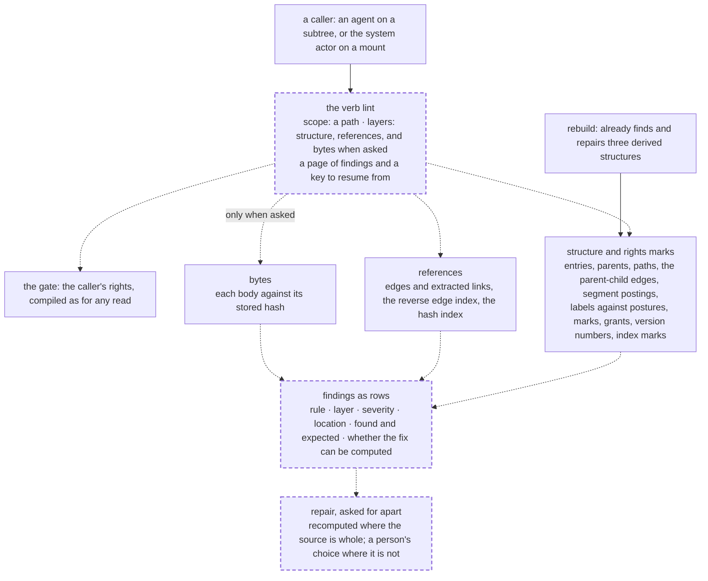

# `lint` finds what is broken in a mount and changes nothing: one verb over structure, references and, when asked, the stored bytes; a finding never names a row its caller cannot see; repair is a separate ask

A placeholder spec. It records Clay's rulings of 2026-11-15 on a `lint` verb and the decisions that can be made now, so they wait in the repository; it is not fit to build until it is completed from the experiments [the lint memo](../../research/2026-11-15-a-lint-verb-that-finds-integrity-issues.md) names in its last section, and the completed spec is reviewed. It will be a feature that changes the public API (a new verb and a new kind of result row), touches rights (a finding can reveal that a row exists, so leak tests are among its criteria) and needs the engine legs. It stands on the lint memo. No intention: the request was one sentence and the memo answers it. It depends on [the kernel rulings spec](2026-11-15-the-kernels-public-names-and-argument-families-are-ruled.md), whose decision 5 says a key that is not a path gets a field of its own and whose decision 9 says a damaged file is never locked, and it takes the place of the `scrub` verb the numbered spec 175 plans.

## The problem

Labels: EXECUTED means a command ran on 2026-11-15 and the claim reports its output; READ means read in the file cited, at `08c372af`; INFERRED means reasoning. Each claim is from the lint memo, which cites the probe or the file and line.

vfs keeps its integrity in the verbs. The schema has no foreign key, so every rule that holds across rows is kept by application code and by nothing else (READ, `src/vfs/models/rows.py`). When a rule is broken beneath the verbs, by a writer with SQL credentials, by a lost race or by a bug, almost nothing notices. EXECUTED: of eighteen kinds of damage planted with direct SQL on the in-memory store, nearly all were served as success. A body that does not match its hash is read, copied, and laundered by `edit` into a healthy-looking version. A wrong label lets an anonymous `glob` list a file that `read` refuses. A row marked indexed that the index does not hold is missed by `grep` for good. An entry whose version sits below its own version rows refuses every overwrite. A grant on a destroyed file's path applies to the next file written there. A missing parent sends `rebuild` into a loop.

No verb finds any of this. The one whole-store audit is a helper in the tests, which checks four things on the server legs only (READ, `tests/storage/database/test_races.py`). `rebuild` finds and repairs three derived structures as a side effect (EXECUTED). The numbered spec 175 plans a `scrub` verb for the bytes alone, report-only, and it is not built.

Clay asked on 2026-11-15: "I want to have a lint verb that finds integrity issues with vfs. Can you have that apart of research? Comes come karpharys llm wiki idea, but maps nicely into vfs". The idea he named is a health check a model runs over a wiki's pages and links (READ, the gist the memo quotes). The memo found that vfs can do the mechanical half of that from rows, and can check two more layers beneath it, at a cost that follows what is checked.

## Architecture

What `lint` reads and what it returns. Solid is what exists. Dashed is what this spec adds.

Page this changes: none; the architecture folder was retired on 2026-10-30.

## Decisions

### 1. One verb, `lint`, covers three layers: structure, references, and the stored bytes; the byte layer runs only when asked, and no `scrub` verb is added

Clay, on being shown this as the recommendation with the alternative of keeping `scrub` as a verb of its own: "I agree with your recommendations in lint." One verb is what he asked for, and one tool in the eleven the memo read, `git fsck`, puts all three layers under one name with a flag that leaves the bytes out. The byte layer is the one that must read every body, about 40 GB of text and terabytes with binary bodies at the reference deployment, where every other check costs the rows it visits; so it is off unless the caller asks. The `scrub` verb of the numbered spec 175 is read as this verb's byte layer from here on.

### 2. `lint` reports and changes nothing

A finding is a fact about the store as it stands. Every tool the memo read makes finding the default and repair a separate, graded ask, and none makes a damaged thing unusable as its answer. A lint that wrote would also need the rights and the locks of a write, and a caller who may only read could not run it.

### 3. A finding is a row with the same parts for every rule

The rule's code, its layer, a severity, a location (a path, and the row's identity where the path is not enough), what was found and what was expected, and whether the fix can be computed. It is the shape every tool the memo read uses, and a row is what an agent can act on in the same session. A reference finding that is not damage, such as a file nothing links to, carries the lowest severity: it is a suggestion, as the named idea's lint has them.

### 4. A finding never names a row its caller cannot see, and the checks with no path to judge are for the system actor

Today a row a caller cannot see and a row that does not exist answer alike (EXECUTED, the memo's section 6). `lint` keeps that: a finding that would name a hidden row reports it as absent, so a broken link to a hidden target reads as a link to nothing and a hidden file with the same hash is not counted. Otherwise the verb is a way to learn that a hidden file exists or what it holds. The checks whose subject has no path, a body, version or chunk row with no entry, and the checks whose finding is itself a rights fact, a wrong label or a grant on a path with no row, are run by the system actor only.

### 5. Repair is asked for apart from finding, and is automatic only where the answer can be recomputed

Where the broken thing is derived and its source is whole, the fix is a recomputation: a path from parent and name, segment postings, the parent-child edge, a label from the posture rows, a size, an index mark, extracted links. Where the source itself is damaged there is nothing to compute from and a person chooses: a body that fails its hash, a parent that names nothing, a version row with no entry. For a damaged body the ways out are the ones decision 9 of the kernel rulings spec lists. `rebuild` shows what the other order does: run against a missing parent it mints and deletes an edge on every pass (EXECUTED).

### 6. `lint` is scoped by a path, paged by a key of its own, and takes no lock another caller waits on

Every check but the bytes is a plain read that seeks an index (EXECUTED on SQLite, the memo's section 4). A lint of one folder is one statement; a lint of the whole reference mount is about 11,000 statements of 1,000 rows, once a day (INFERRED). Each page is its own short transaction, so no snapshot is held open across a walk, and a finding is reported only when a second read agrees, because a rival's commit between two pages can look like damage. The key to resume from is not a path, so by decision 5 of the kernel rulings spec it is a field of its own and does not ride `next_after`.

### 7. The model's half stays with the agent

The named idea's lint also looks for contradictions between pages, stale claims and gaps. Those need a model. vfs returns the mechanical findings as rows and the agent that called it does the rest; vfs does not call a model.

### 8. What is not decided here waits on the memo's experiments

The verb's signature and the name of its key field; how repair is asked for, as an argument of `lint` or as a verb of its own; the rule codes and which rules the first build carries; whether a whole-mount run's findings are returned page by page or kept in a report the daily pass refreshes; and the plans on the four server engines. The lint memo's last section names the experiment for each, and this spec is completed from them.

## Intent

After this spec, an agent can ask vfs what is wrong beneath a folder and get back a list it can act on: this link points at a file that was deleted, nothing links to this page, these two files are the same. An operator can ask the same of a whole mount, and also whether any stored byte has changed beneath vfs, and gets a list of exactly what is damaged and which of it can be recomputed. Nothing is changed by asking, nobody else's call waits, and nobody learns of a file they may not see.

## Design

**The order of work.** This spec is completed first: the experiments of decision 8, then every choice it leaves as a decision. Then tests first, as for any feature.

**What is known of the shape.** A verb `lint` in the op vocabulary, on both faces and both sessions, with a storage method beside the read verbs. Its statements live in a module of their own under `src/vfs/storage/backends/database/`, one function a rule, each a keyset-paged read chunked under the membership budget. Its result is the one `Result`, its rows the findings of decision 3. The structure rules read the entry table by its key and seek each parent; the label rule seeks the `(everyone_level, path)` index once per posture region and level; the reference rules read the edge tables by their existing indexes; the byte rule joins file rows to the body tables and hashes in the caller, as the numbered spec 175 has `scrub` do.

**Scale.** Costed against [the reference deployment](../../../AGENTS.md#the-reference-deployment-the-scale-every-idea-is-filtered-through). Per verb call: a lint of a folder or a subtree costs the rows in scope, which is what a read verb may cost. Per corpus, once a day: the whole-mount structure walk is about 11 million row visits in pages, the one place a whole-table operation is allowed, bounded and resumable. Per index visit: nothing is added to `rebuild`'s per-file path. Per lock: none is taken. The byte layer is the exception to all of this and is why it is opt-in: every stored byte crosses the wire, so it is a paced, resumable job for off-peak hours.

## Scope

In: decisions 1 to 8, as rulings and as the frame the completed spec fills.

Out. Any code: nothing is built from a placeholder. The read-side hash check on every `read`, the integrity kind and the repair rule of a damaged file: the numbered spec 175's conversion and decision 9 of the kernel rulings spec. A foreign key or any other constraint in the schema. Calling a model from vfs (decision 7). The link extractor keeping a row for a link to a path that does not exist, which the memo names as an experiment. The daily pass running `lint` by itself: a host schedules it, since storage owns no background work.

## Acceptance criteria

The completed spec names a test for each. What can be said now:

1. For each rule, a node that plants the damage with direct SQL on SQLite and on the four engine legs, calls `lint` over a scope that holds it, and finds exactly one finding with that rule's code at that location; and a node on an undamaged store of the same shape that finds none.
2. A leak node for each reference rule: with the target of a broken link in a region the caller cannot list, the finding the caller gets is the same row, field for field, as when the target does not exist; and a file with the same hash in a region the caller cannot read is not counted.
3. A count node: a lint of a folder of 25 children issues one statement a rule and visits no row outside the folder; a lint of 10,000 rows issues one statement a page and its statement count does not grow with the tombstones in scope.
4. A node that shows nothing is written: the store's rows before and after a `lint` with every layer on are equal, and a caller holding `read` alone may run it over what it may read.
5. A node that shows no call waits: with a `lint` walk stopped at a seam between two pages, a read, a write and a posture change each return.

## Landing notes

Filled in on landing.

## One line

One verb, `lint`, reports what is broken in a mount's structure, references and, when asked, bytes, as rows a caller may act on, without changing anything, taking a lock or revealing a hidden file; repair is asked for apart.
