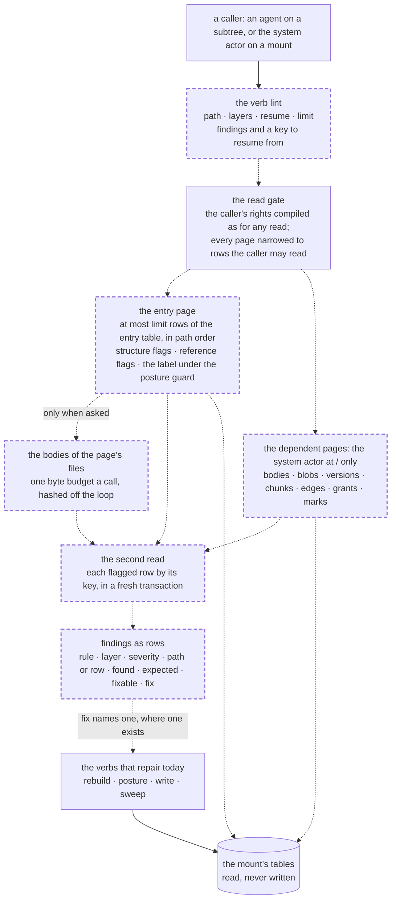

# `lint` finds what is broken in a mount and changes nothing: one verb over structure, references and, when asked, the stored bytes; a finding never names a row its caller cannot see; repair is a separate ask

A feature, drafted whole on 2026-11-25 and awaiting its spec review. It adds one verb, `lint`, that reads a mount's rows and returns what is broken in them as findings. It is structural: it adds two modules (`src/vfs/results/findings.py` and `src/vfs/storage/backends/database/lint.py`), one storage protocol and one routed verb. It changes the public API: a new verb on both faces and both sessions, and a new kind of result row. It touches rights: a finding can reveal that a row exists, so the security lens is mandatory and criteria 7 to 14 are leak tests. It needs the engine legs: it adds statements under `storage/backends/database/`, and criteria 1, 15, 16 and 17 run on the four server engines. It changes no schema format, no stored row and no Rust. It touches the gate's size baseline in three held entries (decision 20). It records Clay's rulings of 2026-11-15 as decisions 1 to 7, unchanged, and decides the rest from the experiments of [the lint memo](../../research/2026-11-15-a-lint-verb-that-finds-integrity-issues.md), which was completed on 2026-11-25 with [study 03](../../research/studies/2026-11-15-a-lint-verb-that-finds-integrity-issues/03-the-experiments-the-memo-named-run-on-five-engines.md). No intention: the request was one sentence and the memo answers it. It depends on [the kernel rulings spec](2026-11-15-the-kernels-public-names-and-argument-families-are-ruled.md), whose decision 5 says a key that is not a path gets a field of its own, whose decision 6 says an entry's id is not shown on a row, and whose decision 9 says a damaged file is never locked; and on [the SQL Server spec](2026-11-15-on-sql-server-a-read-never-waits-on-a-write.md), whose required setting decision 18 leans on. It takes the place of the `scrub` verb that [the numbered spec 175](../archive/175-integrity-verify-on-read-and-scrub/spec.md) planned, which was archived on 2026-11-25 with that slice named as overtaken by this spec. It is not parallel-safe: it edits `tests/lint/allowlist.py`, `src/vfs/base.py`, `src/vfs/ops.py` and `src/vfs/params.py`, which other active specs edit too.

## The problem

Labels: EXECUTED means a command ran and the claim reports its output; READ means read in the file cited; INFERRED means reasoning. A claim with no date is from the lint memo's two first studies, run and read on 2026-11-15 at `08c372af`. A claim dated 2026-11-25 is from study 03, run at `20a3075` on SQLite, Postgres 17, MariaDB 11.8, SQL Server 2025 and Oracle 23ai, each server engine in a container; `src/` did not change between that commit and this draft.

vfs keeps its integrity in the verbs. The schema has no foreign key, so every rule that holds across rows is kept by application code and by nothing else (READ, `src/vfs/models/rows.py`). When a rule is broken beneath the verbs, by a writer with SQL credentials, by a lost race or by a bug, almost nothing notices. EXECUTED: of eighteen kinds of damage planted with direct SQL on the in-memory store, nearly all were served as success. A body that does not match its hash is read, copied, and laundered by `edit` into a healthy-looking version. A wrong label lets an anonymous `glob` list a file that `read` refuses. A row marked indexed that the index does not hold is missed by `grep` for good. An entry whose version sits below its own version rows refuses every overwrite. A grant on a destroyed file's path applies to the next file written there. A missing parent sends `rebuild` into a loop.

No verb finds any of this. The one whole-store audit is a helper in the tests, which checks four things on the server legs only (READ, `tests/storage/database/test_races.py`). `rebuild` finds and repairs three derived structures as a side effect (EXECUTED). The numbered spec 175 planned a `scrub` verb for the bytes alone, report-only, and it was not built.

Clay asked on 2026-11-15: "I want to have a lint verb that finds integrity issues with vfs. Can you have that apart of research? Comes come karpharys llm wiki idea, but maps nicely into vfs". The idea he named is a health check a model runs over a wiki's pages and links (READ, the gist the memo quotes). The memo found that vfs can do the mechanical half of that from rows, and can check two more layers beneath it, at a cost that follows what is checked.

What the experiments of 2026-11-25 added, each EXECUTED and each in study 03. The statements the first study measured on SQLite do not keep their plans on a server: of its sixteen, written once and compiled for each engine at 100,000 files, three walk a whole table or index on Postgres, six on MariaDB and five on Oracle, and each of the anti-joins can visit every row past its key in one statement on a clean store. A reshaped statement, a bounded page of one table with each row judged by a one-row probe, seeks on all five engines and found every planted damage on all five. The structure checks, run in one statement a page beside sixteen writers, three posture changes, a sweep and a mover, reported no false finding on any engine in 14,000 to 22,000 row visits a run; the label check reported thousands, and a second read withdrew almost none of them, until the page was read under a guard of two existing facts, the posture stamp and the relabel marks, which brought it to zero on every engine. On SQL Server with snapshot reads off, the walk was chosen as a deadlock victim. One finding in a thousand rows at a million rows is 1,000 rows and six statements to keep; keeping them is cheap and buys a list that is stale the moment a row is mended. In this repository's own `context/` tree, 97 references in 100 that name no file are code spans shaped like a path, not links.

## Architecture

What one `lint` call reads and what it returns. Solid is what exists. Dashed is what this spec adds.

Page this changes: none; the architecture folder was retired on 2026-10-30.

Five terms. A *finding* is one row of a `lint` result: one broken rule at one row of the store. A *layer* is one of three groups of rules, named for what they read: `structure`, `references`, `bytes`. A *flag page* is the one statement shape every walk uses: at most `limit` rows of one table past a key, in key order, each row carrying one small integer a rule, zero or one. The *resume key* is a string a call returns when rows remain, which the caller hands back unchanged to continue. The *posture guard* is the order of reads under which a label is judged: the posture stamp, the relabel marks, the page, the posture rows, the stamp again.

## Decisions

### 1. One verb, `lint`, covers three layers: structure, references, and the stored bytes; the byte layer runs only when asked, and no `scrub` verb is added

Clay, on being shown this as the recommendation with the alternative of keeping `scrub` as a verb of its own: "I agree with your recommendations in lint." One verb is what he asked for, and one tool in the eleven the memo read, `git fsck`, puts all three layers under one name with a flag that leaves the bytes out. The byte layer is the one that must read every body, about 40 GB of text and terabytes with binary bodies at the reference deployment, where every other check costs the rows it visits; so it is off unless the caller asks. The `scrub` verb of the numbered spec 175 is read as this verb's byte layer from here on.

### 2. `lint` reports and changes nothing

A finding is a fact about the store as it stands. Every tool the memo read makes finding the default and repair a separate, graded ask, and none makes a damaged thing unusable as its answer. A lint that wrote would also need the rights and the locks of a write, and a caller who may only read could not run it.

### 3. A finding is a row with the same parts for every rule

The rule's code, its layer, a severity, a location (a path, and the row's identity where the path is not enough), what was found and what was expected, and whether the fix can be computed. It is the shape every tool the memo read uses, and a row is what an agent can act on in the same session. A reference finding that is not damage, such as a file nothing links to, carries the lowest severity: it is a suggestion, as the named idea's lint has them.

### 4. A finding never names a row its caller cannot see, and the checks with no path to judge are for the system actor

Today a row a caller cannot see and a row that does not exist answer alike (EXECUTED, the memo's section 6). `lint` keeps that: a finding that would name a hidden row reports it as absent, so a broken link to a hidden target reads as a link to nothing and a hidden file with the same hash is not counted. Otherwise the verb is a way to learn that a hidden file exists or what it holds. The checks whose subject has no path, a body, version or chunk row with no entry, and the checks whose finding is itself a rights fact, a wrong label or a grant on a path with no row, are run by the system actor only.

### 5. Repair is asked for apart from finding, and is automatic only where the answer can be recomputed

Where the broken thing is derived and its source is whole, the fix is a recomputation: a path from parent and name, segment postings, the parent-child edge, a label from the posture rows, a size, an index mark, extracted links. Where the source itself is damaged there is nothing to compute from and a person chooses: a body that fails its hash, a parent that names nothing, a version row with no entry. For a damaged body the ways out are the ones decision 9 of the kernel rulings spec lists. `rebuild` shows what the other order does: run against a missing parent it mints and deletes an edge on every pass (EXECUTED).

### 6. `lint` is scoped by a path, paged by a key of its own, and takes no lock another caller waits on

Every check but the bytes is a plain read that seeks an index (EXECUTED on SQLite, the memo's section 4). A lint of one folder is one statement; a lint of the whole reference mount is about 11,000 statements of 1,000 rows, once a day (INFERRED). Each page is its own short transaction, so no snapshot is held open across a walk, and a finding is reported only when a second read agrees, because a rival's commit between two pages can look like damage. The key to resume from is not a path, so by decision 5 of the kernel rulings spec it is a field of its own and does not ride `next_after`.

### 7. The model's half stays with the agent

The named idea's lint also looks for contradictions between pages, stale claims and gaps. Those need a model. vfs returns the mechanical findings as rows and the agent that called it does the rest; vfs does not call a model.

### 8. The verb is `lint(path="/", *, layers=("structure", "references"), resume=None, limit=1000, authority=None)`: a read verb at the `read` rung, on the agent plane, answered by the one mount that holds `path`

The signature is the one the numbered spec 175 gave `scrub`, a path first and every option by keyword with `authority` last, with two changes. `layers` is a sequence of the three layer names; its default leaves `bytes` out, which is decision 1. The key argument is `resume`, not `after`: `after` takes a path everywhere it appears in the kernel plan, and this key is not one (decision 6). `limit` is the most rows one call visits, as it was for `scrub`, and not a count of findings: a clean store must still return after a bounded read (decision 14). The verb is in `READ_OPS`, so a read-only mount serves it, and its rung is `read`: a finding is a fact about a row's content or history, and a caller that may only list a row learns no such fact from any other verb. It is not in `DEVELOPER_OPS`: the ruled picture is an agent on a subtree. It routes as `sweep` and `grants` do, to the one mount that holds `path`, and does not fan out to mounts beneath it, because the key is a position in one store's tables. A backend that cannot answer declares no `lint` capability and the router answers `vfs.unsupported`, as for any verb.

### 9. Findings ride the result in an extra, `findings`, as grant rows ride `grants`; the key rides `resume`; `errors` holds only the call's own failures

READ, `src/vfs/storage/backends/database/rights.py:1068` and `src/vfs/base.py:342-356`: `grants` already answers with rows that are not observations, as an extra field of the open `Result`, rebased across a mount by a function of its own. A finding cannot be an `Observation`: two findings can share a path, which the result algebra merges, and some have no path. It cannot be a `ResultError`: an error says the call failed or lost something, `success` is derived from the errors, and a lint that found damage succeeded. So each finding is one dict in `findings` with eight keys: `rule`, `layer`, `severity`, `path`, `found`, `expected`, `fixable`, `fix`, and a ninth, `row`, a table name and a key, on the system actor's findings about a row that has no path. `severity` is one of the tree's three words, with the meanings they have on an error scaled to the store: `error` is damage a verb acts on (it refuses, leaks, loses a file from a listing or a search, or serves bytes that were not written), `warning` is stored state that is wrong or stranded while every verb still answers rightly, and `info` is a suggestion. An entry's id appears only inside `row`, so no finding a caller other than the system actor receives carries one (decision 6 of the kernel rulings spec). `resume` is absent when the walk is finished.

### 10. The first build carries twenty rules, each named `layer.rule` in the spelling error kinds have

A rule is in the first build when its statement ran on all five engines on 2026-11-25 and found the damage planted for it, or, for three, when it stands on reads vfs already runs on every engine (the posture rows, the relabel marks, `sha256` of a fetched body). The code is the layer, a dot, and the rule in lower-case words joined by underscores, which is how `vfs.unavailable.integrity` and `not_found` are spelled, so a caller filters by prefix.

| Rule | Severity | Who | Fixable | `fix` today | What is broken |
|---|---|---|---|---|---|
| `structure.parent_missing` | error | any reader | no | none | a row's parent names no row the caller may name, or a row that is not the root has no parent |
| `structure.parent_not_directory` | error | any reader | no | none | a row's parent is a file |
| `structure.path_torn` | error | any reader | yes | none | a row's path is not its parent's path, a slash and its name |
| `structure.live_under_deleted` | error | any reader | no | none | a live row sits under a deleted parent |
| `structure.edge_missing` | warning | any reader | yes | `rebuild` | a row has no parent-child edge from its parent |
| `structure.body_missing` | error | any reader | no | `write` | a file with a size has no body row |
| `structure.version_reached` | error | any reader | yes | none | a file's version rows reach its own version, so every overwrite fails |
| `structure.index_mark` | error | any reader | yes | none | a file is marked indexed and holds no chunk row |
| `structure.label_wrong` | error | system | yes | `posture` | a row's stored label is not the one the standing postures give |
| `structure.mark_without_posture` | error | system | yes | `posture` | a relabel mark stands with no posture row |
| `structure.grant_without_row` | info | system | no | none | a grant names a path no row holds; it applies to the next file written there |
| `structure.orphan_body` | warning | system | no | `sweep` | a body row, text or bytes, belongs to no entry |
| `structure.orphan_version` | warning | system | no | none | a version row belongs to no entry |
| `structure.orphan_chunk` | warning | system | yes | none | a chunk row belongs to no entry |
| `structure.orphan_edge` | warning | system | yes | `rebuild` | an edge names an entry that does not exist |
| `references.target_deleted` | warning | any reader | no | none | a document links a file that was deleted |
| `references.unlinked` | info | any reader | no | none | a Markdown file that no link names |
| `references.same_content` | info | any reader | no | none | a file whose body another file also holds |
| `bytes.hash_mismatch` | error | any reader | no | none | a body does not hash to the hash its row records |
| `bytes.size_wrong` | warning | any reader | yes | `write` | a row's size or line count is not its body's |

Five things about the table are decisions. A row raises at most one of the first three rules, the first that holds, because a missing parent makes the path and the edge wrong too and three findings for one fault are noise (EXECUTED 2026-11-25: one repointed parent raised three flags on every engine). `structure.grant_without_row` is a suggestion and not damage, because `grant` on a path with no row succeeds today on every engine (EXECUTED 2026-11-25); it is still the system actor's alone, as decision 4 rules. `references.unlinked` is raised only for a file whose extension the link extractor reads, because the rule is the named idea's "orphan pages" and a page is what the extractor reads: on a store of 100,000 text files and 400 linked Markdown pages the unfiltered rule flags 99,975 rows of 104,407 and the pages' share of those is five, the five whose linkers were deleted (EXECUTED 2026-11-25). `references.same_content` skips empty files, which all share one hash. And `fixable` is decision 5's test applied to each rule: yes where the broken thing is derived and its source is whole.

Rules left out, each with where it belongs, are in Scope.

### 11. Repair is a verb of its own, this spec builds none, and a finding's `fix` names the verb that repairs it today

Decision 2 settles the half the experiments could not: a verb that changes nothing has no argument that changes rows, so repair is not an argument of `lint`. The other half, a new public verb that writes, needs a name ruled as `destroy` was, a rung on the write side, and the guarded re-read of each row that `rebuild`'s repairs make before they write (READ, `maintenance.py:667`); that is a work package of its own. Until it exists, `fix` carries the name of the verb that already repairs the finding, for the eight rules that have one, and is null for the rest: `rebuild` for the two it repairs today, `posture` for a label and a stray mark (EXECUTED: a `posture` call on the region relabels it and any `posture` call clears every mark), `write` for a missing body and a wrong size (EXECUTED: a write over the file heals both), `sweep` for a body with no entry once it is a day old. `fixable` says whether the answer can be computed and does not depend on a verb existing.

### 12. Findings are returned page by page and nothing is kept between runs

EXECUTED 2026-11-25, on Postgres at 1,001,003 entry rows with one row in a thousand torn: the walk is 1,002 statements; the 1,000 findings fit one second read; keeping them in a table is 1,000 rows, six statements under the tightest bind budget, about 290 KB with its indexes, and six statements again each day to replace. So cost does not decide it. Three other things do. A kept report is a write, and decision 2 says `lint` changes nothing and a caller who may only read can run it. A kept finding is stale the moment a row is mended: after 100 of the 1,000 rows were put right, the table still listed 1,000. And a kept finding names a row, so every read of the report would have to judge each stored row against the reader's rights again, which is the page-by-page answer with a table in front of it. A caller who wants one folder gets it in one statement from the rows themselves (EXECUTED: one statement, 1,000 rows visited). A host that wants yesterday's findings keeps what `lint` returned.

### 13. Every statement is a flag page: a bounded page of one table, each row judged by seeks, with every probe of a dependent table a one-row scalar subquery

EXECUTED 2026-11-25, study 03 sections 2 to 4. An anti-join with a limit, the first study's shape, has two faults. On a clean store it finds nothing to stop at, so one statement reads every row past its key. And three planners answer it with a whole read of the other table: Postgres with a hash anti-join over a sequential scan, MariaDB with a materialised subquery, Oracle with a fast full scan of the entry index. The flag page has neither fault. Its inner select is the page, at most `limit` rows of one table in key order, so the rows a statement visits are bounded whatever it finds. Its outer select returns one slim row for each of them, the key and one integer a rule. How each flag probes another table then matters, and it was measured three ways. A left join on a unique key is read whole by Oracle and, for the parent-child edge, by Postgres. A correlated `EXISTS` inside the flag is hashed by Postgres over a sequential scan of the body and chunk tables once a page. A correlated scalar subquery of one row, compared to null, was answered with an index seek a row by SQLite, Postgres, MariaDB and Oracle, on the entry page and on every dependent page. So every probe is that shape, and the join to the parent row, which carries four columns, is the one join kept. No profile field is added: one spelling serves the engines measured, and criterion 16 pins each engine's plan so that a planner that turns is caught on its own leg.

### 14. The entry walk is keyed by path inside the scope, a call visits at most `limit` rows, and a call that stops says where

The scope is the row at `path` and every row beneath it, a range of the path index. The page is keyed by path for every caller, the system actor included, for two reasons: a path is the only key of a row a caller may be shown (an integer id would tell a caller how many rows a mount has minted), and one key means one statement to plan and pin. EXECUTED 2026-11-25: the whole mount walked by path is the same number of statements as by id on all five engines, 24 for 23,207 rows. One call visits at most `limit` rows across the walks it runs, default 1,000, and at most 10,000 whatever is asked, which keeps the second read of a call's flagged rows to ten statements at Oracle's 1,000-element floor. The router admits any `limit` up to the shared integer ceiling, as it does every integer argument (READ, `tests/test_params.py:59-73`), and the storage serves the smaller number; the answer has the same shape either way. The key is `<walk>:<position>`: `entries:` and the last path the page returned, or for the system actor's dependent walks the table's own key. It is not sealed, and it need not be: a key is only ever compared with the rows of a page that is itself narrowed to what the caller may read, and a key that names a walk the caller may not run, or a path outside the scope, is refused `vfs.invalid`. The first page of a walk binds no key at all, because an empty string is null on Oracle and a comparison with it matches nothing (EXECUTED 2026-11-25: the first page of a directory walk returned 25 rows on four engines and none on Oracle).

### 15. For a caller who is not the system actor, `lint` answers exactly as it would on a store holding only the rows that caller may see

This is decision 4 made testable, in the form the house rule has for every read: two stores built by the same calls, one with rows the caller cannot see and one without, give equal results. It binds five things. The page is narrowed in SQL by the caller's compiled rights at `read` (`Visibility.narrow`), not filtered afterwards, so the number of pages, the rows visited and the key depend only on rows the caller may read; a walk that paged over hidden rows would tell the caller how many there are. A row's parent is used in a judgment only when the caller may list it, or when it is a live directory at the row's own parent path, which the row's path already states; any other parent reads as no parent, and the row is reported under `structure.parent_missing` with no field naming it. A link's deleted target is reported only when the caller may read that tombstone, the rule the trashed hint already keeps (READ, `rights.py:660-666`); a link to a target the caller cannot see is no finding, which is what a link to nothing is today. A link from a source the caller cannot list is not counted, as `traverse` inbound already leaves it out, and a twin the caller cannot read is not counted. And the nine rules the table gives to the system actor are not run for any other caller, with no refusal that would say they exist. The two probes that read another entry row, the linking source and the twin, carry the view's own predicate on that row (`Visibility.clauses`), one statement a clause where the predicate does not fit one statement.

### 16. A flagged row is read again before it is reported, and a label is judged only under the posture guard

EXECUTED 2026-11-25, study 03 section 5, on all four server engines beside the label experiment's writers. The structure flags are judged inside one statement, which every engine but SQL Server with snapshot reads off answers from one snapshot: 0 rows were flagged in every run. The second read of decision 6 is kept all the same: it costs nothing on a clean page, it is the read that fetches what a finding shows, and it is the fence for an engine or a rule this run did not reach. The label is different. It compares a row with the posture rows, two statements, and a posture change commits before its relabel has reached every row. Read naively, 299 to 17,371 rows a run looked wrong, and a second read withdrew at most a third of them, because the relabel was still running. Read under the guard, none did, on any engine. The guard is five reads in this order, in one transaction: the everyone stamp, the relabel marks, the page, the posture rows of the page's ancestors, the stamp again. A page whose stamp moved is not judged for labels in this call. A row beneath a mark read at the start is not judged for its label. Both facts already exist: a posture write moves the stamp and plants its mark in one transaction (READ, `labels.py:239-260`, `:303`). The cost is four statements a call for the system actor, more only where a page's ancestor paths outnumber the membership budget.

### 17. The byte layer hashes the current body of each file the page holds, a byte budget a call, and reports to anyone who may read the file

The byte layer rides the entry page: with `bytes` asked, the bodies of the page's files are fetched by key and measured with `measure_text` and `measure_bytes`, the one measurement law every write uses (READ, `models/version.py:71-84`), on the worker pool the write path already hashes on. A call judges the longest prefix of its page whose recorded sizes sum to at most `CONTENT_BYTE_BUDGET`, 32 MiB, the budget the scan tier keeps for bodies held at once (READ, `offload.py:88`), and never fewer than one row; the key it returns is that prefix's last path. A row whose recorded size is itself wrong is fetched under the size it states, which this layer then reports; the honest bound on memory is the budget plus the largest body, as it is for `read`. This departs from the numbered spec 175 in one place: `scrub` was to refuse unless its caller could read every row beneath the path, and `lint` instead judges each row the caller may read and skips the rest. A caller who may read a file can already hash what `read` serves, so the recorded hash is no oracle to that caller, and all-or-nothing would make the layer useless on any subtree with one hidden file. Version rows' bodies are not hashed in this build: most are stored as a diff against a neighbour, no verb reads them yet, and the history read is its own story.

### 18. `lint` is costed on snapshot reads, and on SQL Server it stands on the setting vfs requires

EXECUTED 2026-11-25. With the label experiment's writers and a mover beside it, on a SQL Server database with `READ_COMMITTED_SNAPSHOT` off, the walk's plain read was chosen as the victim of a deadlock with a move (error 1205). On a database of the same server with the setting on, the same run finished with every call lawful, no deadlock and no false finding. This is AGENTS.md's fourth lock rule met in the open: there an engine's own reader locks make a read a party to a lock cycle. The SQL Server spec refuses a database with the setting off at first touch, so `lint` adds no rule of its own; it depends on that spec, and its SQL Server criteria run in the database that spec's leg creates.

### 19. The pathless walks and the grant walk run for the system actor at the scope `/` only, after the entry walk, in a fixed order

A body, version, chunk or edge row whose entry is gone has no path, so no scope beneath the root can hold it (the memo's section 4), and a relabel mark is one small table. So a `lint` of `/` by the system actor with `structure` asked runs, after the entry walk: bodies, blobs, versions, chunks, edges, grants, marks, each as its own flag page keyed by its table's key, each under the same `limit`. The mark check is no new statement: it is the two reads vfs already has, the marks and the posture rows at their paths (EXECUTED 2026-11-25: two statements on every engine, one stray mark found). A `lint` of any other path runs the entry walk alone, and the label rule rides it there too.

### 20. Three held modules grow by what cannot live elsewhere, and the rule table lives with the result types

`src/vfs/base.py`, `src/vfs/storage/backends/database/backend.py` and `src/vfs/sync.py` are each held at an exact line count by `MODULE_LINE_BASELINE`. A routed verb needs a public method on the router, a method on the backend and one on each sync class, as every verb has; each is a signature, a gate call and a dispatch, and none can live in another module. So the three entries rise by the lines those methods take, about 30, 25 and 8, and the review states the new counts. Everything else is new and under the ceiling: the statements and the walks in `storage/backends/database/lint.py`, and the rule table, the finding's fields and its rebase in `results/findings.py`, beside the error kinds, where the router, the storage, the renderer and the docs export can all import it. The layer ladder is unchanged: both new modules sit inside units it already names.

## Intent

After this spec, an agent can ask vfs what is wrong beneath a folder and get back a list it can act on: this link points at a file that was deleted, nothing links to this page, these two files are the same, this file's path and its parent disagree. An operator can ask the same of a whole mount, a thousand rows a call, and also whether any stored byte has changed beneath vfs, and gets a list of exactly what is damaged, which of it can be recomputed, and which verb repairs it today. Nothing is changed by asking, nobody else's call waits, and nobody learns of a file they may not see: not from a finding, not from a key, and not from how many calls a walk took.

Flagged to Clay. Six items are the author's and not rulings; say so if any should stand otherwise. First, the names: the arguments `layers=` and `resume=`, the result fields `findings` and `resume`, and the twenty rule codes. Second, decision 11 builds no repair verb; a repair spec will need its verb's name ruled. Third, `references.unlinked` speaks only of Markdown files (decision 10). Fourth, the byte layer judges row by row where `scrub` was all or nothing (decision 17). Fifth, a row whose parent the caller cannot name is reported as a row with no parent (decision 15), which is decision 4's "reports it as absent" applied to a parent. Sixth, an operator's whole-mount walk is many calls of at most 10,000 rows, never one long call (decision 14).

## Design

**The order of work.** Tests first. Every node the criteria name is written and seen failing before the source that passes it: the vocabulary and drift nodes, then `tests/results/test_findings.py`, then `tests/storage/database/test_lint.py`, then the contract rows, then the engine nodes. Then the source below, in the order given.

**`src/vfs/results/findings.py`**, new, about 170 lines. `Layer = Literal["structure", "references", "bytes"]`. `class LintRule(NamedTuple)` with `code`, `layer`, `severity`, `fixable`, `fix`, `system_only` and `path_valued` (whether `found` and `expected` are paths the router rebases). `LINT_RULES: Final[dict[str, LintRule]]`, the twenty rows of decision 10 and nothing else. `def finding(code, path, *, found=None, expected=None, row=None) -> dict[str, object]`, the one builder, which reads everything but the location and the two values from the table, so no producer spells a severity. `def rebased(row, mount)` and `def unrebased(row, mount)`, which re-root `path` and, for a path-valued rule, `found` and `expected`. `def findings_of(result) -> list[dict[str, object]]`, the typed read of the extra. Exported from `vfs.results`.

**`src/vfs/ops.py`.** `"lint"` joins `Op` and `READ_OPS`. `VERB_RUNGS["lint"] = Needs("read")`. `LINT_LAYERS: Final = ("structure", "references", "bytes")`, `LINT_LAYERS_DEFAULT: Final = ("structure", "references")`, `LINT_LIMIT_DEFAULT: Final = 1_000`, `LINT_PAGE_CEILING: Final = 10_000`, beside the traverse defaults, so the signature and the params table carry one value each.

**`src/vfs/params.py`.** `PARAMS["lint"]`: `path` (a path, default `/`), `layers` (a `str_seq`, each member one of `LINT_LAYERS`, default `LINT_LAYERS_DEFAULT`), `resume` (a `str`, nullable), `limit` (an `int`, minimum 1, maximum `INT_CEILING`, default `LINT_LIMIT_DEFAULT`), `authority`. An unknown layer or an empty `layers` is `vfs.invalid` at the gate, with zero dispatch.

**`src/vfs/storage/protocol.py`.** `class SupportsLint(Protocol)` with `async def lint(self, *, path: Path, layers: tuple[str, ...], resume: str | None, limit: int, authority: Authority | None = None) -> Result`, runtime-checkable as its neighbours are.

**`src/vfs/storage/backends/database/lint.py`**, new, under the 1,000-line ceiling, laid out as AGENTS.md's file order has it. Constants: the walk order of decision 19 and the flag names. Statement builders, pure functions of the tables and bounds: `entry_page(tables, *, scope, after, limit, layers, system)` (the flag page of decision 13 over the path range, with the structure flags, the reference flags when asked, and for the system actor `everyone_level`), `entry_rows(tables, keys)` (the second read: the same flags and the columns a finding shows, for the given paths), `owner_page(tables, table, *, after, limit)` and `owner_rows`, `version_page`, `grant_page`, and `body_rows(tables, keys)` for the byte layer. Walks, each taking a session factory so that each page and each second read is its own short transaction: `async def lint_rows(host, view, *, path, layers, resume, limit) -> Result`, which parses the key (`parse_key`, refusing one that names no walk of this call), runs the walks in order until `limit` rows are visited, and builds the result; `_entry_walk`, `_owner_walk`, `_guarded_labels` (decision 16), `_hashed` (decision 17, through `call_offloaded`). Every key chunk goes through `chunked()` at `host.membership_budget`. Two seams, `lint:after-page` and `lint:between-pages`, where a test stages a rival.

**`src/vfs/storage/backends/database/backend.py`.** `async def lint(...)`: built on `_viewed("lint", authority, [str(path)], build)`, the wrapper every read verb uses, so the anonymous posture check, the rights compile and the `not_found` of a hidden scope path are the ones `tree` has. `build` hands the view, or `None` for a caller who sees the whole mount, to `lint_rows`.

**`src/vfs/base.py`.** `async def lint(self, path="/", *, layers=LINT_LAYERS_DEFAULT, resume=None, limit=LINT_LIMIT_DEFAULT, authority=None) -> Result`: `_gate_params`, then `_route_single("lint", ...)`; a `case "lint"` in the dispatch that answers `_backend_unsupported` for a storage that is not `SupportsLint`; and the result passed through `findings.rebased` beside `_rebase_grant_rows`, since an extra is not reached by the funnel's rebase. `resume` is handed to the storage as given and returned as given; the router never reads it.

**`src/vfs/session.py` and `src/vfs/sync.py`.** The mirrors every verb has: `lint` on the async session, on the sync file system and on the sync session, with the same defaults.

**`src/vfs/results/render.py`.** `findings` joins the extras that render as a Markdown table, with the columns `severity`, `rule`, `path`, `found`, `expected`, `fix`; the line after the table says whether a key came back.

**Docs.** The docstrings of the four public methods and of `findings.py` are the reference pages' content. `documentation/reference/access-levels.md` gains `lint` at `read`; the Python API reference gains the verb and the finding's fields, as `scripts/docs.sh check` requires of an exported name.

**Tests.** New: `tests/results/test_findings.py` and `tests/storage/database/test_lint.py`, the mirrors of the two new modules. Rows added to `tests/support/storage_contract.py` and `tests/support/grants_contract.py`, which run on the in-memory, SQLite-file and four server legs. Nodes added to `tests/storage/database/test_races.py`, `tests/storage/test_conformance.py`, `tests/storage/test_protocol.py`, `tests/base/test_dispatch.py`, `tests/test_ops.py`, `tests/test_params.py`, `tests/test_sync.py` and `tests/results/test_render.py`. The damage each rule node plants is one helper in `storage_contract.py`, `planted(storage, rule)`, direct SQL through the store's own engine, the statements study 03's probes ran. The plan nodes read plans through `tests/support/plan_store.py`, which already spells an entry id as each engine's literal.

**Scale.** Costed against [the reference deployment](../../../AGENTS.md#the-reference-deployment-the-scale-every-idea-is-filtered-through), every count from study 03 and every product of two counts INFERRED.

- *Per verb call.* An agent's `lint` of a folder is one narrowed page statement, plus one statement a clause for each of the two reference probes, plus the second read of what was flagged; its cost follows the rows the caller may read beneath the path and never the corpus. At a median of two files a directory it is one page. A caller cannot make a call cost more than 10,000 row visits.
- *Per corpus, once a day.* The system actor's walk of the whole mount at 1,000 rows a call is about 11,000 entry pages, each with the guard's four reads, so about 55,000 statements; then about 10,000 pages of bodies, 100,000 of chunks, at least 11,000 of edges, and the version, grant and mark pages: about 190,000 statements and about 135 million row visits a day, each visit two to four seeks. On Postgres the entry walk measured 12 to 17 buffer visits a row at 100,000 rows and at 1,000,000, so the cost of a row does not grow with the corpus. This is the one place AGENTS.md allows a whole-table operation: bounded a statement, resumable by a key, and holding no snapshot between pages. At 10,000 rows a call it is a tenth of the statements.
- *Per file write, per index visit, per batch.* Nothing is added to any of them. `lint` is not called by `rebuild`, `refresh` or a write.
- *Per lock.* None is taken. Every statement is a plain read. On Postgres, MariaDB and Oracle a plain read waits on no writer; on SQL Server that is true with the setting decision 18 names; SQLite serialises every call as it always has. Criterion 15 counts it on each server engine.
- *The least generous engine.* A page statement binds its scope bounds, its key and its limit, a constant. The second read, the posture read and the body fetch are chunked at the membership budget, 1,000 on Oracle and 2,000 on SQL Server, so a call's flagged rows cost at most ten statements at the ceiling. No statement grows with the scope.
- *The byte layer.* About 40 GB if text only and 3 to 7 TB with binary bodies, at 32 MiB a call: 1,250 calls to 220,000. It is a job a host paces over nights, which is why it is off unless asked.
- *What was not measured.* The plans were read at 100,000 files and the Postgres walk at a million; Oracle's and SQL Server's plans at a million rows and more were not, and study 03 names that run.

## Scope

In: decisions 1 to 20. Source: `src/vfs/results/findings.py` (new), `src/vfs/results/__init__.py`, `src/vfs/results/render.py`, `src/vfs/ops.py`, `src/vfs/params.py`, `src/vfs/storage/protocol.py`, `src/vfs/storage/backends/database/lint.py` (new), `src/vfs/storage/backends/database/backend.py`, `src/vfs/base.py`, `src/vfs/session.py`, `src/vfs/sync.py`. Tests: the two new modules and the nine edited ones the Design names. Docs: `documentation/reference/access-levels.md` and the Python API reference pages. Records: `tests/lint/allowlist.py` (three entries), `context/standards/mutant-ledger.md` (the rows under the criteria).

Out, each with where it belongs.

- A repair verb, and any write by `lint`: a spec of its own, which needs the verb's name ruled (decision 11).
- The read-side hash check on every `read`, the hash on written rows, and the system actor accepting a body as found: the three units the archived spec 175 was converted into, under decision 9 of the kernel rulings spec.
- The bodies of version rows: the spec that lands the history read.
- Segment postings that disagree with a row's ancestors: `rebuild` finds and repairs them today, and the comparison was not run on the engines.
- The posting tables' own rules, a chunk's text against its own hash, renderings, embeddings, ranking signals and membership rows: none was broken or costed by the research; each is a rule a later spec adds to the table with its own probe.
- A link to a path that never existed. The extractor counts those and keeps no row. EXECUTED 2026-11-25: over this repository's 1,021 documents under `context/` it found 46,232 references, minted 2,758 edges, and left 42,561 unresolved, 41,479 of them code spans shaped like a path; a kept row for each would be 24,750 rows, nine times the edges, and almost none a wanted page. A rule for wanted pages waits on an extractor that tells a link from a code span.
- The model's half: contradictions, stale claims, gaps (decision 7).
- A foreign key or any other constraint in the schema.
- A kept report, and the daily pass running `lint` by itself: a host schedules it and keeps what it wants (decision 12); storage owns no background work.
- Fan-out across mounts beneath the path (decision 8).
- The MCP tool and the shell word: the tool surface's own specs register every agent-plane op, and `lint` is one.
- A plan hint for any engine: none was needed at the sizes measured; criterion 16 is what says so if that changes.

## Acceptance criteria

Counts and states, never clocks. "Planted" means written with direct SQL through the store's own engine by `planted(storage, rule)`. "To its end" means called again with each returned `resume` until none comes back. "Equal" means equal `success`, equal `findings` in order, equal `resume` at every call, the same number of calls, and equal errors by `model_dump(exclude={"source"})`. Every `storage_contract.py` and `grants_contract.py` node runs on `TestMemoryConformance` and `TestSqliteConformance`, and on the four server classes when their URLs are set; the landing runs all four.

1. `tests/support/storage_contract.py::StorageContract::test_lint_finds_each_planted_damage_once`, parametrised by the seventeen rules of decision 10 that are damage (every rule but the three at `info`): on a store of two folders, six files and two linked Markdown pages, with that rule's damage planted, the system actor's `lint("/", layers=LINT_LAYERS)` to its end returns exactly one finding with that code, at the planted path or row, with the table's severity, `fixable` and `fix`, and no other finding at `error` or `warning`. For `structure.live_under_deleted` the count is one a live child, three.
2. `…::test_lint_of_an_undamaged_store_finds_only_its_suggestions`: the same store undamaged returns no finding at `error` or `warning`, exactly one `references.unlinked` (the page nothing links), exactly two `references.same_content` (the pair written with one body), and exactly one `structure.grant_without_row` after a grant is made on a path with no row.
3. `tests/storage/database/test_lint.py::test_a_folder_is_one_page_statement`: the system actor's `lint` of a folder of 25 files with the default layers issues five `SELECT` statements, the page and the guard's four, counted through `before_cursor_execute`; the page's bound range is the folder's and its limit is `limit`. With `layers=("references",)` it issues one.
4. `…::test_one_call_visits_at_most_limit_rows_and_says_where_it_stopped`: over 2,500 rows with `limit=1000`, three calls reach the end; the first two each issue one page statement and return a `resume` that begins `entries:`; the findings of the three calls together equal those of one call at `limit=10000`; and a `limit` of 50,000 visits 10,000 rows of a 12,000-row store in its first call.
5. `tests/support/storage_contract.py::StorageContract::test_lint_writes_nothing`: with every rule's damage planted, the rows of every table, read whole before and after `lint("/", layers=LINT_LAYERS)` to its end, are equal, and the recorder saw no `INSERT`, `UPDATE`, `DELETE` or lock statement. `tests/base/test_dispatch.py::test_lint_is_served_by_a_read_only_mount`: a mount mounted read-only answers `lint` with its findings.
6. `tests/support/storage_contract.py::StorageContract::test_lint_bytes_finds_a_rewritten_body_and_a_wrong_size`: with one text body and one bytes body rewritten by SQL and one row's size changed, `layers=("bytes",)` returns two `bytes.hash_mismatch` and one `bytes.size_wrong` and no body in any field; `tests/storage/database/test_lint.py::test_without_bytes_no_statement_selects_a_body` finds no `content` or `data` column in any statement of a default call; and `…::test_a_byte_call_fetches_one_budget_of_bodies`, with `CONTENT_BYTE_BUDGET` patched to 1,000 bytes over forty 100-byte files, fetches ten bodies a call and returns the tenth path as its key.
7. `tests/support/grants_contract.py::GrantsContract::test_lint_reads_a_link_to_a_hidden_target_as_no_link`: three worlds at posture `none` on `/alice`, in which bob's page links `/alice/plan.md` and that file is live, is deleted, or was never written. Bob's `lint("/bob")` to its end is equal across the three and holds no `references.target_deleted`. With bob granted `read` on `/alice`, the deleted world answers one, naming the target.
8. `…::test_lint_counts_no_hidden_twin_and_no_link_from_a_hidden_source`: bob's file has the body of a file under `/alice`, and bob's Markdown page is linked only from a page under `/alice`. Bob's results are equal to the world without `/alice`: no `references.same_content`, and one `references.unlinked`.
9. `…::test_the_pages_and_the_key_of_a_lint_do_not_change_with_hidden_rows`: bob's `lint("/")` at `limit=100` over a world with 300 files of his own, and over the same world with 2,500 files under `/alice` interleaved by path. The two are equal: the same four calls, the same keys.
10. `…::test_a_parent_the_caller_cannot_name_reads_as_no_parent`: one of bob's rows has its `parent_id` repointed by SQL, in one world to a directory under `/alice` and in the other to an id no row holds. Bob's results are equal: one `structure.parent_missing` whose fields hold no path under `/alice`. The system actor's first world answers `structure.path_torn` with the expected path.
11. `…::test_the_system_rules_answer_the_system_actor_alone`: with a body, a version, a chunk and an edge left with no entry, a wrong label, a stray mark and a grant on a path with no row all planted, bob's and the anonymous caller's results are equal to the world with none of them, and the system actor's holds each code once.
12. `…::test_a_key_the_caller_made_up_names_nothing_hidden`: bob's `lint("/", resume="entries:/alice/plan.md")` is equal across the worlds with and without that file and returns only rows he may read; `resume="chunks:5"` and a key whose path is outside the scope each answer one `vfs.invalid` with zero page statements.
13. `…::test_an_anonymous_lint_is_judged_as_a_tree_is`: at posture `none` an anonymous `lint("/alice")` answers the refusal an anonymous `tree("/alice")` answers, field for field, and at posture `read` it answers the findings a named reader gets.
14. `tests/results/test_findings.py::test_no_finding_but_a_row_finding_carries_an_entry_id`: over every rule's built finding, an entry id appears only inside `row`, and `row` is set only by a rule the table marks `system_only`.
15. `tests/storage/database/test_races.py::TestLintWaitsOnNobody::test_every_other_call_returns_while_a_walk_stands_between_pages`, on each server leg: with a walk held at `lint:between-pages`, a read, a search, an edit of an existing file, a write of a new one and a posture change each return, by the system actor, a named caller and anonymous; and `…::test_a_lint_page_returns_while_a_write_is_open`, with a write held at `write:before-apply`, a `lint` page of the folder it writes into returns its findings.
16. `tests/storage/test_conformance.py::TestPostgresLintPlans`, `TestMariaDBLintPlans`, `TestMSSQLLintPlans`, `TestOracleLintPlans`, each `::test_every_lint_page_seeks`, and `tests/storage/database/test_lint.py::test_every_lint_page_seeks_on_sqlite_with_statistics`: on the plan store with statistics gathered, the plan of the entry page with every flag, of each dependent page and of the second read holds no whole read of a table or index that holds rows, as `tests/support/plan_store.py` reads each engine's plan.
17. `tests/storage/database/test_races.py::TestLintBesideWriters::test_an_undamaged_store_yields_no_finding_under_writers`, on each server leg: four writers of 25 files each, three posture changes with their relabels, and a folder moved back and forth five times, with the system actor's `lint("/")` run to its end again and again beside them, give every call a lawful outcome and no finding at `error` or `warning`.
18. `tests/storage/database/test_lint.py::test_a_label_is_judged_only_under_the_guard`: with a posture change committed at `lint:after-page`, the call returns no `structure.label_wrong` and a later call does when the label is truly wrong; with a mark planted over a folder, a wrong label beneath it is not reported and one outside it is.
19. `…::test_the_second_read_binds_one_per_key_on_every_profile[sqlite]`, `[postgresql]`, `[mssql]`, `[mariadb]`, `[oracle]`: `entry_rows` compiled for that dialect over a full chunk at the profile's membership budget binds exactly the chunk's keys, and 10,000 flagged rows are `ceil(10000 / budget)` statements. `…::test_the_first_page_binds_no_key`: the first page of each walk, compiled for each dialect, holds no bind for its key.
20. `tests/test_ops.py::test_expected_vocabulary` and `::test_router_public_verbs_are_exactly_the_registered_ops` hold with `lint` in `READ_OPS` and out of `DEVELOPER_OPS`; `tests/test_params.py::test_every_verb_signature_matches_the_table` holds and `::test_every_int_channel_enforces_the_shared_ceiling` sweeps nine channels; `tests/test_sync.py` and `tests/storage/test_protocol.py` hold their mirror and protocol nodes with `lint` and `SupportsLint`; `tests/base/test_dispatch.py::test_lint_findings_are_rebased_into_the_callers_namespace`: through a mount at `/wiki`, every `path` and every path-valued `found` and `expected` begins `/wiki`, and the `resume` a call returns is accepted by the next; `tests/results/test_render.py::test_lint_renders_its_findings_as_a_table`.
21. `scripts/ci.sh` exits 0, with the three baseline entries of decision 20 at their measured counts and no other module over the ceiling; `scripts/docs.sh check` exits 0 with `lint` on a reference page.

Ledger rows the build adds to `context/standards/mutant-ledger.md`, each proven killed on a scratch copy:

- L1: the entry page is filtered after the fetch and not narrowed by `Visibility.narrow`. Killer: criterion 9.
- L2: a parent the caller cannot list is used in the judgment. Killer: criterion 10.
- L3: the target-deleted flag ignores whether the caller may read the tombstone. Killer: criterion 7.
- L4: the twin probe or the source probe drops the view's predicate. Killer: criterion 8.
- L5: a system-only rule runs for a named caller. Killer: criterion 11.
- L6: the stamp is not read again after the page. Killer: criterion 18.
- L7: the marks are read after the page and not before it. Killer: criterion 18.
- L8: a flag is reported without the second read. Killer: a node of `test_lint.py` that mends the row at `lint:after-page`.
- L9: the first page binds an empty key. Killer: criterion 19, and criterion 1 on the Oracle leg.
- L10: a rule's finding is built with a severity not read from the table. Killer: criterion 1.

## Landing notes

Filled in on landing.

## One line

One verb, `lint`, reads a mount in bounded pages and reports what is broken in its structure, its references and, when asked, its bytes, as rows a caller may act on, without writing, taking a lock or revealing a hidden file; repair is a verb of its own, for a later spec.
