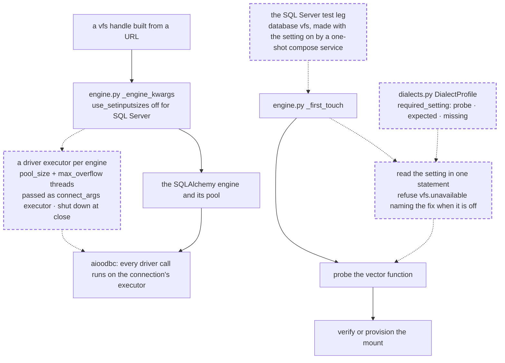

# On SQL Server a read never waits on a write and a commit never waits for a thread: vfs refuses a database with `READ_COMMITTED_SNAPSHOT` off, and gives the driver a thread for every pooled connection

A fix, from two findings of the label fix's research on 2026-11-15 and Clay's rule of the same day that a lock must never hold up every query on a mount many users share. It needs the engine legs: it edits `engine.py` and `dialects.py` under `storage/backends/database/`, the SQL Server leg's database, the CI workflow and the `db_test` skill. It changes no public signature, no schema format, no rights and no Rust; it adds one refusal at first touch on one engine, one profile field and one small type, and no module. It stands on [the SQL Server memo](../../research/2026-11-15-on-sql-server-a-thread-for-every-connection-ends-the-stall-and-snapshot-reads-end-the-reader-waits.md) and on sections 10 and 11 of [the label memo](../../research/2026-11-14-a-mint-must-prove-its-label-against-a-posture-change-committed-inside-its-window.md). No intention: the work is two properties on one engine. It depends on [a row minted across a posture change carries the label the standing posture gives](2026-11-14-a-row-minted-across-a-posture-change-carries-the-label-the-standing-posture-gives.md), active and not built, which lands first: that spec edits `engine.py`, `dialects.py` and `tests/storage/database/test_races.py` too, and decision 7 below finishes two of its nodes. It is not parallel-safe with that spec, and whichever builds second rebases.

## The problem

Labels: EXECUTED means a command ran on 2026-11-15 and the claim reports its output; READ means read in the file cited, at `08c372af`; INFERRED means reasoning. Each claim is from one of the two memos, which hold the runs.

**Every call waits behind an open write.** SQL Server's default lets a plain read take a shared lock and wait for a row another transaction wrote and has not committed. EXECUTED, the label memo's section 10: with one posture write held open on the SQL Server leg as it runs today, all eleven calls made beside it waited until it committed: reads by the system actor, a granted caller, a caller with the posture only and anonymous, a glob, a grep, two rewrites of existing files, two creates and a grant. On Postgres, MariaDB and Oracle only the grant waited. The cause is the database's setting `READ_COMMITTED_SNAPSHOT`, which is off in `master`, where the leg runs (EXECUTED, the SQL Server memo's section 4). vfs neither reads nor requires the setting (READ, `src/vfs/storage/backends/database/engine.py:585-605`). So on a SQL Server database with the default, one slow write holds every reader of the rows it wrote. `AGENTS.md` now says a read never waits on a writer, and that a setting that makes readers wait is refused at first touch or flagged, never designed around.

**A process can stall for good.** aioodbc runs every driver call on an executor, and vfs gives it none, so each call borrows a thread of the loop's default executor: the processor count plus four, 32 at most (READ, `aioodbc/connection.py:68`; `engine.py:219`, `:983-1000`; CPython's `concurrent/futures/thread.py`). vfs builds its engine with SQLAlchemy's default pool, up to 15 connections. When one session holds a row lock and as many other calls block on that row as there are threads, the holder's commit has no thread to run on, and SQL Server's lock wait has no limit, so nothing ends it. EXECUTED, the label memo's section 11, sixteen writers on fourteen threads: with the setting off the unfixed tree hung 2 runs of 2; one was left for 54 minutes. With the setting on the unfixed tree finished 11 of 11, and the label mechanism, which adds one driver call before a mint's commit, hung 4 of 11. A host with two processors has six threads.

**What ends each.** EXECUTED, the SQL Server memo's sections 2 and 3. With the driver given an executor of its own, 15 threads an engine, 19 runs of 19 that completed finished, on both trees, with the setting off and on, and with the loop's own executor at 4 threads. In a database with the setting on, the reader waits end and the whole SQL Server leg passes: 438 tests, as with it off.

## Architecture

What first touch and engine construction do on SQL Server after this spec. Solid is what exists. Dashed is what this spec adds.

Page this changes: none; the architecture folder was retired on 2026-10-30.

## Decisions

### 1. The property: on SQL Server, as on every engine vfs serves, a read never waits on another call's open write, and a call that holds a lock always finds a thread to finish on

It is the first rule under "Per lock" in `AGENTS.md`, held on the one engine where today it does not hold. The first half is the engine's setting; the second is the driver's threads. Neither is the label defect, and both are in the tree today.

### 2. vfs requires `READ_COMMITTED_SNAPSHOT` on, and first touch refuses a SQL Server database that has it off

First touch reads `is_read_committed_snapshot_on` for the current database and, when it is 0, returns one `vfs.unavailable` error, not retryable, whose detail names the setting and the statement that turns it on. It runs before anything is provisioned, so a refused database is left untouched. `AGENTS.md` gives the two choices, refuse or flag; this spec refuses, because a flag leaves a mount serving with every reader exposed to any slow write, and the design is unreleased, so no deployment is broken by the refusal. The same rule already stands for MariaDB in words: vfs requires `innodb_snapshot_isolation` on (READ, `src/vfs/storage/backends/database/dialects.py:588`).

### 3. vfs never turns the setting on itself

`ALTER DATABASE … SET READ_COMMITTED_SNAPSHOT ON` needs the right to alter the database and a moment with no other session in it (INFERRED, the memo's section 4). A library that ran it at first touch would need rights a host app should not hold and could hang behind the host's own sessions. The refusal's detail gives the statement; the person who owns the database runs it once.

### 4. The requirement is declared in the profile as one small type, and first touch reads it for any dialect that declares one

`DialectProfile` gains `required_setting`, a `RequiredSetting` of three facts: `probe`, a statement that returns one scalar; `expected`, the text that scalar must equal; and `missing`, the refusal's detail. It is the shape `VectorFunction` already has for the distance function, a probe and the words for its absence (READ, `engine.py:630-659`). SQLAlchemy models isolation levels and does not model this database setting, so it is a profile fact. SQL Server declares it; the other profiles declare none. MariaDB's own setting can take the same field later, in the change the commit-point spec names; this spec does not add it.

### 5. An engine vfs builds for SQL Server gives the driver an executor of its own, with as many threads as its pool holds connections

`_engine_kwargs` sets the pool's two sizes explicitly for SQL Server, `pool_size=5` and `max_overflow=10`, which are SQLAlchemy's defaults today, and passes `connect_args={"executor": ThreadPoolExecutor(15)}`, the two sizes summed from the same two constants. A connection has one driver call in flight at most, so with a thread for every connection the session that holds a contended row always has a thread for its commit (INFERRED; EXECUTED as the memo's section 2). The size of the host loop's default executor stops mattering to vfs. The rejected alternatives: telling every host to resize its loop's executor, which vfs cannot check and a host will not know to do; raising the loop's default executor from inside a library, which changes a host's process behind its back; and a lock timeout on every statement, which turns a stall into errors on calls that were merely waiting their turn. The threads are named with the prefix `vfs-odbc`, made as needed, and the executor is shut down when the handle closes.

### 6. A host that hands vfs its own session factory is told the rule in the docstring, and nothing is detected

vfs cannot pass an executor to an engine it did not build. The docstring of `_engine_kwargs` already says that borrowed session factories "carry their builder's engine and must apply this themselves" for the bind-size setting; it gains the executor in the same sentence, with the reason in one line. First touch still reads the required setting through a borrowed factory, because that is a statement, not an engine option. What vfs could read of a host's engine to warn about its executor is not known and is named in the memo as an experiment; nothing here waits on it.

### 7. The SQL Server leg runs in a database with the setting on, and two of the label spec's nodes are finished here

`master` cannot have the setting turned on: the server refuses it with error 5058 (EXECUTED). So the leg moves to a database named `vfs`, made by a one-shot service in `docker/compose.test.yml` that waits for the server and runs `CREATE DATABASE vfs` and `ALTER DATABASE vfs SET READ_COMMITTED_SNAPSHOT ON`. The URL in the `db_test` skill, the CI workflow and the Docker README names `vfs`. One node keeps a use for `master`: the refusal of decision 2 is pinned against it. With the leg on snapshot reads and the driver on its own threads, the label spec's node `test_only_a_create_waits_while_a_posture_write_is_open` gains its `[mssql]` leg, and its contention node stops setting 64 threads on the loop and runs on the default.

### 8. The cost is one statement at first touch and at most fifteen idle threads an engine; no verb call changes

First touch runs once a handle, so the probe is one statement a process start. The threads are made on demand and sit idle. No statement is added to any verb, so no count pin moves on any engine. Per the reference deployment: a deployment on SQL Server runs each verb call on the same number of statements as today, and a write held open for a second no longer stalls the about twenty calls a second that arrive beside it.

### 9. The driver's own crashes are not this spec's to fix, and its landing does not wait on them

The memo's sections 5 and 6: the test process died or hung on a fault inside Microsoft's ODBC driver six times in the day's runs, on the unfixed tree as on the patched ones. vfs has no code in the crashed frames. EXECUTED: an executor per engine fell as often as 64 shared threads, two runs against one in 25, so decision 5 does not make it likelier. No run of 25 fell with `pyodbc.pooling` off, which SQLAlchemy's documentation advises and which is too few runs to call the cause. This spec does not set that flag: it is global to the host's process and must be set before any connection is made, so a library cannot set it reliably, and the evidence does not yet carry a requirement. The docstring of `_engine_kwargs` names the flag and SQLAlchemy's advice in one sentence, and the memo names the experiment that settles it.

### 10. Two listed modules grow by what cannot live elsewhere

`engine.py` is held at 1,158 lines and the label spec raises it to 1,160. This spec adds at most 30: the two pool constants, the executor made and kept, its shutdown at close, the probe method and its call in `_first_touch`. `dialects.py` is held at 1,145 and the label spec raises it by at most 25. This spec adds at most 20: the `RequiredSetting` type, the field with its docstring paragraph and one declaration. Each entry is raised to its file's count, and the code review's finding is answered "kept because" with a link to the document that carries that module's reduction: [whether the planner statistics step leaves the engine host](../../research/2026-11-13-whether-the-planner-statistics-step-leaves-the-engine-host.md) and [whether the driver error classifiers leave the dialect module](../../research/2026-11-13-whether-the-driver-error-classifiers-leave-the-dialect-module.md).

## Intent

After this spec, a team that points vfs at a SQL Server database with the default setting is told at the first call, in one sentence, which statement to run, and nothing is created until they do. Once it is on, a read, a search or an edit never waits for someone else's slow write, as on the other engines. And however many callers pile onto one folder at once, the process keeps moving: vfs brings its own threads for the driver and does not depend on how the host sized its event loop.

Flagged to Clay. Four items. First, decision 2 refuses a SQL Server database with the default setting, where a softer choice would warn and serve. Second, decision 7 moves the SQL Server test leg from `master` to a database named `vfs`, in the skill, the CI workflow and the compose file. Third, decision 9: Microsoft's ODBC driver died or hung six times in the day's runs, on the unfixed tree too; an executor per engine does not make it likelier, turning off `pyodbc.pooling` may end it, and that is not yet proved. Fourth, this spec is written to land after the label fix; decision 19 of that spec says what a host on SQL Server must set in between.

## Design

**The order of work.** Tests first: the unit nodes on SQLite and the profile node, seen failing; the compose service and the leg's move to the `vfs` database, with the whole leg green there on the unchanged code; then the refusal node against `master` and the executor nodes on the SQL Server leg, seen failing; then the code; then the label spec's two nodes changed as decision 7 says.

**`src/vfs/storage/backends/database/dialects.py`.** `RequiredSetting`, a `NamedTuple` of `probe`, `expected` and `missing`, beside `VectorFunction`. `DialectProfile.required_setting: RequiredSetting | None = None`, with one paragraph in the class docstring. `MSSQL` declares the probe `SELECT is_read_committed_snapshot_on FROM sys.databases WHERE database_id = DB_ID()`, `expected="1"`, and a `missing` that reads: "vfs requires READ_COMMITTED_SNAPSHOT on this SQL Server database, so a read never waits on another caller's write; run ALTER DATABASE CURRENT SET READ_COMMITTED_SNAPSHOT ON once, with no other session connected, and open the mount again".

**`src/vfs/storage/backends/database/engine.py`.** Two module constants beside `_engine_kwargs`, `_ODBC_POOL_SIZE = 5` and `_ODBC_MAX_OVERFLOW = 10`. `_engine_kwargs` returns, for SQL Server, the existing `use_setinputsizes`, the two pool sizes, and `connect_args` holding a `ThreadPoolExecutor` of their sum with `thread_name_prefix="vfs-odbc"`; its return type widens to `dict[str, Any]`, and its docstring gains the executor and its reason. The host keeps the executor as `driver_executor`, `None` on every other engine and under a borrowed factory, and `close` shuts it down with `shutdown(wait=False)` after the engine is disposed. A method `_probe_required_setting(setting)` runs the probe on a connection with `vfs_no_begin`, as `_read_value_cap` does, and returns `classified(ErrorKind.unavailable, detail=setting.missing)` when the scalar's text differs from `expected`; a raise the retry policy would restart, or one that cost the connection, propagates, as in `_probe_vector_function`. `_first_touch` calls it first, before the file settings, and returns its refusal.

**`docker/compose.test.yml`, `docker/README.md`, `.claude/skills/db_test/SKILL.md`, `.github/workflows/test-dialects.yml`.** A service `mssql-init` under the `mssql` profile, on the server's image, that depends on the server being healthy and runs the two statements of decision 7 with `sqlcmd`, guarded by `IF DB_ID('vfs') IS NULL`. The SQL Server URL names the database `vfs` in the skill, the workflow and the README; the workflow runs the same two statements before its tests where it does not use the compose file.

**Tests.** The unit nodes for the probe live in `tests/storage/database/test_engine.py` and run on SQLite with a profile made by `dataclasses.replace`. The profile node lives in `tests/storage/database/test_dialects.py`. The engine-leg nodes live in `tests/storage/database/test_engine.py`, marked `mssql`. The label spec's two nodes are edited in `tests/storage/database/test_races.py`.

**Scale.** Costed against [the reference deployment](../../../AGENTS.md#the-reference-deployment-the-scale-every-idea-is-filtered-through). Per verb call, per file write, per batch, per index visit and per corpus: nothing. Per process start: one statement. Per lock, the multiplier this spec exists for: with the setting on, an open write holds up only the calls that need the rows it locked for writing, not their readers; and a call that holds a lock other callers need can always commit, so the lock is held for the length of a commit and not for as long as the process has no free thread.

## Scope

In: decisions 1 to 10; the files the Design names; the nodes below; the two baseline entries.

Out. The cause of the driver's crashes (decision 9; the memo's first unsettled item). Detecting a host-built engine's executor (decision 6). MariaDB's `innodb_snapshot_isolation` check, which the commit-point spec names as its own change and which can take decision 4's field. A lock timeout on SQL Server statements. Turning the setting on from vfs (decision 3). The other engines' pools and executors: asyncpg, aiomysql and oracledb do not run their calls on the loop's default executor (INFERRED from the label memo's contention runs, which finished on 14 threads on those three engines). The label spec's own decisions.

## Acceptance criteria

1. `tests/storage/database/test_engine.py::test_a_required_setting_that_reads_wrong_refuses_the_mount`, on SQLite: with the profile replaced to carry `RequiredSetting(probe="SELECT 0", expected="1", missing="set it")`, the first verb returns exactly one error, kind `vfs.unavailable`, not retryable, whose detail is `set it`; a `before_cursor_execute` listener records the probe as the only statement, and no vfs table exists afterwards. With `probe="SELECT 1"` the same call succeeds and the probe ran exactly once across three verb calls.
2. `tests/storage/database/test_dialects.py::test_only_sql_server_declares_a_required_setting`: `MSSQL.required_setting.probe` holds `is_read_committed_snapshot_on` and `DB_ID()`, its `expected` is `"1"`, and its `missing` holds `READ_COMMITTED_SNAPSHOT` and `ALTER DATABASE`; `required_setting` is `None` on `SQLITE`, `POSTGRESQL`, `MARIADB`, `ORACLE`, `GENERIC` and on a profile resolved for an unknown dialect name.
3. `tests/storage/database/test_engine.py::test_first_touch_refuses_a_sql_server_database_with_snapshot_reads_off`, leg `[mssql]`: a handle whose URL is the leg's with the database set to `master` returns, from its first `write`, one `vfs.unavailable` error, not retryable, whose detail holds `READ_COMMITTED_SNAPSHOT`; a second handle on the leg's own database then finds no table of the first handle's schema.
4. `tests/storage/database/test_engine.py::test_a_sql_server_engine_brings_its_own_driver_threads`, leg `[mssql]`: the handle's `driver_executor` is a `ThreadPoolExecutor`; with the running loop's default executor replaced by one whose `submit` raises, a `write`, a `read` and a `grep` each succeed, so no driver call reached the loop's executor; after `close`, `driver_executor.submit` raises `RuntimeError`.
5. `tests/storage/database/test_engine.py::test_only_a_sql_server_engine_is_given_an_executor`, on any interpreter with no server: `_engine_kwargs` for an `mssql+aioodbc` URL returns `pool_size == 5`, `max_overflow == 10`, `use_setinputsizes is False` and a `connect_args["executor"]` that is a `ThreadPoolExecutor`; for a Postgres, a MariaDB, an Oracle and a SQLite URL it returns no `connect_args`, no `pool_size` and no `max_overflow`; and a handle on SQLite has `driver_executor is None`.
6. `tests/storage/database/test_races.py::TestRightsAtCommit::test_only_a_create_waits_while_a_posture_write_is_open` has a leg `[mssql]` and it passes with the assertions of its other three legs; `rg -n 'ThreadPoolExecutor\(64\)' tests/storage/database/test_races.py` exits 1, and `…::test_mints_posture_writes_relabel_chunks_and_a_sweep_finish_without_a_deadlock[mssql]` passes with its assertions unchanged.
7. `rg -n '/master\?driver' .claude/skills/db_test/SKILL.md .github/workflows/test-dialects.yml docker/README.md` exits 1; `rg -c 'READ_COMMITTED_SNAPSHOT ON' docker/compose.test.yml` prints 1; and the SQL Server leg, run through the `db_test` cycle against the `vfs` database, passes whole, with its count in the Landing notes beside the 438 the memo records.
8. `scripts/ci.sh` exits 0; `scripts/docs.sh check` exits 0, since the landing edits docstrings under `src/vfs/`; and the other three engine legs pass whole through the `db_test` cycle, with the counts in the Landing notes.

## Landing notes

Filled in on landing.

## One line

On SQL Server vfs refuses a database whose readers would wait on writers, naming the one statement that fixes it, and brings its own driver threads so a caller holding a lock can always commit.
