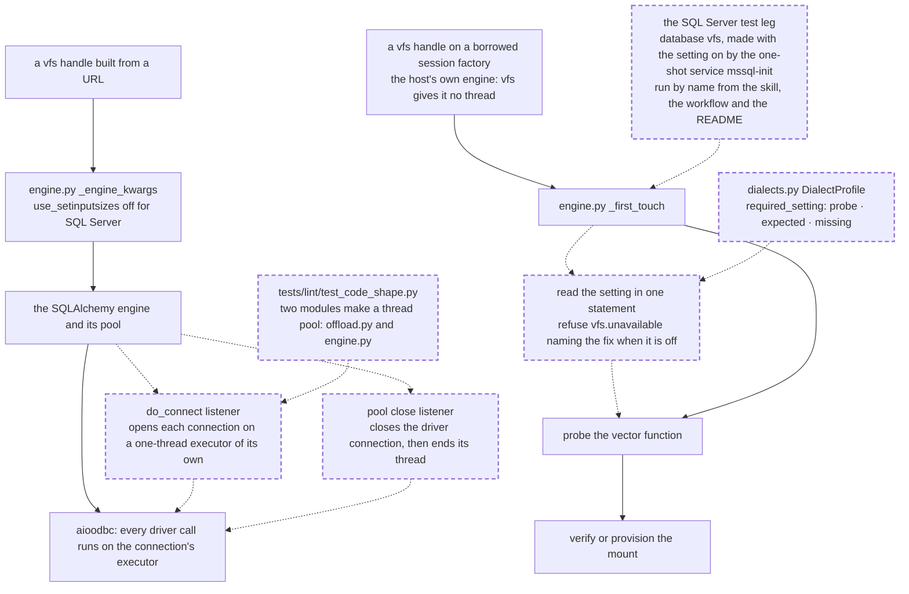

# On SQL Server a read never waits on a write and a commit never waits for a thread: vfs refuses a database with `READ_COMMITTED_SNAPSHOT` off, and gives the driver a thread for every pooled connection

A fix, from two findings of the label fix's research on 2026-11-15 and Clay's rule of the same day that a lock must never hold up every query on a mount many users share. It needs the engine legs: it edits `engine.py` and `dialects.py` under `storage/backends/database/`, the SQL Server leg's database, the CI workflow and the `db_test` skill. It touches the gate: one rule of `tests/lint/test_code_shape.py`, and the dialect workflow. It changes no public signature, no schema format, no rights and no Rust; it adds one refusal at first touch on one engine, one profile field and one small type, and no module. It stands on [the SQL Server memo](../../research/2026-11-15-on-sql-server-a-thread-for-every-connection-ends-the-stall-and-snapshot-reads-end-the-reader-waits.md) and on sections 10 and 11 of [the label memo](../../research/2026-11-14-a-mint-must-prove-its-label-against-a-posture-change-committed-inside-its-window.md), and it was amended on 2026-11-25 for the findings of [its spec review](../../reviews/2026-11-15-on-sql-server-a-read-never-waits-on-a-write-spec-review.md), whose probes on SQL Server it cites. No intention: the work is two properties on one engine. It depends on [a row minted across a posture change carries the label the standing posture gives](../archive/2026-11-14-a-row-minted-across-a-posture-change-carries-the-label-the-standing-posture-gives.md), landed on 2026-11-15 as `c92f1d3`: this spec is built on that tree, and decision 7 below finishes two of its test nodes. It is not parallel-safe: it edits `tests/lint/allowlist.py` and `tests/lint/test_code_shape.py`, which other active specs edit too ([the rights compile spec](2026-11-14-the-rights-compile-is-the-same-at-every-world-size.md) sets another entry of the first), so whichever builds second rebases those two files.

## The problem

Labels: EXECUTED means a command ran and the claim reports its output; READ means read in the file cited; INFERRED means reasoning. A claim with no date ran on 2026-11-15 or was read at `08c372af`, and is from one of the two memos, which hold the runs. A claim marked "the review's probe" was EXECUTED by the spec review on SQL Server on 2026-11-15 and is READ here in the review. A claim dated 2026-11-25 was run or read that day at `3166469`, in a container with no database server and no ODBC driver; the review's Disposition records those runs.

**Every call waits behind an open write.** SQL Server's default lets a plain read take a shared lock and wait for a row another transaction wrote and has not committed. EXECUTED, the label memo's section 10: with one posture write held open on the SQL Server leg as it runs today, all eleven calls made beside it waited until it committed: reads by the system actor, a granted caller, a caller with the posture only and anonymous, a glob, a grep, two rewrites of existing files, two creates and a grant. On Postgres, MariaDB and Oracle only the grant waited. The cause is the database's setting `READ_COMMITTED_SNAPSHOT`, which is off in `master`, where the leg runs (EXECUTED, the SQL Server memo's section 4). vfs neither reads nor requires the setting (READ, `src/vfs/storage/backends/database/engine.py:585-605`). So on a SQL Server database with the default, one slow write holds every reader of the rows it wrote. `AGENTS.md` now says a read never waits on a writer, and that a setting that makes readers wait is refused at first touch or flagged, never designed around.

**A process can stall for good.** aioodbc runs every driver call on an executor, and vfs gives it none, so each call borrows a thread of the loop's default executor: the processor count plus four, 32 at most (READ, `aioodbc/connection.py:68`; `engine.py:219`, `:983-1000`; CPython's `concurrent/futures/thread.py`). vfs builds its engine with SQLAlchemy's default pool, up to 15 connections. When one session holds a row lock and as many other calls block on that row as there are threads, the holder's commit has no thread to run on, and SQL Server's lock wait has no limit, so nothing ends it. EXECUTED, the label memo's section 11, sixteen writers on fourteen threads: with the setting off the unfixed tree hung 2 runs of 2; one was left for 54 minutes. With the setting on the unfixed tree finished 11 of 11, and the label mechanism, which adds one driver call before a mint's commit, hung 4 of 11. A host with two processors has six threads.

**A pool of driver threads as wide as the connection pool still stalls once a waiting call is cancelled.** A cancellation inside a statement makes SQLAlchemy invalidate the connection, and the driver's close of it then waits for that statement to end (READ on 2026-11-25, `engine.py:866-870`, the tree's own words). On aioodbc that close is one more driver call, sent while the first is still in flight. The review's probe B, three connections and three driver threads: one cancelled waiter took a second thread for its connection's close, all three threads were busy with two requests blocked on the server, the holder's commit sat queued with no thread, and it ran the moment a fourth thread was allowed. EXECUTED on 2026-11-25 against a stand-in for the driver, which is SQLAlchemy 2.0.52 and aioodbc 0.5.0 as installed with pyodbc replaced by a module that models one row lock and makes a connection's close wait for its statement, as probe B saw the driver do: on the loop's executor, and on one executor an engine, each as wide as the pool, with every waiter cancelled once, the holder's commit never ran, at 3 connections and at 15. A host that wraps a call in its own timeout cancels in exactly this way.

**The setting reads as a boolean through the driver.** The review's probe A: `SELECT is_read_committed_snapshot_on …` answers a Python `bool` through pyodbc, `False` in `master` and `True` in a database with the setting on, whose text is never `1`; cast to an integer it answers `0` and `1`. The memo ran the statement only in `sqlcmd`, which prints 0 and 1.

**What ends each.** EXECUTED, the SQL Server memo's sections 2 and 3. With the driver given an executor of its own, 15 threads an engine, 19 runs of 19 that completed finished, on both trees, with the setting off and on, and with the loop's own executor at 4 threads; no call was cancelled in those runs. In a database with the setting on, the reader waits end and the whole SQL Server leg passes: 438 tests, as with it off. EXECUTED on 2026-11-25 against the same stand-in: with every connection opened on a one-thread executor of its own, the holder's commit ran in four runs of four, at 3 and at 15 connections with every waiter cancelled once and twice, and every cancelled waiter ended cancelled. That shape has not run on SQL Server; the build runs it there first, under criteria 4, 6 and 9.

## Architecture

What first touch and engine construction do on SQL Server after this spec. Solid is what exists. Dashed is what this spec adds.

Page this changes: none; the architecture folder was retired on 2026-10-30. A new term: a driver thread is a one-thread executor that belongs to one driver connection, made when the connection is opened and ended when it closes.

## Decisions

### 1. The property: on SQL Server, as on every engine vfs serves, a read never waits on another call's open write, and a call that holds a lock always finds a thread to finish on, whether or not the calls waiting behind it are cancelled

It is the first rule under "Per lock" in `AGENTS.md`, held on the one engine where today it does not hold. The first half is the engine's setting; the second is the driver's threads. Neither is the label defect, and both are in the tree today. The second half names cancellation because a host's own timeout is a cancellation, and the review's probe B showed that a design which holds only while no waiting call is cancelled does not hold.

### 2. vfs requires `READ_COMMITTED_SNAPSHOT` on, and first touch refuses a SQL Server database that has it off

First touch reads `is_read_committed_snapshot_on` for the current database, cast to an integer, and, when it is 0, returns one `vfs.unavailable` error, not retryable, whose detail names the setting and the statement that turns it on. It runs before anything is provisioned, so a refused database is left untouched. `AGENTS.md` gives the two choices, refuse or flag; this spec refuses, because a flag leaves a mount serving with every reader exposed to any slow write, and the design is unreleased, so no deployment is broken by the refusal. The same rule already stands for MariaDB in words: vfs requires `innodb_snapshot_isolation` on (READ on 2026-11-25, `src/vfs/storage/backends/database/dialects.py:611`).

### 3. vfs never turns the setting on itself

`ALTER DATABASE … SET READ_COMMITTED_SNAPSHOT ON` needs the right to alter the database and a moment with no other session in it (INFERRED, the memo's section 4). A library that ran it at first touch would need rights a host app should not hold and could hang behind the host's own sessions. The refusal's detail gives the statement; the person who owns the database runs it once.

### 4. The requirement is declared in the profile as one small type, and first touch reads it for any dialect that declares one

`DialectProfile` gains `required_setting`, a `RequiredSetting` of three facts: `probe`, a statement that returns one scalar; `expected`, the text that scalar must equal; and `missing`, the refusal's detail. `probe` returns an integer or a text scalar, never a driver-typed boolean: first touch compares the scalar's text, and SQL Server's `bit` column arrives through the driver as a boolean whose text is `True` (the review's probe A), so SQL Server's probe casts it. It is the shape `VectorFunction` already has for the distance function, a probe and the words for its absence (READ on 2026-11-25, `dialects.py:131-147` and `engine.py:633-661`). SQLAlchemy models isolation levels and does not model this database setting, so it is a profile fact. SQL Server declares it; the other profiles declare none. MariaDB's own setting can take the same field later, in the change the commit-point spec names; this spec does not add it.

### 5. An engine vfs builds for SQL Server opens every driver connection on a thread of its own, and that thread ends when the connection closes

Where vfs builds the engine and its dialect is SQL Server, it listens for two events on it. A `do_connect` listener makes a `ThreadPoolExecutor` of one thread, named with the prefix `vfs-odbc`, opens the connection itself with that executor (`dialect.connect(*cargs, **cparams, executor=…)`, the override the event documents), keeps the executor in the connection record's `info`, and returns the connection; a connect that raises shuts its executor down and raises again. A pool `close` listener closes the driver connection through `run_async` and then shuts that executor down with `shutdown(wait=False)`; SQLAlchemy's own close follows and finds the connection closed (READ on 2026-11-25, SQLAlchemy 2.0.52, `sqlalchemy/connectors/aioodbc.py:99-104`). The thread is shut only after the driver's close has returned, because until then SQLAlchemy can still hand the connection a call, and a shut executor refuses one with `RuntimeError`: a close that raises is left to SQLAlchemy's own close, which logs it, and a close that is cancelled raises the cancellation on; in both, the thread ends when its connection object is collected (READ on 2026-11-25, CPython 3.13, `concurrent/futures/thread.py:101-103`: a worker exits when its executor has been collected). The host holds no executor, so `close` has nothing of the driver's to shut: disposing the engine closes its connections, each close ends its own thread, and a verb after `close` opens new connections on new threads, as the close contract requires (READ on 2026-11-25, `engine.py:519-526`: "No close is one-shot").

Why a thread for each connection, and not one pool an engine. aioodbc sends every call of a connection to that connection's executor (READ on 2026-11-25, aioodbc 0.5.0, `aioodbc/connection.py:65-69`). With one thread of its own, a connection's calls run in the order they were sent and never take a thread another connection needs. So the session that holds a contended row has an idle thread whenever it has no call in flight, and its commit runs; and a cancelled waiter's close queues behind that waiter's own statement, on that waiter's own thread (INFERRED from the READ fact; EXECUTED on 2026-11-25 against the stand-in the problem section describes: the holder's commit ran in four runs of four, and 8 connections checked out at once ran on 8 threads, one a connection over every call). The reviewed draft gave an engine one executor as wide as its pool, the shape the memo ran. That shape rests on a connection having one driver call in flight at most, which the review's probe B showed false once a waiting call is cancelled. With a thread for each connection the loop's default executor stops mattering to vfs, and so do the pool's sizes: vfs sets neither, and the threads follow the connections whatever the pool holds. The thread is ended at the connection's close, and not left to the collector, because a cancelled call's connection sits in a reference cycle (EXECUTED on 2026-11-25, the stand-in, 100 rounds of fourteen cancelled waiters: with the close ending the thread, 1 to 14 driver threads were alive after a round; with the end left to collection, 15 to 127). What is not evidenced: this shape has not run on SQL Server or against Microsoft's driver. Its first run there is the build's: criterion 4 for the threads' life, criterion 6 for the contention run on the loop's default executor, criterion 9 for a full pool of cancelled waiters.

The rejected alternatives: telling every host to resize its loop's executor, which vfs cannot check and a host will not know to do; raising the loop's default executor from inside a library, which changes a host's process behind its back; a lock timeout on every statement, which turns a stall into errors on calls that were merely waiting their turn; one executor an engine at twice the pool's width, which is not a bound for a call cancelled twice (INFERRED, the review's finding M1); and running each call in a task its caller's cancellation does not reach, which changes what a cancelled verb does (decision 12).

### 6. A host that hands vfs its own session factory is told the rule where it reads, and nothing is detected

vfs cannot open the connections of an engine it did not build. The docstring of `_engine_kwargs` already says that borrowed session factories "carry their builder's engine and must apply this themselves" for the bind-size setting; it gains the driver threads in the same sentence, with the reason in one line. A borrowing host does not read a private helper, so the same rule goes in the module docstring of `backend.py`, where the borrowed path is described to hosts (READ on 2026-11-25, `src/vfs/storage/backends/database/backend.py:15-25`): on SQL Server a host that lends its session factory gives every driver connection of its engine an executor of one thread of its own, handed over in a `do_connect` listener, because the driver otherwise runs on the loop's own threads and a caller holding a lock can be left without one. First touch still reads the required setting through a borrowed factory, because that is a statement, not an engine option. What vfs could read of a host's engine to warn about its threads is not known and is named in the memo as an experiment; nothing here waits on it.

### 7. The SQL Server leg runs in a database with the setting on, made by a service every caller runs by name, and two of the label spec's nodes are finished here

`master` cannot have the setting turned on: the server refuses it with error 5058 (EXECUTED). So the leg moves to a database named `vfs`, made by a one-shot service, `mssql-init`, in `docker/compose.test.yml`, that waits for the server and runs `CREATE DATABASE vfs` and `ALTER DATABASE vfs SET READ_COMMITTED_SNAPSHOT ON`. The service is run by name, `docker compose -f docker/compose.test.yml run --rm mssql-init`, as a step after the server is healthy: in the workflow, after each of the skill's two commands that start the server, and in the README's quick start. It is run by name because every caller starts the server by name, `up -d --wait mssql` (READ on 2026-11-25, `.github/workflows/test-dialects.yml:59-62`, `.claude/skills/db_test/SKILL.md:54` and `:177`, `docker/README.md:42`), and naming a service starts it and what it depends on, never a service that depends on it (INFERRED from Compose's documented behaviour, as the review's finding M3 has it; not run, and criterion 7's cycle starts from `down -v`, so the build runs the commands as written). The URL in the `db_test` skill, the CI workflow and the Docker README names `vfs`. One node keeps a use for `master`: the refusal of decision 2 is pinned against it. With the leg on snapshot reads and the driver on its own threads, the label spec's node `test_only_a_create_waits_while_a_posture_write_is_open` gains its `[mssql]` leg, and its contention node stops setting 64 threads on the loop and runs on the default.

### 8. The cost is one statement at first touch and one idle thread for each open driver connection; no verb call changes

First touch runs once a handle, so the probe is one statement a process start. A process holds one driver thread for each open connection of each SQL Server engine vfs built: at most fifteen an engine under SQLAlchemy's default pool, so a host with ten such mounts holds at most 150, and the contention node's eighteen handles at most 270. A thread is idle unless its connection has a call in flight; it is made with its connection and ends after that connection's close, and `shutdown(wait=False)` returns before it ends. Making a thread costs far less than the login it accompanies (INFERRED). No statement is added to any verb, so no count pin moves on any engine. Per the reference deployment: a deployment on SQL Server runs each verb call on the same number of statements as today, and a write held open for a second no longer stalls the about twenty calls a second that arrive beside it.

### 9. The driver's own crashes are not this spec's to fix, and its landing does not wait on them

The memo's sections 5 and 6: the test process died or hung on a fault inside Microsoft's ODBC driver six times in the day's runs, on the unfixed tree as on the patched ones. vfs has no code in the crashed frames. EXECUTED: the fault fell with an executor per engine four times in 46 runs and without one twice in 60; the counts are too few to say whether giving the driver its own threads changes its rate, none was taken on the Linux driver the workflow uses, and none was taken with a thread for each connection, the shape decision 5 builds. No run of 25 fell with `pyodbc.pooling` off, which SQLAlchemy's documentation advises and which is too few runs to call the cause. This spec does not set that flag: it is global to the host's process and must be set before any connection is made, so a library cannot set it reliably, and the evidence does not yet carry a requirement. The docstring of `_engine_kwargs` names the flag and SQLAlchemy's advice in one sentence, and the memo names the experiment that settles it. How a landing run tells a driver fault from this spec's failure is the last paragraph of the acceptance criteria.

### 10. Two listed modules grow by what cannot live elsewhere

`engine.py` is held at 1,160 lines and `dialects.py` at 1,170 (EXECUTED on 2026-11-25, `wc -l`; READ, `tests/lint/allowlist.py:31-32`). This spec adds at most 60 to `engine.py`: the two listeners with their constant, their registration, the probe method and its call in `_first_touch`, and the docstring's sentences. It adds at most 30 to `dialects.py`: the `RequiredSetting` type, the field with its docstring paragraph and one declaration. The listeners stay in `engine.py` because they are part of how the host builds its engine, beside `_engine_kwargs` and the connection hooks already there. Each entry is raised to its file's count, and the code review's finding is answered "kept because" with a link to the document that carries that module's reduction: [whether the planner statistics step leaves the engine host](../../research/2026-11-13-whether-the-planner-statistics-step-leaves-the-engine-host.md) and [whether the driver error classifiers leave the dialect module](../../research/2026-11-13-whether-the-driver-error-classifiers-leave-the-dialect-module.md).

### 11. `engine.py` is the second module that makes a thread pool, a named departure from decision 5 of the bounded-work spec

Decision 5 of [bounded work has one home](../archive/2026-11-07-bounded-work-has-one-home.md) is "One pool per process", its criterion 5 is that `ThreadPoolExecutor(` appears on exactly one line of `src/vfs`, and the code-shape lint holds it (READ on 2026-11-25, `tests/lint/test_code_shape.py:539-541`). This spec departs from it for one kind of thread. That pool is one a process because one native call already fills the machine; a driver thread does no work of ours and waits on the server, and it must belong to one connection, so sharing the process pool, or any pool, would put the stall back. The rule `tests/lint/test_code_shape.py::test_the_clock_the_deadline_and_the_cadence_have_one_home` is edited to expect exactly two makers, `src/vfs/offload.py` and `src/vfs/storage/backends/database/engine.py`, one line each, so the docstrings this spec writes name the class and never write it as a call. EXECUTED on 2026-11-25: the rule's own line search, replayed on the tree's sources with one maker line added to `engine.py`, lists those two files in that order, fails the rule as it stands and passes the two-maker form, and a second matching line in `engine.py`, a docstring's, fails both. The rule that one module hops off the process pool is untouched: vfs adds no hop, and the driver makes its own.

### 12. This spec does not change what a cancelled call does; it changes which thread its connection's close waits on

A call cancelled while it waits on a row ends as it does today: SQLAlchemy invalidates its connection, the driver's close waits for the statement the server has not answered, and the caller's task ends cancelled once the server answers (READ on 2026-11-25, `engine.py:866-870`; EXECUTED on 2026-11-25 against the stand-in: every cancelled waiter ended cancelled, after the holder's commit). Its transaction is rolled back with its connection (INFERRED; criterion 9 counts that none of the cancelled writes left a file). The fix is only that the close waits on its own connection's thread. Two other designs would also answer the review's finding M1, and neither is taken. Keeping the driver call from the cancellation, as the analysis pass keeps its own (READ on 2026-11-25, `engine.py:863-887`), lets a cancelled write run on and commit after its caller was told it was cancelled, on one engine only: a change to what every verb does under cancellation, which this fix does not need. Interrupting the statement through the driver, so that a cancelled call ends at once, is something vfs does on no server engine and needs a study of the driver's cancel call on a connection in use; it is left out of this spec.

## Intent

After this spec, a team that points vfs at a SQL Server database with the default setting is told at the first call, in one sentence, which statement to run, and nothing is created until they do. Once it is on, a read, a search or an edit never waits for someone else's slow write, as on the other engines. And however many callers pile onto one folder at once, and however many of them give up waiting, the process keeps moving: on an engine vfs builds, vfs brings a thread for each driver connection and does not depend on how the host sized its event loop; a host that lends its own engine sizes the driver's threads itself.

Flagged to Clay. Five items. First, decision 2 refuses a SQL Server database with the default setting, where a softer choice would warn and serve. Second, decision 7 moves the SQL Server test leg from `master` to a database named `vfs`, in the skill, the CI workflow and the compose file. Third, decision 9: Microsoft's ODBC driver died or hung six times in the day's runs, on the unfixed tree too; the runs do not show whether giving the driver its own threads makes that likelier, turning off `pyodbc.pooling` may end it, and that is not yet proved. Fourth, the thread shape changed in answer to the review: a thread for each connection, where the memo ran one pool of fifteen an engine, because a cancelled waiting call takes a second thread from a shared pool (decision 5). The new shape has run only against a stand-in for the driver. Its first run on SQL Server is the build's, and a failure of criterion 4, 6 or 9 there comes back as a report, not as a change of design made during the build. Fifth, the label fix landed first, on 2026-11-15; until this spec lands, decision 19 of that spec says what a host on SQL Server must set.

## Design

**The order of work.** Tests first: the unit nodes on SQLite, the profile node and the listener node, seen failing; the lint rule edited to expect two makers, seen failing; the compose service, the commands that run it and the leg's move to the `vfs` database, with the whole leg green there on the unchanged code, from `down -v`; then the refusal node against `master` and the thread nodes on the SQL Server leg, seen failing, the cancelled-waiters node under a short `--timeout` because its red is a hang; then the code; then the label spec's two nodes changed as decision 7 says; then the docstrings.

**`src/vfs/storage/backends/database/dialects.py`.** `RequiredSetting`, a `NamedTuple` of `probe`, `expected` and `missing`, beside `VectorFunction`; its docstring says `probe` returns an integer or a text scalar, never a driver-typed boolean. `DialectProfile.required_setting: RequiredSetting | None = None`, with one paragraph in the class docstring. `MSSQL` declares the probe `SELECT CAST(is_read_committed_snapshot_on AS int) FROM sys.databases WHERE database_id = DB_ID()`: the column is a `bit`, which the driver returns as a boolean whose text is `True`, and the cast makes the scalar's text `1` or `0`. It declares `expected="1"`, and a `missing` that reads: "vfs requires READ_COMMITTED_SNAPSHOT on this SQL Server database, so a read never waits on another caller's write; run ALTER DATABASE CURRENT SET READ_COMMITTED_SNAPSHOT ON once, with no other session connected, and open the mount again".

**`src/vfs/storage/backends/database/engine.py`.** A module constant `_DRIVER_THREAD = "vfs-odbc"`, which is the threads' name prefix and the key under which a connection record's `info` holds its executor. Two module helpers beside `_engine_kwargs`. `_open_on_its_own_thread(dialect, record, cargs, cparams)` makes `ThreadPoolExecutor(1, thread_name_prefix=_DRIVER_THREAD)`, calls `dialect.connect(*cargs, **cparams, executor=…)`, stores the executor in `record.info` and returns the connection; on any raise from the connect it shuts the executor down with `shutdown(wait=False)` and raises again. `_close_and_end_its_thread(dbapi_connection, record)` does nothing for a record whose `info` holds no executor; otherwise it awaits the driver's close with `dbapi_connection.run_async(lambda driver: driver.close())` and then calls `shutdown(wait=False)`; when the close raises an `Exception` it returns without shutting, and a cancellation propagates. Where the host builds its engine (`engine.py:220`), and that engine's dialect name is `mssql`, it registers the first as a `do_connect` listener and the second as a `close` listener on the sync engine, beside `_rearm_on_fresh_connection`; a host on a borrowed factory registers neither. `_engine_kwargs` keeps its return value and its type; its docstring gains the threads rule for a borrowed factory, with the reason in one line, and the sentence on `pyodbc.pooling`. The host's `close` is unchanged. A method `_probe_required_setting(setting)` runs the probe on a connection with `vfs_no_begin`, as `_read_value_cap` does, reads it with `scalar_one()`, and returns `classified(ErrorKind.unavailable, detail=setting.missing)` when the scalar's text differs from `expected`; any raise from the probe propagates to first touch's retry and classifier (`engine.py:307-324`), so a busy, dropped or misconfigured engine is never reported as the setting being off. `_first_touch` calls it first, before the file settings, and returns its refusal.

**The docstrings a host reads, and one the landing makes false.** The module docstring of `backend.py` gains, where it describes the borrowed path, the sentence of decision 6. The module docstring of `labels.py` loses its sentence on the loop's threads (lines 63 to 66 today) and says instead that an engine vfs builds gives each driver connection a thread of its own, and that a host that lends its own session factory does the same on its engine.

**`docker/compose.test.yml`, `docker/README.md`, `.claude/skills/db_test/SKILL.md`, `.github/workflows/test-dialects.yml`.** A service `mssql-init` under the `mssql` profile, on the server's image, that depends on the server being healthy and makes two `sqlcmd` calls: `IF DB_ID('vfs') IS NULL CREATE DATABASE vfs`, then the `ALTER` of decision 7, issued only when `sys.databases` reads the setting as off for `vfs`, so the service can run a second time beside a live leg (INFERRED: the `ALTER` needs the database to itself). The workflow gains a step after "Start", for the `mssql` leg only, that runs `docker compose -f docker/compose.test.yml run --rm mssql-init`. The skill gains the same command after the command that starts the heavyweights and, with its `-p` project name, after the phantom-record start command. The README's quick start gains it after the command that starts the heavier engines. The SQL Server URL names the database `vfs` in the skill, the workflow and the README's table, and setup note 3 of `docker/README.md` names the `vfs` database and the init service where it names `master` today.

**`tests/lint/test_code_shape.py`, `tests/lint/allowlist.py`.** The pool rule of `test_the_clock_the_deadline_and_the_cadence_have_one_home` expects the two makers of decision 11, in path order, and its docstring says two modules make a pool. The `engine.py` and `dialects.py` entries of `MODULE_LINE_BASELINE` are raised to the files' counts.

**Tests.** The unit nodes for the probe and for the two listeners live in `tests/storage/database/test_engine.py`; the probe's run on SQLite with a profile made by `dataclasses.replace`, and the listeners' call the two helpers with stand-ins for the dialect, the record and the adapted connection, so they need no driver. The profile node lives in `tests/storage/database/test_dialects.py`. The engine-leg nodes live in `tests/storage/database/test_engine.py`, marked `mssql`. `server_storage` in `tests/support/server_schemas.py` gains a keyword `database`, `None` by default, that replaces the URL's database for that one storage and its schema, so a node can open a mount on `master`. The label spec's two nodes are edited in `tests/storage/database/test_races.py`.

**Scale.** Costed against [the reference deployment](../../../AGENTS.md#the-reference-deployment-the-scale-every-idea-is-filtered-through). Per verb call, per file write, per batch, per index visit and per corpus: nothing. Per process start: one statement. Per connection opened: one thread made, and one ended at its close; the pool keeps five connections open and opens up to ten more under load, so threads are made at the rate logins are. Per lock, the multiplier this spec exists for: with the setting on, an open write holds up only the calls that need the rows it locked for writing, not their readers; and a call that holds a lock other callers need can always commit, cancelled waiters or not, so the lock is held for the length of a commit and not for as long as the process has no free thread.

## Scope

In: decisions 1 to 12; the files the Design names, `tests/lint/test_code_shape.py` and `tests/support/server_schemas.py` among them; the nodes below; the two baseline entries.

Out. The cause of the driver's crashes (decision 9; the memo's first unsettled item). Detecting a host-built engine's threads (decision 6). MariaDB's `innodb_snapshot_isolation` check, which the commit-point spec names as its own change and which can take decision 4's field. A lock timeout on SQL Server statements. Turning the setting on from vfs (decision 3). Ending a cancelled call before the server answers its statement, and changing what a cancelled verb leaves behind (decision 12). The pool's sizes, which stay SQLAlchemy's defaults. The other engines' pools and executors: asyncpg, aiomysql and oracledb do not run their calls on the loop's default executor (INFERRED from the label memo's contention runs, which finished on 14 threads on those three engines). The label spec's own decisions.

## Acceptance criteria

1. `tests/storage/database/test_engine.py::test_a_required_setting_that_reads_wrong_refuses_the_mount`, on SQLite: with the profile replaced to carry `RequiredSetting(probe="SELECT 0", expected="1", missing="set it")`, the first verb returns exactly one error, kind `vfs.unavailable`, not retryable, whose detail is `set it`; a `before_cursor_execute` listener records the probe as the only statement, and no vfs table exists afterwards. With `probe="SELECT 1"` the same call succeeds and the probe ran exactly once across three verb calls.
2. `tests/storage/database/test_dialects.py::test_only_sql_server_declares_a_required_setting`: `MSSQL.required_setting.probe` holds `CAST(is_read_committed_snapshot_on AS int)` and `DB_ID()`, its `expected` is `"1"`, and its `missing` holds `READ_COMMITTED_SNAPSHOT` and `ALTER DATABASE`; `required_setting` is `None` on `SQLITE`, `POSTGRESQL`, `MARIADB`, `ORACLE`, `GENERIC` and on a profile resolved for an unknown dialect name.
3. `tests/storage/database/test_engine.py::test_first_touch_refuses_a_sql_server_database_with_snapshot_reads_off`, leg `[mssql]`: a handle on `master`, in a schema the node has made there as the leg's fixture makes one, so that provisioning there would succeed, returns, from its first `write`, one `vfs.unavailable` error, not retryable, whose detail holds `READ_COMMITTED_SNAPSHOT`; a plain SQLAlchemy connection to `master` then counts zero rows in `INFORMATION_SCHEMA.TABLES` for that schema; and the same first `write` through a handle on the leg's own database succeeds. The build sees the count go red with the probe moved after `_verify_or_provision`.
4. `tests/storage/database/test_engine.py::test_a_sql_server_engine_gives_each_connection_a_thread_of_its_own`, leg `[mssql]`, counting only threads named `vfs-odbc…` that did not exist before the handle was built: `sqlalchemy.event.contains` finds both listeners of decision 5 on the handle's engine; with the running loop's default executor replaced by one whose `submit` raises, a `write`, a `read` and a `grep` each succeed, so no driver call reached the loop's executor; with three connections checked out of the handle's engine at once, the threads alive number the pool's connections, checked in and checked out; after `close`, every thread seen is joined and none is alive; a `stat` then succeeds, with one new thread alive; and after a second `close` none is alive.
5. `tests/storage/database/test_engine.py::test_a_driver_thread_is_one_connections_own_and_ends_with_it`, with no server and no driver, calling the two helpers with stand-ins: two connects hand the driver two different `ThreadPoolExecutor`s, each kept in its record's `info`; one of them, given a call that waits and then a second call, has not started the second while the first has not returned, and runs both on one thread; after the close helper the stand-in's close was awaited once and that executor's `submit` raises `RuntimeError`; when the stand-in's close raises, the helper returns and the executor still takes a call; a connect that raises is raised again and its executor's `submit` raises `RuntimeError`; a record with no executor in `info` awaits no close. A handle on SQLite has neither listener, and `_engine_kwargs` for an `mssql+aioodbc` URL is still exactly `{"use_setinputsizes": False}`.
6. `tests/storage/database/test_races.py::TestRightsAtCommit::test_only_a_create_waits_while_a_posture_write_is_open` has a leg `[mssql]` and it passes with the assertions of its other three legs; `rg -n 'ThreadPoolExecutor\(64\)' tests/storage/database/test_races.py` exits 1, and `…::test_mints_posture_writes_relabel_chunks_and_a_sweep_finish_without_a_deadlock[mssql]` passes with its assertions unchanged.
7. `rg -n '/master\?driver' .claude/skills/db_test/SKILL.md .github/workflows/test-dialects.yml docker/README.md` exits 1; `rg -n 'Tests target the .master. database' docker/README.md` exits 1; `rg -c 'READ_COMMITTED_SNAPSHOT ON' docker/compose.test.yml` prints 1; `rg -c 'mssql-init' .github/workflows/test-dialects.yml .claude/skills/db_test/SKILL.md docker/README.md` prints a count of at least 1 for each of the three files; and the SQL Server leg, run through the `db_test` cycle from `down -v` with the commands as the skill writes them, against the `vfs` database, passes whole, with its count in the Landing notes beside the 438 the memo records.
8. `scripts/ci.sh` exits 0; `scripts/docs.sh check` exits 0, since the landing edits docstrings under `src/vfs/`; and the other three engine legs pass whole through the `db_test` cycle, with the counts in the Landing notes.
9. `tests/storage/database/test_engine.py::test_cancelled_waiters_never_take_the_holders_thread`, leg `[mssql]`: on one handle, a `posture` write is stopped at the seam `posture:after-stamp`; fourteen `write` calls, each creating one file, are started on the same handle, which with the posture write fill its pool of fifteen; a connection of the node's own counts fourteen requests in `sys.dm_exec_requests` that wait on a lock and whose statement names the node's schema; all fourteen tasks are cancelled and the loop is yielded once; the seam returns. Then the posture write returns success, each of the fourteen tasks ends cancelled, the same count on the server is zero, none of the fourteen files exists, a fifteenth `write` on the same handle succeeds, and after `close` no thread named `vfs-odbc…` that the handle made is alive. Returns and counts, never a clock.
10. `tests/lint/test_code_shape.py::test_the_clock_the_deadline_and_the_cadence_have_one_home` passes, expecting the two makers; `rg -c 'ThreadPoolExecutor\(' src/vfs/offload.py src/vfs/storage/backends/database/engine.py` prints 1 for each file; `rg -n 'thread for every pooled connection' src/vfs/storage/backends/database/labels.py` exits 1; and `rg -c 'do_connect' src/vfs/storage/backends/database/backend.py` prints at least 1.

Deadlines and driver faults. Every SQL Server node and leg above runs under `--timeout=900 --timeout-method=thread`, a deadline for each test that stops a hung run and is never an assertion; the thread method ends the process, which a run with every driver thread blocked cannot do for itself. A run that ends with the process dead and a crash report whose crashed thread is inside `libmsodbcsql`, or with an answer carrying SQLSTATE `08S01`, is a driver fault under decision 9: it is recorded in the Landing notes with its report and run again. A run stopped by the deadline with a request blocked on the server (`sys.dm_exec_requests` with `blocking_session_id <> 0`) is this spec's failure.

## Landing notes

Filled in on landing.

## One line

On SQL Server vfs refuses a database whose readers would wait on writers, naming the one statement that fixes it, and opens every driver connection on a thread of its own so a caller holding a lock can always commit, however many waiters give up.
