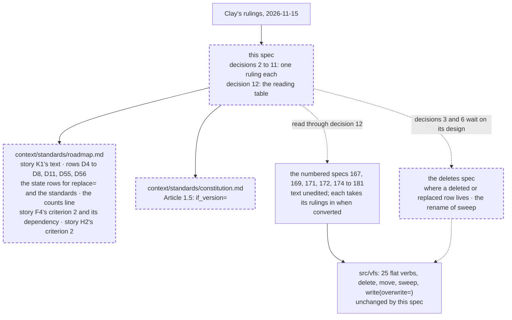

# The kernel's public names and argument families are ruled: `delete` and `move` stay, the irreversible verb is `destroy`, names are flat, the paging key is a path on `Result`, a move keeps the moved file's identity, the transfer flag is `replace=`, and the integrity, replay and history words are fixed

A docs change. It records the rulings Clay made on 2026-11-15 for roadmap story K1 as numbered decisions, corrects the roadmap rows and story text that waited on them, and corrects one word of the constitution. It changes no file under `src/`, `tests/` or `crates/`, so it changes no public API, no schema format, no rights and no engine code by itself, and it needs no engine leg: the stories that build each ruled name carry those gates. It stands on [the eight open kernel rulings memo](../../research/2026-11-15-the-eight-open-kernel-rulings-against-the-tree-and-the-specs-as-they-stand.md). No intention: the work is one roadmap story. It depends on no spec. It edits `context/standards/roadmap.md`, which [the rights-compile spec](2026-11-14-the-rights-compile-is-the-same-at-every-world-size.md) also edits, at story I5 and nowhere this spec touches, and `context/standards/constitution.md`, which no other active dated spec edits.

## The problem

Labels: READ means read in the file cited, at `08c372af`; EXECUTED means a command ran and the claim reports its output; INFERRED means reasoning. Each claim is from the memo above, which cites the file and line or the command.

The kernel plan was written as a decision record, ADR 087 of 2026-10-24. It set the kernel's shape in seventeen pins and left eight items for Clay to rule on. Twelve numbered specs stand on it. Decision records were removed from the tree on 2026-10-30 (READ, commit `3667fec2`), with the architecture pages. So the eight items are undecided in a document that no longer exists, and the specs that need them still cite it 151 times (EXECUTED).

Roadmap story K1 asks for the rulings, and it is worded against the files that are gone: its first criterion asks for a status line on the record, its third for an empty list on an architecture page, and its second for a search that would mean rewriting a recorded probe output and the checked-off record of a built spec (READ, `context/standards/roadmap.md:134-136`; INFERRED). Every later kernel story depends on K1, because none can freeze a public name until the names are ruled (READ, `roadmap.md:133`).

Nothing is in the way of ruling them. No alpha has shipped, so each choice costs edits and no user; once the beta begins the release standard allows "no rename, removal or change of meaning" (READ, `context/standards/release.md:13-18`). The researcher's lean matched the record's on all eight, and no pin of the record is contradicted by code (the memo's sections 2 and 5).

Three words the record did not ask for must be ruled with the eight, or the rulings contradict each other (the memo's section 3). The flag on `move` and `copy` is written `overwrite=` 22 times and `replace=` 10 times in the active specs. The paging key is typed as a path by one spec and used as an opaque string by two others. And the constitution names the write precondition `if_revision=` where every spec since writes `if_version=`.

Clay ruled on each item on 2026-11-15. Seven rulings follow the lean. One does not: asked whose identity survives a replacing move, Clay ruled for POSIX. Two rulings came with a condition, and one added a name nobody had asked about. Each decision below quotes the ruling.

## Architecture

Where a ruling lives after this spec, and what reads it. Solid is what exists and is not edited. Dashed is what does not exist yet or is corrected here: this spec, the two standards, and the deletes spec, which this spec only names.

Page this changes: none; the architecture folder was retired on 2026-10-30.

## Decisions

### 1. The rulings live here as numbered decisions, and the numbered specs are not rewritten

Decision records are gone, and the rules written since say a record's pending items "are answered in the spec that implements them", that a numbered spec is converted in place when it is picked up to build, and that active numbered specs are "built against the new names with its text unedited" (READ, the memo's section 4). So this spec carries each ruling, decision 12 says how to read the old words, and each numbered spec takes its rulings in when it is converted. Rewriting twelve specs now would edit recorded probe outputs and built records, for text that is rewritten again at conversion.

### 2. `delete` and `move` keep their names at the Python surface

Clay: "I think keep them." The names stand at every layer today, six definitions each; a rename would touch about 470 places for `delete` and about 290 for `move`, and the class already uses `remove` for `remove_mount` and `remove_member` (EXECUTED and READ, the memo's section 2). The constitution's Article 3 asks that a departure from Unix be written down in four parts. The principle: follow Unix where it has a convention. The deviation: Unix says `rm` and `mv` at the shell and `unlink` and `rename` at the system call, and the Python surface says `delete` and `move`. The constraint: one name at every layer and the name callers already know; ten systems in the earlier studies split three ways on the removal word; and `move` here crosses directories and takes batches, which `rename` does not say. The expiry: none; the shell keeps `rm` and `mv`, and a POSIX front spells them `unlink`, `rmdir` and `rename`.

### 3. The verb that destroys for good is named `destroy`; `sweep` is retired as a name when the deletes spec lands

Clay: "Sweep should be destroy I think, so it is clear this is not undoable if you agree". The author agrees. READ, `src/vfs/base.py:1119-1136`: the verb's own docstring begins "Destroy at *path*", and at any address but the trash view it "purges that subtree wholesale, immediately, regardless of retention age". A verb that can destroy a live tree should say so in its name, and `delete`, `restore`, `destroy` then read as a set: undoable, undo, not undoable. The code keeps `sweep` until [the deletes memo](../../research/2026-11-15-deletes-tombstones-and-a-move-that-keeps-its-identity.md) is answered and the spec that stands on it lands, because that spec also decides the verb's arguments, and one rename is cheaper than two.

### 4. The verbs stay flat methods; kernel groups are documentation and freeze nothing

Clay: "Flat if that is the right design." It is. Namespaces would rewrite about 470 call sites and add sixteen objects across the four public classes, and they would reach no agent, because tool names and shell words are op names either way (EXECUTED and READ, the memo's section 2). A group's name is not a public name, so it is not part of the freeze; which names the README, the reference pages and `ops.py` share is decided when spec 181 is converted.

### 5. A listing's resumption key is a declared field of `Result`, `next_after`, typed as a path; a key that is not a path does not ride it

Clay chose "Result field, a path". The constitution says every verb returns the one result type, and a separate return would change twelve public signatures and 424 call sites (READ and EXECUTED). A path is gated and rebased across mounts like a row's path, which an opaque string cannot be. Specs 175 and 180 say their scrub, sweep and versions keys ride this field as opaque strings; under this ruling they do not, and each names its own field when it is converted. This also answers spec 176's marker on the key's shape: the key is the plain path of a row on the page, never a sealed token.

### 6. A move keeps the moved file's identity, a replacing move included, and the replaced file stays undoable

Clay: "I think we should keep POSIX, so we may need to design this and tombstoning a bit better. If you move a file, you are keeping the same id but changing the path." This departs from the record's lean and from what specs 167 and 181 and roadmap story F4 wrote, which kept the destination's identity. The reason is the one POSIX has: a file's id names the file, a move changes where it is, and a caller who holds an id or an edge to the moved file still holds it afterwards. It also keeps spec 177's replay rule true as written: a replayed `move` finds the same `entry_id` at the destination. The schema today holds one row per path and per parent and name, tombstones included (READ, `src/vfs/models/rows.py:432`, `:486`), so the replaced file has nowhere to go, and Clay asked for separate research on whether tombstones are designed correctly. The ruling stands now; the design that makes it possible is the deletes spec's, and every story that adds `replace=` depends on that spec. `entry_id` is not an address and not an inode: no verb takes it, rights and routing stay keyed by path as the constitution's Article 1.2 has it, and the id says only that two observations are of one file. Showing it on a row is spec 181's to justify under Article 3 when it is converted; this ruling says only which row a move keeps. A replacing `copy` is not changed by this ruling: it stays a write of the source's body onto the destination's row, which keeps the destination's identity and keeps the replaced body as a version, as POSIX `cp` does and as spec 181 has it. The replaced file stays undoable because the roadmap's third promise is that every delete is reversible, and a replace that destroyed its occupant would be the one delete that is not. If the deletes research shows that no design keeps both at the reference deployment, the ruling returns to Clay as a decision of the deletes spec, and that landing corrects row D55 and story F4.

### 7. The flag that lets `move` or `copy` land on an existing file is `replace=`, default refuse, and `overwrite=` leaves `write`

Clay chose "Remove it; transfers use replace=". `if_absent=True` says what `overwrite=False` says today, and two arguments for one fact would freeze a contradiction into the beta. With the word gone from `write`, spec 181's one reason for spelling the transfer flag `overwrite=` is gone, and the two flags have opposite defaults: `write` replaces unless told not to, a transfer refuses unless told to (READ, `src/vfs/base.py:967`, `src/vfs/storage/backends/database/topology.py:186-191`). The removal lands with the build of spec 174, which adds `if_absent=`; this spec removes nothing from code.

### 8. The write precondition is spelled `if_version=`, and `if_versions=` for a batch; the constitution's `if_revision=` is corrected to match

This one is the author's, flagged to Clay. The row's field is `version`, every spec since the kernel plan writes `if_version=`, and "revision" already names a different thing in the tree: the mount's revision row and the principal revisions the rights gate reads. The constitution's Article 1.5 says a caller "MAY pass `if_revision=X`" (READ, `context/standards/constitution.md:75`). One word there changes, so the standard and the specs name one argument. Clay's assent to this one word is his reading of this spec before it lands, and the landing notes record it. The article keeps the word "revision" for the stamp itself; roadmap story R5's sixth criterion amends Articles 1.2, 1.3, 1.5 and 2 to the frozen names, and this spec changes the argument's spelling only.

### 9. A body that does not match its stored hash answers `vfs.unavailable.integrity`, never retryable; the 100,000-byte threshold stays; and a failed check never locks a file

Clay: "I like your recommendations, but I want to make sure an incorrect hash doesn't essentially lock a file. We need a plan to repair it, agreed?" Agreed, and it is a condition on the integrity story, K3. The kind is the child of `unavailable`: a caller that does not know it still lands on the right family, and `vfs.unavailable.schema` is already a child whose retry class is `never` (READ, `src/vfs/results/kinds.py:92-94`). The threshold is built and pinned by count (READ, `src/vfs/models/version.py:60`). The repair rule K3 must carry, as decisions of its own when spec 175 is converted: the check refuses a call only where it must hand out or build on the damaged body, `read` first; which other verbs read a body (`edit`, `copy`, a cross-mount `move`, `grep`) and what each answers is spec 175's decision at conversion, under the one condition below; a `write` over the file succeeds and heals it, which spec 175 holds today as a lean and which becomes its decision; `stat`, a listing, `delete`, `move` and `restore` of the file work as on any file; `scrub` names every damaged file; a prior version is readable once the history read lands; and spec 175 decides whether the system actor may accept a body as found, for a file changed on purpose outside vfs. K3 does not land with a path on which a damaged file can be neither read, rewritten nor removed.

### 10. A stored first answer is kept 24 hours by default, and `idempotentHint` is withheld from a tool whose verb has any form that applies twice

Clay chose "24 hours, withhold hint". The roadmap already gives the ask ledger and the run ledger 24 hours on the same key, so a shorter life would let an approval arrive after its key lapsed (READ, roadmap decisions D10 and D43). The value is the default of a per-storage setting, as spec 177 has it. Withholding means a host never resends an append or an edit on its own. One consequence is accepted: the `write` tool loses the hint when `append=` lands, and whether append is served as a tool of its own is spec 171's choice at conversion.

### 11. The history verb is `versions`, and the newest old version of a file is kept whole

Clay chose "versions, keep newest whole". Every spec already writes `versions`, the constitution uses the word for the same thing, and `history` is the shell's builtin and the session's field (READ, the memo's section 2). `PACK_HOT_ROWS = 1` keeps the most likely undo at one row; it is not a public name and can move after a measurement. Which index pass packs is decided when spec 180 is converted, since the pass it names was split into `rebuild` and `refresh`.

### 12. Until a numbered spec is converted, its old words are read through this table

| Where | The text says | Read it as |
|---|---|---|
| Any numbered spec | "ADR 087 pin 3 (lean)", `delete` and `move` or `remove` and `rename` | Decided: decision 2 |
| Any numbered spec | "ADR 087 pin 12 (lean)", the resumption key | Decided: decision 5 |
| Any numbered spec | "ADR 087 pin 16 (lean)", flat names or namespaces | Decided: decision 4 |
| Any numbered spec | "ADR 087 pin 17 (lean)", whose identity survives | Decided against the lean: decision 6 |
| Any numbered spec | "ADR 087 pin 9", the threshold and the integrity kind, pending | Decided: decision 9 |
| Any numbered spec | "ADR 087 pin 10", the stored answer's life and the hint, pending | Decided: decision 10 |
| Specs 167, 169 and 181 | `overwrite=` on `move` or `copy` | `replace=` (decision 7) |
| Spec 167's rebase note, spec 181 §11, roadmap story F4 | the destination's identity survives a replacing move | the moved file's identity survives (decision 6) |
| Spec 167 §4.1 and spec 169's `path_rename` line | the replaced body is kept as a version; the replaced row is recoverable as 167 defines | the replaced file is kept undoable as the deletes spec designs; the moved file's identity survives (decision 6) |
| Spec 181 §11 | `copy(overwrite=True)` is already this shape | a replacing `copy` keeps the destination's identity, unchanged (decision 6) |
| Specs 160, 162 and 177 | `write(overwrite=False)` | `write(if_absent=True)`, from the landing of spec 174 (decision 7) |
| Spec 176 | the key's shape, a plain path as a lean or a sealed opaque token | Decided: a plain path (decision 5) |
| Specs 175 and 180 | a scrub, sweep or versions key "rides" the resumption-key field | a field of its own, named at conversion (decision 5) |
| Spec 174 and spec 171 | `overwrite=` leaves `write`, pending Clay | Decided: it leaves (decision 7) |
| Spec 175 | the integrity kind and the threshold, as leans; an overwrite of a damaged body succeeds, as a lean | Decided, with the repair rule (decision 9) |
| Spec 177 | 24 hours and the withheld hint, as leans | Decided (decision 10) |
| Spec 180 | `PACK_HOT_ROWS` and `versions`, as leans | Decided (decision 11) |
| Any numbered spec | `sweep` as the verb's name | `destroy`, from the landing of the deletes spec (decision 3) |

### 13. The roadmap's K1 story and the rows that waited on it are corrected in this landing

Story K1's three criteria name a record and a page that are gone, so they are replaced by this spec's. The decision rows D4 to D8 and D11 read "Decided", as row D23 does. Two rows are added for the rulings that had none: D55 for decision 6 and D56 for decision 3. The state row that says which specs write `overwrite=` is corrected, story F4's second criterion says whose identity survives and its dependency names the deletes spec, story H2's second criterion follows, and two lines that count the record's pending items or name `if_revision` are corrected. The Design gives each new wording. The roadmap page is otherwise left as it is.

### 14. Fifteen undecided choices in specs 174 to 181 are not ruled here

They hold 28 clarification markers; the eight items, the flag's name and the key's type answer 13 (EXECUTED, the memo's section 6, which counts 12 before decision 5's answer to spec 176's marker on the key's shape). The other fifteen belong each to one spec's own design, and each is settled as a decision or a placeholder memo when that spec is converted, as the process page says. At least three name a public argument or a default, so K1 unblocks the kernel stories and does not by itself freeze every name.

## Intent

After this spec, a developer who opens the roadmap or any kernel spec can find, for each public name the kernel stories will freeze, one ruling with its reason and Clay's words. `delete` and `move` are the names. The irreversible verb will be `destroy`. The verbs are flat. A listing hands back a path to resume from, on the result it already returns. A moved file is the same file. The flag is `replace=`. A damaged file can always be rewritten or removed. Nothing in the running code has changed yet: each story that builds a ruled name does that.

Flagged to Clay. Six items. First, decision 8 changes one word of the constitution and is the author's, not a ruling; say so if `if_revision=` should stand. Second, decision 6 makes every story that adds `replace=` wait for the deletes spec, which is not written. Third, decision 6 also says a replacing `copy` keeps the destination's identity, as `cp` does; that sentence is the author's reading of the POSIX ruling, not Clay's words. Fourth, under decision 10 the `write` tool loses `idempotentHint` once `append=` lands. Fifth, decision 9 makes the repair rule a condition of K3's landing. Sixth, fifteen smaller choices stay with their specs (decision 14).

## Design

**The order of work.** No test is written: the change is to documents, and the criteria are commands and the existing lint. The edits below, then the lint.

**`context/standards/roadmap.md`.** Story K1's heading reads "K1 — The kernel's public names and argument families are ruled" and names this spec in place of the record. Its *Why* reads: "Twelve specs stand on a kernel plan whose record was retired with eight items unruled, two of them public verb names. Nothing in K2–K9 can freeze until they are decided." Its *Acceptance* list is replaced by three items: the rulings are this spec's decisions 2 to 11; rows D4 to D8, D11, D55 and D56 read "Decided"; the numbered specs are read through the spec's decision 12 until each is converted. In section 3's counts line, "the kernel plan's eight items ruled on 2026-11-15 (K1)" replaces "ADR 087 with 6 leans and 2 spec forks pending Clay". In the state table of domain J, the Standards row drops `if_revision` from the names the constitution carries. Story F4's *Depends on* reads "F3; K1; the deletes spec". Story H2's second criterion reads "with `replace=True`, the occupant that would be replaced" in place of "the occupant that would be versioned". In the kernel domain's state table, the row for `move`/`copy(replace=)` reads "missing; the flag is `replace=` and the moved file keeps its identity (K1), by the design of the deletes spec". Story F4's second criterion reads: "`move(src, dest, replace=True)` onto a file leaves the moved file's `entry_id` at the destination and the replaced file undoable, by the design of the deletes spec; a directory over a directory is `vfs.exists`; on SQLite and on each engine leg." In section 16, the lean cell of each of six rows begins "**Decided** (Clay, 2026-11-15):" followed by these words. D4: "keep `delete` and `move`." D5: "flat; the groups are documentation." D6: "a field of `Result`, `next_after`, typed as a path." D7: "yes; transfers use `replace=`." D8: "the child kind `vfs.unavailable.integrity`, never retryable; the threshold stays; a failed check never locks a file." D11: "withhold; a stored answer is kept 24 hours by default." Two rows are added after D54. D55: "ADR 087 pin 17: whose identity survives `move(replace=True)`?", its lean cell "**Decided** (Clay, 2026-11-15): the moved file's, as POSIX; the replaced file stays undoable.", needed by F4. D56: "The irreversible verb's name: keep `sweep`, or rename it?", its lean cell "**Decided** (Clay, 2026-11-15): `destroy`.", needed by the deletes spec.

**`context/standards/constitution.md`.** In Article 1.5, `if_revision=X` becomes `if_version=X`. Nothing else on the line changes.

**Nothing else.** No file under `src/`, `tests/`, `crates/`, `docs/`, `documentation/` or a numbered spec folder is edited.

**Scale.** Costed against [the reference deployment](../../../AGENTS.md#the-reference-deployment-the-scale-every-idea-is-filtered-through): this spec adds no statement, no row and no lock. Two of its rulings bind later designs there. Decision 6 means a replacing move must keep an id through a rewrite of at most the moved subtree's rows, which the deletes spec must show bounded for a 10,000-file batch. Decision 10's 24 hours holds about 100 stored batch answers and at most 100,000 single-write head rows at the design ceiling if every write carried a key (INFERRED, the study's table).

## Scope

In: decisions 1 to 14; the two standards files as the Design names them.

Out. Any change to code: each ruled name is built by the story that owns it (K2 for `if_absent=` and the removal of `overwrite=`, K3 for the integrity kind and its repair, K4 for `next_after`, K5 for the replay row, K8 for `versions`, F4 for `replace=`). Where a deleted or replaced row lives, and the rename of `sweep`: the deletes spec, on [the deletes memo](../../research/2026-11-15-deletes-tombstones-and-a-move-that-keeps-its-identity.md). A roadmap story for the deletes spec and its place in section 14's order: that spec's own landing adds them, before story R5 draws the freeze list. Whether a directory may replace an empty directory, which specs 169 and 181 answer differently: the deletes spec; until then it is refused `vfs.exists`, as story F4 says. The landing standard's example commit message, which spells the argument `if_revision` and is a shape, not a prediction. The names of the kernel groups: spec 181's conversion. The fifteen choices of decision 14. Spec 175's hop arithmetic and roadmap story K3's fourth criterion, which describe a rule the tree did not build: spec 175's conversion. The other pins of the record that the tree has not built: the stories that build them. Rewriting any numbered spec. The frozen status page. The rest of the roadmap page, which is stale in other places.

## Acceptance criteria

Counts and states, never clocks.

1. `rg -c '^\| D(4|5|6|7|8|11) \|.*\*\*Decided\*\* \(Clay, 2026-11-15\)' context/standards/roadmap.md` prints 6.
2. `rg -c '^\| D5[56] \|.*\*\*Decided\*\* \(Clay, 2026-11-15\)' context/standards/roadmap.md` prints 2, and the D55 line holds "the moved file's" and the D56 line holds "Decided** (Clay, 2026-11-15): `destroy`".
3. `rg -n 'Ratify ADR 087|Architecture page 02|status line reads|6 leans and 2 spec forks' context/standards/roadmap.md` exits 1, `rg -c '^#### K1 — The kernel.s public names and argument families are ruled' context/standards/roadmap.md` prints 1, and `rg -c 'read through .* decision 12' context/standards/roadmap.md` prints 1.
4. `rg -n 'specs 167/169/171 say' context/standards/roadmap.md` exits 1, `rg -n "keeps the destination's .entry_id." context/standards/roadmap.md` exits 1, `rg -n 'the occupant that would be versioned' context/standards/roadmap.md` exits 1, `rg -c "leaves the moved file's .entry_id. at the destination" context/standards/roadmap.md` prints 1, `rg -c 'the flag is .replace=. and the moved file keeps its identity' context/standards/roadmap.md` prints 1, and `rg -c 'F3; K1; the deletes spec' context/standards/roadmap.md` prints 1.
5. `rg -c 'if_revision' context/standards/constitution.md` exits 1, `rg -c 'if_version=X' context/standards/constitution.md` prints 1, and `rg -c 'if_revision' context/standards/roadmap.md` exits 1.
6. With `C` the landing commit, `git diff --name-only C^ C -- src tests crates docs documentation` prints nothing, and `git diff --name-only C^ C -- context/specifications/active` prints no path inside a numbered spec folder.
7. `uv run pytest tests/lint -q -n 0 -p no:cov` exits 0 and `uv run python scripts/unwrap_context.py --check` exits 0.

## Landing notes

Filled in on landing.

## One line

Clay's eight kernel rulings and three words beside them are written down once as decisions, with a table for reading the older specs, and the roadmap and one line of the constitution are corrected to match; no code changes.
