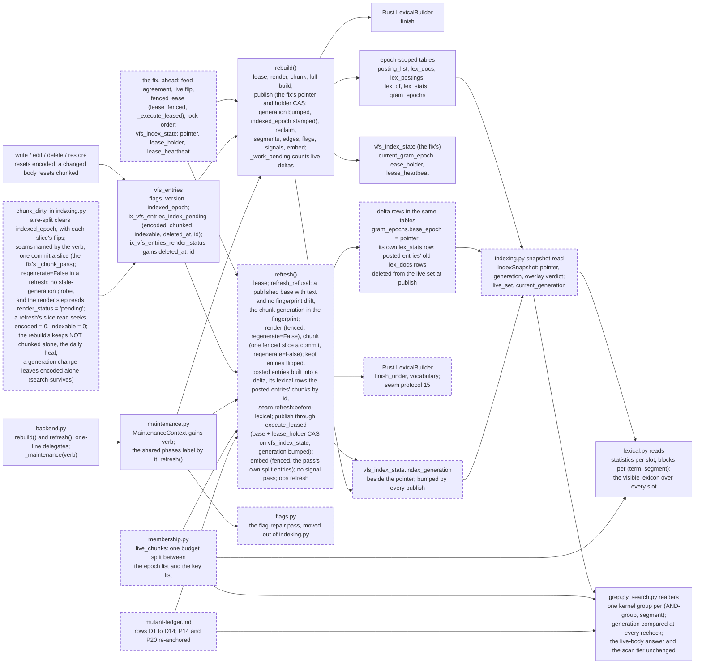

# Refresh, the incremental index verb: delta segments on the epoch tables, published by a generation counter, folded by `rebuild()`, with every chunk posted in exactly one live segment

A feature, structural (a new protocol method and admin verb, `refresh()`, beside the full pass `rebuild()`, and one module, `storage/backends/database/flags.py`, which takes the flag-repair pass out of `indexing.py` to keep it under the ceiling, decision 29), that changes the schema format (two columns on `vfs_gram_epochs`, one on `vfs_index_state`, the row the fix ahead gives the pointer and the lease, one on `vfs_entries`, a new index on `vfs_entries` and one existing index extended by a column, decision 36; `SCHEMA_FORMAT_VERSION` goes from 25, the value the fix leaves, to 26), needs the engine legs (every behaviour change is under `storage/backends/database/`) and touches the engine (two new methods on the Rust lexical builder; the seam's `PROTOCOL_VERSION` goes from 14 to 15). It changes the storage protocol (`SupportsRebuild` gains `refresh`), not the user-facing `VirtualFileSystem` surface, and no docs reference exists to regenerate (no page under `docs/` or `documentation/` and not the README names either verb, EXECUTED again at `5d47a21a`), so the public-API flag does not apply. It changes no rights rule, but it changes how a caller with partial read rights is scored (decision 27), so the security lens applies and criterion 27 is a leak test. It touches the gate in no declaration: it lowers `backend.py`'s `MODULE_LINE_BASELINE` entry and adds and raises none, and `LAYERS` is unchanged (decision 29). It adds rows D1 to D14 to the mutant ledger, and D17 to D24 by the amendments of 2026-11-14, and re-anchors P14 and P20 (decision 31). It comes from no intention: Clay's request of 2026-10-31 for incremental indexing in a 1,000,000-file store with 1–5% daily edits and three full rebuilds a day is the stated intent, recorded in the opening of [the research memo](../../research/2026-10-31-incremental-index-refresh-measured-and-the-delta-segment-recommendation.md) this spec stands on, together with its four studies; since then [the reference deployment](../../../AGENTS.md) (10,000,000 files, one full rebuild a day, a partial index pass every 15 minutes with a floor of 1 minute, sourced in [the deployment memo](../../research/2026-11-09-what-an-enterprise-scale-deployment-looks-like.md)) is the filter every claim here is costed against, and its "Partial index pass" and "Full rebuild" rows are the two this spec serves.

It is written against the tree the nine specs ahead of it in the queue leave, each active and not built, and it lands last; every name, module, signature and count below is that tree's unless it says otherwise. From [the index publishes only what its build read](2026-11-13-the-index-publishes-only-what-its-build-read.md) (the fix), signed "Fit to build" on 2026-11-13 and commissioned that day for defects of today's tree that this spec's review led to (The problem), it takes the four invariants of its Intent, cited in its words in decision 32 (feed agreement, live flip, fenced lease, lock order); the table `vfs_index_state`, one row holding `current_gram_epoch`, `lease_holder` and `lease_heartbeat`, which leave `vfs_meta`, under the schema bump from 24 to 25; the fence `lease_fenced` and the leased runner `_execute_leased`, under the profile's topology isolation pin; the publish's `lease_holder = :token` with the run's token a required field of the build state; the classifier `is_unique_violation` and the chunk pass's collision handler; the seam `reindex:before-lexical`; the chunk pass committed one slice at a time through `_chunk_pass`, each slice of at most `CHUNK_SLICE_ENTRIES` (256) entries or `CHUNK_SLICE_BYTES` (1 MiB) of text its own leased, fenced transaction that runs its flips before its chunk and edge writes, with no up-front generation re-dirty but a run probe, `stale_generation`, after which each slice also reads the live `chunked` rows of a stale generation (`ChunkCursor` with `stale`); and ledger rows A1 to A12, with P6 retired and P7 re-anchored. From [the full pass is named rebuild and its pipeline leaves the backend](2026-11-12-the-full-pass-is-named-rebuild-and-its-pipeline-leaves-the-backend.md) (the refactor), which lands after the fix and whose author corrected it for the fix's final, sliced shape on 2026-11-13, it takes Clay's decision of 2026-11-09 that the full pass is `rebuild()` (this spec's decision 25 until 2026-11-12), and the moves this spec's draft held as decisions 26 and 27; the refactor no longer renames a column or bumps the schema format, since the fix moved the lease to a row whose columns carry no verb's name. Every name the refactor creates is marked "(from the refactor)" where it first appears, each READ on 2026-11-13 in the refactor's working text as its author corrected it for the fix that day (its move table, its context block and its decision 8), where it agrees with what the fix's last Design paragraph tells the refactor to leave. The names: `rebuild()` and `SupportsRebuild`; `RebuildState`, which stays in `indexing.py` and carries the fix's required `token`; the eight `rebuild:` seams, two of them in `chunk_dirty` and `rebuild:before-lexical` in `build_epoch`, both of which stay in `indexing.py`; the module `storage/backends/database/maintenance.py`, holding `MaintenanceContext` (a frozen dataclass of ten fields: `host`, `renderers`, `render_limits`, the getter `ranker`, `embed_concurrency`, `embed_timeout`, and the runners `execute`, `execute_maintenance`, `execute_leased` and `rows`), the public `rebuild(context)`, the private phases `_rebuild_phases`, `_render_step`, `_land`, `_gram_phases`, `_chunk_pass`, `_reconverge`, `_signal_phase` and `_embed_step`, each taking `context` first and its other parameters as the fix leaves them, the run's `token` among them for `_rebuild_phases`, `_render_step`, `_land`, `_gram_phases`, `_chunk_pass` and `_embed_step`, the private `_held_index_lease` and `_beat_index_lease`, and the index lease moved out of `indexing.py`: `claim_index_lease`, `heartbeat_index_lease`, `release_index_lease`, `lease_fenced`, `lease_lost_result`, `with_notes`, `lease_lost`, `INDEX_LEASE_TTL_MS`, `INDEX_LEASE_HEARTBEAT_SECONDS` and `LEASE_LOST_DATA`; `DatabaseStorage._maintenance()`, the one-statement delegate `DatabaseStorage.rebuild()`, and the fix's `DatabaseStorage._execute_leased`, which stays in `backend.py`; `pointer_with_overlay`, moved from `reads.py` into `indexing.py` beside `current_epoch`; and in `lexical.py` the public `chunk_ranking`, `tail_block_statements`, `posting_columns`, `chunk_ids_for`, `visible_lexicon`, `Lexicon`, `HEAD_BLOCKS`, `ChunkId` and `Ranking`, with the private `_packed_arms`, `_visible_corpus`, `_all_blocks` and `_visible_chunks`. From [search survives a chunk row deleted under its read](2026-11-12-search-survives-a-chunk-row-deleted-under-its-read.md), signed on 2026-11-13, it takes the chunk generation as an input of `index_options_hash`, so a chunk-generation bump is fingerprint drift and the re-dirty leaves `encoded` alone (its decisions 1 and 2; the fix, landing after it, replaces the re-dirty with its slices' stale reads, which leave `encoded` alone as well); the private `_resplit_bodies`, which answers a ranked chunk whose row is gone from its entry's live body (its decision 3); the whole-call redrive only when that body is gone too (its decision 4); the seam `search:before-chunk-texts`; ledger rows S1 to S4; and `search.py`'s entry raised by 33. From [the scan tier reveals nothing about rows a caller cannot read](2026-11-12-the-scan-tier-reveals-nothing-about-rows-a-caller-cannot-read.md), signed on 2026-11-13, it takes `entries_for_scan` with the caller's `view`, whose statements carry the caller's packed rights groups, ledger rows V1 to V3, `search.py`'s entry lowered by three, and [the placeholder memo](../../research/2026-11-13-how-the-index-side-cuts-are-bounded-over-the-visible-set.md) that holds the three index-side cuts that spec does not fix. From [scope crosses the seam in one shape](2026-11-07-scope-crosses-the-seam-in-one-shape.md), signed, it takes `addressing.py`, `SearchChannels.prefilter` and `COMPOSED_PREFILTER_LIMIT`, none of which it edits; from [close leaves no SQLite side files](2026-11-12-close-leaves-no-sqlite-side-files.md), signed, nothing it reads. Line citations are to `5d47a21a`, whose `src/`, `tests/` and `crates/` equal those of `bba0999c` and `f7539910` (EXECUTED: `git diff --stat` over the three folders is empty between each pair), and where today's names stand; a definition a landing ahead moves or renames is named both ways where the line matters.

Its reviews: [the review of 2026-10-31](../../reviews/2026-10-31-refresh-the-incremental-index-verb-spec-review.md) signed "Fit to build" before the rename was decided; [the review of 2026-11-09](../../reviews/2026-11-09-refresh-the-incremental-index-verb-spec-review.md) stood at "Not yet" and its Disposition was confirmed answered; [the review of 2026-11-12](../../reviews/2026-11-12-refresh-the-incremental-index-verb-spec-review.md) stands at "Not yet" on three Highs, two Mediums and six Lows, which the first author answered in that file's Disposition on 2026-11-12, amending this text over `bba0999c`, with a one-line map that gives each earlier decision and criterion number its number here. On 2026-11-13 a second author took the spec over and amended it again over `5d47a21a`, against the five specs ahead as they were signed or amended that day; that file's Disposition gains a section dated 2026-11-13 that lists every change of this pass with its cause and extends the map by decision 31 and criteria 32 and 33. [The review of 2026-11-13](../../reviews/2026-11-13-refresh-the-incremental-index-verb-spec-review.md) stands at "Not yet" on one High and one Medium with ten Lows; the same author answers it in that file's Disposition, which adds decisions 32 to 34 and criteria 34 to 37 and renumbers nothing, and in a second dated note there re-cuts this text onto the fix once it was written and signed, adding decision 35 and criterion 38 and giving ledger row D4 a new meaning. The spec waits for that review's re-read before the build.

Landed since the review of 2026-11-09 and read at `bba0999c`, unchanged at `5d47a21a`: [the verbs take the names agents know](2026-11-09-the-verbs-take-the-names-agents-know.md) (glean is `search`, in `search.py`, with the `search_staleness` trait and `examples/search_walkthrough.ipynb`); [the overlay counts in the engine](2026-11-09-the-overlay-counts-in-the-engine-and-the-scan-tier-shares-one-budget.md) (`PROTOCOL_VERSION` 14, the shared `SCAN_TIER_BUDGET` of 25,000); [the lexical builder interns each term once](2026-11-09-the-lexical-builder-interns-each-term-once.md) (the accumulator this spec adds two methods to); [the chunk-page filter](2026-11-09-the-chunk-page-filter-takes-the-shape-each-planner-serves.md) (`covered_chunk_page`, whose build page the fix replaces with a keyset over the chunk table alone, and which this spec's delta does not read through); [bounded work has one home](2026-11-07-bounded-work-has-one-home.md); [the router keeps routing](2026-11-07-the-router-keeps-routing.md); and [the gate reads the layer map and the size baseline](2026-11-07-the-gate-and-the-review-read-the-layer-map-and-the-size-baseline.md).

Landing order and shared files, READ in the working-tree copies on 2026-11-13 at `5d47a21a`. The queue: [scope crosses the seam in one shape](2026-11-07-scope-crosses-the-seam-in-one-shape.md); [close leaves no SQLite side files](2026-11-12-close-leaves-no-sqlite-side-files.md); [search survives a chunk row deleted under its read](2026-11-12-search-survives-a-chunk-row-deleted-under-its-read.md); [the scan tier reveals nothing about rows a caller cannot read](2026-11-12-the-scan-tier-reveals-nothing-about-rows-a-caller-cannot-read.md); [the index publishes only what its build read](2026-11-13-the-index-publishes-only-what-its-build-read.md) (the fix); the refactor; the three rendering fixes, in the order their own texts give: an Office container is measured before it is opened, then a docx note is written once and a span is clamped, then an xlsx sheet is read under the clock and its tables stream; this spec last. It is parallel-safe with close and with the three rendering fixes, which share only the mutant ledger with it, and with none of the others, and it rebases onto the refactor's landing. A build that finds that the fix landed other invariants than the four decision 32 cites is building a stale spec, and this spec is amended first. The files this spec edits are listed under Scope. Each spec ahead, with the files it edits that this spec also edits:

- Scope crosses the seam edits `src/vfs/storage/protocol.py`, and under `storage/backends/database/` `grep.py`, `search.py` and `backend.py`, with `tests/storage/database/test_grep.py`, `test_search.py`, `tests/support/storage_contract.py`, `tests/lint/allowlist.py` and the mutant ledger (rows K1 and W4); its `fanout.py`, `base.py`, `reads.py`, `scope.py`, the new `addressing.py` and its other tests this spec does not edit.
- Close leaves no SQLite side files edits `engine.py`, `src/vfs/sync.py`, `tests/test_sync.py`, `tests/storage/database/test_statistics.py` and one tutorial page, none of which this spec edits, so the two share no file.
- Search survives a chunk row deleted edits `indexing.py` (`index_options_hash` alone), `search.py` (`search_rows`' answer assembly, the new `_resplit_bodies`, the module docstring and `_observe`'s docstring), `tests/storage/database/test_indexing.py`, `test_search.py`, `test_races.py`, `tests/lint/allowlist.py` and the ledger (rows S1 to S4), all of which this spec also edits, and `test_vector_leg.py`, which it does not. This spec edits none of that spec's lines: not `index_options_hash`, `_chunk_texts`, `_resplit_bodies`, `_observe` or the re-dirty statement; and it takes none of its seams, test classes or ledger rows.
- The scan tier reveals nothing edits `grep.py` and `search.py` (the scan side and the overlay block, whose `entries_for_scan` calls gain `view=view,`; this spec edits the generation recheck beside them and none of their lines), `tests/support/storage_contract.py`, `test_search.py` (class `TestOverlay`), `test_grep.py` (classes `TestOverlayGate` and `TestPushdownBindAccounting`), `tests/lint/allowlist.py` and the ledger (rows V1 to V3), all of which this spec also edits, and `tests/support/plan_store.py`, where this spec adds its own root of ineligible, trashed and dirty files and its selection plans beside that spec's lines and edits none of them, and `scope.py`, `dialects.py`, `grants_contract.py` and `test_statistics.py`, which it does not.
- The fix edits, of the files this spec edits, `models/rows.py`, `indexing.py`, `lexical.py` and `backend.py`, with `tests/models/test_rows.py`, `tests/storage/database/test_indexing.py`, `test_lexical.py`, `test_grep.py`, `test_races.py` (classes `TestBuildAgreement` and `TestLeaseFence`, beside which this spec's `TestGenerationConsistency` sits), `tests/support/storage_contract.py`, `tests/ranking/driver.py`, `tests/lint/allowlist.py` and the ledger (rows A1 to A12, L2, L6, P6 and P7); its `reads.py`, `engine.py`, `pages.py`, `dialects.py` and its other tests this spec does not edit. Its Design's last paragraph lists what this spec must change to match it, and this text takes each item (the 2026-11-13 Disposition of this spec's review answers them one by one).
- The refactor edits, of the files this spec edits, `models/rows.py`, `storage/protocol.py`, `maintenance.py` (which it adds), `indexing.py`, `lexical.py`, `backend.py`, `grep.py`, `search.py`, `test_indexing.py`, `test_grep.py`, `test_search.py`, `test_lexical.py`, `test_races.py`, `tests/models/test_rows.py`, `tests/storage/test_protocol.py`, `tests/ranking/driver.py`, `tests/support/storage_contract.py`, `tests/lint/allowlist.py` and the ledger (L12, A4, A6, A8 and A11 re-targeted, rows I1 to I5), and, for the rename alone, `render.py` and `tests/support/plan_store.py`, whose `reindex` words it renames in place; this spec is written against the tree it leaves.
- The three rendering fixes edit modules under `src/vfs/rendering/` and `src/vfs/deadline.py`, their tests under `tests/rendering/` and `tests/support/documents.py`, and the ledger, of which this spec edits only the ledger, whose D rows collide with none of theirs (READ, their Scopes); this spec edits none of their lines.

Each of the nine names this spec in its own landing-order text. Where a sentence there no longer matches this text (the files this spec edits, the scan tier's hidden count, where `chunk_dirty` lives), the section of this spec's review dated 2026-11-13 lists it for that spec's author; this spec edits no other spec. [The release audit is a review](../active/2026-11-07-the-release-audit-is-a-review.md) shares no file. Two numbered specs: [the history pack spec, 180](../active/180-history-pack-on-reindex-and-the-bounded-sweep/spec.md), adds a phase to the full pass in `maintenance.py`, so whichever lands second rebases onto the other; the CLI subcommands for both verbs belong to [the MCP adapter and CLI spec, 171](../active/171-the-mcp-adapter-and-the-cli-tool/spec.md). The compaction of many deltas into one and the running of a refresh during a full rebuild are follow-on specs named under Scope.

## The problem

Measured on `main` at `3667fec`, 2026-10-31 (details and tables in the memo and its studies); every READ claim below was re-read at `bba0999c` on 2026-11-12 and at `5d47a21a` on 2026-11-13, whose `src/`, `tests/` and `crates/` equal `f7539910`'s.

READ: the full pass (`reindex()` today, `rebuild()` after the refactor) rebuilds the whole gram index and the whole lexical index whenever any live entry is dirty. `build_epoch` (`storage/backends/database/indexing.py:369`) scans every `chunked ∧ indexable ∧ live` entry with no `encoded` term; `_work_pending` (`indexing.py:713`) is true when one entry awaits encoding. Chunking (`chunk_dirty`, `indexing.py:240`) and embedding (`_embed_step`, `backend.py:1512`, in `maintenance.py` after the refactor) are already dirty-bounded; the two inverted indexes are not. (Corrected 2026-11-14: embedding is not; the code review's F2 found its page read and its two counts walk the chunk table every run, and decision 19's amendment bounds a refresh's.)

EXECUTED (SQLite, M1 Pro, synthetic prose, at `3667fec`): a cold rebuild of 50,000 files took 136 s and 2.8 GB of peak RSS; a rebuild with 1% of files rewritten took 1.24x the cold build; with 5% rewritten 0.94x. The builder-only cost of the work the dirty set needs was under 3 s of CPU for 6,000 files.

EXECUTED (at `3667fec`): readers pay for every dirty body on every call. Ten grep patterns took 1.03 s on a clean 10k store and 4.00 s with 5% of files dirty; 13.4 s clean and 24–27 s from 1% dirty on at 50k. No match was lost.

EXECUTED at `3667fec`, and READ at `bba0999c` for what changed since: the measurement found glean's lexical overlay scoring at most 500 unindexed entries per call in path order. The overlay kernel landing replaced that cap: both verbs now cut the path-ordered scan tier at `SCAN_TIER_BUDGET = 25_000` (`scope.py:72`), whose comment prices a candidate at about 75 µs and a saturated call near 2 s. The defect moved, it did not go away. INFERRED against the reference deployment: organic change of about 50,000 files a working day crosses 25,000 dirty entries about half a working day after the daily rebuild, and the nightly batch of 1,000,000 files crosses it within its first batches; from then until the next rebuild every grep and every search call pays the saturated scan tier, about 2 s each, and search silently drops a dirty file whose path sorts past the cut. READ in [the scan-tier spec](2026-11-12-the-scan-tier-reveals-nothing-about-rows-a-caller-cannot-read.md), which lands before this one: it keeps the cut and takes it over the rows a partial caller may read, one statement per packed group of that caller's rights, and each such statement still visits every dirty content row (its Scale), so that spec's cost is also in proportion to the dirty set this spec shrinks.

EXECUTED (at `3667fec`): `write()` of 500 entries issues 13 statements whether the store is clean or 5% dirty. The write path never touches the index; the constraint that a refresh must not slow writes is already met and must stay met.

READ: `_entries_for_chunks` (`search.py:648`) keeps a ranked chunk whenever its entry is `encoded`, and `_observe` indexes `sources.chunks[chunk_id]` (`search.py:1211`) with no miss path, so today a lexical posting that names a chunk row `chunk_dirty` has deleted raises `KeyError`, uncaught by `_execute` (`backend.py:1848`). [The search-survives spec](2026-11-12-search-survives-a-chunk-row-deleted-under-its-read.md)'s problem section finds two paths to it, EXECUTED there and READ here. One needs no race and is open on every engine: a chunk-generation bump re-splits every entry under new chunk ids while `encoded` stays true (the `stale` update at `indexing.py:311` clears `chunked` alone), so `_work_pending` finds nothing pending, the run publishes nothing, and the published epoch keeps naming deleted chunk ids until some later run happens to have other work. The other is a race on SQL Server and Oracle, which pin no op isolation: a chunk pass or a sweep that commits between search's ranking and its text read. That spec, signed on 2026-11-13, closes both before this one lands, and this spec builds on its rules as signed. The chunk generation is an input of `index_options_hash`, so a bump is fingerprint drift and the run that re-splits every entry also rebuilds and publishes whole, while the re-dirty leaves `encoded` alone (its decisions 1 and 2), as do the stale reads with which the fix later replaces the re-dirty. A ranked chunk whose row is gone answers from its entry's live body, as one whole-document match under its ranked score (its decision 3). Only an entry whose body is gone too raises `StaleSnapshot`, and the backend redrives the whole call within the existing retry budget (its decisions 4 and 8). Under this spec a chunk pass runs in every refresh, every 15 minutes with a floor of 1 minute, and every publish moves what readers compare (decision 3), so the two are staged below and counted in decision 30.

EXECUTED on 2026-11-13, how a running search meets an index run's commits, on a plain copy of the search-survives spec's build (`src/` of `5d47a21a` with that spec's Design applied; `search.py` 1,281 lines) against SQL Server 2025 from `docker/compose.test.yml`, brought up alone and torn down with its volume afterwards, and on SQLite. `reindex()` stands for a refresh's two commits that can reach a running search: its chunk pass, which deletes the chunk rows of the entries it re-splits, and its publish, which moves what the closing compare reads (the pointer today, the generation under decision 3). The store holds four files and the query is `tokens`; attempts are counted at `search:after-pointer-read`, which every attempt awaits once, and text reads on `_chunk_texts`. On SQL Server: a rewrite of the ranked `/notes.txt` and a run, committed at `search:before-chunk-texts`, answered in 1 attempt with `/notes.txt` from its live body; a bytes write over `/notes.txt` and a run committed there answered in 2 attempts without it; a run that posts a new file, committed at `search:after-pointer-read`, answered in 2; one such run in each of the first two attempts, in 3; one run whose chunk pass committed in the first attempt's text window after a bytes write over a ranked file, and whose publish, held at `reindex:before-publish`, committed in the second attempt before its compare, in 3; two such runs over four attempts, after 4, with one retryable `conflict`, "search kept losing to concurrent changes: the gram-index epoch pointer moved mid-search"; and a run in every attempt, after 4 with the same `conflict`. On SQLite each of the eight cases answered in 1 attempt from the state before the run, because the snapshot WAL takes at the attempt's first read hides it; [the search-survives spec](2026-11-12-search-survives-a-chunk-row-deleted-under-its-read.md)'s table gives the same for Postgres and MariaDB from their `REPEATABLE READ` pin (READ there). The probe is `redrive_probe.py` in the session scratchpad's `specs-ready/refresh/`.

EXECUTED the same day, a chunk-generation bump on the same build: after a full pass over four files, with `chunk_generation` patched to return a new value, the comparison `_work_pending` makes between the published epoch's stored `(format_version, options_hash)` and the code's reports drift before any pass runs, and the published epoch names 0 chunk ids that no `vfs_chunks` row holds; the full pass then publishes (pointer 1 to 2) and the drift is gone. At `5d47a21a` the same comparison reports no drift and the pass leaves 4 ids stranded (`bump_probe.py`, beside the other probe).

READ, and EXECUTED by [the review of 2026-11-13](../../reviews/2026-11-13-refresh-the-incremental-index-verb-spec-review.md) and again here: one full build reads its dirty set twice, once in the posting scan (`indexing.py:413` to 433) and again in the lexical pages, which re-test `chunked`, `indexable` and `deleted_at` (`lexical.py:109` to 117). The maintenance runner stamps `op_isolation` (`backend.py:1896`, `dialects.py:661` to 673), which is `REPEATABLE READ` on Postgres and MariaDB and nothing on SQL Server and Oracle, where each statement reads the latest commit. EXECUTED on 2026-11-13 at `5d47a21a` with `scan_split_proto.py` (the review's `scan_split_probe.py` widened by one rival and a check over every file), against SQL Server 2025 with the rivals committed through the public verbs between the posting scan and the lexical pages, and on SQLite with the rivals run as statements in the build's own session, which is what an unpinned engine's later statements see: a same-body overwrite of `/a.txt` left it with grams and 0 of its 1 chunk ids in the new epoch's `lex_docs`; a restore of `/b.txt`, trashed before the run, left it with 1 lexical row and no grams; and a delete of the directory `/d`, which tombstones `/d/x.txt` as a descendant with no version bump (`_tombstone_descendants`, `trash.py:468` to 494), left `/d/x.txt` with grams, no lexical rows, and `encoded` true, because the publish's flip is guarded by `(entry_id, version)` alone and the version never moved. After a restore of `/d`, whose members revive with no version bump either (`_revive_sets`, `trash.py:529` to 541), SQL Server's search for `/d/x.txt`'s word answered nothing while grep found it, until a later run that had other work (`today_probe.py`, the `lexical` case). The same delete committed at `reindex:before-publish`, after the build and before the publish, does the same on every engine once a later full pass has excluded the trashed row: on SQLite and on SQL Server, after that later pass and the restore, grep and search both answered nothing, and the file stayed `encoded` with no row in the published epoch until a third run (`today_probe.py`, the `publish second` case). So today's full pass already marks an entry `encoded` that the published index does not hold, on SQL Server and Oracle through the two reads and on every engine through the unversioned tombstone; it is a defect of the tree before this spec, which [the fix](2026-11-13-the-index-publishes-only-what-its-build-read.md) carries (decision 32), and its problem section measures it on all four server engines. EXECUTED on a plain copy of `5d47a21a`'s `src/` with a prototype of that fix (the lexical pages taking exactly the posting scan's covered entries by id, keyset over chunk ids, with no flag re-read; the flip guarded by `deleted_at IS NULL` beside the version): on SQLite and on SQL Server every file of `scan_split_proto.py` came out with both its grams and its lexical rows in the new epoch, or neither, and no `encoded` file lacked either; `/a.txt` was then found by search after the kept flip this spec prescribes, where today it is not; and the `publish second` case left `/d/x.txt` unencoded and found by both verbs after its restore.

EXECUTED on 2026-11-13 with `lapse_probe.py` on SQLite, two handles on one file: run A builds and pauses at `reindex:before-publish`; a write changes `/e.txt`'s body; the lease is forced to lapse; run B claims, its chunk pass re-splits `/e.txt` (chunk id 1 replaced by 4), it builds and pauses; A is released, then B. At `5d47a21a` A published, epoch 2 holding `/e.txt`'s replaced chunk id 1, and B lost its pointer race: today that is harmless, because A's version-guarded flip missed `/e.txt`, but a stamp written by A's publish would name a segment that holds none of `/e.txt`'s current chunks, and a per-row guard of the form `chunk_source_hash = content_hash` would let it, since B's split stamped the current hash. With the prototype's publish carrying the holder (here `reindex_holder = :token`, the column's name today; `lease_holder` on `vfs_index_state` once the fix lands) in its CAS, A's publish was refused and B published epoch 3 holding chunk id 4. READ in [the fix](2026-11-13-the-index-publishes-only-what-its-build-read.md)'s problem section, which reran this probe and found it narrower than the defect: a lapsed run's chunk pass, committed before any publish, replaces the chunk rows the holder's build has already read, which no compare-and-set on the holder can refuse (its sibling 1, EXECUTED there on SQL Server and Oracle), so the fix fences every chunk pass, render landing and embed write with the lease's heartbeat in the same transaction, and this spec rests on that fence (decisions 26 and 32).

EXECUTED on 2026-11-13 at `5d47a21a` with `link_probe.py` on SQLite: over 20 indexed markdown files, two rewritten after the full pass, with `link_generation` patched to a new value, the chunk pass alone read all 20 bodies and stamped all 20 with the new generation; with its generation re-dirty skipped it read the 2 rewritten bodies, stamped those 2, and left 18 at the old generation for a later pass.

EXECUTED at `bba0999c`, the review's `chunk_id_probe.py` run again: after a full build, a changed body gets new chunk ids, but a same-body overwrite and a trash then restore each leave the entry `chunked ∧ indexable ∧ ~encoded ∧ live` with the same chunk ids the base epoch's `lex_docs` already posts. The chunk pass keeps an unchanged body's rows (the fingerprint-skip law, `indexing.py:261` to 265), and a delete demotes `encoded` and leaves `chunked` (`trash.py:446` to 452). EXECUTED, the review's `double_post_probe.py` and this draft's `kept_probe.py`: a chunk posted in a base slot and again in a delta slot under the base's idf scores exactly twice what it scored alone, a ratio of 2.0, for a same-body overwrite and for a restore, because the scorer sums per chunk id over every block (`lexical.rs:864`). A delta that re-posts every dirty entry double-counts every kept chunk until the next full rebuild. EXECUTED again on 2026-11-13, `kept_probe.py` at `5d47a21a` and on the search-survives build: the same verdicts for every path, the ratio 2.0 for a re-post and 1.0 for a flip with no posting, on both.

EXECUTED at `bba0999c` and again at `5d47a21a`, a scratch probe compiling `vfs_chunks` for SQLite: the id renders `INTEGER NOT NULL PRIMARY KEY AUTOINCREMENT`, and deleting the highest id and inserting again gave ids 1, 2, 4. READ: on every other engine the column is an `Identity()` (`models/rows.py:578`); INFERRED from each engine's documented identity semantics, Postgres, SQL Server and Oracle hand each value out once, and MariaDB's InnoDB has kept its counter across restarts since 10.2.4, well before the `mariadb:11.8` the engine leg runs (`docker/compose.test.yml:53`). A chunk id that the chunk pass replaces is never minted again.

READ: `crates/vfs-core/src/lexical.rs` `LexicalAccumulator::finish` (`lexical.rs:659`) computes N, avg_dl, each term's idf and every block's maximum weight from the documents it was fed, and the lexical build writes what it returns as the epoch's `lex_stats` row (`lexical.py:100` to 102). A delta of 5,000 chunks would fix statistics from 5,000 documents, so its block bounds would be wrong for the scorer's block selection under the base epoch's statistics.

READ: `crates/vfs-core/src/postings.rs` `candidate_ids(groups, allow, cap)` (`postings.rs:289`) ORs its groups and ANDs the blobs within a group, and treats `cap` as a hard limit on survivors (`postings.rs:278`). EXECUTED on the prototype: one group per (AND-group, segment) is a union across segments that admits no cross-version phantom, because an entry's postings for one version live whole in one segment; no new gram kernel is needed.

READ: a caller whose read rights are not whole is scored by the visible lexicon (`_visible_lexicon`, `search.py:834`, `visible_lexicon` in `lexical.py` after the refactor), the visible-set law of [the grants spec](058-row-level-permission-grants/spec.md)'s decision 7: `N`, the mean length and each term's `df` counted over the rows the caller can see, and every stored block bound rescaled by `idf_v / idf_g` (`search.py:880`); a caller with whole read rights gets `view = None` (`backend.py:1702` to 1703). The function reads one summary row per term for three things, the union cap (`search.py:868`), the bound maxima indexed by block number (`:881`, `:886`) and the rescale (`:880`).

## Architecture

No architecture page exists under `context/`; when the storage page is written it carries this diagram. Solid is what exists after the refactor, its label saying how this spec changes it; dashed is what this spec adds, and the one node of the fix ahead of it, which is not yet built either. Nothing is retired.

Terms. A *segment* is one epoch number's rows in the epoch-scoped tables. The *base* is the epoch the pointer names. A *delta* is a segment whose `gram_epochs.base_epoch` equals the base and that holds postings for only the entries it posted. The *live set* is the base plus its published deltas. The *generation* is the integer `vfs_index_state.index_generation`, on the fix's index-state row beside the pointer, which every publish increments; readers compare it where they compared the pointer. A *slot* is one (term, segment) pair the lexical scorer treats as a term of its own. An entry is *kept* when its current chunk rows were posted by a live segment and have not been replaced since, which `vfs_entries.indexed_epoch` records (decision 26); a dirty entry that is not kept is *posted*. A *ghost* is a posting that names a body or a chunk that has since been replaced; grep rejects it at verification and search finds no `lex_docs` row for it. A *run* is one `rebuild()` or one `refresh()` under the index lease. A *redrive* is the backend running a whole read call again after `StaleSnapshot`, within its retry attempts. An engine is *pinned* when every statement of one read attempt sees one snapshot: SQLite through its WAL, Postgres and MariaDB through the `REPEATABLE READ` their profiles stamp; SQL Server and Oracle are not.

## Decisions

### 1. Two verbs, `rebuild()` and `refresh()`, not one verb with a mode.

The full pass is O(corpus) and holds the lease for hours at the reference deployment's 10,000,000 files; `refresh()` is O(dirty): every read it issues to find its work, the render step's, each chunk-pass slice's and the delta's posting and kept scans, seeks an index on `vfs_entries` in keyset order by id over live rows and visits the rows awaiting that step, never the corpus, the trash or the permanently ineligible rows (decision 36), and each dirty entry it then handles costs what a full build's visit costs. The constitution makes cost part of the contract and asks for declared capabilities, so a caller must be able to tell the two apart without running either. The two have different preconditions as well: a refresh refuses without a published base and on fingerprint drift, and the full pass never refuses that way, so a parameter whose branches share neither cost nor refusals would be two functions under one name. The surface already speaks this way, `delete` beside `sweep` (`backend.py:813`, `:911`), `glob` beside `grep` beside `search`, each verb owning one cost shape. `SupportsRebuild` (from the refactor) declares both verbs; a backend that exposes one exposes the other. Underneath, the two share the pipeline of `maintenance.py` (from the refactor), the lease, render, chunk, build, publish and embed, with the scope of the build following from the running verb's name carried in `MaintenanceContext` (decision 19) and never a boolean on the surface.

### 2. A delta is an epoch number in the existing epoch-scoped tables, marked by `gram_epochs.base_epoch`.

`epoch_scoped()`, `bulk_insert`, the primary-key collision that arbitrates rival builds and the range-delete reclaim all keep working unchanged. `vfs_gram_epochs` gains `base_epoch` (nullable integer; null for a full epoch) and `published_at` (nullable timestamp). No second table family. A retirement stamp is not added: nothing in this spec would write it, because the fold deletes the rows it would retire; the compaction spec, which retires deltas without a fold, adds it under its own schema bump.

### 3. The readers' coherence token is `vfs_index_state.index_generation`, bumped by every publish.

The two-read protocol in `grep.py` and `search.py` compares one integer for equality. The pointer alone cannot see a delta publish, which changes what the live index is without moving the pointer, nor a publish that only flips kept entries (decision 24). `pointer_with_overlay` (in `indexing.py`, from the refactor) returns the generation beside the pointer and the overlay verdict in the same statement; movement of the generation raises `StaleSnapshot` exactly as pointer movement does today, with the context "the index generation moved mid-grep" or "the index generation moved mid-search". On a pinned engine the compare reads the attempt's one snapshot and never moves inside it; on SQL Server and Oracle it is what turns a publish committed under a call into a redrive (decision 30).

### 4. The live set is read from `vfs_gram_epochs` by one statement per call.

`SELECT epoch FROM vfs_gram_epochs WHERE epoch = :pointer OR (base_epoch = :pointer AND published_at IS NOT NULL)` runs after the first generation read. The generation compare closes the window in which the set changes under the reader. The table holds one row per unreclaimed epoch, the live set plus at most the residue of builds that lost their publish, so the statement reads that many rows and no index is added for it. A denormalised live-set column on the index-state row is the fallback if this statement ever shows in a measurement; the normalised set is the honest shape of the data.

### 5. The delta build posts only the dirty entries that are not kept, `NOT encoded ∧ chunked ∧ indexable ∧ live ∧ (indexed_epoch IS NULL OR indexed_epoch < :base)`, ordered by surrogate id.

The dirty predicate is the one `_pending_probe` uses (`indexing.py:781`) and the order is the one `build_epoch` feeds; the last term leaves out the kept entries of decision 26, which are flipped and not built. Doc ids stay the entry surrogate `entry.id`, which is stable across content writes. Old postings of a re-split entry remain in older segments as ghosts.

### 6. Ghosts stay until the full rebuild; grep tolerates them, search must not see them.

grep verifies every candidate against its live body (`_entries_for_docs`, `content_for_entries`, the matcher), so a ghost costs one candidate fetch and nothing else; the prototype measured ghosts at 1.2–5.8% of candidates at 3–12% churn. The lexical leg resolves chunk ids through `lex_docs` and then indexes chunk rows by id, so a chunk id that resolves to an entry must be a live chunk. The delta publish therefore deletes the posted entries' `lex_docs` rows across the live set, chunked by `membership_budget` and served by `ix_vfs_lex_docs_entry` on `(epoch, entry_id)` (`models/rows.py:747`). Every such row names a replaced chunk: a posted entry is one whose current chunk rows no live segment holds (decision 26), so the rows the live set holds for it are its old chunks'. With no `lex_docs` row the ghost block's chunk id resolves to no entry and is dropped by the join, as the existing code already does for an unresolved id, and a replaced chunk id is never minted again (the chunk-id probe under The problem), so it can never come to resolve. The delete runs over the live set as it stands before the `published_at` stamp, so the delta's own `lex_docs` rows are not in it. A kept entry's rows are not touched: they name its current chunks, posted once.

### 7. Readers pass one kernel group per (AND-group, segment); no gram kernel changes.

`candidate_ids` ORs groups and ANDs within a group. A document's postings for one version live whole in one segment, so this is union across segments and intersection within, and it admits no candidate whose grams come from two different versions of one body. The prototype measured the alternative, a per-gram union before the kernel, at 20–100 ms per query in Python and up to 108 phantom candidates per query. A gram absent from a segment contributes no group for that segment.

### 8. Posting meta is summed across the live set; the ladder prices the sum.

`_posting_meta` fetches `doc_count` and `byte_size` per (epoch, gram) across the live set in one statement per membership chunk, `epoch IN (S)` carried in every arm, and sums per gram before `_choose_grams` and `_ladder_defers` price the plan.

### 9. The live set is itself chunked by the membership budget, and every statement that carries `epoch IN (S)` runs once per chunk of `S` with its key list sized to what remains.

The existing filter bind reserve, `_FILTER_BIND_RESERVE = 32` (`dialects.py:722`), is not sized for 49 segments, which is a four-hour gap at five-minute cadence, nor for the 96 a day the reference deployment's 15-minute pass accumulates before the daily fold, and nothing in this spec bounds how many deltas a store without a full rebuild accumulates. So `S` is chunked too: a statement carries at most `membership_budget - <other binds> - 1` epochs per chunk, so at least one key always fits, and the key list takes what remains of the budget, and the results merge: posting meta sums per gram, blobs, summaries and `lex_stats` rows are keyed by `(epoch, key)` and concatenate, `lex_docs` resolutions and deletes union, and `_visible_corpus`'s count and total length sum across epoch slices. The kernel still receives one group per (AND-group, segment). No statement grows with the number of live deltas or with the dirty set, and a test with a tightened budget holds both a live set of 49 and a live set larger than the budget. The kept test of decision 26 carries one bind, `:base`, and never the set. The slicing is one helper, `live_chunks(epochs, keys, budget)` in `membership.py`, beside `membership`: it yields, in order, each pair of an epoch slice of at most `max(1, budget // 2)` epochs (amended 2026-11-14, below; first written `budget - 1`) and a key slice of at most what remains of `budget`, and nothing for an empty set or no keys. Every statement with a key list iterates it where it iterates `chunked` over its keys today, the publish's `lex_docs` delete among them, and a statement with no key list (the live set's `lex_stats` rows, `_visible_corpus`) slices the set with `chunked` alone. `membership.py` owns how an `IN` list renders on every dialect, so the split of one budget between two lists belongs beside it, and one helper keeps each call site's change to its loop line and its predicate.

Amended 2026-11-14, after the code review's F6 (EXECUTED there, `scale_segments.py`): an epoch slice of `budget - 1` epochs leaves one key a statement once the live set passes about 999 segments, so at 1,440 segments and Oracle's 1,000-element floor a search issued 1,015 statements and a partial caller's search 4,185, where both issued 9 and 13 at 96, and `live_chunks` over 1,440 epochs and 5,000 keys yielded 5,009 pairs. So `live_chunks` caps its epoch slice at half the budget, `chunked(epochs, max(1, budget // 2))`, and each key slice takes what remains, `budget - len(epoch_slice)`, at least half the budget. That still holds at most `budget - 1` epochs a statement, as this decision words it, and row D6's law is unchanged. A call spends `⌈E / ⌊B/2⌋⌉ × ⌈K / (B − e)⌉` statements for E live segments, K keys, budget B and epoch slice e: over 5,000 keys at the 1,000 floor, 6 at 96 segments (one slice of 96 epochs, key slices of 904) and 29 at 1,440 (slices of 500, 500 and 440 epochs, with 10, 10 and 9 key slices; the review's "30" rounds it), where the first split gives 5,009. What a search costs (the Design's Scale paragraph carries the rows it reads): under the native budgets of SQLite, Postgres and MariaDB every live-set statement fits one epoch slice up to 16,334 segments, so a search issues its 9 statements and a partial caller's its 13 at 96 and at 1,440 segments alike (EXECUTED by the review at 96; INFERRED at 1,440 from the split); under the 1,000 floor of Oracle and the generic profile, each live-set statement runs once per epoch slice, three times at 1,440 segments where it runs once at 96, and once per extra key slice its longer lists need at 500 keys a slice, so a search issues at most about three times its count at 96 and a partial caller's search, whose visible chunk-id lists are longer, somewhat more (INFERRED; the builder counts both at 1,440 segments under the 1,000 floor and records them in the Landing notes). The rows each statement reads still grow with the segments since the last rebuild, never with the corpus, and the fold compaction named under Scope is the direction that bounds them.

### 10. Deltas score under the base's `avg_dl`, and under the base's idf where the term exists in the base, else `idf(delta_df, base_n + delta_n)`, the base's `n_docs` plus the delta's own document count.

This is the law `search._overlay_blocks` (`search.py:1078`) already applies to unindexed bodies, the base's idf where the term is in the base and otherwise the idf of the counted df under the base's `n_docs` plus the bodies counted, so the index side, the deltas and the overlay share one scale. `base_n` is the base's `lex_stats.n_docs` and `delta_n` is the delta's own, as decision 28 stores them. Under a live set the overlay keeps its code and reads the live set through `TermStatistics` (decision 25): a term any live segment holds takes its first slot's idf, and any other the idf of its counted df under `n_live` plus the bodies counted. The prototype measured the drift at 5% churn as median 0%, p90 3.2%, p99 8.3% in idf when delta df is ignored, and showed that a term absent from the base takes the maximum idf (+307%) unless its own df under the summed N is used. A term absent from the base therefore carries a different idf in each delta that holds it. The full rebuild resets every statistic.

Amended 2026-11-14, after the code review's F1 (EXECUTED there, `empty_store.py`): a base built over no indexable text stores `n_docs` 0 and `avg_dl` 0.0, and a delta on it put `n_docs > 0` beside an `avg_dl` of 0 under every slot, a pair no store reached before; BM25's length term `dl / avg_dl` then divided by zero, and a search raised `ZeroDivisionError` out of `term_weight` to the caller. Decision 17 now refuses a refresh on such a base. Independently of that refusal the scorer is total. A zero (or negative) `avg_dl` means no indexed document carries a length to normalise against, so every function that weighs a posting under `avg_dl`, `term_weight` in `models/lexical.py`, which the oracle in `tests/support/oracles/lexical.py` imports, and its Rust twin in `crates/vfs-core/src/lexical.rs`, which the engine's block weights and its scorer both call, takes the length ratio as 1 when `avg_dl <= 0`: the weight is `idf * tf * (k1 + 1) / (tf + k1)`, BM25 with no length normalisation, finite for every input, and equal to today's weight wherever `avg_dl > 0`. The overlay's own mean length (`search.py`, `stats.avg_dl if stats.n_docs else …`) keeps its code; it is the weight, not the mean, that is made total. The engine's signatures do not change, so the protocol stays at the 15 decision 11 sets. Criterion 43 pins it.

### 11. The Rust lexical builder gains `finish_under(n_docs, avg_dl, idfs)` and `vocabulary()`, `finish_under` returns the delta's own statistics, and the seam's protocol moves from 14 to 15.

`LexicalAccumulator::finish` computes statistics from its own documents; a delta needs the base's. `vocabulary()` returns each distinct term the accumulator holds with its document count, `(term, df)`, in term order, which is the order `finish` drains, read from the interner the interning landing gave the accumulator. The refresh asks for it, fetches the base's `lex_df` rows for those terms in membership chunks, computes each term's idf by decision 10, and hands `finish_under` one idf per vocabulary term in the same order, with the base's `n_docs` and `avg_dl`; a list of any other length is refused with a `LexicalError`, and `finish_under` consumes the accumulator as `finish` does, after which feeding is refused as today. Block maximum weights are then computed under the base's `avg_dl` and the given idfs, the statistics the scorer will use, so `select_blocks` bounds stay sound. `finish_under` returns the accumulator's own `(n_docs, avg_dl)`, the delta's document count and mean length, exactly what `finish` returns for its documents, and never the arguments it was handed; decision 28 says where they are stored. Oracle parity in `tests/support/oracles/lexical.py` pins the new methods, per the Rust-engine rule. The two methods change the seam's shapes, which `python.rs:27` to 28 says bumps the protocol: `PROTOCOL_VERSION` in `crates/vfs-core/src/python.rs:29` and `EXPECTED_PROTOCOL` in `src/vfs/native.py:35` move together from 14 to 15, so a stale wheel refuses at import naming the reinstall instead of raising `AttributeError` inside a refresh. No spec ahead of this one in the queue moves either constant; the refactor keeps it at 14 by its decision 3.

### 12. The lexical leg reads summaries and blocks per (term, segment) and concatenates blocks.

`lexical_score` sums per chunk id over every block whose term index names an idf. A chunk id has lexical rows in exactly one live segment: a posted entry's chunks are new to the live set or replaced (decision 26), a kept entry's are never re-posted, and a replaced chunk's id has no `lex_docs` row left (decision 6) and is never minted again. So the sum per chunk id is one segment's BM25 sum. `select_blocks` treats each (term, segment) summary as a term, a slot, and takes the summed maxima of the others as lift, which loosens the bound and never tightens it. The draft this replaces rested the same claim on chunk ids never being reused alone, which a same-body overwrite and a restore break (The problem).

### 13. The delta publish flips `encoded` on the posted and the kept (entry, version) pairs, stamps `indexed_epoch` on the posted entries, deletes their old `lex_docs` rows, stamps `published_at`, and bumps the generation under a compare-and-set on the base and the lease holder, in one transaction.

The flip is the existing version-guarded set-based `_flip_flags` (`indexing.py:725`), with the fix's live flip, its liveness term `deleted_at IS NULL` (decision 32); a write between build and publish bumps the version, the flip misses, and the row stays scan-side, which is the guard a refresh racing a write needs. The stamp of decision 26 rides the same statement for the posted pairs and is guarded neither by the version nor by the liveness term, for the reason the Design's stamp paragraph gives; it is guarded by the transaction it rides in. The CAS is `UPDATE vfs_index_state SET index_generation = index_generation + 1 WHERE id = 1 AND current_gram_epoch = :base AND lease_holder = :token`, on the fix's index-state row, with `:base` read from that row before the delta build begins and `:token` the run's own lease token, a required first field of `DeltaState` with no default, for the reason the fix gives its own token: an unset token would compile to `lease_holder IS NULL` and publish whenever no run holds the lease (its decision 5). The holder predicate replaces the generation predicate this decision first carried, because it refuses everything that one refused and more. Another run can publish between this run's read and its CAS only while it holds the lease, which takes a claim after this run's, through a lapse (decision 14), and that claim moves the holder; and a rival that has claimed and not yet published moves the generation not at all but moves the holder too (EXECUTED under The problem, `lapse_probe.py`). The holder in the compare-and-set closes the lapsed run's publish; the lapsed run's earlier commits, its chunk pass among them, are closed by the fix's fenced lease, which this spec's own phases take (decision 32), and decision 26 rests on the two together. A miss classifies `conflict`, not retryable, with the detail "refresh lost the index publish race for epoch {epoch}", the shape the fix gives the full publish's miss. The publish runs through the fix's leased runner, `context.execute_leased` (from the refactor; `_execute_leased` on the backend, from the fix), under the profile's topology isolation pin, because its compare-and-set updates the row the run's own beat updates every minute and would fail against it under Postgres's `REPEATABLE READ` (the fix's sibling 2 and decision 8); it is not wrapped in `lease_fenced`, because its compare-and-set on the holder is its fence, as the full publish's is. It returns the miss as its `conflict` Result, as `publish_epoch` does, so the runner, which commits only a successful Result (`_mutate`, `backend.py:1952` to 1985), rolls back the flip, the stamp, the `lex_docs` delete and the `published_at` stamp together; it takes the entry rows (the flips and stamps), the `lex_docs` rows of the posted entries, its own `gram_epochs` row and the index-state row, in that order, the index-state row last, the fix's lock order; `reclaim_built_epoch` (`indexing.py:526`) then removes the built delta in its own transaction. Two deltas on one base publishing without the holder predicate would double-post an entry's chunks into two segments, since a delta's publish moves no pointer and the base predicate alone passes for both.

### 14. The full publish bumps the generation in the fix's compare-and-set on the pointer and the lease holder, and stamps `indexed_epoch` on every covered entry.

The fix gives the full publish its holder predicate, its required token and its miss detail (its decision 5, row A3): `UPDATE vfs_index_state SET current_gram_epoch = :epoch WHERE id = 1 AND current_gram_epoch = :previous AND lease_holder = :token`, run through the leased runner, a miss being `conflict`, not retryable, "rebuild lost the index publish race for epoch {epoch}" once the refactor renames it. This spec adds two things to that publish and nothing else: `index_generation = index_generation + 1` in the same statement's `SET`, on the same row, and the stamp in its flip. A full epoch covers every entry that was dirty when its scan ran, but not an entry a delta posted after that scan: such a delta can publish during a full only when the lease has lapsed, and `claim_index_lease` (from the refactor) takes a lease whose heartbeat is five minutes stale (`INDEX_LEASE_TTL_MS`, which the refactor moves to `maintenance.py`; `REINDEX_LEASE_TTL_MS`, `indexing.py:127`, today) while `_gram_phases` checks the lease only between phases. That delta's run claimed after this one, so it holds the lease, and the fix's holder predicate refuses this publish; that refusal is what this spec needs of it, because without it that delta's covered entries would stay `encoded` with their only postings in a segment outside the new live set, a silent lost match until the next full rebuild, and this run's stamps would name a segment that misses any entry the rival's chunk pass re-split. Criterion 14 stages that case, so it kills the fix's row A3 as well. The bump also makes readers that cached a live set redrive. The full publish's flip already writes every covered row (the full build covers every `chunked ∧ indexable ∧ live` entry); it stamps `indexed_epoch = :epoch` on each in the same statement, guarded neither by the version nor by the liveness term and guarded by the transaction's holder predicate, as decision 26 requires. The fix's Scope leaves to this spec the narrowing of that flip to rows not yet `encoded`, which would cut its row writes and locks to the dirty set; with the stamp it cannot narrow, because every covered row, `encoded` already or not, needs the new epoch's stamp, or the next refresh would find an older stamp below the new base, post the entry again and score its chunks in two segments. The narrowing waits for a stamp that can be written apart from the flip, which is the compaction spec's to weigh.

### 15. The existing reclaim rule sweeps deltas: every epoch-scoped row with `epoch < current` is deleted after a full publish.

A delta is minted past every built epoch, so its number is above its base and below the next full epoch. `reclaim_epochs` (`indexing.py:508`) already deletes below the pointer in its own transaction after re-reading the pointer. The swept `gram_epochs` rows go with the sweep, so no retirement stamp is needed here (decision 2).

### 16. `_work_pending` is true when live deltas exist.

A scheduled full rebuild must fold the deltas back into one epoch even when no entry is dirty, or the deltas persist until the next dirty write and the live set grows without bound.

### 17. A refresh with no published base refuses with a classified `unavailable` record naming `rebuild`.

The first index of a corpus is the corpus; a refresh that silently became an O(corpus) build would break decision 1. The record is not retryable and its detail is the fixed phrase "no index is published yet; run rebuild". This departs from the design study's lean to run the full build in that case.

Amended 2026-11-14, after the code review's F1, by the session lead's ruling: a refresh also refuses when the published base holds no text, its `lex_stats` row's `n_docs` 0 or no row at all. A base built over no indexable text is not yet the first index of a corpus; a delta on it has no mean length to be weighed under, which made search raise (decision 10's amendment). `refresh_refusal` reads the base's `n_docs` after the pointer test and before the fingerprint test, `select(tables.lex_stats.c.n_docs).where(tables.lex_stats.c.epoch == pointer)`, and answers `classified(ErrorKind.unavailable, retryable=False, detail="the published index holds no text yet; run rebuild")` when it is 0 or absent. So the refusals are three, each naming `rebuild`, each before any phase writes: no published base, a base that holds no text, and fingerprint drift (decision 18). An operator's first day under this rule: on an empty store, a `rebuild()` publishes an index with no text, and every `refresh()` refuses with this phrase while grep and search serve the files written since from the scan tier; after the first ingest, the first `rebuild()` over text publishes the base, and from then on `refresh()` runs on its cadence. So a deployment ingests first, then runs `rebuild()`, then schedules `refresh()`; one that schedules refreshes from an empty store sees them refuse, naming `rebuild`, until a rebuild has seen text. Criterion 42 pins it.

### 18. A refresh refuses on fingerprint drift, a chunk-generation bump among it, before any phase writes, and names `rebuild`.

A delta built under different options against an old base mixes formats. `build_epoch` already treats format or options drift as a drop-and-rebuild (`_work_pending`, `indexing.py:713` to 722). The refresh reads the same comparison, the published epoch's stored `(format_version, options_hash)` against `(INDEX_FORMAT_VERSION, index_options_hash())`, and on a mismatch returns one `unavailable` record, not retryable, whose detail is the fixed phrase "the published index was built under other index options (a format, gram-option or chunk-generation change); run rebuild". Since the search-survives spec the chunk generation is an input of `index_options_hash` (its decision 1), so a chunk-generation bump is drift and meets this refusal; that spec's Scope leaves the case to this decision. Refusing is the answer, for three reasons. The refusal runs before the render step and the chunk pass, so no chunk row is replaced and every chunk id the live set names stays held: EXECUTED under The problem, the published epoch names 0 stranded ids while no pass has run. A refresh that ran its chunk pass instead would re-split every live entry, which is the whole corpus and breaks decision 1, and would leave every chunk id the live set names stranded until a full publish. And the full pass is the answer the signed design already gives a bump: it re-splits and publishes whole in the same run. What clears the refusal is one `rebuild()`: after its publish the stored hash is the code's, and refreshes run again. Between a bump and that rebuild every refresh refuses, so the writes since the bump stay in the scan tier, which is where a deployment without this spec keeps them between daily rebuilds. A bump comes with a vfs release that changes chunk shapes (`models/chunking.py:174` to 176, READ in the search-survives spec), so the release is the time to run `rebuild()`, and a scheduler that receives this record runs it. The check and decision 17's are one function, `refresh_refusal` in `indexing.py`, which reads the pointer and the fingerprint row in the refresh's first read after the lease claim, before any phase runs (the Design's verb paragraph); `_work_pending` and it share one private comparison, `_fingerprint_matches`.

### 19. The refresh runs render, chunk and embed; it does not run the segment, edge, flag, signal or history-pack phases; `MaintenanceContext` gains the running verb's name.

The first three are dirty-bounded. They reuse `_render_step` and `_embed_step` (from the refactor, private functions of `maintenance.py`) and `chunk_dirty`, which stays in `indexing.py` and which `maintenance.py` imports from there. `MaintenanceContext` (from the refactor, whose ten fields include the fix's runner `execute_leased`) gains an eleventh, `verb: Literal["rebuild", "refresh"]`, and `DatabaseStorage._maintenance` takes it as a keyword defaulting to `"rebuild"`, so the refactor's test call sites of `storage._maintenance()` keep their meaning unedited. Where the refactor writes the literal `"rebuild"` in `maintenance.py`, the shared phases write `context.verb`: the op label of every runner call and the prefix of every seam, spelled `f"{context.verb}:before-publish"` and so on. The unrendered warning is raised by `_rebuild_phases`, not by a shared phase, so `_refresh_phases` carries the same warning with the detail "… binaries are still pending a rendering; run refresh again". `chunk_dirty` gains the keyword `verb`, defaulting to `"rebuild"`, for the prefix of its two seams and its Result's op, and both verbs' phases pass `context.verb`; the fix's `_chunk_pass`, which runs `chunk_dirty` one slice at a time, gains `regenerate`, which the refresh passes false, and `_render_step` gains the same keyword for the render step's read (decision 33). So a refresh awaits `refresh:before-render`, `refresh:before-render-land`, `refresh:before-chunk-split`, `refresh:before-chunk-flip`, `refresh:before-lexical`, `refresh:before-publish` and `refresh:before-embed` where the same store's rebuild awaits their `rebuild:` twins, the delta build's `refresh:before-lexical` standing where the full build awaits the fix's `rebuild:before-lexical`, and no `rebuild:` seam; it has no `before-reclaim` seam, because it reclaims only a delta that lost its publish (decision 13). Every Result `refresh` returns carries `ops=("refresh",)`: it relabels the Result it ends with in one place, as `rebuild` assembles its own at its end, so the functions it shares with the full pass in `indexing.py`, `render.py` and the lease keep their own op label. The other phases are whole-corpus by nature: the baseline measured the segment and edge re-convergence at 24 s on a 50k store with nothing dirty, and a 15-minute cadence would pay it 96 times a day. They stay in `rebuild()`.

Amended 2026-11-14, after the code review's F2 and F3, by the session lead's rulings: "the first three are dirty-bounded" was false for the embed step and for the render step's closing count, and both are bounded now. What was wrong (EXECUTED there, `scale_refresh.py`, ten changes over 1,000 and 10,000 files with `HashEmbeddingProvider(8)`): the shared `_embed_step` pages the chunk table from chunk id 0 by `embedding IS NULL`, which no index serves on any engine, and then counts it twice, `count_unembedded` and `count_refused`, each a `count(*)` over the chunks joined to the entries: 3,055 then 30,055 VM steps for the page read and 3,031 then 30,031 for each count, against 2,872 for every other read together at both sizes; and `count_unrendered` walked the entry table on SQLite under the statistics vfs's own step writes, 3,043, 30,043 and 150,043 steps at 1,000, 10,000 and 50,000 files. The rule now, the same as decision 36's: a refresh never heals, the rebuild does. A refresh's embed step works only on the chunk rows this pass's slices wrote. `ChunkCursor` gains `resplit: list[str]` (with `next_resplit`, adopted with the slice), the entry ids a committed slice split, every row the fingerprint-skip did not keep, a new file's first chunking among them (`_assess_and_split`'s `resplit_ids`), bounded by what the pass changed; `_chunk_pass` returns it to `_refresh_phases`, and `_embed_step` gains the keyword `entries: Sequence[str] | None = None`, `None` for the rebuild's walk. With `entries`, `select_unembedded`, `count_unembedded` and `count_refused` (`embed.py`) take the same keyword `entry_ids` and carry `membership(chunks.c.entry_id, slice, profile)` over each membership slice of those ids, served by the chunk table's `entry_id` index, the page still keyset by chunk id within a slice; the step embeds those rows, lands them fenced as today, and reports pass-scoped counts: `embedded`, `cached`, `tokens`, `requests` and `truncated` as today, `unembedded` the pass's own chunk rows still without a vector and not refused, and `refused` the pass's own chunk rows whose text is refused. It reads no corpus-wide count and never pages the chunk table from its start. Chunks an earlier pass left without a vector (a batch set aside as refused, a provider that stopped, a lapsed lease) are not a refresh's work and its counts do not include them: the daily `rebuild()` keeps the full walk and its corpus-wide counts, and heals and counts them there, as it heals the rows decision 36's seek cannot see. `maintenance.refresh`'s docstring says so: the embedding counts are the pass's own, and the rebuild is where vectors an earlier pass left are counted and filled. A refresh leaves a file's chunks without a vector four ways: a text the provider refuses; a provider outage, which can leave every file changed during an afternoon-long outage; slices committed before a lost lease or before a lost publish race; and every file written while the stored model identity differs from the configured provider's. Until the rebuild embeds them, those files are ranked by the lexical leg alone and the vector leg does not see them; no Result marks such a hit. That window is bounded by the daily rebuild, the same class of staleness decision 33 accepts for renderings and decision 35 for ranking priors, and it is the right trade against a chunk walk every pass. A marker of the entry ids a pass left unembedded, read by the next pass by membership, would close that window to one interval and is the direction; it is not adopted, because it adds a store object written every pass for a window the daily rebuild already closes. In a refresh, the transient-failure warning's detail ends "; the chunks this pass left without a vector are embedded by the next rebuild", and it is not retryable, since no later refresh reads them; the rebuild's warning keeps its text and stays retryable. `_embed_step`'s docstring says the rest wait for the next rebuild when `entries` is given, and for the next run when it is not. A chunk whose text the provider refuses during a refresh is set aside as today, its refusal row recorded and the `invalid` warning naming the pass's paths, and it is retried, by the rebuild or a later pass that re-splits its entry, only when its text, the model or the model's declared caps change, the skip law the rebuild already applies. A refresh never migrates the embedding space: the migration clears every vector, a write over the whole chunk table, so when the stored identity is not the configured provider's, a refresh's embed step writes nothing and its Result carries one warning, `classified(ErrorKind.unavailable, severity=Severity.warning, retryable=False, detail="the embedding model changed since the last rebuild; run rebuild")`, and the next `rebuild()` migrates. The alternative of a seekable chunk flag, `vfs_chunks.embedded` with an index on `(embedded, id)`, is rejected: it is one more index maintained on every chunk write, on the table of about 100,000,000 rows, paid on the rebuild path, which the reference deployment's table names the costliest multiplier, to serve a healing job the rebuild already does once a day. The render step's closing count goes the same way: a refresh issues no `count_unrendered`. Its `unrendered` is the pass's own, the bytes rows its pages read that no landing reached (a write that changed the bytes under the render, a landing that missed), counted from the landings' rowcounts in `_render_step` when `regenerate` is false, and the warning "… binaries are still pending a rendering; run refresh again" fires on that count; `rebuild()` keeps `count_unrendered`, which takes the profile's rarity hint (decision 36's amendment), as the corpus-wide figure it reports. Criteria 44 and 46 pin both.

### 20. The refresh shares `rebuild()`'s lease, the index lease, and stops at its loss as the full pass does.

One arbiter, one lifecycle. A refresh that finds the lease held refuses loudly with the existing retryable `conflict` record. The claim's refusal, whose detail the refactor words "a rebuild is already running", is worded "an index run is already running" here, because the holder may now be either verb; the lease-lost record's detail names no verb and is kept. While a full rebuild runs, no refresh runs; the follow-on spec that splits the lease removes that blackout. The refresh checks the lease's lost event between its phases as `_gram_phases` does and returns `lease_lost_result()` (from the refactor); a delta built and not published because the lease was lost stays outside every live set and is swept by the next full publish's range delete.

### 21. The chunk generation is part of the epoch fingerprint, as the search-survives spec lands it; this spec adds only that a re-split clears `indexed_epoch`.

This decision first said the re-dirty demotes `encoded` on every re-dirtied entry, and the amendment of 2026-11-12 took a narrower demotion from the search-survives spec's first draft. [That spec](2026-11-12-search-survives-a-chunk-row-deleted-under-its-read.md), signed on 2026-11-13, demotes nothing: the chunk generation is an input of `index_options_hash`, so a bump is fingerprint drift, the full pass that re-splits every entry also rebuilds and publishes whole, and the re-dirty leaves `encoded` as it is, because `encoded` means gram coverage and a re-split changes no gram (its decision 1). The fix, landing after it, deletes the re-dirty `UPDATE` and has each chunk-pass slice read the live `chunked` rows of a stale generation instead (its decision 14), which leaves `encoded` alone the same way. This spec takes both as landed and restates nothing of them. Two things follow here. A bump reaches a refresh only as drift, which decision 18 refuses before the chunk pass runs, so a refresh never re-splits for a bump; the full pass does, and its publish stamps `indexed_epoch` on every entry it covers (decision 14). And a refresh's chunk pass re-splits only a changed body and a landed rendering. The fix's sliced pass has no re-dirty: a rebuild after a bump reads the live `chunked` rows of a stale generation into its slices (its decision 14), so a row that lay in the trash through that rebuild keeps `chunked` and its old-generation chunk rows, and its restore leaves it `NOT encoded`, its trash having demoted it. A refresh reads no stale-generation row into its slices (decision 33), so it does not re-split that row; its posting scan posts it with the chunk rows it holds, pieces of its same body cut by the old splitter, under a stamp of that delta, and the next rebuild reads it as stale, re-splits it, clears its stamp and publishes it whole. A refresh likewise reads no stale-generation row, so a row whose stored generation went stale outside vfs, the case the search-survives spec names, is left to the next rebuild, whose stranded ids that spec answers from the live body until then. A row whose only drift is the link generation is likewise left to the rebuild, and if a write dirties it first, the fingerprint-skip law keeps its chunk rows, so it is kept in decision 26's sense and is never posted. What this spec adds is decision 26's clear: the chunk pass sets `indexed_epoch = NULL` on every entry whose chunk rows it replaces, in a rebuild and in a refresh alike, so a re-split entry is never kept and, once it is dirty, is posted.

### 22. The schema format constant goes from 25 to 26; the index format constant stays at 4.

Two columns on `vfs_gram_epochs`, `index_generation` on `vfs_index_state` and `indexed_epoch` on `vfs_entries` (decision 26) are a schema change, so `SCHEMA_FORMAT_VERSION` (`models/rows.py:139`) goes from 25, the value the fix leaves when it moves the pointer and the lease to `vfs_index_state` (its decision 7) and the refactor keeps, to 26, and a store provisioned before the landing refuses at first touch naming the re-provision (`engine.py:931`). The posting and lexical row formats are unchanged, so `INDEX_FORMAT_VERSION` (`indexing.py:102`) stays at 4; no spec ahead moves it, and the search-survives spec changes the stored `options_hash` value under no bump (its decision 2). A build that finds `SCHEMA_FORMAT_VERSION` at anything but 25, `INDEX_FORMAT_VERSION` at anything but 4, or `PROTOCOL_VERSION` and `EXPECTED_PROTOCOL` at anything but 14 on the tree it starts from is building a stale spec, and this spec is amended before that build goes on.

### 23. The `search_staleness` and `grep_staleness` traits are unchanged by this spec.

The readers still serve the `NOT encoded` rows from the scan tier and the overlay (`backend.py:326` to 328). What changes is how many rows are there between passes, which is a deployment's cadence, not a backend trait.

### 24. A refresh that finds nothing dirty writes nothing; a refresh whose dirty entries are all kept mints no epoch but flips them and bumps the generation.

A scheduled refresh runs whether or not anything changed. When the scan after the chunk pass returns no `NOT encoded ∧ chunked ∧ indexable ∧ live` entry, the verb writes no row, bumps nothing and returns `Result(ops=("refresh",))` with the render, chunk and embed extras of the phases it ran; a refresh never creates an empty segment, or every quiet night would add one segment per scheduled run to the live set and every reader would carry that growth. When every dirty entry is kept, there is nothing to post, so no epoch is minted and no epoch-scoped row is written; the publish transaction flips the kept pairs and bumps the generation under decision 13's CAS, because a flip moves an entry from the scan tier to the index tier and a reader that straddles it must redrive, as decision 3 says.

### 25. Under a live set the statistics carry one row per slot, and a caller with whole read rights is exported the live set by decision 10's law.

`TermStatistics` keeps the base's `avg_dl`, `k1` and `b`. Its `n_docs` becomes `n_live`, the base's `lex_stats.n_docs` plus each live delta's (decision 28). It gains `slots`, each query term's stored `lex_df` rows across the live set as `(epoch, SummaryRow)` in epoch order, which `chunk_ranking`'s head and tail fetches and the visible lexicon read. Its `terms` map holds, for each term present in any live segment, the row of that term's first slot in epoch order with its `df` replaced by the term's `df` summed across the live set, so a term found only in a delta is probed and scored, where today `present` keeps only the terms the one epoch holds. That row's `idf` is the first slot's, which for a term in the base is the base's idf that every slot carries; its blocks and its bound are the first slot's, and no reader selects or rescales blocks by them, because those readers read `slots`. The three readers of `terms` and `n_docs` outside `lexical.py` keep their code and read the live set through them: the export, the visible lexicon's union cap (decision 27) and the overlay, whose law stays decision 10's, a term the live set holds taking that idf and any other `idf(df, n_docs + bodies counted)`, now over `n_live`, the whole indexed side's count. This decision's export rule is for a caller whose read rights are whole (`view` is `None`, `backend.py:1702` to 1703) and for no other: the `lexical_stats` export on the search `Result` keeps its keys and its code, `n_docs` is `n_live`, `avg_dl` is the base's, and each term's `df` is its live-set sum and its `idf` the one the scorer used on the term's first slot. `n_live` counts a re-split entry's replaced chunks until the fold, because the base's `lex_stats` row counted them when it was built, as Lucene counts deleted documents in N until a merge. A caller with partial rights is exported the visible lexicon's figures (decision 27). What the export reports under a live set, for a whole-rights caller, said exactly: each term's `idf` is the one the scorer used on the term's first slot; its `df` and `n_docs` are the live set's counts, which with a delta live do not reproduce that idf through `idf(df, n_docs)`, because a term in the base is scored in every slot under the base's idf, computed from the base's `df` and `n_docs`; and `avg_dl` is the base's, which every slot's weights were computed under.

### 26. A dirty entry whose current chunk rows a live segment already posted is kept: it is flipped and never re-posted, and `vfs_entries.indexed_epoch` records the segment.

The problem section shows a delta that re-posts every dirty entry scoring a same-body overwrite and a restore twice. Every way an entry reaches the dirty set with chunk rows a live segment already posted, read from the code that writes `encoded` or the chunk rows: a same-body overwrite or `edit` (`writes.py`'s material values reset `chunked` and `encoded`, and the fingerprint-skip law keeps the rows, `indexing.py:261` to 265); a revive, a write of the same body at a trashed path, which is the same write; a trash then restore (`trash.py:446` to 452, which demotes `encoded` and leaves `chunked`); and a publish whose flip missed because any write, a move or rename among them (`topology.py:308` to 318 bumps the version), landed between that build's scan and its publish. Every other path replaces the chunk rows and so mints new ids: a changed body, a rendering landed for a bytes row (`render.py:361` clears `chunk_source_hash`), a chunk-generation re-split, which a refresh never makes: a row restored across a bump is posted with its old chunk rows and re-split by the next rebuild (decision 21), and a bump itself is drift that a refresh refuses (decision 18), and a copy, which mints new entries. A move, a rename, a rights or posture change and a stamp change leave `encoded` as it is (`topology.py:308` to 318, and no `encoded` term in `labels.py` or `rights.py`, READ), so they never enter the dirty set by themselves. The rule: `vfs_entries` gains `indexed_epoch` (nullable integer), the epoch of the last published segment that posted the entry's current chunk rows. Every publish, full or delta, sets it on every entry it posted, by `entry_id` and unguarded by the version, in the flip statement it already issues, inside the transaction whose CAS carries the lease holder (decisions 13 and 14). That is sound for three reasons together, on every engine, for the full build and the delta build alike. Only a chunk pass and a purge, which removes the entry, replace an entry's chunk rows (EXECUTED: `grep` over `src/vfs` finds a delete of chunk rows at `indexing.py:336` and `trash.py:599` and nowhere else), and under the fix's fenced lease every slice of every chunk pass, the delta's included, commits only while its run holds the lease, its heartbeat being the last statement of the slice's own transaction. The stamp lands only in a publish whose compare-and-set names this run's token as the holder, in the same transaction; a token belongs to one run, so the holder is still this run's only if no other run has claimed since this run did, and then no other run's chunk pass has committed since, because a fenced commit lands only from the run that holds the lease. This run's own chunk pass committed its last slice before its posting scan, and the scan reads only `chunked` entries, which only a committed slice makes `chunked`. So between the build's reads and its publish an entry's chunk rows changed only by a purge: the fix's Intent says the same in its last sentence. The holder in the compare-and-set alone would not give this: a lapsed run's chunk pass commits before any publish (the fix's sibling 1), and it is the fence, not the compare-and-set, that refuses it. And the build's lexical rows are the chunks of exactly the entries its posting scan posted, chosen by that set and never by their flags (the fix's feed agreement for the full build; decision 32's feed by id for the delta), so the segment holds both the grams and the lexical rows of every entry it stamps, on SQL Server and Oracle too, where the build's statements read different commits. So the rows a build posted are still the entry's rows when it publishes, whatever write moved the version or the trash, and a stamp is true whenever it is written. If it were not, criterion 34's chunk-pass case (a lapsed refresh's chunk pass) and criterion 35 (a write between the delta's two reads) would fail on the entry they stage, which search would then rank from no segment or score twice. The chunk pass clears it, `indexed_epoch = NULL`, for every entry whose chunk rows it replaces, in a statement after the pass's entry lock and before the delete of those rows (`indexing.py:336`; the Design's stamp paragraph gives the order), unguarded for the same reason. A dirty entry is kept when `indexed_epoch >= :base`, where `:base` is the pointer read before the build. That one comparison is exactly "a live segment posted its current chunks": a stamp comes only from a published epoch, every published epoch at or above the pointer is in the live set (the base, or a delta on it; a delta on an older base with a higher number was built by a run that claimed after the full's, so one of the two publishes fails its holder predicate, decision 14, and a full epoch above the pointer would be the pointer), and every published epoch below it has been or is being reclaimed; the compaction spec, which retires deltas, must keep this equivalence or test `IN (S)`. A kept entry's grams and lexical rows in that segment were built from its current body: the body's hash equals the stamped `chunk_source_hash` when the fingerprint-skip law keeps the rows, and a build scans an entry only while it is `chunked`. The refresh reads the kept entries' `(entry_id, version)` alone, no body, and flips them version-guarded; the posted entries are built into the delta. EXECUTED with `kept_probe.py`, simulating the stamp's two writers on a scratch copy of a full build: the stamp's verdict agreed with the truth (every current chunk id already in the live set's `lex_docs`) on a changed body (posted), a same-body overwrite, a restore and a revive (kept); a moved entry stayed `encoded`; flipping the kept entries with no posting left grep finding each from the index tier and each entry's best chunk scoring exactly what it scored before the write, a ratio of 1.0, where re-posting them scored 2.0. The alternatives, costed against the reference deployment's per-index-visit multiplier (about 11,000,000 visits a day, of which about 1,050,000 are a refresh's): the review's fix, re-posting the grams and skipping the lexical rows of chunk ids the live set already resolves, reads, folds and posts every kept body anyway, about a million bodies a nightly batch of unchanged files, and adds a `lex_docs` membership lookup per chunk of covered chunks; testing the truth directly (every current chunk id has a `lex_docs` row in the live set) heals itself without a stamp but costs about one index probe per live segment per dirty entry, about 50,000,000 a day at an average of 48 segments; forcing a re-split of every dirty entry deletes and inserts about ten chunk rows per kept entry, about 20,000,000 row writes a day on the nightly batch, and re-posts them all; and deduplicating per chunk in the reader puts the cost on every verb call, about 150,000 a day, with a kernel change. The stamp costs no statement per index visit: one column read in the dirty scan, one column written in flip statements the publishes already issue, and one `UPDATE` per membership chunk of re-split entries in the chunk pass.

### 27. A caller with partial read rights is scored and exported by the visible lexicon over the whole live set, and nothing this spec adds moves with a row that caller cannot read; the index-side cuts the scan-tier spec leaves to its memo stand over the live set as they stand over one epoch.

A caller whose read rights are not whole is served by `visible_lexicon` (from the refactor; `_visible_lexicon`, `search.py:834`, today), the grants spec's decision 7, over the live set. Each read it makes, under several live segments: `_visible_corpus` counts `N_v` and the total length over the `lex_docs` rows with `epoch IN (S)`, chunked by decision 9, met with the visible entries, and each live chunk has one `lex_docs` row in the live set (decisions 6 and 26), so each visible chunk counts once; `_all_blocks` reads every block of each query term in every slot, with its epoch; the union of those blocks' doc ids, which `candidate_ids` caps, is capped at the sum over the probed terms of the stored `df` of every slot, never below the union's size, so no visible chunk is cut (today one `df` per term); `_visible_chunks` resolves the union through `lex_docs` over the live set; each term's visible `df_v` is the count of that union, taken over the term's blocks in every slot, met with the visible chunks, and `idf_v = idf(df_v, N_v)`, one idf and one scorer term index per term, which is exact because a chunk's postings for a term are in one slot (decision 12); each block's bound is rescaled from its own slot's summary and stored idf, `max_weight_slot[block_no] * idf_v / idf_slot * max(1, avg_dl_v / avg_dl_base)`, where `avg_dl_base` is the base's mean length that every slot's maxima were computed under (decision 11), never below the block's true maximum under the visible statistics; and that caller's `lexical_stats` export is the visible lexicon's, `n_docs` `N_v`, `avg_dl` `avg_dl_v`, each term's `df_v` and `idf_v`, never decision 25's corpus-wide figures. The law, from the landed grants specs: hidden rows are absent and statistics are visible-set. What this spec guarantees for a partial caller under a live set, and no more: every score, every statistic of its lexical leg (`N_v`, `avg_dl_v`, each `df_v` and `idf_v`) and its `lexical_stats` export are taken over the visible chunks of the live set, exactly as the landed law takes them over one epoch. The bounds and the union cap do read hidden rows' postings, and are used only to prune and to cap, never reported: the scorer skips a block only when no document in it can reach the k-th score (`lexical.rs:823` onward checks every id already scored against the lift), so pruning under sound bounds returns the exact top-k, and a cap at or above the union truncates nothing. Each thing this spec adds was checked for a new observable that moves with a row the caller cannot read, and none is one. The delta segments and the live set reach no record, export or count: nothing reports a segment, its number or how many there are. The per-segment statistics reach the export only of a caller whose read rights are whole (decision 25); a partial caller's export is the visible lexicon's. The generation is compared and never reported. A redrive carries no record when it succeeds, and its exhaustion is the fixed-phrase retryable `conflict` with no count; the publishes that cause it come from any dirty row, readable or not, exactly as today's full publish moves the pointer for any dirty row, so it is a concurrency outcome and not a count over rows. What this spec does not guarantee: the three index-side cuts that [the scan-tier spec](2026-11-12-the-scan-tier-reveals-nothing-about-rows-a-caller-cannot-read.md)'s decision 9 leaves to [the placeholder memo](../../research/2026-11-13-how-the-index-side-cuts-are-bounded-over-the-visible-set.md) still count ids a partial caller cannot read, and over a live set they work as over one epoch. Grep's candidate cap is taken over the union of the live segments' doc ids, so a hidden entry is counted when any live segment's version of it matches, its current body once a refresh posts it or an older version a delta posted until the fold, and never more than once, because the kernel's union keeps one id per entry. Grep's deferred ladder and search's `SCOPE_ID_BUDGET` rung test read the scope's allow-list, which this spec does not change. A refresh moves a file the caller cannot read from the scan tier, where the scan-tier spec's statements keep it out of every count, to the index side about one interval after its write, where a rebuild moves it at the next rebuild; the memo's experiment 3 already prices that at a 15-minute pass. The leak test of criterion 27 is an unscoped search, so it reaches none of those cuts, and its hidden documents are indexed into the base and a delta.

### 28. Each delta writes its own `lex_stats` row, and readers take the base's mean length and every segment's document count from the live set's rows.

`finish_under` returns the delta's own `(n_docs, avg_dl)` (decision 11), and the lexical delta writes them as its epoch's `lex_stats` row with the base's `k1` and `b`, as the full build writes what `finish` returns (`lexical.py:100` to 102). `lexical_stats` reads the `lex_stats` rows of the whole live set in the statement that reads the base's today, `epoch IN (S)` chunked by decision 9 and spelled, like its `lex_df` probe's epoch and term lists, through `membership` with the profile, which `lexical_stats` now takes (amended 2026-11-14 after the code review's F7; the build spelled the three lists with a bare `in_`), and takes `avg_dl`, `k1` and `b` from the base's row and each delta's `n_docs` from its own; `n_live` is their sum (decision 25). Counting `lex_docs` rows would give a third figure, because the publish deletes replaced chunks' rows from earlier segments; the stored counts are what each segment's idfs were computed against, which is the reason to read them. A refresh that mints no epoch (decision 24) writes no row.

### 29. No module this spec edits crosses its bound: `backend.py` shrinks and its entry is lowered, `search.py` grows by exactly one line, the flag-repair pass leaves `indexing.py` for a module of its own, and every other module grows by at most an itemized ceiling that keeps it under 1,000; no entry is added or raised

The refactor holds `backend.py` at its exact count with `rebuild()`'s full docstring, 19 lines, on the delegate. This spec adds `refresh()` beside it, and states the two contracts where a caller and a reader of the pipeline find them: on `SupportsRebuild`, whose docstring states each verb's cost and refusals, and on `maintenance.refresh`. Each delegate on the backend keeps one docstring line naming its contract's home, so `backend.py` ends about 13 lines below the refactor's count and its entry is lowered to the count the build finds. The other modules are unlisted, so each is bound by the ceiling of 1,000 lines, and the Design's size table gives, for each one, its count after the nine landings ahead (from their own texts, the refactor's executed scratch build, and the fix's own size decision), what this spec adds, itemized by the Design's parts with each item's ceiling, and the most it can end at. `search.py` is the tight one: the refactor leaves it at 969 to 972 lines, 28 to 31 under the ceiling (its decision 8), and this spec's edits to it, applied to a copy of the refactor's build and formatted, add exactly one line (EXECUTED: 941 to 942), because every live-set statement it holds takes the set through `live_chunks` (decision 9) and every statistic through `TermStatistics` (decision 25), so its loops and its export keep their lines. `indexing.py` is the one that moves something. The delta build's feed by id (decision 32) the per-slice clear and the slice read's seek terms (decision 36) bring this spec's additions to it to 223 lines by their ceilings, and the fix ahead grows it to 895 before the refactor cuts it (the fix's decision 12, with its sliced chunk pass), and the refactor's cut leaves it at most at 808 (its decision 8), so it would end near 1,031 with its flag-repair pass in place, over the ceiling. The pass (`FlagRebuildState`, `collect_flag_drift`, `repair_flag_drift`, about 56 lines) is a re-convergence pass over the directory flag, the same shape as the segment pass in `segments.py` and the edge pass in `edges.py`, reads nothing else of `indexing.py`, and is called only by `maintenance.py`, so it moves unchanged into a new module of its own, `flags.py`, beside them; `indexing.py` then ends at most at 975, 25 under, every term of which is an upper bound. Nothing else moves: `search.py` ends at 973 by measurement and `indexing.py` at most at 975 by ceilings, the two modules within 30 lines of a bound, and the Design says why nothing more leaves either and which move the amendment makes if the stop rule fires on `indexing.py`, a move that lands first as its own refactor commit under its own spec and review and never inside this spec's commit; `rows.py`, at most 957 after the fix's new table and this spec's index, needs nothing. The bound is held at the build's start as the refactor holds its own: a build that finds a module's count above the table's "after the nine" figure by more than that module's margin is building on a queue this spec was not written against, and this spec is amended before that build goes on.

### 30. On SQL Server and Oracle a run's publish redrives a search at most once, and its chunk pass only where a write has also emptied an answered entry, at most once per slice; on a pinned engine a run never redrives one; a search's four attempts are exhausted only by four redriving commits inside its span

The search-survives spec, as signed, answers a ranked chunk whose row is gone from its entry's live body and redrives the whole call only when that body is gone too (its decisions 3 and 4). So each commit of a run meets a running search in one of three ways. The render step lands renderings page by page; it demotes the entries it lands and replaces their bodies, deletes no chunk row, and so makes no ranked chunk vanish (`render.py:360` to 382); a rendering that lands with no text leaves its entry without a body for the chunk pass to follow. The chunk pass commits one slice at a time once the fix lands, each slice its own leased, fenced transaction of at most `CHUNK_SLICE_ENTRIES` entries or `CHUNK_SLICE_BYTES` of text, through the fix's `_chunk_pass` (its decision 14), and the refresh's own phases run the same `_chunk_pass`; each slice deletes the chunk rows of the entries it re-splits (`indexing.py:335` to 338 today): a changed body and a landed rendering (decision 21). It keeps every other entry's rows, the kept entries of decision 26 among them. A chunk the search ranked of an entry it re-splits is answered from the live body with no redrive; only an entry whose body is gone as well redrives: one whose text a bytes write, a rendering with no text, a purge or a move out of the attempt's view removed in the same window. The publish is one transaction; it moves the generation, and a search that read the old one redrives at its overlay-empty recheck or its closing compare, while one that compared before it reads nothing the publish changed, because the publish deletes `lex_docs` rows and flips flags but deletes no chunk row and no body. The delta build writes only rows no live set names, a lost delta's reclaim deletes only those, and the embed step only fills vectors, so none of them reaches a reader. On a pinned engine an attempt reads one snapshot, so none of these commits is seen inside it and no refresh redrives a search. EXECUTED under The problem, with `reindex()` standing for a run on the search-survives build: on SQL Server, a re-split under the text read answered in 1 attempt from the live body; a re-split of an emptied entry, or a publish before the compare, in 2; one run that did both in two attempts, in 3; on SQLite every case in 1. So a run's publish redrives a search at most once, and its chunk pass redrives it only where a write has also emptied an answered entry in the same window, at most once per slice that deletes such an entry's chunk rows; these probes staged the pass before it was sliced, over four files, which the fix's slicing cuts into one slice, so their counts stand.

The bound over a cadence. A search's span is its four attempts (`retry_attempts`, default 4, `engine.py:178`), each under the wall `search_wall_seconds` (default `WALL_TIME_BUDGET`, 10 s, `deadline.py:36`, `backend.py:225`), whose deadline `search_rows` makes afresh in each attempt, plus three backoff waits of at most 0.05, 0.1 and 0.2 s (`retry_base_delay` 0.05, doubled per attempt, `engine.py:179`, `:365` to `:378`): about 40.35 s. The index lease runs one run at a time and a run that finds it held refuses, so refreshes a scheduler starts every T begin at least T apart (vfs does not enforce T; the caller owns the cadence, decision 34), and a window shorter than T meets at most two of them: the one running when it opens and one that starts inside it. At the 1-minute floor and the default wall, then, a search's span meets at most two refresh publishes, so publishes alone redrive at most two of its four attempts and the third answers (EXECUTED: two runs in one span, 3 attempts). A daily rebuild that starts inside the span adds no publish to it, because its publish comes hours later at the reference deployment. The four attempts are exhausted only when four redriving commits land in four distinct attempts. Within the floor that takes chunk-pass slices of those runs deleting the chunks of answered entries that writes also emptied in the same span, one such slice for each attempt the publishes do not already take (EXECUTED: two such runs over four attempts, 4 attempts and then the retryable `conflict`). By publishes alone it takes four publishes in one span, and a span of length W meets at most 1 + W / T of them, so it takes a cadence of about a third of the span or less, about 13 s at the default wall, or a wall the mount raised to three quarters of the cadence or more (EXECUTED: a run in every attempt, 4 attempts and the `conflict`). The call then answers the retryable `conflict` of the search-survives spec's decision 8, "search kept losing to concurrent changes: the index generation moved mid-search", or, when the last attempt lost a body, that spec's "an entry the answer carries is gone since it was ranked" after the same prefix, as a pointer that never settles does today: an operating condition the caller retries, never an exception and never a wrong answer. At the 15-minute default the same arithmetic holds and a search meets a publish fifteen times less often. Grep has no text-read window, so only a publish redrives it, at most once per run (criterion 5). Criteria 5 and 31 count these on the server legs.

### 31. Each law this spec pins lands with its mutant as a row of the mutant ledger: D1 to D14

[How we code](../../standards/how-we-code.md) and [testing](../../standards/testing.md) ("Pins land with their mutant") ask that a pinned law name the one-line mutation that breaks it and land as a row of [the mutant ledger](../../standards/mutant-ledger.md) that review campaigns replay; the specs ahead land S1 to S4, V1 to V3, A1 to A12 (with P6 retired and P7 re-anchored by the fix), I1 to I5, and the rendering fixes' own rows that way, and the letter D is unused. D1, the kept test removed: `build_delta`'s posting scan loses its `indexed_epoch IS NULL OR indexed_epoch < :base` term and the kept scan its `indexed_epoch >= :base`, so every dirty entry is posted; criterion 23 kills it, each kept chunk scoring twice. D2, the stamp's clear removed: the chunk pass's `UPDATE … indexed_epoch = NULL` deleted, so a re-split entry stays stamped, is kept, and its new chunks are never posted; criterion 4 kills it. D3, `lease_holder = :token` dropped from `publish_delta`'s CAS, so two refreshes on one base both publish and a run whose lease was taken publishes stamps over a rival's re-split; criteria 6 and 34's publish case kill it. D4, `_refresh_phases` running `chunk_dirty` through the leased runner without `lease_fenced`, so a lapsed refresh's chunk pass commits after a rival claimed; criterion 34's `[chunk-pass]` node kills it on SQLite in the default suite, through the double, and its engine-leg node on every server leg. (D4 first named the full publish's holder predicate, which is the fix's, its row A3; criterion 14 kills A3 too.) D5, search's closing compare made blind, its condition `await current_generation(session, tables) != snapshot.generation` replaced by `False`, so a delta publish under the call, which moves no pointer, goes unseen; criterion 5's SQLite node for search kills it. D6, `live_chunks` slicing the keys on the whole budget, with no room left for the epochs; criterion 8 kills it. D7, `refresh_refusal`'s fingerprint comparison deleted, so a refresh after a chunk-generation bump builds a delta against a base built under other options; criterion 11 kills it. D8, the delta's lexical feed reading chunks by the entry's flags again (the posted entry ids replaced by `chunked ∧ indexable ∧ live ∧ ~encoded` and the stamp term), so a write between the two reads leaves a posted entry with grams and no lexical rows; criterion 35 kills it, and criterion 36 on the server legs. D9, the refresh passing `regenerate=True` to `_chunk_pass`, so a link-generation bump makes its slices read every live body; criterion 37 kills it. D10, `publish_delta` run through `context.execute_maintenance` instead of the leased runner, so on Postgres its compare-and-set fails against the run's own beat; criterion 38 kills it on `postgres`, and on SQLite, SQL Server, Oracle and the generic floor the two runners' options are the same, so the row is inert there, as the fix's A5 is. D11, the refresh passing `regenerate=True` to `_render_step`, so a renderer-generation bump makes it render every stale bytes row; criterion 39 kills it. D12, the seek undone, in three directions: the slice read's `~encoded` and `~indexable` terms deleted, `ix_vfs_entries_index_pending` dropped from `models/rows.py`, or `deleted_at` dropped from either index's key, so a read walks the entry table or, after `ANALYZE`, leaves the index for `ix_vfs_entries_deleted_at`; criterion 40 kills all three on its step counts (EXECUTED by the review: the index dropped, 3.8 times over a fourfold N; `deleted_at` absent after `ANALYZE`, 3.7 times). D13, the render landing's `indexable=False` deleted, so a row re-rendered by a rebuild that stops before its first slice sits NOT `chunked` and `indexable`, which a refresh's seek never finds; criterion 41 kills it. D14, the seek terms put on the rebuild's slice read as well (`seek=True` whatever `regenerate` is), so a content row in a state no vfs path produces is never healed; criterion 41's outside-write node kills it. Rows P14 and P20, which name `build_epoch`'s fold-and-feed and its drain (`mutant-ledger.md:50`, `:56`), are re-anchored to `_post_epoch`, their intent unchanged, as the refactor re-anchors L12; the fix does not move them (its decision 13), and its L2, re-anchored to the posting scan's liveness term, stays where it is, because `build_epoch` still builds the scan that `_post_epoch` streams. Each row carries its intent, its anchor, its target file, its scope selection and the killers the build records when it applies the mutation to the tree as built under the safe-restore rule, and its provenance column says "refresh, the incremental index verb".

Amended 2026-11-14, after the code review: the build already added D15 and D16 (its Landing notes' fourteenth and fifteenth departures), so the amendments' guards take D17 to D24. D17, `refresh_refusal`'s no-text test deleted, so a refresh publishes a delta on a base with no text; criterion 42 kills it. D18, the zero-mean guard deleted from `term_weight`, in two directions, the Python function in `models/lexical.py` and its Rust twin; criterion 43 kills each. D19, a refresh's embed step run without its pass's entry ids (`entries=None`), so it pages the chunk table from chunk id 0 and counts it whole; criterion 46's `[stragglers]` node and criterion 44's `[embedder-raw]` and `[embedder-analyzed]` nodes kill it. D20, `_render_step` calling `count_unrendered` in a refresh again; criterion 44's ban on a refresh `count(*)` kills it. D21, the rarity hint taken off `count_unrendered`, so the rebuild's count walks the entry table on SQLite after `ANALYZE`; criterion 44's rebuild-count node kills it. D22, `live_chunks`' epoch slice put back at `budget - 1`; criterion 45 kills it. D23, a refresh's embed step migrating a changed embedding space (`clear_embeddings` run when the stored identity differs); criterion 46's `[identity]` node kills it. D24, a refresh's transient-failure warning written as the rebuild's, retryable and promising the next run (the `entries` test on the warning's wording and retryability deleted); criterion 46's `[outage]` node kills it. F7's `membership` spelling takes no row: on SQLite, Postgres and MariaDB, whose profiles declare the expanding `IN` list, both spellings compile to the same SQL, so its only killer is a SQL Server plan, which the builder records in the Landing notes instead.

### 32. This spec relies on the fix's four invariants, gives the delta build the same feed agreement by its own form, and makes every commit it adds through the fix's runners in the fix's lock order

The fix states four invariants in its Intent, in words meant for this spec to cite, and this spec relies on exactly those. **Feed agreement:** "a full build's lexical rows are the chunk rows, read after its posting scan, of exactly the entries that scan covered, every chunk row whose entry the scan covered and no other, chosen by the covered set and never by re-reading an entry's flags; the seam `reindex:before-lexical` stands between the two reads." **Live flip:** "every flip `_flip_flags` makes, in each of its three spellings, lands only on a row that still exists, is still at the version its pair names and is live (`deleted_at IS NULL`) when the flip runs; the members a directory delete tombstones and a restore revives keep their versions; the liveness term, not a bump, is what refuses a tombstoned member, and a revived one is flipped when its version still matches." **Fenced lease:** "every leased commit, each render landing, the chunk pass, the publish, and the embed step's migration and each landing, lands only while its run holds the lease: all but the publish end with the lease's heartbeat on the index-state row in the same transaction (`lease_fenced`), the publish's compare-and-set on that row names `lease_holder = :token` with a token that is always a bound string, and all of them run under the profile's topology isolation pin, so the fence and the guards read the latest commit and never fail against the run's own beat." **Lock order:** "the pointer and the lease live on the index-state row, which no writer takes before another row and every leased commit takes last, and the meta row, the admin lock, is never taken by a leased commit before a row an admin write takes after it; and every leased commit that writes an entry's derived rows (its content, chunk or edge rows) and also writes that entry's row writes the entry's row first, the purge's order, each chunk-pass slice's flips running before that slice's chunk-row and edge-row writes; and no chunk-pass transaction holds more than one slice's entry and chunk rows, at most `CHUNK_SLICE_ENTRIES` entries or `CHUNK_SLICE_BYTES` of their bodies, or one entry when that entry alone is larger." The fix closes its Intent: "Together: between the reads of a build whose publish lands and that publish, a covered entry's chunk rows change only by a purge, which removes the entry." The fix's form of the feed for the full build is a keyset over the chunk table filtered in memory by the covered set (its decision 1), which reads what a full build reads anyway; this spec's delta takes the same agreement by the form below, because a keyset over every chunk row would cost a refresh the corpus. If the fix lands other invariants than these, this spec is amended before its build.

This spec's earlier text said every scan of a build runs in one transaction "so they cover one snapshot of the dirty set". That holds on SQLite, Postgres and MariaDB and is false on SQL Server and Oracle, where the maintenance runner pins no isolation and each statement reads the latest commit (The problem), so the sentence is gone and nothing here rests on it. What makes a build's two reads agree is that the second one never chooses its own rows: it reads the chunks of the set the first one posted. For the delta, `build_delta` hands `build_lexical_delta` the posted entry ids; it reads their chunk ids by `membership(chunks.c.entry_id, slice, profile)` in membership chunks, sorts them in memory, about ten integers a posted entry and so in proportion to the dirty set, and reads each chunk's content by `membership(chunks.c.id, slice, profile)` over the sorted ids in order, so the lexical builder receives strictly increasing ids, which it requires (`lexical.rs:103`). That is two statements a membership slice, none growing with the dirty set. The rejected forms: re-reading the flags, which is the defect; and the fix's keyset pages over every chunk row filtered against the posted set, which is in proportion to the corpus on every refresh. A write between the two reads then leaves the entry with grams and lexical rows both, built from the body its chunk pass split, because chunk rows change only in a fenced chunk pass of the run that holds the lease (decision 26): the posting scan reads only `chunked` entries, whose body is the one their chunk rows were cut from, and the version-guarded flip misses the written entry, which stays scan-side until the next run. The seam `refresh:before-lexical` stands in `build_delta` between the posting drain and `build_lexical_delta`, where criteria 35 and 36 commit their rivals. The delta build takes the live flip by calling the same `_flip_flags`, and the fenced lease and the lock order by the runners in the table below. Today's full pass splits too, and one more way on every engine (EXECUTED under The problem); that is the fix's defect and its criteria pin it (its criteria 1, 2, 8 and 9), so this spec carries no criterion of its own for the full pass's window.

Every commit a refresh makes, the runner it goes through, whether it is fenced, and the rows it takes, in order; every row list ends with the index-state row where the commit takes it, which is the fix's lock order, and no commit here takes the meta row's grant revision, so a refresh adds no lock cycle on a fixed row.

| Commit | Runner | Fenced | Rows taken, in order |
|---|---|---|---|
| The lease's claim and release | `context.execute_maintenance`, as the full pass's | no; each is one statement on the index-state row alone | the index-state row |
| `refresh_refusal` | `context.rows`, a read | no; it writes nothing | none |
| Each render landing (`_land`, shared with the full pass) | `context.execute_leased` | yes, `lease_fenced` | the fix's order (its decision 9): the landed bytes entries' entry rows, then their content rows, then the index-state row (`render.py:339` to 379) |
| The chunk pass, one commit per slice (the fix's `_chunk_pass` with `regenerate=False`, each slice a `chunk_dirty` with `verb="refresh"`) | `context.execute_leased`, once per slice | yes, `lease_fenced`, each slice | per slice, the fix's order (its decisions 9 and 14): the slice's entry rows, by its two guarded flips and this spec's `indexed_epoch` clear on its re-split entries, then its chunk rows (the delete, the insert, the carried vectors), then its edge rows (the extracted links), then the index-state row; no slice holds more than one slice's rows; a chunk-row collision is the fix's handler's, inside `chunk_dirty` |
| The delta build (`build_delta`, `build_lexical_delta`) | `context.execute_maintenance` | no; inert | its own new rows under an unpublished epoch in the epoch-scoped tables and its `gram_epochs` row; it reads entry and chunk rows and locks none another writer takes |
| The delta publish (`publish_delta`, the stamps in its flip) | `context.execute_leased` | its compare-and-set on `lease_holder = :token` is its fence, as the full publish's is | entry rows (the kept flips, then the posted flips and their stamps), the posted entries' `lex_docs` rows in the live set, its own `gram_epochs` row, then the index-state row |
| A lost delta's reclaim (`reclaim_built_epoch`) | `context.execute_maintenance` | no; inert | its own built epoch's rows in each epoch-scoped table, never a row the pointer or a live set names |
| The embed step's landings (`_embed_step`, shared; a refresh runs no migration, decision 19 as amended 2026-11-14) | `context.execute_leased` | yes, `lease_fenced` | as the fix gives them (its decision 9): chunk rows' vectors and refusal rows, then, on the first page, the meta row's embedding identity, then the index-state row; no entry row |

Two of these are unfenced, as the fix leaves the full build and the reclaims unfenced (its decision 10), and each is inert to a reader. A lapsed refresh's delta build can commit rows under an epoch no live set names, because its `published_at` stays null; they cost the live-set statement one more `gram_epochs` row read per call (decision 4) until the next full publish's range delete sweeps them, at most one rebuild interval, a day at the reference deployment; a build that collides on the epoch number the holder minted is the primary-key arbitration that redrives today. A lapsed refresh's reclaim deletes only the rows of its own delta, which no publish named. The delta publish's flips update entry rows in several statements, which is the one interleaving the fix documents and bounds against other multi-statement entry writers (its decision 9); this spec neither adds a second kind nor widens it, and its retry budget bounds it the same way.

The stamp, why it is true whenever it is written. Decision 26 gives the argument, and it rests on the fix's fenced lease, not on the holder in a compare-and-set alone: the fix found that a lapsed run's chunk pass commits before any publish, so a compare-and-set on the holder cannot refuse it (its sibling 1), and the fence on every chunk pass is what does. With the fence, the holder in the publish's compare-and-set means more than "this publish is the holder's": since a token belongs to one run and a fenced commit lands only from the run that holds the lease, a compare-and-set that finds this run's token finds that no other run has committed a chunk pass, a render landing or an embed write since this run claimed. So the stamp needs no per-row guard. The stamp is written in the publish's flip statement whether or not the liveness term lets that statement flip `encoded`, for the reason the Design's stamp paragraph gives. Two per-row guards were weighed and set aside. A guard of the form `chunk_source_hash = content_hash AND chunk_generation = :generation` costs no bind, but it is false exactly when the next chunk pass will re-split the entry and clear the stamp anyway, so it changes no outcome, and it is true in the lapsed case it would be asked to close (EXECUTED: `lapse_probe.py` printed true). A guard on the `chunk_source_hash` the posting scan read fires only when another run's chunk pass has committed, which the fence already refuses, passes a re-split that reproduces the same hash, and costs a bind a covered row: at the 1,000-element floor the row-constructor flip goes from 333 rows a statement to 200 (the selection by id, the `(entry_id, version)` guard and an `(entry_id, chunk_source_hash)` guard, five binds a row), about 50,000 statements for a rebuild of 10,000,000 rows where this design takes 30,000, and about a third more statements where a VALUES spelling is bound by binds. The adopted guard, the fix's fence on the commits that change chunk rows and the holder in the publish's compare-and-set, costs this spec no statement and no bind per index visit beyond the fix's, and one bind in the delta publish's compare-and-set, about 96 a day.

### 33. A refresh leaves generation-stale rows to the rebuild: its chunk pass skips the fix's stale-generation probe and its render step reads only the rows whose bytes changed, so a link-generation or renderer-generation bump neither refuses it nor makes it read the corpus

The principle: a refresh's cost is in proportion to what writes dirtied since the last run, always, in the rows it reads to find its work as in the work itself (decision 36 makes each of those reads a seek), and anything that needs a pass over the corpus is the rebuild's, which runs daily by design. Two generations reach a refresh's phases and are not in the fingerprint. The link generation, a hand-bumped constant (`models/links.py:36`): today `chunk_dirty`'s re-dirty clears `chunked` on every row whose stored chunk or link generation is not the code's (`indexing.py:303` to 311), and the fix replaces that re-dirty with its run's probe `stale_generation`, after which each slice also reads the live `chunked` rows of a stale generation (its decision 14), so either way the first pass after a release that bumps it reads every live body (EXECUTED under The problem on today's re-dirty, which reads the same set: 20 of 20 bodies read; with the re-dirty skipped, the 2 written). And a renderer's generation: the render step re-renders every bytes row whose stamp misses, by the bytes or by the generation its media type resolves to (`select_render_dirty`, `render.py:150` to 177 at `5d47a21a`), and a renderer's generation carries its `revision` and its library's version (`BundledRenderer`, `seam.py:266` to 290 at `5d47a21a`), so a release that raises one renderer's revision, or an upgrade of its library, makes every row of that renderer's types stale at once: at 5% of the reference deployment's 10,000,000 files, 500,000 renders, half the nightly batch's file count, in the first pass that runs the render step. So both read sites gain `regenerate: bool = True`, and the refresh passes false. The fix's `_chunk_pass` (from the refactor, in `maintenance.py`) with `regenerate=False` does not read `stale_generation`, so its cursor's `stale` stays false and its slices read `NOT chunked` entries alone, as the fix's Design says of this spec, narrowed by decision 36's two seek terms to the live content rows at `(0, 0, 0)`; the rows writes dirtied are still assessed against the current generations, their links re-extracted and their chunk rows kept or re-split by `_assess_and_split` as today. `select_render_dirty` with `regenerate=False` reads `render_status = 'pending'` in place of its four stamp-miss terms, the rows whose bytes a write changed or that were never rendered, served in keyset order over live rows by `ix_vfs_entries_render_status` extended to `(render_status, deleted_at, id)` (decision 36), and `_render_step` passes the keyword through; the two hash terms, `render_source_hash IS NULL OR render_source_hash != content_hash`, would select the same rows, but they compare two columns no index serves, so every pass would walk the bytes rows (EXECUTED by the review on SQLite, 3,208 entry rows and 5 written: 11,101 VM steps for the hash terms, 85 for `render_status = 'pending'` through the index). On every bytes row vfs writes, `render_status = 'pending'` holds exactly when the hash terms do (READ at `732425ea`): a write or an overwrite sets `render_status` to `pending` and `render_source_hash` to null together, with `content_hash` the new bytes' (`writes.py:1211` to 1212, and the clobbered columns at `:125` to `:127`); a render landing sets a settled status and `render_source_hash` together, only where `content_hash` equals the hash it rendered (`render.py:336` to 361), and its status is never `pending`, because `settle` turns a `pending` answer from any renderer into `failed` (`rendering/seam.py:209`); a copy carries `content_hash`, `render_status` and `render_source_hash` verbatim from a row in one of those two states (`topology.py:88` to 104 and `:450`); and no other statement in `src/` writes either column. The rows it would miss are rows changed outside vfs, a `content_hash` edited by hand under a settled stamp, which this spec leaves to the rebuild as decision 21 leaves a chunk generation gone stale outside vfs. A row stale only by its renderer's generation keeps its old stamp's state, its chunks and its index rows until the rebuild renders it again. The rebuild keeps `regenerate=True` at both sites. Both choices, at the reference deployment. Refusing a refresh on link-generation drift, as decision 18 refuses chunk-generation drift: from the release until the next rebuild, up to a day, every refresh refuses, the day's writes pile up in the scan tier, past `SCAN_TIER_BUDGET` about half a working day in, and every grep and search pays the saturated scan tier, about 2 s a call with a truncation record, which is the state The problem measures and which a link-extractor change gives no reason for, since links feed no gram and no lexical row. Leaving the stale rows to the rebuild: a refresh still reads its 1,250 to 2,500 bodies a pass by day and about 45,000 by night, issues one statement fewer (no probe), and the rebuild after the bump reads the corpus's 10,000,000 bodies, about 40 GB of text, once, which it does today after a bump. What a reader sees in the interval: the extracted out-edges of the files written since the bump are the new extractor's and the others' the old one's, a mix of two generations until the rebuild converges it; today every edge stays the old extractor's for the same interval, so the mix is strictly fresher, and grep and search are unchanged. For a renderer's generation the same two choices weigh the same way: refusing would stop every refresh for up to a day after a renderer release, and leaving the stale rows keeps a refresh at the bytes writes dirtied, while the rebuild after the release renders the stale share once, which is the rebuild's cost today after such a release; a reader sees each such file in the state its old stamp left: its old rendering's text, or, where the old stamp was a failure or an unavailable renderer, its old note and no text (EXECUTED by the review, `render_regen_probe.py`: with `PdfRenderer.revision` raised by one, a PDF stamped `corrupt` under the old generation still reads "no text rendering (corrupt)"); a renderer release that fixes such files, or an extra installed for them, reaches readers at the next rebuild, never at a refresh, at most one rebuild interval, a day at the reference deployment. Leaving them is chosen. The chunk generation is still refused (decision 18), for a different reason: it is part of the fingerprint, and a delta built under other chunk options against a base mixes the index's formats. Criterion 37 counts the bodies a refresh reads after a link bump, and criterion 39 the files it renders after a renderer bump.

### 34. The caller owns the cadence: vfs enforces no minimum spacing between runs, and states the spacing decision 30's bound needs

Decision 30's bound, that publishes alone never exhaust a search's four attempts, holds while at most three publishes meet one search's span W, and runs that start at least T apart put at most 1 + W / T publishes in it, so it holds for T above W / 3: about 13.5 s at the default wall, about four thirds of `search_wall_seconds` in general. The reference deployment's default of 15 minutes and floor of 1 minute are far above it. Enforcing a spacing would take a stored last-publish time, a column or a new meaning for the lease's heartbeat, and a new refusal; leaving it to the caller is chosen, for four reasons. Too fast a cadence costs a retryable `conflict` on SQL Server and Oracle for a search that straddles four publishes, an operating condition and never a wrong answer, and nothing on a pinned engine. A floor inside vfs would cap freshness by design, which the production posture forbids unless an external system imposes the cap. The spacing that matters depends on the mount's `search_wall_seconds`, which the caller sets. And vfs runs no scheduler: every run is a call someone makes. `SupportsRebuild`'s docstring states the rule in one sentence: "Start refreshes at least four thirds of the search wall apart, or a search on an engine without a snapshot pin can exhaust its retries."

### 35. A refresh runs no signal pass; a ranking prior is up to one rebuild interval old, a day at the reference deployment, and that is stated, not hidden

The signal pass is whole-corpus by construction: `collect_graph` reads every live entry, its tree and the reference edges into memory before any signal is computed (`signals.py:1` to 21, READ), so running it in a refresh would put a pass over the corpus, about 10,000,000 nodes and their edges, into a verb decision 33's principle keeps to what writes dirtied, 96 times a day at the 15-minute default. So the signals stay the rebuild's (decision 19). The cost, stated: a prior is computed from the graph as the last rebuild saw it, so a file written since has no stored prior, which `signal_factors` reads as a factor of one, and every other file's prior reflects that graph, for at most one rebuild interval, a day plus the rebuild's own hours at the reference deployment; this is today's staleness, since today's priors are computed only by the full pass too. And a lapsed run's signal publish or sweep, which the fix leaves unfenced because its harm heals at "the holder's next full run", which "after refresh lands is the daily rebuild, since refresh runs no signal pass" (its decision 10), heals at the next rebuild: up to a day of a stale or missing prior, never a wrong index membership. With the declared β positive, a missing prior is the lowest factor a file can carry, so a file written since the last rebuild ranks below an otherwise equal older file until the rebuild; today's daily pass gives the same. Fencing the signal publish and sweep with `lease_fenced` is the direction, which the fix names; a signal pass that recomputes only what writes dirtied is not possible for a graph centrality measure, whose value for every node can move with one new edge.

### 36. Every read a refresh issues to find its work seeks an index in keyset order by id over live rows: the slice read and the delta's posting and kept scans through a new index `ix_vfs_entries_index_pending` on `(encoded, chunked, indexable, deleted_at, id)`, the render read through `ix_vfs_entries_render_status` extended to `(render_status, deleted_at, id)`; the rebuild keeps its daily walk, which heals any row the seek cannot see

The problem, measured by the review (EXECUTED, `selection_plan_probe.py`, SQLite, 3,208 entry rows, 5 written since a full pass): the slice read, `NOT chunked` past the cursor in id order, returned 5 rows in 35,405 VM steps; the render read on its hash terms returned 0 in 11,101; the delta's posting scan was planned through `ix_vfs_entries_deleted_at`, every live row. `vfs_entries` has no index on `chunked`, `indexable` or the hash pair (READ at `732425ea`, `models/rows.py:427` to 498: unique `entry_id` and `path`, `kind`, `ext` and `owner_id` on their columns, and the composites `(ext, kind)`, `(encoded, kind)`, `(everyone_level, path)`, `deleted_at`, `trash_root_id`, `content_hash` and `render_status`). At the reference deployment each such read visits about 10,000,000 rows a pass to find a few thousand, about 2 billion row visits a day for two reads at the 15-minute default and about 29 billion at the 1-minute floor, the whole-table operation the constitution keeps to the daily rebuild. The session lead's ruling of 2026-11-13: the reads seek; naming the walk as the profile is rejected.

Why neither existing index serves. `ix_vfs_entries_encoded_kind` leads with `encoded`, but its second column is `kind`, and every content statement spells kind as an `IN` of three values (`CONTENT_KINDS`, `models/entry.py:43`; `kind_membership`, `reads.py:668`), so after the equality on `encoded` no engine returns the range in id order without reading every match and sorting it, and each slice would cost the whole region past its cursor; extending it with `id` changes nothing of that, and reordering it would move the index grep's overlay probe and the scan tier seek (`reads.py:691` to 698, `scope.py:306`). The review's scratch index on `(encoded, id)` does keep id order (2,842 steps for the slice read with an `encoded = 0` term), but its `encoded = 0` range holds more than the dirty set: every content row the chunk pass stamped ineligible, a body with no text rendering, above `MAX_INDEXABLE_BYTES` or over `MAX_DISTINCT_GRAMS` (`indexing.py:106` to 109 and `:616` to 617), which stays `chunked` and not `encoded` for good and is served by the scan side; and every content row in the trash, whose delete demotes `encoded` (`trash.py:497` to 503). Those are a share of the corpus, not of the day's writes (the binaries' share by count is an assumption at the reference deployment), and a seek on `encoded` alone visits that share every pass. So the new index carries the three flags in the order the reads pin them, then `deleted_at`, then `id`: the slice read pins `(0, 0, 0)`, the rows not yet chunked; the posting and kept scans pin `(0, 1, 1)`, the rows chunked, indexable and awaiting the gram index; the permanently ineligible rows sit at `(0, 1, 0)` and are visited by neither; a directory is created `encoded` (`models/entry.py:46` to 54) and sits at `(1, 0, 0)`. Every one of the reads already pins `deleted_at IS NULL` (the slice read takes live entries, the posting scan `indexing.py:416`, the render read `render.py:171`), and that term sits in the key as an equality before the range on `id`, for two reasons. The trash's content rows sit at `(0, 1, 1)` or `(0, 0, 0)` beside the work, a delete demoting `encoded` and keeping `chunked` and `indexable` (`trash.py:458`, `:490`), and they are a share of the corpus, which a range on the flags alone would visit every pass. And on SQLite, `sqlite_stat1` averages `deleted_at` over its distinct timestamps, so once the trash holds rows `IS NULL` looks selective and the planner takes `ix_vfs_entries_deleted_at` for any read whose index does not also carry `deleted_at`, the skew `dialects.py:368` to 376 already names for the overlay fetch; vfs's own statistics step writes those statistics on every file store on SQLite 3.46 or later (`engine.py:290`), so this is production SQLite, not a lab state. Each read is then one equality prefix ending in `deleted_at IS NULL` and a range on `id` in id order, a keyset seek over live rows. The render read takes `render_status = 'pending'` (decision 33), and `ix_vfs_entries_render_status` becomes `(render_status, deleted_at, id)` for the same two reasons; the unrendered count and every other reader of the index read its prefix as before. Four flag columns are the least that serves: without `indexable` the ineligible share returns to the posting scan's range, and a partial index on the pending rows is not portable, since MariaDB and Oracle have none.

What the review measured on this form and the one before it (EXECUTED, `seek_probe.py` and `stat_probe.py` on a `732425ea` copy: file stores of N text files, 20% too short to be indexable and 10% trashed after a full pass, 50 bytes rows, 5 rows chunked and awaiting the publish and 5 written and not chunked; VM steps by `set_progress_handler(…, 1)` at N = 1,000 and N = 4,000, first on the statistics vfs's own step leaves and then after a full `ANALYZE`). With no new index the slice read walks the primary key, 11,688 then 44,088 steps, and on `(encoded, id)` it takes 4,696 then 15,796, visiting the ineligible and trashed shares. On `(encoded, chunked, indexable, id)` the slice read is flat at 267, but the posting and kept scans grow from 683 to 2,183, the trashed indexable rows beside the work, and after `ANALYZE` all three reads leave the new indexes for `ix_vfs_entries_deleted_at`: the slice read 10,850 then 40,550, the posting scan 6,012 then 21,912, the render read on `(render_status, id)` 5,012 then 18,512. On this decision's form every read seeks and stays flat at both sizes before and after `ANALYZE`: the slice read 268 and 268, then 318 and 318; the posting and kept scans 180 and 180, then 200 and 200; the render read 101 and 101, then 113 and 113.

The two redundant terms. The posting and kept scans already pin all three flags (`chunked`, `indexable`, `~encoded`, the delta's form of the build's scan at `indexing.py:416`). The slice read pins only `~chunked`, so in a refresh, when `_chunk_pass` runs with `regenerate=False`, it gains `~encoded` and `~indexable`, which drop no row vfs writes, because on the tree the fix leaves with this spec, for every content-kind row, NOT `chunked` implies NOT `encoded` and NOT `indexable`. Every path that sets one of the three (READ at `732425ea`): `chunked` false is set by a write and an overwrite, which set `encoded` and `indexable` false in the same values (`writes.py:1207` to 1209, the clobbered columns at `:121` to `:123`); by a copy, whose inserted row takes the column defaults, false, for `chunked` and `indexable` (`models/rows.py:444` and `:448`; neither is in `_COPIED_COLUMNS`, `topology.py:88` to 104) and `encoded` false for a content kind (`topology.py:453`); by a render landing, which sets `chunked` and `encoded` false (`render.py:360` to 361) and, by this spec, `indexable` false; and by the generation re-dirty (`indexing.py:311`), which sets `chunked` alone and which the fix deletes (its decision 14); nothing else sets it. `encoded` true is set on a content row only by a publish's flips and the kept flips, which land on rows their scan read as `chunked`, guarded on the version read and on liveness (`_flip_flags`, `indexing.py:725` to 767, and the fix's live flip): a write that clears `chunked` after the read bumps the version, so the flip misses; a render landing bumps no version, but only the lease's holder lands, its render step runs before its chunk pass and its build, and a lapsed run's landing is fenced (the fix's Fenced lease). The flag-repair pass and a directory's creation and delete set it only on a directory (`indexing.py:586` to 587, `trash.py:503`). `indexable` true is set only by the chunk pass's flip, with `chunked` true (`indexing.py:349`). So the implication holds on every row vfs writes, and a row changed outside vfs is left to the rebuild, as decision 21 leaves a chunk generation gone stale outside vfs. The landing's reset is needed and harmless. A re-render of a row whose old rendering was indexable happens only after a renderer-generation change and so only in a rebuild, and without the reset it leaves the row NOT `chunked` and `indexable`, at `(0, 0, 1)` (EXECUTED by the review, `landing_flags_probe.py`: after a renderer bump the five re-rendered PDFs sat there, the `(0, 0, 0)` seek found 0 of them and the `NOT chunked` read 5). The same rebuild's chunk pass reads `NOT chunked` alone and splits them, but a rebuild stopped between its render landings and its first slice, by a lost lease or a crash, would leave them for every refresh's seek to miss until the next rebuild; with the reset they sit at `(0, 0, 0)` and the next refresh splits them. And `indexable` is "only read behind a true `chunked`" (`models/rows.py:446` to 447; every read of it, `indexing.py:416`, `:789` and `lexical.py:116`, pins `chunked`), so resetting it changes no read (EXECUTED by the review with the reset applied: `tests/storage`, `tests/rendering` and `tests/base`, 2,966 passed and 9 skipped).

When the terms apply. Refresh and rebuild share `_chunk_pass` and `chunk_dirty`, and the terms hang on `regenerate`, not on the cursor's `stale`: `chunk_dirty` gains the keyword `seek: bool = False`, which `_chunk_pass` passes as `not regenerate`, so the refresh's slice read carries the two terms and the rebuild's slice read is the fix's as it lands it, `NOT chunked` alone in its steady state and with the stale-generation rows when its probe finds them. The rebuild keeps that walk on purpose. A content row in a flag state no vfs path produces, at `(1, 0, x)` or `(0, 0, 1)`, from a write outside vfs, a future defect, or a landing made before the reset, is seen by no seek, and a row at `(1, 0, x)` is out of grep's and search's scan tier too, because it is `encoded`; the daily rebuild reads `NOT chunked` and re-splits it, chunks it and publishes it within a day, at the cost of one walk of the entry table a day, about 10,000,000 row visits beside the full build's own 10,000,000, the per-corpus pass the constitution allows. So "a row changed outside vfs is left to the rebuild" holds for these states as for a stale chunk generation, and criterion 41 pins it. What this spec changes on top of the fix's landing is one statement, the slice's size read, which gains the two terms when `seek` is true, which only a refresh sets; the body read by membership, the probe, the flips and everything after them are the fix's as it lands them, and every statement the rebuild issues is the fix's. The fix's criteria 23 to 29 drive `reindex()`, the rebuild, so none of their statements changes and each reads true as written, 28's count of `SELECT`s naming `chunk_generation` in their `WHERE` included.

The engines. SQLite: `id` is the rowid alias, and every SQLite index already ends in the rowid, so the explicit `id` is the same key; `IS NULL` is an equality constraint for its planner, so `deleted_at IS NULL` stands in the prefix before the range on `id`; with no statistics three equalities and a range take the new index, and with the statistics vfs's own step writes, the index must also carry `deleted_at`, which `sqlite_stat1` makes look selective, as the measurement above shows, and criterion 40 pins both states. MariaDB (InnoDB) and SQL Server, where the primary key on `id` is the clustered key: a secondary index carries `id` as its row locator already, so the explicit column is the same key; both take `IS NULL` on a nullable key part as an equality of the seek, InnoDB as a `ref` on the key prefix and SQL Server as a seek predicate, with the range on `id` after it in index order; and both estimate an equality range on constants by index dives or the leading column's histogram, which sees the flags' skew (INFERRED). Postgres and Oracle: a secondary index carries a tuple id or rowid, not `id`, so the explicit column is what puts the range in id order; a Postgres B-tree takes `IS NULL` as an index condition on any key column, so the prefix ends in it and the range on `id` follows in order, and Postgres keeps most-common-value frequencies for a boolean column; an Oracle B-tree holds every row whose key is not wholly null, and the flags are not null, so every row with `deleted_at` null is in the index and `deleted_at IS NULL` is an access predicate of an `INDEX RANGE SCAN` there, and Oracle sees the flags' skew once its statistics hold a histogram on them, which its automatic gathering takes for skewed columns that predicates use (INFERRED for all four). The plans on Postgres, MariaDB, SQL Server and Oracle are the builder's to run through the `db_test` cycle and record in the Landing notes, as plan rows of `tests/support/plan_store.py` (criterion 40). The index is defined in `models/rows.py` beside its siblings and provisioned by the metadata's own create step under the bump to 26, which refuses an older store, so no migration exists. Its cost rides every flip of a flag and is in the Scale paragraph.

Amended 2026-11-14, after the code review's F3 and F5: the indexes are not enough on SQLite alone. Under the statistics vfs's own step writes, SQLite priced the five-column prefix at hundreds of rows and walked the primary key under the `LIMIT` of the two keyset reads, and walked the table for `count_unrendered` (EXECUTED by the build, `render_plan_probe.py`, and by the review, F3); SQLite's `unlikely()` brings each back to its index. The project already declares that fact as `DialectProfile.rarity_hint` (`"unlikely"` on SQLite, `None` elsewhere, `dialects.py:369` to 378), which the scan tier's overlay fetch reads (`scope.py:328`). So the rare term of each read takes the profile's hint through that field and no second construct: the slice's size read marks `~encoded`, the render read `render_status == "pending"`, and the rebuild's `count_unrendered`, which a refresh no longer issues (decision 19's amendment), the same term, each spelled as `scope.py` spells it, `term if profile.rarity_hint is None else getattr(func, profile.rarity_hint)(term)`. `select_render_dirty` and `count_unrendered` gain a `profile` keyword, which `_render_step` passes, so `render.py` imports nothing from `indexing.py`; the build's `Rare` construct, its two compilers and their imports leave `indexing.py`, and `dialects.py` is not edited. On the server engines the hint is `None` and the bare term is the plan, which criterion 40's plan rows record.

## Intent

After this spec, a deployment that runs `rebuild()` once a day, as the reference deployment does, or three times a day, as the originating request did, can run `refresh()` every 15 minutes in between, and every file written since the last run is in the index within one refresh interval: grep finds it without reading its body in the scan tier, search ranks it beside the rest with the same statistics and scores each chunk once, a caller with partial rights is scored and exported exactly what the visible-set law gives it, a release that bumps the chunk generation stops refreshes until the next `rebuild()` instead of re-splitting under them, a search on SQL Server or Oracle is redriven at most once by a run's publish and by its chunk pass only where a write has also emptied an answered entry, the next full rebuild folds every delta back into one epoch, and `write()` issues exactly the statements it issues today.

## Design

Tests first, at the layer the behaviour lives; each test is seen failing before the code that passes it. The tree is the refactor's.

The schema (`models/rows.py`): `vfs_gram_epochs` gains `base_epoch` and `published_at`; the fix's `vfs_index_state` gains `index_generation` (integer, not null, default 0), beside the `current_gram_epoch` it is bumped with, so the one-row read of `pointer_with_overlay` reads both, and the first-touch insert of the row (`engine.py`'s `_provision`, the fix's) needs no change, the column taking its default; `vfs_entries` gains `indexed_epoch` (integer, nullable, no index: it is read off rows the dirty scan already reads); `SCHEMA_FORMAT_VERSION` goes from 25 to 26. Tests: `tests/models/test_rows.py` pins the columns and the constant.

The protocol (`storage/protocol.py`): `SupportsRebuild` (from the refactor) gains `async def refresh(self) -> Result`; its docstring takes the contract the backend's `rebuild()` docstring states today and adds the refresh's, each verb's cost and refusals (decision 29), and decision 34's sentence on spacing. Tests: `tests/storage/test_protocol.py` and the conformance node of criterion 12. The refactor's node `tests/storage/test_protocol.py::test_the_old_index_names_are_gone`, which holds `SupportsRebuild` to `rebuild` and no other method (its criterion 3), changes with this spec: its expected method set becomes `{"rebuild", "refresh"}`, and the rest of it stands.

The engine (`crates/vfs-core/src/lexical.rs`, `python.rs`, `src/vfs/_native.pyi`, `src/vfs/native.py`, `models/lexical.py`): `LexicalAccumulator::finish_under(n_docs, avg_dl, idfs)` and `vocabulary()` as decision 11 shapes them; the pyo3 `LexicalBuilder` exposes both, the stub declares them, the Python `LexicalBuilder` protocol gains both; the oracle `PureLexicalBuilder` in `tests/support/oracles/lexical.py` mirrors them; `PROTOCOL_VERSION` and `EXPECTED_PROTOCOL` go from 14 to 15. Tests: parity between the engine and the oracle on a fixed corpus under given statistics, its return value included; `cargo test -p vfs-core` for the Rust side, the length refusal included; `tests/test_native.py::TestSeamGate::test_the_protocol_version_is_15`, which replaces `test_the_protocol_version_is_14` (`tests/test_native.py:273`). After the Rust edit the wheel is rebuilt with `uv sync --all-extras --group dev --reinstall-package vfs-py`.

The stamp (`indexing.py`): `_flip_flags`, which the fix leaves with its liveness term `entry.c.deleted_at.is_(None)` in the `WHERE` of all three spellings, gains a keyword `stamp: dict[str, Any] | None`. With no stamp it is the fix's statement, unchanged. With a stamp, the stamp's columns are set on every row whose `entry_id` matches, while `assignments` stay guarded, written `CASE WHEN <version matches> AND deleted_at IS NULL THEN <value> ELSE <column> END`, so the fix's version and liveness terms move from the statement's `WHERE` into the guard of the `encoded` assignment, in each of the three spellings: the VALUES join selects by `entry.entry_id = incoming.v_id` and guards by `entry.version = incoming.v_ver AND entry.deleted_at IS NULL`; the row-constructor form selects by `entry_id IN (ids)` and guards by `(entry_id, version) IN (pairs) AND deleted_at IS NULL`, three binds a row, so it chunks at `max(1, membership_budget // 3)` where it chunks at half today; the executemany floor selects by `entry_id = :b_id` and guards by `version = :b_ver AND deleted_at IS NULL`. The liveness term costs no bind. The stamp does not follow the liveness term, and must not: a posted entry that a directory delete tombstones between the build's reads and its publish keeps the chunk rows the build fed (the fix's feed agreement keeps every covered entry's chunks, whatever its flags), so the segment does hold its current chunks; were its stamp withheld, its restore would leave it dirty with an older stamp, the next refresh would post it again, and its chunk ids would sit in two live segments, scored twice (decision 12). So the stamp lands on it, its `encoded` stays false under the liveness term, and its restore finds it kept and flips it without a posting. A purged entry has no row to stamp. The VALUES join and the executemany keep their statement counts; the row-constructor form issues one and a half times as many. `publish_epoch` passes `stamp={"indexed_epoch": epoch}`; The fix's chunk pass commits one slice at a time (its decision 14): `_chunk_pass` (from the refactor, in `maintenance.py`) runs one leased, fenced `chunk_dirty` per slice of at most `CHUNK_SLICE_ENTRIES` (256) entries or `CHUNK_SLICE_BYTES` (1 MiB) of text, and within each slice `chunk_dirty` issues its two guarded flips immediately after its split hop and before the carried-vector read, the chunk-row delete and insert, the carried vectors and the links, so each slice takes its entries' rows before their derived rows, the purge's order (`trash.py:584` to 604). In each slice, `chunk_dirty` clears `indexed_epoch` on that slice's re-split entries with `update(entry).where(membership(entry.c.entry_id, ids, profile)).values(indexed_epoch=None)`, one statement per membership slice of those ids (one statement, since a chunk-pass slice is at most 256 entries and 256 is within every engine's membership budget), immediately after the slice's flips and before its carried-vector read and its chunk-row delete. Three reasons fix that place. It keeps the fix's order: the clear is an entry-row write, so it belongs with the slice's flips, before any chunk or edge row. It also takes the row of a re-split entry the flip missed, a write having moved its version since the slice's read, before that entry's chunk rows are deleted, which the fix notes its flips leave unheld (its decision 14), so in a refresh's slice every entry whose chunk rows are replaced is held before they are. And the build chooses nothing. The clear and the slice's new chunk rows commit together or not at all, being one transaction, so no commit shows an entry stamped by a segment while its chunk rows are ones that segment never posted. The seam `refresh:before-chunk-split` stays after the slice's reads and before its split, ahead of any write, which criterion 34's engine-leg case needs open; `refresh:before-chunk-flip` stands immediately before the flips, where the fix moves it. `chunk_dirty` also gains the keyword `verb` of decision 19 for its two seams and its op. `_chunk_pass` gains `regenerate: bool = True` (decision 33), which, false, skips its read of `stale_generation`, so its cursor's `stale` stays false and every slice reads `NOT chunked` entries alone, with the seek terms below; and `select_render_dirty` (`render.py`) and `_render_step` gain the same keyword, which, false, reads `render_status = 'pending'` in place of the render step's four stamp-miss terms (decision 33). And, in a refresh alone, `chunk_dirty`'s new keyword `seek`, which `_chunk_pass` passes as `not regenerate`, makes its slice read carry `~encoded` and `~indexable` beside `~chunked`, so it seeks the new index; the render landing also sets `indexable=False` beside its `chunked=False` and `encoded=False` (decision 36). Tests: `test_indexing.py` for the stamp on a full publish, on a missed flip, and its clearing on a re-split.

The build (`indexing.py`, `lexical.py`): `RebuildState` (from the refactor) already carries the fix's required `token`; `DeltaState` stands beside it, a dataclass whose first field is `token: str`, required with no default for the reason the fix gives its own (its decision 5), then `base`, `epoch`, `kept` and `posted`; `_refresh_phases` builds it with the token the verb claimed with. `build_epoch`'s scan, feed and drain into `posting_list` move into one private helper both builds call, `_post_epoch(session, tables, scan, epoch, executor)`, which returns the covered `(entry_id, version)` dict, so the delta adds no second copy of them; `build_epoch` hands that dict to the fix's `build_lexical_epoch(..., covered)` after the fix's seam, unchanged. `build_delta(session, tables, state, executor, profile)` reads `:base`, the pointer, then two scans of the dirty predicate: the kept scan, `indexed_epoch >= :base`, reading `(entry_id, version)` alone; and the posting scan, `indexed_epoch IS NULL OR indexed_epoch < :base`, by surrogate id, handed to `_post_epoch`, which feeds the postings builder in byte-bounded batches and drains into `posting_list` under the new epoch, then awaiting the seam `refresh:before-lexical` and calling `lexical.build_lexical_delta(session, tables, epoch, base, posted_ids, executor, profile)`, with `posted_ids` the entry ids the posting scan posted, which reads exactly those entries' chunks by id as decision 32 gives it (their chunk ids by membership slices of entry ids, sorted in memory, then their content by membership slices of chunk ids in ascending order; no entry flag is read), fetches the base's `lex_df` rows for the builder's vocabulary in membership chunks, each probe spelled `membership(df.c.term, probe, profile)` (amended 2026-11-14 after the code review's F7: the build spelled it `df.c.term.in_(probe)`, which on SQL Server, whose profile declares the `VALUES` form, sends `nvarchar` binds against the `varchar` key `membership.py` exists to avoid), computes idfs by decision 10, finishes under them and writes the delta's `lex_stats` row from what `finish_under` returns (decision 28). The build's statements may each read a different commit on SQL Server and Oracle; the feed by id is what makes the posted grams and the posted lexical rows the same set of entries there. `gram_epochs` gets the row with `base_epoch` set and `published_at` null, and no epoch is minted when the posting scan is empty. `publish_delta` runs the guarded flip of the kept pairs, the stamped flip of the posted pairs, the `lex_docs` delete of the posted entries across the live set (`epoch IN (S) AND entry_id IN (…)` through `live_chunks`), the `published_at` stamp and the CAS on the base and the lease holder that bumps the generation, returning a CAS miss as its `conflict` Result with decision 13's detail. `publish_epoch` adds the generation increment to the `SET` of the fix's compare-and-set on `vfs_index_state`, whose holder predicate, token and miss detail are the fix's, and the stamp to its flip. `_work_pending` gains the live-delta clause, and its fingerprint comparison becomes the private `_fingerprint_matches(session, tables, epoch)`, which the public `refresh_refusal(session, tables) -> ResultError | None` also calls: it reads the pointer, answers decision 17's record when there is none and decision 18's when the fingerprint does not match, and `None` otherwise. The fix's `stale_generation` probe and its slices' stale reads are left as the fix lands them; this spec only skips the probe in a refresh (decision 33). Tests: `tests/storage/database/test_refresh.py` for the delta build, publish, CAS, reclaim and refusals; `test_indexing.py` for the changed full publish and `_work_pending`.

The verb (`maintenance.py`, `backend.py`): `refresh(context)`, public under the refactor's banner "The verb" beside `rebuild`, claims the index lease with `claim_index_lease` and holds it with `_held_index_lease`, as `rebuild` does; runs `refresh_refusal` through `context.rows` as its first read and returns its record, if any, before any phase runs; then `_render_step(context, tables, lost, token, regenerate=False)`, whose landings the fix fences and whose read keeps only the rows whose bytes changed (decision 33); then the private `_refresh_phases(context, tables, lost, token)`, under the Internal helpers banner beside `_gram_phases`, which it mirrors: the chunk pass as the fix's `_chunk_pass(context, tables, lost, token, regenerate=False)`, which runs one `context.execute_leased(context.verb, lease_fenced(tables, token, …))` commit of `chunk_dirty(..., verb=context.verb)` per slice and checks `lost` before each slice, then, after the pass's last slice, `build_delta` through `context.execute_maintenance`, as the full build reads after the last slice, the seam `refresh:before-publish`, `publish_delta` through `context.execute_leased` with no `lease_fenced` around it, and `reclaim_built_epoch` through `context.execute_maintenance` on a lost CAS, returning at once when the chunk pass answers the lease-lost verdict, and it raises the unrendered warning of decision 19 as `_rebuild_phases` does; then `_embed_step(context, tables, lost, token, entries=resplit)` when an embedder is configured, with `resplit` the chunk pass's split entry ids, whose landings the fix fences, which migrates nothing, and whose transient-failure warning in a refresh is not retryable and ends "; the chunks this pass left without a vector are embedded by the next rebuild" (decision 19 as amended 2026-11-14); and it releases. Decision 32's table gives each commit's runner, fence and rows. It checks the lease's lost event between phases and returns `lease_lost_result()` (decision 20); when the dirty scan is empty it skips the build and the publish, and when every dirty entry is kept it mints no epoch and publishes the flips and the CAS alone (decision 24). Its docstring states the verb's phases, its cost, O(dirty), and its three refusals (decision 17 as amended 2026-11-14), and says that a vector, a rendering or a row's chunks an earlier pass left undone are the rebuild's to count and heal, never a refresh's (decision 19 as amended 2026-11-14). Its Result carries `ops=("refresh",)`, set once at its exit by the private `_as_refresh(result)`, and the same extras `rebuild()` carries for the phases it ran. `MaintenanceContext` gains `verb`; `DatabaseStorage._maintenance(verb="rebuild")` builds the context with it (decision 19); `DatabaseStorage.rebuild()` keeps one docstring line and `DatabaseStorage.refresh()`, one docstring line and `return await refresh(self._maintenance("refresh"))`, stands after it (decision 29). `claim_index_lease`'s refusal says "an index run is already running" (decision 20).

The readers (`indexing.py`, `membership.py`, `grep.py`, `search.py`, `lexical.py`): `pointer_with_overlay` (from the refactor) returns `IndexSnapshot(pointer, generation, overlay_empty)`, a `NamedTuple` defined beside it with the fields `pointer: Epoch | None`, `generation: int` and `overlay_empty: bool`, reading `index_generation` in the statement it already issues, and `IndexSnapshot(None, 0, False)` when the index-state row is missing, as it answers `(None, False)` for a missing row today; `live_set(session, tables, pointer)` returns the live set as a tuple of epochs in ascending order, the base first, and `()` for no pointer; `current_generation(session, tables)` returns the generation from the index-state row, beside the fix's `current_epoch`, which reads the pointer from the same row; `live_chunks` is decision 9's helper in `membership.py`; `_posting_meta` and `_posting_blobs` take the set and carry `epoch IN (S)` through `live_chunks`, the first summing `doc_count` and `byte_size` per gram and the second keying each blob by `(epoch, gram)`; `_index_doc_ids` builds one group per (AND-group, segment), leaving out a segment that lacks one of the group's chosen grams; `lexical_stats(session, tables, live, terms, membership_budget)` takes the set where it takes one epoch today and reads the live set's `lex_stats` rows and every live segment's `lex_df` rows for the query terms into the `slots`, `terms` and `n_docs` of decisions 25 and 28, answering empty statistics for an empty set as it answers for the epoch `-1` today; `chunk_ranking` fetches summaries and head blocks per slot and concatenates; `visible_lexicon` reads every slot as decision 27 says; the generation replaces the pointer at every read and recheck of the two-read protocol, three sites in each reader (at `5d47a21a`, in `grep.py` the preamble read at `:236`, the overlay-empty recheck at `:301` and the closing compare at `:335`; in `search.py` the same three at `:327`, `:420` and `:458`), the closing compare reading `current_generation`. Every statement that is pinned to one epoch today takes the live set, fourteen predicates in all (`grep -n "epoch == epoch"` at `5d47a21a`; on the refactor's scratch build one in `search.py`, two in `grep.py` and eleven in `lexical.py`, EXECUTED): in `search.py`, `_entries_for_chunks` (`search.py:686`); in `lexical.py` after the refactor, `chunk_ids_for` (`search.py:523` today), `chunk_ranking`'s head fetch (`:565`), `tail_block_statements`' two spellings (`:616`, `:623`), `_visible_corpus`'s three (`:909`, `:918`, `:926`), `_all_blocks` (`:943`), `_visible_chunks` (`:967`) and `lexical_stats`' two (`lexical.py:144`, `:150`); in `grep.py`, `_posting_meta` and `_posting_blobs` (`grep.py:523`, `:543`). The tail fetch's tuple spelling takes `(epoch, term, block_no)` triples, chunked at `max(1, membership_budget // 3)` where it chunks pairs at half the budget today; its OR spelling's arms are one per slot and chunk of block numbers, `epoch = :e AND term = :t AND block_no IN (...)`, priced at the chunk plus three binds, because `select_blocks` chooses block numbers per slot and an arm over `epoch IN (S)` would fetch blocks no slot chose; `posting_columns` gains `epoch` first, so a fetched block is assigned to its slot, and the ranking harness driver takes it with its import. The rights-scoped (`view`) and scope-narrowed (`allow`) paths of search are among them and have their own criteria. In `search.py` the edits are exactly these, which a copy of the refactor's build took with one line more after `ruff format` (EXECUTED, 941 to 942): the preamble `epoch, overlay_empty = await pointer_with_overlay(session, tables)` becomes `snapshot = await pointer_with_overlay(session, tables)`, `epoch, overlay_empty = snapshot.pointer, snapshot.overlay_empty` and `live = await live_set(session, tables, epoch)`, before the seam `search:after-pointer-read`; `lexical_stats`, `visible_lexicon`, `chunk_ids_for`, `chunk_ranking` and `_entries_for_chunks` take `live` where they take `epoch`, and `lexical_stats` loses its `-1 if epoch is None else epoch`; the overlay-empty recheck reads `again = await pointer_with_overlay(session, tables)`, compares `again.generation != snapshot.generation` and sets `skip_verified = again.overlay_empty`; the closing compare reads `await current_generation(session, tables) != snapshot.generation`; both raises carry the context "the index generation moved mid-search"; `_entries_for_chunks` types its parameter `live: Sequence[int]` and iterates `for epochs, chunk in live_chunks(live, [chunk_id for chunk_id, _ in ranking], per_chunk)` with `membership(docs.c.epoch, epochs, profile)` in place of `docs.c.epoch == epoch`; the import from `indexing.py` names `current_generation, live_set, pointer_with_overlay`, the import from `membership.py` gains `live_chunks`, and the `TYPE_CHECKING` import of `Epoch`, then unread, goes. The export, the overlay and every other line of `search.py` are unchanged, and the lines the four landings ahead add to it are not among these. `grep.py` takes the same three generation sites with "mid-grep", and its `_index_doc_ids` takes `live` where it takes `epoch`. Tests: `test_grep.py`, `test_search.py`, `test_lexical.py`, `test_races.py` gain the delta cases named under Acceptance criteria. The existing tests that read the two-read protocol's names follow them, listed at `5d47a21a` and re-found by `grep -n "pointer_with_overlay\|current_epoch"` over `tests/` on the commit the build starts from: `test_grep.py`'s `TestEpochLadder` (`:761` to `:811`), which patches `current_epoch` on `grep_module` and so raises `AttributeError` at its patch once `grep.py` no longer imports it, patches `current_generation` and moves the generation; `TestOverlayGate`'s nodes at `:966` to `:1093`, which compare `pointer_with_overlay`'s answer with `(None, False)` and unpack it in their wrappers, compare with `IndexSnapshot(None, 0, False)` and wrap with `_replace`; and `test_search.py`'s `TestOverlay` nodes at `:688` to `:725` the same, `test_a_pointer_that_never_settles_classifies_conflict` patching `current_generation`. Each keeps its assertions on attempts and statement counts, and each such patch on a module that no longer binds the old name is loud.

Sizes that matter: `build_delta` holds the posted entries' postings in the Rust accumulator, which allocates a fixed 64 MB slot table per builder (`GRAM_SPACE` of 2^24 four-byte slots, `postings.rs:22`) plus the postings themselves (about 3 bytes per (gram, document) pair measured), and the lexical accumulator holds their terms; `vocabulary()` hands the delta's distinct terms to Python once, as one list; the kept pairs are two values an entry; and, added 2026-11-14 with decision 19's amendment, `ChunkCursor.resplit` holds the pass's split entry ids until its embed step, one 26-character id a split entry, about 4 MB for a nightly pass of 45,000 files and about 100 MB for a pass after a blackout that split a million (INFERRED, from the id's length and Python's per-string overhead), in proportion to the pass's own changes as the posted pairs are; if a blackout pass ever makes that matter, the direction is to embed each committed slice's ids as the slice commits rather than hold them for the pass, never a cap. Each is proportional to the dirty set and to nothing else; nothing in the refresh is proportional to the corpus. A refresh that follows a long blackout holds everything written in it, and the gram-range-partitioned build `build_epoch`'s docstring names is the direction for both verbs.

The flag-repair pass moves (`flags.py`, decision 29). `FlagRebuildState`, `collect_flag_drift` and `repair_flag_drift`, with their banner "Flag repair — directories a store wrote before they were created encoded" (about 56 lines of `indexing.py` on the refactor's build, `:475` to `:530`), move unchanged to the new module `storage/backends/database/flags.py`, which holds a two-line module docstring, its imports (`dataclass` and `field`, `TYPE_CHECKING`, `Any`, `Final` and `cast`, `select` and `update`, `Result`, `chunked`, `membership`, and under `TYPE_CHECKING` `CursorResult`, `AsyncSession`, `VFSTables` and `DialectProfile`), its own `_SCAN_YIELD_ROWS: Final = 256`, the value the pass reads in `indexing.py` today, and the three definitions, about 75 lines. They read nothing else of `indexing.py`, and nothing in `src/` but `maintenance.py` calls them, which imports them from `flags.py`; `flags.py` sits in the `vfs.storage.backends` unit by prefix, so `LAYERS` does not change, and it imports only names below or beside it. `indexing.py`'s module docstring, which names the two functions (`indexing.py:41`), names them in `flags.py`. In the tests, the two reads of `indexing.collect_flag_drift` (`test_indexing.py:184`, `:215` at `5d47a21a`) read `flags.collect_flag_drift`, through `from vfs.storage.backends.database import flags as flags_module`; the two patches of `collect_flag_drift` (`:194`, `:221`), which the refactor puts on `maintenance_module`, stay there, because `maintenance.py` binds the name it imports and calls it. The landing records an `ast` comparison of the three moved definitions with their old bodies, each "equal", as the refactor records its own.

Module sizes, decision 29. "After the nine" is each module's count once the nine specs ahead have landed. For the fix, its own size decision (its decision 12): `indexing.py` at most 895, `lexical.py` at most 220, `pages.py` at most 81, `models/rows.py` at most 945, `engine.py` from 1,151 to 1,152, `dialects.py` at most 30 above its count, and `backend.py` at most 56 above the entry scope crosses the seam leaves, nearly all of it in the span the refactor moves, `_chunk_pass` among it. For the refactor, its own size table as corrected for the fix's slicing (READ, its decision 8): `indexing.py` about 802 and at most 808 (−87 net), `lexical.py` at most 540, `maintenance.py` about 720 and at most 724, `_chunk_pass` in it, `grep.py` about 649, `backend.py` 1,527 or 1,528 at its lowered entry. The three rendering fixes edit only modules under `src/vfs/rendering/` and `src/vfs/deadline.py`, none of which this spec edits (READ, their Scopes), so they move no figure here; and `render.py` changes length under no spec ahead (READ: the fix's Scope excludes it, and the refactor only renames `reindex` to `rebuild` in its docstrings and its two `ops` labels, in place), so it stands at its 420 lines at `5d47a21a`. Every figure that rests on the fix's code is INFERRED there, as the fix is not built, and is taken here at the refactor's "at most" where it gives one. "This spec" is what this Design adds, the sum of the ceilings beneath the table; "margin" is 1,000 less "at most". A build that finds a module's count, on the commit it starts from, above "after the nine" by more than its margin stops before it writes a line, and this spec is amended first.

| Module | After the nine | This spec | At most | Margin |
|---|---|---|---|---|
| `storage/backends/database/search.py` | 969 to 972 (the refactor's B − R, with S between 1,245 and 1,248; the fix does not edit it) | +1, EXECUTED | 973 | 27 |
| `storage/backends/database/indexing.py` | about 802, at most 808 (the refactor's, over the fix's 895) | at most +223, −56 moved out | 975 (about 969) | 25 |
| `storage/backends/database/flags.py` | new | at most 75 | 75 | 925 |
| `storage/backends/database/lexical.py` | at most 540 (the refactor's, over the fix's 220) | at most +157 | 697 | 303 |
| `storage/backends/database/maintenance.py` | about 720, at most 724 (the refactor's, with `lease_fenced`, `_chunk_pass` and the fix's growth of the moved phases) | at most +109 | 833 | 167 |
| `storage/backends/database/render.py` | 420 (the refactor renames words in it in place) | at most +9 | 429 | 571 |
| `storage/backends/database/grep.py` | about 649 (the refactor's) | at most +12 | 661 | 339 |
| `storage/backends/database/membership.py` | 98 | at most +13 | 111 | 889 |
| `storage/backends/database/backend.py` | 1,527 or 1,528, the refactor's count at its entry, with the fix's `_execute_leased` in it | about −13 | lowered | its entry |
| `models/rows.py` | at most 945 (the fix's; the refactor no longer edits it) | at most +12 | 957 | 43 |
| `models/lexical.py` | 372 | at most +12 | 384 | 616 |
| `storage/protocol.py` | about 546 | at most +20 | 566 | 434 |
| `native.py`, `_native.pyi` | 139, 70 | 0, at most +4 | 139, 74 | 861, 926 |

The ceilings, counted in formatted lines with docstrings and the two blank lines between definitions. `indexing.py`: `IndexSnapshot` 9; `pointer_with_overlay`'s generation 5; `live_set` 15; `current_generation` 6; `_fingerprint_matches` 6; `refresh_refusal` 21; `_work_pending`'s live-delta clause 5; `DeltaState` 11; `_post_epoch`, net of the lines it takes out of `build_epoch`, 6; `build_delta`, its seam and its hand-off of the posted ids 61; `publish_delta` 47; `publish_epoch`'s generation increment and stamp 2 (its holder predicate, token and detail are the fix's); `_flip_flags`' stamp in three spellings, with the fix's version and liveness terms moved into the `encoded` guard, 18; `chunk_dirty`'s per-slice clear and `verb` 6; the keyword `seek` and the slice read's two terms under it 4; imports 1; the flag pass moved out, −56. `lexical.py`: `TermStatistics.slots` 4; `lexical_stats` over the set 22; `build_lexical_delta` with its feed by posted id 80; `chunk_ranking` per slot 12; `tail_block_statements`' triples and per-slot arms 12; `posting_columns` 1; `chunk_ids_for` 2; `visible_lexicon` per slot 12; `_visible_corpus` 6; `_all_blocks` 3; `_visible_chunks` 2; imports 1. `maintenance.py`: `MaintenanceContext.verb` 2; `refresh` 30; `_refresh_phases` with its call of `_chunk_pass`, its leased publish and its unrendered warning 61; `_as_refresh` 6; `_chunk_pass`'s `regenerate`, its guard on the `stale_generation` read, its `seek=not regenerate` and its docstring line 5; `_render_step`'s `regenerate` and its pass-through 3; imports, `flags.py`'s among them, 2. `render.py`: `select_render_dirty`'s `regenerate`, the `pending` term beside the four stamp-miss terms and its docstring 8; the landing's `indexable=False` 1. `grep.py`: the preamble 2; `_posting_meta` 2; `_posting_blobs` 1; `_index_doc_ids` 5; signatures and docstrings 2. `membership.py`: `live_chunks` 13. `models/rows.py`: four columns, `index_generation` on the fix's `vfs_index_state` among them, and their comments 8; `ix_vfs_entries_index_pending` and its two-line comment 3; `deleted_at` and `id` on `ix_vfs_entries_render_status` and its comment, in place, 1. `models/lexical.py`: the protocol's two methods 12. `storage/protocol.py`: `refresh`, the two contracts and decision 34's sentence 20. `_native.pyi`: the two methods 4. `backend.py`: `rebuild()`'s docstring from 19 lines to 1, −18; the `refresh` delegate and its blank line, +4; `verb=verb,` in `_maintenance`, +1.

Two modules end within 30 lines of a bound. `search.py`, and nothing moves out of it: its "this spec" figure is the one measured on a build rather than forecast, so its margin of 27 is known; the groups that could leave it, the vector leg, the overlay and the assembly, all read its private `_Gates` and `_Hit`, which a move would make public (the refactor's decision 8); and the stop rule above holds a queue that has moved under it. And `indexing.py`, which the fix's slicing grows to 895 before the refactor's cut and this spec by 223 lines: it would end near 1,031 with the flag pass in it, over the ceiling, which is why the pass moves now rather than at the build; it then ends at most at 975, 25 under, and about 969 on the refactor's "about" figure. Nothing more moves, for three reasons. Every term of 975 is an upper bound: the fix's 895 and the refactor's 808 are their "at most", and this spec's 223 is the sum of itemized ceilings. The stop rule holds it: a build that finds `indexing.py` above 808 at its start, by any amount past 25, stops before a line is written. And the one group a further move would take, the chunk pass the fix slices (`chunk_dirty`, `ChunkCursor`, `stale_generation` and their helpers), is the fix's code, not yet built, whose dependencies on the module's private helpers no one has read; moving it unread would be a move this spec cannot state exactly, so it is named here as the move the amendment makes if the stop rule fires, the shape of the flag pass's move into a module of its own. If the stop rule fires on `indexing.py`, the chunk pass's move into a module of its own lands first as its own refactor commit, with its own spec and review, and this build resumes on that tree; it never lands inside this spec's commit. `models/rows.py`, at most 957, is next, 43 under, and needs nothing. `backend.py`, `dialects.py` and `engine.py`, which the fix raises, this spec lowers or leaves: it edits neither `dialects.py` nor `engine.py`.

Amended 2026-11-14: the code review's amendments fit every ceiling above, and none is loosened. On the tree as built (EXECUTED by the review, `wc -l` on `c0fbda4b`): `indexing.py` 966 of 975, which gains the no-text refusal (about 5 lines) and `ChunkCursor.resplit` (about 3) and loses the `Rare` construct (about 16); `maintenance.py` 811 of 833, which gains the pass's entry ids, the identity warning and the pass-scoped unrendered count (about 15); `render.py` 424 of 429, whose two reads gain `profile` and the hint (about 4) and lose the `indexing.py` import (1); `models/lexical.py` 380 of 384, whose `term_weight` gains its guard (about 2); `membership.py` 111 of 111, whose split changes in place; `lexical.py` 647 of 697; `search.py` 974, untouched by them. `embed.py`, unlisted at 520 lines, gains the `entry_ids` keyword on three functions (about 15) and stays far under 1,000. A build that finds a module past its ceiling stops and this spec is amended first, as above.

Scale against [the reference deployment](../../../AGENTS.md), by the multiplier each part rides on. Per file write, about 1,050,000 a day: no statement; the write path issues the statements it issues today, and criterion 2 counts it. What it gains is index maintenance inside them (decision 36): a written file's row enters or moves within `ix_vfs_entries_index_pending` three times in its life to the index, at the write (to `(0, 0, 0)`), at its chunk-pass flip (to `(0, 1, 1)` or `(0, 1, 0)`) and at its publish flip (to `(1, 1, 1)`), each one index-entry delete and insert inside a statement already issued, about 3,150,000 a day, about 36 a second on average and about 150 a second through the nightly batch's 50 files a second; a bytes write and its landing also move the row within `ix_vfs_entries_render_status`, as they move it within that index today. With `deleted_at` in both keys, a trash and a restore now move the row in both indexes too, beside the moves they already make in `ix_vfs_entries_deleted_at` and, by the delete's `encoded` demotion, in `ix_vfs_entries_encoded_kind`: two more index-entry moves a row, inside the trash's per-root statements already issued, and a directory delete or restore pays them once per member it tombstones or revives. They ride the per-file-write multiplier, a delete or restore being one of the day's writes, so at most about 2,100,000 a day if every write were one, and in proportion to the day's deletes and restores, an assumption at the reference deployment, otherwise; the retention sweep's purge removes the row from every index, as it does today. The rebuild's publish rewrites `encoded` true on all 10,000,000 covered rows, of which all but the day's dirty rows already hold it; an engine that skips index maintenance for an unchanged key pays the index only for the dirty rows, and on Postgres that holds for heap-only updates with room on the page, otherwise every index entry of the row is written again, as today's flip writes them (INFERRED). Both ranges are queue-shaped: entries leave them as fast as they arrive, so on Postgres and SQL Server a seek from the range's start also steps over dead tuples or ghost records until vacuum or ghost cleanup removes them, in proportion to the day's churn, never to the corpus (INFERRED). The index holds one entry a row, three flags, a nullable timestamp and a 64-bit id, about 250 to 400 MB at 10,000,000 rows (INFERRED from per-entry overhead). The `encoded = 0` ranges are not a hot row: the live ones are the dirty set and the permanently ineligible rows, the trash's content rows sit apart under their `deleted_at`, and no reader locks an index entry; their one hot spot is the right edge of the live `(0, 0, 0)` range, where new files arrive in ascending id, a leaf page latched by the nightly batch's inserts, about 50 a second, as the primary key's own right edge is today and far below where last-page insert contention matters on SQL Server or right-hand growth waits on Oracle (INFERRED), and `ix_vfs_entries_encoded_kind` already has the same shape. The rebuild alone keeps one walk of the entry table a day, its slice read's `NOT chunked` (decision 36), about 10,000,000 row visits beside the full build's own, the per-corpus pass that heals any row a refresh's seek cannot see. Per index visit, about 11,000,000 a day: the refresh visits each dirty entry once, the table's million of partial-pass visits, and finds them by seeks, never walks (decision 36): its render read visits the live `pending` bytes rows, its slice reads the live rows at `(0, 0, 0)`, the content rows not yet chunked, and its posting and kept scans the live rows at `(0, 1, 1)`, the rows awaiting the gram index; the trash's rows sit after them under a non-null `deleted_at` and the permanently ineligible rows at `(0, 1, 0)`, and none of the reads visits either; a kept entry costs one column read and its share of a flip statement and is never read, folded or posted, which on the nightly re-ingest of mostly unchanged files is most of the batch; a posted entry costs what a full build's visit costs; and each pass adds one `lex_df` fetch over its vocabulary in membership chunks, one `lex_docs` delete over the posted entries in chunks of the live set and the key budget, one `lex_stats` read chunk, and the flip. Its lexical feed by posted id (decision 32) reads the posted entries' chunk ids in one statement a membership slice of entries and their content in one a membership slice of chunk ids: for a night pass of 45,000 posted files at ten chunks each and the 1,000-element floor, about 45 and 450 statements, where keyset pages of 256 chunk rows would take about 1,760. The holder predicate costs one bind in a CAS each publish already issues, and no statement or bind per visit. After a release that bumps the link generation or a renderer's generation a refresh still reads and renders only what writes dirtied, and the next rebuild reads the corpus's bodies, or renders the stale renderer's share, once, as it does today (decision 33). The daily rebuild's 10,000,000 visits are unchanged; its flip writes the stamp in the row it already writes, and the row-constructor spelling of that flip issues one and a half times its statements: on an engine that takes that spelling with a 1,000-element floor, 10,000,000 rows at 333 a statement where they went at 500, about 30,000 statements a day where there were 20,000. The chunk pass is the fix's, one leased commit a slice of at most 256 entries or 1 MiB of text, about 12 statements a slice on Postgres and Oracle and about 21 on SQL Server (its decision 14); a refresh's pass over 1,250 to 2,500 dirty files is about 5 to 20 slices by day, and about 180 to a few hundred over the night's 45,000. This spec adds one `UPDATE` to each slice that re-splits an entry, its `indexed_epoch` clear, one statement since a slice is within every engine's membership budget: over the organic 50,000 changed bodies a day, about 200 statements at 256 a slice, more where the byte budget cuts slices smaller. Per verb call, about 150,000 a day: each grep and search adds one live-set statement of one bind and keeps its count of generation reads, which replace pointer reads; at Oracle's 1,000-element floor and up to 96 segments, every epoch-pinned statement still fits one epoch chunk, so each runs once per key chunk as today, the key chunk smaller by the segment count, and rows grow: posting rows per grep query rise linearly with the segment count (the prototype's 4 at none, 196 at 48, so about 390 at 96), lexical head rows by at most `HEAD_BLOCKS` per slot, and kernel groups by AND-groups times segments; a partial caller's visible lexicon reads every block of its terms in every slot, which it already does over one epoch and which grows with the delta blocks, not with the corpus; all of it grows with segments since the last rebuild and never with the corpus. Past 500 segments under that floor, at the 1-minute cadence's 1,440 a day, each live-set statement runs once per epoch slice of at most 500, three times at 1,440 (decision 9 as amended 2026-11-14): a search issues at most about three times the 9 statements it issues at 96, and a partial caller's search somewhat more than three times its 13, where the first split issued 1,015 and 4,185 (EXECUTED by the review at 96 and under the first split; INFERRED under the amended one, which the builder counts and records), and the native budgets of SQLite, Postgres and MariaDB keep one epoch slice to 16,334 segments; the rows read are the same at either split. Against that it removes the saturated scan tier of The problem: with a 15-minute pass the scan tier holds at most one interval's writes, about 1,250 to 2,500 files in working hours, and during the nightly batch about 45,000 (the batch's 50 files a second for 15 minutes), which is still past `SCAN_TIER_BUDGET` for that window and is the reason the 1-minute floor matters. The same fall lowers the scan-tier spec's cost for a partial caller, whose scan-tier statements visit every dirty row once per packed group of its rights (its Scale): from up to about 50,000 rows a group by day and 1,000,000 by night to about 1,250 to 2,500 and 45,000. The redrives of decision 30 are paid only on SQL Server and Oracle, and only by a call that straddles a publish: INFERRED from the table's 5 verb calls a second, 20 at peak, and the 2 s a saturated call takes today, about one to forty calls in flight at a publish, so at about 97 publishes a day some hundreds to a few thousand redriven calls a day out of 150,000, each paying its statements again, and about fifteen times that at the 1-minute floor's 1,440 publishes. A refresh with an embedder, amended 2026-11-14 after the code review's F2 (decision 19's amendment). As built it walked the chunk table three times a pass, the page read from chunk id 0 and two counts, every walk growing with the corpus (EXECUTED by the review: 3,055 then 30,055 VM steps for the page and 3,031 then 30,031 for each count at 1,000 and 10,000 files); at the reference deployment's 100,000,000 chunk rows that is about 300,000,000 row visits a pass, about 29 billion a day at the 15-minute default and about 432 billion at the 1-minute floor (INFERRED, multiplied). Bounded to the pass, its embed step reads the chunk rows of the entries its slices re-split, by the chunk table's `entry_id` index: by day, 1,250 to 2,500 changed files at about ten chunks each, about 12,500 to 25,000 chunk rows a pass, in about three membership slices of entry ids at the 1,000 floor, each slice one or more pages and two counts, so some ten statements, and about 1,200,000 to 2,400,000 chunk-row visits a day at 96 passes; through the nightly batch, about 45,000 files a pass, about 450,000 chunk rows in 45 slices at the floor, about 135 statements and pages (INFERRED, multiplied from the pass's re-split entries and the reference deployment's ten chunks a file). Only chunks whose text carried no vector reach the provider, as today. The rebuild keeps its whole walk and its two corpus counts once a day, the per-corpus pass it already pays. Per batch, 100 a night: nothing; batches are writes. Per corpus, once a day: the full rebuild, unchanged but for the rows the range delete removes, which grow by the day's delta rows, at most about 10,500,000 `lex_docs` rows if all of the day's 1,050,000 dirty files were posted at ten chunks each, fewer by every kept file. The index-state row takes one update per publish, about 97 a day at the 15-minute cadence, beside the fence's one heartbeat per fenced commit and the beat's one a minute, which are the fix's, and two to three reads per verb call; it is never on the write path, and the meta row, the admin lock, is untouched by this spec. Segments: 96 a day at 15 minutes and 1,440 at the 1-minute floor, every statement bounded by decision 9 at either; the reader rows they cost are the honest profile this spec carries, and the fold compaction named under Scope is the direction that bounds them. The blackout of decision 20: the daily rebuild of 10,000,000 files holds the index lease for hours (the memo's linear figure of about 45 minutes per million gives about seven and a half, and its lexical build measured superlinear), and no refresh runs in that window; the split lease named under Scope removes it. No figure here is a designed cap: each grows with input, each is bounded per statement by the engine's own limits, and each that is suboptimal names its direction.

Order of work, on the tree the refactor and the build-agreement fix leave: first the starting counts, every constant of decision 22, each module's count against the size table, and the fix's two invariants (decision 32), read before a line is written; the move of the flag pass to `flags.py`, alone and green; schema, the generation token and the stamp, with readers comparing the generation and no behaviour change, and the existing two-read tests moved to the generation; the new index, the extended one, the landing's `indexable` reset and the slice read's seek terms, with criteria 40 and 41 seen failing first; the gram delta build and publish with grep reading the live set and the kept entries flipped; the lexical delta with the engine methods, the protocol bump, the delta's `lex_stats` row and search reading the live set, the visible lexicon included; the verb, the refusals, its seams and op label, the holder predicate and the two regenerate switches, on `_chunk_pass` and on the render step's read, and the full rebuild's fold; the ledger rows D1 to D14 and the re-anchoring of P14 and P20, each mutation applied and restored under the safe-restore rule; `scripts/ci.sh`; the engine legs through the `db_test` cycle.

## Scope

In: decisions 1 to 36. Files: `src/vfs/models/rows.py`, `src/vfs/models/lexical.py`, `src/vfs/_native.pyi`, `src/vfs/native.py`, `src/vfs/storage/protocol.py`; under `src/vfs/storage/backends/database/`: `maintenance.py`, `indexing.py`, `flags.py` (new, the moved flag pass), `lexical.py`, `membership.py`, `render.py` (the render step's `regenerate` and the landing's `indexable` reset, and, by the amendments of 2026-11-14, the `profile` keyword and rarity hint of its render read and of `count_unrendered`), `embed.py` (added 2026-11-14: the `entry_ids` keyword of the unembedded page and its two counts), `backend.py`, `grep.py`, `search.py`; `crates/vfs-core/src/lexical.rs`, `crates/vfs-core/src/python.rs`; `tests/support/oracles/lexical.py`; `tests/storage/database/test_refresh.py` (new), `test_indexing.py`, `test_grep.py`, `test_search.py`, `test_lexical.py`, `test_races.py`, `tests/models/test_rows.py`, `tests/models/test_lexical.py`, `tests/storage/test_protocol.py`, `tests/test_native.py`, `tests/ranking/driver.py` (the epoch column `posting_columns` gains), `tests/support/storage_contract.py`, `tests/support/plan_store.py` (the root of ineligible, trashed and dirty files and the selection plans of criterion 40), and `tests/lint/allowlist.py` (`backend.py`'s entry lowered, nothing else); and `context/standards/mutant-ledger.md` (rows D1 to D24, D15 and D16 added by the build and D17 to D24 by the amendments of 2026-11-14; P14 and P20 re-anchored). Module sizes, by the Design's table: `backend.py` shrinks and its entry is lowered; `search.py` grows by one line and stays unlisted, at most 973; `indexing.py` loses the flag pass and ends at most at 975; `render.py` grows by at most 9; every other module grows within its ceiling and stays under 1,000; no entry is added or raised and `LAYERS` is unchanged.

Out: the rename of the full pass and the moves of the pipeline, the lease, the snapshot read and the lexical reads, which [the refactor](2026-11-12-the-full-pass-is-named-rebuild-and-its-pipeline-leaves-the-backend.md) carries. Out: the chunk generation in the epoch fingerprint, the live-body answer for a ranked chunk whose row is gone, and the redrive of a call whose answered body is gone too, which [the search-survives spec](2026-11-12-search-survives-a-chunk-row-deleted-under-its-read.md) carries; decisions 18, 21 and 30 say how they meet this spec and change nothing of them. Out: the scan tier's cut over the rows a partial caller may read, which [the scan-tier spec](2026-11-12-the-scan-tier-reveals-nothing-about-rows-a-caller-cannot-read.md) carries and lands before this one. Out: the three index-side cuts over surrogate ids, grep's candidate cap, its deferred ladder's price and slice, and search's `SCOPE_ID_BUDGET` rung test, which that spec leaves to [the placeholder memo](../../research/2026-11-13-how-the-index-side-cuts-are-bounded-over-the-visible-set.md); decision 27 says how they read a live set, and this spec neither fixes them nor waits on the memo, which no spec waits on. Out: everything [the fix](2026-11-13-the-index-publishes-only-what-its-build-read.md) carries, landing ahead of this spec (decision 32): the full build's feed agreement and its seam, the liveness term in every flip, the index-state row, the fence and the leased runner on the full pass's chunk pass, render landings, embed step and publish, the full publish's holder predicate, token and miss detail, the chunk-row collision handler and its classifier, the lock order, the sliced chunk pass with its probe and cursor, and ledger rows A1 to A12 with L2, L6, P6 and P7. Out: fencing the signal passes, which the fix names as the direction (decision 35). Out: a minimum spacing between runs enforced by vfs (decision 34). Out: the fold compaction that merges several deltas into one segment by re-indexing their covered entries from bodies, with `MERGE_FAN_IN` as a merge trigger and a retirement stamp on `vfs_gram_epochs` that it adds under its own schema bump (decision 2); it serves the reference deployment's 1-minute floor and lowers the reader rows of the 15-minute default, it must keep decision 26's equivalence between `indexed_epoch >= :base` and membership of the live set, and it is its own spec, written after this one lands and the live-set row counts are measured on a real corpus, as the memo's second open item says. Out: a refresh during a full rebuild (an early epoch reservation row and a split lease); its own spec, which removes the blackout of decision 20. Out: the CLI subcommand for `refresh` and MCP exposure; [spec 171](../active/171-the-mcp-adapter-and-the-cli-tool/spec.md). Out: the full rebuild's whole-corpus residency and the gram-range-partitioned build; the direction the `build_epoch` docstring names. Out: moving the blob column after the meta columns in `posting_list`; a schema hygiene change for a later format bump. Out: the scan tier's behaviour past `SCAN_TIER_BUDGET`, which the overlay kernel landing owns.

Against the reference deployment, this spec serves the "Partial index pass" row at its 15-minute default and the "Full rebuild" row as the daily fold; the row's "each pass writes its own posting table" is served by decision 2, each pass writing its own epoch number in the shared epoch-scoped tables, which the fold removes by the range delete: the daily rebuild holds the index lease for hours, during which no refresh runs (decision 20); a 15-minute cadence carries about 96 segments to the daily fold and the 1-minute floor about 1,440; and a refresh during the nightly batch holds one interval's posted writes, at most about 45,000 files, in the accumulator. The split lease, the compaction and the gram-range-partitioned build are the follow-on specs that close each.

## Acceptance criteria

1. `refresh()` on a store with a published base and D posted entries inserts posting rows only under one new epoch whose `base_epoch` is the pointer, and the base epoch's posting row count and lexical row counts are unchanged before and after. Test: `tests/storage/database/test_refresh.py::TestDeltaBuild::test_a_delta_posts_only_the_dirty_under_its_base`.
2. The write path issues the same statement count for a 500-entry `write()` with zero and with three live deltas. Test: `test_refresh.py::TestWritePath::test_write_statements_do_not_change_with_live_deltas`.
3. After `refresh()`, every covered entry is `encoded`, and a grep for a word unique to a refreshed body finds it with zero scan-tier content reads and one group per (AND-group, segment) handed to the kernel. Test: `tests/storage/database/test_grep.py::TestLiveSet::test_a_refreshed_body_is_found_from_the_index_tier`.
4. A refreshed entry whose body was re-split into different chunk ids is ranked by search from its new chunks, no `lex_docs` row of the live set names its old chunk ids, and nothing is raised. Test: `tests/storage/database/test_search.py::TestLiveSet::test_a_re_split_entry_ranks_from_its_new_chunks`.
5. A refresh that posts a new file, committed at `grep:after-pointer-read` and at `search:after-pointer-read`, leaves the pointer where it was and moves the generation. On the `mssql` and `oracle` legs, whose profiles declare no `op_isolation`, each call redrives exactly once (2 attempts, counted at its seam) and answers the new file; on `postgres` and `mariadb`, whose profiles pin `REPEATABLE READ`, each answers in exactly 1 attempt from its snapshot. Test: `tests/storage/database/test_races.py::TestGenerationConsistency::test_a_delta_publish_mid_call_redrives_grep_and_search[engine]`, over `ENGINE_LEGS`. On SQLite, whose WAL snapshot hides a rival, `current_generation` patched on the reader's module to answer one more than the truth at its first call makes each verb redrive exactly once with the pointer unchanged; the SQLite nodes write one file after the build and before the call, so the overlay is not empty and the closing compare runs, as `test_a_pointer_that_never_settles_classifies_conflict` writes `/fresh.txt`. Tests: `tests/storage/database/test_search.py::TestLiveSet::test_a_moved_generation_redrives_search_once` and `tests/storage/database/test_grep.py::TestLiveSet::test_a_moved_generation_redrives_grep_once`.
6. Two refreshes racing on one base, the rival claiming through a lapsed lease (the holder's `lease_heartbeat` on `vfs_index_state` set older than `INDEX_LEASE_TTL_MS` before the rival's `refresh()`, the path decisions 13 and 14 guard): exactly one publishes, the other classifies `conflict` with decision 13's detail, its flips and stamps are rolled back, and the loser's epoch has zero rows in every epoch-scoped table afterwards. Test: `test_refresh.py::TestRivals::test_the_loser_of_the_publish_cas_reclaims_its_delta`.
7. A `rebuild()` after N published deltas with no dirty entries still builds (`_work_pending` is true), and afterwards every epoch-scoped row has `epoch == current`, every covered entry's `indexed_epoch` is `current`, and `index_generation` has increased by one. Test: `test_refresh.py::TestFold::test_the_full_rebuild_folds_every_delta`.
8. With a bind budget tightened to the minimum, a live set of 49 segments and then a live set larger than the tightened budget, no statement issued by grep, search (unscoped and with a partial `view`) or refresh over a 10,000-entry dirty set exceeds the budget. Test: `test_refresh.py::TestBounds::test_no_statement_grows_with_the_dirty_set_or_the_live_set`.
9. `refresh()` on a store with no published base writes no row outside the lease's two columns, renders and chunks nothing, and returns one `unavailable` record, not retryable, whose detail is decision 17's phrase; the same on format drift, staged by patching `INDEX_FORMAT_VERSION` on `indexing`, with decision 18's phrase. Test: `test_refresh.py::TestRefusals::test_no_base_and_drift_refuse_naming_rebuild`.
10. A delta's `lex_df` row for a term present in the base carries the base's idf, and for a term absent from the base carries `idf(delta_df, base_n + delta_n)`; the engine's `finish_under` and `vocabulary` and the oracle's agree byte for byte on a fixed corpus, `finish_under` returns the fed documents' own count and mean length, and given a list of the wrong length it is refused. Tests: `tests/storage/database/test_lexical.py::TestDeltaStatistics::test_delta_idfs_follow_the_overlay_law`; `tests/models/test_lexical.py::test_finish_under_matches_the_oracle`; `cargo test -p vfs-core` exits 0.
11. With the chunk generation patched to a new value on a store with a published base and one dirty entry, `refresh()` returns one `unavailable` record, not retryable, whose detail is decision 18's phrase; it deletes no `vfs_chunks` row, leaves every `indexed_epoch` and `index_generation` as they were, and leaves the published epoch's `lex_docs` naming 0 chunk ids that no `vfs_chunks` row holds. The `rebuild()` that follows publishes, stamps every live entry's `indexed_epoch` with the new pointer, and the next `refresh()` succeeds. Test: `tests/storage/database/test_refresh.py::TestRefusals::test_a_chunk_generation_bump_refuses_until_a_rebuild`. An entry trashed before that bump and restored after that rebuild, which the rebuild's slices read live rows only and so left with its old-generation chunk rows, is not re-split by the next refresh: that refresh's chunk pass hands it to no slice, its posting scan posts it into the delta with the chunk ids it held, its `indexed_epoch` is that delta, and no chunk id of it is in two live segments; the next `rebuild()` re-splits it into new chunk ids, clears its stamp and publishes it whole, after which no `lex_docs` row of the live set names a chunk id no `vfs_chunks` row holds. With only the link generation patched and nothing written, a refresh keeps every `indexed_epoch`, posts nothing and reads no body (criterion 37 counts the reads). The fingerprint and the generation change's `encoded` are the search-survives spec's, pinned by its own criteria 1 and 2, and the sliced pass's stale reads are the fix's, pinned by its criteria 26 and 28; neither is pinned again here. Test: `tests/storage/database/test_indexing.py::TestGenerationLaw::test_a_restore_across_a_bump_is_posted_until_the_rebuild_re_splits_it`.
12. `SCHEMA_FORMAT_VERSION` is 26, `INDEX_FORMAT_VERSION` is 4, `vfs_entries` carries `ix_vfs_entries_index_pending` on `(encoded, chunked, indexable, deleted_at, id)` and `ix_vfs_entries_render_status` on `(render_status, deleted_at, id)`, and `SupportsRebuild` declares `rebuild` and `refresh`. Tests: the fix's `tests/models/test_rows.py::TestBuildVFSTables::test_one_metadata_owns_the_whole_family`, its version changed to 26 and `index_generation` added to what it reads of `vfs_index_state`, seen failing at 25; `tests/support/storage_contract.py::StorageContract::test_a_rebuilder_declares_refresh`, new in the conformance suite that resolves `SupportsRebuild`, run as `tests/storage/test_conformance.py::TestSqliteConformance::test_a_rebuilder_declares_refresh` and on each engine leg; and the refactor's `tests/storage/test_protocol.py::test_the_old_index_names_are_gone`, its expected method set changed to `{"rebuild", "refresh"}` and the rest unchanged, seen failing before `refresh` is declared.
13. The four engine legs pass with the suite's refresh tests selected. Evidence: the `db_test` cycle's output in the landing notes.
14. A delta published at the `rebuild:before-publish` seam, its refresh claiming through a lapsed lease as criterion 6 stages it, makes the full publish classify `conflict` with the fix's publish-race detail, reclaims the full's epoch, and leaves no `encoded` entry whose postings are outside the live set; it kills the fix's row A3 as well as this spec's case. Test: `tests/storage/database/test_races.py::TestGenerationConsistency::test_a_delta_published_mid_full_build_fails_the_full_publish`.
15. `refresh()` on a store with a published base and zero dirty entries leaves every table's row count and `index_generation` unchanged. Test: `test_refresh.py::TestDeltaBuild::test_a_quiet_refresh_mints_nothing`.
16. A rights-scoped search (`view` set) and a scope-narrowed search (`allow` within `SCOPE_ID_BUDGET`) each rank a refreshed entry from its delta chunks. Test: `tests/storage/database/test_search.py::TestLiveSet::test_the_view_and_scope_paths_read_the_live_set`.
17. On a fixed corpus split as base plus two deltas sharing a term absent from the base, search's ranking equals the oracle's BM25 over the same blocks under the base's `avg_dl` and the stored per-slot idfs, and the block set `select_blocks` fetches is a superset of the set it fetches for the same blocks laid flat. Test: `tests/storage/database/test_lexical.py::TestDeltaStatistics::test_concatenated_segments_rank_as_the_oracle_does`.
18. `refresh()` issues no statement against `vfs_segments` or the edge tables and runs no history-pack phase. Test: `test_refresh.py::TestPhases::test_refresh_runs_only_the_dirty_bounded_phases`.
19. A `refresh()` while the lease is held classifies the retryable `conflict` and writes no row. Test: `test_refresh.py::TestRefusals::test_a_held_lease_refuses_with_conflict`.
20. `vfs._native.PROTOCOL_VERSION` and `vfs.native.EXPECTED_PROTOCOL` are both 15, `_native.LexicalBuilder` has `finish_under` and `vocabulary`, and a mismatched extension still refuses the import. Tests: `tests/test_native.py::TestSeamGate::test_the_protocol_version_is_15`, seen failing at 14 before the bump; `tests/test_native.py::TestSeamGate::test_protocol_mismatch_fails_the_import`, unchanged.
21. Under a base and two deltas, a caller with whole read rights gets a `lexical_stats` export that lists a term found only in a delta with its df summed across the live set, `n_docs` equal to the base's `lex_stats.n_docs` plus both deltas', and the base's `avg_dl`. Test: `tests/storage/database/test_search.py::TestLiveSet::test_the_export_reports_the_live_set`.
22. `scripts/ci.sh` exits 0 on the tree as committed.
23. A same-body overwrite, a trash then restore and a revive of three indexed entries, then `refresh()`: the three are `encoded`; the refresh writes no `posting_list`, `lex_docs`, `lex_postings` or `lex_df` row for any of them; no chunk id appears in the decoded `lex_postings` blocks of two live segments; and each entry's best chunk scores exactly what it scored before the write. Test: `tests/storage/database/test_search.py::TestLiveSet::test_a_kept_chunk_id_is_posted_once`. On a delta that re-posts every dirty entry, the design as drafted before this amendment, the node fails: every chunk of the three entries is in two segments and each scores twice (EXECUTED in `kept_probe.py`, ratio 2.0).
24. A same-body write that lands at the `refresh:before-publish` seam on an entry the refresh is posting: the publish's flip misses it, its `indexed_epoch` is the new delta, and the next `refresh()` posts nothing for it and leaves each of its chunk ids in one live segment; the same at `rebuild:before-publish`, where the next refresh finds the entry kept by the new full epoch. Test: `tests/storage/database/test_races.py::TestGenerationConsistency::test_a_write_during_a_publish_keeps_one_posting`.
25. `refresh()` on a store whose only dirty entries are kept mints no epoch, leaves every epoch-scoped table's row count unchanged, flips every kept entry `encoded`, and raises `index_generation` by one. Test: `test_refresh.py::TestDeltaBuild::test_a_refresh_of_kept_entries_flips_and_bumps_only`.
26. Under a base and two deltas, a partial caller's search equals the oracle's BM25 over the visible chunks under visible statistics; the bound of every fetched block is at least its true maximum under them; the union cap handed to `candidate_ids` is at least the union's size; and the export's `n_docs`, `avg_dl` and each `df` are the visible counts. Test: `tests/storage/database/test_search.py::TestLiveSet::test_a_partial_caller_scores_and_exports_the_visible_live_set`.
27. Two stores built alike, the second with documents a partial caller cannot read added, which hold every query term and are indexed into the base and into one of two deltas: that caller's unscoped search on each, which reaches none of decision 27's index-side cuts, returns the same paths in the same order with the same scores, the same `lexical_stats` export, the same records with the same data, and the same `legs`. Test: `tests/storage/database/test_search.py::TestLiveSet::test_a_hidden_document_moves_no_number_a_partial_caller_sees`.
28. After a full build over B chunks and two refreshes posting D1 and D2 chunks, the two deltas' `lex_stats` rows hold `n_docs` D1 and D2 and the base's `k1` and `b`, the base's row is unchanged, and a term absent from the base carries `idf(df, B + D1)` in the first delta and `idf(df, B + D2)` in the second. Test: `tests/storage/database/test_lexical.py::TestDeltaStatistics::test_each_delta_counts_its_own_documents`.
29. The module sizes hold without a raised entry: `tests/lint/test_code_shape.py::test_a_listed_module_never_grows_and_an_unlisted_one_stays_under_the_ceiling` and `::test_imports_point_down_the_ladder` pass on the tree as committed; `git diff` from the commit the build starts from over `tests/lint/allowlist.py` and `tests/lint/test_code_shape.py` shows exactly one changed line, `backend.py`'s entry, lower, and no change to `LAYERS`; `wc -l` gives for each module of the Design's size table, `flags.py` among them, at most its count on the commit the build starts from plus its ceiling in the table, and under 1,000, and for `search.py` exactly one more than on the commit the build starts from; the three definitions that move to `flags.py` compare "equal" with their old bodies under `ast`, and `grep -c "def collect_flag_drift\|def repair_flag_drift\|class FlagRebuildState" src/vfs/storage/backends/database/indexing.py` reports 0. Evidence: the diff, and each module's count at the start and at the end, in the landing notes.
30. A refresh whose lease is taken by a rival after its build and before its publish returns the lease-lost `conflict`, publishes nothing, leaves its built delta in no live set, and the next `rebuild()` sweeps it. Test: `test_refresh.py::TestRefusals::test_a_lost_lease_stops_the_refresh_before_its_publish`.
31. A search staged against a refresh's commits on each server leg, attempts counted at `search:after-pointer-read` and text reads on `_chunk_texts`: (a) a rewrite of a ranked file that keeps the query term, then a refresh, committed at `search:before-chunk-texts`; (b) a bytes write over a ranked file and a write of a new file, then a refresh whose chunk pass, its two dirty files one slice and so one leased commit, commits at `search:before-chunk-texts` and whose publish, held at `refresh:before-publish`, commits at the next attempt's `search:after-pointer-read`; (c) a refresh posting a new file, committed at `search:after-pointer-read` in every attempt. On `mssql` and `oracle`: (a) answers in exactly 1 attempt, the rewritten file's one match whole (`content` `None`); (b) answers in exactly 3 attempts, without the overwritten file and with the new one; (c) ends after exactly 4 attempts in one retryable `conflict` whose message ends "search kept losing to concurrent changes: the index generation moved mid-search", with nothing raised. On `postgres` and `mariadb` each case answers in exactly 1 attempt. Test: `tests/storage/database/test_races.py::TestGenerationConsistency::test_a_refresh_redrives_a_search_as_decision_30_counts[engine-case]`, over `ENGINE_LEGS`. The three cases ran with `reindex()` for the refresh on the search-survives build on SQL Server and SQLite with these counts (EXECUTED, The problem), before the fix sliced the chunk pass; with each case's dirty files in one slice, the sliced pass commits the same rows in the same one commit, so the counts stand.
32. On two stores built alike, each with a published base and the same writes since (a text file rewritten and one new), `rebuild()` on one and `refresh()` on the other: for every seam suffix but `before-reclaim`, the refresh awaits `refresh:<suffix>` exactly as many times as the rebuild awaits `rebuild:<suffix>`, `refresh:before-chunk-split` and `refresh:before-publish` once each (the two dirty files are one chunk-pass slice, within `CHUNK_SLICE_ENTRIES` and `CHUNK_SLICE_BYTES`, so each slice seam fires once), and the refresh awaits no `rebuild:` seam and no `refresh:before-reclaim`, each counted by a handler on it. `refresh()` answers `ops == ("refresh",)` on that dirty store, on the same store clean, with the lease held by a rival, whose record's detail begins `an index run is already running (lease heartbeat`, and with no published base. Test: `tests/storage/database/test_refresh.py::TestPhases::test_a_refresh_awaits_its_own_seams_and_answers_as_refresh`.
33. Each mutation of rows D1 to D24 (decision 31; amended 2026-11-14, first written D1 to D9), applied to the tree as built under the safe-restore rule, makes its row's named node fail, and the restored file passes `ruff` and that node; rows P14 and P20, replayed against `_post_epoch`, are killed by their recorded killers. Evidence: each row's recorded killers and the counts in the landing notes, as the ledger records them.
34. A refresh whose lease another run took commits nothing a reader uses, on SQLite with two handles on one file and the lease forced to lapse (`lease_heartbeat` set to 0), in two cases. `[publish]`: refresh A builds and pauses at `refresh:before-publish`; a write changes the body of an entry A posted; refresh B claims, re-splits that entry in its chunk pass and pauses at its own `refresh:before-publish`; A is released and returns one `conflict` with decision 13's detail, writing no stamp, no flip and no `published_at`; B is released and publishes; the entry's `indexed_epoch` is B's epoch, never A's, and its current chunk ids are in B's segment. `[chunk-pass]`, on SQLite by a double, because a rival handle cannot write while A's chunk pass holds the write lock inside its transaction (EXECUTED by the review: B's first write waited and ended in a retryable conflict after 4 attempts): the one dirty entry is one slice, so A's chunk pass is one leased transaction; a double on `indexing._carried_embeddings`, which the slice calls with its own session after its flips and its `indexed_epoch` clear and before its chunk-row delete, writes a rival's claim in that session (`lease_holder` set to `RIVAL` with a fresh `lease_heartbeat`) and delegates; the slice's closing heartbeat misses, the slice rolls back whole, flips and clear included, and A returns the lease-lost verdict without reaching its build; the entry's chunk ids are those it held before the run, its `indexed_epoch` and `chunked` are unchanged, and `lease_holder` is null, the rival's claim having rolled back with the slice and A having released its own token (EXECUTED by the review, `fence_double_probe.py`, fenced case: `holder=None`). The full pass's two cases are the fix's criteria 4 and 8, and its lapsed publish on the engines is its criterion 19, which this spec cites for the full verb and does not repeat. On the drafted design A publishes in the first case (EXECUTED in miniature with the full pass for both runs, `lapse_probe.py`: A published, its epoch holding the replaced chunk id), and A's chunk pass commits in the second (EXECUTED by the review with this double on today's pass, `fence_double_probe.py`: the chunk ids went from [1] to [2] and the run succeeded; with a prototype of `lease_fenced` around the pass they stayed [1] and the run returned the lease-lost verdict). Tests: `tests/storage/database/test_refresh.py::TestRivals::test_a_refresh_whose_lease_was_taken_commits_nothing[publish]` and `[chunk-pass]`. The same chunk-pass case is also run on the engine legs, as the fix's criterion 8 runs its own: over `ENGINE_LEGS`, refresh A reads its one slice, the one dirty entry, and pauses at `refresh:before-chunk-split`, which precedes every write of the slice, its flips first (the Design's stamp paragraph); the lease is made stale; refresh B on a sibling handle claims, chunks the same dirty entry, builds and pauses at `refresh:before-publish`; A is released and returns the lease-lost verdict without reaching its build, its chunk pass having committed nothing; B is released and publishes; the entry's chunk rows are B's, the delta's `vfs_lex_docs` names exactly them, its `indexed_epoch` is B's epoch, and search answers it. Test: `tests/storage/database/test_races.py::TestGenerationConsistency::test_a_lapsed_refresh_chunk_pass_never_strands_the_holders_delta[engine]`.
35. A write between a delta build's two reads, staged on SQLite with the rivals run as statements in the build's own session at `refresh:before-lexical`, which is what an engine without a snapshot pin sees: a same-body overwrite's flags (`chunked` and `encoded` false, the version bumped) on an entry the posting scan posted, a restore's (`deleted_at` cleared, the version bumped) on an entry trashed before the run, and a directory delete's on a descendant (`deleted_at` set, `encoded` false, no version bump). After the publish every content entry has both its grams and its lexical rows in the delta, or neither, and no entry marked `encoded` lacks either; after the next `refresh()`, search ranks the overwritten entry from its chunks with the score it had before the write, the restored entry's chunk ids are in exactly one live segment and score as before, and the descendant, restored with its directory, is found by grep and search. On the drafted design, whose lexical feed re-read the flags, the overwritten entry has grams and no lexical rows (EXECUTED in today's full build, `scan_split_proto.py` on SQLite: `SPLIT /a.txt`). Test: `tests/storage/database/test_refresh.py::TestBuildAgreement::test_a_write_between_the_two_reads_leaves_grams_and_lexical_rows_together`.
36. The same three rivals committed through the public verbs on a sibling handle at `refresh:before-lexical`, over `ENGINE_LEGS`: the same both-or-neither check over the delta and the same answers after the next `refresh()`, on every leg; on `mssql` and `oracle` this is the case a snapshot pin does not hide. The full pass's window is the fix's criterion 9, which this spec cites and does not repeat. Test: `tests/storage/database/test_races.py::TestGenerationConsistency::test_a_write_between_a_refreshs_two_reads_never_splits_an_entry[engine]`. EXECUTED for the full pass on SQL Server against today's tree and a prototype of the fix (The problem): three entries split today, none on the prototype.
37. A link-generation bump reads only what writes dirtied: over 20 indexed files, two rewritten after the base, with `link_generation` patched to a new value, `refresh()` never calls `stale_generation` (counted by a spy on `maintenance_module.stale_generation`, the name `_chunk_pass` calls), commits its chunk pass in exactly 1 slice (1 leased transaction through `_chunk_pass`), hands that slice exactly 2 bodies, counted on `indexing._assess_and_split`'s rows, and leaves the other 18 files at the old link generation; the `rebuild()` that follows calls it once, commits its chunk pass in exactly 1 slice of the 18 files the refresh left at the old link generation (18 small files are within `CHUNK_SLICE_ENTRIES` and `CHUNK_SLICE_BYTES`; the refresh's slice stamped the 2 rewritten files with the current `link_generation`, `indexing.py:343` to 352), hands it those 18 bodies and leaves every file at the new generation. Test: `tests/storage/database/test_refresh.py::TestPhases::test_a_link_generation_bump_reads_only_what_writes_dirtied`. On the drafted design the refresh reads 20 (EXECUTED in miniature, `link_probe.py`: 20 of 20 with the re-dirty, 2 of 20 without).
38. A heartbeat committed inside the delta publish never fails it, over `ENGINE_LEGS`: a double on `indexing._flip_flags` commits the run's own heartbeat on a sibling handle after the delta publish's flips run; `refresh()` succeeds and the publish ran exactly once. It is row D10's killer on `postgres`, where the delta publish under `REPEATABLE READ` would fail against the beat after four attempts, as the fix's criterion 10 shows for the full publish (EXECUTED there today); on the other legs it pins that the leased runner keeps the publish whole. Test: `tests/storage/database/test_races.py::TestGenerationConsistency::test_a_heartbeat_inside_the_delta_publish_never_fails_it[engine]`.
39. A renderer-generation bump renders only what writes dirtied: over 5 PDF files rendered by a full build and one new PDF file written since, with `PdfRenderer.revision` patched up by one and the store mounted again so its registry claims the new generation, `refresh()` hands the render step exactly 1 row, counted on `render.select_render_dirty`'s returned rows, and leaves the other 5 files' `render_generation` at the old value with their content rows unchanged; the `rebuild()` that follows hands it the 5 the refresh left at the old generation (the refresh rendered the new file under the new one) and leaves every file at the new generation. Test: `tests/storage/database/test_refresh.py::TestPhases::test_a_renderer_generation_bump_renders_only_what_writes_dirtied`. On the drafted design the refresh renders 6 (EXECUTED by the review, `render_regen_probe.py`, on today's selection: 6 rows with the generation terms, 1 with the hash terms alone, 1 with `render_status = 'pending'`).
40. Every read a refresh issues to find its work seeks, before and after statistics: on SQLite, over a file store of N text files of which 20% are too short to be indexable and 10% are trashed after its full pass, with 50 bytes rows, 5 rows chunked and awaiting the publish and 5 written and not chunked, the statements `refresh()` issues are captured by a `before_cursor_execute` listener; `EXPLAIN QUERY PLAN` of its render read names a `SEARCH` of `vfs_entries` using `ix_vfs_entries_render_status`, and of its chunk-pass slice read, its posting scan and its kept scan a `SEARCH` using `ix_vfs_entries_index_pending`, each with `deleted_at=?` in its constraint, and the slice and render reads, which page by id, with `id>?` after it; none a `SCAN vfs_entries`; and the VM steps of each of those four statements, counted by `set_progress_handler(…, 1)` on the raw connection, at N = 4,000 are at most 1.5 times their count at N = 1,000, where a walk of the table gives about 3.2 to 4 times. The plans and the steps are taken twice, on the statistics vfs's own step leaves and after an explicit `ANALYZE` of the mount's tables, and both hold in both states; an in-memory store, which never writes statistics (`engine.py:820`), does not stand in for the file store. Tests: `tests/storage/database/test_refresh.py::TestSeeks::test_the_selection_reads_seek_an_index[raw]` and `[analyzed]`, and `::test_the_selection_reads_do_not_grow_with_the_corpus[raw]` and `[analyzed]`. Over the plan store, which writes under a root outside every plan root, after its reindex and before its statistics step, 1,000 files of which 200 are too short to be indexable and 100 are trashed, then five more, the same four statements' plans name the same index on each server leg, as an `Index Scan` or `Index Only Scan` on Postgres, the index as the `key` on MariaDB, an `Index Seek` on SQL Server and an `INDEX RANGE SCAN` on Oracle: `tests/support/storage_contract.py::StorageContract::test_the_refresh_selection_plans_seek`, run on each engine leg, with the plans the builder reads recorded in the Landing notes, one plan row per read per leg; amended 2026-11-14, the server plan rows also cover the refresh's embed page and its two pass-scoped counts. It kills row D12 in all three directions. On the drafted design the slice read takes 35,405 VM steps for 5 rows over 3,208 entry rows, the render read on its hash terms 11,101, and the posting scan is planned through `ix_vfs_entries_deleted_at` (EXECUTED by the review, `selection_plan_probe.py`); on this decision's first form, without `deleted_at` in the keys, the posting scan grows 3.2 times raw and the slice read 3.7 times after `ANALYZE`, and on the form signed the four reads grow 1.0 times in both states (EXECUTED by the review, `seek_probe.py` and `stat_probe.py`). Amended 2026-11-14: these four are not every read a refresh issues (the code review's F2 and F3); criterion 44 holds every statement of a refresh to the same law, and this criterion keeps its plan pins for the four.
41. NOT `chunked` implies NOT `encoded` and NOT `indexable` on every content row vfs writes, a re-rendered row is re-split by the next refresh, and a row in any other state is healed by the next rebuild, in three nodes. `[landing]`: over 5 PDF files rendered, chunked and published by a `rebuild()`, each `indexable`, with `PdfRenderer.revision` patched up by one and the store mounted again, a `rebuild()` whose first `rebuild:before-chunk-split` handler raises, which the node expects with `pytest.raises`; its slice rolls back, its render landings stay committed and its lease is released, so the next `refresh()` claims at once and hands its chunk pass the 5, each of which the raised rebuild left NOT `chunked`, NOT `encoded` and NOT `indexable`; and after it each is `chunked`, `indexable` and `encoded` with chunk rows that are the split of its new rendering. `[writes]`: after a write, an overwrite, a copy and a render landing on a store, no content row is NOT `chunked` and `encoded` or `indexable`. `[outside]`: a content row set by a direct `UPDATE` to `encoded`, NOT `chunked` and `indexable` is not read by a `refresh()`'s chunk pass, counted on `indexing._assess_and_split`'s rows, and is re-split, chunked and published by the next `rebuild()`. Tests: `tests/storage/database/test_refresh.py::TestSeeks::test_a_row_the_seek_cannot_see_is_found[landing]`, `[writes]` and `[outside]`. `[landing]` kills row D13: without the landing's reset the 5 rows sit at `(0, 0, 1)`, which the refresh's seek does not read (EXECUTED by the review, `landing_flags_probe.py`: the `(0, 0, 0)` seek found 0 of the 5). `[outside]` kills row D14.
42. A base that holds no text refuses a refresh, and search answers beside it (added 2026-11-14, decision 17's amendment): on SQLite, `rebuild()` on an empty store, one text file written, then `refresh()` answers one `unavailable` record, not retryable, whose detail is "the published index holds no text yet; run rebuild", leaves every table's row count and `index_generation` as they were and mints no epoch; a second text file written, `search(query=…)` for a word both files hold answers both, with finite scores and no exception, from the scan tier; then `rebuild()` publishes a base whose `n_docs` is above 0, and the `refresh()` after a third write succeeds and posts it. Test: `tests/storage/database/test_refresh.py::TestRefusals::test_a_base_with_no_text_refuses_naming_rebuild`, which the builder writes. It kills row D17: without the test the refresh publishes a delta on the empty base and the search after the second write raises `ZeroDivisionError` (EXECUTED by the review, `empty_store.py`, on the tree as built).
43. The scorer is total at a zero mean length (added 2026-11-14, decision 10's amendment): `term_weight(tf, dl, 0.0, idf)` equals `idf * tf * (k1 + 1) / (tf + k1)` for `tf` 1 and 3 and `dl` 0 and 7, and is finite, in Python and in Rust, and equals today's value at `avg_dl` 9.0; and a search over a delta on a base with no text, staged with `maintenance_module.refresh_refusal` patched to answer `None` so the refresh publishes it, answers its matches with finite scores and no exception. Tests: `tests/models/test_lexical.py::test_term_weight_is_total_at_a_zero_mean_length`; `crates/vfs-core/src/lexical.rs`'s `term_weight_is_total_at_a_zero_mean_length` under `cargo test -p vfs-core`; and `tests/storage/database/test_search.py::TestLiveSet::test_a_zero_mean_length_never_fails_a_search`, each of which the builder writes. It kills row D18 in each of its two directions: the Python node and the search node fail under the Python guard deleted, the Rust node under the Rust guard deleted.
44. Every statement a refresh issues is flat in the corpus, with and without an embedder (added 2026-11-14, the code review's F2 and F3): on SQLite, over file stores of N = 1,000 and N = 4,000 text files composed as criterion 40's are, each given after its full pass the same ten changes (three rewritten bodies, two same-body overwrites, three new text files, one trashed file and one new PDF), and, amended 2026-11-14, one markdown file with a link to another file and one restore of a trashed indexed file, with the embedder runs also given one text the provider double refuses, `refresh()` is run with its statements captured by a `before_cursor_execute` listener, and at both sizes: it issues the same statements, the same count and the same texts with bind lists collapsed; each `SELECT` on `vfs_entries` or `vfs_chunks` returns the same number of rows; no `SELECT` is a `count(*)` over `vfs_entries` or `vfs_chunks`; and every `SELECT`, replayed on the raw connection under `set_progress_handler(…, 1)`, takes at N = 4,000 at most 1.5 times its VM steps at N = 1,000; every `UPDATE` and `DELETE` the refresh issues is shown by `EXPLAIN QUERY PLAN` to name no `SCAN vfs_entries` and no `SCAN vfs_chunks`; measured on the statistics vfs's own step leaves and again after an explicit `ANALYZE`, once with no embedder and once with `HashEmbeddingProvider(8)` configured, where the embedding extra's `embedded` equals the new chunk rows of the changed files at both sizes. Beside it, the rebuild's `count_unrendered`, replayed the same way after `ANALYZE` at the two sizes, takes at most 1.5 times its steps. Tests: `tests/storage/database/test_refresh.py::TestScale::test_every_statement_of_a_refresh_is_flat_in_the_corpus[plain-raw]`, `[plain-analyzed]`, `[embedder-raw]` and `[embedder-analyzed]`, and `::test_the_rebuilds_unrendered_count_seeks`, marked `slow`, which the builder writes, widening `TestScale::test_a_refresh_issues_the_same_statements_at_two_corpus_sizes`. On the tree as built the `[embedder-*]` nodes fail on the page read and the two counts, about ten times the steps at ten times the files (EXECUTED by the review, `scale_refresh.py embed`), and `[plain-analyzed]` on `count_unrendered`, 3,043 then 30,043 steps at 1,000 and 10,000 files (EXECUTED by the review, `scale_refresh.py plain`). It kills rows D19 (the `[embedder-*]` nodes), D20 (the ban on a `count(*)`) and D21 (the rebuild-count node).
45. The live set's epoch slice is half the budget (added 2026-11-14, decision 9's amendment): `live_chunks` over 1,440 epochs and 5,000 keys at budget 1,000 yields exactly 29 pairs (slices of 500, 500 and 440 epochs, with 10, 10 and 9 key slices), every epoch slice at most 500 epochs and every pair's epochs plus keys at most 1,000, and over 96 epochs and the same keys exactly 6, where the first split yields 5,009 and 6; and over a SQLite store whose live set is 40 segments, the base and 39 deltas, with the membership budget patched to 16, a search for a 20-term query issues exactly 15 `lex_df` probe statements in `lexical_stats` (⌈40/8⌉ epoch slices times ⌈20/8⌉ key slices), counted by a `before_cursor_execute` listener, where the first split issued 44. Tests: `tests/storage/database/test_membership.py::test_live_chunks_splits_the_budget_in_half` and `tests/storage/database/test_search.py::TestLiveSet::test_many_segments_issue_bounded_statements`, which the builder writes and whose counts at 1,440 segments under the 1,000 floor, for a search and a partial caller's search, it records in the Landing notes. It kills row D22.
46. A refresh embeds only what its own pass chunked, counts only that, and migrates nothing (added 2026-11-14, decision 19's amendment), in four nodes (the fourth added 2026-11-14), on SQLite with `HashEmbeddingProvider(8)`. `[stragglers]`: after a `rebuild()` that embeds every chunk, one chunk row's `embedding` set to null by a direct `UPDATE` (a vector an earlier pass left undone), then two text files written, `refresh()`'s `embedding` extra counts `embedded` equal to the two files' new chunk rows and `unembedded` 0, the straggler is still null after it, and every statement the refresh's embed step issues on `vfs_chunks` carries a `chunks.entry_id` membership term; the `rebuild()` that follows embeds the straggler and counts it. `[refused]`: with a provider double that refuses one of the new texts for its input, `refresh()`'s extra counts `refused` 1, its `invalid` warning names that file's path, the refusal row is recorded, and the next `refresh()` with no write embeds nothing and counts nothing. `[identity]`: with the configured provider's dimension changed after the rebuild and one file written, `refresh()` writes no vector, clears none (every stored vector is unchanged), and its Result carries one warning whose detail is "the embedding model changed since the last rebuild; run rebuild"; the `rebuild()` that follows migrates. `[outage]`, added 2026-11-14: with a provider double that fails after its first request and two text files written, `refresh()` ends its embed step with one `unavailable` warning that is not retryable and whose detail ends "; the chunks this pass left without a vector are embedded by the next rebuild"; the next `refresh()` with no write embeds nothing; and the `rebuild()` that follows, with the double answering, embeds the chunks the refresh left, while a `rebuild()` that meets the same failing double answers its own warning retryable, with the detail it carries today. Tests: `tests/storage/database/test_refresh.py::TestEmbed::test_a_refresh_embeds_only_what_its_pass_chunked[stragglers]`, `[refused]`, `[identity]` and `[outage]`, which the builder writes. It kills rows D19 (`[stragglers]`: the straggler is embedded and counted), D23 (`[identity]`: every vector is cleared) and D24 (`[outage]`: the refresh's warning is retryable and names no rebuild).

## Landing notes

Built on 2026-11-14 in the git worktree `.claude/worktrees/index`, branch `lane/index`, a clean checkout at local `main`, `e90ec653` (the refactor's landing), which the developer authorised for this effort, by a sub-agent of the session lead (Claude Opus 5.5) who wrote the code from this spec's text and its four reviews and left it uncommitted for a code review by an agent who did not write it. No text above these notes was changed (the spec's SHA-256 began `37f36e2b5fca` before and after these notes' first write).

Reconciliation, before a test was written (the table is `RECONCILE.md` in the build's scratch folder). Every Decision and every criterion could be built as signed; the differences are anchors, counts and where a term goes in code the spec could not see. The constants of decision 22 are as it requires: `SCHEMA_FORMAT_VERSION` 25, `INDEX_FORMAT_VERSION` 4, `PROTOCOL_VERSION` and `EXPECTED_PROTOCOL` 14; `vfs_index_state` holds `id`, `current_gram_epoch`, `lease_holder`, `lease_heartbeat`; `vfs_gram_epochs` holds `epoch`, `format_version`, `options_hash`, `created_at`. The four invariants decision 32 quotes are the fix's Intent word for word, its seam now `rebuild:before-lexical`. The anchors stand where the refactor put them: the eleven phases and `MaintenanceContext` (ten fields) in `maintenance.py`; `chunk_dirty`, `ChunkCursor` (with `pending`, `links`, `adopt()`, `links_record()` beyond the fields the spec names), `_size_read(tables, profile, terms, *, past, wanted)`, `stale_generation`, `pointer_with_overlay`, `current_epoch`, `_flip_flags` (VALUES join on Postgres and SQL Server, the row-constructor form on SQLite, MariaDB and Oracle, the executemany floor) and the flag pass (`indexing.py:520` to 574, 55 lines) in `indexing.py`; the eleven `epoch == epoch` predicates of `lexical.py`, the three generation sites of `grep.py` and `search.py` and `_entries_for_chunks`. The seek terms go into the terms the slice hands `_size_read` (its derived `candidates` table), never into the body read by id, and only when `seek` is true, which only a refresh sets; the rebuild's slices keep the fix's walk. Starting sizes: `search.py` 973 (the spec's "969 to 972"), `indexing.py` 808, `lexical.py` 538, `maintenance.py` 705, `render.py` 420, `grep.py` 649, `membership.py` 98, `backend.py` 1,521 at its entry 1,521 (the spec's 1,527 or 1,528), `models/rows.py` 938, `models/lexical.py` 372, `storage/protocol.py` 554 (the spec's "about 546"), `native.py` 139, `_native.pyi` 70; none is above "after the nine" by more than its margin, so the stop rule did not fire. The ledger's P14 and P20 anchor `build_epoch`'s feed and drain, which this build moves into `_post_epoch`; L2's scan term stays in `build_epoch`. The docx and xlsx renderers are at revision 2; a refresh's render read with `regenerate=False` reads `render_status = 'pending'` alone, so no renderer generation re-renders in a refresh (criterion 39 pins it with `PdfRenderer.revision` raised).

Tests first. The flag move came first, alone: with `test_indexing.py` reading `flags.collect_flag_drift` and `src/` untouched, the file failed to collect (`ImportError: cannot import name 'flags'`); after the move its 84 nodes passed. Then every new and changed node of criteria 1 to 41 was written with `src/` otherwise unedited: 62 nodes failed or errored in one run and one passed, `TestSeeks::test_a_row_the_seek_cannot_see_is_found[writes]`, which pins an implication the unedited write paths already hold. The reasons, by kind: `AttributeError` on a name the build adds (`refresh`, `current_generation`, `live_set`, `IndexSnapshot`, `finish_under`, `vocabulary`, `_delta_scans`, `indexed_epoch`, `index_generation`, `base_epoch`), most of them; `KeyError` on the new index names; `FileNotFoundError` from a test helper that wrote into a missing folder, fixed in the tests before any code; one `TypeError` on `_flip_flags`' `stamp`; and assertions on the schema format 25, the protocol 14, the protocol's one method, and `(chunked, encoded, indexable) == (False, False, True)` for the re-rendered rows of criterion 41's `[landing]` node, row D13's red direction on today's landing. The red record is `red-reasons.txt` and `red-reason-classes.txt` in the build's scratch folder. Eight nodes were added after the code to reach the coverage gate and to kill mutants the first suite let live (the ledger paragraph below); each was seen to fail under its mutant.

What was built, by decision. 1: `DatabaseStorage.refresh()` beside `rebuild()`, both on `SupportsRebuild`. 2: `vfs_gram_epochs.base_epoch` and `published_at`; a delta is an epoch number in the shared tables. 3: `vfs_index_state.index_generation`, bumped by both publishes; `pointer_with_overlay` answers `IndexSnapshot(pointer, generation, overlay_empty)`, `IndexSnapshot(None, 0, False)` for a missing row; `current_generation`; both readers compare the generation at the overlay recheck and the closing compare, "the index generation moved mid-grep" and "mid-search". 4: `live_set(session, tables, pointer)`, one statement. 5 and 26: `_delta_scans(tables, base)` gives the kept scan (`indexed_epoch >= :base`, `(entry_id, version)` alone) and the posting scan (`indexed_epoch IS NULL OR indexed_epoch < :base`), both over `NOT encoded ∧ chunked ∧ indexable ∧ deleted_at IS NULL` in id order. 6: `publish_delta` deletes the posted entries' `lex_docs` rows across the live set through `live_chunks`. 7: `_index_doc_ids` hands the kernel one group per (AND-group, segment), leaving out a segment that lacks a chosen gram. 8: `_posting_meta` sums per gram across the set; `_posting_blobs` keys by `(epoch, gram)`. 9: `live_chunks(epochs, keys, budget)` in `membership.py`; every statement carrying the set iterates it, the statements with no key list slice the set with `chunked`. 10, 11 and 28: `LexicalAccumulator::vocabulary` and `finish_under`, the pyo3 methods, the stub, the protocol and the oracle; `build_lexical_delta` takes the base's idf for a term the base holds and `idf(df, base_n + delta_n)` otherwise, weighs every block under the base's `avg_dl`, and writes the delta's own `lex_stats` row under the base's `k1` and `b`; `PROTOCOL_VERSION` and `EXPECTED_PROTOCOL` are 15. 12: `chunk_ranking`, `tail_block_statements` (triples, a third of the budget a statement; per-slot arms) and `posting_columns` (epoch first) work per slot. 13: `publish_delta` flips the kept pairs, flips and stamps the posted ones, deletes their old doc rows, stamps `published_at`, and bumps the generation in one compare-and-set on the base and `lease_holder = :token`, `DeltaState.token` first and required; a miss is "refresh lost the index publish race for epoch {epoch}", not retryable, and the lost delta is reclaimed. 14: `publish_epoch`'s compare-and-set also bumps the generation and its flip stamps every covered entry. 15: the full publish's range reclaim sweeps every delta. 16: `_work_pending` is true while a published delta of the pointer exists; `_fingerprint_matches` is shared with 18. 17 and 18: `refresh_refusal` answers the two fixed-phrase `unavailable` records, not retryable, read through `context.rows` before any phase. 19: `MaintenanceContext.verb`, `_maintenance(verb="rebuild")`, the shared phases' runner labels and seams written from it, `chunk_dirty(verb=…)`, `_refresh_phases`, `_as_refresh`; the unrendered warning says "run refresh again". 20: the claim's refusal reads "an index run is already running". 21: each chunk-pass slice clears `indexed_epoch` on its re-split entries after its flips and before its carried-vector read. 22: `SCHEMA_FORMAT_VERSION` 26. 23: no trait changed. 24: a quiet refresh writes nothing; a kept-only one flips and bumps alone. 25 and 27: `TermStatistics.slots`; `lexical_stats` over the set; `visible_lexicon`, `_visible_corpus`, `_all_blocks` and `_visible_chunks` over every slot, the union capped at every slot's `df` summed and each bound rescaled from its own slot. 29: the flag pass is in `flags.py` (the `ast` comparison below). 30, 34 and 35: no code; the protocol's docstring carries 34's sentence. 32: every commit takes the runner decision 32's table gives it; the delta's lexical feed reads chunk ids by membership slices of the posted entry ids, sorts them, and reads content by slices of those ids in order. 33: `_chunk_pass(…, regenerate=False)` skips `stale_generation` and passes `seek=True`; `_render_step` and `select_render_dirty` take `regenerate`. 36: `ix_vfs_entries_index_pending` on `(encoded, chunked, indexable, deleted_at, id)`, `ix_vfs_entries_render_status` on `(render_status, deleted_at, id)`, the slice's size read pinning `NOT encoded` and `NOT indexable` under `seek`, and the render landing's `indexable=False`.

Per criterion, on the tree as left; every node named passes on SQLite unless it names an engine leg. 1: `test_refresh.py::TestDeltaBuild::test_a_delta_posts_only_the_dirty_under_its_base`. 2: `TestWritePath::test_write_statements_do_not_change_with_live_deltas` (the same count with none and with three live deltas). 3: `test_grep.py::TestLiveSet::test_a_refreshed_body_is_found_from_the_index_tier` (no scan-tier statement; 1 kernel group for a word one delta holds, 3 for one the base and both deltas hold). 4: `test_search.py::TestLiveSet::test_a_re_split_entry_ranks_from_its_new_chunks`. 5: `test_search.py::TestLiveSet::test_a_moved_generation_redrives_search_once` and `test_grep.py::TestLiveSet::test_a_moved_generation_redrives_grep_once` (2 attempts, the pointer read 1 both times); `test_races.py::TestGenerationConsistency::test_a_delta_publish_mid_call_redrives_grep_and_search[engine]` for the legs. 6: `TestRivals::test_the_loser_of_the_publish_cas_reclaims_its_delta`. 7: `TestFold::test_the_full_rebuild_folds_every_delta`. 8: `TestBounds::test_no_statement_grows_with_the_dirty_set_or_the_live_set`, marked `slow`, at a membership budget of 64 (the suite's own bound pins use 4; 2 would cut the 10,000-entry pass into 5,000 slices), with live sets of 49 and of 66 for grep, search and a partial `view`, and a refresh over 10,000 rewritten entries, every statement within the parameter budget and every live-set statement's epoch list beside its key list within 64. 9: `TestRefusals::test_no_base_and_drift_refuse_naming_rebuild`. 10: `test_lexical.py::TestDeltaStatistics::test_delta_idfs_follow_the_overlay_law`, `tests/models/test_lexical.py::test_finish_under_matches_the_oracle` and `::test_finish_under_weighs_every_block_under_the_given_statistics`, and `cargo test -p vfs-core` (118 passed, `finish_under_weighs_under_the_given_statistics` the new one, its length refusal included). 11: `TestRefusals::test_a_chunk_generation_bump_refuses_until_a_rebuild` and `test_indexing.py::TestGenerationLaw::test_a_restore_across_a_bump_is_posted_until_the_rebuild_re_splits_it`. 12: `tests/models/test_rows.py::TestBuildVFSTables::test_one_metadata_owns_the_whole_family` (26, the five index-state columns, both index keys), `test_conformance.py::TestSqliteConformance::test_a_rebuilder_declares_refresh`, and `tests/storage/test_protocol.py::test_the_old_index_names_are_gone` (method set `{"rebuild", "refresh"}`). 13: the engine legs, left to the session lead. 14: `test_races.py::TestGenerationConsistency::test_a_delta_published_mid_full_build_fails_the_full_publish`, on SQLite with two handles. 15: `TestDeltaBuild::test_a_quiet_refresh_mints_nothing`. 16: `test_search.py::TestLiveSet::test_the_view_and_scope_paths_read_the_live_set`. 17: `test_lexical.py::TestDeltaStatistics::test_concatenated_segments_rank_as_the_oracle_does` and `::test_a_slot_bound_fetches_a_superset_of_the_flat_bound` (the superset is pinned on `select_blocks` with per-slot and flattened summaries, since the test store's terms never pass `HEAD_BLOCKS`). 18: `TestPhases::test_refresh_runs_only_the_dirty_bounded_phases` (no statement names `vfs_segments` or `vfs_edges`; `_reconverge` and `_signal_phase` never called; no history-pack phase exists on this tree). 19: `TestRefusals::test_a_held_lease_refuses_with_conflict`. 20: `tests/test_native.py::TestSeamGate::test_the_protocol_version_is_15` and `::test_protocol_mismatch_fails_the_import`, unchanged. 21: `test_search.py::TestLiveSet::test_the_export_reports_the_live_set`. 22: `scripts/ci.sh` exits 0 (below). 23: `test_search.py::TestLiveSet::test_a_kept_chunk_id_is_posted_once`. 24: `test_races.py::TestGenerationConsistency::test_a_write_during_a_publish_keeps_one_posting`, on SQLite. 25: `TestDeltaBuild::test_a_refresh_of_kept_entries_flips_and_bumps_only`. 26: `test_search.py::TestLiveSet::test_a_partial_caller_scores_and_exports_the_visible_live_set[whole]` and `[one-epoch-a-statement]` (the second at a membership budget of 2, so every live-set read merges one statement per segment). 27: `test_search.py::TestLiveSet::test_a_hidden_document_moves_no_number_a_partial_caller_sees`. 28: `test_lexical.py::TestDeltaStatistics::test_each_delta_counts_its_own_documents`. 29: the size node and the ladder node pass; `git diff` over `tests/lint/` is one line, `backend.py`'s entry 1521 to 1507; `LAYERS` unchanged; sizes below; the `ast` comparison and the grep below. 30: `TestRefusals::test_a_lost_lease_stops_the_refresh_before_its_publish` (through `_refresh_phases`, since the public verb's `lost` flag is set only by a beat a minute apart; the built delta is outside the live set and the next rebuild sweeps it). 31: `test_races.py::TestGenerationConsistency::test_a_refresh_redrives_a_search_as_decision_30_counts[engine-case]`, for the legs; each case's writes and refresh run inside the window the criterion names. 32: `TestPhases::test_a_refresh_awaits_its_own_seams_and_answers_as_refresh`. 33: the ledger paragraph. 34: `TestRivals::test_a_refresh_whose_lease_was_taken_commits_nothing[publish]` and `[chunk-pass]` on SQLite; `test_races.py::TestGenerationConsistency::test_a_lapsed_refresh_chunk_pass_never_strands_the_holders_delta[engine]` for the legs. 35: `TestBuildAgreement::test_a_write_between_the_two_reads_leaves_grams_and_lexical_rows_together` (the scores compared with a twin store that took the same writes through the verbs). 36: `test_races.py::TestGenerationConsistency::test_a_write_between_a_refreshs_two_reads_never_splits_an_entry[engine]`, for the legs. 37: `TestPhases::test_a_link_generation_bump_reads_only_what_writes_dirtied` (the refresh: 0 probes, 1 slice, 2 bodies; the rebuild: 1 probe, 1 slice, the other 18). 38: `test_races.py::TestGenerationConsistency::test_a_heartbeat_inside_the_delta_publish_never_fails_it[engine]`, for the legs. 39: `TestPhases::test_a_renderer_generation_bump_renders_only_what_writes_dirtied` (1 row, then the rebuild's 5). 40: `TestSeeks::test_the_selection_reads_seek_an_index[raw]` and `[analyzed]`, `::test_the_selection_reads_do_not_grow_with_the_corpus[raw]` and `[analyzed]` (marked `slow`), and `storage_contract.py::StorageContract::test_the_refresh_selection_plans_seek` over the plan store, run on SQLite as `TestSqliteConformance::test_the_refresh_selection_plans_seek` and on each engine leg. 41: `TestSeeks::test_a_row_the_seek_cannot_see_is_found[landing]`, `[writes]` and `[outside]`.

The scale laws, each counted at two corpus sizes with the same writes. Per pass, regardless of the corpus: a refresh over 200 files and over 800, each with one rewritten body, one same-body overwrite and three new files, issued 42 statements (16 selects, 7 inserts, 9 updates, 2 deletes) and the same statement texts, bind lists collapsed (`TestScale::test_a_refresh_issues_the_same_statements_at_two_corpus_sizes`). Per selection read, VM steps on a file store at N = 1,000 and N = 4,000 (20% too short to index, 10% trashed after the full pass, 50 bytes rows, 5 rows chunked and awaiting the publish, 5 written and not chunked), on the statistics vfs's own step left: render read 206 and 206, slice read 472 and 472, posting scan 204 and 204, kept scan 135 and 135; after an explicit `ANALYZE`: 192 and 192, 450 and 450, 204 and 204, 135 and 135. Per changed entry: one posting-scan row or one kept-scan pair, its chunk ids and chunk texts in membership slices, one share of a flip; per slice: the fix's statements plus one `indexed_epoch` clear when the slice re-splits; per pass: one render page read, one size read a slice, one base `lex_stats` read, one `lex_df` probe per membership slice of the delta's vocabulary, one `lex_docs` delete per slice of the live set and the posted ids, one `published_at` stamp and one compare-and-set. Per write: `write()` of 500 entries issues the same statements with none and with three live deltas. Per verb call: one live-set statement more for grep and for search (the search-survives nodes' statement counts rise by one an attempt, 8 to 9, 9 to 10 and 17 to 19). Nothing a refresh reads grows with the corpus on these counts.

The ledger. Rows D1 to D14 are appended after the last row, P14 and P20 re-anchored to `_post_epoch`. Each mutation was applied by the Edit tool to a file first copied to the build's scratch folder, checked with `cmp` to differ, run over its scope, restored with `cp` and checked with `cmp` to be identical; one hunt on `grep.py` was applied before its copy was taken and was undone by the reverse Edit, the file then linted and its diff read. Results, each recorded in its row: D1 6 of 42, D2 4 of 133, D3 2 of 35, D4 1 of 33, D5 3 of 85, D6 2 of 71, D7 2 of 124, D8 1 of 71, D9 7 of 34, D11 5 of 33, D12 in each of its four spellings (6, 5, 4 and 3 of 8), D13 1 of 76, D14 7 of 124; D10 survives on SQLite, as the row says it must, its killer being the `postgres` leg; P14's two `_post_epoch` directions and P20's two each 1 of 91. The hunt beyond the ledger, each mutant applied and restored the same way: the stamped flip's version guard dropped (4 failures), its liveness term dropped (3), its row-constructor chunk at half the budget (1, after the spelling node took three pairs at a budget of six), the tail triples at half the budget (1), the full publish's generation bump dropped (1, `TestFold`), the delta publish's doc-row delete dropped (1), its `published_at` stamp dropped (9), the kept-only publish skipped (2), the live set taking unpublished residue (5), the export's `df` from the first slot (1), `n_live` from the base (1), the union cap from the first slot (2), the visible corpus counting its last slice (1, the `[one-epoch-a-statement]` node, added for it), the posting meta overwritten rather than summed (1, `TestPhases::test_the_posting_meta_sums_a_gram_across_the_live_set`, added for it), an absent term's idf counting the term's documents rather than the delta's (survived the first suite; criterion 10's node then took a second delta document without the term and kills it), every slot scored under the first slot's idf (1), search's empty-overlay recheck made blind (survived; `TestLiveSet::test_a_generation_moved_at_the_empty_overlay_recheck_redrives_search` was added and kills it), and the delta minted past the base alone rather than past every built epoch (the rival nodes never finish: the colliding rival exhausts its retries while the first waits at its seam; killed by a hang, the run stopped by hand). Not run: the order of `slots` within a term, which SQLite returns in key order anyway, and `k1`/`b` taken from the constants, which equal the base's.

The move is a move. `ast.unparse` of each definition at `e90ec653` against `flags.py`: `FlagRebuildState`, `collect_flag_drift` and `repair_flag_drift` each "equal"; `grep -c "def collect_flag_drift\|def repair_flag_drift\|class FlagRebuildState" indexing.py` reports 0. The two patches of `collect_flag_drift` stay on `maintenance_module`, which binds the name it calls; the two reads of it read `flags_module`; no test patched the old home.

Sizes on the tree as left after the fourth round, each equal to `wc -l`, from `e90ec653`, with that round's change from `6437f335` in brackets. `search.py` 973 to 973 (973; 974 at `c0fbda4b`, the dead `parameter_budget` argument left `chunk_ranking`'s call); `indexing.py` 808 to 957 (960; ceiling 975: `Rare` and its compilers left, the floor went); `flags.py` new, 75 (ceiling 75); `lexical.py` 538 to 647 (647; 697); `maintenance.py` 705 to 898 (833; the forecast ceiling 833 passed by 65, departure 30); `render.py` 420 to 427 (429; ceiling 429); `embed.py` 520 to 595 (570; the amended text forecast about 15 more, and the pass-scoped read, the refusal probe, the page by id and their helpers took 75); `scope.py` 400 to 400 (400; its hint now spelled through `rare`); `grep.py` 649 to 659 (661); `membership.py` 98 to 123 (111; the forecast ceiling 111 passed by 12, departure 30); `backend.py` 1,521 to 1,507, its entry lowered to 1507; `models/rows.py` 938 to 948 (950); `models/lexical.py` 372 to 381 (380; ceiling 384); `storage/protocol.py` 554 to 578 (573; the verb's contract gained the no-text refusal and the unembedded-file sentence); `crates/vfs-core/src/lexical.rs` 1,190 to 1,204 at `c0fbda4b` (the guard and its test); `native.py` 139; `_native.pyi` 70 to 72 (74). `MODULE_LINE_BASELINE` changes in that one entry, `backend.py`'s, which equals `wc -l`; no entry added or raised; `LAYERS` unchanged.

Departures from the signed text, none of which changes a Decision in substance. First, `search.py` ends at 974, not "at most 973": it starts one line higher than the spec forecast, and grows by exactly one, as criterion 29 asks. Second, `flags.py` carries no section banner and a three-line module docstring: with the banner and the two-line docstring the Design lists it is 78 lines, over its ceiling of 75, and a module of one concern carries none elsewhere (`distance.py`). Third, `finish_under(avg_dl, idfs)` takes no `n_docs`: the weights read the mean length and the idfs alone, and the statistics it returns are the fed documents' own, so the argument would be read by nothing; on a refused length the engine keeps its accumulator, as the oracle does. Fourth, `build_delta` and `build_lexical_delta` also take `membership_budget`, since the profile alone does not carry it. Fifth, `_refresh_phases` runs the render step itself, as `_rebuild_phases` does, so it holds the report its warning needs; `refresh` claims, refuses, runs `_refresh_phases`, then the shared `_embedded`, a helper `rebuild` now calls too, its body moved unchanged out of `rebuild`. Sixth, decided at the build and the largest: the refresh's two keyset reads mark a term rare to SQLite's planner, `Rare(~encoded)` in the slice's size read and `Rare(render_status = 'pending')` in the render read, a `FunctionElement` in `indexing.py` that compiles to `unlikely(…)` on SQLite and to the term itself on every other engine. Without it, on a file store whose statistics vfs's own step took before the trash, SQLite planned both reads as a walk of the primary key under their `LIMIT` (EXECUTED, `render_plan_probe.py`: the render read 3,592 VM steps and the slice read 11,964 at N = 1,000, growing with N), because the averaged statistics priced the five-column prefix at 527 rows; `unlikely()` brings both back to the index with `id>?` in the seek (`variant_probe.py`: 108 and 237 steps). SQLAlchemy's SQLite compiler renders no table hint, so `INDEXED BY` was not available through `with_hint`. Seventh, the tail fetch's per-slot `OR` arm is priced at its chunk plus two binds, the epoch and the term it carries, where the Design wrote "plus three". Eighth, a kept-only publish that loses its race names the base in its detail, since it minted no epoch. Ninth, the plan store's refresh root is written after the scan tier's readings, not before the statistics step that follows the store's rebuild: written there, its 200 ineligible and 5 dirty rows would break `build_plan_store`'s and `overlay_readings`' pending-row assertions; its full pass is a refresh, and the statistics step runs after its trash and its five late files. Tenth, two files outside the Scope took forced one-word edits: `tests/support/lexical_fidelity.py` passes `(epoch,)` to `lexical_stats`, and `tests/storage/database/test_statistics.py` counts 14 entry indexes where it counted 13 (two nodes). Eleventh, existing nodes the Design does not name follow the change: the search-survives nodes' statement counts (+1 an attempt), the probe-chunking node (3 to 4 statements, one epoch beside the terms), the tail-form node (triples), `TestRebuild`'s claim wording, five `_flip_flags` wrappers that now pass `stamp` through, the row-drift node (`indexed_epoch` added to `ENTRY_ROW_ONLY_COLUMNS` in `models/rows.py`), and the gram-epoch column node. Twelfth, `index_generation` carries `server_default="0"` beside its default. Thirteenth, `lexical_stats` spells its epoch list with `in_`, as it spells its terms, since it takes no profile; every other live-set statement uses `membership`.

Flagged to Clay, on the tree as left. First, a file a refresh left unembedded is ranked by the lexical leg alone until the next rebuild, and no Result marks such a hit: a text the provider refused, a provider outage mid-pass, the slices a pass committed before it lost its lease, and every file written while the stored embedding model is not the configured one. The verb's contract in `storage/protocol.py` says so in those words. Second, the operator's first day is ingest, then `rebuild()`, then refreshes on a schedule: a `refresh()` before any rebuild refuses ("no index is published yet; run rebuild"), and so does one over a base that holds no text ("the published index holds no text yet; run rebuild"), which is what a rebuild of an empty store publishes. Third, a refresh under a changed embedding model writes no vector and clears none; it answers one warning, "the embedding model changed since the last rebuild; run rebuild", and every file written until that rebuild is ranked lexically. Fourth, a base whose documents are all wordless (`... --- ...`) counts its documents with a mean length of 0, so the refusal lets a refresh through; the scorer's zero-mean guard is what keeps that store's searches total (`TestRefusals::test_a_base_of_wordless_documents_refreshes_and_scores`). Fifth, `README.md` names `rebuild` and not `refresh`; no page under `documentation/` names either verb (READ). Sixth, `TestBounds` takes about 18 s, the four all-statements nodes about 2 s each, the stale-statistics node about 5 s and the two rebuild-count nodes about 4 s each, all marked `slow`. Seventh, on SQL Server a `membership` over a column declared plain `String(n)` now matches in that column's own collation rather than the binary UTF-8 one (thirty-second departure). The reviewer compiled it for every string key column `membership` serves, and the change is narrower than this flag first said. Every `BytewiseString` or `_string` column keeps `main`'s exact SQL, with the binary collation: paths, grant prefixes, lexical terms, segments, principals, groups, owners, edge types and signal names. Only four columns lose the cast: the three `content_hash` columns and the signal tables' `generation`. Every value they hold is minted by vfs in one case, a lower-case SHA-256 hex digest or an upper-case ULID, so a case-insensitive comparison can match no row a bytewise one would not. `_typed`'s docstring now says a caller-cased key column must carry `_string` or `BytewiseString`. Eighth, a refresh's embed step holds an id and a hash for every chunk row its pass left without a vector. The reviewer measured about 272 bytes a chunk row at the peak (`tracemalloc`). At ten chunks a file that is about 120 MB for a 15-minute pass in the nightly batch, about 45,000 files, and about 2.7 GB for a single pass that chunks a million files, the pass after the daily rebuild's blackout. There is no cap; the direction is to embed each committed slice's rows as that slice commits, so the step holds one slice's rows at a time.

What did not run. In the first two rounds, the engine legs (criteria 5, 13, 31, 34's engine node, 36, 38 and the plan rows of 40), row D10's kill, D4's and D8's engine killers: they need the `db_test` cycle, which the session lead runs. In the third, the builder ran the MariaDB and SQL Server legs once each on the tree as left, one engine at a time under the session's Docker lock, for L5 and the plan rows below; the Postgres and Oracle legs, and the Postgres and Oracle plan rows, did not run here. In the fourth, all four legs ran once each on the tree as left, with every plan row below. The CI legs 3.11, 3.12 and 3.14 are CI's.

Engine legs: run by the session lead on 2026-11-14 on an exported copy of the tree as the code review's second re-read read it (`33a62133`, lane commit before landing), one engine at a time in the local containers, each torn down with its volume: Postgres 415 passed; MariaDB 405 passed, 8 skipped; SQL Server 415 passed; Oracle 410 passed; `scripts/ci.sh` on the same copy exit 0, 5,195 passed, 11 skipped, coverage 100%. Three earlier runs are the record of what the legs caught: on `62ce1abb` the lease-fence node failed on MariaDB and SQL Server (the lock cycle) and the scan-tier plan node on Postgres and MariaDB (the second dirty-row index); on `c0fbda4b` all four were green; on `6437f335` Oracle failed the refused count's plan row. After the last run only three docstring sentences, the ledger and the documents changed, no statement and no test, and the legs were not run again.

Gates, on the tree as left after the fourth round: `ruff check`, `ruff format --check` and `ty check` over `src/` and `tests/` at zero; `uv run pytest tests/lint -q -n 0` 38 passed; `cargo test -p vfs-core` 117 library tests and 2 more passed; `scripts/ci.sh` exit 0, every step PASS, 5,195 passed and 11 skipped, coverage 100.00% over 14,081 statements, the docs examples 44 passed, the wheel budget kept. The first gate of the round stopped at 99.99%, one line uncovered, the lost-lease exit between a refresh's embed pages; its node is D30's. After the third round: `ruff check`, `ruff format --check` and `ty check` over `src/` and `tests/` at zero; `uv run pytest tests/lint -q -n 0` 38 passed; `cargo test -p vfs-core` 117 library tests and 2 more passed; `uv run pytest tests/storage tests/test_plan_store.py -q` 2,300 passed and 11 skipped; `scripts/ci.sh` exit 0, every step PASS, 5,192 passed and 11 skipped, coverage 100.00% over 14,041 statements, the docs examples 44 passed, the wheel budget kept. (After the first round: 5,177 passed and 11 skipped over 14,012 statements.)

After the session lead's engine legs over the work-in-progress commit `62ce1abb` (Postgres 414 passed and 1 failed, MariaDB 403 passed, 8 skipped and 2 failed, SQL Server 414 passed and 1 failed, Oracle 410 passed), two findings were answered in the tree. First, a regression: `test_races.py::TestLeaseFence::test_an_admin_lock_never_deadlocks_a_lease_held_commit[mariadb-chunk]` counted `(2, 1)` and `[mssql-chunk]` `(1, 2)` where both had passed on `e90ec653`. The cause, read on the live engines: the slice's flips take the entry's primary-key row (on MariaDB the row-constructor flip walked `PRIMARY` and held its rows; on SQL Server the VALUES-join flip held the clustered key `X`); the node's relabel then takes the admin lock and runs `UPDATE vfs_entries SET everyone_level = ? WHERE entry_id = ?`, which takes the `ix_vfs_entries_entry_id` key (InnoDB `X locks rec but not gap`; SQL Server `U`) and waits for that primary-key row; and this build's `indexed_epoch` clear, `UPDATE vfs_entries SET indexed_epoch = NULL WHERE entry_id IN (…)`, run after the flips, then asked for the same `ix_vfs_entries_entry_id` key the relabel held. InnoDB's `LATEST DETECTED DEADLOCK` named exactly those two statements and those two record locks and rolled back the slice, which redrove (`(2, 1)`); SQL Server's `system_health` deadlock report named the same two statements, the relabel holding `U` on `ix_vfs_entries_entry_id` and waiting `U` on the clustered key the slice held `X`, and chose the relabel (`(1, 2)`). The fix keeps the clear where decision 26 and the Design put it, after the flips and before the carried-vector read, and keys it by the surrogate ids the slice's flips already hold: the body read now projects `entry.c.id`, and the clear is `UPDATE vfs_entries SET indexed_epoch = NULL WHERE id IN (…)` over the re-split entries' ids, so it asks only for rows the slice already holds, and `indexed_epoch` is in no secondary index, so no index key is asked for either. Postgres and Oracle were never affected: both lock the row itself (a Postgres tuple lock, an Oracle row lock in its block's transaction slot) and take no lock on an index key, so the relabel waits on the row and the slice's later update of its own row asks for nothing the relabel holds. Reruns after the fix: the node 20 times on MariaDB, 20 of 20 green both phases; 20 times on SQL Server, 20 of 20 green; and the whole of `test_races.py` once on each engine: Postgres 43 passed, MariaDB 44 passed, SQL Server 43 passed, Oracle 43 passed. With the old clear put back, the node failed 10 of 10 runs on SQL Server and 15 of 20 on MariaDB (the twenty MariaDB runs of the old clear were the reviewer's in-place restore over the fix, caught by `git status` afterwards, not a planned mutant); ledger row D15 records it. This is a fourteenth departure: the Design spells the clear `update(entry).where(membership(entry.c.entry_id, ids, profile))`; it is keyed by `entry.c.id`. Second, by the session lead's ruling, the scan-tier bound: `test_every_callers_scan_statement_only_seeks` failed on Postgres and MariaDB because their planners now serve the scan tier's statement by `ix_vfs_entries_index_pending` (Postgres `Index Scan`, `Index Cond: ((encoded = false) AND (deleted_at IS NULL))`, rows 1; MariaDB `type: ref`, `ref: const`, rows 1), a seek of the rows awaiting the index on an equality of its leading column, by a second index than the one `bounded_access` named. The scan-tier spec's criterion 7 names `ix_vfs_entries_encoded_kind`; this landing adds a second index with the same leading column and widens the bound to both, a fifteenth departure: `plan_store.dirty_indexes(table)` derives the set from the table's own indexes whose first column is `encoded`, as `LEADING_COLUMNS` is derived, `DIRTY_INDEXES` is that set over the entry table, and `bounded_access` admits a seek of any of them, the leading-column rule, the path-range refusal and the fail-closed readers unchanged. The two captured plans are fixtures `postgresql-corrected-pending.txt` and `mariadb-corrected-pending.txt`, read as admitted seeks; a constructed `postgresql-walk-pending-nonleading.txt` seeks the pending index on its second and third columns alone and is refused; `tests/test_plan_store.py::test_every_index_led_by_encoded_is_a_dirty_index_and_no_other` pins all three and refuses, on a constructed table, an index holding `encoded` second. Under the mutant naming one index by hand both plan-reader nodes fail; under `"encoded" in index.columns` the new node fails; under the leading-column rule waived for an `encoded` index both fail (ledger row D16). Rerun live: Postgres `test_every_callers_scan_statement_only_seeks` and `test_the_refresh_selection_plans_seek` passed, MariaDB the same two passed. What SQL Server and Oracle chose for the same statements, read over the plan store on each leg (`plan_probe.py`): SQL Server seeks `ix_vfs_entries_encoded_kind` for every caller's scan-tier statement (with the owner index beside it for the partial callers), Oracle an `INDEX RANGE SCAN` of `IX_VFS_ENTRIES_ENCODED_KIND`; for criterion 40's four reads SQL Server takes an `Index Seek` of `ix_vfs_entries_render_status` (render) and of `ix_vfs_entries_index_pending` (slice, posting, kept) with primary-key lookups, and Oracle an `INDEX RANGE SCAN` of the same two indexes. `StorageContract::test_the_refresh_selection_plans_seek` passed on all four legs of `62ce1abb` (no leg lists it failed; the legs run `-q`) and again live on Postgres and MariaDB after these edits.

The third round, after [the code review of 2026-11-14](../../reviews/2026-11-14-refresh-the-incremental-index-verb-code-review.md), which answered "Does not land yet" on `c0fbda4b` over `e90ec653`. In plain words it found seven things and five smaller ones. F1: a refresh over a base that holds no text, which is what a rebuild of an empty store publishes, made the next search raise `ZeroDivisionError`. F2: a refresh with an embedder paged the chunk table from its first row and then counted it whole twice, so every pass walked the table three times. F3: the refresh's closing unrendered count walked the entry table on SQLite. F4: the admin-lock regression, already answered in `c0fbda4b`. F5: the `Rare` element in `indexing.py` was a second spelling of the profile's own rarity hint. F6: a live set past about a thousand segments left one key a statement. F7: two live-set statements spelled their lists with `in_` rather than `membership`. L1 to L5: an untested compare-and-set predicate, the tail fetch packing to the whole parameter budget, rival waits that could hang a worker, two lines missing from these notes, and a deadlock pin that held by luck on MariaDB. The spec's author amended decisions 9, 10, 17, 19, 28, 31, 32 and 36 and added criteria 42 to 46, and the text was re-signed "Fit to build" over SHA-256 `24c4748b9a87…`. Every new assertion was seen red on the tree as it stood or under its mutant; each mutant was applied by the Edit tool to a file first copied to the build's scratch folder, checked with `cmp` to differ, run, restored with `cp`, and checked with `cmp` to match.

What changed, finding by finding. F1 has two halves. The refusal: `refresh_refusal` reads the base's `lex_stats.n_docs` after the pointer test and before the fingerprint test, and 0 or no row answers `unavailable`, not retryable, "the published index holds no text yet; run rebuild" (red first: the node's `_only` found no record, because the refresh had succeeded). The scorer: `term_weight` in `models/lexical.py` and its Rust twin take the length ratio as 1 when `avg_dl <= 0`, so the weight is `idf * tf * (k1 + 1) / (tf + k1)`, and nothing changes wherever `avg_dl > 0` (red first: the Python node raised `ZeroDivisionError` at `models/lexical.py:192`, the Rust node failed `weight.is_finite()`); after the Rust edit, `cargo test -p vfs-core`, the extension rebuilt inside the worktree, and `tests/test_oracles.py` with `tests/models` passed 489. A caller-side fallback the builder first wrote in `lexical_stats` and `_overlay_blocks` was taken out again, because it hid the scorer's guard from the search node that pins it. F2: the chunk cursor carries `resplit`, every entry a committed slice split, a new file's first chunking among them (`_assess_and_split`'s `resplit_ids` holds every row whose fingerprint missed, and a new file's `chunk_source_hash` is null), and `floor`, the chunk table's highest id before the pass, read by `embed.chunk_ceiling` only when an embedder is configured. `_embedded` hands a refresh's cursor to `_embed_step(…, entries=cursor.resplit, after=cursor.floor)`; `select_unembedded`, `count_unembedded` and `count_refused` take `entry_ids` and read one membership slice of the chunk table's `entry_id` a statement; a refresh's short page ends its slice with no empty read; a stale identity answers the warning and writes nothing; an outage's warning ends "; the chunks this pass left without a vector are embedded by the next rebuild" and is not retryable, while the rebuild's keeps its text and stays retryable. The rebuild passes no cursor and runs the step as before. F3: a refresh issues no `count_unrendered`; `_render_step` counts the rows its pages read that no landing reached when `regenerate` is false; the rebuild keeps `count_unrendered(session, tables, profile)`, hinted. F5: `Rare`, its two compilers and their imports left `indexing.py`; `_size_read`, `select_render_dirty` and `count_unrendered` spell the hint inline as `scope.py:328` does, `getattr(func, profile.rarity_hint)(term)`; `render.py` no longer imports `indexing.py`; `dialects.py` is untouched; `TestRareTerm` now compiles `_size_read` on the five dialects, and only SQLite's SQL carries `unlikely(`, the same text `Rare` rendered. F6: `live_chunks` slices the epochs at `max(1, budget // 2)` (red first: 5,009 pairs and 44 probes, the first split's figures). F7: `lexical_stats` takes the profile and spells both its lists through `membership`, as `build_lexical_delta`'s document-frequency probe now does; its five callers pass the profile. L1: recorded in the ledger beside D3 as designed-inert; its deletion survives 136 of 136 nodes of `test_refresh.py`, `test_races.py` and `test_indexing.py`, as the review found. L2: the tail fetch's `OR` arms pack under the membership budget, which nets the driver's reserve, and a slot's block list is chunked at that budget less the arm's two binds (red first: `test_the_tail_fetch_keeps_the_reserve_on_sql_server`, 96 slots of two terms and 40 blocks, statements of 2,058 binds against SQL Server's membership budget of 2,000). L3: every rival wait in `test_refresh.py` and `test_races.py` goes through `_arrived`, which fails at once when the rival ends before its seam; the mint mutant, `epoch = state.base + 1`, now fails 11 nodes and hangs none under `--timeout=120`. L4: the two lines are in the next paragraph. L5: the admin-lock node records the relabel's own session id and holds the slice, bounded by `asyncio.wait_for(…, 30)`, until a third handle reads that session waiting on a lock (`information_schema.INNODB_TRX` in `LOCK WAIT` on MariaDB, `sys.dm_exec_requests` with `wait_type LIKE 'LCK_M_%'` on SQL Server); D15's counts are below.

L4, the two lines this round adds to what changes for a store that never calls `refresh`, as the review measured on `c0fbda4b` against `e90ec653`: a quiet rebuild issues one more `SELECT`, 43 to 44, decision 16's live-delta probe; and a rebuild slice that re-splits an entry issues one more `UPDATE`, 6 to 7, the `indexed_epoch` clear. Against `c0fbda4b`, with `HashEmbeddingProvider(8)` over 200 text files and five linking notes, a write, a rebuild, a quiet rebuild, a second write, a dirty rebuild, a search and a grep (`never_refresh.py`, the base in its own tree from `git archive c0fbda4b`): every phase issues the same statements in the same counts but three. The rebuild's unrendered count gains `unlikely(…)` (F5). The flip `UPDATE` gains its `entry_id IN (…)` key (the nineteenth departure below). The statistics step's own transactions vary between runs, 98 to 100 statements in the first rebuild, as they did before. The embed step's page, its counts and its landings are unchanged, so a store that never refreshes pays nothing for F2.

The amended decisions as built. 9: the live set's epoch slice is at most half the budget. 10: the scorer is total at a zero mean length, in Python and in Rust. 17: the third refusal, a base whose `n_docs` is 0 or absent. 19: a refresh's embed step reads and counts only the rows its own pass split, from the floor, and never migrates; a provider outage's remainder waits for the rebuild. 28: no unrendered count in a refresh; the rebuild's count carries the hint. 31: rows D17 to D24 below. 32: the stale-identity answer writes nothing, so it needs no fence; every other row of the fence table stands. 36: the sizes above.

Criteria 42 to 46, the nodes, their counts and their red. 42: `test_refresh.py::TestRefusals::test_a_base_with_no_text_refuses_naming_rebuild`, which also asserts that the refused refresh mints no epoch, that the search after a second write answers both files with finite scores, and that the rebuild's base has `n_docs` above 0 before the third write is posted; red as above, and D17 below. 43: `tests/models/test_lexical.py::test_term_weight_is_total_at_a_zero_mean_length`, the Rust test `term_weight_is_total_at_a_zero_mean_length`, and `test_search.py::TestLiveSet::test_a_zero_mean_length_never_fails_a_search`, staged with `maintenance_module.refresh_refusal` patched to answer `None` over a whole and a partial caller; red as above. The search node fails under the Python direction of D18 and not under the Rust one: Rust's `dl / 0` is infinite, so the weight is 0, and the hit's score, a fused rank, stays finite. 44: `TestScale::test_every_statement_of_a_refresh_is_flat_in_the_corpus[plain-raw]`, `[plain-analyzed]`, `[embedder-raw]`, `[embedder-analyzed]` and `::test_the_rebuilds_unrendered_count_seeks`, all `slow`, replacing `test_a_refresh_issues_the_same_statements_at_two_corpus_sizes`. The corpus: N text files of which a fifth are too short to index and a tenth are trashed after the rebuild, and 50 PDFs. The changes: three rewritten bodies, two same-body overwrites, three new text files, a markdown file linking one of them, a trashed file, a restored file the rebuild had indexed, a new PDF, and in the embedder runs a text the provider double refuses. Each statement is replayed in order on a copy of the store as the pass found it, under `set_progress_handler(…, 1)`, and each `UPDATE` and `DELETE` is planned there with `EXPLAIN QUERY PLAN`. At N = 1,000 and N = 4,000 the figures are identical, statement for statement: without an embedder, 64 statements, 22 of them `SELECT`s and 15 planned writes, the reads taking 2,883 VM steps in all (largest 796) on vfs's own statistics and 2,854 (largest 774) after `ANALYZE`; with one, 83 statements, 29 `SELECT`s and 18 planned writes, 4,458 steps (largest 827) and 4,215 (largest 805). Every read returns the same rows at both sizes, no write's plan names `SCAN vfs_entries` or `SCAN vfs_chunks`, and the embedding extra counts 8 embedded and 1 refused against 9 new chunk rows at both sizes. So every statement's growth is 1.0, inside the 1.5 the criterion allows. Red first, on the tree as it stood: the two `[embedder-*]` nodes on the page read and the two whole counts, and all four on two flip `UPDATE`s, `… WHERE (entry_id, version) IN (VALUES …)`, which took 11,378 then 43,778 and 10,122 then 39,822 steps, a walk of the entry table. The rebuild-count node replays the rebuild's `count_unrendered` after `ANALYZE` at the two sizes: 33 steps at each. 45: `test_membership.py::test_live_chunks_splits_the_budget_in_half`, exactly 29 pairs at 1,440 epochs (slices of 500, 500 and 440 epochs, 10, 10 and 9 key slices) and exactly 6 at 96; and `test_search.py::TestLiveSet::test_many_segments_issue_bounded_statements`, 40 segments, the budget patched to 16, a 20-term query, exactly 15 `lex_df` probes; red first at 5,009 and 44. At 1,440 live segments under the 1,000-element floor (`segments_probe.py`: a base and 1,439 deltas, every other file outside the partial caller's grant, the same 20-term query), a whole caller's search issues 22 statements and a partial caller's 37, each with 3 `lex_df` probes; under the first split the arithmetic gives 21 probes for the same query, 20 beside the 999-epoch slice and 1 beside the rest. 46: `TestEmbed::test_a_refresh_embeds_only_what_its_pass_chunked[stragglers]`, `[refused]`, `[identity]` and `[outage]`. `[stragglers]` writes two new files, so it is also the node that proves a brand-new file's chunks are embedded by the refresh that chunked them. Red first under D19, D23 and D24.

The server plan rows, the refresh's reads on the plan store, criterion 40 and its amendment, read by `refresh_plans_probe.py` on the tree as left. MariaDB 11.8: render, `vfs_entries` range on `ix_vfs_entries_render_status`; slice, `vfs_entries` range on `ix_vfs_entries_index_pending`; kept and posting, `ref` on `ix_vfs_entries_index_pending`; embed page and the unembedded count, `vfs_chunks` range on `uq_vfs_chunks_entry_index` then `eq_ref` on `ix_vfs_entries_entry_id`; refused count, `vfs_chunks` range on `uq_vfs_chunks_entry_index`, with `vfs_embed_refusals` read `ALL`, an empty table on the plan store. SQL Server 2025: render, `Index Seek` on `ix_vfs_entries_render_status`; slice, kept and posting, `Index Seek` on `ix_vfs_entries_index_pending`; embed page and both counts, `Index Seek` on `uq_vfs_chunks_entry_index`, then `ix_vfs_entries_entry_id` and clustered seeks. Both engines seek the chunks through the unique `(entry_id, chunk_index)` key, a seek on the same leading column, so the plan node accepts either chunk index led by `entry_id`. Postgres and Oracle were not run here. F7's compile, `compile_probe.py`: on SQL Server the membership budget is 2,000, and a probe over 40 epochs spends 40 epoch binds and 1,960 term binds, 2,000 in all, through two `VALUES` derived tables (`… epoch IN (SELECT keys.v FROM (VALUES (:param_1), …) AS keys (v))`); on Oracle the budget is 1,000, and the probe spends 40 and 960 in two plain `IN` lists. The SQL Server leg ran whole once, 415 passed; the MariaDB leg ran whole once, 404 passed, 8 skipped and 1 failed, the plan node on its unique key, which passed on its own rerun once it accepted either key.

The ledger. D15 is re-measured, rows D17 to D24 are appended, and D3 gains L1's note. D15: under the new wait, SQL Server kills it 20 of 20 runs and the built code passes 20 of 20. On MariaDB it survives 20 of 20, with the built code passing 20 of 20: since the flip seeks its rows through `entry_id IN (…)` (the nineteenth departure), the flip takes the `ix_vfs_entries_entry_id` key itself, the relabel parks at that key holding nothing, and the mutant's clear asks again only for keys its own transaction holds, so no cycle can form. The row records MariaDB as designed-inert. D17: the refusal node (1 of 1). D18, Python: the term-weight node and the search node, both `ZeroDivisionError` (2 of 11 with `TestRefusals`); Rust: the Rust node (1 of 1). D19: all four `TestEmbed` nodes and the two `[embedder-*]` pins (6 of 8). D20: the four all-statements nodes, on the ban of a `count(*)` over `vfs_entries` (4 of 4). D21: **not killed**. `test_the_rebuilds_unrendered_count_seeks` passes under it, because on every corpus measured SQLite seeks `ix_vfs_entries_render_status` after `ANALYZE` with or without the hint: 33 or 34 steps at 1,000, 4,000 and 10,000 files, over text files, over unsupported bytes rows, and over the criterion's mix (`count_probe.py`). The review's walk, 3,043 then 30,043 steps, did not reproduce here, and the row says so. D22: both F6 nodes (2 of 2). D23: `[identity]` (1 of 4). D24: `[outage]` (1 of 4).

Departures from the signed text, numbered on from the fourteenth. Fifteenth: the ruling's "every statement" pin stands beside criterion 44's text, so the node also plans every `UPDATE` and `DELETE` (L28). Sixteenth: criterion 44's "no `SELECT` is a `count(*)` over `vfs_entries` or `vfs_chunks`" is read as no count that no entry list bounds. The refresh's two pass-scoped counts are `count(*)` over the chunks joined to the entries, each with a `vfs_chunks.entry_id IN (…)` term; a count with none, the D20 shape, fails the node. Seventeenth: criterion 46's "every statement the refresh's embed step issues on `vfs_chunks` carries a `chunks.entry_id` membership term" is read as every `SELECT` that finds null vectors. The vector landing (`UPDATE … WHERE id = ?`) and the twin lookup by `content_hash` are point statements keyed otherwise, and they carry none. Eighteenth: `[identity]` changes the model at the same width, `ScriptedProvider(8, model="first")` then `"second"`, not the dimension: the mount refuses a new width at first touch ("the mount's native vector column is 8 wide"), so a refresh never meets one. Nineteenth: on the engines that take a row-value `IN` (SQLite, MariaDB), every flip, stamped or not, selects its rows by `entry_id IN (…)` beside the `(entry_id, version) IN (VALUES …)` match, in slices of a third of the budget. That was already the stamped form; criterion 44's plan check found the unstamped one walking the entry table. `TestFlipArms` counts three binds for SQLite's spelling where it counted two. (That reason did not reproduce, and the fourth round below corrects it: in the raw state `main`'s spelling seeks too, and the walk the key is needed for is a young store's statistics.) Twentieth: the embed step's keyset starts at the cursor's floor, and a refresh's page carries the profile's rarity hint on its `entry_id` membership term. Under statistics vfs's own step had taken early (204 chunk rows recorded where 850 stood), SQLite paged by walking the primary key, 6,145 steps for a 9-row page at 1,000 files. The hint alone did not hold it, and the floor bounds the walk to the pass's own rows whatever the planner picks; with both, and with a short page ending its slice, the pin held 8 of 8 repeated runs. (Withdrawn in the fourth round: the floor rested on identity order and neither it nor the hint had a killer.) Twenty-first, from the spec review's L31: with a refused text in the embedder runs, the node asserts `embedded` equals the new chunk rows less the refused text's chunks, and `refused` equals those. Twenty-second, from L32: the `[outage]` double fails on its first request, `fail_after` set to the batches answered so far once the rebuild has embedded the base, so the refresh meets the outage whatever its batching. Twenty-third: `tail_block_statements` and `chunk_ranking` lose their `parameter_budget` argument, dead once L2 packs under the membership budget. Twenty-fourth: `select_render_dirty` takes `profile` positionally before `regenerate`, and both callers pass it by keyword, which holds `render.py` at 429; the two counts take `profile` and `membership_budget` beside `entry_ids`, since a slice needs both. Twenty-fifth: the plan reader spells entry ids inline through a per-engine key literal it patches onto `ULIDKey` while it renders (a uuid on Postgres, `X'…'`, `0x…` or `HEXTORAW('…')` elsewhere), since SQLAlchemy renders no literal for a sixteen-byte key; no `src/` file changes for it. Twenty-sixth: the all-statements nodes' setup settles vfs's statistics step after each phase, so the raw state is one state on every run. Twenty-seventh: `embed.py` grew by 50, not about 15. Twenty-eighth: `TestLiveSet::test_a_partial_caller_over_an_empty_base_reads_its_deltas` is gone, since the refusal now keeps a store out of that state and the zero-mean search node pins the reader. The wordless-base node of the fourth flag takes its place in `TestRefusals`. The sixth and thirteenth departures above are withdrawn by F5 and F7.

The fourth round, after the reviewer's re-read of `6437f335` ("Does not land yet" on R1 and R2) and the session lead's legs on it (Postgres 415, MariaDB 405 and 8 skipped, SQL Server 415, Oracle 409 and 1 failed). In plain words there were five things. R1: after `ANALYZE` on SQLite, every chunk slice's flip walked the live entry rows through the `deleted_at` index, a walk older than this change, and the all-statements pin could not see it because it compared steps for reads alone. R2: the embed step's floor and its hint had no killer, because the pin settled statistics after every phase, and the floor rested on identity values coming out in order, which Oracle RAC does not promise. R3: D21's killing state existed (a store of text files alone) and was not in the suite. R4: the rarity hint was spelled five times, and `maintenance.py` was squeezed to fit a forecast. The Oracle leg: a refresh's refused count was driven from a full scan of the refusal table.

What changed, item by item. R1: the all-statements node now compares every statement's VM steps at the two sizes, writes included. It was red first after `ANALYZE`: 9,497 then 33,797 steps without an embedder, and 9,588 then 33,888 with one, on the flip. The unstamped row-constructor flip now selects by `entry_id IN (…) AND (entry_id, version) IN (…)` and guards liveness in each assignment's `CASE`, the stamped flip's form; no profile field was added and `dialects.py` is untouched. `main`'s key, the pairs alone with liveness in the `CASE`, is flat raw and after `ANALYZE`, but on a young store's statistics it walks, 10,552 then 40,552 steps. So the `entry_id IN` key stays, the state that needs it is the stale one, and `TestFlipArms` keeps three binds. That corrects the nineteenth departure's stated reason, which did not reproduce: in the raw state `main`'s spelling seeks too. The rows flipped and the guard are `e90ec653`'s term by term: the version and liveness decide each column's value, and a pair that matches a trashed row rewrites its columns with their own values, as the stamped flip already does. The walk predates this change, on `e90ec653` too, and this landing removes it. R2: a refresh's embed step no longer pages by chunk id at all. `embed.pass_unembedded` reads the pass's entries' rows without a vector through the chunk table's `entry_id` index, with no `ORDER BY` and no `LIMIT`, and then probes the refusal table by its key over those rows' hashes. `embed.select_pass_page` reads the kept ids a page at a time by primary key, and the two counts come from the same two reads. No read orders the chunk table, so no planner has a sort to avoid by walking its key, and the order an engine hands out identity values in decides nothing: correct by construction on every engine, Oracle RAC included. That is the simplest form that gives both. Paging in the unique index's order would need a two-column keyset that SQL Server and Oracle cannot spell as one row-value comparison, and a floor taken from the slices' own rows still needs a `min()` that SQLite can serve by walking its key. `chunk_ceiling`, `ChunkCursor.floor` and the short-page exit are gone, and the rebuild's embed statements are `c0fbda4b`'s again. The pin is `TestScale::test_every_statement_of_a_refresh_is_flat_on_stale_statistics`. The state is produced this way: 20 files written and rebuilt, one `ANALYZE` taken, `EngineHost.request_analysis` replaced by a no-op, the store grown by 1,000 or 4,000 files and rebuilt, three files written. The node asserts that `sqlite_stat1` still records fewer than half the chunk rows, and holds every statement flat. With the read ordered by id under a limit, the old page's shape, it fails at 7,229 then 28,229 steps (D27). It also kills D26. A rarity hint on the read and the pass's ids on its entry side were tried, survived every node, and were not kept. Departure 26's settling stays in the all-statements nodes, where it keeps one statistics state a run; the stale state has this node of its own. R3: `test_the_rebuilds_unrendered_count_seeks` runs `[mixed-analyzed]` and `[text-own-statistics]`; under D21 the latter's bare count takes 3,640 then 12,640 steps, so D21 is killed. R4: `membership.rare(profile, term)` spells the hint for `scope.py` and the three new sites (`_size_read`, `select_render_dirty`, `count_unrendered`); `maintenance.py`'s packed tuples and term dictionaries are plain statements. The Oracle leg: the plan store now holds 2,000 refusal rows for its own model and 2,000 for another, against five chunk rows in the pass. The refusal probe is a key list, each key cast to the column's type, `content_hash IN (CAST(? AS VARCHAR(64)), …)`. On SQL Server the derived-table form merge-joined against a `Clustered Index Scan` of the refusal table (D28), and a plain list's `nvarchar` binds convert the column. `membership`'s derived table also casts each key through the column's own SQL Server collation, and through none for a plain column such as a hash, as its docstring always said (D29, `test_mssql_keys_take_their_columns_own_collation_at_its_own_length`, red first).

The all-statements pins, writes included, at N = 1,000 and N = 4,000, identical statement for statement in every state. Without an embedder: 64 statements, 22 `SELECT`s and 24 writes, 11,385 VM steps in all on vfs's own statistics (2,883 in reads, 7,753 in writes) and 11,375 after `ANALYZE`, the largest statement the posting insert at 2,828. With one: 83 statements, 30 `SELECT`s and 28 writes, 14,424 steps (4,042 and 9,610) and 14,272 after `ANALYZE`, the largest 3,780. On the young store's statistics, with an embedder, growing by 1,000 or by 4,000 files: 61 statements, 24 `SELECT`s and 19 writes, 4,975 steps at both sizes. Every growth is 1.0.

The plan rows of the refresh's reads on the plan store, read on each leg after the changes (`refresh_plans_probe.py`). Postgres: render, slice, kept and posting on their indexes as before; the pass read `Index Scan using ix_vfs_chunks_entry_id`; the refusal probe `Bitmap Index Scan on vfs_embed_refusals_pkey`; the page `Index Scan using vfs_chunks_pkey`. MariaDB: the pass read `range` on `uq_vfs_chunks_entry_index` then `eq_ref` on `ix_vfs_entries_entry_id`; the probe `range` on the refusal table's `PRIMARY`; the page `range` on the chunks' `PRIMARY`. SQL Server: the pass read `Index Seek` on `uq_vfs_chunks_entry_index`; the probe `Clustered Index Seek` on the refusal key; the page `Clustered Index Seek` on the chunk key. Oracle: the pass read `INDEX RANGE SCAN` on `IX_VFS_CHUNKS_ENTRY_ID` then `INDEX UNIQUE SCAN` on `IX_VFS_ENTRIES_ENTRY_ID`; the probe and the page `INDEX UNIQUE SCAN` on their keys. The node's walk pattern now names every vfs table on every engine, the refusal table among them. The legs, run once each on the tree as left, under the session's Docker lock, one engine at a time: Postgres 415 passed, MariaDB 405 passed and 8 skipped, SQL Server 415 passed, Oracle 410 passed; `test_the_refresh_selection_plans_seek` and `test_every_callers_scan_statement_only_seeks` pass on all four; `test_races.py` passed whole on MariaDB (44) and inside the SQL Server leg. D15 was re-run on the new flip: SQL Server 20 of 20 killed, MariaDB 20 of 20 survived, the built code passing 20 of 20 on each.

The ledger for this round. D15 and D19 are re-measured, D21 is killed, and D25 to D30 are new. D25: liveness back in the flip's `WHERE`, killed by the two `[*-analyzed]` all-statements nodes and `TestFlipArms` (3 of 10). D26: `main`'s key, killed by the stale-statistics node and `TestFlipArms` (2 of 10). D27: the pass read ordered by id under a limit, killed by the stale-statistics node (1 of 6). D28: the refusal probe through the derived-table form, killed on the SQL Server leg by the plan node. D29: a plain column's keys cast through the UTF-8 collation, killed by the collation node (1 of 12). D30: the lost-lease test between a refresh's embed pages deleted, killed by `TestEmbed::test_a_lost_lease_stops_the_embed_step_between_pages` (three pages read where one stands), the node the coverage gate asked for. D19, on the page by id, fails 7 of 11 `TestEmbed` and `TestScale` nodes.

Departures in the fourth round, numbered on from the twenty-eighth. Twenty-ninth: the refusal probe spells its keys as a cast list rather than through `membership`, for the reason D28 records; it is the one key lookup outside `membership`, and its comment says why. Thirtieth: `maintenance.py` is 898 lines against the forecast 833, and `membership.py` 123 against 111, by the session lead's ruling that readable code beats a forecast; `embed.py` is 595. Thirty-first: `count_unembedded` and `count_refused` do not take `entry_ids`, as decision 19's amendment names them; they are the rebuild's whole-table counts as at `c0fbda4b`, and a refresh's counts come from `pass_unembedded`'s two reads; `select_unembedded` is likewise the rebuild's page alone, and a refresh pages through `select_pass_page`. Thirty-second: a `membership` over a plain string column on SQL Server now compares in the column's own collation, which on the default `SQL_Latin1_General_CP1_CI_AS` ignores case, as `==` on that column always has; the collated key columns are unchanged. Thirty-third: the plan node reads a table and an index for each reading, and accepts a bitmap index scan on Postgres, a clustered seek on SQL Server and a unique scan on Oracle, each a seek; its walk pattern grew to every vfs table and to MariaDB's and SQL Server's full scans. Thirty-fourth: the stale-statistics node stages its state with an explicit `ANALYZE` at 20 files and a patched `request_analysis`, since vfs's own step had written no statistics at that size.

The fifth round's close, after the reviewer's second re-read of `33a62133` ("Lands, once the session lead's `scripts/ci.sh` and four engine legs on `33a62133` are green") and its three Lows, each answered by its fix text in docstrings and documents alone; no statement and no test changed. S1: `pass_unembedded`'s docstring states what it holds and the direction: "It holds an id and a 64-character hash for every chunk row the pass left without a vector, about 0.3 KB a row, so about 120 MB for a 45,000-file pass; the direction is to embed each committed slice's rows as it commits." The eighth flag above carries the measured profile. S2: the refusal probe's cast list is named, not moved, as the one key list built outside `membership.py`, in both docstrings. Moving it into `membership.py` as `typed_list` would change statements, and this round changes none. S3: `_typed`'s docstring gains the reviewer's sentence on caller-cased columns, and the seventh flag is corrected with the reviewer's list. D26's ledger row now records the reviewer's replay as well: five `TestScale` nodes, the stale-statistics node and all four all-statements nodes. That replay does not bear out the fourth round's note that the pair-only key is flat raw and after `ANALYZE`; the row is killed in every statistics state. Sizes after this round, each equal to `wc -l`: `embed.py` 605 and `membership.py` 131, both docstrings only; every other module as the fourth round left it.

Architecture page: none; the architecture folder was retired on 2026-10-31.

Reviews: the spec reviews [of 2026-10-31](../../reviews/2026-10-31-refresh-the-incremental-index-verb-spec-review.md), [of 2026-11-09](../../reviews/2026-11-09-refresh-the-incremental-index-verb-spec-review.md), [of 2026-11-12](../../reviews/2026-11-12-refresh-the-incremental-index-verb-spec-review.md) and [of 2026-11-13](../../reviews/2026-11-13-refresh-the-incremental-index-verb-spec-review.md), the first three standing at "Fit to build" over SHA-256 `37f36e2b5fca…`, and the fourth, re-read twice on 2026-11-14 after the code review's amendments, at "Fit to build" on its last dated line over SHA-256 `24c4748b9a87…`. The code review: [of 2026-11-14](../../reviews/2026-11-14-refresh-the-incremental-index-verb-code-review.md), "Does not land yet" on `c0fbda4b` and again on `6437f335`, and "Lands" on its last dated line, the second re-read on `33a62133`, once the session lead's gate and four engine legs on that commit were green, which the line above records; its Disposition answers every finding in its own file.

**Changelog:** Added — `refresh()`, the incremental index pass beside `rebuild()` on `SupportsRebuild`: it renders, chunks and indexes only what writes changed since the last pass into a delta segment that grep and search read beside the published index, flips without re-indexing a file whose indexed chunks are unchanged, fills the vectors of only the chunks it split, and costs what was written, never the corpus; it refuses, naming `rebuild`, when no index is published, the published one holds no text, or it was built under other index options; it never migrates a changed embedding model, and a file it left without a vector is ranked lexically until the next `rebuild()`, which folds every delta back into one index. Fixed — BM25's term weight is total at a mean length of 0, in Python and in the Rust engine; the tail fetch's `OR` statements keep the driver's bind reserve on SQL Server. Changed — the schema format goes from 25 to 26 (an index generation, two delta columns, a per-entry stamp and two indexes): a store provisioned before it refuses at first touch and is provisioned again, which at this pre-release stage is the only migration; the lease's refusal now reads "an index run is already running"; the engine's seam protocol is 15.

## One line

A `refresh()` verb indexes only the entries written since the last run into a delta segment that readers union with the base and that the daily `rebuild()` folds away, flips without re-posting every entry whose chunks a live segment already holds, so each chunk scores once, scores a partial caller by the visible set alone, and keeps `write()` exactly as it is.
