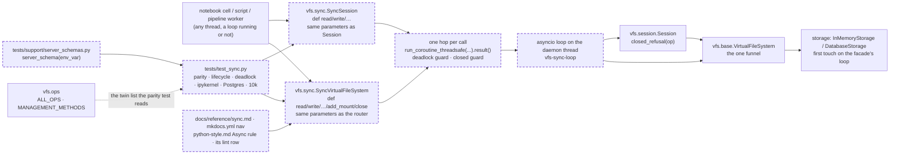

# The sync facade: `vfs.sync`, a typed synchronous twin of the router and the session that owns one loop on one thread, for notebooks, scripts and pipelines

A feature, additive to the public API: a new module `vfs.sync` with `SyncVirtualFileSystem` and `SyncSession`, a new public name `vfs.ops.MANAGEMENT_METHODS` and a new public function `vfs.session.closed_refusal`; no verb changes its contract. It changes no schema format, touches no rights and no engine code. It needs one engine leg, Postgres, for the one criterion that is about asyncpg's loop affinity; every other criterion runs on SQLite. It is parallel-safe with every other active spec: the only existing files it edits are `src/vfs/ops.py` (one constant added), `src/vfs/session.py` (one helper lifted out of a method and one synchronous private close the async close calls), `tests/test_ops.py` (an import), `tests/support/server_schemas.py` (one helper added), `mkdocs.yml`, `context/standards/python-style.md` and `tests/lint/test_code_shape.py`. It builds roadmap story X1 and takes its rulings D26 and D27 as written.

## The problem

Measured on the branch `claude/tender-clarke-j01e4i` at `f9d0ef3`, 2026-11-06, unless labelled otherwise.

- **Every public verb is a coroutine, and there is no synchronous way in.** EXECUTED: `inspect.getmembers(VirtualFileSystem, inspect.iscoroutinefunction)` lists 33 public coroutines, the 25 ops in `ALL_OPS` plus the eight mount-management methods; `Session` has 26. EXECUTED: `grep -rn "run_coroutine_threadsafe\|class Sync\|nest_asyncio\|run_until_complete" src/vfs` finds nothing. READ: `context/standards/python-style.md` line 53 states it as a fact of the tree: "there is no sync facade".
- **A notebook cell cannot reach a verb at all.** EXECUTED: inside a running loop, `asyncio.run(fs.read("/x"))` raises `RuntimeError: asyncio.run() cannot be called from a running event loop`. READ, [the developer-experience audit](../../research/studies/2026-10-28-the-0-1-0-roadmap-audits/06-developer-experience-sync-jupyter-etl.md) section 1.8: the same two cells sent through a real ipykernel fail with that error and with `This event loop is already running`; `nest_asyncio` is the only workaround a user finds, and it is unsupported.
- **A script needs a harness, and a forgotten `await` is silent.** READ, the audit's section 1.9: a plain script must wrap every call in `asyncio.run(main())`; `fs.write(...)` without `await` in a loop creates the coroutines, writes no rows and warns only at garbage collection. An ETL developer who thinks in rows, not loops, has no shape that is safe by construction.
- **The design is already chosen and prototyped, not built.** READ, the audit's section 5 and the roadmap's rulings D26 and D27: a facade owning a private loop on a daemon thread, forwarding each verb through `asyncio.run_coroutine_threadsafe`, was prototyped in 25 lines and run against a plain script and inside a running loop; `anyio`'s portal (a new core dependency), SQLAlchemy's greenlet bridge (the inverse direction, a kernel rewrite) and unasync codegen (a whole sync storage path) were weighed and set aside. READ, `src/vfs/storage/backends/database/engine.py` lines 1 to 13 and `tests/storage/database/test_engine.py::TestLifecycle::test_construct_on_one_loop_first_touch_on_another`: engine construction binds nothing to a loop until first touch, which is what lets a facade construct a storage anywhere and touch it on its own loop.
- **asyncpg binds an engine to the loop that first touches it.** READ, the audit's sections 1.2 and 4: whichever loop first-touches an asyncpg engine owns it, and the live suite does not pin the notebook shape on Postgres. A facade that owns its loop is the one shape under which a Postgres-backed notebook is safe by construction, and that is the one claim here that needs the engine leg.
- **The management allowlist lives in a test.** READ: `tests/test_ops.py` line 37 defines `MANAGEMENT_METHODS`, the eight public coroutines of the router that are not ops, and `test_router_public_verbs_are_exactly_the_registered_ops` holds the router's surface to `ALL_OPS | MANAGEMENT_METHODS`. The sync twin must mirror exactly that surface, so the list becomes a name `src/` owns, as the roadmap's X1 says.
- **The closed-session refusal is private to `Session`.** READ: `src/vfs/session.py`, `Session._refuse_closed`, mints `vfs.invalid` with the detail "the session is closed and cannot reopen; open a new one". The sync session must answer with the same fact, so the mint becomes a function both can call.
- **The notebook tooling is already a dev dependency.** EXECUTED: `uv run python -c "import jupyter_client, ipykernel"` reports `jupyter_client 8.8.0` and `ipykernel 7.2.0` from the `dev` group, so a real-kernel pin costs no new dependency.

## Architecture

The facade is a front in the sense the roadmap uses: it owns only its machinery, one loop and one thread, and stores no fact. Solid is what exists today; dashed is what this spec adds.

Page this changes: none; the architecture folder was retired on 2026-10-31, and the landing notes will say so in one line.

## Decisions

Every choice this change needs, numbered, each with its reason. The roadmap's rulings D26 (thread-loop, no dependency) and D27 (wrapping an existing filesystem is allowed, documented SQLite-only until pinned) are taken as written and not reopened.

### 1. The facade is a thread-loop wrapper in a new module `src/vfs/sync.py`, with no new dependency

One module holds `SyncVirtualFileSystem`, `SyncSession` and the hop between the caller's thread and the loop. Reason: ruling D26 and the audit's comparison. `anyio`'s portal is the same design behind a core dependency vfs does not have; SQLAlchemy's greenlet bridge runs sync code inside an async front, the inverse of what a sync caller over an async kernel needs, so adopting it is a kernel rewrite; generated sync code needs a sync storage path that does not exist. The thread-loop wrapper is about a hundred lines of machinery, needs no kernel change and no dependency, and was prototyped against both the script and the running-loop case.

### 2. Each class is a typed twin written by hand: every public coroutine of the router is a `def` on `SyncVirtualFileSystem` with the identical parameter list, and every public coroutine of `Session` likewise on `SyncSession`

No method is generated at import time and nothing is forwarded through `__getattr__`. The twin list is `ALL_OPS | MANAGEMENT_METHODS` for the router (33 names today) and the public coroutines of `Session` (26) for the session, plus both constructors. Reason: the facade exists for people typing in a notebook and a type checker reading a pipeline; a generated method has no signature for either. The cost, about 450 lines of forwarding methods, is paid once, and the parity test of decision 12 is what keeps the twins honest: a verb that joins the router or the session without its twin fails that test by name.

### 3. The facade constructs the router in the caller's thread, before the loop thread starts, and every later touch lands on the facade's loop

`SyncVirtualFileSystem.__init__` takes exactly the router's constructor parameters (`name`, `title`, `description`, `storage`, `permissions`, `deny_ops`, `no_overlay`, `hop_budget`, `close_timeout`, `rerankers`, `default_authority`), builds the `VirtualFileSystem`, then creates the loop and starts the thread. Reason: construction is loop-free, so where it happens does not matter: the router's constructor creates an `asyncio.Lock()`, which binds to a loop only on a contended acquire and never at construction, and reads `storage.capabilities()`, which does no I/O; the engine host binds nothing until first touch by its design and its pin; and doing it first means a refused argument raises the router's own `TypeError` with no thread left behind. First touch, the engine's `ensure_ready`, is the first verb, and that always runs on the facade's loop, which is what makes an asyncpg engine the facade's own.

### 4. `SyncVirtualFileSystem.wrap(fs)` takes an existing router; its docstring says it is pinned on SQLite and unproven on asyncpg

A class method that attaches the loop thread to a `VirtualFileSystem` the caller already built and may already have awaited on another loop. Reason: ruling D27. The SQLite case is pinned here (a router first-touched on one loop, wrapped, served through the facade, closed through the facade); the asyncpg case is not pinned and the docstring says so in one sentence, because a wrapped engine already bound to the notebook's loop is exactly the hazard the owning constructor exists to avoid, and a false guarantee is worse than a stated gap.

### 5. One daemon thread named `vfs-sync-loop` per facade; every call is one `run_coroutine_threadsafe(...).result()`; an exception escaping the wait cancels the in-flight call

The thread sets the loop as its current loop and runs it forever until `close()`. The hop creates the coroutine in the caller's thread, submits it, and blocks on the future. The wait is the private module function `_wait(future)`, so a test can replace it with `monkeypatch.setattr`, the shape the dispatch tests already use for `asyncio.to_thread`; when any `BaseException` escapes the wait, the facade cancels the future before re-raising, so a Ctrl-C in a notebook does not leave a verb running on the loop behind the user's back. Reason: `run_coroutine_threadsafe` is the standard library's one thread-safe entry into a loop and serializes every facade call onto one loop, so one facade shared by a thread pool is safe by construction; a daemon thread lets an interpreter exit with a forgotten facade instead of hanging; the cancel-on-escape rule is the one the audit named as the gap in the prototype.

### 6. A call from the facade's own loop thread is refused, never waited on: a verb answers `vfs.invalid`, a management method raises `RuntimeError`

Before submitting, the hop compares the calling thread's identity with the loop thread's. A verb (any name in `ALL_OPS`, on either class) returns a `Result` whose one error is `classified(ErrorKind.invalid, detail="called from the facade's own loop thread; a callback running on the loop uses the async filesystem")` with `ops=(<verb>,)`; a management method (`bind`, `unbind`, `add_mount`, `remove_mount`, `remount`, `close`, `locate`, `locate_edge`) raises `RuntimeError` with the same words. Reason: blocking the loop's thread on a future the same loop must complete is a deadlock with no timeout, and the place it happens is a user's own callback (a reranker, an embedder) that reached for the sync handle. The verb case is a classified row because verbs never raise; the management case raises because those methods raise by contract already.

### 7. `close()` is idempotent and final: it closes the router on the loop, stops the loop and joins the thread, and the loop thread shuts itself down, cancelling whatever other threads still had in flight; `__exit__` calls it

After `close()`, a verb returns `classified(ErrorKind.backend_unavailable, detail="the filesystem is closed")` with `ops=(<verb>,)`, the same fact the router mints for a dispatch after its own close; a management method raises `RuntimeError("the filesystem is closed; the loop thread has stopped")`; `mounts()` and `capabilities()` forward to the router, which answers empty. A router close that raises still stops the thread, and the exception then propagates. Every shutdown step that runs a loop (cancelling the pending tasks and gathering them, `shutdown_asyncgens`, `shutdown_default_executor`, `loop.close()`) runs on the loop thread itself, in the runner's `finally`, never on the caller's thread; a waiter in another thread whose call the close cancelled sees `concurrent.futures.CancelledError` from its wait, re-raised unchanged. Reason: the facade owns the thread, so leaving one behind is a leak a test can see in `threading.enumerate()`; running a loop on the caller's thread raises `RuntimeError` from any thread whose own loop is running, which is every notebook cell; stopping the loop without cancelling its tasks would leave a pooled worker blocked forever on a future nothing resolves; the default executor is shut down because the router hops large-body hashing onto it; the closed answers reuse the router's words so a caller handles one fact, not two.

### 8. `SyncSession` wraps a `Session`, closes it through a synchronous `Session._close_now()`, reads `closed` from it, and refuses with the same fact through `vfs.session.closed_refusal(op)`

`SyncVirtualFileSystem.session(authority)` returns `SyncSession(self, authority)`, which builds the `Session` over the wrapped router and forwards each verb's coroutine through the facade's hop. `closed_refusal(op) -> Result` is lifted out of `Session._refuse_closed` into a public function of `vfs.session`; both classes call it. `Session` gains a synchronous private `_close_now()` holding the one line `close()` holds today, and `async def close()` calls it. `SyncSession.close()` calls `self._session._close_now()` directly, with no hop; `SyncSession.closed` returns `self._session.closed`; the sync session owns no flag of its own. A sync verb checks `self._session.closed` before hopping and answers `closed_refusal(op)`; `__enter__` after close raises the same `ValueError` as `Session.__aenter__`. Reason: the session is sugar over the funnel in both shapes, and wrapping the async session rather than the router keeps one implementation of everything a session will come to hold (the roadmap's K10 puts the read stamps on `Session`, drops them in `Session.close()`, and says `SyncSession` shares them), so there is one closed fact, held once; the synchronous close exists because `Session.close` is a coroutine that awaits nothing, and hopping to the loop to set a boolean would make a session on a closed facade unclosable.

### 9. `MANAGEMENT_METHODS` moves from `tests/test_ops.py` to `src/vfs/ops.py` as a `Final[frozenset[str]]`, and the test imports it

Reason: the roadmap's X1 says so, and the reason holds: the list defines the router's public surface beyond the ops, the sync twin must mirror it, and a name two modules depend on belongs in `src/`. The set stays `str`, not `Op`, because its members are not ops.

### 10. Exceptions and results pass through unchanged; the facade adds no exception class

A management method's `MountError` or `ValueError` is raised from the future's result in the caller's thread exactly as the router raised it on the loop; a verb's `Result` is returned as the router built it, so `raise_if_failed` works on it. Reason: the facade is a front; a second vocabulary of failures would be a second contract to document and to drift.

### 11. The facade is not exported from `vfs`; the import is `from vfs.sync import SyncVirtualFileSystem`

Reason: the roadmap's ruling D28 bundles the top-level exports (`Entry`, `DatabaseStorage`, `InMemoryStorage`, `SyncVirtualFileSystem`) into story X2, and this landing stays the facade. Nothing in `vfs/__init__.py` changes.

### 12. The tests live in `tests/test_sync.py`, mirroring `src/vfs/sync.py`; the parity test reads the twin lists from `vfs.ops` and from `Session`'s own members

The parity test compares, for every name, `inspect.signature(...).parameters` of the twin with the original, requires the original to be a coroutine function and the twin not to be, and compares return annotations after mapping `Session` to `SyncSession` and `VirtualFileSystem` to `SyncVirtualFileSystem`; it covers both constructors. Reason: a parity test that reads its list from the live classes fails the day a verb joins without a twin, which the roadmap names as the test's job; comparing parameters rather than source keeps it indifferent to formatting.

### 13. The real-kernel pin starts an ipykernel through `jupyter_client`'s blocking client and is marked `slow`; the Postgres pin is a synchronous test marked `postgres` over a new `server_schema` context manager; the 10k pin counts statements and is marked `slow`

`tests/support/server_schemas.py` gains `server_schema(env_var)`, a synchronous context manager that creates a schema on the server, yields `(url, schema)` and drops the schema after, built on the same `_apply` the async `server_storage` uses, because the facade must own and first-touch its own `DatabaseStorage` and the existing fixture would touch it on the test's loop. The ipykernel pin starts `jupyter_client.KernelManager(kernel_name="python3")`, takes its `blocking_client()`, waits for the kernel to be ready, sends each cell with `execute`, reads the shell reply's `content["status"]` and the iopub `stream` messages until the kernel reports `idle`, and shuts the kernel down in `finally`; the per-message timeout is a hang guard, not an assertion; it needs no new dependency. The 10k pin records statements with `before_cursor_execute` on the facade's storage and on an async router's storage and asserts the two counts are equal. Reason: each is the one place the claim can be seen; the clock appears in none of them.

### 14. The docs gain `docs/reference/sync.md`, in the nav under Reference, with fences Sybil runs; `python-style.md`'s Async rule is rewritten and the standards test holds it

The page names the module, the two classes, the import, the lifecycle, the two refusals and the Postgres rule, and its fences construct and close their own facade under a name other than `fs` so the page's async fixtures are left to the conftest. `python-style.md` line 53 becomes two bullets: the router is async, and `vfs.sync` is the synchronous twin for callers without a loop. `tests/lint/test_code_shape.py::test_the_standards_agree_with_the_tree` gains a forbidden row (`python-style.md` must not say "there is no sync facade") and a required row (it must say `vfs.sync`). Reason: a reference page mirrors a module, and the docs' fences are tests; the standard said a fact that stops being true at this landing.

## Intent

A person in a notebook writes `fs = SyncVirtualFileSystem(storage=InMemoryStorage())`, then `fs.write(path="/a.txt", content="x")` and `fs.read("/a.txt")`, in cells, with the kernel's loop running, and gets two `Result`s; no `asyncio.run`, no `nest_asyncio`, no `RuntimeError`. A pipeline worker does the same in a plain script with no loop at all, and a 10,000-entry `write` costs the engine exactly what the async path costs it. A Postgres-backed notebook is safe because the facade's loop is the only loop its engine ever sees. The sync handle refuses, with a classified row, the one call that would hang it: a call from its own loop thread. Closing it leaves no thread behind. Every verb the router gains from now on must gain its twin or the parity test names it.

## Design

**The module.** `src/vfs/sync.py`, laid out as the file-organization rule says: docstring with the notebook example; imports (`asyncio`, `threading`, `concurrent.futures.Future` for the annotation, `vfs.base.VirtualFileSystem`, `vfs.session.Session` and `closed_refusal`, `vfs.results.ErrorKind`, `Result`, `classified`, `vfs.ops.GRAPH_DEPTH_DEFAULT`, `GRAPH_LIMIT_DEFAULT`, and under `TYPE_CHECKING` the same names `Session` imports; `BM25Rerank` is imported at runtime because the constructor's default needs it); constants `LOOP_THREAD_NAME = "vfs-sync-loop"`, `LOOP_THREAD_DETAIL` and `CLOSED_DETAIL` (the two detail strings of decisions 6 and 7); then `SyncVirtualFileSystem` grouped by lifecycle, mount administration, reads, mutations, search, grants; then `SyncSession` in the same order; then the internal helpers, among them the private module function `_wait(future)`, which returns `future.result()` and is the seam the interrupt test replaces.

**The hop.** Two private methods on `SyncVirtualFileSystem`. `_result(op, call, *args, **kwargs) -> Result` is the verb hop: the loop-thread check answers `classified(ErrorKind.invalid, detail=LOOP_THREAD_DETAIL)` in a `Result(ops=(op,), errors=[...])`; the closed check answers `classified(ErrorKind.backend_unavailable, detail=CLOSED_DETAIL)` the same way; otherwise it submits `call(*args, **kwargs)` with `asyncio.run_coroutine_threadsafe` and returns `_wait(future)`, cancelling the future in an `except BaseException` before re-raising. `_await(call, *args, **kwargs) -> Any` is the management hop: the same two checks raise `RuntimeError`; the same submit and wait. The coroutine object is created only after both checks pass, so a refusal never leaves a coroutine unawaited.

**The thread.** `_start()` creates `asyncio.new_event_loop()`, a `threading.Thread(target=self._serve, name=LOOP_THREAD_NAME, daemon=True)` and starts it. `_serve` is the runner: `asyncio.set_event_loop(loop)`, then `loop.run_forever()` inside a `try`, and in its `finally`, still on the loop thread, cancel every task `asyncio.all_tasks(loop)` returns, run the loop until they have all finished (`loop.run_until_complete(asyncio.gather(*pending, return_exceptions=True))`), then `loop.run_until_complete(loop.shutdown_asyncgens())`, `loop.run_until_complete(loop.shutdown_default_executor())` and `loop.close()`. The caller's `close()` does only this: return when closed; mark closed; submit `self._fs.close()` through the raw submit-and-wait (not `_await`, which would refuse the closed facade) inside a `try`; in `finally`, `loop.call_soon_threadsafe(loop.stop)` and `thread.join()`. A waiter in another thread whose call the close cancelled sees `concurrent.futures.CancelledError` from `_wait`, which the facade re-raises unchanged. `__enter__` returns `self`; `__exit__` calls `close()`. A `closed` property reports the flag. `close()` called from the loop thread raises `RuntimeError` through the same check before anything is marked.

**The twins.** Each verb on `SyncVirtualFileSystem` has the router verb's exact parameter list and forwards positionally and by keyword exactly as `Session` does today, through `_result(op, self._fs.<verb>, ...)`. Each management method forwards through `_await(self._fs.<method>, ...)`. `mounts()` and `capabilities()` call the router directly, because they are plain functions on it. `session(authority)` returns `SyncSession(self, authority)`. `wrap(cls, fs)` builds the instance with `cls.__new__`, attaches `fs`, calls `_start()`.

**`SyncSession`.** `__slots__ = ("_facade", "_session")`; `__init__(self, fs: SyncVirtualFileSystem, authority: Authority)` builds `Session(fs._fs, authority)`; `authority` and `closed` read the wrapped session's; `close()` calls `self._session._close_now()`; `__enter__` raises `ValueError("the session is closed and cannot reopen; open a new one")` when closed, else returns `self`; `__exit__` calls `close()`. Each verb: `if self._session.closed: return closed_refusal(op)`, then `self._facade._result(op, self._session.<verb>, ...)` with the session verb's exact parameters. The two classes live in one module and reach each other's underscored attributes as `Session` reaches the router's; nothing outside the module does.

**`vfs.session.closed_refusal`.** `def closed_refusal(op: Op) -> Result` under a banner of its own, returning `Result(ops=(op,), errors=[classified(ErrorKind.invalid, detail="the session is closed and cannot reopen; open a new one")])`; `Session._refuse_closed` becomes `return None if not self._closed else closed_refusal(op)`. `Session` gains `def _close_now(self) -> None`, the one line that sets the flag, and `async def close()` calls it.

**`vfs.ops.MANAGEMENT_METHODS`.** `MANAGEMENT_METHODS: Final[frozenset[str]] = frozenset({"add_mount", "remove_mount", "bind", "unbind", "remount", "close", "locate", "locate_edge"})` beside `ALL_OPS`, with a docstring saying these are the router's public coroutines that manage the mount tree rather than route an op, and that the router's surface is exactly `ALL_OPS | MANAGEMENT_METHODS`. `tests/test_ops.py` deletes its copy and imports the name.

**Context.** Each hop runs its task in a copy of the caller's context taken at submit time (`call_soon_threadsafe` captures it), so a context variable the caller set is visible to the verb; the hop budget is per task and starts fresh for every facade call, exactly as for a top-level `await` on the router. The docstring of `SyncVirtualFileSystem` says so in one sentence.

**Scale.** Nothing here grows with input. A batch (`entries=`, `edges=`, `moves=`, `observations=`) is passed by reference through the hop, never copied; the loop and the thread are created once per facade, never per call; every statement the engine sees is the one the async path issues, which the 10,000-entry pin asserts.

**The test support.** `server_schema(env_var)` in `tests/support/server_schemas.py`: `@contextmanager`, reads the URL as `server_storage` does, skips when unset, names a schema the same way, runs `asyncio.run(_apply(url, schema, create=True))`, yields `(url, schema)`, and in `finally` runs the drop. The module docstring gains the one-line example.

**The docs.** `docs/reference/sync.md` under the Diátaxis reference comment: module, import, construction (the constructor's parameters are the router's; `wrap`), lifecycle table (`with`, `close()`, idempotence, the thread's name), verbs (every router verb and every management method, same parameters), the two refusals as tables of `kind` and `message`, `SyncSession`, the context rule, and the Postgres rule (the facade's loop is the only loop its engine sees; `wrap` is pinned on SQLite only). Its fences build `sync_fs = SyncVirtualFileSystem(storage=InMemoryStorage())`, write, read, assert on the `Result`, and close. `mkdocs.yml` gains `- Synchronous use: reference/sync.md` after Session.

## Scope

In: decisions 1 to 14. Files: `src/vfs/sync.py` (new), `src/vfs/ops.py`, `src/vfs/session.py`, `tests/test_sync.py` (new), `tests/test_ops.py`, `tests/support/server_schemas.py`, `tests/lint/test_code_shape.py`, `docs/reference/sync.md` (new), `mkdocs.yml`, `context/standards/python-style.md`.

Out: the top-level exports and the iterable `entries=` (X2, ruling D28); the notebook how-to and the nav-coverage test (X3); the read stamps (K10); any `serve()` or MCP shape (M1, M2); a sync twin for anything that is not a public coroutine of the router or the session today; pinning `wrap` on asyncpg; a `__del__` finalizer on the facade (the router has none either; `with` and `close()` are the contract); any change to what a verb does.

## Acceptance criteria

Counts and states, never clocks. Every test is in `tests/test_sync.py` unless its path says otherwise.

1. In a subprocess running `sys.executable -c` with no event loop, `with SyncVirtualFileSystem(storage=InMemoryStorage()) as fs:` followed by `fs.write(path="/a.txt", content="x")` and `fs.read("/a.txt")` prints `True True` and exits 0; and in-process, through the facade, `write` then `read` return `Result`s whose `success is True` and whose one row's `content` is `"x"`. Tests: `test_a_plain_interpreter_with_no_loop_writes_and_reads` and `test_write_then_read_through_the_facade`.
2. The same three cells (construct, write, read) sent to a real ipykernel through `jupyter_client` each come back with reply status `ok`, and the third cell's stream output contains `True`; a fourth cell, `fs.close()`, comes back with reply status `ok` and a fifth cell prints the kernel's thread names, which hold no `vfs-sync-loop`; no cell imports `nest_asyncio`. Test: `test_the_cells_run_in_a_real_ipykernel`, marked `slow`.
3. For every name in `ALL_OPS | MANAGEMENT_METHODS`, `SyncVirtualFileSystem` has a non-coroutine method whose parameters equal the router coroutine's and whose return annotation equals it after the family map; for every public coroutine of `Session`, `SyncSession` has the same; the two constructors' parameters equal their originals' after the family map; `__enter__`/`__exit__` exist where `__aenter__`/`__aexit__` do. Tests: `test_every_router_coroutine_has_a_sync_twin` (parametrized over the 33 names), `test_every_session_coroutine_has_a_sync_twin` (parametrized over the 26 names) and `test_the_constructors_and_the_context_managers_are_twins`.
4. A sync `read` issued from inside a reranker stub that the facade's `glean` runs on the loop thread returns, inside the stub, a `Result` whose one error has `kind == "vfs.invalid"` and whose message names the loop thread, while the outer `glean` completes with `success is True`; a management call from the same place raises `RuntimeError`. Tests: `test_a_verb_from_the_loop_thread_is_refused_not_hung` and `test_a_management_call_from_the_loop_thread_raises`.
5. After `close()`, and after `__exit__`, no thread named `vfs-sync-loop` is in `threading.enumerate()`, `closed is True`, a second `close()` returns `None`, every verb in `ALL_OPS` returns a `Result` with `ops == (verb,)` and one error of kind `vfs.unavailable.backend` and message `the filesystem is closed`, and `add_mount` raises `RuntimeError`. Tests: `test_close_stops_the_loop_thread_and_is_idempotent`, `test_a_verb_after_close_answers_the_closed_fact` (parametrized over `ALL_OPS`) and `test_a_management_call_after_close_raises`.
6. On the Postgres leg, a `SyncVirtualFileSystem` over `DatabaseStorage(url=<asyncpg url>, schema=<its own>)` serves `write`, then the main thread runs `asyncio.run(...)` in which a sibling `DatabaseStorage` on the same schema is constructed, first-touched, reads the same path and is closed, so no asyncpg pool outlives the loop that owns it, then the facade serves `read` of the same path; all three succeed and the content agrees. Test: `test_the_facade_owns_its_asyncpg_loop_beside_the_main_threads_own`, marked `postgres`, a synchronous test over `server_schema`.
7. A 10,000-entry `write(entries=..., parents=True)` through the facade issues exactly as many statements as the same batch issues through an async router: the facade and the router each own a fresh `DatabaseStorage(url=f"sqlite+aiosqlite:///{tmp_path}/<side>.sqlite")`, a `before_cursor_execute` listener is installed on each `storage._host.engine.sync_engine` before either side's first call so both lists include first touch, and the two lists are compared by length; across 100 verb calls, exactly one thread named `vfs-sync-loop` exists and the facade's thread identity is unchanged. Tests: `test_a_ten_thousand_entry_write_costs_what_the_async_path_costs` (marked `slow`) and `test_one_thread_per_facade_not_per_call`.
8. A `SyncSession` verb returns a `Result` equal to the direct facade call with `authority=` filled in; a closed `SyncSession` answers every verb with `ops == (verb,)` and one error of kind `vfs.invalid` and message `the session is closed and cannot reopen; open a new one`, dispatching nothing (the recorder storage sees no call); `with` on a closed session raises `ValueError`; after `SyncSession.close()` the wrapped session's `closed` is `True`; `Session._refuse_closed` and `SyncSession` produce equal facts. Tests: `test_a_sync_session_verb_is_the_facade_call_with_the_authority_filled_in`, `test_a_closed_sync_session_refuses_and_dispatches_nothing`, `test_sync_closed_is_final` and `tests/base/test_authority.py::test_a_closed_session_refuses_and_dispatches_nothing` (unchanged, now through `closed_refusal`).
9. A router first-touched by `asyncio.run` on the test's thread, then passed to `SyncVirtualFileSystem.wrap`, serves `read` of what was written and is closed by the facade's `close()`, which also stops the thread. Test: `test_wrap_serves_a_router_touched_on_another_loop`.
10. When `_wait` raises `KeyboardInterrupt` while a verb is in flight on the loop, the facade re-raises it, the in-flight future is cancelled, and the next verb on the same facade succeeds. Test: `test_an_interrupt_in_the_waiting_thread_cancels_the_call`.
11. `vfs.ops.MANAGEMENT_METHODS` is a `frozenset` of the eight names, and `tests/test_ops.py` holds no definition of it. Tests: `tests/test_ops.py::test_router_public_verbs_are_exactly_the_registered_ops` (importing the name) and `test_the_management_allowlist_is_owned_by_ops`.
12. `grep` over `src/vfs` finds `run_coroutine_threadsafe` and `threading.Thread` in `src/vfs/sync.py` and in no other file. Test: `test_the_facade_is_the_only_thread_hop_in_the_package`.
13. `docs/reference/sync.md` exists, its fences pass under `uv run pytest docs README.md -p no:cov -n 0`, and `mkdocs.yml` names it in the nav; `context/standards/python-style.md` does not say "there is no sync facade" and does say `vfs.sync`. Tests: `test_the_reference_page_is_in_the_nav` and `tests/lint/test_code_shape.py::test_the_standards_agree_with_the_tree`.
14. A `close()` from the main thread while a second thread's verb is held in flight on the loop (a storage double that blocks on a threading event the test controls) returns, stops the thread, and the second thread's call raises `concurrent.futures.CancelledError` inside the test, never blocking; a `close()` issued from inside a running loop on the calling thread (an `async def` test) returns without error. Tests: `test_close_cancels_the_calls_other_threads_are_waiting_on` and `test_close_works_from_inside_a_running_loop`.
15. `scripts/ci.sh` is green at 100% coverage on the tree as committed; `ruff check`, `ruff format --check` and `ty check` at zero over `src/` and `tests/`; the Postgres leg of `tests/test_sync.py` green against a real server, with the run named in the landing notes.

## Landing notes

Landed 2026-11-06 on the branch `claude/tender-clarke-j01e4i`, as slices each green on its own: the spec (`511070a`, amended in `4f64c4a`, its review signed in `c4d0dfd`), the code (`72e428d`), the code review's fixes (`bcecbe0`, `7acfbb9`), and the landing commit that carries these notes, the spec's move and the signed review. Reviewed before the build by [the spec review](../../reviews/2026-11-06-the-sync-facade-spec-review.md) ("Fit to build" on `4f64c4a`, after two Highs, one Medium and six Lows were answered) and before the landing by [the code review](../../reviews/2026-11-06-the-sync-facade-code-review.md) (two Mediums and three Lows; the disposition of every finding is in the file, and its standing verdict is the last dated line there). Everything below is EXECUTED on this branch unless labelled otherwise.

**The gate.** `scripts/ci.sh` on `7acfbb9`: lint, format and types clean; 4,529 passed and 7 skipped with coverage at 100% of 12,269 statements; the 42 docs examples passed, the four on the new reference page among them; the wheel is 9 MB against the 50 MB budget. The engine legs did not run here: no server and no Docker on this machine. The real-kernel pin ran: an ipykernel subprocess (`ipykernel 7.2.0`, `jupyter_client 8.8.0`, both already in the `dev` group) executed the five cells with reply status `ok`, the write and the read printing `True`, and the thread list after `fs.close()` holding no `vfs-sync-loop`.

**Tests first.** `tests/test_sync.py` was placed before any code changed and run on `c4d0dfd`: it could not collect (`ModuleNotFoundError: No module named 'vfs.sync'`), and `tests/test_ops.py` would have failed its import of `MANAGEMENT_METHODS` the same way. The first full run after the code: 63 passed and one failed (the context-manager twin check, which wrongly expected the async router to have `__aenter__`; the test was corrected, not the code). Six lines of the management forwards were then uncovered, because the parity test reads their signatures and runs none of them; `test_the_management_twins_drive_the_mount_tree` was added to drive each through the hop.

**The criteria.** 1 to 5 and 7 to 14 are met and pinned by the node ids the criteria name; `tests/test_sync.py` holds 27 tests, 155 collected with the parametrizations. Criterion 6 and the Postgres half of 15 are pending: no server is reachable from this session; the pull request's Dialect tests run (it triggers on `tests/**`) supplies the `postgres` job with `tests/test_sync.py`'s leg executed, and a context-only commit adds its run id here; the code review's condition is that this job is green before the merge to `main`, and that a red leg there is a code fix needing a new signature.

**The mutants.** With the drain in `close()` replaced by a plain router close (the file copied to the session scratchpad, the mutant applied, the file restored from the copy and checked with `ruff`), `test_close_under_load_on_a_real_storage_returns_cleanly` fails on its first trial with the pool's `KeyError: 'connection'`, the failure the code review demonstrated 54 times in 60 on the unfixed code. The code review's own mutants (the loop-thread check in `_result`, `_refuse_loop_thread`, the `future.cancel()` on an escaping exception, the runner's cancel-all) each failed their pin; three failed by hanging, which is why `pytest-timeout` joined the dev group; the loop-thread mutant with the thread timeout method ends the run with the test named in the dump.

**Differences from the text above, each with its reason.**

1. `close()` drains before it closes: it submits `_drain_and_close`, which on the loop cancels every other task, gathers them and only then awaits the router's close (the code review's M1: with the router closing under an in-flight call on a `StaticPool`, SQLAlchemy's `dispose` raised `KeyError` out of `close()` in most trials). Decision 7's runner sweep stays for a task born during that shutdown, pinned by `test_the_runner_sweeps_a_task_born_during_shutdown` over a double whose cancelled read spawns a task in its `finally`.
2. The hops test the closed flag before the thread identity, the reverse of the Design's order (the code review's L3: a thread identity can be reused after the facade's thread has ended).
3. `CLOSED_SESSION_DETAIL` is a constant of `vfs.session` read by `closed_refusal`, `Session.__aenter__` and `SyncSession.__enter__` (the code review's L2); `CLOSED_MANAGEMENT_DETAIL` names decision 7's third string; the helper that starts the thread is `_attach(fs)`, shared by the constructor and `wrap`, not the Design's `_start()`.
4. `pytest-timeout` joined the `dev` group and five pins carry `@pytest.mark.timeout(60)` (the code review's L1), so a removed guard fails by name rather than by a stuck worker; the two deadlock pins use `method="thread"`, because the signal alarm fires inside the test body and the `with` block's exit then blocks on the wedged loop again, while the thread method ends the run with the test named (the reviewer's re-read, fixed in `7acfbb9`); `uv.lock` is regenerated; neither file was in the Scope's list.
5. Three tests beyond the criteria's list: the two named in 1 and the management-twins drive named under "Tests first".
6. `tests/test_sync.py` imports `ALICE`, `CALLS` and `seen` from `tests/base/test_authority.py` rather than copying the per-op sample calls; the code review found precedent and asked for `tests/support/` only when a third file wants the table.

**Follow-ups found, not done here.** The async router's own `close()` racing an in-flight op on a `StaticPool` is pre-existing (the code review reproduced it with no facade in 59 of 60 trials) and untouched: a spec of its own, whether the router awaits its in-flight dispatches before disposing or the engine host serializes `dispose` behind its lock. `wrap` over an asyncpg router first-touched on another loop stays unpinned, as decision 4 says. The top-level exports are ruling D28's, in the next chunk. The `CALLS` table moves to `tests/support/` when a third test file wants it.

**Architecture pages:** none exist since 2026-10-31; nothing to redraw.

**Changelog:** Added — `vfs.sync`: `SyncVirtualFileSystem` and `SyncSession`, synchronous twins of the router and the session with the same parameters, each facade owning one loop on one daemon thread; a call from the facade's own loop thread is refused as an `invalid` row, a verb after close answers the router's closed fact, and `close()` cancels what other threads had in flight before the router closes. `vfs.ops.MANAGEMENT_METHODS` names the router's mount-management surface; `vfs.session.closed_refusal` is the one closed-session fact.

## One line

A synchronous twin of the router and the session, owning one loop on one daemon thread, so a notebook cell or a pipeline worker calls `fs.write(...)` and gets a `Result`, with the same statements, the same refusals, no extra dependency and no thread left behind.
