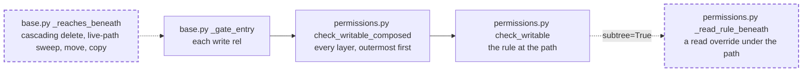

# A read-only rule gates the verbs that reach beneath: a cascading delete, a sweep, move and copy consult the `read` overrides under the path they act on

A fix to the router's write gate: not structural, no public API, schema or storage change, and the engine legs are not needed because no statement changes. It closes the medium finding `vfs:permissions:check_writable:subtree-override-not-consulted` of the 0.1.0a1 security audit (run `vfs-run-1-2026-11-07` at commit `3586750`). No intention and no research: one defect, and the router already applies the same subtree rule to bind sites. It depends on nothing unlanded. The grant-gate spec ([2026-11-07-the-grant-gate-judges-the-subtree.md](2026-11-07-the-grant-gate-judges-the-subtree.md)), active and not yet landed, also edits `src/vfs/base.py` (the `grant` and `revoke` docstrings); the two edits do not overlap and either may land first.

## The problem

READ at `3586750`. `check_writable` (`src/vfs/permissions.py:269-321`) resolves one path through `PermissionMap._resolve` (`permissions.py:192-197`), which matches an override only when it equals or covers that path. `_gate_entry` (`src/vfs/base.py:2858-2902`) calls it for the addressed paths only: the path of delete, restore and sweep (`base.py:1748`), delete and restore by observation (`base.py:1795`), and the source and destination of move or the destination of copy (`base.py:2535-2537`). These verbs act on everything beneath their path, so a `read` override under that path is never consulted, although the mount-admin spec says a map "gates every path beneath" (`context/specifications/archive/068-mount-admin-completeness/spec.md:93`).

READ. The router already treats these verbs as reaching beneath their path for bind sites: `_BUSY_GUARDED_OPS` (`base.py:122`) and `_busy_guard(..., subtree=True)` (`base.py:2939-2952`).

EXECUTED by the audit's verifier on InMemoryStorage with `read_write(read=['/proj/locked'])`: direct mutations inside `/proj/locked` answer `read_only`, while subtree verbs addressed at `/proj`, or at a destination of `/proj`, change rows inside it. The evidence is in the audit's run folder at `agents/v18-p3/artifacts/evidence/`.

## Architecture

Dashed is what this spec adds.

Page this changes: none; the architecture folder was retired on 2026-10-31, and the landing notes will say so in one line.

Terms. A **subtree verb** is a cascading delete or a sweep at a live path, move at its source and destination, or copy at its destination. A **read rule beneath** a path is a `read` override of a layer's map whose prefix lies strictly under that path, in the layer's own coordinates.

## Decisions

### 1. For a subtree verb, `check_writable` answers `read_only` when the path itself resolves writable but a read rule lies beneath it

The verb's effect reaches every path under its target, so the operator's read-only rule there must hold for it as it holds for a direct write. Writable carve-outs nested inside the read rule do not change the answer, because the verb still reaches the read-only rows around them. Like every map refusal, this one binds every actor, the system actor and ETL callers included: a pipeline that deletes or moves a region holding a read rule is refused before dispatch.

### 2. One function, `_reaches_beneath(op, rel, kwargs)` with the module's internal helpers, decides the flag, and `_gate_entry` takes it as a keyword from each route

The answer depends on the call, not only the op: a delete reaches beneath only when it cascades, and a sweep only at a live path (decision 8). One function keeps the rule in one place, and the single, grouped and paired routes each pass its answer. It is true for `delete` with `cascade` true (the default), for `sweep` at a path outside the trash view, and for `move` and `copy`; false for everything else.

### 3. The check is static over the map: no storage read, and it does not ask whether the target is a directory

A map is a policy over paths, not over rows. A read rule beneath a path means the operator declared something under it read-only, whether or not rows exist there today; copy and move onto an absent path are exactly the case where nothing exists yet. The cost is a scan of the layer's overrides, which a map holds few of.

### 4. Both permission candidates are checked, the path and its `/.vfs` alias, as `check_writable` already resolves both

A rule declared on the logical path must also govern its metadata projection, as the existing resolution does.

### 5. The refusal is today's `read_only` result at the router-side path the caller sent, with `rule_prefix` set to the read rule found and the detail "by a mount rule beneath"

The caller sees the path it typed and the rule that refused it, the same shape a direct refusal has, and the detail says why a writable-looking path was refused.

### 6. `write` and `mkdir` with `parents=True` are not subtree verbs, nor are `edit`, `mkedge`, `rmedge` and the grant writes

`write` and `mkdir` create the named path and its missing ancestors, never rows beneath an existing path; that ancestors may be minted inside a read-only region is the documented carve-out the audit records as a hardening note, out of this spec. `edit`, `mkedge` and `rmedge` address one row or one edge, and the grant writes (`grant`, `revoke`, `posture`, `add_member`, `remove_member`) write rights rows, never data rows beneath; the map still refuses every data write those rights would admit inside a read rule, so none is a subtree verb.

### 7. A non-cascading delete and every restore are not subtree verbs

A delete with `cascade=False` is refused by storage on a non-empty directory, so its effect never reaches beneath its path. A restore returns, and a retention sweep destroys, only rows an earlier delete trashed; this spec refuses such deletes from now on, and a row trashed before the rule was declared or through another face over the same storage follows the delete that trashed it, which is accepted because neither verb brings a row into the region that it did not hold. The router's own mount-point handling depends on both: `remove_mount` is a strict delete (`base.py:575`) and `add_mount` restores a tombstoned mount point (`base.py:547`), and neither may be refused by a rule beneath the mount site.

### 8. A sweep addressed into the trash view keeps the point gate

`sweep()` at `/.vfs/trash` runs retention over the mount's trashed rows (`base.py:1117-1135`); like a restore (decision 7), it only finishes an earlier delete and never brings a row into a region. Its address is not a parent of the rows it purges in the map's coordinates, so neither the static scan beneath `/.vfs/trash` nor its `/trash` alias is consulted for it; the existing point resolution stays.

## Intent

After this spec, a read-only rule in a permission map holds against every verb that could change a row under it from above, not only against verbs addressed inside it. A cascading delete, a sweep at a live path, a move or a copy whose effect would reach a read-only region answers `read_only` before dispatch, naming the rule; unmount, remount, restore and a strict delete behave as today.

## Design

**`src/vfs/permissions.py`.** `check_writable` and `check_writable_composed` take a keyword `subtree: bool = False`. After the existing resolution, when the result is `read_write` and `subtree` is true, `_read_rule_beneath(permission_map, rel)` returns the first `read` override whose prefix starts with the candidate plus `/` (any prefix at all when the candidate is `/`), over both candidates of `_permission_candidates`; a hit builds the `read_only` result of decision 5. `_read_rule_beneath` sits with the module's internal helpers.

**`src/vfs/base.py`.** `_reaches_beneath(op: Op, rel: Path, kwargs: Mapping[str, Any]) -> bool` with the internal helpers, under the rule of decision 2. `_gate_entry` gains the keyword `subtree: bool = False` and passes it to `check_writable_composed`; `_route_single` and `_dispatch_grouped_observations` pass `subtree=_reaches_beneath(op, rel, kwargs)`, and the transfer route passes `subtree=True` for move and copy.

**Tests first.** The criteria's tests are written and seen failing before the two modules change.

**Scale.** Per gated path, one pass over each layer's overrides; a 10,000-row batch makes 10,000 such passes, linear in the batch as today's resolution is, and nothing grows with stored rows or issues a statement.

## Scope

In: decisions 1 to 8. Files: `src/vfs/permissions.py`, `src/vfs/base.py`, `tests/test_permissions.py`, `tests/base/test_gates.py`, `tests/base/test_mount_admin.py`, and this spec's landing notes.

Out: minted ancestors under `parents=True` (decision 6); row-level rights, which storage enforces separately; any change to `PermissionMap` construction or to `resolve`.

## Acceptance criteria

Counts and states, never clocks.

1. `check_writable(read_write(read=['/p/locked']), op, Path('/p'), subtree=True)` returns a `read_only` result with `rule_prefix` `/p/locked` for `delete`, `sweep`, `move` and `copy`, and `None` with `subtree=False`; it returns `None` for `/q` and for `/p/open`. Test: `tests/test_permissions.py::test_a_read_rule_beneath_refuses_a_subtree_op`.
2. A read rule beneath the root refuses at `/`, and a rule declared on `/p/locked` refuses the alias `/.vfs/p` with `subtree=True`. Test: `tests/test_permissions.py::test_the_subtree_check_covers_the_root_and_the_alias`.
3. Through `AsyncVirtualFileSystem(storage=store, permissions=read_write(read=['/proj/locked', '/proj2/locked']))` over one `InMemoryStorage` `store`, with `/proj/locked/policy.txt`, `/proj/open.txt` and `/stage/locked/policy.txt` seeded with `parents=True` through a second `AsyncVirtualFileSystem(storage=store)` that has no map, a named principal's `delete('/proj')`, `sweep('/proj')` and `move('/proj', '/x')` each answer `read_only` at the path sent and a read of `/proj/locked/policy.txt` through the map-free face returns its original content after each; `copy('/stage', '/proj2')` onto the absent `/proj2` answers `read_only` and `/proj2` stays absent. Test: `tests/base/test_gates.py::test_subtree_verbs_honour_a_read_rule_beneath`.
4. Under the same map and seeding, `delete('/proj/open.txt')`, `delete('/stage/locked/policy.txt')`, `move('/stage', '/elsewhere')` and a strict `delete('/proj2', cascade=False)` of an empty `/proj2`, made with `mkdir` through the map-free face, succeeds although `/proj2/locked` is a read rule beneath it, and under `read_only(write=['/a/b'])`, with `/a/b/x.txt` seeded through the map-free face, a delete of `/a/b` succeeds. Test: `tests/base/test_gates.py::test_subtree_verbs_pass_where_no_read_rule_lies_beneath`.
5. A child mount's own map is consulted in its coordinates: with a child at `/m` mounted with `read_write(read=['/d/frozen'])`, `delete('/m/d')` answers `read_only` with `rule_prefix` `/d/frozen`. Test: `tests/base/test_gates.py::test_a_child_mounts_read_rule_gates_a_subtree_op`.
6. Under `AsyncVirtualFileSystem(storage=InMemoryStorage(), permissions=read_write(read=['/data/archive']))`, `add_mount(InMemoryStorage(), '/data')`, `remove_mount('/data')` and a second `add_mount` at `/data` all succeed, and `restore('/data')` of a row deleted strictly is not refused by the rule. Test: `tests/base/test_mount_admin.py::test_unmount_and_remount_pass_under_a_rule_beneath_the_site`.
7. With a read rule at `/trash/x`, `sweep('/.vfs/trash')` is not refused by it, and with a read rule at `/proj/locked`, `sweep('/.vfs/trash')` is not refused either. Test: `tests/base/test_gates.py::test_a_trash_view_sweep_keeps_the_point_gate`.
8. Every existing node of `tests/test_permissions.py`, `tests/base/test_gates.py`, `tests/base/test_dispatch.py` and `tests/base/test_mount_admin.py` passes unchanged, and `scripts/ci.sh` is green at 100% coverage on the tree as committed.

## Landing notes

Landed 2026-11-07 on `main` as one commit over `9219057`, after [the spec review](../../reviews/2026-11-07-a-read-only-rule-gates-the-verbs-that-reach-beneath-spec-review.md) (one High, two Mediums and eight Lows, all fixed, re-signed "Fit to build") and [the code review](../../reviews/2026-11-07-a-read-only-rule-gates-the-verbs-that-reach-beneath-code-review.md) (three Highs, five survived mutants, closed by tests; five Lows applied; re-signed "Lands"). The code review was one fresh reviewer running the five lenses in order plus the security lens.

Tests first, EXECUTED: the criterion nodes were written before either module changed; four failed for the right reason (the unit check took no `subtree` keyword, and the router answered ok over a read rule beneath), and the three controls passed and must keep passing (no rule beneath, the trash-view sweep, unmount and remount). The code review's added assertions each fail under their mutant: the observation route with `subtree = False`, the scan with a bare name prefix or with no `read` filter, `full` for `rel` in the single route, and `rel` for `full` in the reported path; the reviewer killed five more of its own, ten of ten.

The gate, EXECUTED on the tree as committed: lint, format, types, docs examples and wheel size PASS; 4,593 passed; 100% coverage of 12,327 statements. The engine legs were not needed: no SQL statement changed, as the code review confirmed from the diff.

Differences from the spec as written: the transfer route passes `subtree=_reaches_beneath(op, dest_terminal.rel, {})`, and `_reaches_beneath` answers true for move and copy, so decision 2's one function carries all four verbs, as the code review's L4 asked.

Architecture pages: unchanged; the folder was retired on 2026-10-31.

**Changelog:** Security — a `read` rule in a permission map now refuses a cascading delete, a sweep, a move or a copy aimed at any path above it, as it already refused verbs aimed inside it; unmount, remount, restore and a strict delete are unchanged.

## One line

A read-only rule in a permission map now holds against a cascading delete, a sweep, a move or a copy aimed at any path above it, not only against verbs aimed inside it.
