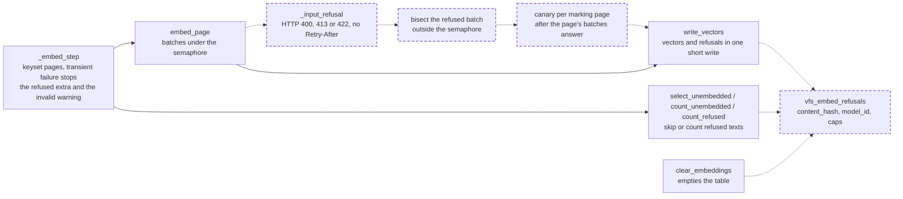

# A refused embed batch is split and its refused texts set aside: the embed step bisects a batch the provider refuses for its input, records each text still refused alone by its content hash, and keeps advancing past it

A fix to the reindex embed step (`src/vfs/storage/backends/database/embed.py`, `backend.py`) and a schema change (one new table, `vfs_embed_refusals`, in `src/vfs/models/rows.py`, with `SCHEMA_FORMAT_VERSION` from 23 to 24), so the engine legs are needed. It closes the medium finding `vfs:storage/backends/database/backend.py:_embed_step:refused-batch-head-of-line-no-split-or-quarantine` of the 0.1.0a1 security audit (run `vfs-run-1-2026-11-07` at commit `3586750`). No intention and no research: the cost is plain in the source, and the audit's verifier reproduced it with a provider double. It depends on nothing unlanded. Two active specs, not built, touch the same code: [the storage seam as the kernel](../active/179-the-storage-seam-as-the-kernel/spec.md) names the schema's tables and takes the new one as it stands when built, and [refresh, the incremental index verb](../active/2026-10-31-refresh-the-incremental-index-verb.md) calls `_embed_step` and so inherits its refusal handling; this spec does not touch `chunk_dirty`, which refresh changes.

## The problem

READ at `4fc3307`. `_embed_step` (`src/vfs/storage/backends/database/backend.py:1424-1487`) pages unembedded chunks by keyset on their id and calls `embed_page` (`src/vfs/storage/backends/database/embed.py`) for each page. `embed_page` cuts the page into batches by the provider's own token estimate (`token_batched`), and when any batch raises, its exception rides back as the page's `failure`; `_embed_step` then ends the step. Every failure ends the step the same way: a timeout, a rate limit, a network fault, and a refusal of the batch's content alike.

READ. The default estimate is `ceil(len(text) / 4)` (`src/vfs/embedding/provider.py:94-96`), which the OpenAI adapter uses too (`src/vfs/embedding/openai.py:63-64`). For text such as CJK, where one character is about one token, the estimate is about four times too low, so a batch planned under the provider's per-request token cap can carry four times the cap, and the provider refuses it with a 400. The refusal is deterministic: the next run selects the same rows first and is refused again.

EXECUTED by the audit's verifier with a provider double that counts one token per CJK character: one writer's 4,096 CJK files at the head of the keyset ended every run at the first page, and a second writer's 40 files, written after, were never embedded.

READ. A refusal that splitting cannot fix exists too: one text over a self-hosted server's real context. Retrying it every run costs requests every run. The re-split deletes and reinserts every chunk row of an edited entry (`indexing.py:331-335`) and carries back only vectors (`_carried_embeddings`, `indexing.py:586-601`), so a mark kept on the chunk row would be lost on any edit to the file. A provider refusing every input, for instance because `dimensions` is misconfigured or a gateway's budget ran out mid-step, must not be mistaken for refused content.

## Architecture

Dashed is what this spec adds.

Page this changes: none; the architecture folder was retired on 2026-10-31, and the landing notes will say so in one line.

Terms. An **input refusal** is an exception that carries an HTTP status of 400, 413 or 422 on the exception (`status_code`) or its response (`response.status_code`), and no `Retry-After`. Every other exception is a **transient failure**. A **refused text** is a content hash with a row in `vfs_embed_refusals` for the current provider's refusal key. The **refusal key** is the provider's `model_id`, `max_input_tokens` and `max_batch_tokens`. The **canary** is the fixed text `"vfs embedding canary"`.

## Decisions

### 1. A batch that meets an input refusal is split in half, in order, and each half is embedded again; a single row still refused is a candidate refusal, and so is every row of the page that shares its content hash

Halving costs at most `2n − 1` requests for a batch of n rows; when the refusal is for r rows' own content and the halves otherwise fit, at most `2·r·⌈log₂ n⌉ + 1`. A batch the provider refused only for its total size succeeds after a few halvings. The halves keep the rows' order, so the vectors land as they would have in smaller batches. A refusal is handled after the batch releases the semaphore; each half acquires it on its own, so refused batches never hold slots while they wait.

### 2. A page's candidate refusals are recorded only after a canary, sent once that page's batches have all answered, succeeds; any exception from that canary, a refusal, a rate limit or a timeout, drops the page's candidates and ends the step as a transient failure

A provider that refuses a fixed four-word text is failing, not refusing content, whether it was misconfigured from the start or turned mid-step, as a gateway whose budget ran out does. Asking after the refusals it vouches for means a provider that turns marks nothing: the page that saw the turn fails its canary. The cost is one small request per page that would record a refusal, and none for a page that records none; a provider that turns mid-page spends at most `2·EMBED_PAGE_ROWS − 1` refused calls before the canary ends the step. The canary acquires the semaphore like any request. A page that met a transient failure sends no canary and records none of its candidates: the failure ends the step, and the next run tries those rows again.

### 3. A transient failure ends the step as today, and an input refusal whose canary succeeded never does

Timeouts, rate limits, network faults and server errors say nothing about the content and pass on retry, so the next run is the right place for them. An input refusal is about the content, so the step continues with the next page, and later writers' chunks are embedded.

### 4. Refusals live in a new table, `vfs_embed_refusals (content_hash String(64) PRIMARY KEY, model_id, max_input_tokens, max_batch_tokens)`, written in the same short write as the page's vectors; `select_unembedded` and `count_unembedded` skip a chunk whose hash has a refusal under the current refusal key, and `count_refused` counts live unembedded chunks that do

A refusal is a fact about a text and a provider, so it is keyed by the text's hash, not by the chunk row: it survives the re-split's delete and reinsert, covers a twin in any page, run or newly written file, and a chunk whose text changes has a new hash and is tried again. The provider facts a refusal depends on, the model and its declared caps, are stored with it, so declaring a larger cap, the operator's fix for a server whose context was raised, gives every refused text another try; a model or dimension change runs `clear_embeddings`, which also empties the table. A chunk with no content hash is never recorded and is retried each run, as today. The table's key is its only index; `select_unembedded` reads it by `NOT EXISTS` on the key. Recording replaces: the write deletes the page's refused hashes from the table in chunks of `membership_budget`, then inserts the page's distinct refused hashes under the current key in one executemany, in the same transaction, so a text refused again under a new key, after an operator raised a cap that is still too small, takes the new key and the write never meets the primary key; three of the five profiles have no native upsert, and on Postgres a failed insert would abort the transaction and lose the page's vectors on every run. A rival that lost its lease mid-page and records the same hash may meet the key on its insert; that write fails classified for that run, and the next run finds the hash recorded and converges, as the lease bounds the overlap to one page.

### 5. `_embed_step` stamps the embedding identity when a page lands a vector or records a refusal

A canary that succeeded proves the provider answers in its space, so a store whose every chunk was refused is stamped too, and a later model change clears its refusals.

### 6. The `embedding` extra gains `refused`, the live unembedded chunks whose text is refused, and a step that recorded any refusal carries one warning of kind `invalid`, not retryable, whose `path` is the first refused chunk's entry and whose `data` holds the provider, the step's refused count and the refused entries' paths in chunk-id order, at most `EMBED_PAGE_ROWS` of them

`invalid`'s locus is the entry the input named, so the warning names it, and the list tells a caller which files to look at without guessing. `unembedded` keeps counting rows still waiting, which no longer include refused texts, so a store with only refused texts left reports `unembedded: 0` and `refused: N`.

### 7. The token estimate does not change

A better estimate would lower the number of halvings for CJK text but not remove the need for them, and the byte length the audit suggests would over-truncate English text at the per-input cap. Splitting makes the step correct for any estimate; a tokenizer-backed estimate is the direction.

### 8. `SCHEMA_FORMAT_VERSION` goes from 23 to 24

A store created before this change then refuses at first touch with the classified "re-provision the mount" message (`engine.py:569-576`) instead of a raw missing-table error at the first `reindex`, which is the migration the pre-release stage owes.

## Intent

After this spec, a batch the provider refuses for its content is split until its acceptable rows are embedded, each text still refused on its own is recorded by its hash and not sent again while the model and its declared caps stand, and the step continues to the chunks after it, so one writer's content can no longer stop vector indexing for everyone. A provider failing for any other reason, or turning to refuse everything mid-step, ends the step as today and records nothing from the page that saw it.

## Design

**`src/vfs/models/rows.py`.** `embed_refusals = Table("vfs_embed_refusals", metadata, Column("content_hash", String(64), primary_key=True), Column("model_id", _string(MAX_MODEL_ID_LENGTH), nullable=False), Column("max_input_tokens", Integer, nullable=False), Column("max_batch_tokens", Integer, nullable=False), schema=schema)` on `VFSTables`, a cap the provider does not declare stored as `-1` so plain equality compares keys on every engine; `SCHEMA_FORMAT_VERSION = 24`.

**`src/vfs/storage/backends/database/embed.py`.** `EMBED_CANARY: Final = "vfs embedding canary"` and `_INPUT_REFUSAL_STATUSES: Final = frozenset({400, 413, 422})`. `EmbedRow` gains `entry_id`. `EmbedReport` gains `refused: int = 0` and `refusal: str | None` (the first input refusal's text), and `as_extra` gains `"refused"`. `Embedding` gains `refused: list[EmbedRow]`. `RefusalKey = tuple[str, int | None, int | None]` and `refusal_key(provider)`. In `embed_page`, `one(batch)` calls the provider under the semaphore, and on an input refusal (`_input_refusal(exc)`) leaves the semaphore and either embeds both halves or returns the single row as a candidate; after `gather`, when the page has candidates and no transient failure, `embed_page` sends the canary under the semaphore and returns the candidates and their in-page twins as `refused`, or, if the canary raised, returns no candidates and the original refusal as the page's `failure`. `write_vectors(..., refused, key)` deletes the refused hashes from the table in chunks of `membership_budget` with `membership(content_hash, chunk, profile)`, then inserts the distinct refused hashes under the key in one executemany, in the same transaction (decision 4). `select_unembedded` adds `NOT EXISTS (SELECT 1 FROM vfs_embed_refusals r WHERE r.content_hash = chunks.content_hash AND r.model_id = :m AND r.max_input_tokens = :i AND r.max_batch_tokens = :b)`, with `-1` for an undeclared cap, and selects `entry_id`; `count_unembedded` adds the same predicate; `count_refused` counts live unembedded chunks that match it; `refused_paths(session, tables, entry_ids, profile, membership_budget)` returns the paths of up to `EMBED_PAGE_ROWS` entries, chunked by `membership_budget`. `clear_embeddings` also deletes every row of the table. The module docstring gains one paragraph on refusals.

**`src/vfs/storage/backends/database/backend.py`.** `_embed_step` passes the refusal key through, stamps on a vector or a refusal (decision 5), reads `report.refused` from `count_refused`, collects the refused rows' entry ids in id order up to `EMBED_PAGE_ROWS`, and appends decision 6's warning when the step recorded any refusal.

**`tests/support/embedding_doubles.py`.** `ScriptedProvider` gains `token_of: Callable[[str], int] | None` (the provider's real count, default `None`), `real_batch_tokens: int | None`, `real_input_tokens: int | None`, `refuse_all: bool` and `refuse_all_after: int | None` (refuse every request from that call on, the canary included); a request over a real cap, or refused by those flags, raises `InputRefusedError(status_code=400)`, a new double shaped as the OpenAI client's `BadRequestError`. `calls` records every call, answered or refused.

**Tests first.** `tests/storage/database/test_embed.py` gains the criteria's nodes, seen failing before the modules change.

**Scale.** Per refused batch, at most `2n − 1` requests with n at most `max_batch_inputs`; one canary per page that records a refusal; each refused text sent at most once per model and declared caps, across re-splits, twins and files; one extra executemany per page, of at most `EMBED_PAGE_ROWS` hashes; one chunked path read per step, of at most `EMBED_PAGE_ROWS` ids; the `NOT EXISTS` probe reads the table by its primary key per candidate row. The table holds one row per refused text.

## Scope

In: decisions 1 to 8. Files: `src/vfs/models/rows.py`, `src/vfs/storage/backends/database/embed.py`, `src/vfs/storage/backends/database/backend.py`, `tests/support/embedding_doubles.py`, `tests/storage/database/test_embed.py`, `tests/models/test_rows.py`, and this spec's landing notes.

Out: a tokenizer-backed estimate; a reset other than a model or caps change, which is the operator's route after a server-side fix; splitting on refusals from providers that raise no HTTP status (the LangChain adapter over Voyage or Bedrock, for instance), which stay transient failures; pruning refusal rows whose text no live chunk holds, which costs one row per text and is the direction if the table ever grows large.

## Acceptance criteria

Counts and states, never clocks. Tests are in `tests/storage/database/test_embed.py`.

1. With a provider whose real count is one token per character, a real batch cap of 300 tokens, `max_batch_tokens = 300` and `max_batch_inputs = 64`, one writer's 40 files of 30 CJK characters each, then a second writer's 10 ASCII files: one `reindex` embeds every chunk of both writers, `unembedded` and `refused` are 0, no canary is sent, and the result carries no error. Test: `test_a_batch_refused_for_its_size_is_split_until_it_fits`.
2. With a real per-input cap of 50 tokens and one chunk of 200 CJK characters at `/w/long.md` among nine ASCII chunks: one `reindex` embeds the nine, records one refusal, reports `refused: 1`, and carries one `invalid` warning, not retryable, whose `path` is `/w/long.md` and whose `data` paths are `["/w/long.md"]`; a second `reindex` makes no call at all. Test: `test_a_text_refused_alone_is_set_aside_and_never_resent`.
3. After criterion 2, an edit to another line of `/w/long.md` that keeps the refused chunk's text, and a new file `/w/copy.md` holding the same text: the next `reindex` embeds the edited file's other chunks and sends the refused text in no call. Test: `test_a_refusal_survives_the_resplit_and_covers_twins`.
4. With `refuse_all`, `max_batch_inputs = 8` and four chunks, so the first page is one batch of four, `calls` records exactly eight calls (the batch's seven halvings, `2·4 − 1`, and one canary), the step ends with one `unavailable` warning naming the refusal, no refusal is recorded, and `unembedded` equals the chunk count. Test: `test_a_provider_refusing_the_canary_ends_the_step_and_records_nothing`.
5. With `refuse_all_after` set so the provider turns after the first page's batches answer, over two pages: the first page's vectors land, no refusal is recorded, and the step ends with one `unavailable` warning. Test: `test_a_provider_turning_mid_step_records_nothing`.
6. A provider raising a 401-shaped error makes exactly one call, ends the step with the `unavailable` warning, and records no refusal. Test: `test_an_auth_refusal_is_transient`.
7. After criterion 2, a `reindex` under a provider with a different model id clears the refusals, sends the refused text again, and, with no per-input cap, embeds it; and on a store whose only chunk was refused, the identity was stamped, so the same model change clears that refusal too. Test: `test_a_model_change_gives_refused_texts_another_try`.
8. After criterion 2, a `reindex` under the same model with `max_input_tokens` raised sends the refused text again; with the real cap still too small, the text is refused again, the step ends with no error but the `invalid` warning, the table holds one row for the hash under the new key, and a third `reindex` makes no call. `test_a_raised_cap_gives_refused_texts_another_try` is parametrized over SQLite and the `ENGINE_LEGS` of `tests/storage/database/test_races.py` (one `pytest.param` per engine URL with its `postgres`, `mariadb`, `mssql` or `oracle` mark), so the engine legs run it and an unset URL deselects it. Test: `test_a_raised_cap_gives_refused_texts_another_try`.
9. A page whose batches meet a transient failure beside an input refusal records no refusal and sends no canary. Test: `test_a_transient_failure_beside_a_refusal_records_nothing`.
10. Every existing test of `tests/storage/database/test_embed.py` passes unchanged, `tests/models/test_rows.py`'s table-name set gains `vfs_embed_refusals`, the embed and chunk nodes of `tests/support/storage_contract.py` pass on SQLite and on the four engine legs (`-m postgres`, `-m mariadb`, `-m mssql`, `-m oracle`), and `scripts/ci.sh` is green on the tree as committed.

## Landing notes

Landed 2026-11-07 on `main` as one commit over `c9b7ebf`, after [the spec review](../../reviews/2026-11-07-a-refused-embed-batch-is-split-and-its-refused-chunks-set-aside-spec-review.md) (four Mediums and fourteen Lows over three reads, all fixed, re-signed "Fit to build"; its first Medium moved the refusal off the chunk row into `vfs_embed_refusals`) and [the code review](../../reviews/2026-11-07-a-refused-embed-batch-is-split-and-its-refused-chunks-set-aside-code-review.md) (six Highs, all unpinned decisions or a regression its re-read caught, and six Lows; re-signed "Lands"). Beyond the Design, the code review's first Low made `one` return its failure inside an `Embedding`, so a refused batch's answered half lands beside its sibling's transient failure; `write_vectors` takes its refusal arguments as required keywords; and `ENGINE_LEGS` lives once in `tests/support/server_schemas.py`. One existing test changed: `TestStep::test_reindex_embeds_every_chunk_and_stamps_the_space` compares the whole `embedding` extra, so it gained `"refused": 0`, the key decision 6 adds; every other existing test of `test_embed.py` is unchanged. `SCHEMA_FORMAT_VERSION` is now 24. The architecture folder was retired on 2026-10-31, so no page changes.

Tests first, EXECUTED: the nine criterion nodes were seen failing before the modules changed (no `EMBED_CANARY`, no refusal handling). The code review's twenty-one mutants, rewritten against the final text, each fail a test except one equivalent (the `listed` set beside `refused_paths`, which already removes duplicate ids).

The gate, EXECUTED on the tree as committed: lint, format, types, docs examples and wheel size PASS; 4,662 passed; 100% coverage of 12,497 statements. The engine legs, EXECUTED by the code review on the full markers: `-m postgres` 380 passed, `-m mariadb` 370 passed and 8 skipped (the MySQL legs with no URL), `-m mssql` 380 passed, `-m oracle` 375 passed.

## One line

The embed step now splits a batch the provider refuses for its content, records each text still refused by its hash, and keeps going, so one writer's files can no longer stop vector indexing for everyone else.
