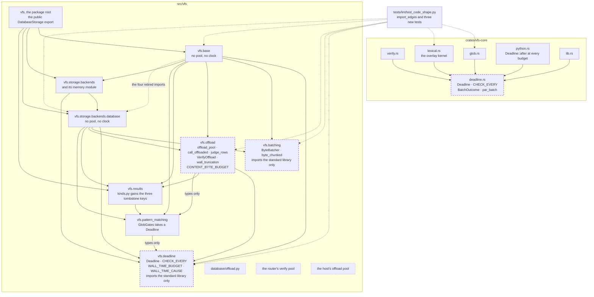

# Bounded work has one home: `vfs.deadline` at the bottom of the package holds the `Deadline` value and reads the clock; `vfs.batching` beside it holds the byte batcher; `vfs.offload` above them holds the one process pool, the hop, the row judge, the byte budget of one hop and the one truncation mint; the router and storage import all three downward; the Rust kernels share one deadline module; and a lint refuses any import of the database adapter from outside it

A refactor, structural: it adds the modules `src/vfs/deadline.py`, `src/vfs/batching.py` and `src/vfs/offload.py` and the Rust module `crates/vfs-core/src/deadline.rs`, removes `src/vfs/storage/backends/database/offload.py`, and retires two lifecycles, the router's verify pool and the engine host's offload pool, in favour of one process pool. It touches the engine (`cargo test -p vfs-core` and the wheel reinstall are criteria; `PROTOCOL_VERSION` stays at 14, the value [the overlay kernel spec](../archive/2026-11-09-the-overlay-counts-in-the-engine-and-the-scan-tier-shares-one-budget.md) set, because no binding signature changes) and needs the engine legs (it edits nineteen files under `storage/backends/database/` and deletes one, all listed under Scope, though no SQL statement changes). It touches rights: `rights.py` and `labels.py` change how their deadline is carried and change no rights rule, so the security lens runs in guidance mode, the grants conformance suite is a criterion, and the leak test among the criteria is the posture gate's fail-closed wall node (criterion 13). It changes no public API: `DatabaseStorage`'s three `*_wall_seconds` arguments keep their names and defaults, `vfs.results.__all__` is unchanged, and none of the three new modules is exported from `vfs`. It depends on no active spec. Every spec whose shape it assumes has landed, and it is written against `280a983`, after eight landings that touched its files since its first draft at `acf1735`: [the two-channel scope spec](../archive/2026-11-07-storage-takes-scope-roots-and-arms-as-two-channels.md) (`0867fbb`, the scope fan, `scope_addressed` and the posture hops), [the lexical fetch fix](../archive/2026-11-08-the-lexical-fetch-spells-its-arms-as-a-tuple-membership.md) (`be80a65`, the search tail fetch), [the SQLite planner statistics](../archive/2026-11-07-sqlite-gathers-planner-statistics-after-each-write.md) (`2d263fb`, `backend.py`, `dialects.py`, `engine.py` and `scope.py`; it moved the host pool's shutdown under a `finally` in `EngineHost.close` and added no deadline, pool or hop), [a directory is never awaiting the index](../archive/2026-11-08-a-directory-is-never-awaiting-the-index.md) (`b85e3df`), [the chunk-page filter](../archive/2026-11-09-the-chunk-page-filter-takes-the-shape-each-planner-serves.md) (`682182f`, `pages.py` and a `profile` argument through `build_epoch`), the overlay kernel spec linked above (`f1e17f0`, a kernel in `lexical.rs` that takes a deadline, a fifth budget site in `python.rs`, and the byte budget moved into `scope.py`), [the lexical builder interning](../archive/2026-11-09-the-lexical-builder-interns-each-term-once.md) (`e094679`) and [the verbs rename](../archive/2026-11-09-the-verbs-take-the-names-agents-know.md) (`280a983`, `glean.py` to `search.py`, `graph.py` to `traverse.py`, `glean_wall_seconds` to `search_wall_seconds`). It is not parallel-safe, and it is built next, before every active spec that shares a file with it. Three depend on it and are built after it, and each takes an amendment pass of its own when it is taken up, because each was drafted before this landing's names existed, still calls the two-channel spec active, and still names `glean.py`. [The gate and the review read the layer map](../active/2026-11-07-the-gate-and-the-review-read-the-layer-map-and-the-size-baseline.md), active and not built, extends the import walk this spec adds to `tests/lint/test_code_shape.py`; from this landing its ladder needs `vfs.deadline` and `vfs.batching` on the bottom rung and `vfs.offload` above `vfs.results` and `vfs.pattern_matching`, where its draft sets `vfs.offload` beside the pattern layer. [The router keeps routing](../active/2026-11-07-the-router-keeps-routing.md), active and not built, moves code out of `src/vfs/base.py` that takes this spec's `Deadline`, `offload_pool()`, `wall_truncation` and `byte_chunked` from their new homes, and shares `tests/base/test_glob_namespace.py`, `test_grep_namespace.py` and `test_dispatch.py`. [Scope crosses the seam in one shape](../active/2026-11-07-scope-crosses-the-seam-in-one-shape.md), active and not built, takes this spec's `Deadline` and its `chunks` in the posture gate and shares `reads.py`, `scope.py`, `grep.py`, `search.py`, `backend.py`, `base.py` and their tests. One shares files without depending on it: [refresh, the incremental index verb](../active/2026-10-31-refresh-the-incremental-index-verb.md), active, not built and waiting on a new review of its own, edits `indexing.py`, `lexical.py`, `backend.py`, `reads.py`, `grep.py`, `search.py`, `crates/vfs-core/src/lexical.rs` and `python.rs`; because this spec is built first, the refresh build takes this spec's paths (its hops pass `offload_pool()`, its `call_offloaded` comes from `vfs.offload`, and it bumps `PROTOCOL_VERSION` from the 14 this spec leaves). One shares nothing: [the release audit is a review](../active/2026-11-07-the-release-audit-is-a-review.md), active and not built, edits `tests/lint/shapes.py`, `tests/lint/test_context_shape.py`, `scripts/unwrap_context.py` and two standards pages this spec does not touch, so the two land in either order. The numbered October drafts under `active/` are not started; one that is picked up is converted in place and takes this spec's names then. It stands on two memos, [how runtimes bound work](../../research/2026-11-07-how-runtimes-bound-work-deadlines-cadence-and-pools.md) and [import direction and module size as fitness functions](../../research/2026-11-07-import-direction-and-module-size-fitness-functions.md), and on two earlier ones it does not reopen, [matcher offload](../../research/2026-08-18-matcher-offload.md) and [the close lifecycle](../../research/2026-08-25-close-lifecycle-and-shutdown-race-prior-art.md). No intention: the concern exists; this spec gives it a home. One hazard it names and does not fix: once a process has run a parallel kernel, a child it forks hangs in its own first grep, glob, search or reindex, today and after this landing, because the engine's rayon pool crosses a fork with no threads; decision 11 guards the Python pool alone, and the engine's pool waits on [a placeholder memo](../../research/2026-11-12-a-forked-child-hangs-in-its-first-parallel-kernel-once-the-parent-ran-one.md) and a fix spec of its own. Its first spec review is [the review of 2026-11-09](../../reviews/2026-11-09-bounded-work-has-one-home-spec-review.md), which ended "Not yet", and its second is [the review of 2026-11-12](../../reviews/2026-11-12-bounded-work-has-one-home-spec-review.md), which ended "Not yet" on one Medium; this text answers both reviews' findings and takes a re-read before the build.

## The problem

Every count and line number in this section is read at `280a983`. Every recursive grep over `src/vfs` is run with `--include='*.py'`, so the bytecode under `__pycache__` is not counted.

READ. The router imports its concurrency primitives from inside the database adapter. `src/vfs/base.py:114-123` holds four import statements carrying eight names: `TRASHED_KEY` from `storage.backends.database.descent` (`:114`), `byte_chunked` from `storage.backends.database.dialects` (`:115`), `OFFLOAD_WORKERS`, `WALL_TIME_BUDGET`, `WALL_TIME_CAUSE`, `call_offloaded` and `judge_rows` from `storage.backends.database.offload` (`:116-122`), and `CONTENT_BYTE_BUDGET` from `storage.backends.database.scope` (`:123`). EXECUTED: `git log -S` dates the first to `6bc61f6` of 2026-10-12, the second and third to `f89e5cb` of 2026-11-07, and the fourth to `f1e17f0` of 2026-11-10, when the overlay kernel spec moved the constant from `grep.py` to `scope.py`. [How we code](../../standards/how-we-code.md), section 3, says the router depends on the `Supports*` protocols; no lint holds it. EXECUTED: `grep -rnE --include='*.py' '(from|import) +vfs\.storage\.backends\.database' src/vfs`, with the adapter's own files left out, lists eight lines: the four above, the public export at `src/vfs/__init__.py:19`, the re-export at `src/vfs/storage/backends/__init__.py:9`, and `src/vfs/storage/backends/memory.py:25-26`, whose second line takes `WALL_TIME_BUDGET` from the adapter's offload module. The stdlib import walk in [the import-direction study](../../research/studies/2026-11-07-import-direction-and-module-size-fitness-functions/experiments/01-import-linter-tach-and-a-stdlib-test/output-script.txt) found the same shape at `acf1735`.

READ and EXECUTED. The wall-time deadline is a bare `float` through 22 signatures (`grep -rn --include='*.py' 'deadline: float' src/vfs`: five in `search.py`, three each in `base.py`, `pattern_matching/glob.py`, the adapter's `offload.py` and `rights.py`, and one each in `grep.py`, `reads.py`, `scope.py`, `labels.py` and `pathterms.py`); ten of the 22 are `float | None`. `grep -rn --include='*.py' 'monotonic()' src/vfs` lists 45 lines in 16 files; two are docstring lines (`offload.py:133`, `rendering/markdown.py:15`), so the monotonic clock is read at 43 call sites. Six of them are in the five renderers under `src/vfs/rendering/`, which time their own work. The other 37 are in eleven files that all compute or check a deadline: `base.py` 9, `search.py` 7, `glob.py` 6, `grep.py` 4, `reads.py` 3, `offload.py` 3, and one each in `backend.py`, `labels.py`, `pathterms.py`, `rights.py` and `scope.py`. A budget becomes a deadline as `monotonic() + seconds` at ten sites (`base.py:1936,2002,2095,2513,2574,2656`, `backend.py:1753`, `grep.py:227`, `reads.py:375`, `search.py:324`), and the deadline becomes a budget again as `max(0.0, deadline - monotonic())` at eight (`glob.py:359,385,435`, `offload.py:157,186,204`, `base.py:2105`, `search.py:1045`). Five constants hold the value 64 as a cadence under five names: `_RESIDUATIONS_PER_CHECK` (`base.py:158`), `PAIR_ROWS_PER_CHECK` (`glob.py:266`), `POSTURE_PATHS_PER_CHECK` (`rights.py:169`, imported by `reads.py:81`), `PROGRAMS_PER_CHECK` (`glob.rs:223`) and `CLOCK_EVERY` (`lexical.rs:85`), with a helper `_past(deadline, position)` at `rights.py:1196`. The wall's truncation record is minted four ways: by `_wall_record` in the router (`base.py:3490`, six call sites), by storage grep's six `WALL_TIME_CAUSE not in truncations` guards and the loop that turns causes into records (`grep.py:281-401`), by search's `_record_wall` (`search.py:1245`, five call sites) and its own loop (`search.py:481-492`), and inline in glob (`reads.py:443-445`).

READ. Two thread pools of the same width and the same lifecycle exist: the router's `_verify_pool` (`base.py:456,735-737,2042-2051`) and the engine host's `_offload_executor` (`engine.py:244,283-295,571-573`). Both are `OFFLOAD_WORKERS = os.cpu_count()` wide, both are shut without waiting at close, both serve a captured hop inline once shut, and both are re-minted on the next capture. EXECUTED: `grep -rn --include='*.py' 'ThreadPoolExecutor(' src/vfs` lists two lines, `base.py:2050` and `engine.py:294`. The router's body-measure hop rides asyncio's default executor instead (`base.py:390,392`). The laws governing all of this are a 78-line module docstring (`offload.py:1-78`) that names "the tree's only deliberate threads" as three owners and omits three the tree holds: the synchronous face's loop thread (`sync.py:648`), the executor a local embedding provider is constructed with (`embedding/provider.py:121,136`), and the engine's own rayon workers, the process-global pool every parallel loop in the crate runs on (`verify.rs:205,230`, `glob.rs:300`, `chunk.rs:43`, `links.rs:60`, `vectors.rs:70`), which the crate neither builds nor names and which starts on the first parallel kernel call, as wide as the machine (the runtimes memo, section 3.2).

READ. The byte batcher lives in the adapter and is used outside it. `ByteBatcher` and `byte_chunked` are defined in `dialects.py:768-820`. The router batches bodies in hand with `byte_chunked` under `CONTENT_BYTE_BUDGET` (`base.py:2098`), as storage grep (`grep.py:358`) and the search overlay (`search.py:1019`) do; the reindex stages batch their hops with it under budgets of their own (`indexing.py:424,632`, `lexical.py:172`); and the blob pagers in five files cut statements with it under `BLOB_PAGE_BYTES` (`backend.py:1368`, `render.py:377`, `versions.py:90,152`, `topology.py:502`, `writes.py:1025`). `CONTENT_BYTE_BUDGET` itself is defined in `scope.py:75` beside `SCAN_TIER_BUDGET`, and `scope.py` never reads it.

READ in the crate. The parallel batch skeleton (an atomic `completed` flag, a `par_iter`, a deadline read before each item, a `BatchOutcome`) is written three times in two files: `count_batch` and `hits_batch` (`verify.rs:194-240`) and `judge_batch` (`glob.rs:291-310`). `glob.rs:35` imports `BatchOutcome` from the sibling grep kernel. "Has the deadline passed" is spelled four times: inline at `verify.rs:207,232` and `lexical.rs:306`, and as the private `past` at `glob.rs:316-318`. Six kernel signatures take `deadline: Option<Instant>` (`verify.rs:201,226`, `glob.rs:244,266,296`, `lexical.rs:296`). A budget becomes an `Instant` two ways at five binding sites: `python.rs:124,144` inline through `Duration::from_secs_f64`, and `python.rs:206,226,342` through `deadline_after` (`python.rs:240-243`), the checked conversion. Three further parallel loops take no deadline and are not this skeleton: `chunk.rs:43`, `links.rs:60` and `vectors.rs:70`.

EXECUTED on 2026-11-12 at `280a983`, CPython 3.13.11 on macOS. The unchecked conversion panics on a budget a caller can send: `count_lines(..., budget=1e300)` and `budget=float("inf")` raise `PanicException`, where `overlay_postings` under the same budgets, through `deadline_after`, runs with no deadline; and `InMemoryStorage(grep_wall_seconds=math.inf)` raises `PanicException` out of `grep`, while the same store's `glob` answers. In a scratch copy of `src/vfs` with a stub `vfs/deadline.py` that imports only the standard library, a stub `vfs/offload.py` that imports `vfs.deadline` and `vfs.results` at runtime, and runtime imports of both added to `base.py`, eight adapter modules, `memory.py` and (of `vfs.deadline` alone) `pattern_matching/glob.py`, each of `import vfs`, `vfs.deadline`, `vfs.offload`, `vfs.results`, `vfs.pattern_matching` and `vfs.base` succeeds, with the pattern layer imported by `vfs.offload` under `TYPE_CHECKING` and again with it imported at runtime; an `ast` walk of the copy that counts `TYPE_CHECKING` imports, with the compiled extension's `from vfs import _native` left out (the edge the import memo's section 3.4 says grimp's own configuration ignores), finds neither new module on a cycle, and no module of `vfs.pattern_matching`, `vfs.results`, `vfs.models`, `vfs.paths` or `vfs.native` that reaches `vfs.offload`. With a third stub added to the copy, `vfs/batching.py` holding the batcher and importing only the standard library, and runtime imports of it added to `base.py` and nine adapter modules, the same imports succeed under both variants, `vfs.batching` and `vfs.deadline` each load alone with no other `vfs` module, the walk finds none of the three new modules on a cycle, and `vfs.offload` does not reach `vfs.batching`. A module-level `ThreadPoolExecutor` used once and then forked while a second thread holds the module's lock leaves the child holding the parent's executor and a lock no thread will release; with `os.register_at_fork(after_in_child=...)` resetting both, the child's first hop runs on a thread of its own pool and the parent's pool is unchanged. The engine's pool is a second fork hazard, and it exists today: with the second review's two probe scripts, run unchanged, a parent that ran one `ContentMatcher.count_lines` batch, or one `InMemoryStorage.grep`, and then forked has a child whose own first parallel kernel call did not return inside 8 seconds and was killed by its alarm, with no Python pool involved in the first case; a child of a parent that ran no kernel answers; and a parent that only wrote one body past `MEASURE_OFFLOAD_BYTES` forks children that write and then grep (the scripts and the output are with [the placeholder memo](../../research/2026-11-12-a-forked-child-hangs-in-its-first-parallel-kernel-once-the-parent-ran-one.md)). INFERRED: rayon's global pool crosses the fork with its registry and none of its threads, on Linux as on macOS; Linux was not run.

EXECUTED, from the memo's studies on this machine. One native matcher call saturates all ten cores: twenty Python threads each submitting a 256 MiB batch at once reach the same aggregate throughput as one, at thirteen times the latency. A `Deadline` object's method costs about 30 ns an item over the inline check in CPython, and a loop that reads the clock once per chunk of 64 costs 1.07 times the bare loop. READ, the memo's synthesis: every runtime studied keeps the deadline absolute in one explicit value, every engine checks it between chunks in one helper, the stop is one record minted in one place, and every pool owner keeps one lazily made pool per process or loop.

## Architecture

Dashed boxes are what this spec adds; dotted boxes and the dotted edge are what it retires. An arrow runs from the importer to the module it imports, and every import edge among the drawn nodes is drawn; an edge marked "types only" is under `TYPE_CHECKING`, and every other edge is a runtime import. The dotted arrows from the lint show what it reads.

Page this changes: none; the architecture folder was retired on 2026-10-31, and the landing notes will say so in one line.

Terms. A **deadline** is an absolute instant on the monotonic clock before which a stage must finish, or none. The **wall** is the deadline a bounded stage takes at its entry, `WALL_TIME_BUDGET` seconds ahead by default; a verb with more than one bounded stage takes one wall per stage today, and still does. A **budget** is the seconds left before a deadline, derived from it when a worker starts. A **hop** is one unit of CPU work handed to a worker thread and awaited; it is not the router's `hop_budget`, which counts routed dispatches. The **process pool** is the one `ThreadPoolExecutor` every hop in the process runs on. A **cadence** is the number of items a loop takes between two reads of the clock.

## Decisions

### 1. `src/vfs/deadline.py` holds the deadline value and imports only the standard library, `src/vfs/offload.py` above it is the one home of the pool, the hop, the judge and the truncation mint, and `src/vfs/storage/backends/database/offload.py` is deleted

`vfs.deadline` holds `Deadline`, `CHECK_EVERY`, `WALL_TIME_BUDGET` and `WALL_TIME_CAUSE`, and imports nothing from `vfs`. `vfs.offload` holds `OFFLOAD_WORKERS`, `CONTENT_BYTE_BUDGET`, `wall_truncation`, `offload_pool`, `shutdown_offload_pool`, `call_offloaded`, `judge_rows` and `VerifyOffload`; the byte batcher has a module of its own, `vfs.batching` (decision 8), which `vfs.offload` does not import. Its runtime imports from `vfs` are `vfs.deadline` (for `WALL_TIME_CAUSE`) and `vfs.results` with `vfs.results.kinds` (for `classified`, `ErrorKind`, `ResultError` and `Severity`); it imports `vfs.pattern_matching` only under `TYPE_CHECKING`, because it names `GlobGates`, `GlobRow`, `Body`, `ContentMatcher` and `MatchSpan` in annotations alone, as the deleted module does today. The pattern layer imports `vfs.deadline` and never `vfs.offload`: `pattern_matching/glob.py` names `Deadline` in annotations alone, so its import sits under `TYPE_CHECKING`, as ruff's type-checking rule requires of a typing-only import. A module that builds a `Deadline` or reads one of the three constants imports `vfs.deadline` at runtime (`base.py`, `offload.py`, `memory.py`, and `backend.py`, `grep.py`, `search.py`, `reads.py` and `rights.py` in the adapter); a module that only takes one imports it under `TYPE_CHECKING` (`glob.py`, `labels.py`, `pathterms.py`, `scope.py`). Neither kind can close a cycle, at runtime or under `TYPE_CHECKING`, because `vfs.deadline` has no import to follow back and nothing beneath `vfs.offload` imports it (The problem, EXECUTED). The reason the deadline has a module of its own, beneath `vfs.offload`, is the first review's H1: a deadline is a pure value at the bottom of the ladder, and the first draft closed a cycle by giving that clock value a method that built a result record, which made the value's module import `vfs.results`, which imports the pattern layer at runtime (`results/render.py:21`, `results/preview.py:31`), which was to take the value. The router and the database adapter import these modules downward, which is the rule [how we code](../../standards/how-we-code.md) section 3 states and the tree broke on 2026-11-07. This departs from [the off-loop glob spec](../archive/2026-11-07-glob-matching-runs-off-the-loop-under-the-wall.md)'s decisions 4 and 8, which put `judge_rows` and the two wall constants in the adapter's `offload.py`; the names and their contracts are kept and only their home moves. `vfs.offload`'s docstring states the four laws the old docstring stated in a quarter of the length, because the pool and the deadline are now types and not prose, and it names every deliberate thread in the tree: the process pool, the engine's rayon workers (the global pool the crate's parallel kernels start on their first call, as wide as the machine, a thread set vfs's Python side does not own and this spec does not re-make), the synchronous face's loop thread and a local embedding provider's executor. The test files mirror the paths: `tests/test_deadline.py` is new, and `tests/storage/database/test_offload.py` moves to `tests/test_offload.py` with `git mv`. Its three nodes that pin `writes.py` behaviour (`test_large_bodies_are_measured_in_one_offloaded_hop`, `test_a_body_changed_during_the_hop_is_never_stored_under_another_hash`, `test_an_edit_call_matches_in_one_hop_with_a_budget_per_match`) move to `tests/storage/database/test_writes.py`.

### 2. `Deadline` is a frozen value holding an absolute monotonic instant or none, it builds no result record, and `vfs.deadline` is the only module outside the renderers that reads the monotonic clock

`Deadline.after(seconds: float)` reads `monotonic()` once and holds the instant; `Deadline.never()` holds none; `remaining() -> float | None` is `max(0.0, at - monotonic())` or `None`; `expired() -> bool` is `monotonic() > at`, the strict comparison every site makes today, and `False` for never. It has no method that returns a `ResultError` and no import that could build one (decision 1). Every signature that takes `deadline: float` or `deadline: float | None` today takes `deadline: Deadline`, so no site can forget the `None` case or recompute the budget its own way; a site that passes `None` today passes `Deadline.never()`; the Rust kernels receive `deadline.remaining()` as their `budget`. The memo's five runtimes all keep the deadline absolute in one explicit value that is passed and never stored on a long-lived object, and derive the remaining time at each hop. vfs follows that: no long-lived object holds a deadline, `GlobGates` holds none (`native`, `scope_native` and `judge_scope` take it as an argument on every call), and the one object that does hold one, the planner's `_Walk` (`base.py:3515`), is built and dropped inside one `_plan_scope` call and keeps holding its `Deadline`. The monotonic clock is read in `vfs.deadline` and in the five renderer modules under `src/vfs/rendering/`, which time their own work and are out of this spec's scope; a test pins that list. A fake clock in a test is one patch, on `vfs.deadline.monotonic`.

### 3. The clock is read between chunks, through `Deadline.chunks`, and `CHECK_EVERY = 64` is the one default cadence

`Deadline.chunks(items: Iterable[T], size: int = CHECK_EVERY) -> Iterator[list[T]]` repeats three steps: if the deadline has passed, stop; take up to `size` items through `itertools.islice`; if none came, stop, else yield them as a list. So the clock is read once before each chunk, an iterator is chunked without being materialized (`scope_addressed`'s product of roots and arms is one), and a deadline that holds an instant is read once more than the chunks it yields. A caller that must know whether every item was reached counts what it consumed against what it was given, as the sites already do with `reached`. The three 64-valued Python constants and `rights.py`'s `_past` go. `_Walk` in the planner counts residuations through the `Deadline` it holds and reads `expired()` before every `CHECK_EVERY`th one, because its items arrive one call at a time and are not a sequence it can chunk; `GlobGates.native` and `scope_native` read `expired()` before each pattern, because one item there is a whole program build. The memo's engines all check at a loop bottom or between chunks and never per innermost step (SQLite measured its loop-bottom placement at 1.5 percent; Lucene's chunk starts at 100 documents), and on this machine the chunked shape costs nothing where the per-item mask costs 1.7 times the loop. A stage may pass a different `size` only with a two-line comment saying how long one of its items can take; none does in this landing.

### 4. The wall's truncation record is minted in one place, `wall_truncation(guidance)` in `vfs.offload`

`wall_truncation(guidance: str) -> ResultError` is `classified(ErrorKind.truncated, severity=Severity.warning, detail=f"at the {WALL_TIME_CAUSE}; {guidance}")`, the record every site writes today, with the stage's guidance text as its one parameter. The router's `_wall_record` is deleted and its six call sites call `wall_truncation`; glob's inline record in `reads.py` calls it. In grep and search the guards keep appending `WALL_TIME_CAUSE` to the call's list of causes and check the wall through `deadline.expired()`; search's `_record_wall` stays as the guard that appends the cause once; the loop that turns causes into records mints the wall's record through `wall_truncation` and every other cause through `classified` with its data, in the list's order, so a call carries one record per cause as today, and the wall's record carries no data as today. It lives in `vfs.offload` and not on `Deadline` because the record is a `Result` fact and the deadline is a clock value (decision 1). The anonymous posture gate's refusal at its wall, `posture_wall_refusal` in `rights.py`, is an `unauthenticated` refusal of the whole call and not a truncation; it keeps its own text and its home. This departs from nothing landed; it is the shape [the chained-grep spec](../archive/2026-11-07-chained-grep-verifies-off-the-loop-under-a-wall.md) decision 5 began when it gave the router's record the same cause words as storage's.

### 5. One pool per process, lazily made, `OFFLOAD_WORKERS` wide, shared by the router and every storage host; the router's verify pool and the host's offload pool are removed

`offload_pool()` returns the process pool, making it on first call with `thread_name_prefix="vfs-offload"` under a module lock. `shutdown_offload_pool()` shuts it with `shutdown(wait=False)` and clears the slot, never passing `cancel_futures`, so queued work is served; it takes no `wait` parameter, because nothing calls for a waiting shutdown and the close-lifecycle rule makes `shutdown(wait=False)` the only shutdown. vfs calls it nowhere, and it exists for a test that narrows the pool and for a host's own teardown; the next hop re-mints. `call_offloaded(executor, work)` keeps its signature, and every builder in the adapter keeps its `executor` parameter, so tests inject counting executors as they do. `backend.py` passes `offload_pool()` at each of the eleven sites where it passes `host.offload_executor` today, and the router calls `offload_pool()` at each hop. `AsyncVirtualFileSystem.close()` and `EngineHost.close()` shut nothing; `EngineHost.offload_executor` and the router's `_verify_executor` go; the router's body-measure hop (`base.py:390,392`) rides the process pool through `call_offloaded` instead of `asyncio.to_thread`. The reason is the memo's third section: one native call already saturates the machine, so a second pool over the same rayon engine buys latency and not work; asyncio, anyio, trio and polars each own one pool per loop or process; and the one reason the router grew its own pool, keeping ten-second hops off asyncio's default executor and its `getaddrinfo`, argues against the default executor and not for two pools. The law that a hop submitted to a shut executor is served inline stays in `call_offloaded`: a caller that holds the executor it was given before a shutdown (a storage builder, a `VerifyOffload`) serves its remaining hops inline, and a caller that asks `offload_pool()` per hop gets the re-minted pool; since no vfs code path shuts the pool, the difference is visible only to a test or a host that calls `shutdown_offload_pool`. The close-lifecycle memo's rule that running work finishes into the void stays: no vfs code path waits on a worker of the process pool; the synchronous face's loop teardown still shuts its loop's default executor and waits for it (`sync.py:672`), and after this landing, of vfs's own hops, only a local embedding provider's can be on it. This departs from [the chained-grep spec](../archive/2026-11-07-chained-grep-verifies-off-the-loop-under-a-wall.md) decision 4 (the router owns its verify pool), from [the off-loop glob spec](../archive/2026-11-07-glob-matching-runs-off-the-loop-under-the-wall.md)'s decisions 5 and 10, which ride that pool, and its decision 7, which rides the host's, and from the engine host's ownership that [matcher offload](../../research/2026-08-18-matcher-offload.md) first proposed; the laws they stated about queued work, cancellation and inline service are kept, in one place.

### 6. The width stays `os.cpu_count() or 1`, and each stage's wall is still taken where it is taken today

The memo leaves the width open between the core count and "a few slots", and shows the difference is latency under contention rather than throughput; merging two pools into one already halves the process's threads over the rayon engine. A narrower width is a measured change for a later spec, on a CI runner as well as this machine. A wall is taken at ten sites today (The problem), each at the entry of one bounded stage: a storage reader (`grep.py:227`, `reads.py:375`, `search.py:324`), the anonymous posture gate ahead of it (`backend.py:1753`), and each of the router's matching stages (the six sites in `base.py`). This spec converts each site to `Deadline.after` in place and merges none, and the budget is still derived from the deadline when a worker starts, which is the gRPC and trio rule. Merging the stages of one verb under one wall would move the instant at which a verb truncates, so it would change answers, and this spec changes none.

### 7. `crates/vfs-core/src/deadline.rs` owns `Deadline`, `CHECK_EVERY`, `BatchOutcome` and the one parallel batch skeleton; every kernel that takes a deadline takes this one, the overlay kernel included; and `python.rs` converts every budget through it

`Deadline` is a `Copy` value over `Option<Instant>`. `Deadline::after(budget: Option<f64>)` is the checked conversion `deadline_after` makes today: no budget is no deadline, a negative or NaN budget is a zero budget, and a budget past what an `Instant` can hold is no deadline, so no budget can panic. `Deadline::never()` holds none, `Deadline::at(instant)` holds the instant given, and `past()` is one comparison. `BatchOutcome<T>` moves here from `verify.rs`. `par_batch(items, deadline, skipped, run)` is the one skeleton: a `par_iter` that reads the deadline before each item, answers `skipped()` for an item it did not start, calls `run(item)` otherwise, which returns `(T, bool)`, the bool saying the item finished, and stores `false` into an atomic `completed` for an item skipped or unfinished. `count_batch`, `hits_batch` and `judge_batch` call it, and `judge_batch`'s row stopped inside its groups flips `completed` as it does today. It reads the clock before every item and not every `CHECK_EVERY`th, because one item is a whole body or a whole row, as the kernels read it today. The six kernel signatures that take `Option<Instant>` take `Deadline`, the sequential overlay kernel `lexical::overlay_postings` among them, and the four spellings of "has the deadline passed" become `deadline.past()`. Each cadence constant in the crate is decided here. `CLOCK_EVERY` (`lexical.rs:85`) becomes the shared `deadline::CHECK_EVERY`: the overlay kernel spec's decision 4 chose 64 as this spec's default and said the check moves onto this module. `PROGRAMS_PER_CHECK` (`glob.rs:223`) becomes it too: the off-loop glob spec chose 64 as a bound on matches past the wall with no measurement of one program step, so under decision 3's rule it is the default and not a kernel fact; `verdict_with` keeps its injected `expired` closure, which its tests count through. A kernel may name a cadence of its own only with a comment saying how long one of its items can take; none does in this landing. The Python and the Rust `CHECK_EVERY` are two constants that are equal by choice; no binding exports either, and each bounds loops on its own side of the seam. No binding signature changes, so `PROTOCOL_VERSION` stays at 14. This is the single behaviour change of the spec, and it turns a crash into the answer the sibling verb already gives: `count_lines` and `hit_lines` under a budget of infinity or `1e300` run with no deadline instead of raising `PanicException`, so a store built with `grep_wall_seconds=math.inf` greps as the same store's `glob` already globs under `glob_wall_seconds=math.inf` (The problem, EXECUTED). Criterion 14 pins it. The structural review found the kernels carrying the skeleton more than once with two conversions, and the memo's engines keep one helper.

### 8. `ByteBatcher` and `byte_chunked` move to a new module `src/vfs/batching.py` that imports only the standard library; `CONTENT_BYTE_BUDGET` moves to `vfs.offload`; `SCAN_TIER_BUDGET` and `stored_size` stay in `scope.py`; `chunked`, `membership_budget`, `arm_budget` and `BLOB_PAGE_BYTES` stay in `dialects.py`

The batcher is a generic cut by bytes: items accumulate until the next would pass a budget the caller names, and one oversized item rides alone. Its callers are the router (`base.py:2098`), the adapter's readers and reindex stages (`grep.py`, `search.py`, `indexing.py`, `lexical.py`), which size a hop's payload with it, and the blob pagers in `backend.py`, `render.py`, `versions.py`, `topology.py` and `writes.py`, which size SQL statements with it under their own page budget, `BLOB_PAGE_BYTES`. Sizing a statement is not a worker fact, so the batcher does not belong in `vfs.offload`; and the router must not import the adapter (decision 10), so it cannot stay in `dialects.py`. It belongs beneath both its users, in `vfs.batching`, which imports nothing from `vfs` and which each caller imports downward at runtime; `vfs.offload` has no call to it and does not import it. `CONTENT_BYTE_BUDGET`, the 32 MiB figure, is a fact about what one hop holds, so it lives in `vfs.offload` beside the pool: the router batches rows in hand under it where no scan tier exists, and `grep.py` and `search.py` import it from there while they keep importing `SCAN_TIER_BUDGET` and `stored_size` from `scope.py`. `scope.py` imports neither the batcher nor the budget, because it reads neither. `stored_size` stays because it prices a row by its stored `size_bytes` column, an adapter fact; `chunked`, `membership_budget` and `arm_budget` stay in `dialects.py` as [AGENTS.md](../../../AGENTS.md) documents them, beside `BLOB_PAGE_BYTES`, because SQL bind and statement budgets are dialect facts. The module's test file is `tests/test_batching.py`, the mirror of its path, and the seven nodes of `TestByteChunked` move there from `tests/storage/database/test_dialects.py`. This departs from the overlay kernel spec's decision 6, which put the three scan-tier laws in one module by moving the byte budget into `scope.py` and left `byte_chunked` in `dialects.py`; that decision foresaw a move ("if the bounded-work spec lands first, all three names come from `vfs.offload` instead"), and of its three names the budget goes to `vfs.offload`, `byte_chunked` goes to `vfs.batching`, and `stored_size` stays, each for the reason above. `embed.py`'s token-bounded batcher keeps citing `byte_chunked` as its sibling.

### 9. `TRASHED_KEY`, `DELETED_AT_KEY` and `TRASH_ROOT_KEY` move to `vfs.results.kinds` beside `ErrorKind` and are not added to `vfs.results.__all__`

They are the keys a `ResultError`'s `data` carries so a caller knows `restore` applies; the router reads one off a `Result`, and a `Result`'s data vocabulary belongs with the `Result`, as `vfs.target` already does in `envelope.py`. `base.py` imports `TRASHED_KEY` from `vfs.results.kinds`, as `base.py:100` already imports `Severity` from there; `descent.py` imports the two it reads, `TRASHED_KEY` and `DELETED_AT_KEY`, and `trash.py` imports `TRASH_ROOT_KEY`, each from `vfs.results.kinds`. `vfs.results` is a public package (`docs/reference/sync.md:78` imports from it), so the keys stay out of its `__all__` and the public surface is unchanged.

### 10. A stdlib lint holds two rules over one import walk: no module outside `vfs.storage.backends.database` imports from it except three named importers, and `vfs.deadline` and `vfs.batching` import nothing from `vfs` while nothing in the pattern or results layers imports `vfs.offload`

`tests/lint/test_code_shape.py` gains one `ast` walk over `src/vfs` that builds the module-level import graph, `TYPE_CHECKING` imports included. The first test fails on any import from the protected package by a module outside it. The allowed importers are matched exactly by module name: `vfs` (`src/vfs/__init__.py`, the public `DatabaseStorage` export), `vfs.storage.backends` (the package's `__init__`) and `vfs.storage.backends.memory` (which constructs a `DatabaseStorage`). The second test fails if `vfs.deadline` or `vfs.batching` imports any `vfs` module, or if any module of `vfs.pattern_matching` or `vfs.results` imports `vfs.offload`; the first and the last are the two edges that would re-close the first review's cycle, and the middle one keeps the batcher beneath both its users. Each failure names file and line, as the other shape tests do. The memo weighed import-linter and chose the stdlib test for a small gate that already runs as pytest, naming the condition for the tool later. The layer ladder and the size baseline are the next spec's; its ladder subsumes this second rule when that spec lands, and the rule is removed then.

### 11. A forked child forgets the inherited Python pool: `vfs.offload` registers `os.register_at_fork(after_in_child=_forget_pool)` where the platform has it, and the child mints its own pool on its first hop; the engine's rayon pool is not covered, and a forked child's parallel kernel call still hangs once its parent has run one

`_forget_pool` sets the module's pool slot to none without shutting the inherited executor, whose threads do not exist in the child, and replaces the module's lock with a new one, because a lock another thread held at the instant of the fork is held in the child by no thread. The registration is one module-level statement under `if hasattr(os, "register_at_fork"):`. `_forget_pool` carries `# pragma: no cover`, because it runs only in a forked child, where the coverage of the parent's run cannot see it; the subprocess test of criterion 7 is what pins it, and the comment says so in the form `native.py:28,37` uses for its own subprocess-pinned lines. vfs ships wheels for five platforms (`.github/workflows/publish.yml:26-30`: Linux x86_64 and aarch64, macOS aarch64 and x86_64, Windows x64) and supports Python 3.11 to 3.14 (`pyproject.toml:19,28-31`). `os.register_at_fork` exists on Linux and macOS under every one of those versions, and Windows has neither it nor `os.fork`, so there is no fork there to guard and the statement is skipped. A child started by `spawn` or `forkserver` (the `multiprocessing` default on macOS, on Windows, and on Linux from Python 3.14) imports `vfs.offload` fresh and inherits nothing. The reason is the consequence of decision 5 the first review found as H2: today a child that builds its own storage and router mints fresh Python pools, because each pool belongs to an object, and after decision 5 the pool belongs to the module and survives the fork with no threads, so without the hook the child's first hop of any kind would wait forever (the review's EXECUTED probe, and The problem's). The hook keeps this landing from adding that hang. The hook covers the Python pool alone. EXECUTED at `280a983` (The problem): once a process has run one parallel kernel, a child it forks never returns from its own first parallel kernel call, because rayon's global pool crosses the fork with no threads. That is so before this landing and after it. In plain words, for the ETL audience [AGENTS.md](../../../AGENTS.md) calls first-class, which forks workers on Linux under Python 3.11 to 3.13, where fork is the `multiprocessing` default: a forked worker may write, and may hop pure-Python work; it may grep, glob, search or reindex only when its parent ran no parallel kernel before the fork, and otherwise that call hangs, as it does today. `vfs.offload`'s docstring says so beside the thread list, and names the way around it that needs no fix: start workers with `spawn` or `forkserver`. This spec does not fix the engine's pool, because what a forked child should get from it (a pool the engine re-makes, kernels that run without parallelism, or a refusal the caller can read) is a design question with prior art to study; it waits in [a placeholder memo](../../research/2026-11-12-a-forked-child-hangs-in-its-first-parallel-kernel-once-the-parent-ran-one.md) for a fix spec of its own.

## Intent

After this spec, every stage that bounds its work takes one `Deadline`, reads the clock through it between chunks, and mints its truncation through one function; every hop in the process runs on one lazily made Python pool that no verb owns and a forked child never inherits; the router imports nothing from the database adapter; the Rust kernels share one deadline module; and the gate refuses the next import that would cross the adapter's boundary. Every verb answers exactly what it answers today, with the single change decision 7 names: a grep under a wall too large for an `Instant` answers, as glob already does, instead of panicking. What changes beside the answers is lifecycle, in four facts: pool threads live until the interpreter exits and no `close()` shuts them; a hop racing a close runs on the pool and not inline; the router's hops and the body-measure hop run on threads named `vfs-offload`; and the synchronous face's close no longer waits for a body-measure hop. What does not change is the engine's fork hazard: a forked child of a process that has run a parallel kernel still hangs in its own first grep, glob, search or reindex (decision 11).

## Design

**`src/vfs/deadline.py`** (new, about 90 lines, the standard library only). The docstring states the law: a relative budget becomes an absolute instant once, at a stage's entry, and the remaining time is derived from it at each hop. Then `WALL_TIME_BUDGET`, `WALL_TIME_CAUSE` and `CHECK_EVERY` with their comments. Then `Deadline`, a frozen dataclass with slots and one field `at: float | None`, and `after`, `never`, `remaining`, `expired` and `chunks` as decisions 2 and 3 give them. The module reads the clock as `monotonic()` through `from time import monotonic`, so `vfs.deadline.monotonic` is the one patch target. A test builds a deadline that has already passed as `Deadline(at=-1.0)`, where it passes `deadline=-1.0` today.

**`src/vfs/batching.py`** (new, about 70 lines, the standard library only). A docstring stating the flush law, then `ByteBatcher` and `byte_chunked`, moved from `dialects.py:768-820` with their code unchanged; `byte_chunked`'s docstring names its twin `chunked` by its full path in `dialects.py`.

**`src/vfs/offload.py`** (new, about 250 lines). The module docstring states the four laws (the deadline crosses absolute, one batch in flight per `VerifyOffload`, cancellation is abandonment made safe, a shut executor serves inline) and names the tree's deliberate threads as decision 1 lists them, the engine's rayon workers among them, with decision 11's sentence beside the list: a forked child may write and may hop pure-Python work, and its parallel kernel calls hang if its parent ran one before the fork. Then `OFFLOAD_WORKERS` and `CONTENT_BYTE_BUDGET` with their comments. Then `wall_truncation`. Then `offload_pool` and `shutdown_offload_pool` over a module-level `_pool: ThreadPoolExecutor | None` and `_lock: threading.Lock`. Then `call_offloaded`, `judge_rows` (taking `deadline: Deadline`, cutting the budget with `deadline.remaining()`) and `VerifyOffload` (its two methods taking `deadline: Deadline`), moved from the old module. Under the internal helpers banner, `_forget_pool` and the one registration statement of decision 11; `_forget_pool` carries `# pragma: no cover` with the reason that it runs only in a forked child and is pinned by a subprocess test, the form `native.py:28,37` uses.

**`src/vfs/pattern_matching/glob.py`.** `GlobGates.native`, `scope_native` and `judge_scope` take `deadline: Deadline`. `native` and `scope_native` read `deadline.expired()` before each pattern and hand the native set `deadline.remaining()`. `judge_scope` iterates `deadline.chunks(rows)`, counts the rows it consumed as `reached`, and hands the scope set `deadline.remaining()`; the per-64 mask and `PAIR_ROWS_PER_CHECK` go. The `monotonic` import goes.

**`src/vfs/base.py`.** The four imports from `storage.backends.database` go. `Deadline`, `WALL_TIME_BUDGET` and `CHECK_EVERY` come from `vfs.deadline`; `byte_chunked` from `vfs.batching`; `offload_pool`, `call_offloaded`, `judge_rows`, `CONTENT_BYTE_BUDGET` and `wall_truncation` from `vfs.offload`; `TRASHED_KEY` from `vfs.results.kinds`. `_verify_pool`, `_verify_executor` and the shutdown lines in `close()` go; every `pool` parameter in `_judged`, `_match_in_hand`, `_planned`, `_root_probes`, `_root_probe` and the dispatch builders goes with its `assert pool is not None`, and each hop calls `call_offloaded(offload_pool(), work)` or `judge_rows(offload_pool(), ...)`. `monotonic() + WALL_TIME_BUDGET` becomes `Deadline.after(WALL_TIME_BUDGET)` at its six sites, the conditional one at `:2002` taking `Deadline.never()` where it takes `None` today, and the in-place planning call passing `Deadline.never()`. `_wall_record` is deleted for `wall_truncation`. `_match_in_hand` reads `deadline.expired()` before each batch and cuts the budget with `deadline.remaining()` in the worker. `_Walk` holds a `Deadline` and a count and reads `expired()` before every `CHECK_EVERY`th residuation; `_RESIDUATIONS_PER_CHECK` goes. `_authored_entry` measures through `call_offloaded(offload_pool(), ...)`. The `ThreadPoolExecutor` and `monotonic` imports go, and the docstrings that name the router's pool name the process pool.

**`src/vfs/storage/backends/database/`.** `engine.py` loses `_offload_executor`, `offload_executor`, its shutdown lines, the paragraph of `close`'s docstring about them, and its `ThreadPoolExecutor` and `OFFLOAD_WORKERS` imports. `backend.py` passes `offload_pool()` at its eleven `offload_executor` sites and builds `Deadline.after(gate.wall_seconds)` in `_scoped_refusals`. `grep.py`, `search.py` and `reads.py` build `Deadline.after(wall_seconds)` where they add the wall to the clock today, read `deadline.expired()` where they compare the clock today (three sites in `grep.py`, five in `search.py`), and mint the wall's record through `wall_truncation` as decision 4 says; `search.py`'s `_count_overlay` hands the kernel `deadline.remaining()`. `scope.py`'s `entries_for_scan`, `labels.py`'s `posture_rows_for_chunks` and `pathterms.py`'s `allow_list_ids` take `deadline: Deadline` and read `deadline.expired()` before each SQL chunk or arm, the first included. `rights.py`'s `posture_chain` and `posture_refusals` and `reads.py`'s `scope_addressed` take `deadline: Deadline`, iterate `deadline.chunks`, and return `None` when they consumed fewer items than they were given, as they return `None` past the wall today; `rights.py`'s inline gate passes `Deadline.never()` at its three calls; `POSTURE_PATHS_PER_CHECK` and `_past` go. Every `from time import monotonic` in these files goes. `dialects.py` loses `ByteBatcher` and `byte_chunked`. `scope.py` loses `CONTENT_BYTE_BUDGET` and its docstring names the constant's new home. `grep.py` and `search.py` import `byte_chunked` from `vfs.batching` and `CONTENT_BYTE_BUDGET` from `vfs.offload`, and `backend.py` imports `byte_chunked` from `vfs.batching`. Seven files change only import lines and the prose that names a moved thing: `writes.py`, `indexing.py` and `lexical.py` (`call_offloaded` from `vfs.offload` and the batcher names from `vfs.batching`), `signals.py` (`call_offloaded` from `vfs.offload`), and `render.py`, `topology.py` and `versions.py` (`byte_chunked` from `vfs.batching`). `descent.py` loses the three key definitions and imports the two it reads; `trash.py` imports `TRASH_ROOT_KEY` from `vfs.results.kinds`. `src/vfs/storage/backends/memory.py` imports `WALL_TIME_BUDGET` from `vfs.deadline`.

**`src/vfs/results/kinds.py`.** The three keys with their two-line comment. `src/vfs/results/__init__.py` is unchanged.

**`crates/vfs-core/src/deadline.rs`** (new, about 110 lines plus tests): `CHECK_EVERY`, `Deadline`, `BatchOutcome<T>` and `par_batch<I, T>(items: &[I], deadline: Deadline, skipped: impl Fn() -> T + Sync, run: impl Fn(&I) -> (T, bool) + Sync) -> BatchOutcome<T>`. `verify.rs` and `glob.rs` call `par_batch` and lose their skeletons, their `AtomicBool` and `Instant` imports, and `glob.rs:35`; `glob.rs` loses `past` and `PROGRAMS_PER_CHECK`; `lexical.rs` loses `CLOCK_EVERY` and its `Instant` import and reads `ordinal % CHECK_EVERY == 0 && deadline.past()`; the kernels' own tests build `Deadline::at(expired)` and `Deadline::never()` where they build `Some(expired)` and `None`. `python.rs` calls `Deadline::after(budget)` at its five budget sites and loses `deadline_after` and its `std::time` import. `lib.rs` declares the module and re-exports `BatchOutcome`, `CHECK_EVERY`, `Deadline` and `par_batch` from it.

**`tests/lint/test_code_shape.py`.** `import_edges()` (the `ast` walk, about 60 lines, returning `(importer, imported, path, line, type_checking)` rows; the compiled extension's `from vfs import _native` is not an edge to the package root), the two tests of decision 10, the source-text test of criterion 8, and one row in `test_the_standards_agree_with_the_tree`'s forbidden table for the mutant ledger.

**`context/standards/mutant-ledger.md`.** Seven rows name what this spec moves. P3, P4, P5 and P9 take `src/vfs/offload.py` as target and `tests/test_offload.py` as scope, P3's anchor becoming `deadline.remaining()` hoisted out of the worker. P15 takes `src/vfs/batching.py` as target, with `tests/test_batching.py` beside `tests/storage/database/` as scope. P8 and P17, whose anchors are the engine host's close, are re-anchored on `shutdown_offload_pool` (the dead pool kept in the slot; `cancel_futures=True` passed), with `tests/test_offload.py` as scope.

**Tests first.** `tests/test_deadline.py`, `tests/test_batching.py` and `tests/test_offload.py` gain the criteria's nodes and the moved ones, seen failing on the missing modules; `tests/lint/test_code_shape.py` gains the boundary test, seen failing on today's four router imports before `base.py` changes; `crates/vfs-core/src/deadline.rs` gains its unit tests, seen failing before the module exists. Then the code, in the order: the Rust module and its callers, with the wheel reinstall; `vfs.deadline`, `vfs.batching`, `vfs.offload` and `vfs.results.kinds`; the pattern layer; storage; the router; the deletions. A test that needs a one-worker pool patches `vfs.offload.OFFLOAD_WORKERS` and calls `shutdown_offload_pool()` before its first hop and again in its teardown, so no later test inherits the narrow pool.

**Scale.** Nothing new grows with input. `Deadline.chunks` holds one list of at most `size` references at a time over items the caller already holds. One `Deadline` is built per bounded stage, a handful per verb call, against [the reference deployment](../../../AGENTS.md)'s 150,000 verb calls a day. The process pool is bounded at `OFFLOAD_WORKERS` threads, half of today's ceiling on a host running one router over one storage. Router hops and storage hops now queue on the same workers: at the deployment's peak of about 20 verb calls a second a chained grep that holds a worker for its whole ten-second wall can delay another call's hop, and the delayed stage's budget still runs from its own entry, so it stops at its wall and never waits past it. A delayed matching stage truncates at its wall; the anonymous posture gate, whose two hops now share the queue with router hops, refuses the whole call at its wall, as it does today behind its own storage's hops, so a saturated pool fails closed; decision 6 keeps the width and names the narrower one as a measured change. A 10,000-file write still measures its bodies in one hop. `par_batch` is the skeleton the kernels run today, with the same clock read per item. The fork hook runs once per forked child and does no work in the parent. The engine's rayon pool stays as wide as the machine and is not sized, named or re-made by this spec; across a fork it is the hazard decision 11 states.

## Scope

In: decisions 1 to 11. Files, each found by grep at `280a983`. New: `src/vfs/deadline.py`, `src/vfs/batching.py`, `src/vfs/offload.py`, `crates/vfs-core/src/deadline.rs`, `tests/test_deadline.py`, `tests/test_batching.py`. Deleted: `src/vfs/storage/backends/database/offload.py`. Moved: `tests/storage/database/test_offload.py` to `tests/test_offload.py`. Edited in the package: `src/vfs/base.py`, `src/vfs/pattern_matching/glob.py`, `src/vfs/results/kinds.py`, `src/vfs/storage/backends/memory.py`, and under `src/vfs/storage/backends/database/`: `backend.py`, `engine.py`, `reads.py`, `grep.py`, `search.py`, `scope.py`, `labels.py`, `rights.py`, `pathterms.py`, `writes.py`, `dialects.py`, `descent.py`, `trash.py`, `indexing.py`, `lexical.py`, `signals.py`, `render.py`, `topology.py`, `versions.py`. Edited in the crate: `verify.rs`, `glob.rs`, `lexical.rs`, `python.rs`, `lib.rs`. Edited tests: `tests/lint/test_code_shape.py`; `tests/results/test_facts.py`; `tests/pattern_matching/test_glob.py`; `tests/base/test_glob_namespace.py`, `test_grep_namespace.py` and `test_dispatch.py`; and under `tests/storage/database/`: `test_writes.py` (the three moved nodes), `test_dialects.py` (`TestByteChunked` leaves for `tests/test_batching.py`), `test_grep.py`, `test_search.py`, `test_reads.py`, `test_rights.py`, `test_pathterms.py`, `test_coherence.py` and `test_trash.py`. Edited standards: `context/standards/mutant-ledger.md`. And this spec's landing notes.

Out: the renderers' own elapsed-time reads under `src/vfs/rendering/`, which bound a render and could take a `Deadline` in a spec of their own. Out: a narrower pool width, and a cadence per stage set from the cost of its slowest item, each a measured choice the memo names an experiment for. Out: the local embedding providers' hop (`embedding/provider.py:136`), which runs a provider's synchronous kernel on the executor its constructor was given or on the loop's default pool; that executor is an argument of a public class, and moving the hop is a decision about that argument. Out: the synchronous face's loop thread (`sync.py:648`), which is a thread and not a pool. Out: one wall per verb across its stages, a follow-up that changes answers (decision 6) and takes a spec of its own. Out: the awaited timeouts (`asyncio.wait_for` at `backend.py:738`, `embed.py:437,470,476` and `base.py:751`), which bound an await on the loop's own timer and read no clock of vfs's; the query embedding's wait at `backend.py:738` runs under `search_wall_seconds` before the search reader takes its own wall, and folding the two together belongs with the item before this one. Out: the waits on the loop's own timer that are not deadlines, the reindex heartbeat (`backend.py:1249`, `indexing.py:128-129`), the retry backoff (`engine.py:396`), the interrupt poll (`engine.py:909`) and the embedder's `Retry-After` sleep (`embed.py:475`), and SQLite's `busy_timeout` pragma (`dialects.py:461`), which the engine keeps. Out: an engine pool that survives a fork (a pool the crate builds itself and re-makes in a child, kernels that run without parallelism in a forked child, or a refusal a forked child can read in place of a hang), which changes how the crate starts and takes a spec of its own; until it lands a forked child's parallel kernel call hangs once its parent has run one (decision 11), and the question waits, with the executed probe, the Linux run still to make and the prior art to study, in [the placeholder memo](../../research/2026-11-12-a-forked-child-hangs-in-its-first-parallel-kernel-once-the-parent-ran-one.md), which also carries the runtimes memo's unsettled question of a named rayon pool. Out: the times stored in the database and compared across processes, the reindex lease's stamp (`indexing.py:601`) and the `datetime.now(UTC)` stamps rows carry, where a monotonic instant has no meaning. Out: the three parallel loops in the crate that take no deadline (`chunk.rs:43`, `links.rs:60`, `vectors.rs:70`). Out: the layer ladder, the module-size baseline and the review rubric, which [the next spec](../active/2026-11-07-the-gate-and-the-review-read-the-layer-map-and-the-size-baseline.md) carries; from this landing its ladder needs `vfs.deadline` and `vfs.batching` on the bottom rung and `vfs.offload` above `vfs.results` and `vfs.pattern_matching`, and it removes decision 10's second rule, which the ladder subsumes. Out: moving the planner and the in-hand verbs out of the router, which [the router spec](../active/2026-11-07-the-router-keeps-routing.md) carries; the code it moves takes `Deadline` from `vfs.deadline`, `byte_chunked` from `vfs.batching`, and `offload_pool`, `call_offloaded`, `judge_rows`, `CONTENT_BYTE_BUDGET` and `wall_truncation` from `vfs.offload`. Out: the posture gate's new computation, which [the scope-shape spec](../active/2026-11-07-scope-crosses-the-seam-in-one-shape.md) carries; its gate takes this spec's `Deadline` and chunks through it. Out: the text of those three specs, each of which is amended to this landing's names in a pass of its own when it is taken up.

## Acceptance criteria

Counts and states, never clocks. A fake clock is a patch on `vfs.deadline.monotonic`. Tests are in `tests/test_offload.py` unless their path says otherwise. Every recursive grep over `src/vfs` carries `--include='*.py'`, so bytecode is not listed; the lint node named beside a grep reads the sources and is the pin.

1. `Deadline.after(10.0).expired()` is `False` under a clock patched to its creation instant, `False` under a clock patched to exactly the deadline's instant, and `True` once the patched clock passes it by any amount; `Deadline.never().expired()` is `False` and its `remaining()` is `None` under any clock; `Deadline.after(5.0).remaining()` under a clock advanced by 2 is `3.0` and under one advanced by 7 is `0.0`; `Deadline.after(math.inf)` is never expired and its `remaining()` is `math.inf`. Test: `tests/test_deadline.py::test_a_deadline_is_absolute_and_never_negative`.
2. `Deadline.after(1.0).chunks(range(1000))`, under a clock patched after construction that passes the deadline after its third read, yields exactly 3 chunks of 64 and a counting clock records 4 reads, one before each chunk and the one that finds the wall passed; with `size=100` it yields 3 chunks of 100. Over `itertools.product(range(10), range(10))` under a clock that never passes, it yields a list of 64 and a list of 36 and the clock records 3 reads. `Deadline.never().chunks(range(100))` yields a list of 64 and a list of 36 and the clock records 0 reads. Test: `tests/test_deadline.py::test_chunks_read_the_clock_once_per_chunk_and_stop_at_the_deadline`.
3. `wall_truncation("narrow it")` is a `ResultError` of kind `truncated`, severity `warning`, with no data, whose `message` is "Truncated: at the wall-time budget; narrow it"; `tests/storage/database/test_grep.py::TestBudgets::test_the_wall_record_carries_no_data` passes unchanged. Test: `test_the_wall_truncation_has_one_text`.
4. `offload_pool()` called twice returns the same executor, with `OFFLOAD_WORKERS` max workers and threads named `vfs-offload…`; after `shutdown_offload_pool()` the module holds none and the old executor refuses a submit, and the next `offload_pool()` returns a new one. Test: `test_the_process_pool_is_lazy_shared_and_reminted`.
5. A `DatabaseStorage` grep, an `AsyncVirtualFileSystem` chained grep and a router path write of a body at `MEASURE_OFFLOAD_BYTES` each run their hop on a thread whose name starts `vfs-offload`; `tests/base/test_dispatch.py::test_a_large_body_is_measured_off_the_loop` counts hops through `call_offloaded` (none below the threshold, one for the text body, one for the bytes body); and `grep -rn --include='*.py' 'ThreadPoolExecutor(' src/vfs` lists exactly one line, in `src/vfs/offload.py`, while `grep -rnE --include='*.py' 'to_thread|run_in_executor' src/vfs` lists exactly `src/vfs/embedding/provider.py:136`. Tests: `test_every_hop_rides_the_process_pool`, `tests/lint/test_code_shape.py::test_the_clock_the_deadline_and_the_cadence_have_one_home`.
6. After `AsyncVirtualFileSystem.close()`, after `DatabaseStorage.close()` on a built host and on a borrowed one, the process pool is the same executor and still accepts a submit; a close in a process that has made no hop mints no pool; a storage grep and a reindex whose builders hold an executor shut by `shutdown_offload_pool()` finish inline and return every match and every chunk; and with a one-worker pool, one batch running and one queued, `shutdown_offload_pool()` leaves the queued grep to return its match. Tests: `test_close_leaves_the_process_pool_alone`, `test_a_hop_captured_before_shutdown_is_served_inline` (parametrized over grep and reindex), `test_queued_work_at_shutdown_is_served_never_cancelled`. These three and criterion 4's node replace the eight nodes of today's `TestExecutorOwnership`. In `tests/base/test_grep_namespace.py` the four nodes whose law is a router-owned pool are deleted (`test_close_shuts_the_verify_pool_and_a_closed_router_makes_none`, `test_close_shuts_the_verify_pool_with_nothing_to_dispose`, `test_a_chained_grep_racing_close_makes_no_pool`, `test_a_chained_grep_closed_during_its_read_makes_no_pool`), and one node, `test_a_closed_router_refuses_a_chained_grep`, keeps the one answer they pinned that survives: a chained grep on a closed router is `backend_unavailable`. `test_close_never_waits_for_a_running_batch` passes unchanged, and `test_a_batch_queued_at_close_still_finishes` passes with `vfs.offload.OFFLOAD_WORKERS` patched and the pool shut before and after. `TestVerifyOffload`, `TestLoopResponsiveness`, `TestJudgeRows` and `TestAbandonment` pass with `Deadline` arguments.
7. A child interpreter imports `vfs.offload`, runs one hop on `offload_pool()`, and calls `os.fork()` while a second thread holds the module's lock. The forked child finds the module holding no pool and a lock that is not held, runs a hop on `offload_pool()` that returns on a thread named `vfs-offload…` of an executor that is not the parent's, and exits 0; a child that finds the inherited executor or a held lock exits 1 without attempting a hop, so a failure is an exit code and never a hang; the parent then finds `offload_pool()` is the executor it had. Both hops are a pure-Python function that enters no kernel: the criterion pins the Python pool across a fork, which is all decision 11 guards, and a hop that entered a parallel kernel in both the parent and the child would never return in the child, today and after this landing. The test runs the scenario through `subprocess`, as the seam's pins in `tests/test_native.py` do, and carries a `pytest.mark.skipif(not hasattr(os, "fork"), ...)` marker, the form `tests/test_native.py:62` uses, with no `pytest.skip()` call. Test: `test_a_forked_child_mints_its_own_pool`.
8. `grep -rlw --include='*.py' 'monotonic' src/vfs` and `grep -rlE --include='*.py' '^from time import monotonic' src/vfs` each list exactly `src/vfs/deadline.py` and the five renderer modules `src/vfs/rendering/{docx,markdown,pdf,pptx,xlsx}.py`; `grep -rn --include='*.py' 'deadline: float' src/vfs` lists nothing; `grep -rnE --include='*.py' '_PER_CHECK|_past\(' src/vfs` lists nothing; `grep -rnE 'PER_CHECK|CLOCK_EVERY' crates/vfs-core/src` lists nothing. Test: `tests/lint/test_code_shape.py::test_the_clock_the_deadline_and_the_cadence_have_one_home`.
9. `tests/lint/test_code_shape.py::test_no_module_outside_the_adapter_imports_it` passes on the tree as committed and, run on `280a983` with the test file copied in, fails naming `src/vfs/base.py:114`, `:115`, `:116` and `:123` and no other line. `tests/lint/test_code_shape.py::test_the_bottom_modules_import_nothing_from_vfs_and_nothing_beneath_offload_imports_it` passes on the tree as committed, and fails naming file and line when a scratch copy of the tree adds `from vfs.results import classified` to `vfs/deadline.py`, `from vfs.paths import Path` to `vfs/batching.py`, or `from vfs.offload import wall_truncation` to `vfs/pattern_matching/glob.py`.
10. `from vfs.results.kinds import TRASHED_KEY, DELETED_AT_KEY, TRASH_ROOT_KEY` succeeds, none of the three is in `vfs.results.__all__`, and `src/vfs/storage/backends/database/descent.py` holds no assignment to any of them. `tests/base/test_mount_admin.py` and `tests/base/test_mounts.py` pass unchanged, and `tests/storage/database/test_trash.py` passes with only its import of the three keys moved to `vfs.results.kinds`. Test: `tests/results/test_facts.py::test_the_tombstone_keys_live_with_the_result`.
11. `cargo test -p vfs-core` passes with new nodes `deadline::tests::after_a_huge_budget_is_no_deadline` (budgets of `1e300` and infinity give a deadline that is never past), `deadline::tests::par_batch_skips_items_past_the_deadline` (a deadline already past yields `skipped` for every item, `completed` false, and `run` called 0 times), `deadline::tests::par_batch_flips_completed_for_an_unfinished_item` (a `run` that answers `(value, false)` for one item returns every value and `completed` false) and `deadline::tests::par_batch_is_thread_count_invariant` (pools of 1 and 8 threads return the same results in item order). The kernels' own deadline nodes pass with `Deadline::at` and `Deadline::never` arguments: `glob_set_rows_past_the_deadline_are_unjudged`, `glob_set_a_row_with_many_programs_stops_at_the_deadline`, `glob_set_build_stops_at_the_deadline`, `batch_reports_counts_and_completion` and `overlay_postings_stops_between_documents_at_the_deadline`. `verify.rs` and `glob.rs` hold no `AtomicBool`, `glob.rs` imports nothing from `verify`, `grep -n 'Instant::now' crates/vfs-core/src/{verify,glob,lexical}.rs` lists only lines inside those files' `tests` modules, where an already-past instant is built, and `python.rs` holds no `from_secs_f64`, no `Instant` and no `Duration`.
12. `tests/pattern_matching/test_matcher_parity.py` and `tests/models/test_lexical.py::TestOverlayPostings` pass unchanged, and `tests/pattern_matching/test_glob.py` passes with only a `Deadline` where a float or `None` was and its clock patched on `vfs.deadline.monotonic`, so the kernels answer as before. `PROTOCOL_VERSION` is 14 in `python.rs` and `EXPECTED_PROTOCOL` is 14 in `native.py`: `tests/test_native.py::TestSeamGate::test_the_protocol_version_is_14` passes unchanged.
13. Every node of `tests/support/grants_contract.py` passes unchanged. Every node of `tests/storage/database/test_rights.py` passes, unchanged except the posture gate's wall nodes, which take a `Deadline` where a float or `None` was and patch the fake clock on `vfs.deadline.monotonic`: `TestPostureGate::test_a_gate_past_its_wall_refuses_the_call`, both cases of `TestPostureGate::test_a_gate_past_its_wall_at_any_stage_refuses_the_call`, which assert the call is refused whole when `posture_rows_for_chunks` or `posture_refusals` reaches the wall, and `TestPostureGate::test_the_pure_steps_read_their_deadline_every_64_paths`.
14. The single behaviour change: a store built with `grep_wall_seconds=math.inf` and `glob_wall_seconds=math.inf` greps a one-file corpus and returns its match with no error and no exception, where it raises `PanicException` at `280a983`, and globs the same file as it does at `280a983`. Test: `tests/storage/database/test_grep.py::TestBudgets::test_an_unbounded_wall_is_no_deadline`.
15. `grep -rnE --include='*.py' 'def byte_chunked|class ByteBatcher|^CONTENT_BYTE_BUDGET' src/vfs` lists exactly three lines, the two definitions in `src/vfs/batching.py` and the constant in `src/vfs/offload.py`; `src/vfs/batching.py` imports no `vfs` module (criterion 9's second test); the seven nodes of `TestByteChunked` pass in `tests/test_batching.py` with only their import moved; `tests/storage/database/test_search.py::TestOverlay::test_the_overlay_reads_the_shared_scan_tier_budget` passes unchanged, so grep and search still hold the same three shared budget names.
16. `context/standards/mutant-ledger.md` names neither `storage/backends/database/offload.py` nor `tests/storage/database/test_offload.py`, pinned by the row added to `tests/lint/test_code_shape.py::test_the_standards_agree_with_the_tree`; and each of the seven re-anchored rows (P3, P4, P5, P8, P9, P15, P17), replayed in place under the safe-restore rule of [the testing standard](../../standards/testing.md), "Pins land with their mutant", is killed by at least one failure in its scope, the counts recorded in the landing notes.
17. Every other existing test passes with only the edits the Design names: a `Deadline` where a float or `None` was, `offload_pool()` where an owner's pool was, a clock patched on `vfs.deadline.monotonic` where a module's own `monotonic` was, `vfs.offload.OFFLOAD_WORKERS` patched where a module's own copy was, a `shutdown_offload_pool()` call before the first hop and in the teardown of a test that narrows the pool, the five nodes named for the router's or the backend's pool renamed to end `_on_the_process_pool` (`test_chained_glob_judges_once_on_the_router_pool`, `test_chained_grep_matches_in_byte_batches_on_the_router_pool`, `test_chained_grep_filters_once_on_the_router_pool`, `test_search_gates_judge_on_the_backend_pool`, `test_glob_judges_each_side_once_on_the_backend_pool`), and an import line moved to `vfs.deadline`, `vfs.batching`, `vfs.offload` or `vfs.results.kinds`. `uv run pytest tests/storage/test_conformance.py -m "postgres or mariadb or mssql or oracle"` with all four `VFS_TEST_<ENGINE>_URL` variables set, through the `db_test` skill, exits 0. `scripts/ci.sh` and `cargo test -p vfs-core` are green, after `uv sync --all-extras --group dev --reinstall-package vfs-py`, on the tree as committed.

## Landing notes

Built 2026-11-12 in the working tree over `280a983`, by a sub-agent of the session lead (Claude Fable 5.2), and left uncommitted for a code review by an agent who did not write it. Before any code the one Low the second spec review added on its re-read, L9, was applied to the first paragraph as that review words it, with one Disposition line in the review file; no decision, Design, Scope, Intent or criterion text was changed after that. The order of work was the Design's: tests first, then the Rust module and its callers with the wheel reinstall, then `vfs.deadline`, `vfs.batching`, `vfs.offload` and `vfs.results.kinds`, the pattern layer, storage, the router, the deletions, the moved tests, and the mutant ledger last.

Tests first, each seen failing for its own reason before the code that passes it. The Rust unit tests were written into `crates/vfs-core/src/deadline.rs` with no module body: `cargo test -p vfs-core deadline` stopped on 18 compile errors, `cannot find type Deadline` and `cannot find function par_batch`. The lint tests were added to `tests/lint/test_code_shape.py` while `src/vfs` was still the base tree: 4 failed and 5 passed; `test_no_module_outside_the_adapter_imports_it` named `src/vfs/base.py:114`, `:115`, `:116` and `:123` and no other line, the bottom-modules test named the three missing modules, the one-home test named eleven modules that read the clock, 22 float deadlines, 13 cadence lines, two pool constructions and the router's two `to_thread` hops, and the standards test named the two ledger paths. `tests/test_deadline.py`, `tests/test_batching.py` and `tests/test_offload.py` failed at collection on `ImportError` and `ModuleNotFoundError` for `vfs.deadline` and `vfs.batching`. `tests/results/test_facts.py` failed at collection on `cannot import name 'DELETED_AT_KEY' from 'vfs.results.kinds'`. Criterion 14's node was run against the base tree with the base extension (a `git archive` of `280a983` and the `_native` library out of the wheel built at that commit, in a scratch folder): it failed with `PanicException: cannot convert float seconds to Duration: value is either too big or NaN`. Two nodes pin answers the base already gives and so were never red; they are named under the deviations.

Per criterion, each command or node run on the finished tree. 1: `tests/test_deadline.py::test_a_deadline_is_absolute_and_never_negative` passes; it reads `False` at the creation instant, `False` at exactly the deadline's instant, `True` one float past it, `3.0` and `0.0` for the remaining time, and `math.inf` for an unbounded wall. 2: `tests/test_deadline.py::test_chunks_read_the_clock_once_per_chunk_and_stop_at_the_deadline` passes with the four counts as written: three chunks of 64 on 4 reads, three chunks of 100, lists of 64 and 36 on 3 reads, and lists of 64 and 36 on 0 reads. 3: `tests/test_offload.py::test_the_wall_truncation_has_one_text` passes and `tests/storage/database/test_grep.py::TestBudgets::test_the_wall_record_carries_no_data` passes with its body unchanged. 4: `tests/test_offload.py::test_the_process_pool_is_lazy_shared_and_reminted` passes. 5: `tests/test_offload.py::test_every_hop_rides_the_process_pool` passes, one hop per stage, each on a thread named `vfs-offload…`; `tests/base/test_dispatch.py::test_a_large_body_is_measured_off_the_loop` passes counting through `call_offloaded` (none, then `measure_text`, then `measure_bytes`); `grep -rn --include='*.py' 'ThreadPoolExecutor(' src/vfs` prints `src/vfs/offload.py:123` alone, and the `to_thread|run_in_executor` grep prints `src/vfs/embedding/provider.py:136` alone. 6: `test_close_leaves_the_process_pool_alone`, both cases of `test_a_hop_captured_before_shutdown_is_served_inline` and `test_queued_work_at_shutdown_is_served_never_cancelled` pass and, with criterion 4's node, stand where the eight nodes of `TestExecutorOwnership` stood; in `tests/base/test_grep_namespace.py` the four router-pool nodes are deleted, `test_a_closed_router_refuses_a_chained_grep` passes, `test_close_never_waits_for_a_running_batch` passes unchanged, and `test_a_batch_queued_at_close_still_finishes` passes under a one-worker process pool; `TestVerifyOffload`, `TestLoopResponsiveness`, `TestJudgeRows` and `TestAbandonment` pass with `Deadline` arguments, 27 nodes in the file, the 27th added after the code review. 7: `tests/test_offload.py::test_a_forked_child_mints_its_own_pool` passes; the child interpreter prints `{"child_exit": 0, "parent_kept_its_pool": true}`. 8: both `monotonic` greps print `src/vfs/deadline.py` and the five renderers and nothing else; the `deadline: float` grep, the `_PER_CHECK|_past\(` grep and the crate's `PER_CHECK|CLOCK_EVERY` grep print nothing; `tests/lint/test_code_shape.py::test_the_clock_the_deadline_and_the_cadence_have_one_home` passes. 9: both lint nodes pass on the tree; run on a `git archive` of `280a983` the first rule prints `vfs/base.py:114`, `:115`, `:116` and `:123` and no other line; on three scratch copies of the built tree the second rule prints `vfs/deadline.py:90: vfs.deadline imports vfs.results; it imports no vfs module`, `vfs/batching.py:82: vfs.batching imports vfs.paths; it imports no vfs module` and `vfs/pattern_matching/glob.py:913: vfs.pattern_matching.glob imports vfs.offload, which sits above it`, one fault each. 10: `tests/results/test_facts.py::test_the_tombstone_keys_live_with_the_result` passes; `tests/base/test_mount_admin.py` and `tests/base/test_mounts.py` are unchanged and pass; `tests/storage/database/test_trash.py` changes its import lines alone. 11: `cargo test -p vfs-core` passes, 115 unit tests and 2 integration tests, with the four named `deadline::tests` nodes and the five named kernel nodes among them; `verify.rs` and `glob.rs` hold no `AtomicBool`, `glob.rs` does not name `verify`, the `Instant::now` grep prints six lines (`verify.rs:547`, `glob.rs:664` and `:697`, `lexical.rs:974`, `:978` and `:989`), each inside a `tests` module (which open at `verify.rs:401`, `glob.rs:443` and `lexical.rs:881`), and `python.rs` holds no `from_secs_f64`, `Instant` or `Duration`. 12: `tests/pattern_matching/test_matcher_parity.py`, `tests/models/test_lexical.py` and `tests/test_native.py` are unchanged and pass, `test_the_protocol_version_is_14` among them; `tests/pattern_matching/test_glob.py` passes with a `Deadline` where a float or `None` was and its two clock patches on `vfs.deadline.monotonic`. 13: `tests/support/grants_contract.py` is unchanged and its 85 nodes pass on the memory and SQLite legs (202 nodes selected by those names, all passing); `tests/storage/database/test_rights.py` passes, 36 nodes, its diff nine lines added and nine removed: two imports and the three wall functions, which are the four wall nodes. 14: `tests/storage/database/test_grep.py::TestBudgets::test_an_unbounded_wall_is_no_deadline` passes. 15: the grep prints `src/vfs/batching.py:28`, `src/vfs/batching.py:65` and `src/vfs/offload.py:88`; the seven nodes of `TestByteChunked` pass in `tests/test_batching.py`; `TestOverlay::test_the_overlay_reads_the_shared_scan_tier_budget` passes unchanged. 16: the ledger names neither old path and the lint row holds it; the seven rows were replayed in place, each file copied to the scratch folder first, restored from the copy and checked by SHA-256 and `ruff`: P3 killed by 2 failures, P4 by 1, P5 by 10, P8 by 4, P9 by 3, P15 by 251 (4 of them in `tests/test_batching.py`), P17 by 1. 17: `uv run pytest` gives 4868 passed and 6 skipped; `uv run ruff check src/ tests/`, `uv run ruff format --check src/ tests/` and `uv run ty check src/ tests/` are at zero; `scripts/ci.sh` and `cargo test -p vfs-core` are green after `uv sync --all-extras --group dev --reinstall-package vfs-py`; the engine-leg clause is the session lead's, in the line that begins "Engine legs" below.

Counts, each read at `280a983` and again on the built tree. Imports of the adapter from outside it: 8 lines to 3, the three allowed importers. `deadline: float` signatures: 22 to 0; 21 signatures take `deadline: Deadline`, the 22nd having been `_past`, which is gone. Lines holding `monotonic()`: 45 in 16 files to 10 in 6, three call sites in `vfs/deadline.py` and the renderers' six with their one docstring line. A budget becomes a deadline through `Deadline.after` at the same ten sites (`base.py` 6, and one each in `backend.py`, `grep.py`, `reads.py` and `search.py`); the eight sites that turned a deadline back into a budget read `deadline.remaining()`. The five 64-valued cadence constants are two, `CHECK_EVERY` in `vfs/deadline.py` and in `deadline.rs`. The wall's record is minted by `wall_truncation` at nine call sites (`base.py` 6, `grep.py`, `reads.py` and `search.py` one each) where four mints stood. `ThreadPoolExecutor(` is constructed at one line where it was two; `offload_pool()` is called at 11 sites in `backend.py` and 6 in `base.py`. In the crate the batch skeleton is written once and called three times, "has the deadline passed" is `Deadline::past` at every site, six kernel signatures take `Deadline`, and `python.rs` converts through `Deadline::after` at its five budget sites. Module sizes: `src/vfs/deadline.py` 89 lines, `src/vfs/batching.py` 81, `src/vfs/offload.py` 274 against the 222 of the deleted module, `crates/vfs-core/src/deadline.rs` 202 of which 105 stand before its tests, and `src/vfs/base.py` 3,710 lines to 3,660. Tests: 4856 passed and 6 skipped at the base, 4868 and 6 now, the twelve being 8 nodes in `tests/test_deadline.py`, 3 in the lint, 1 each in `test_facts.py`, `test_grep.py`, `test_reads.py` and `test_offload.py`, and 3 fewer in `test_grep_namespace.py`; `cargo test -p vfs-core` 105 and 2 at the base, 115 and 2 now. The landing's diff over tracked files, this spec aside, is 46 paths, 1,020 lines added and 1,142 removed: 24 under `src/` (224 added, 592 removed, one path the deleted module), 16 under `tests/` (701 added, 423 removed, one path the moved file), 5 in the crate (83 added, 120 removed) and the ledger (12 added, 7 removed); beside it stand six new files of 842 lines, the three modules, `deadline.rs` and the two test files. The figures of this paragraph and of the paragraph before it are the tree's after the code review's findings were answered; as built they were 4867 passed, 113 crate tests, 974 and 1,141 lines and 814 new lines, the figures the code review reproduced.

Deviations, each with its reason. One: `_QueueClock` in `tests/test_offload.py` changed by more than its patch target, because criterion 16 could not be met otherwise. Replayed on a scratch copy of the base tree with the base tests, the P3 mutant survived, 6 passed in each of five runs: the job that moved the fake clock ran before the hoisted read, so a budget cut at submit time read the same value as one cut at worker start. The clock's job now holds the one worker until the measured hop waits in the queue behind it, and the row is killed by 2 failures. Two: one node the spec does not name, `tests/storage/database/test_reads.py::TestScopeChannel::test_scope_addressed_past_its_deadline_addresses_nothing`. `scope_addressed` under `Deadline.chunks` needs its count comparison after the composition loop, or a deadline already past with no entry-wide pattern composes nothing and is judged at the root alone; no existing node would have seen that comparison dropped, and the new node is the one failure when it is. It passes on the base, where the answer is the same, as `test_a_closed_router_refuses_a_chained_grep` does by criterion 6's own wording; both answers were executed on a scratch copy of the base tree (`None` and `None`; `vfs.unavailable.backend`). Three: the one-home lint pins criterion 5's second grep by file and count, one line in `src/vfs/embedding/provider.py`, and not by the line number 136, so an edit above that line in the provider does not fail the gate; the command still prints `:136`. Four: the new test nodes of `tests/test_offload.py` were seen red together, as one collection error on the missing module, and not node by node; five of them are since proven by the mutants above, and `test_a_forked_child_mints_its_own_pool` by a mutant of its own, the hook keeping the inherited lock, under which the child exits 1 and the node fails with no hang; `test_the_wall_truncation_has_one_text` was replayed against no mutant.

Decided at the build, each a choice the Design leaves to the builder and none changing a decision. The lint's two rules are pure functions over the import rows, `adapter_boundary_faults` and `layering_faults`, and `import_edges` takes the package folder with `SRC` as its default, so criterion 9's scratch replay runs the code the gate runs; the bottom-modules node also fails when one of the three modules is missing, which is what made it red before they existed. `search.py` gained one private helper, `_truncation_record`, for the loop that turns causes into records. The narrowed-pool law is two fixtures, `fresh_process_pool` in `tests/test_offload.py` and `one_worker_pool` in `tests/base/test_grep_namespace.py`, so the pool is shut in teardown when a test fails as well as when it passes. The router's body-measure hop is `call_offloaded(offload_pool(), partial(measure_text, body))`, and the dispatch test reads the measured function's name off the partial. `tests/test_deadline.py` carries six nodes beyond the two the criteria name (the constants, one clock read per question, a deadline built already past, the frozen value, chunks that never materialize their items, and chunks of nothing), and `deadline.rs` five beyond its four, the fifth added after the code review. The fork script's child exits 2 when its hop ran on the wrong pool or thread and 3 when the hop raised, beside the 0 and 1 the criterion gives. `verify.rs` and `glob.rs` lose their `rayon` imports with their skeletons. The docstrings that named the router's pool or the backend's pool name the process pool.

Flagged to Clay. The engine's rayon pool still hangs a forked child's first parallel kernel call once its parent has run one, before this landing and after it; the hook guards the Python pool alone, `vfs.offload`'s docstring says so, and the question waits in [the placeholder memo](../../research/2026-11-12-a-forked-child-hangs-in-its-first-parallel-kernel-once-the-parent-ran-one.md) for a fix spec. One wall per verb across its stages is the follow-up decision 6 names; it changes answers and takes a spec of its own. The P3 row of [the mutant ledger](../../standards/mutant-ledger.md) said "proven 2026-08-25" and survived at `280a983`; it is re-proven here, and the other rows of the ledger were not replayed. The ledger's own Replay protocol section still tells a replay to use a git worktree, which [AGENTS.md](../../../AGENTS.md) and [the testing standard](../../standards/testing.md) forbid; only the seven rows were edited. Every test in one pytest-xdist worker now shares the one process pool, so a test that shuts or narrows it must take one of the two fixtures. The duplication the Design chose stays: four loops count what `Deadline.chunks` gave them against what they were given, in `rights.py` twice, `reads.py` and `pattern_matching/glob.py`. Pool threads now live until the interpreter exits, and a host that wants them gone calls `shutdown_offload_pool()`, which `vfs` does not export.

After the code review, on 2026-11-12, its one Medium and six Lows were answered in the tree; no decision changed and no answer of any verb moved. M1: `tests/test_offload.py::TestJudgeRows::test_the_set_builds_and_the_scope_judge_take_the_remaining_budget` records the budget each native set is built under and the budget the scope's pairs are judged under, 7.0 three times under a deadline seven seconds out and `None` three times under no deadline; it was seen red under each of the three mutants the review names, `budget=None` in `GlobGates.native`, in `scope_native` and in `judge_scope`, one failure each, each applied in place, restored from a scratch copy and checked by SHA-256. For the overlay kernel the pin is counted: `lexical::tests::overlay_postings_reads_the_deadline_before_every_64th_document` reads 4 clock reads over 200 documents and none more under no deadline. The count comes from a thread-local counter inside `Deadline::past` that is compiled into test builds alone (`#[cfg(test)]` in `deadline.rs`, with its own node `a_deadline_reads_the_clock_once_per_question_and_never_without_an_instant`), so the kernel's code and the shipped library are what they were; an injected check of the kind `GlobSet::verdict_with` has would have changed the kernel's shape, and a wall made to pass mid-batch on the real clock would have asserted on elapsed time. The node fails with 1 read under `ordinal == 0` and with 200 under `CHECK_EVERY` made 1. L6: the glob kernel's cadence node ends `assert_eq!(matched, 128, …)` and fails with 2 under `CHECK_EVERY` made 1, where `<=` passed. L2: the fork sentence of `vfs.offload`'s docstring says what was executed, a kernel call over a batch large enough to go parallel never returns and a call over one item returns. L4: the width's comment is two lines and its measurement is in `offload_pool`'s docstring. L3: `import_edges`' docstring says the walk reads import statements alone and names what it therefore cannot see. L1 and L5 are the two lines below. Five rows, W1 to W5, stand at the end of [the mutant ledger](../../standards/mutant-ledger.md): the three hand-offs, the overlay kernel's cadence, the crate's cadence constant, and the two pins of the build that had no row, `scope_addressed`'s count comparison and the fork hook.

What did not run. The other CI legs, 3.11, 3.12 and 3.14, are CI's on the push. The fork test ran on macOS under CPython 3.13.11 alone; Linux and the Windows skip were not run. No Docker was started by the builder, so the four real-engine legs of criterion 17 did not run in the build; they are recorded by the session lead in the line after this one.

Engine legs: run by the session lead on 2026-11-12 through the `db_test` cycle on fresh containers, on the built working tree over `280a983`, the four legs at once, each `uv run pytest -m <engine> -q` with its `VFS_TEST_<ENGINE>_URL` set: MariaDB 379 passed and 8 skipped, SQL Server 389 passed, Oracle 384 passed, each equal to the verbs landing's count at `280a983`; Postgres 388 passed and 1 failed on the first run, the failure being `tests/storage/test_conformance.py::TestPostgresRankingPin::test_ordered_top10_matches_the_pin`, the hybrid top-10 pin the verbs landing's code review measured failing about one run in fourteen on that tree and on the commit before it; that node then passed 14 runs of 14 alone, and the whole Postgres leg run again alone passed 389 with no failure. The first run's red is recorded as that known flake under the load of four concurrent legs. The node's search path does carry this landing's `Deadline` (built at `search.py:324`, read four times a query and never expired) and makes no hop and enters no kernel this landing changed; the code review measured the node missing in 2 rounds of 30 on this tree and in 2 of 30 on the `280a983` export run beside it, with no error on any envelope.

Architecture pages: unchanged.

Reviews: [the first spec review](../../reviews/2026-11-09-bounded-work-has-one-home-spec-review.md) ended "Not yet" on 2026-11-09 and every finding of it is answered in its Disposition; [the second spec review](../../reviews/2026-11-12-bounded-work-has-one-home-spec-review.md), the standing one, ended "Not yet" on one Medium on 2026-11-12 and was signed "Fit to build" on its re-read the same day, and the one Low that re-read added, L9, is fixed in this text. [The code review](../../reviews/2026-11-12-bounded-work-has-one-home-code-review.md) read the working tree over `280a983` and ended "Does not land yet" on 2026-11-12 on one Medium, M1, with six Lows, L1 to L6, each with its fix text; every finding is answered in its Disposition, and its standing verdict is the last dated line of its Verdict section.

`scripts/ci.sh` on the working tree as built, before the code review and before the spec's move to the archive: install, lint, format and types PASS; 4867 passed, 6 skipped, coverage 100 % over 13,202 statements; 44 docs fences; the wheel 9 MB under the 50 MB budget; all legs green. Run again after the code review's findings were answered and the wheel was reinstalled: the same legs PASS; 4868 passed, 6 skipped, coverage 100 % over 13,202 statements; 44 docs fences; the wheel 9 MB; all legs green; `cargo test -p vfs-core` 115 and 2 passed.

**Changelog:** Fixed — a grep under a wall too large for the engine's clock, such as `DatabaseStorage(grep_wall_seconds=math.inf)`, answers as glob already does where it raised `PanicException`; every hop in the process now runs on one lazily made pool of `vfs-offload` threads that no `close()` shuts and a forked child re-makes, and no public name changes.

## One line

The deadline becomes a value and the byte batcher a helper, each in a module that imports only the standard library, the Python pool becomes one per process that a forked child never inherits, the hop, the row judge and the one truncation mint move to `vfs.offload` at package level with the Rust skeleton in one module beside them, and a lint refuses the next import that would reach into the adapter; the engine's own pool across a fork stays the hazard it is today, named here and left to a spec of its own.
