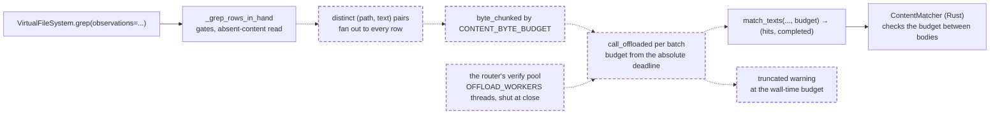

# Chained grep verifies off the loop under a wall: rows in hand are matched once per distinct body, in byte batches on a worker thread, and a call that reaches the wall-time budget truncates with a warning

A fix to the router's chained grep (`_grep_rows_in_hand` in `src/vfs/base.py`) and to `match_texts` (`src/vfs/pattern_matching/grep.py`): no public verb, schema, rights or SQL change, so the engine legs are not needed. It closes the medium finding `vfs.base._grep_rows_in_hand:inline-unbudgeted-verify` of the 0.1.0a1 security audit (run `vfs-run-1-2026-11-07` at commit `3586750`). No intention and no research: the cost is plain in the source, and the storage tier already carries the controls this spec copies. It depends on nothing unlanded. One active spec, [the storage seam as the kernel](../active/179-the-storage-seam-as-the-kernel/spec.md), not built, lifts `_grep_rows_in_hand` into `vfs/chain.py`; it moves the function as this spec leaves it. One more active spec, [the public surface regrouped by kernel group](../active/181-the-public-surface-regrouped-by-kernel-group/spec.md), not built, moves `_grep_rows_in_hand` into `vfs.chain.grep` with its behaviour unchanged; it moves the function as this spec leaves it, thread hop and wall included.

## The problem

READ at `4fc3307`. `grep(observations=...)` filters rows the caller already holds: `_grep_rows_in_hand` (`src/vfs/base.py:1874-1943`) gates paths, reads any absent content, then calls `match_texts` (`src/vfs/pattern_matching/grep.py`) once over every row's text. `match_texts` passes `budget=None` to the Rust matcher, so the call has no wall-time deadline; it runs in the coroutine, so the event loop waits for the whole match, although the Rust side releases the GIL; and it matches every row, so a body held by many duplicate rows is matched once per row. `_RustMatcher` encodes every text to bytes before the call, so a second copy of every body is resident at once.

READ. The storage tier's grep (`src/vfs/storage/backends/database/grep.py:325-371`) has the controls this path lacks: an absolute deadline of `WALL_TIME_BUDGET` (10 s), bodies in `byte_chunked` batches of `CONTENT_BYTE_BUDGET` (32 MiB), each batch on a worker thread with the budget recomputed at worker start, and a `truncated` warning "at the wall-time budget; narrow the pattern, add globs or ext filters, or scope with paths" when the deadline trips.

INFERRED from the audit's evidence: a caller who sends many large rows, or one body repeated across many rows, with a pattern that matches slowly, holds the event loop for every other coroutine on the host for as long as the match runs, with no bound.

## Architecture

Dashed is what this spec adds.

Page this changes: none; the architecture folder was retired on 2026-10-31, and the landing notes will say so in one line.

Terms. A **distinct body** is one `(path, text)` pair among the rows to match; rows that share both share one verification. The **wall** is the absolute deadline `monotonic() + WALL_TIME_BUDGET` taken when matching starts.

## Decisions

### 1. `match_texts` takes `budget: float | None = None`, passes it to the matcher, and returns `(hits, completed)`

The Rust matcher already honours a budget between bodies and reports whether it finished; `match_texts` discards both today. Returning the flag lets a caller truncate honestly, and `None` keeps the unbounded behaviour for callers that want it. The four call sites in the tree (the router's chained grep, the module docstring's example, and two tests in `tests/pattern_matching/test_grep.py`) take the pair.

### 2. `_grep_rows_in_hand` matches each distinct `(path, text)` pair once and gives the hit to every row that holds it

A row's match depends only on its path and text, so duplicates cost one verification. The output keeps the rows' order as today, because each row reads its hit by its own pair. Each row takes its own copy of the hit's match list (`list(hit.matches)`), so rows that share a body never share a mutable list; the `Match` items are frozen and are shared.

### 3. The distinct pairs are matched in `byte_chunked` batches of `CONTENT_BYTE_BUDGET` characters, each batch on a worker of the router's own verify pool through `call_offloaded`, with the budget `max(0.0, deadline - monotonic())` computed when the worker starts

This is the storage tier's shape, for the same reasons: the loop keeps serving while a batch matches, and time queued for a thread shortens the budget instead of extending the wall. Characters are an ASCII-dominant proxy, as the reindex batchers declare: a batch encodes at most four times `CONTENT_BYTE_BUDGET` in UTF-8 bytes, or one body when a body is larger; an exact byte size would cost an encode or a pass over each text.

### 4. The router owns its verify pool: a `ThreadPoolExecutor` of `OFFLOAD_WORKERS` threads, made on the first chained grep and shut by `close()`

A batch can hold a worker for up to the 10-second wall, so it must not run on the loop's default executor, which the body-measure hop and asyncio's own `getaddrinfo` share: a few chained greps at the wall would make every new database connection's DNS lookup wait. A pool of the router's own keeps that wait inside chained grep, sized like the backends' offload pools. A chained grep takes the pool once, as the first statement of `_grep_rows_in_hand`, before any await (the absent-content read included), and `grep`'s open check precedes it with no await between, so `call_offloaded`, which serves a hop inline when its pool was shut under it, lets a grep racing `close()` finish without making a pool on the closed router; its remaining batches then run on the loop for up to the rest of its wall, the closer's cost to bear, as `offload.py` says of the backends' pools. `close()` shuts the pool in its synchronous step under the mount lock, before any await and before its early return when no storage needs closing, so every router that made a pool shuts it. `offload.py`'s module docstring names this pool beside the backends' as the tree's declared threads, and names its hop in the cancellation law's sentence on character-metered batches. `WALL_TIME_BUDGET` and `CONTENT_BYTE_BUDGET` are imported from `vfs.storage.backends.database.grep`, which owns them.

### 5. When the wall passes before a batch starts, or a batch reports `completed` false, matching stops, and the result carries the matches found so far plus one `truncated` warning whose message is exactly "Truncated: at the wall-time budget; narrow the pattern, add globs or ext filters, or send fewer rows"

`vfs.base` declares `_CHAINED_REFINE_GUIDANCE: Final = "narrow the pattern, add globs or ext filters, or send fewer rows"`. The cause prefix matches the storage tier's, so a caller reads one cause on either path; the advice differs because a chained call cannot take `paths`. The rows of an unfinished batch that the matcher did reach keep their hits, as the storage tier keeps them.

## Intent

After this spec, `grep(observations=...)` never holds the event loop while it matches, matches each distinct body once, stops at the same 10-second wall the storage tier uses, and says so with a `truncated` warning when it stops early. Every call that finishes inside the wall returns exactly what it returns today.

## Design

**`src/vfs/pattern_matching/grep.py`.** `match_texts(texts, verifier, *, invert, before, after, mode, cap, budget=None) -> tuple[list[GrepHit | None], bool]` passes `budget` to `count_lines` or `hit_lines` and returns their `completed`. The module docstring's example takes the pair.

**`src/vfs/base.py`.** `_grep_rows_in_hand` builds `unique: dict[tuple[str, str], int]` and `bodies: list[tuple[Path, str]]` from `texted`, then calls a private `_match_in_hand(bodies, verifier, pool, *, invert, before, after, mode, cap) -> tuple[list[GrepHit | None], list[ResultError]]`: it takes the deadline once, loops over `byte_chunked(range(len(bodies)), lambda i: len(bodies[i][1]), CONTENT_BYTE_BUDGET)`, checks the deadline before each batch, receives `pool`, which `_grep_rows_in_hand` takes with `self._verify_executor()` as its first statement, before any await, and runs `await call_offloaded(pool, work)` where `work` computes the budget and calls `match_texts`, extends the aligned hit list, and on a trip pads the rest with `None` and returns the warning `classified(ErrorKind.truncated, severity=Severity.warning, detail=f"at the wall-time budget; {_CHAINED_REFINE_GUIDANCE}")`. Each row then reads its hit by `unique[(str(row.path), text)]` and copies its match list. `_verify_executor()` returns the router's pool, making it when it is `None`; `close()` shuts it with `wait=False` and sets it to `None` in its synchronous step under the mount lock, before any await and before the early return. The two constants, `byte_chunked`, `call_offloaded` and `OFFLOAD_WORKERS` are imported at the top.

**`src/vfs/storage/backends/database/offload.py`.** The module docstring names the router's verify pool among the tree's deliberate threads, and its hop in the cancellation law's sentence on character-metered batches.

**Tests first.** `tests/base/test_grep_namespace.py` gains the criteria's nodes, and the two `match_texts` callers in `tests/pattern_matching/test_grep.py` take the pair; the new nodes are seen failing before the modules change.

**Scale.** One verification per distinct body; batches of at most `CONTENT_BYTE_BUDGET` characters or one body, so the bytes encoded at once are at most four times the budget or the largest body; one thread hop per batch, on at most `OFFLOAD_WORKERS` router threads; a wall of 10 s per call. The `unique` dict and the hit list are linear in the rows, as the rows themselves are. Building the dict hashes each body once on the loop, linear in the bytes in hand (measured by the code review: 0.137 s for 100 equal 4 MiB bodies), which the rows' own transfer into the call already costs in kind.

## Scope

In: decisions 1 to 5. Files: `src/vfs/pattern_matching/grep.py`, `src/vfs/base.py`, `src/vfs/storage/backends/database/offload.py` (docstring), `tests/base/test_grep_namespace.py`, `tests/pattern_matching/test_grep.py`, and this spec's landing notes.

Out: the per-hit context copies of lines mode, which the audit's separate finding on `extend_context` covers; a caller-configured wall for the chained path; a cap on the number of rows a caller may send.

## Acceptance criteria

Counts and states, never clocks. Tests are in `tests/base/test_grep_namespace.py` unless their path says otherwise.

1. `grep("x", observations=...)` over 1,000 rows that share one path and the content `"x\n"` returns 1,000 observations, and the verifier, counted by wrapping `compile_verifier`'s result, receives exactly one body in total. Test: `test_chained_grep_verifies_each_distinct_body_once`.
2. With `base.CONTENT_BYTE_BUDGET` set to 10 and five rows holding distinct 8-character bodies that all match, `grep` returns five observations, `base.call_offloaded`, counted, is called exactly five times, each time with the router's verify pool, and the loop's default executor, wrapped to count submissions, receives none. Test: `test_chained_grep_matches_in_byte_batches_on_the_router_pool`.
3. With `base.WALL_TIME_BUDGET` set to `-1.0`, `grep` over three matching rows returns no observations, exactly one error of kind `truncated` and severity `warning` whose `message` is "Truncated: at the wall-time budget; narrow the pattern, add globs or ext filters, or send fewer rows", and `call_offloaded` is never called. Test: `test_chained_grep_truncates_at_the_wall`.
4. With `base.CONTENT_BYTE_BUDGET` set so two rows make two batches, and `base.compile_verifier` patched to return a stand-in whose first batch returns `completed` false, `grep` keeps the first batch's hits, returns one `truncated` warning, and makes one hop. Test: `test_a_batch_the_matcher_could_not_finish_truncates`.
5. `match_texts` returns `(hits, True)` with `budget=None` and passes a given budget to the matcher, in `tests/pattern_matching/test_grep.py`. Test: `test_match_texts_reports_whether_it_finished`.
6. `grep("x", observations=...)` over rows `/a` "x", `/b` "y", `/a` "x", `/a` "xx" returns `/a`, `/a`, `/a` in that order with the third row's matches from "xx", the verifier receives three bodies, and no two returned rows share a `matches` list object. Test: `test_chained_grep_dedupes_without_reordering_or_aliasing`.
7. After `close()`, the router's verify pool is shut and `None`, and a chained grep on the closed router answers the closed error and makes no pool. Test: `test_close_shuts_the_verify_pool_and_a_closed_router_makes_none`. A router with no owned storage also shuts its pool on `close()`. Test: `test_close_shuts_the_verify_pool_with_nothing_to_dispose`.
8. A chained grep of two batches whose first batch runs while `close()` shuts the pool finishes its second batch inline, and afterwards the router holds no pool. Test: `test_a_chained_grep_racing_close_makes_no_pool`. A chained grep whose absent-content read is in flight when `close()` completes finishes, and afterwards the router holds no pool. Test: `test_a_chained_grep_closed_during_its_read_makes_no_pool`.
9. Every existing `test_chained_grep_*` node of `tests/base/test_grep_namespace.py`, `tests/base/test_dispatch.py::test_grep_observations_match_in_memory_fetching_absent_content`, and every other test of `tests/pattern_matching/test_grep.py` pass, the two `match_texts` callers changed only to take the pair, and `scripts/ci.sh` is green on the tree as committed.

## Landing notes

Landed 2026-11-07 on `main` as one commit over `4fc3307`, after [the spec review](../../reviews/2026-11-07-chained-grep-verifies-off-the-loop-under-a-wall-spec-review.md) (three Highs, one Medium and eight Lows over four reads, all fixed, re-signed "Fit to build") and [the code review](../../reviews/2026-11-07-chained-grep-verifies-off-the-loop-under-a-wall-code-review.md) (one High, two Mediums and four Lows, all test or docstring gaps; re-signed "Lands"). Criterion 7 changed after the spec review: a closed router refuses every bind, so the remount it described cannot happen, and it now pins that a chained grep on the closed router answers the closed error and makes no pool; the code review judged the change. The code review also moved the wall's cause text into one constant, `WALL_TIME_CAUSE` in `vfs.storage.backends.database.grep`. The architecture folder was retired on 2026-10-31, so no page changes.

Tests first, EXECUTED: the nine new router nodes and the two changed `match_texts` nodes were seen failing before the code changed (twelve failed). The code review's ten mutants, among them a matcher given no budget, a budget not cut at worker start, `shutdown(wait=True)` and `cancel_futures=True`, each fail at least one test.

The gate, EXECUTED on the tree as committed: lint, format, types, docs examples and wheel size PASS; 4,634 passed; 100% coverage of 12,409 statements. The engine legs are not needed: no SQL statement, schema or rights path changed.

## One line

Chained grep now matches each distinct body once, in batches on a worker thread, and stops at the storage tier's 10-second wall with the same warning.
