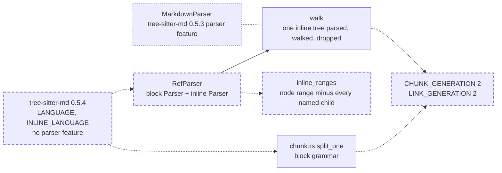

# Deep Markdown nesting never aborts the process: the Markdown grammars move to tree-sitter-md 0.5.4, and the crate splices the inline grammar itself

A fix to the Rust engine's Markdown parsing (`crates/vfs-core`): the binding's signatures and types do not change, so `PROTOCOL_VERSION` stays; no schema, rights or SQL change, so the engine legs are not needed. It closes a defect found by the code review of the Markdown reference walk (named out of scope in [that spec](../archive/2026-11-07-markdown-reference-walk-is-linear.md)): a body of 255 or more nested blocks aborts the whole process. No intention and no research memo: the defect and its upstream fix are plain in the two releases' sources. It depends on nothing unlanded.

## The problem

EXECUTED at `ae0be95`, each call in a child process: `vfs.native.markdown_refs([("> " * 300 + "x\n").encode()])` and `vfs.native.chunk_spans([(that body, "markdown")], chunk_size=64)` both exit with status 134 (SIGABRT); at a depth of 200 both exit 0. The abort is not an exception: it kills the interpreter, so one stored Markdown file stops every reindex of the mount that holds it, and any process serving that mount with it.

READ in the registry source of tree-sitter-md 0.5.3, `tree-sitter-markdown/src/scanner.c`. The block scanner's `serialize` copies its whole stack of open blocks into tree-sitter's fixed state buffer of `TREE_SITTER_SERIALIZATION_BUFFER_SIZE` (1,024) bytes with no bound, after a 5-byte header; a `Block` is an enum of 4 bytes, so 255 open blocks no longer fit. Every nested block quote, list item, fence or HTML block holds one entry.

READ in tree-sitter-md 0.5.4 (crates.io, the next release), the same file: a `MAX_OPEN_BLOCKS` of `(1024 - 5) / sizeof(Block)`, that is 254; once that many blocks are open, the scanner removes every block-opening token from the valid set, so deeper markers parse as paragraph text; and `serialize` clamps the count it copies to what fits. The release also bails early from two runs (backtick and tilde fences, `*` and `_` breaks) that it names as quadratic across a paragraph, ends a closing fence at end of input without a newline, treats `<!-->` and `<!--->` as a whole HTML comment, and counts a one-digit ordered marker as able to interrupt a paragraph.

EXECUTED with `cargo update`: 0.5.4's `parser` feature, which carries `MarkdownParser`, depends on tree-sitter 0.27, and the crate's `tree-sitter-perl` 1.1.2, the newest release, depends on tree-sitter 0.26.3 as a normal dependency; tree-sitter links one native library, so cargo refuses both in one graph. Without the `parser` feature, 0.5.4 depends only on `tree-sitter-language` 0.1, and its two grammars are ABI 15, which the locked runtime (tree-sitter 0.26.13, ABI 13 to 15) loads.

READ at `crates/vfs-core/src/links.rs:23-47`: the reference walk uses `MarkdownParser`, and through it only `parse`, `block_tree` and `inline_tree`. `crates/vfs-core/src/chunk.rs:84` uses only `tree_sitter_md::LANGUAGE`.

READ in 0.5.3's `bindings/rust/parser.rs`, and EXECUTED by a probe printing the block tree of `"> a\n> b\n> c\n"`: an `inline` node's named children are its `block_continuation` markers (`> ` at bytes 4-6 and 8-10); the binding parses every inline tree before returning, holds them all, and leaves the first named child out of the ranges it excludes, so the inline grammar reads the second line's `> ` as text.

EXECUTED with two probe binaries, one per release, each dumping every node's kind and byte range of the block and inline trees: over 1,725 real Markdown files (this repository, `cpython`, `codex`, `cognee`, `adk-python`, `A2A`) one block tree differs (a file ending in a closing fence with no newline) and no inline tree differs; of crafted bodies, `<!-->` and a fence closed at end of input differ.

## Architecture

Dashed is what this spec adds; dotted is what it retires.

Page this changes: none; the architecture folder was retired on 2026-10-31, and the landing notes will say so in one line.

Terms. A body's **open blocks** are the containers the block scanner holds open at a point: block quotes, list items, indented code, fences and HTML blocks. An **inline tree** is the inline grammar's parse of one `inline` or `pipe_table_cell` node of the block tree.

## Decisions

### 1. `tree-sitter-md` moves to 0.5.4 with default features off; `tree-sitter` stays at 0.26

0.5.4 is the upstream fix: the scanner stops opening blocks at 254 and clamps what it serializes, so no body overflows the buffer. Its `parser` feature needs tree-sitter 0.27, which `tree-sitter-perl` 1.1.2 refuses, and dropping or replacing a grammar to take a binding we need three methods of is the larger change. The grammars alone need only `tree-sitter-language`, and the locked runtime loads their ABI.

### 2. `links.rs` owns a `RefParser { block: tree_sitter::Parser, inline: tree_sitter::Parser }`, built by `RefParser::default()` with the two 0.5.4 languages; `markdown_refs(parser: &mut RefParser, body)` and `markdown_refs_batch` keep their shapes otherwise

The two-grammar splice is the only part of `MarkdownParser` the walk uses, and it is short. The batch keeps one parser per rayon worker, as today. A language that fails to load is a build defect, so `default()` panics with the grammar's name, as the 0.5.3 binding's `parse_with_options` did with `expect`; `chunk.rs` instead answers `None` per body, because its host has a fallback splitter and the reference walk has none. A cargo test `both_markdown_grammars_load` pins the load, as `every_registered_grammar_loads` pins the chunk registry.

### 3. The walk parses each inline tree when it reaches the node, walks it, and drops it before moving on

The binding parses and holds every inline tree of a body before the walk starts; parsing in the walk holds one inline tree at a time, so the memory beside the block tree is one inline tree, not all of them. The nodes visited and their order are today's: an `inline` or `pipe_table_cell` node is visited, then its inline tree is walked in place of its block children, starting at the inline root's first child.

### 4. A private `inline_ranges(node) -> Vec<tree_sitter::Range>` gives the inline parse the node's range minus the range of every named child, in order; an empty piece between two adjacent children is kept

The named children of an inline node are its block continuation markers, block syntax rather than inline text, and in a malformed body an `ERROR` node, which the binding also excludes; the binding's loop skips the first child, so when the first line holds no punctuation the second line's `> ` reaches the inline grammar. Excluding every named child is the grammar's intent. EXECUTED by this spec's reviewer on 0.5.3's grammars, over 12,582 real Markdown files and 1,502,622 inline nodes: 11 inline trees differ between the two splices, each by one anonymous `>` node the binding keeps, and no inline tree's `link_destination` or `code_span` nodes differ; over the same files, 0.5.4 with this splice against 0.5.3 with the binding yields the same 781,000 references. A reference's text is decoded from the body's bytes, so its destination and context do not depend on the excluded ranges.

### 5. A failed inline parse skips that node's inline tree, and the walk goes on

`set_included_ranges` fails only on unordered or overlapping ranges, which decision 4 cannot produce, and `parse` returns `None` only on a timeout or cancellation flag, which the crate never sets. Skipping one node keeps the rest of the body's references; the binding returned no tree at all. A failed block parse yields no references, as today.

### 6. `CHUNK_GENERATION` and `LINK_GENERATION` both move from 1 to 2

The 0.5.4 block grammar changes the tree of some bodies (a closing fence at end of input, `<!-->`), so chunk spans can change; `chunking.py` states that a grammar crate change that alters chunk shapes bumps the generation, and a bump re-chunks every stored document once. The link extractor's generation follows the same law for the new grammars and the new splice. Before the first release no store needs to keep the old shapes.

### 7. `PROTOCOL_VERSION` stays at its value

The binding takes and returns the same types; only the parse behind it changes.

### 8. The abort is pinned in a child process, at the native seam, for both entry points

An abort cannot be caught in-process, and a test that aborts would take the pytest worker with it; a child process turns it into a non-zero exit the parent asserts on, as `tests/test_native.py` already does for the seam's import refusals. The seam is where both reindex paths, `vfs.models.links.extract_links` and the chunker, reach the parser.

## Intent

After this spec, no Markdown body can abort the process: a body nested past 254 open blocks parses with its deeper markers as text, through the reference walk and the chunker alike. The references and chunk spans of every body that parsed before are the same, except where the 0.5.4 grammar reads a body differently, and the generation bumps re-derive those once.

## Design

**`crates/vfs-core/Cargo.toml` and `Cargo.lock`.** `tree-sitter-md = { version = "0.5.4", default-features = false }`; the lock moves `tree-sitter-md` to 0.5.4, keeps `tree-sitter` at 0.26.13, and `tree-sitter-md` no longer lists `tree-sitter` among its dependencies.

**`crates/vfs-core/src/links.rs`.** `pub struct RefParser { block: Parser, inline: Parser }` with `impl Default`; `markdown_refs_batch` maps with `RefParser::default`; `markdown_refs(parser: &mut RefParser, body)`; `walk(parser: &mut RefParser, body)` parses the block tree with `parser.block`, which never takes included ranges, and at a node whose kind is `inline` or `pipe_table_cell` sets `parser.inline`'s included ranges to `inline_ranges(node)`, parses, and walks the result with `walk_inline` in place of the node's block children; `inline_ranges` as decision 4. The module docstring says the crate splices the inline grammar itself, one inline tree at a time. The existing tests build `RefParser::default()` in place of `MarkdownParser::default()`. Cargo tests, beside today's: `both_markdown_grammars_load` (`RefParser::default()` builds, so both 0.5.4 languages load into its two parsers), `continuation_markers_are_left_out_of_the_inline_ranges` (the inline node of `"> a\n> b\n> c\n"` yields the byte ranges 2-4, 6-8 and 10-11), `a_body_nested_past_the_scanner_cap_yields_its_reference` (`"> " * 2000 + "[l](a.md)\n"` yields one reference whose destination is `a.md`), and `nested_list_markers_past_the_cap_parse` (`"- " * 2000 + "x\n"` returns without panicking or aborting).

**`crates/vfs-core/src/chunk.rs`.** No code change; `tree_sitter_md::LANGUAGE` is the 0.5.4 block grammar. One cargo test: `a_markdown_body_nested_past_the_scanner_cap_chunks` (`"> " * 2000 + "x\n"` at a chunk size of 64 yields spans that start at 0, end at the body's length and are contiguous).

**`src/vfs/models/chunking.py` and `src/vfs/models/links.py`.** `CHUNK_GENERATION: Final = 2`; `LINK_GENERATION: Final = 2`. `tests/models/test_links.py::TestExtractLinks::test_the_generation_names_the_extractor` asserts `"md:2"`.

**`tests/test_native.py`.** A class `TestMarkdownNesting` with one parametrized test, `test_deep_nesting_never_aborts_the_process[entry-body]`, over the two entries (`markdown_refs`, `chunk_spans` with `"markdown"` at a chunk size of 64) and three bodies (`"> " * 300 + "[l](a.md)\n"`, `"> " * 2000 + "[l](a.md)\n"`, `"- " * 2000 + "[l](a.md)\n"`): six cases, each running the call in a child process through the existing environment helper's pattern, and asserting exit status 0 and, on its standard output, the destinations `["a.md"]` for `markdown_refs` and spans starting at 0 and ending at the body's length for `chunk_spans`.

**Tests first.** The six seam cases are seen failing first: all three bodies exit 134 today, through both entries. The four link cargo tests fail to compile before `RefParser` and `inline_ranges` exist; the chunk cargo test aborts the cargo test process before the bump.

**Scale.** Per body: the block tree, one inline tree at a time (today: every inline tree at once), one included-range vector the size of one inline node's continuation markers, and the walk's cursors; nothing grows with nesting past 254, because the scanner opens no further blocks. The batch is parallel per body, as today.

## Scope

In: decisions 1 to 8. Files: `crates/vfs-core/Cargo.toml`, `Cargo.lock`, `crates/vfs-core/src/links.rs`, `crates/vfs-core/src/chunk.rs` (one test), `src/vfs/models/chunking.py`, `src/vfs/models/links.py`, `tests/models/test_links.py`, `tests/test_native.py`, and this spec's landing notes.

Out: moving tree-sitter to 0.27, which waits on `tree-sitter-perl`; a guard of vfs's own on nesting depth, which the upstream cap makes redundant; the memory the block tree takes for a body of millions of blank lines, a separate lead from the reference walk's review, for its own spec; the Python oracle in `tests/support/oracles/links.py`, whose fixtures stay inside what both readings agree on.

## Acceptance criteria

Counts and states, never clocks.

1. `uv run pytest tests/test_native.py -k TestMarkdownNesting` runs six cases and all pass; before the change all six cases fail with exit status 134.
2. `cargo test -p vfs-core` passes the five new tests named in the Design and every existing test with its assertions unchanged; the `links.rs` tests build `RefParser::default()` in place of `MarkdownParser::default()`.
3. `tests/models/test_links.py` (with its parity tests against the oracle), `tests/storage/database/test_links.py`, `tests/models/test_chunking.py` (with `TestChunkFixtures` against the committed `expected.json`, unregenerated) and the ranking pins under `tests/ranking/` pass, with the one generation assertion changed to `"md:2"`; and `uv run python tests/models/fixtures/chunking/regen.py` leaves `git diff --exit-code tests/models/fixtures/chunking/expected.json` at exit 0: the bump re-derives stored chunks, and the committed fixtures are already the 0.5.4 shapes (EXECUTED by this spec's reviewer: none of the 202 Markdown files under `tests/` changes its block tree).
4. `cargo tree -p vfs-core -i tree-sitter -e normal` lists no `tree-sitter-md`, and `Cargo.lock` holds `tree-sitter-md` 0.5.4 and `tree-sitter` 0.26.13.
5. `git grep -n MarkdownParser -- crates src tests` prints nothing.
6. `scripts/ci.sh` and `cargo test -p vfs-core` are green on the tree as committed, after `uv sync --all-extras --group dev --reinstall-package vfs-py`.

## Landing notes

Landed 2026-11-07 on `main` as one commit over `ae0be95`, after [the spec review](../../reviews/2026-11-07-deep-markdown-nesting-never-aborts-the-process-spec-review.md) (one Medium and five Lows, all fixed, re-signed "Fit to build") and [the code review](../../reviews/2026-11-07-deep-markdown-nesting-never-aborts-the-process-code-review.md) (four Lows, all fixed; signed "Lands"). The architecture folder was retired on 2026-10-31, so no page changes. One file beyond the Scope's list: `crates/vfs-core/src/lib.rs` re-exports `RefParser`, which `markdown_refs` takes, from the code review's L2. `tests/models/test_chunking.py` also gains the literal `"rust:2"` pin, from its L1.

Tests first, EXECUTED: the six seam cases failed before the change, each child aborting on tree-sitter's `length <= 1024` assertion; the four link cargo tests failed to compile before `RefParser` and `inline_ranges` existed. The code review found the references unchanged, independently of the spec review's corpus: 24,880 references from 1,366 Markdown files of eighteen sibling repositories, identical between the base crate with `MarkdownParser` and this one; 600 random deep bodies in child processes all exited 0 with spans covering each body.

The gate, EXECUTED on the tree as committed: lint, format, types, docs examples and wheel size PASS; 4,668 passed; 100% coverage of 12,497 statements; `cargo test -p vfs-core` 77 passed; `regen.py` leaves `expected.json` unchanged. The engine legs are not needed: no SQL statement, schema, binding signature or protocol changed.

## One line

A Markdown body nested past 254 blocks no longer aborts the process, because the grammars move to the release that caps the scanner's stack, and the crate splices the inline grammar itself to keep the runtime it has.
