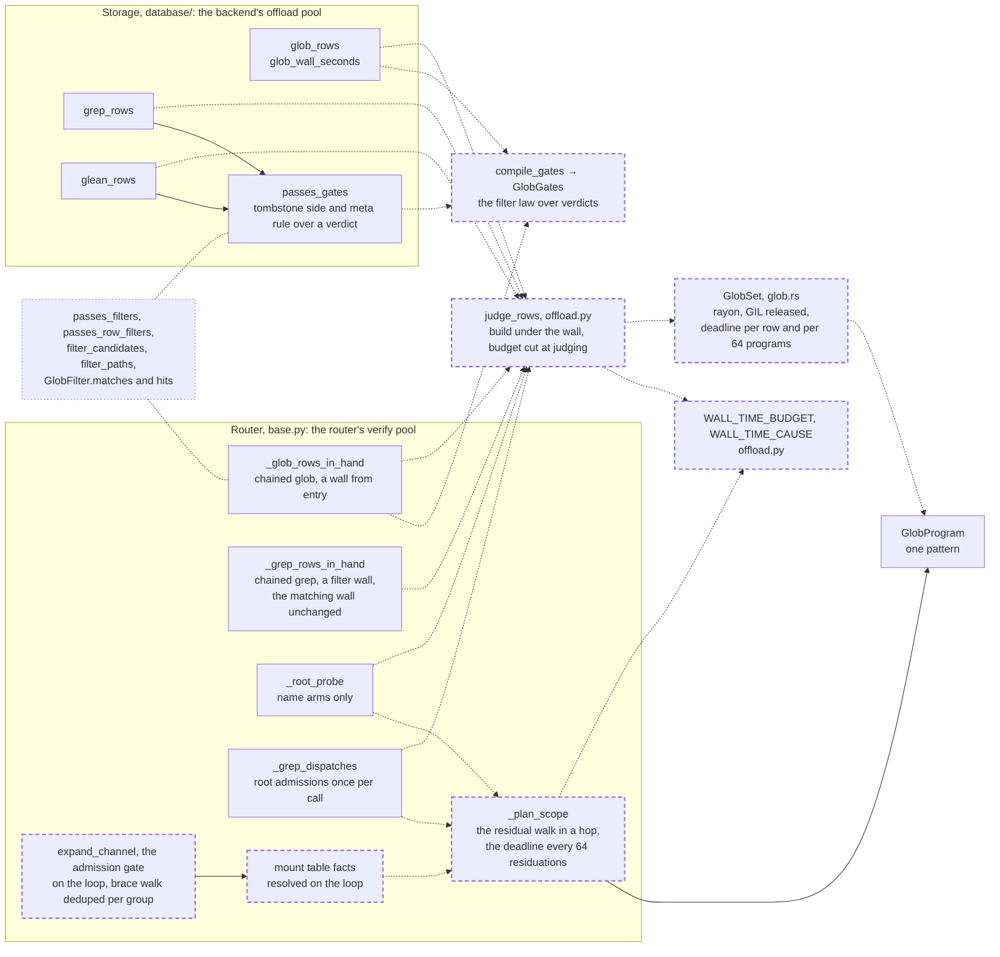

# Glob matching runs off the loop under the wall: one native set judges a call's rows on a worker, the router's residual walk plans on a worker too, and a stage that reaches the wall-time budget truncates loudly

A change to where glob matching runs: the router (`src/vfs/base.py`), the pattern layer (`src/vfs/pattern_matching/`), the storage backend's glob, grep and glean (`src/vfs/storage/backends/database/`) and the Rust engine (`crates/vfs-core`). No verb's parameters, no schema, no rights rule and no SQL statement change. Storage modules do change, so the engine legs are needed: the conformance suite (`tests/storage/test_conformance.py`) against Postgres, MariaDB, SQL Server and Oracle, through the `db_test` skill. It closes the second half of the medium finding `vfs.pattern_matching.glob._translate:backtracking-wildcards` of the 0.1.0a1 security audit (run `vfs-run-1-2026-11-07` at commit `3586750`). The first half was the engine spec: after it, one match never backtracks, but every match still runs on the event loop, and one call may make tens of millions of them. After this spec, no glob program runs on the event loop. Every row-matching site sends its rows to a worker in one batch per stage. The router's residual walk, which matches pattern components against bind segments while it plans a fan-out, runs on a worker too. Each stage runs under the wall-time budget, and a stage that reaches the wall returns what it finished, with one warning. A fix. It depends on [glob matching runs on the linear engine](../archive/2026-11-07-glob-matching-runs-on-the-linear-engine.md), landed as `c544934`, and builds on its `GlobProgram`, its `_program` walk and its protocol 12. With the engine spec, this spec closes the finding's matching cause: no glob program runs on the loop. It does not remove every loop hold the finding reports. Storage's statement building over the router's composed patterns stays on the loop: one `pattern_arm` per composed pattern, about 51 µs an arm without a profiler (measured by this spec's reviewer). So a fan-out scoped by 10,000 paths with a 64-arm pattern reaches storage as 640,000 patterns and holds the loop about 33 s building them. The developer decided that hold is fixed in the same release, not carried: [storage takes scope roots and arms as two channels](../active/2026-11-07-storage-takes-scope-roots-and-arms-as-two-channels.md), which lands after this spec, removes it (decision 15). So the audit record that [the release-audit spec](../active/2026-11-07-the-release-audit-is-a-review.md)'s decision 8 lands waits on both specs, as that decision already requires for every medium, and it needs no amendment. The follow-on is also named under [Scope](#scope), Out. It moves `PROTOCOL_VERSION` from 12 to 13. It changes public names of `vfs.pattern_matching`: it adds `GlobGates`, `GlobSet` and `compile_gates`; it removes `filter_candidates`, `filter_paths`, `passes_filters` and `passes_row_filters`; `GlobFilter` loses `program`, `wanted_ext`, `matches` and `hits`, and `compile_filter` takes the pattern alone. No intention and no research memo: the cost is plain in the source, and the measurements below were run for this spec and its review. One active spec, [the storage seam as the kernel](../active/179-the-storage-seam-as-the-kernel/spec.md), not built, counts native calls by thread in its fixture F9, where `glob` makes none today; when built, its glob, grep and glean rows count this spec's `GlobSet` builds and `judge` hops on a worker. Two more active specs, not built, rewrite code this spec changes: [the listing cursor](../active/176-the-listing-cursor/spec.md) pages `_glob_dispatches` and `_root_probe`, and [the public surface regrouped by kernel group](../active/181-the-public-surface-regrouped-by-kernel-group/spec.md) moves `_glob_rows_in_hand` and `_grep_rows_in_hand` into `vfs.chain`; each moves or pages these functions as this spec leaves them, hop and wall included.

## The problem

READ at `c544934`, where the engine spec landed over `e5b903f` and left the cited code unchanged. Every glob match runs inside a coroutine, on the loop thread. These are the matching sites:

- Router chained glob, `_glob_rows_in_hand` (`src/vfs/base.py:1849`): it compiles one filter per arm and per exclusion (`base.py:1874-1875`), then calls `passes_filters` per row in hand (`base.py:1878`). No deadline applies.
- Router chained grep, `_grep_rows_in_hand` (`base.py:1890`): it calls `filter_candidates` (`base.py:1931-1933`, `src/vfs/pattern_matching/grep.py:137`) with no deadline. Its matching wall is read later, when matching starts, in `_match_in_hand` (`base.py:1998`), as [the chained-grep spec](../archive/2026-11-07-chained-grep-verifies-off-the-loop-under-a-wall.md) decides. Its pool is taken first (`base.py:1921`).
- Router fan-out glob root probe: the `keep` closure of `_glob_dispatches` (`base.py:2337-2346`) compiles `effective_pattern(row.path, arm)` per row per arm (`base.py:2340`). It runs in `_root_probe` (`base.py:2516-2539`) over the stat rows of the scope roots, which grow with the call's `paths`.
- Router fan-out grep and glean admissions, `_grep_admissions` (`base.py:2434`): it compiles and matches each caller glob against each root (`base.py:2449`), once per capable entry, from the synchronous `_grep_dispatches` (`base.py:2374`).
- Router planning: `_composed_members` (`base.py:2453`), `_residual_renders` (`base.py:2541`) and `_glob_reaches` (`base.py:2550`) call `residuals` (`src/vfs/pattern_matching/glob.py:386-412`), which builds and matches one native program per pattern component per bind segment through `_component_matches` (`glob.py:528-530`). It runs for every capable entry, every scope root and every arm and exclusion, on the loop, with no wall. Only `_composed_members` reads router state, through `_resolve_terminal` (`base.py:2470`).
- Storage glob, `glob_rows` (`src/vfs/storage/backends/database/reads.py:301`): it compiles one filter per pattern (`reads.py:345-351`) and calls `passes_row_filters` on every candidate the SQL prefilter returns (`reads.py:363-368`), all materialized, with no deadline, inside the read session. On SQLite and in-memory mounts that session holds the host's `asyncio.Lock` (`src/vfs/storage/backends/database/engine.py:694-721`). `DatabaseStorage.glob` passes no executor (`src/vfs/storage/backends/database/backend.py:480-494`), though `host.offload_executor` is in reach.
- Storage grep, `grep_rows` (`src/vfs/storage/backends/database/grep.py:154`): `passes_gates` (`src/vfs/storage/backends/database/scope.py:83`) per row on the index side (`grep.py:262-266`) and the scan side (`grep.py:304-308`). Here a deadline and an executor already exist.
- Storage glean, `glean_rows` (`src/vfs/storage/backends/database/glean.py:215`): `_Gates.admits` (`glean.py:162-163`) per row in `_entries_for_chunks` (`glean.py:574-576`), twice per ranked row in `_vector_leg` (`glean.py:652-653`, `:670`, `:678`), and over the overlay's nominees (`glean.py:380`, at most `OVERLAY_BUDGET`, 500). With observations, it adds one escaped literal pattern per observation (`glean.py:263-264`).

READ. Nothing caps a call's rows or patterns, and AGENTS.md forbids a designed cap: `observations` is a list of any length, `globs` and `globs_not` hold any number of patterns (`src/vfs/params.py:251`, `:263-264`, `:308-309`), and each pattern expands to as many as 64 arms. The router composes every arm under every scope root into the storage `globs` channel (`base.py:2453-2475`), so a call scoped by 10,000 paths with a 64-arm glob reaches storage as up to 640,000 patterns.

EXECUTED with a 1 ms ticker task beside one chained glob, each row a 997-character path: 1,000 rows against 64 arms of `/**/{x00,…,x63}*a` plus 250 `?` took 0.73 s, and the loop's longest gap was 0.73 s; 10,000 rows took 7.27 s with a 7.27 s gap; 10,000 rows admitted by `**` and judged against three such 64-arm exclusions took 25.72 s with a 25.72 s gap. The loop did not turn once during any of these calls.

EXECUTED on an in-memory mount of 10,000 files, two to a directory, scoped by the 5,000 directories: one `grep` took 9.85 s, 9.29 s of it in `passes_gates`, with 10,000 patterns at storage; one `glob("*.txt")` took 12.09 s, 4.00 s of it in `passes_row_filters`, with 5,000 patterns. Under a profiler at half that size, the gate made 6,252,500 `hits` calls; the native `is_match` was 1.01 s of the 3.30 s, about 0.16 µs a call, and the rest was Python dispatch around it. The same profile spent 0.437 s building 2,500 SQL arms in `pattern_arm` (`reads.py:500`), about 175 µs an arm under the profiler. EXECUTED by this spec's reviewer without a profiler, over 5,000 composed patterns on the SQLite profile: about 51 µs an arm.

EXECUTED. One match of the slowest shape found, 2,000 `a/**/` groups against a 1,022-character path, took 57.6 µs; the 250-`?` shape took 12.1 µs against 1,000 characters. EXECUTED by this spec's reviewer: one 1,000-character row against 1,000 programs of the 250-`?` shape took 0.018 s, and against 4,000 took 0.071 s, so one row's cost grows with the program count. One build took 74 µs for the 250-`?` shape and 2.7 µs for `*.py`. 10,000 builds of 924-character composed patterns (a root of 920 characters plus `/**`) took 3.13 s on the loop and grew peak resident memory by 334 MB; 10,000 builds of 16-character ones took 61 ms and 23 MB. Of a build, the Python atom walk is about three quarters (1,067 ms of 1,441 ms for 2,000 long patterns) and the native construction the rest. The admission gate's own walk over the same 10,000 long patterns took 280 ms, and over 10,000 16-character patterns 9 ms.

READ and EXECUTED, the admission gate's brace walk: `_cross_product` (`glob.py:493-501`) iterates `itertools.product` over every group and dedupes only finished arms, so groups whose arms collapse multiply the walk without adding arms. `"{,a}" * n + "b"` has n + 1 distinct arms, but the gate walked 2,097,152 combinations for n = 20 (0.566 s on the loop) and 131,072 for n = 16, twice 2^n, because `glob_defect` and `expand_pattern` each walk it once (`glob.py:155`, `:182`). INFERRED: at n = 64 the walk needs about 2^65 combinations before it sees a 65th arm and refuses, so the call never returns, and nothing before the gate can stop it. A prototype that expands group by group, deduping after each group, folding one-alternative groups into a pending literal and stopping once the partial set passes 64, agreed with `_cross_product` on 295,659 part lists under the limits 64 and 5 (591,318 comparisons, 0 mismatches). It refused the n = 64 pattern after 89,440 characters joined (0.5 ms), and expanded `"{,a}" * 63` followed by 10,000 one-alternative groups (30,252 characters) to its 64 arms in 3.1 ms.

EXECUTED, planning: `residuals(composed_pattern(root, arm), bind)` for 10,000 roots under a two-segment bind path took 55 ms for one arm, with 20,000 component builds, and 3.36 s for 64 arms. Run on a one-thread pool for 2,000 roots × 64 arms, beside a loop task that awaits `asyncio.sleep(0)` and counts, the walk read the count at 0 when it started and at 86 when it finished: under the 5 ms switch interval, a pure-Python walk on a worker lets the loop turn between its turns.

READ, the precedent: chained grep matches in batches on the router's own pool (`_verify_executor`, `base.py:1972-1976`; `_match_in_hand`, `base.py:1979-2023`) through `call_offloaded` (`src/vfs/storage/backends/database/offload.py:90-102`), and storage grep through `VerifyOffload` (`offload.py:105-160`), whose deadline crosses absolute and whose budget is cut at worker start. The verifier's batch API takes a `budget`, releases the GIL with `py.detach`, fans bodies across threads with rayon and checks a deadline before each body (`crates/vfs-core/src/python.rs:100-163`, `crates/vfs-core/src/verify.rs:194-239`). The wall is `WALL_TIME_BUDGET` (10 s) and its record names `WALL_TIME_CAUSE` (`grep.py:122`, `:125`); glean keeps a second `WALL_TIME_BUDGET` (`glean.py:146`) and appends the cause as a literal, with no check for a record already present (`glean.py:357-358`). `reads.py` cannot import either constant from `grep.py`, because `grep.py` imports `reads.py` (`grep.py:81-86`).

READ and EXECUTED, the root probe: `effective_pattern` returns a name arm unchanged and composes a path arm as the root's escaped text followed by the arm anchored with a leading `/` (`glob.py:348-364`). The probe's rows are the roots themselves, so a composed path arm still needs at least a `/` where the subject ends. Under the oracle (`re` over `tests/support/oracles/glob.py`'s `_translate`), 12 roots against every defect-free arm of length 1 to 4 over `"a*?[]!-/"` that holds a `/` (1,170 arms, 14,040 pairs) gave 0 matches. The probe skips the namespace root (`base.py:2495-2496`), the one root where a path arm could match.

## Architecture

Dashed is what this spec adds; dotted is what it retires.

Page this changes: none; the architecture folder was retired on 2026-10-31, and the landing notes will say so in one line.

Terms. A **row** to judge is a pair: its path and its leaf name. A **group** is a list of programs whose verdict is "any of them matches". A row's **verdict** is a word with one bit per group, set when some program of that group matches the row's subject: its path for a program whose pattern holds a `/`, its name otherwise. An **unjudged** row is one the engine reached, or was still inside, after the deadline; its verdict is `None`. A **hop** is one call on a worker thread through `call_offloaded`. A **stage** is one CPU-bound step of a call that reads its own deadline when it starts: a chained call's filter, chained grep's match, a fan-out's planning, its admissions, one root probe, one storage call. A **marked** admission is one whose pattern names the meta subtree literally (`meta_scoped`, `reads.py:541`); only a marked admission admits a row under `/.vfs`. The **residual walk** is the router's planning of a fan-out: composing each arm under each scope root and residuating it against each entry's bind path.

## Decisions

### 1. A native `GlobSet` in `crates/vfs-core/src/glob.rs` holds a call's distinct programs and their groups, and judges many rows in one call: in parallel with rayon, the GIL released, and the deadline checked before each row and before every 64th program inside a row

One call per batch moves the whole matching loop into Rust, which removes the Python dispatch that was about 70% of the gate's time (The problem) and lets rows spread across cores. Releasing the GIL is what makes the hop worth taking: the loop thread runs while the worker judges. The check before each row is the verifier's (`verify.rs:207`), and a row started after the deadline gets the verdict `None`. That alone does not bound a hop, because one row's cost grows with the program count (The problem: 0.018 s a row at 1,000 programs). So `GlobSet::verdict` checks the deadline before every 64th program it matches for a row, and a row stopped inside its groups is unjudged (`None`) and clears `completed`, so a thread overruns the wall by at most 64 matches. Groups stay in group order and stop at a group's first match, so a row never costs more matches than today's `any()` loops made. The verdict word is a `u64`, so a set holds at most 64 groups, refused at construction past that; the sites use three, and the number of groups is fixed by the call site, never by the caller's input. Programs and groups are separate lists, groups naming programs by index, so one pattern that appears in two channels is built once. The native construction checks the deadline between programs and answers no set when it reaches it (decision 4).

### 2. The filter law stays in Python, in one owner: `GlobGates` in `vfs.pattern_matching.glob`, built by `compile_gates`, reads a verdict and the row's extension and answers admission, exclusion and the ext facts

The law (admission by any admission, rejection by any exclusion, the wanted and unwanted extensions, an unjudged row never passing) is small and changes with the language, and a second copy of it in Rust would drift from the first. `GlobGates` puts its admissions in two groups, unmarked (bit 0) and marked (bit 1), and its exclusions in a third (bit 2). `admits(verdict, ext, *, marked_only=False)` works in four steps. It refuses a `None` verdict. With *marked_only* set it needs bit 1; otherwise, when the gates hold any admission, it needs bit 0 or bit 1. It refuses bit 2. Then it applies the ext facts. What is marked is the caller's predicate, passed to `compile_gates` as *marked*, so the pattern layer still knows nothing about storage. The tombstone side and the choice of *marked_only* for a row under `/.vfs` stay with storage in `passes_gates`, as today. Under the same row facts, `admits` answers what `passes_row_filters` answers today, and what `passes_gates` answers with *marked_only* set for a row under the meta root; the wanted extension that `glob_rows` and the root probe compiled into each filter is the same set for every filter of a call, so applying it once after admission gives the same verdict.

### 3. Each distinct pattern is built once per call, on the worker of the call's first hop, under a lock in `GlobGates`

Builds are linear in the pattern text, but at scale they cost more than the matching: 10,000 composed patterns of 924 characters took 3.13 s to build on the loop (The problem). Building inside the hop takes that cost off the loop. The atom walk is Python and holds the GIL in the worker, so the loop is held for at most one interpreter switch interval at a time, the bound `offload.py` already names for edit's hop; the native construction runs with the GIL released. One set per call, reused by every later hop of the call, gives one build per distinct pattern per call, where today the root probe builds one per row per arm and the grep admissions one per root per glob per entry. The root probe's hops for several entries run concurrently over one `GlobGates`, so its lazy build is guarded by a `threading.Lock`; the first worker builds, and the others wait and reuse it, and a waiter's wait shortens its own budget, because the budget is cut after the build. The build runs under the wall (decision 4). After `close()` a hop is served inline, so the loop thread itself may wait on the lock while a worker builds; that is the closer's cost, as `offload.py` already accepts for its other hops.

### 4. One async helper owns the hop: `judge_rows(executor, gates, rows, *, deadline)` in `offload.py`

`offload.py` is the seam every offloaded stage already crosses, and both the router and storage import from it (`base.py:118`). The helper builds the set if needed, then cuts the budget as `max(0.0, deadline - monotonic())` and calls `judge`; so time queued for a thread and time spent building both shorten the budget, and neither extends the wall. The build checks the deadline between patterns; a build that reaches it stops, leaves the set unbuilt, and every hop on those gates answers every row unjudged, so a build overruns the wall by at most one pattern's build. It runs through `call_offloaded`, so a pool shut by `close()` judges inline and never escapes. It makes no hop when there are no rows, and none when the gates hold no pattern, answering a verdict of 0 for every row: the ext facts need no engine. With no rows, or with gates that hold no pattern, it returns completed true whatever the clock reads, so a stage with nothing to judge never records the wall. Otherwise it returns the verdicts in row order and the completed flag.

### 5. The router's row-matching sites and its admission site judge through `judge_rows` on the router's verify pool, each stage under `WALL_TIME_BUDGET` read when the stage starts

Chained glob (`_glob_rows_in_hand`) takes the pool and reads its deadline at entry, before any await, and judges every row in hand in one hop. Chained grep's filter hop reads its own deadline at entry, and `_match_in_hand` keeps reading its deadline when matching starts, as the landed chained-grep spec decides; the call's CPU stages are each bounded by the wall, and the read is I/O that does not hold the loop. The filter reads its deadline only when its gates hold a pattern, so a chained grep with no glob channel reads the clock exactly as it does today. The root probe (`_root_probe`) judges the stat rows of each owning entry in one hop, under a deadline read when its judging starts. The grep and glean admissions become one hop per call over the call's distinct scope roots other than `/`: `_grep_dispatches` becomes `async`, judges once and hands the admitted roots to the residual walk (decision 10), so `_grep_admissions` no longer matches. The admissions' gates are `compile_gates(globs)`: the caller's globs as unmarked admissions, with no exclusions and no ext channel, as `_grep_admissions` matches roots today; a call with no globs makes no hop and admits every root. `_glob_dispatches` becomes `async` too, for its planning hop (decision 10). Each builder takes the pool at its top, before its first await, and only when a hop will run, so a fan-out with nothing to judge or plan mints no pool, and the pool still follows `close()` as it does for chained grep. The router keeps the module constant and gains no knob, as chained grep has none.

### 6. The root probe judges only the call's name arms: a path arm composed under a scope root never matches that root's own row

The probe's rows are the roots, and a path arm composed under a root is the root's literal text followed by an anchored arm that needs at least one more `/` (The problem: 0 matches in 14,040 pairs under the oracle; the namespace root is never probed). A name arm composes to itself (`glob.py:360-361`), so every row of the probe is judged against the same programs. The probe's gates are therefore the name arms as admissions, the caller's exclusions as they are matched today, and the ext channels. With no name arm, `_root_probes` still runs its stat probe, so a missing root classifies loudly as today; it passes no gates, keeps no row and makes no hop. This gives today's verdicts with one program per arm per call, where today the probe builds one per row per arm.

### 7. The storage sites judge through `judge_rows` on `host.offload_executor`, inside the read session, under their call's deadline

`glob_rows` gains the executor and a wall (decision 8). It collects the candidates as today, splits them by tombstone side, and judges each side's rows in one hop against that side's gates. `grep_rows` judges the rows of `_entries_for_docs` in one hop and the scan side's nominees in another, under its existing deadline. `glean_rows` judges in one hop per `_entries_for_chunks` call, one per ranked set of the vector leg (its second loop reads the verdicts the first one took), and one for the overlay's nominees, all under its existing deadline. The session stays open across the hop, because `glob_rows` still needs it after matching for the hidden directories' road and grep and glean for their content and epoch reads. On SQLite and in-memory mounts this holds the host lock while the worker judges, as grep's verify already does, for at most the wall plus one hop's overrun: 64 matches per thread, or one pattern's build (decisions 1 and 4). The loop is free throughout.

### 8. Storage glob gains a wall: `glob_wall_seconds` beside `grep_wall_seconds` on `DatabaseStorage` and `InMemoryStorage`, default `WALL_TIME_BUDGET`, refused when not positive; the two wall constants move to `offload.py`, and glean imports them

Every verb that matches rows now has a bound, and the constructor knob is the same shape as grep's (`backend.py:199`, `:213-215`). The deadline is read when `glob_rows` starts, after the admission gate, so the candidate fetch counts against it, as grep's fetches do. The constants move because `reads.py` cannot import `grep.py`, and the wall is the budget the hop is measured against; this departs from the landed chained-grep spec's note that `grep.py` owns them, for that reason. `grep.py`, `base.py`, `backend.py` and `memory.py` import them from there. Glean's second `WALL_TIME_BUDGET` is dropped, and its literal cause at `glean.py:358` becomes `WALL_TIME_CAUSE`, because glean now writes the same record from a second place (decision 9) and both places must say the same words. Both of glean's wall sites append `(WALL_TIME_CAUSE, None)` only when no wall record is present yet, as grep's sites do (`grep.py:267-268`). `InMemoryStorage` gains `glob_wall_seconds` only; it has no `glean_wall_seconds` today, and this spec does not add one.

### 9. A row the engine did not judge is dropped, and a stage that dropped any row carries one warning-severity `truncated` record naming `WALL_TIME_CAUSE` and the refine guidance; `max_count` applies after the law, as today

An unjudged row may match no admission, or match an exclusion, so serving it could serve a row the caller filtered out; grep already drops a body it did not verify, for the same reason. The rows a call returns are those judged before the wall, so which rows are missing depends on scheduling; the warning is the contract that says some are. `max_count` still cuts by path order after the law, and the warning stays whatever `max_count` is, because an unjudged row may sort before the rows returned. Each storage call and each router stage records the wall at most once; a fan-out over several entries that each reach their wall carries one record per entry and one per router stage that reached its own (planning, the admissions, and the root probe of each owning entry, since each probe answers for its entry), as fan-out grep does today, and its total time is the router's stage walls plus the slowest entry's wall. The guidance names what shrinks the work at each site. Storage glob says "narrow the pattern or its exclusions, add ext filters, or scope with paths" (`GLOB_REFINE_GUIDANCE`, `reads.py`). Chained glob says "narrow the pattern or its exclusions, or send fewer rows" (`_CHAINED_GLOB_REFINE_GUIDANCE`, `base.py`). The root probe and the admissions say "narrow the patterns, or scope with fewer paths" (`_SCOPED_REFINE_GUIDANCE`, `base.py`). Planning says decision 10's guidance. Chained grep and storage grep and glean keep their guidance. A chained grep whose filter did not complete reads and matches only the rows its filter judged, under its own matching wall, and carries one record: the filter's, which takes the place of the matching stage's identical one if both reach their walls.

### 10. The router's residual walk runs in a hop on the router's verify pool, under its own wall: the mount-table facts are resolved on the loop first and handed over as plain data, and the walk checks the deadline before every 64th residuation, inside a root as well as between roots

Planning is glob matching too: `residuals` builds and matches a native program per component per bind segment, and its cost is a product of the caller's inputs, roots × arms (× bind segments), 3.36 s for 10,000 roots × 64 arms and a multiple of that for each further 64-arm pattern in grep's or glean's `globs` (The problem). One root can be large too: its arms and exclusions times the entries it reaches, and the root `/` reaches every entry; this spec's reviewer INFERRED about 34 s past the wall for one root `/` with 100 globs of 64 arms over 1,000 mounts, so a check between roots alone would not bound the walk. The hop covers all of it: `_composed_members` with `residuals`, `composed_pattern`, `_component_matches` and `_residual_renders` for every capable entry, for the arms and for the exclusions; `_glob_reaches` for the capability skips; and the admissions' renders of each admitted root. On the loop, before the hop, the router resolves what the walk reads from router state: each root's owning entry (`_resolve_terminal(root).binding.path`), the capable entries' bind paths and the skips' paths. The hop then runs one pure function of that data and the pattern text, `_plan_scope`, which never reads `self`. The walk reads its deadline when it starts. It checks it before every 64th residuation, inside a root as well as between roots, and between entries when the call has no root. A residuation is one `residuals` call: one composed pattern against one bind path, at most the bind path's segments in component builds and matches, each bounded by the engine. A root whose walk is stopped is dropped from the plan whole, its arms and its exclusions alike. So a root is planned completely or not at all, a stop never dispatches a root without its exclusions, and the walk overruns its wall by at most 64 residuations. A walk that reaches the wall stops; the call dispatches what it planned, keeps every capability skip whose reach is undetermined (a coverage record never hides), and carries one warning-severity `truncated` record naming `WALL_TIME_CAUSE` with the guidance "scope with fewer paths, or send fewer patterns or brace arms" (`_PLANNING_REFINE_GUIDANCE`, `base.py`). The walk is pure Python on a worker, so it holds the GIL in turns at the interpreter's switch interval, and the loop keeps serving other calls between turns (EXECUTED: a `sleep(0)` ticker advanced 86 times during one 2,000-root × 64-arm walk); the wall bounds the walk's total time to the wall plus at most 64 residuations. A call with no root, no path-arm pattern and no capability skip has nothing to residuate, and copies its name arms to each entry on the loop, linear in its arms. The native residual walk is the future direction.

### 11. Of the router's work, only the admission gate stays on the loop, made linear in the caller's pattern text: brace expansion dedupes after each group, folds one-alternative groups into the pending literal, and stops once the partial set passes the arm cap

Today the gate is not linear: its brace walk is exponential in the groups whose arms collapse (The problem: 2,097,152 combinations for 21 arms, and a 64-group pattern that never returns). Moving that walk to a worker would not bound it; it has no wall, and an admission cannot truncate, because it must refuse or admit the whole channel before anything else runs. So the walk itself changes. `_cross_product` expands left to right: after each group it keeps the distinct partial arms in first-appearance order. A group with one distinct alternative is appended to a pending literal instead of expanded. It stops as soon as the partial set holds `limit + 1` arms, and then answers `None`. One private admission walk, `_admit(pattern)`, serves both public calls. It checks the brace structure, runs `_cross_product` once, and checks the component defects of the full arms it returned. `glob_defect` answers that walk's defect and treats `None` as no component defect; `expand_pattern` raises the defect, or the arm cap for `None`. So one call to either makes one walk, where today `expand_pattern` walks twice, once in `glob_defect` and once itself (`glob.py:155`, `:182`). This departs from today for an over-cap pattern whose first 65 full arms hold a component defect: today that refusal names the defect (`glob.py:153-158`), and now it names the arm cap; both refuse the whole channel. The reason is that a stopped walk holds only partial arms, which lack every later part, so a defect read from them could name one the full arm does not have (`'a0/'`, an empty component, for `{a0/,…,a64/}x`) or miss one it has. Finishing the full arms past the cap would bring back the walk this decision bounds. Under the cap, every arm and every refusal is today's. The arms and their order are today's: appending a fixed suffix is injective, so a prefix dropped as a duplicate only ever yields arms already produced earlier, and the final set is never smaller than any partial set, so a refusal at a partial set is today's refusal. A group with two distinct alternatives always grows the partial set by at least one. Take the longest partial arm: followed by the longer of two alternatives of different lengths, or by either of two of equal length, it is a string no other partial arm and alternative can spell. So at most 64 groups expand before refusal, each makes at most 65 × 66 joins, and each join is at most the pattern's length. The gate's work is then at most a constant times the caller's own pattern text: a sum over the caller's inputs, not a product of them. The walk copies at most about 64 × 64 characters per pattern character (EXECUTED by this spec's reviewer: 4,095 for a 1,000,000-character literal ahead of 63 collapsing groups, 0.684 s on the loop). The output itself is up to 64 arms of the pattern's length, so the copy is at most 64 times the output. Joining partial arms by reference instead of by copy is the direction. Each arm the defect check reads is no longer than the pattern, and there are at most 65. Measured: 280 ms for 10,000 patterns of 924 characters and 9 ms for 10,000 of 16 (The problem). It stays on the loop, because it must finish before anything else can be refused or planned. Today's `_cross_product` moves to the oracle as `cross_product` and pins the new walk by parity. The storage seam admits again what it receives (`address_channel`, `reads.py:334-335`; `trash_scope`, `grep.py:192`, `glean.py:264`; `addressed_by`, `reads.py:654`). For a fan-out that is the router's composition, roots × arms patterns, and the same composition drives storage's SQL arm building, one `pattern_arm` per pattern (`reads.py:500`): about 51 µs an arm without a profiler (EXECUTED by this spec's reviewer), so 640,000 composed patterns, from 10,000 paths × 64 arms, hold the loop about 33 s. This is statement building over a product of inputs, on the loop. It is not glob matching, so it is outside the finding's matching cause. It is still a loop hold of the kind the finding reports, so it is removed in the same release by the two-channel spec (decision 15). Moving the defect walk alone into a hop would leave the larger arm building where it is. Its fix is a seam that receives the scope roots and the arms as two channels instead of their product, a change to the storage protocol that the two-channel spec carries (decision 15). Until then, its profile is named here, in the opening paragraph, in the Intent and in Scale.

### 12. The set matches every program of a group against each row until one matches; it builds no index of literal or prefix programs

The scoping the router manufactures is mostly literal: an escaped root, a root followed by `/**`, an observation's path. An index keyed by path segments would let a row reach only the programs whose literal prefix it holds. But that is a second matching strategy with its own parity battery. Without it, the cost of this spec is still strictly below today's: the same matches, without the Python dispatch, in parallel, off the loop and cut at the wall. Scale names the profile, rows × programs; the index is its direction.

### 13. The per-row helpers leave `src/`: `passes_filters`, `passes_row_filters`, `filter_candidates` and `filter_paths` are removed, and `GlobFilter` keeps only `pattern` and `by_path`, built by `compile_filter(pattern)`

After decisions 5 to 7, no runtime site calls them, and a per-row API on the loop is the hazard this spec removes; dead code in `src/` is a smell. `filter_paths` has no caller in `src/` today. `GlobFilter` stays because the SQL prefilters read its `pattern` and `by_path` (`reads.py:522-537`, `scope.py:239`, `pathterms.py`); its `program`, `wanted_ext`, `matches` and `hits` have no reader once the law moves to `GlobGates`, so `compile_filter` loses its `ext` parameter. `compile_glob` and `GlobProgram` stay: planning's `_component_matches` and the engine spec's parity tests use one program alone. The per-row law moves to the oracle, `tests/support/oracles/glob.py`, as `passes_filters` over `re` and `_translate`, and pins `GlobGates` by verdict. Importers today, READ with `rg` at `e5b903f` and unchanged at `c544934`: in `src/`, `passes_filters` in `base.py` and `pattern_matching/grep.py`; `passes_row_filters` in `reads.py` and `scope.py`; `filter_candidates` in `base.py`; `filter_paths` in none; `.matches(` in `base.py`; `.hits(` in `scope.py`. In `tests/`, `tests/pattern_matching/test_glob.py` (3 lines on `passes_filters`, 3 on `passes_row_filters`, 5 on `filter_paths`, 22 `.matches(` lines, 1 `.hits(` line, 3 `.program` lines, 29 `compile_filter(` lines), `tests/pattern_matching/test_grep.py` (8 lines on `filter_candidates`), `tests/storage/database/test_pathterms.py` (4 `compile_filter(` lines, 4 `.matches(` lines), `tests/storage/database/test_grep.py` (2 `compile_filter(` lines) and `tests/storage/database/test_trash.py` (2 lines on `passes_gates`). No page under `docs/`, `documentation/` or `README.md` names any of them.

### 14. `PROTOCOL_VERSION` moves from 12 to 13

The binding gains a class and a function, and an extension built before this spec cannot serve `vfs.native.glob_set`; the seam's version gate refuses that pairing at import, as it is meant to.

### 15. The statement-building hold this spec leaves on the loop is removed in the same release by [storage takes scope roots and arms as two channels](../active/2026-11-07-storage-takes-scope-roots-and-arms-as-two-channels.md), which lands after this spec, and the release-audit record waits on both

The developer decided the two-channel storage seam ships in 0.1.0a1, so the hold of decision 11 is fixed before release, not carried as a residual. That hold is storage's SQL arm building over the router's composed patterns: about 51 µs an arm without a profiler (this spec's reviewer's measurement), so 10,000 paths × 64 arms reach storage as 640,000 patterns and hold the loop about 33 s. That sizing is the problem the next spec solves. The release-audit spec's decision 8 already lands the audit record only after every medium's fix, so the record waits on this spec and the two-channel spec both, and that spec needs no amendment. The two stay two landings. This one moves matching off the loop and changes no storage signature. The next changes the storage protocol and its SQL on every engine, and matches each arm against a row's remainder with this spec's `GlobSet`, so it builds on this one and lands after it.

## Intent

After this spec, no glob program runs on the event loop. A chained glob or grep, a fan-out's planning, its root probe and its admissions, and storage's glob, grep and glean each do their matching on a worker, in one batch per stage. Each distinct pattern is built once per call, on that worker, under the wall. A stage that reaches the wall-time budget returns what it finished and one warning that says so, and overruns the wall by at most 64 matches per thread or one pattern's build. Every row judged answers exactly as it does today, and every call that finishes inside its walls returns exactly what it returns today, with one named departure: an over-cap brace pattern whose first 65 arms hold a component defect is refused naming the arm cap instead of the defect (decision 11). What stays on the loop is the router's admission gate, linear in the caller's own pattern text, and storage's statement building over the router's composed patterns. That building costs about 51 µs an arm (the reviewer's measurement), so 10,000 paths × 64 arms reach storage as 640,000 patterns and hold the loop about 33 s. This spec closes the finding's matching cause. [storage takes scope roots and arms as two channels](../active/2026-11-07-storage-takes-scope-roots-and-arms-as-two-channels.md), which lands after this spec in the same release, removes that hold (decision 15), and the release-audit record waits on both.

## Design

**`crates/vfs-core/src/glob.rs`.** `pub const MAX_GROUPS: usize = 64`, the width of a verdict word. `pub struct GlobSet { programs: Vec<(GlobProgram, bool)>, groups: Vec<Vec<usize>> }`, the bool being whether the program reads the path. `GlobSet::build(programs: Vec<(Vec<Atom>, bool)>, groups: Vec<Vec<usize>>, deadline: Option<Instant>) -> Result<Option<GlobSet>, ProgramError>` builds each program with `GlobProgram::new`, checks the deadline before each program and answers `Ok(None)` when it reaches it, and refuses any program `GlobProgram::new` refuses, an index past the programs, and more than `MAX_GROUPS` groups. `pub fn verdict(&self, path: &str, name: &str, deadline: Option<Instant>) -> Option<u64>` sets bit `g` when a program of group `g` matches its subject, stopping at the group's first match, and checks the deadline before every 64th program it matches, answering `None` when it reaches it. `pub fn judge_batch<S: AsRef<str> + Sync>(set: &GlobSet, rows: &[(S, S)], deadline: Option<Instant>) -> BatchOutcome<Option<u64>>` maps rows with rayon's `par_iter`; a row started after the deadline, or stopped inside its groups, is `None` and clears `completed`. It reuses `verify.rs`'s `BatchOutcome`. Cargo tests:

- `glob_set_sets_one_bit_per_matching_group`: three groups over a path and a name; the verdict is the exact word.
- `glob_set_reads_the_path_or_the_name_per_program`.
- `glob_set_rows_past_the_deadline_are_unjudged`: a deadline one second in the past gives `None` for every row and `completed == false`; no deadline gives `Some` for every row and `completed == true`.
- `glob_set_a_row_with_many_programs_stops_at_the_deadline`: a set of 1,000 programs, none matching the row, and a deadline already past at the second program check; the row is `None`, and the count of programs matched is at most 128.
- `glob_set_build_stops_at_the_deadline`: an expired deadline builds no set and answers `Ok(None)`.
- `glob_set_batch_is_thread_count_invariant`: on pools of 1 and 8 threads, 1,000 rows give the sequential verdicts.
- `glob_set_refuses_an_index_out_of_range_and_a_65th_group`.

**`crates/vfs-core/src/python.rs`.** A `#[pyclass(frozen)] GlobSet` wrapping the crate's, with no Python constructor. A `#[pyfunction] glob_set(programs: Vec<(Vec<(String, Vec<(char, char)>)>, bool)>, groups: Vec<Vec<usize>>, *, budget: Option<f64>) -> PyResult<Option<GlobSet>>` converts each atom through `glob_atom`, turns `budget` into a deadline as `count_lines` does, except that a budget too large for an `Instant` means no deadline, builds under `py.detach`, answers `None` when the build reached the deadline, and raises `ValueError` on every refusal. `GlobSet.judge(rows: Vec<(PyBackedStr, PyBackedStr)>, *, budget: Option<f64>) -> (Vec<Option<u64>>, bool)` judges under `py.detach` with the same deadline rule. `PROTOCOL_VERSION = 13`, and the module adds the class and the function. `src/vfs/native.py` expects 13 and exports `glob_set(programs, groups, *, budget)` beside `glob_program`, with its docstring. `src/vfs/_native.pyi` declares both.

**`src/vfs/pattern_matching/glob.py`.**

- `GlobFilter(pattern, by_path)`. `compile_filter(pattern)` canonicalizes the pattern and builds no program.
- `GlobSet`, a `Protocol` with `judge(rows, *, budget)`.
- A new banner group, "The call's gates", replaces "Path filtering". It holds `GlobGates` and `compile_gates(admissions, exclusions=(), *, ext=(), ext_not=(), marked=None)`.
- `GlobGates` carries `admissions` and `exclusions` as tuples of `GlobFilter`, and `wanted` and `unwanted` as normalized sets. `has_patterns` says whether it holds any pattern. `native(deadline)`, where a deadline of `None` means no budget, builds the set once under its lock: one atom walk per distinct canonical pattern, `(_program(pattern, recursive=True), by_path)`, with `monotonic() > deadline` checked before each walk, then one `glob_set` call with the budget left and the groups unmarked, marked and exclusions. It answers the set, or `None` once a build has reached its deadline, and every later call answers `None` too. `admits(verdict, ext, *, marked_only=False)` is decision 2's law.
- `_cross_product(parts, limit) -> list[str] | None` is decision 11's walk, answering `None` past the cap, with a private per-group step `_expand_group(arms, pending, pool, limit)`; `itertools.product` leaves the module. `_admit(pattern) -> tuple[tuple[str, ...] | None, str | None]` is the one admission walk; `glob_defect` and `expand_pattern` each call it once.
- `passes_filters`, `passes_row_filters` and `filter_paths` are removed, and the comment on `ROW_GATE_FIELDS` (`glob.py:51`) names `GlobGates` in their place. The module docstring's example becomes `compile_gates` and `judge_rows`, and it says matching runs in batches off the loop.

**`src/vfs/pattern_matching/grep.py` and `__init__.py`.** `filter_candidates` and its banner group go, with the imports only it used. `__init__.py` exports `GlobGates`, `GlobSet` and `compile_gates`, and drops the four removed names.

**`src/vfs/storage/backends/database/offload.py`.** `WALL_TIME_BUDGET` and `WALL_TIME_CAUSE` live here, with their comments. `judge_rows(executor, gates, rows, *, deadline)` is decision 4: its work calls `gates.native(deadline)`, answers every row `None` with completed false when that is `None`, and otherwise cuts the budget and calls `judge`. The module docstring adds glob gating and the router's residual walk to the stages whose CPU leaves the loop, and states that the build's atom walk and the residual walk hold the GIL in turns in the worker. Its cancellation law adds: an abandoned judge hop finishes into the void within its wall, holding the call's rows and its set, which its caller already holds. Its close law adds: a judge hop served inline after `close()` may wait on the build lock while a worker builds, the closer's cost to bear.

**`src/vfs/storage/backends/database/reads.py`.**

- `glob_rows(session, tables, profile, parameter_budget, membership_budget, executor, *, …, wall_seconds=WALL_TIME_BUDGET, view=None)`.
- One `GlobGates` per tombstone side, from that side's addressed patterns and exclusions, with `ext` and `ext_not`. The SQL arms are built from each side's `admissions`.
- The candidates are fetched as today, split by side, and judged in one `judge_rows` per side that has rows. A row on a side with no admission is dropped without a hop, as today's `if not side` drops it. A row passes when `gates.admits(verdict, row_ext)`, then the view runs as today.
- `GLOB_REFINE_GUIDANCE`, and the one truncation record of decision 9.

**`src/vfs/storage/backends/database/scope.py`.** `passes_gates(mapping, gates: GlobGates, verdict: int | None, *, trashed=False)` keeps the side check, then answers `gates.admits(verdict, mapping["ext"], marked_only=_under_meta_root(mapping["path"]))`. `entries_for_scan` takes `Sequence[GlobFilter]` for its prefilter.

**`src/vfs/storage/backends/database/grep.py`.** The constants are imported from `offload.py`. `gates = compile_gates(admissions, exclusions, ext=ext, ext_not=ext_not, marked=meta_scoped)`, and `gated` keeps its meaning. When gated, each side's rows go through one `judge_rows`, then `passes_gates` and the view. A hop that did not complete adds `WALL_TIME_CAUSE` once and drops its unjudged rows.

**`src/vfs/storage/backends/database/glean.py`.** `_Gates` holds a `GlobGates`, the pushdown and the side. `admits(mapping, verdict)` calls `passes_gates`. `_entries_for_chunks` and `_vector_leg` take the executor and the deadline, judge as decision 7 says, and return whether every hop completed. An incomplete hop adds `(WALL_TIME_CAUSE, None)` when no wall record is present yet, and so does the site at line 358, whose literal becomes `WALL_TIME_CAUSE`. The second `WALL_TIME_BUDGET` goes.

**`src/vfs/storage/backends/database/backend.py` and `src/vfs/storage/backends/memory.py`.** `glob_wall_seconds: float = WALL_TIME_BUDGET`, refused with `ValueError("glob_wall_seconds must be positive, got …")` when not positive, and `InMemoryStorage` forwards it. `DatabaseStorage.glob` passes `host.offload_executor` and `wall_seconds=self._glob_wall_seconds`.

**`src/vfs/base.py`.**

- The imports: `CONTENT_BYTE_BUDGET` from `grep.py`; `WALL_TIME_BUDGET`, `WALL_TIME_CAUSE`, `judge_rows`, `OFFLOAD_WORKERS` and `call_offloaded` from `offload.py`; `compile_gates` in place of `compile_filter`, `effective_pattern`, `filter_candidates` and `passes_filters`.
- `_CHAINED_GLOB_REFINE_GUIDANCE`, `_SCOPED_REFINE_GUIDANCE` and `_PLANNING_REFINE_GUIDANCE`. `_PathFilters`' docstring (`base.py:311`) names `GlobGates` as the law instead of `passes_filters`.
- `_glob_rows_in_hand` and `_grep_rows_in_hand` as decision 5. `_match_in_hand` keeps its own deadline read, unchanged. `_verify_executor`'s docstring says the pool serves the router's glob judging and planning too.
- `_ScopePlan`, a `NamedTuple` of the members per entry, the exclusion members per entry, the skips kept, the roots planned and whether the walk completed. `_plan_scope(...)`, a module-level pure function in the internal helpers, takes the resolved owners, the entries' bind paths, the skips' paths, the roots, the arms or globs, the exclusions, the patterns a capability skip's reach is judged by, the admitted roots and the deadline (`None` when nothing residuates). It checks the deadline before every 64th `residuals` call and drops a stopped root from the plan whole. `_composed_members`, `_residual_renders` and `_glob_reaches` become module-level pure functions it calls, `_composed_members` reading the owners map in place of `_resolve_terminal`.
- `_glob_dispatches` is `async`. It resolves the owners on the loop, runs `_plan_scope` in one hop, builds the probe's gates from the name arms (decision 6), and hands `_root_probes` the gates and the pool. With no name arm it hands no gates, and the stat probe still runs. `_root_probe` reads its deadline when its judging starts, judges, applies `admits` with the row's derived extension and the kind fact, and adds the scoped truncation record to its result when its hop did not complete. A planning stop adds the planning record to the skips.
- `_grep_dispatches` is `async`. It judges the roots once against `compile_gates(globs)`, then runs `_plan_scope` with the admitted roots in one hop. A judging or planning hop that did not complete adds its record to the skips. `_route_fanout` awaits both builders.

**`tests/support/oracles/glob.py`.** `passes_filters(path, name, ext, admissions, exclusions, wanted, unwanted, *, marked, marked_only)` over canonical patterns: the per-row law of today's `passes_row_filters` and `passes_gates` meta rule, written with `re.match` over `_translate`. `cross_product(parts, limit)`: today's `_cross_product`, verbatim, the reference for decision 11's walk.

**Existing tests that change.**

- `tests/pattern_matching/test_glob.py`: `compile_filter(` loses its ext argument. A test helper `_admits(pattern, path, ext=())` judges one row through `compile_gates` with no budget, and the 22 `.matches(` reads and the `matched()` helper use it. The three `.program` reads become `compile_glob(pattern)`. `TestFilterPaths` (3 tests) and `TestRowFactParity` (2 tests) give way to `TestGlobGates`. The engine spec's nodes keep their names and verdicts.
- `tests/pattern_matching/test_grep.py`: `TestFilterCandidates` (3 tests) moves into `TestGlobGates` with its verdicts.
- `tests/storage/database/test_pathterms.py`: its 4 `.matches(` reads use a local `_admits`, and its 4 `compile_filter(` calls drop the ext argument.
- `tests/storage/database/test_grep.py`: its 2 `compile_filter(` calls drop the ext argument.
- `tests/storage/database/test_trash.py`: its one `passes_gates` call takes `compile_gates(())` and the verdict 0, and its four cases stay.

**Tests first.** The new nodes are seen failing before the code changes. The cargo tests do not compile before `GlobSet` exists. The loop-ticker nodes fail on today's tree: matching and planning run inline, so the ticker does not move. The wall nodes fail because no glob path and no planning step writes a truncation record today. The build-count nodes fail because the root probe builds once per row per arm today. The brace-walk count node fails on today's tree with an `AttributeError`, because `_expand_group` does not exist; its 64-group pattern is never run against today's walk, which would not return.

**Scale.** What grows is a call's rows (observations in hand, storage candidates, scope roots) and its programs (arms times patterns, and the router's composition of each arm under each root into the storage channel). A row costs at most its groups' programs, each match bounded by the engine at about 252,000 word operations. A stage's matching is rows × programs, spread over the cores, off the loop, and cut at the wall; a hop overruns its wall by at most 64 matches per thread, or one pattern's build. At 10,000 rows × 64 arms, a chained glob that held the loop 7.27 s makes one hop. A grep scoped by 10,000 roots still makes rows × patterns matches, about 0.16 µs each at the native rate measured, without the Python dispatch; the literal-prefix index is the direction (decision 12). Residency is the programs, one per distinct composed pattern, as today: about 33 KB for a 924-character pattern and 334 MB for 10,000 of them. With caller globs, a scoped call composes every arm under every root into storage's channel, so 10,000 roots and a 64-arm glob reach storage as up to 640,000 patterns; residency and build cost are one program per distinct composed pattern, as today. The rows cross as borrowed string pairs plus one word each. The residual walk is roots × arms × bind segments, 3.36 s of CPU for 10,000 roots × 64 arms, now on a worker under its wall, which it overruns by at most 64 residuations, the loop turning between its turns (decision 10). No SQL statement changes, so nothing here grows a statement on the least generous engine. Storage glob still materializes every candidate its prefilter returns, as today; that profile is unchanged, and keyset paging of candidates is its direction. On SQLite and in-memory mounts the host lock is held across the hop, for at most the wall plus that overrun. What stays on the loop: the router's admission gate, linear in the caller's pattern text, at most about 4,095 characters copied per pattern character (decision 11); and storage's admission and SQL arm building over the patterns it receives. That building costs about 51 µs an arm without a profiler (the reviewer's measurement), about 33 s for the 640,000 composed arms of 10,000 paths × 64 arms, proportional to roots × arms. It is named in decision 11 and removed by the two-channel spec (decision 15).

## Scope

In: decisions 1 to 15. Files: `crates/vfs-core/src/glob.rs`, `crates/vfs-core/src/python.rs`, `src/vfs/native.py`, `src/vfs/_native.pyi`, `src/vfs/pattern_matching/glob.py`, `src/vfs/pattern_matching/grep.py`, `src/vfs/pattern_matching/__init__.py`, `src/vfs/storage/backends/database/offload.py`, `reads.py`, `scope.py`, `grep.py`, `glean.py`, `backend.py`, `src/vfs/storage/backends/memory.py`, `src/vfs/base.py`, `tests/support/oracles/glob.py`, `tests/pattern_matching/test_glob.py`, `tests/pattern_matching/test_grep.py`, `tests/storage/database/test_offload.py`, `test_reads.py`, `test_grep.py`, `test_glean.py`, `test_pathterms.py`, `test_trash.py`, `tests/base/test_glob_namespace.py`, `tests/base/test_grep_namespace.py`, and this spec's landing notes.

Out: a native residual walk (decision 10's direction); a storage seam that receives roots and arms as two channels instead of their product, which is [storage takes scope roots and arms as two channels](../active/2026-11-07-storage-takes-scope-roots-and-arms-as-two-channels.md), the follow-on that removes the statement-building hold this spec leaves on the loop, in the same release (decision 15); a literal or prefix index in the set (decision 12); moving the atom walk into the crate; keyset paging of storage glob's candidates; a wall knob on the router; a deadline over a hung mount, which is the older draft [a deadline for fan-out](../active/051-fanout-deadline-budget/spec.md) and not this spec's concern.

## Acceptance criteria

Counts and states, never clocks. A loop-ticker node uses `tests/support/loop_ticks.py`: a stand-in whose work calls `LoopTicker.hop()` from its worker, so the node passes only if the loop turned during that work.

1. `cargo test -p vfs-core glob_set` runs the seven tests named in the Design, and all pass.
2. `tests/test_native.py::TestSeamGate::test_the_live_extension_speaks_the_expected_protocol` passes unchanged, with `EXPECTED_PROTOCOL` at 13.
3. `tests/pattern_matching/test_glob.py::TestGlobGates::test_verdicts_agree_with_the_per_row_oracle`. Its battery is today's `TestRowFactParity.PARITY_PATTERNS` (9) and `PARITY_PATHS` (10), carried into `TestGlobGates`. The admission sets are every subset of size 0 to 2 of the patterns (46). The exclusion sets are every subset of size 0 or 1 (10). The ext channel pairs are the four of today's `test_passes_row_filters_agrees_with_passes_filters`. The marked predicate is "starts with `/.vfs`", under both values of *marked_only*. Over the 10 paths this is 36,800 verdicts, and each equals the oracle's `passes_filters`.
4. `TestGlobGates::test_each_distinct_pattern_builds_one_program`: with `glob_module.glob_set` and `glob_module.glob_program` replaced by counters, `compile_gates(("*.py", "/src/**", "*.py"), ("*.py", "**/app/**"))` and two `native(deadline)` calls make one `glob_set` call with 3 programs and 0 `glob_program` calls.
5. `TestGlobGates::test_an_unjudged_row_never_passes`: `admits(None, …)` is `False` for gates with admissions, gates with exclusions only, and gates with no pattern.
6. `TestGlobGates::test_the_ext_facts_need_no_pattern`: today's three `TestFilterCandidates` verdicts hold through `compile_gates((), ext=…, ext_not=…)` with `has_patterns` false.
7. `tests/pattern_matching/test_glob.py::TestEffectivePattern::test_a_path_arm_composed_under_a_root_never_matches_the_root`: 12 roots, 1,170 arms, 14,040 pairs under the oracle, 0 matches.
8. `tests/pattern_matching/test_glob.py::TestExpandPattern` has three new nodes, all passing:
    - `test_the_brace_walk_agrees_with_the_full_product`, marked `slow`: the battery of The problem's prototype, 295,659 part lists under the limits 64 and 5, gives 591,318 comparisons with the oracle's `cross_product` and 0 mismatches.
    - `test_collapsing_groups_expand_a_bounded_number_of_groups`: with `_expand_group` counted, one call `expand_pattern("{,a}" * 64 + "b")` makes one walk and refuses with the arm cap after 64 calls, and one call `expand_pattern("{,a}" * 63 + "{x}" * 10_000)` returns 64 arms after 63 calls.
    - `test_refusal_texts_over_and_under_the_cap`, four patterns, each with its exact expected strings, where `P` stands for the pattern's `repr`:
        - `"{" + ",".join(f"a{i}/" for i in range(65)) + "}x"` keeps today's answers: `glob_defect` is `None`, and `expand_pattern` raises `P + ": expands past the arm cap (64) — narrow the alternation or split the call"`.
        - `"{" + ",".join(f"a{i}" for i in range(65)) + "}/x**y"` takes the new text: `glob_defect` is `None` where today it is `"'**' inside a component ('x**y') — use '**' as a whole path segment (expansion arm 'a0/x**y')"`, and `expand_pattern` raises `P + ": expands past the arm cap (64) — narrow the alternation or split the call"` where today it raises `P + ": '**' inside a component ('x**y') — use '**' as a whole path segment (expansion arm 'a0/x**y')"`.
        - `"{,a}" * 64 + "b"`, whose walk never returns today, takes the new text: `glob_defect` is `None`, and `expand_pattern` raises `P + ": expands past the arm cap (64) — narrow the alternation or split the call"`.
        - `"{a,b}/x**y"`, under the cap, keeps today's answers: `glob_defect` is `"'**' inside a component ('x**y') — use '**' as a whole path segment (expansion arm 'a/x**y')"`, and `expand_pattern` raises `P + ": '**' inside a component ('x**y') — use '**' as a whole path segment (expansion arm 'a/x**y')"`.
9. `tests/storage/database/test_offload.py::TestJudgeRows` has six nodes, all passing:
    - `test_judging_runs_on_a_worker_while_the_loop_turns`: the ticker counts one hop.
    - `test_the_budget_is_cut_after_the_build`: with the deadline at 110 and a fake clock that reads 103 when the cut is taken, `judge` receives the budget 7.0, and the recorded order of events is the build, then the cut, then `judge`.
    - `test_a_build_past_the_deadline_stops`: with a fake clock past the deadline after the first pattern's walk, one program is walked, `glob_set` is called 0 times, every verdict is `None`, and completed is false; a second `judge_rows` on the same gates answers the same and makes no build.
    - `test_no_rows_or_no_patterns_make_no_hop`: a counting executor sees 0 submissions, the verdicts are `[]` and `[0, 0]`, and completed is true in both, with the fake clock already past the deadline.
    - `test_concurrent_hops_build_the_set_once`: two concurrent calls on one gates make 1 `glob_set` call.
    - `test_a_shut_pool_judges_inline`.
10. `tests/base/test_glob_namespace.py` has nine new nodes, all passing:
    - `test_chained_glob_leaves_the_loop`: the ticker counts one hop.
    - `test_chained_glob_judges_once_on_the_router_pool`: 1,000 observations, three arms and one exclusion make one hop, on `fs._verify_pool`, with one set of 4 programs, and return exactly the rows the oracle's `passes_filters` admits, in input order.
    - `test_chained_glob_truncates_at_the_wall`: `WALL_TIME_BUDGET` patched to -1.0 returns no rows and exactly one error, `truncated` and `warning`, whose message is "Truncated: at the wall-time budget; narrow the pattern or its exclusions, or send fewer rows".
    - `test_the_root_probe_builds_each_name_arm_once`: `glob("{a,b}*.txt", paths=…)` over 50 directory roots, 25 of them named to match an arm, makes 0 `glob_program` calls and one probe set of 2 programs, and serves exactly those 25 root rows; the `glob_program` counter is read only while `_root_probe` runs, since planning's `_component_matches` builds programs in the same call.
    - `test_a_path_arm_never_serves_a_scope_roots_own_row`: `glob("/**", paths=("/docs",))` serves no `/docs` row and makes 0 `judge_rows` calls, and `glob("/**", paths=("/nope",))` still carries the missing root's not-found error.
    - `test_a_root_probe_past_its_wall_warns`: with `base_module.judge_rows` replaced by a stand-in that answers every row `None` with completed false, `glob("*", paths=("/docs",))` serves no `/docs` row, carries exactly one `truncated` warning with the scoped guidance, and still carries the storage rows.
    - `test_planning_leaves_the_loop`: during a scoped glob over 2,000 roots × 64 arms on a mount bound at a two-segment path, a loop coroutine that awaits `asyncio.sleep(0)` and counts advances at least once between the count `_plan_scope` reads when it starts and the count it reads when it ends.
    - `test_planning_past_the_wall_truncates`: with the router's `WALL_TIME_BUDGET` at -1.0, `glob("/**/*.txt", paths=…)` over 50 directory roots returns exactly one `truncated` record naming the wall, with the planning guidance, and a counter on `composed_pattern` inside the walk sees at most one distinct root.
    - `test_one_large_root_stops_inside_its_walk`: with one root `/` over 20 mounts, one 64-arm pattern and `globs_not` of 31 64-arm patterns (2,048 arms in all), and a fake `base_module.monotonic` that passes the deadline after the first residuation, a counter on `residuals` inside the walk reads at most 64, no member composed under that root is dispatched to any entry, and the result carries exactly one `truncated` record with the planning guidance.
11. `tests/base/test_grep_namespace.py` has three new nodes, all passing:
    - `test_chained_grep_filters_once_on_the_router_pool`: with `globs=("*.txt",)` and 100 observations, the filter is one hop on `fs._verify_pool`.
    - `test_chained_grep_past_the_wall_reads_nothing`: with `WALL_TIME_BUDGET` at -1.0, globs, and observations lacking content, the filter judges no row, a `read` spy counts 0 calls, and the result holds exactly one `truncated` warning.
    - `test_grep_root_admissions_judge_once_per_call`: `grep("needle", paths=…, globs=("*.txt",))` over 20 file roots in two mounts makes one `judge_rows` call on `fs._verify_pool`, whose set holds 1 program.

    The existing `test_each_batch_gets_the_wall_budget_cut_at_worker_start` and `test_chained_grep_truncates_at_the_wall` pass unchanged.
12. `tests/storage/database/test_reads.py::TestGlobWall` has five nodes, all passing:
    - `test_storage_glob_leaves_the_loop`: the ticker counts one hop.
    - `test_an_expired_glob_wall_truncates_with_a_warning`: `DatabaseStorage(glob_wall_seconds=1e-9)` globbing `*.txt` over three files returns no rows and exactly one error, a `truncated` warning whose message is "Truncated: at the wall-time budget; narrow the pattern or its exclusions, add ext filters, or scope with paths".
    - `test_a_non_positive_glob_wall_refuses_at_construction`: 0 and -1 raise `ValueError` matching `glob_wall_seconds` on `DatabaseStorage` and on `InMemoryStorage`.
    - `test_glob_judges_each_side_once_on_the_backend_pool`: over a mount holding one live candidate and one tombstoned candidate, a live-only call makes 1 hop, and a call with a trash-view pattern and a live pattern makes 2, every one on a thread whose name starts `vfs-offload`.
    - `test_max_count_applies_to_the_rows_judged_in_time`: a stand-in set leaves one of three rows unjudged; `max_count=1` returns 1 row and one `truncated` warning.
13. `tests/storage/database/test_grep.py` has two new nodes, both passing:
    - `test_the_structural_gate_judges_off_the_loop`: a gated grep over an indexed row and an overlay row makes 2 hops and 1 `glob_set` call.
    - `test_an_unfinished_gate_judgement_truncates_once`: a stand-in that reports incomplete gives exactly one record naming `WALL_TIME_CAUSE`.

    `tests/storage/database/test_glean.py` has three new nodes, all passing:
    - `test_glean_gates_judge_on_the_backend_pool`: every hop runs on a `vfs-offload` thread, with 1 `glob_set` call.
    - `test_an_unfinished_gate_judgement_truncates_once`: one wall record.
    - `test_an_expired_wall_and_an_unfinished_judgement_record_once`: `glean_wall_seconds=1e-9`, a glob and a stand-in that reports incomplete give exactly one wall record.

    The existing `TestBudgets::test_an_expired_wall_budget_truncates_and_skips_the_overlay` passes unchanged.
14. `tests/storage/database/test_trash.py::TestTrashView::test_the_row_gate_admits_one_side_of_the_tombstone` passes with the new signature and its four cases.
15. `git grep -nE "passes_filters|passes_row_filters|filter_candidates|filter_paths|wanted_ext" -- src` exits 1, and `git grep -n '"wall-time budget"' -- src` prints exactly one line, in `offload.py`.
16. Every other existing test passes, with only the edits the Design names. That includes the glob, grep and glean rows of `tests/support/storage_contract.py` on SQLite, and `uv run pytest tests/storage/test_conformance.py -m "postgres or mariadb or mssql or oracle"` with all four `VFS_TEST_<ENGINE>_URL` variables set, through the `db_test` skill, exits 0.
17. `scripts/ci.sh` and `cargo test -p vfs-core` are green on the tree as committed, after `uv sync --all-extras --group dev --reinstall-package vfs-py`.

## Landing notes

Landed 2026-11-07 on `main` as one commit over `c544934`, after [the spec review](../../reviews/2026-11-07-glob-matching-runs-off-the-loop-under-the-wall-spec-review.md) (four reads: H1 to H4, M1 to M3 and L1 to L15, all fixed and confirmed; re-signed "Fit to build") and [the code review](../../reviews/2026-11-07-glob-matching-runs-off-the-loop-under-the-wall-code-review.md) (four Highs — a `close()` landing during the new planning or admissions hop raised instead of answering a `Result`, and three untested walls whose mutants survived — and four Lows, all fixed, each fix seen killing its mutant; re-signed "Lands"). The architecture folder was retired on 2026-10-31, so no page changes. The spec was built by a fresh sub-agent of the author's session from its text alone.

Changed during the build, in the spec as written above: the Design's `_plan_scope` also takes the patterns a capability skip's reach is judged by, `None` deadlines mean no budget, and a budget too large for an `Instant` means no deadline. Beyond the criteria: `test_an_unfinished_filter_and_matching_stage_record_once` kills a mutant the criteria let survive; the code review's fixes add `test_a_close_during_the_planning_hop_answers_a_result` (glob and grep, the closer yielding 0 or 1 times), two grep admission-wall nodes, a planning-stop skip node, four glean per-site wall nodes and the cargo node `glob_set_a_group_stops_at_its_first_match`; a dispatch builder that finds the table closed after its last hop answers `backend_unavailable`.

Tests first, EXECUTED: the seven cargo `glob_set` tests failed to compile before `GlobSet` existed; every new Python node was run on the old tree first, 18 failing and 6 modules erroring at import. Twelve mutants the build ran and the code review's eleven each fail a test.

Left for later, found by the code review and outside this change: a `close()` landing about 22 to 27 loop yields into a call raises aiosqlite's `ValueError: no active connection`, on `read` and `ls` alike — the storage engine's own close race.

The gate, EXECUTED on the tree as committed: lint, format, types, docs examples and wheel size PASS; 4,721 passed; 100% coverage of 12,621 statements; `cargo test -p vfs-core` 101 passed. The engine legs, EXECUTED by the code review on the final tree: Postgres 349, MariaDB 340 and 8 skipped (the MySQL-only nodes), SQL Server 351, Oracle 346 conformance nodes passed; the builder's full-marker runs passed 380, 370 and 8 skipped, 380 and 375.

## One line

No glob program runs on the event loop any more: every stage that matches rows, and the router's planning, works on a worker in one batch, with each distinct pattern built once per call under the wall-time budget, and a stage that reaches the wall says so.
