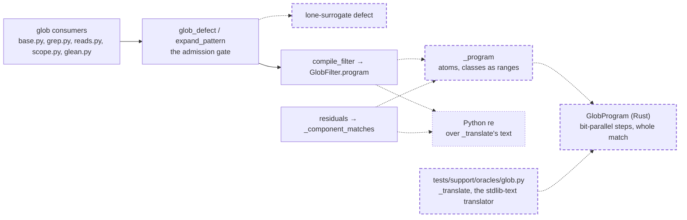

# Glob matching runs on the linear engine: an owned bit-parallel glob program in the Rust crate replaces Python's `re`, so a match costs at most the path's characters times the pattern's words

A fix to the glob pattern language (`src/vfs/pattern_matching/glob.py`) and the Rust engine (`crates/vfs-core`): a new native matcher, no verb, schema, rights or SQL change, so the engine legs are not needed. It closes the backtracking half of the medium finding `vfs.pattern_matching.glob._translate:backtracking-wildcards` of the 0.1.0a1 security audit (run `vfs-run-1-2026-11-07` at commit `3586750`): after it, no arrangement of wildcards makes one match cost more than a fixed number of word operations per character of the path. The other half, that one call may match many rows on the event loop, is the next spec's: it moves every row-matching site off the loop in batches under the wall-time budget, on this spec's engine. This spec does not close the finding by itself. After it lands, one call still matches its candidate rows times its arms on the event loop, each match at most the path's characters times a bound that decision 3 fixes by the path alone; so the 0.1.0a1 audit record, which the release-audit spec's decision 8 lands only after every medium's fix, waits on the next spec as well. No intention and no research memo: the cost is plain in the source, and the measurements below were run for this spec and the reviews of its first draft. It depends on nothing unlanded. It moves `PROTOCOL_VERSION` from 11 to 12. It changes a public function: `compile_glob`, exported from `vfs.pattern_matching`, returns the native program, whose method is `is_match`, instead of a `re.Pattern`. One active spec, [the storage seam as the kernel](../active/179-the-storage-seam-as-the-kernel/spec.md), not built, counts native calls in its fixture F9; when built, its glob, grep and glean rows count `GlobProgram` builds wherever a fixture passes a pattern, `globs` or `globs_not`.

## The problem

READ at `ae0be95`. Every glob consumer compiles a pattern through `compile_filter` or `compile_glob` (`src/vfs/pattern_matching/glob.py:206-219`), which hand the text of `_translate` (`glob.py:518-544`) to Python's `re`, a backtracking engine. `_translate` turns `*` into `[^/]*` and `?` into `[^/]`, so a component like `*a*a*a*a*a*a*a*a*a*a*a*a*b` against a 255-character segment of `a` tries every way to split the segment among its stars before it fails. `GlobFilter.matches` and `GlobFilter.hits` (`glob.py:80-99`) run one match per candidate row, and `_component_matches` (`glob.py:508-510`) one per bind-path segment in `residuals`. Nothing caps the wildcards or the length of a pattern: the router's `pattern`, `globs` and `globs_not` (`src/vfs/params.py:245-309`) carry no limit, and brace expansion turns one pattern into as many as 64 arms (`MAX_PATTERN_ARMS`, `glob.py:39`). EXECUTED by the audit's verifiers: one `glob` call with such a pattern held the event loop until the run was stopped.

READ. Today `compile_filter` and `_component_matches` run `_translate` on every call and lean on `re`'s cache for the compile; the router compiles once per scope root per arm in `_glob_dispatches` (`src/vfs/base.py:2340`) and once per root per glob in `_grep_admissions` (`base.py:2449`), so a call's compile count is linear in its roots times its arms.

EXECUTED for the first draft of this spec and its review, on the `regex` crate this repository already depends on (1.13.1 in `Cargo.lock`): the crate never backtracks, but its bound is the compiled size times the subject, and an admitted shape of `/**/*a` followed by 250 `?` cost 3.86 s per 10,000 distinct 1,000-byte paths; one build costs 58 to 104 µs; a pattern's compiled form needs a size limit (10 MiB by default), past which a matchable pattern fails to build; and each arm near that limit holds about 6 MiB. The review's three findings against that draft (an unsound minimum-length gate, a size refusal that refuses matchable patterns, and per-root builds that need a cache) all come from those properties of a general regex engine.

EXECUTED for this draft in a scratch prototype of decision 3's engine, over the same rows: the `/**/*a` plus 250 `?` shape matched 10,000 paths in 147 ms (256 steps); 300 components of `*a*` (1,200 steps) and 200 `**` components (1,002 steps) in about 287 ms each; a star then 30 `?` over 10,000 names in 23 ms; `**/*.py` in 90 ms; every verdict equal to the `regex` crate's. A build of a 1,200-step program took 70 µs and of a 7-step one 5 µs, linear in the steps. The `regex` crate is faster on ordinary shapes (17 ms for `**/*.py`), which its lazy DFA earns; this engine's bound does not depend on the shape. EXECUTED by this spec's third reviewer, against today's `re`: the engine is slower on an ordinary shape over long paths: `**/*.py` over the same 10,000 1,000-byte paths takes 14 ms under `re` and 89 ms in the prototype, before each row's call into Rust; over short paths `re` takes about 2 ms. The engine reads every character, and that is the price of a bound that does not depend on the shape.

READ. A path is at most 1,024 UTF-8 bytes, a segment at most 255 (`src/vfs/paths.py:40-41`), and a path holds no lone surrogate (`paths.py:531`). A pattern is not checked for lone surrogates today, and a lone surrogate cannot cross into Rust as a `char`.

## Architecture

Dashed is what this spec adds; dotted is what it retires.

Page this changes: none; the architecture folder was retired on 2026-10-31, and the landing notes will say so in one line.

Terms. A **step** is one atom of a compiled program: a literal character, one character other than `/`, any one character, a class, a never-matching atom, or a star (zero or more characters other than `/`, or zero or more of any). A program's **words** are `ceil((steps + 1) / 64)`, the 64-bit words of its state set. A **state set** holds one bit per position between steps: bit `i` set means the subject read so far can be matched by steps `0..i`.

## Decisions

### 1. Every glob match runs in a `GlobProgram`, a matcher of our own in `crates/vfs-core/src/glob.rs`; Python's `re` never compiles or matches a glob at runtime

A general regex engine bounds a match by its compiled size times the subject and needs a compile-size limit, and the three defects of this spec's first draft came from those two facts (The problem). The glob language needs only literals, two wildcards, classes and `**`, and a program over exactly those atoms can be matched with a cost per character fixed by the pattern's length (decision 3), with no size limit and a build linear in the pattern. AGENTS.md puts performance work in our own crate. `python.rs` binds the type as the `GlobProgram` class; `PROTOCOL_VERSION` moves from 11 to 12.

### 2. Python emits the program, not regex text: `_program(pattern, *, recursive)` walks the pattern exactly as `_translate` does and yields one atom per piece, `(op, ranges)` with `op` one of `lit`, `one`, `star`, `class`, `nclass`, `dot`, `never`, `sep`, `mid` and `tail`

The walk, the component split, the whole-component rules and the class scan stay in Python, where today's code and its stdlib parity live, so the program means what `_translate`'s regex means piece for piece: a literal character is `lit` with the one range `(c, c)`; `?` is `one`; a `*` inside a component is `star`; a whole-component `*` is `one` then `star` (today's `[^/]+`); a class is `class` or `nclass` with its members as sorted, merged `(lo, hi)` ranges, `dot` when today's body is `!` alone (any character), and `never` when it is empty; a `/` between components is `sep`; a middle `**` is `mid` (today's `(?:.+/)?`) and a final `**` is `tail` (today's `.*`), both only under *recursive*. The members of a class come from the chunk walk `_translate_class` runs today, inverted ranges merged away as today: the last character of each chunk and the first of the next bound a range, and every other character of a chunk, `-` included, is a member alone. A class is `nclass` when today's body, after the merge, begins with `!`, whether the pattern wrote it or a merge exposed it (`[z-a!b]` is today's `[^b]`); that `!` is not a member. When the negating `!` is the whole first chunk and more chunks follow, the `-` after it is a member alone and the next chunk's first character bounds no range (`[--!!-!]` is today's `[^-!]`). The uniform `(str, list[tuple[str, str]])` shape crosses into Rust as `Vec<(String, Vec<(char, char)>)>` with no per-atom type dispatch in the binding.

### 3. The engine matches with a state set of bit words: per character it shifts the set through the steps that accept the character, keeps the stars that accept it, and closes over the stars and the `**/` groups; the subject matches when the last bit is set after its last character

Building expands `one`, `star`, `class` and the rest into steps, and each `mid` into three steps (any character, a star over any character, `/`) with a skip from the group's first position to its end. For each of the 128 ASCII characters it precomputes two masks of the program's words: the positions whose consuming step accepts the character, and the stars that accept it; a character outside ASCII builds its two masks at match time from the wildcard masks, the non-ASCII literal steps and the class steps, by binary search over each class's ranges. A character's transition is `next = ((state & accept) << 1) | (state & keep)`, and the closure is `state |= (state & group_starts) << 3`, then `state |= (state & stars) << 1`; one pass of each is the whole closure, because `**` inside a component is a refused defect and canonical form collapses adjacent `**` components, so a star is never followed by a star or a group start, and a group never ends at another group's start. The match is anchored at the first character and whole, as `re.match` over a source ending in the end anchor was. A set that empties ends the match false at once. A transition and a closure touch only the words up to one past the word of the highest set bit, which starts at most four positions in (the closure before the first character) and rises at most five positions per character (one for the shift, three for a group skip, one for a star skip), so a match holds at most `(4 + 5 * bytes) / 64 + 1` words, and its three buffers are that long, never the program's length. A match therefore costs those words three times to set up, then at most four passes a character over the live words (the transition, the scan for the highest live word, the group pass and the star pass; a closure only adds bits, so it needs no scan), two more for a character outside ASCII (its two mask copies), plus that character's non-ASCII literal and class steps within the live words; nothing depends on how the wildcards are arranged, and a pattern longer than the path costs no more than the path allows.

### 4. The gate refuses a pattern holding a lone surrogate, with the defect "lone surrogate: U+XXXX"

Such a character cannot cross into Rust, and no path holds one, so the pattern can match nothing it could match today. The text mirrors the path validator's (`paths.py:878`).

### 5. Programs are built per use, with no cache

A build is linear in the pattern (decision 3; measured 5 µs for a 7-step program and 70 µs for 1,200 steps), and each build replaces a `_translate` call that every `compile_filter` and `_component_matches` already makes today, so the per-root and per-arm repeats cost what they cost now, within a constant factor. A cache would add residency and a key-size rule to save that constant; the next spec batches row matching, building each distinct program once per batch; the router's planning repeats, `_component_matches` per bind segment in `residuals` and `compile_filter` per root at `base.py:2449`, stay one build per use, as many as today's `_translate` calls.

### 6. `compile_glob(pattern)` returns the `GlobProgram`, and `GlobFilter.regex` becomes `GlobFilter.program`

Both are public through `vfs.pattern_matching`. The program's one method is `is_match(subject: str) -> bool`, which answers what `regex.match(subject) is not None` answered. Before the first release no caller outside this repository holds the old type; the twenty-five `.match(subject)` reads in the eleven `compile_glob` tests of `tests/pattern_matching/test_glob.py` (lines 210-252, 372-373, 408-410 and 424-425) become `.is_match(subject)`, each `is None` becomes `not`, and their verdicts are unchanged.

### 7. Today's `_translate`, with its component and class helpers, moves to `tests/support/oracles/glob.py` as the oracle: pinned to `glob.translate` byte for byte on Python 3.13 and later, and the engine pinned to it by verdict under `re` on every supported interpreter

The oracle keeps the strongest pin there is, textual identity with the stdlib, which the two `gate.regex.pattern == expected` checks of `tests/pattern_matching/test_glob.py:568-584` assert today through `compile_filter`. The engine is then pinned by verdict three ways: every pattern of the parity battery against every subject of a fixed battery; every defect-free pattern of length 1 to 4 over `"[]!-az*"` (2,654) against every string of length 0 to 3 over `"[]!-azb/é日"` (1,111), whose two multi-byte characters exercise the non-ASCII masks; and every class `"[" + body + "]"` with a body of length 1 to 6 over `"!-az]^["` (137,256 classes), marked `slow`, against every one-character subject over `"!-az]^[b/é"`, which reaches the range, inverted-range, negation and leading-`^` rules the depth-4 patterns are too short to hold. A pattern's verdict under the oracle is `re.match(oracle._translate(...), subject) is not None`.

## Intent

After this spec, matching a glob pattern against a path or a name runs on a program whose cost per character is fixed by the pattern's length, whatever the wildcards; a pattern holding a lone surrogate answers `invalid` naming the defect; and every other pattern matches exactly the subjects it matches today. Matching still runs where it runs today, on the event loop; the next spec moves it.

## Design

**`crates/vfs-core/src/glob.rs` (new).** `pub enum Atom { Lit(char), One, Star, Class(Vec<(char, char)>), NClass(Vec<(char, char)>), Dot, Never, Sep, Mid, Tail }`; `pub struct GlobProgram` holding its steps, its words, the 128 ASCII accept and keep masks, the masks of `one`, `dot`, star kinds, stars and group starts, the non-ASCII literal steps and the class steps; `GlobProgram::new(atoms: &[Atom]) -> GlobProgram`; `is_match(&self, subject: &str) -> bool`; a private `match_cost(&self, subject) -> (bool, MatchCost { chars, word_ops, step_reads })` that `is_match` wraps and the cargo tests read, where `word_ops` counts every word the match touches: the three buffers' setup, the transitions, the scans for the highest live word, the closures and the mask copies of characters outside ASCII, each touching only the words up to one past the highest set bit's; and `step_reads` the literal and class steps read to build the masks of a character outside ASCII. Cargo tests: three verdict pins across a 64-bit word, each killing its carry or reach mutant (a 71-step literal path matches itself; a star at bit 63 skips into the next word; a `mid` starting at bit 62 skips to bit 65); a 100,000-step program against a 10-character subject costs at most `3 + 4 * 10 + 2` word operations; the start anchor and whole match (`a` does not match `ba` or `ab`); the twelve-star shape against 255 `a` is false; `one` matches one multi-byte character and not two ASCII ones; a negated class matches `/` as today's regex does; `never` matches nothing and `dot` matches `/`; a `mid` matches zero segments and three; and the cost pins: for the `/**/*a` plus 250 `?` program against a 1,000-character path, `word_ops` is at most `4 * chars * words + 5 * words`, and for that program against subjects of 501, 1,001 and 2,001 characters, `word_ops` is at most `4 * chars * words + 5 * words`, linear in the subject; for a program of 100,000 `one` steps against a 1,024-character path, `word_ops` is at most `1,024 * (5 * 1,024 / 64 + 2)`; and a program of 100 `class` steps against a 300-character segment of `é` has `step_reads` at most `300 * 100`; 100,000 `class` steps against 255 `é` read at most `255 * 64 * live` steps; a program of 100,000 `one` steps against a 10-character subject spends at most 45 word operations; three verdict pins carry the transition, the star pass and the group pass across a word; and `the_live_words_bound_is_tight` holds two programs whose highest bit rises five positions a character to their match. `lib.rs` declares the module.

**`crates/vfs-core/src/python.rs`.** The `GlobProgram` pyclass: `__new__(atoms: Vec<(String, Vec<(char, char)>)>)`, raising `ValueError` on an unknown op or a range count that does not fit its op, and also when a `star` or `tail` is followed by a `star`, `tail` or `mid`, when a `mid` is followed by a `mid` or `tail`, or when a class's ranges are not sorted, disjoint and each `lo <= hi`, so the closure's invariants and the binary search are checked at the seam, not assumed from the gate; and `is_match(subject: &str) -> bool`; `PROTOCOL_VERSION = 12`. `src/vfs/native.py` expects 12 and exports `glob_program(atoms)`; `src/vfs/_native.pyi` declares the class.

**`src/vfs/pattern_matching/glob.py`.** `GlobFilter.program: GlobProgram`; `matches` and `hits` call `program.is_match`. `compile_glob(pattern)` returns `glob_program(_program(_canonical(pattern), recursive=True))`, its docstring naming the return type. `_program`, `_component_atoms` and `_class_atom` as decision 2; `_translate`, `_translate_component`, `_translate_class`, `_END_OF_STRING` and the `sys` import go to the oracle. `_component_defect` gains decision 4's check. `_component_matches(component, segment)` reads `glob_program(_program(component, recursive=False)).is_match(segment)`. The module docstring says matching runs on the native glob program.

**`tests/support/oracles/glob.py` (new).** Today's `_translate`, `_translate_component`, `_component_class_end` and `_translate_class`, verbatim, with `_END_OF_STRING`; the module docstring says it is the stdlib-text reference the engine is pinned to.

**`tests/pattern_matching/test_glob.py`.** The criteria's nodes; decision 6's twenty-five reads; the two `gate.regex.pattern` checks read the oracle's text instead; `PARITY_PATTERNS` gains `[z-a!b]`, `[--!!!]` and `[--!!-!]`; and the 3.13 `skipif` moves from the `TestTranslateParity` class to its two textual nodes, so the three verdict nodes run on every supported interpreter.

**Tests first.** The new Python nodes and cargo tests are seen failing before the modules change: the cargo tests do not compile before `glob.rs` exists, and criterion 1's counter counts the `re` calls today's matching makes.

**Scale.** A program holds `(256 + 8) * words` words of masks plus its non-ASCII literal and class steps, linear in the pattern; its steps are at most three per pattern character, a class one step whatever its length. One match costs at most four passes a character over the live words, six for a character outside ASCII, plus the non-ASCII steps within the live words; a path has at most 1,024 bytes, so the live words are at most 81 and one match costs at most about 500,000 word operations whatever the pattern. A call's builds are linear in its roots times its arms, as today. A call's matches are linear in its candidate rows times its arms, as today, and run on the event loop until the next spec; that is the profile this spec names, and moving them off the loop under the wall is its direction.

## Scope

In: decisions 1 to 7. Files: `crates/vfs-core/src/glob.rs`, `crates/vfs-core/src/lib.rs`, `crates/vfs-core/src/python.rs`, `src/vfs/native.py`, `src/vfs/_native.pyi`, `src/vfs/pattern_matching/glob.py`, `tests/support/oracles/glob.py`, `tests/pattern_matching/test_glob.py`, and this spec's landing notes.

Out: moving row matching off the event loop and under the wall, and building each distinct program once per batch, which are the next spec's; the SQL prefilter's translation of the anchored pattern (`pathterms.py`), which is linear text work and unchanged; matching a scope root's remainder against an arm compiled once, instead of composing the root into each arm.

## Acceptance criteria

Counts and states, never clocks. Tests are in `tests/pattern_matching/test_glob.py` unless their path says otherwise.

1. With `glob.re` replaced by a stand-in whose `compile`, `match` and `fullmatch` count their calls, `compile_filter("*a" * 12 + "*b", ())` against the leaf name `"a" * 255` answers `False`, `residuals("/x/" + "*a" * 12 + "*b", Path("/x/" + "a" * 255))` is empty, and the counted calls are 0. Test: `test_glob_matching_never_reaches_python_re`.
2. On an `InMemoryStorage` mount holding `/d/` + `"a" * 200`, `glob("*a" * 12 + "*b")` succeeds with no entries, and `glob("*a*")` returns that file. Test: `test_a_backtracking_shape_globs_through_the_verb`.
3. `glob_defect("a\udc80")` names "lone surrogate: U+DC80", and `grep("x", globs=("a\udc80",))` answers `invalid`. Test: `test_a_lone_surrogate_pattern_is_refused`.
4. `compile_filter("?", ())` matches the names `"é"`, `"日"` and `"😀"` and not `"ab"`. Test: `test_a_question_mark_matches_one_character_of_any_width`.
5. On Python 3.13 and later, the oracle's `_translate` equals `glob.translate` byte for byte for every pattern of `PARITY_PATTERNS` and every defect-free pattern of length 1 to 6 over `"[]!-az*"`. Tests: `TestTranslateParity::test_the_oracle_is_the_stdlibs_text` and `TestTranslateParity::test_exhaustive_class_machinery_fuzz_keeps_the_oracle_byte_identical`.
6. On every supported interpreter, decision 7's three verdict comparisons agree on every pair: `PARITY_PATTERNS` against `PARITY_SUBJECTS` (a fixed tuple of at least 40 paths and names covering dotfiles, classes, `[`, `]`, `!`, `-`, multi-byte characters and deep paths); the 2,654 depth-4 patterns against the 1,111 subjects; and the 137,256 class bodies of length 1 to 6 over `"!-az]^["` against the ten one-character subjects. Tests: `TestTranslateParity::test_verdicts_match_the_oracle`, `TestTranslateParity::test_exhaustive_fuzz_agrees_with_the_oracle` and `TestTranslateParity::test_every_short_class_agrees_with_the_oracle`.
7. `cargo test -p vfs-core glob` passes the tests named in the Design, the two cost pins among them.
8. `tests/test_native.py::TestSeamGate::test_the_live_extension_speaks_the_expected_protocol` passes unchanged, with `EXPECTED_PROTOCOL` at 12.
9. Every other existing test of `tests/pattern_matching/test_glob.py`, with only decision 6's twenty-five reads, the two `gate.regex.pattern` checks, the three added `PARITY_PATTERNS` and the moved `skipif` changed, the glob and grep nodes of `tests/support/storage_contract.py`, and `tests/storage/database/test_pathterms.py` pass; `scripts/ci.sh` and `cargo test -p vfs-core` are green on the tree as committed, after `uv sync --all-extras --group dev --reinstall-package vfs-py`.

## Landing notes

Landed 2026-11-07 on `main` as one commit over `e5b903f`, after [the spec review](../../reviews/2026-11-07-glob-matching-runs-on-the-linear-engine-spec-review.md) (four rounds: the first two on a `regex`-crate draft, then this rewrite, whose H6 and lows were fixed and re-signed "Fit to build") and [the code review](../../reviews/2026-11-07-glob-matching-runs-on-the-linear-engine-code-review.md) (one High, the untested word boundary, and one Medium, uncounted costs and setup sized by the program; both fixed, each fix seen killing its mutants; re-signed "Lands", with two Lows fixed after). The architecture folder was retired on 2026-10-31, so no page changes.

Changed during the build, in the spec as written above: the doubling cost pin became a linear bound, because the live words ramp up over the first characters, so a short subject costs less a character than a long one; and the code review moved the buffers from the program's length to the subject's, `(4 + 5 * bytes) / 64 + 1` words, and counted every word a match touches, so decision 3 and the Scale paragraph state four passes a character over the live words, six outside ASCII. One file beyond the Scope's list: `src/vfs/pattern_matching/__init__.py` exports the `GlobProgram` protocol that `compile_glob` now returns.

Tests first, EXECUTED: before the modules changed, sixteen glob nodes failed (the eleven `compile_glob` tests on `is_match`, the three verdict comparisons, and the two surrogate refusals), and the two backtracking nodes hung on today's `re`, which is the defect they pin; `test_a_question_mark_matches_one_character_of_any_width` passed before as after, a pin of verdicts `re` already gave. The cargo tests did not compile before `glob.rs` existed.

Evidence beyond the criteria, EXECUTED by the code review: about 1.8 million pattern and subject pairs against the oracle with no difference, covering long and deep patterns, many `**`, name arms, `residuals` components and multi-byte subjects; every class body of length 7 (823,543) and 300,000 random bodies of length 7 to 16 agree; building 200,000 `?` takes 120 ms against 278 ms for the old `re.compile`.

The gate, EXECUTED on the tree as committed: lint, format, types, docs examples and wheel size PASS; 4,676 passed; 100% coverage of 12,524 statements; `cargo test -p vfs-core` 93 passed. The engine legs are not needed: no SQL statement, schema or rights rule changed.

## One line

A glob pattern now matches on a bit-parallel program of our own in the Rust crate, so a match costs at most the path's characters times the pattern's words, whatever the wildcards, and Python's `re` never runs a glob.
