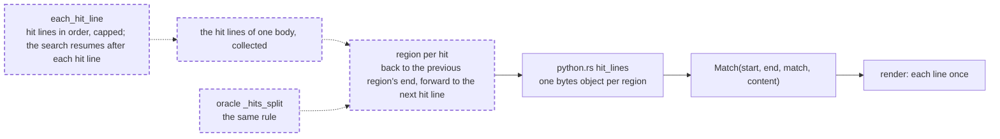

# Grep context regions never overlap: when two hits' context windows meet, the union is split at each hit line, so every line of a body appears in at most one region

A fix to the Rust match authority (`crates/vfs-core/src/verify.rs`) and its pure-Python oracle (`tests/support/oracles/matcher.py`): the binding's signature and types do not change, but what a region covers does, so `PROTOCOL_VERSION` goes from 10 to 11; no schema, rights or SQL change, so the engine legs are not needed. It closes the medium finding `vfs-core.verify.extend_context:per-hit-context-duplication` of the 0.1.0a1 security audit (run `vfs-run-1-2026-11-07` at commit `3586750`). No intention and no research: the cost is plain in the source, and ripgrep, the tool grep's output imitates, prints each line once. It depends on nothing unlanded. It changes the public verb's output: in lines mode, a `Match` whose window overlapped another's now carries fewer lines, and the rendered output loses its repeated lines; no test, no doc under `docs/` and no caller in `src/` relies on the overlap. The active spec [chained grep verifies off the loop under a wall](2026-11-07-chained-grep-verifies-off-the-loop-under-a-wall.md) also edits `src/vfs/pattern_matching/grep.py` and adds nodes to `tests/base/test_grep_namespace.py`; the two touch different functions and land in either order. The active spec [glob matching runs on the linear engine](../active/2026-11-07-glob-matching-runs-on-the-linear-engine.md) also bumps the protocol; it lands after this one and takes the protocol from 11 to 12.

## The problem

READ at `4fc3307`. In lines mode, `Matcher::hit_lines` (`crates/vfs-core/src/verify.rs:108-123`) calls `extend_context` (`verify.rs:242-263`) once per hit line, and each hit's context window runs up to `before` lines back and `after` lines forward, clamped only to the body. The binding (`crates/vfs-core/src/python.rs:133-163`) copies each window's bytes into its own Python bytes object, and each becomes one `Match` with its own `content`. When hits sit closer together than the context, their windows overlap and the same lines are copied once per window. With `before_context` and `after_context` as large as the body, a body of N matching lines returns N copies of the whole body, so the output grows as the number of hit lines times the body's size, and `extend_context`'s scans cost the same.

READ. The renderer (`src/vfs/results/render.py:325-408`) prints every line of every region, so overlapping windows print the same lines more than once, and a later hit's line inside an earlier window prints with the context separator `-` instead of the match separator `:`. ripgrep prints each line once and marks each match line as a match.

READ. The hit scan that feeds the windows is quadratic on its own: `each_hit_line` (`verify.rs:126-157`) runs `memrchr` from every match back to its line's start before it checks whether that line was already seen, so one line holding n matches scans about n²/2 bytes. EXECUTED by this spec's reviewer on the live engine: one line of `x` at 100,000, 200,000 and 400,000 bytes took 0.06, 0.25 and 1.0 seconds, four times longer per doubling; `count_lines` shares the scan.

READ. The pure-Python oracle's `_hits_split` (`tests/support/oracles/matcher.py:174-187`) builds the same overlapping windows, and the parity tests in `tests/pattern_matching/test_matcher_parity.py` pin the engine to it.

## Architecture

Dashed is what this spec adds.

Page this changes: none; the architecture folder was retired on 2026-10-31, and the landing notes will say so in one line.

Terms. A hit's **window** is its line plus up to `before` lines above and `after` lines below, clamped to the body. A hit's **region** is the part of the window this spec emits.

## Decisions

### 1. For hits h₁ < h₂ < … of one body, region k runs from the later of window k's start and the line after region k−1's end, to the earlier of window k's end and the line before hₖ₊₁

Each region contains its own hit line, because the line before the next hit is at or after hₖ and the line after the previous region's end is at or before hₖ. The regions are disjoint, and their union is the union of the windows, because a line that region k−1 gives up is at or after hₖ and so lies in window k. So every line of the body appears at most once, the output of one body is at most the body's size, and every line a caller saw before is still shown. A region that starts at its hit line has no lines above it, because the previous region already holds them.

### 2. `hit_lines` first collects the body's hit lines with `each_hit_line`, under the same cap, then builds each region with a backward scan that stops at the previous region's end and a forward scan that stops before the next hit's line

Knowing the next hit before building a region is what lets the forward scan stop at it. Each byte of the body is then scanned at most once backward and once forward across all regions, so building the regions costs time linear in the body. The collected list holds three integers per hit line, at most the cap.

### 3. The oracle's `_hits_split` applies decision 1's rule, and the `Match` docstring says a grep entry's regions never overlap and each holds one hit line

The parity tests compare the engine with the oracle, so both must emit the same regions. The docstring is where a caller reads what a region is.

### 4. `PROTOCOL_VERSION` goes from 10 to 11

The seam's rule (`crates/vfs-core/src/python.rs:26-27`) bumps the protocol on any change of shapes or semantics, and which lines a region covers is seam semantics: a stale extension must refuse to import rather than serve overlapping regions that contradict the `Match` docstring.

### 5. After each hit line, `each_hit_line` resumes the search at the byte after that line's end with `Regex::find_at`, so each line is searched for at most once

A match never crosses `\n`, so the first match at or after a line's start decides whether that line hits, and the set of hit lines is unchanged. The searches then cover disjoint stretches of the body, and each backward scan for a line start runs only from the search's start, so the hit scan is linear in the body for `hit_lines` and `count_lines` alike. Skipping matches after `find_iter` would not be enough: `find_iter` runs one search per match, and each can scan the rest of the line; EXECUTED by this spec's reviewer on regex 1.13.1, `.*[^A-Z]|[A-Z]` over one line of `A` took 0.023, 0.093, 0.34 and 1.37 seconds at 5,000, 10,000, 20,000 and 40,000 bytes with `find_iter`, and 0.08 milliseconds at 40,000 resuming after the hit line. `find_at` reads the bytes before its start, so `^` and `\b` judge a line start as they do today, and a match at the body's length after a trailing `\n` still meets the phantom-line guard, which ends the scan.

## Intent

After this spec, finding a body's hit lines costs time linear in the body, and grep's lines mode returns, for each body, regions that never overlap and together cover exactly the lines today's windows cover, one region per hit line, each holding its hit line; the bytes returned for one body are at most the body's size, and building them costs time linear in the body. The renderer then prints each line once, with each hit line marked as a match. A call whose windows do not overlap returns exactly what it returns today.

## Design

**`crates/vfs-core/src/verify.rs`.** `hit_lines` collects `(ls, le, line_no)` triples from `each_hit_line` into a `Vec`, stopping at the cap as today, then maps each to a `Hit` with `extend_context(hay, ls, le, line_no, before, after, floor, ceiling)`: `floor` is the byte after the previous region's end (0 for the first), and `ceiling` is the next hit line's start byte (the body's length for the last). The backward loop runs while `back < before && context_start > floor`; the forward loop runs while `forward < after && context_end + 1 < ceiling`. Cargo tests: overlapping windows split as decision 1 says, touching windows stay whole, the twin `before`/`after` of the body's length on a body of N matching lines returns N regions whose spans sum to at most the body's length, and inverted hits follow the same rule. The module docstring and `Hit`'s doc comment name the rule.

**The hit scan.** `each_hit_line` wraps a private `scan_hit_lines(hay, invert, emit) -> ScanCost`, where `ScanCost { searches: u64, back_bytes: u64 }`; the public paths drop the cost, and the cargo tests read it.

**`tests/support/oracles/matcher.py`.** `_hits_split` builds the windows, then clips each to decision 1's region before it joins the lines; both exits, the budget expiry and the end of the body, return the clipped regions of the hits collected so far.

**`crates/vfs-core/src/python.rs` and `src/vfs/native.py`.** `PROTOCOL_VERSION` and `EXPECTED_PROTOCOL` go to 11.

**`src/vfs/pattern_matching/grep.py`.** The `MatchSpan` comment and `verify`'s docstring say a hit's region, clipped at its neighbours, not its window.

**`src/vfs/models/entry.py`.** `Match`'s docstring gains decision 3's sentence, and its first line says "a grep region" rather than "a grep window".

**Tests first.** The cargo tests in `verify.rs`, and `tests/pattern_matching/test_matcher_parity.py` and `tests/results/test_render.py` gain the criteria's nodes, seen failing before the code changes.

**Scale.** One collected triple per hit line, bounded by the cap and the body's lines; one search and one backward scan per stretch between hit lines, over disjoint stretches, for the hit scan, and one backward and one forward pass over the body at most for the regions; output bytes per body at most the body's size. Nothing grows with hits times the body.

## Scope

In: decisions 1 to 5. Files: `crates/vfs-core/src/verify.rs`, `crates/vfs-core/src/python.rs`, `src/vfs/native.py`, `tests/support/oracles/matcher.py`, `src/vfs/models/entry.py` (docstring), `src/vfs/pattern_matching/grep.py` (comment and docstring), `tests/pattern_matching/test_matcher_parity.py`, `tests/results/test_render.py`, `tests/base/test_grep_namespace.py`, and this spec's landing notes.

Out: a per-call output-byte budget, which the linear bound makes unnecessary; checking the deadline inside one body, which stays between bodies; the whole-text path of the oracle, which serves no context.

## Acceptance criteria

Counts and states, never clocks.

1. `cargo test -p vfs-core verify` passes five new tests: `overlapping_windows_split_at_each_hit_line` (body `"a\nx\nb\nx\nc\n"`, pattern `x`, `before = after = 1`, regions with lines (1–3, hit 2) and (4–5, hit 4)), `touching_windows_stay_whole` (body of six lines with hits on lines 2 and 5, `before = after = 1`, regions (1–3, hit 2) and (4–6, hit 5), as today), `wide_context_returns_each_line_once` (2,000 lines of `x`, `before = after = 2,000`, 2,000 regions whose span lengths sum to at most the body's length), `inverted_hits_split_alike` (body `"a\nx\nb\nx\nc\n"`, pattern `x`, `invert`, `before = after = 1`, regions with lines (1–2, hit 1), (3–4, hit 3) and (5–5, hit 5); today's windows are (1–2), (2–4) and (4–5)), and `one_long_line_scans_once` (one line of 100,000 `x` with pattern `x`, and one line of 40,000 `A` with pattern `.*[^A-Z]|[A-Z]`: `hit_lines` and `count_lines` each return one hit line, and `ScanCost` reports at most 2 searches and at most the body's length in `back_bytes`).
2. `tests/pattern_matching/test_matcher_parity.py::test_overlapping_context_regions_partition_the_windows`: for a seeded set of at least 200 bodies of 1 to 40 lines over the alphabet `"xy\n"`, pattern `x`, every `before` and `after` in 0 to 3, every `cap` in None, 1 and 2, and `invert` both ways, the engine and the oracle return identical regions; for each body the regions are disjoint, each contains its hit line, and their union equals the union of the windows of today's rule computed in the test.
3. `grep("x", before_context=2_000, after_context=2_000)` through the public verb, on a mount holding one file of 2,000 lines of `x`, returns 2,000 matches whose `content` lengths sum to at most the file's length. Test: `tests/base/test_grep_namespace.py::test_wide_context_returns_each_line_once`.
4. The rendered output of criterion 1's first body under `before_context = after_context = 1` lists each of its five lines exactly once, with lines 2 and 4 carrying the `:` separator. Test: `tests/results/test_render.py::test_overlapping_context_renders_each_line_once`.
5. Every existing cargo test of `verify.rs`, every other test of `tests/pattern_matching/test_matcher_parity.py`, and every grep node of `tests/support/storage_contract.py` pass unchanged, and `scripts/ci.sh` and `cargo test -p vfs-core` are green on the tree as committed.

## Landing notes

Landed 2026-11-07 on `main` as one commit over `f89e5cb`, after [the spec review](../../reviews/2026-11-07-grep-context-regions-never-overlap-spec-review.md) (two Highs, one Medium and seven Lows over three reads, all fixed, re-signed "Fit to build"; its sixth Low brought decision 5, the resumed hit scan, into this spec) and [the code review](../../reviews/2026-11-07-grep-context-regions-never-overlap-code-review.md) (two Lows, both fixed with their fix text; signed "Lands"). The architecture folder was retired on 2026-10-31, so no page changes. `PROTOCOL_VERSION` is now 11.

Tests first, EXECUTED: the cargo tests failed to compile before `scan_hit_lines` existed, and with that test set aside three of the four region tests failed (the touching-windows test passes today, as the criterion says); the three Python nodes of criteria 2 to 4 failed against the old windows. The code review's Rust mutants on the floor, the ceiling and the resume point, and the old window bounds rebuilt into the extension, each turned the new tests red.

The gate, EXECUTED on the tree as committed: lint, format, types, docs examples and wheel size PASS; 4,637 passed; 100% coverage of 12,409 statements; `cargo test -p vfs-core` 67 passed. The engine legs are not needed: no SQL statement, schema or rights path changed.

## One line

Grep's lines mode now splits overlapping context windows at each hit line, so each line of a body is returned and printed once, and the output of a body is never larger than the body.
