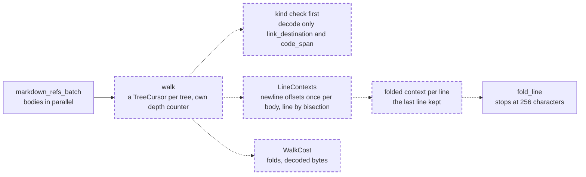

# The Markdown reference walk is linear: each line is found by bisection and folded once, and only reference nodes are decoded

A fix to the Rust reference extractor (`crates/vfs-core/src/links.rs`): the binding's signature, types and output do not change, so `PROTOCOL_VERSION` stays; no schema, rights or SQL change, so the engine legs are not needed. It closes the medium finding `vfs-core.links.line_context:per-reference-whole-line-fold` of the 0.1.0a1 security audit (run `vfs-run-1-2026-11-07` at commit `3586750`), and a second quadratic cost in the same walk found while reading it. No intention and no research: both costs are plain in the source. It depends on nothing unlanded.

## The problem

READ at `4fc3307`. `markdown_refs` (`crates/vfs-core/src/links.rs:39-68`) walks the tree-sitter tree of one body and, for each link destination or path-shaped code span, calls `line_context(body, node.start_byte())` (`links.rs:71-75`). `line_context` scans back to the start of the line and forward to its end, decodes the whole line, and `fold_line` (`links.rs:78-93`) folds the whole line before keeping its first 256 characters. A line holding N references is scanned, decoded and folded N times, so one long single-line body costs its length times its reference count. The reindex stage that calls this through `vfs.models.links.extract_links` runs inside the mount's writer transaction, so the lock is held for that time.

READ. The walk also runs `String::from_utf8_lossy(&body[node.byte_range()])` for every node it visits (`links.rs:47`), before it checks the node's kind, though only `link_destination` and `code_span` nodes use the text. The document node spans the whole body, and every enclosing block spans its contents, so the walk validates the body's bytes once per level of nesting; a body of deeply nested block quotes or lists costs its length times its depth. Inline trees nest too: images nest inside image descriptions, so a body of nested images has a depth linear in its length and costs its length squared; EXECUTED by this spec's reviewer, today 144,001 bytes of them decode 2.3 GB.

READ and EXECUTED by this spec's reviewer. The walk's cursor is itself quadratic in inline depth: `MarkdownCursor::goto_parent` calls `Node::parent` on every upward step inside an inline tree, and tree-sitter computes a node's parent by walking down from the root (`tree-sitter-0.26.13/src/node.c:547-558`), so each step costs the node's depth. On 144 KB of nested images the walk alone, decoding nothing, took 56,034 ms; a walk with one `TreeCursor` per tree took 10.8 ms over the same 144,004 nodes.

READ. The output is bounded per reference: each context is at most 256 characters (`MAX_CONTEXT_CHARS`), so the returned bytes are linear in the number of references. Only the work is quadratic.

## Architecture

Dashed is what this spec adds.

Page this changes: none; the architecture folder was retired on 2026-10-31, and the landing notes will say so in one line.

Terms. A reference's **line** is the bytes between the newline before it (or the body's start) and the newline after it (or the body's end), as today.

## Decisions

### 1. The walk checks a node's kind before it decodes the node's text, and decodes only `link_destination` and `code_span` nodes

No other node's text is used, so decoding it is waste, and that waste is what multiplies the body's length by its nesting depth. Reference nodes do not nest inside one another, so the decoded bytes are at most the body's length; EXECUTED by this spec's reviewer over 945 real Markdown files and their 150,179 reference nodes, none nested.

### 2. The walk does not use `MarkdownCursor`: it walks the block tree with a `tree_sitter::TreeCursor` and, at each node for which `MarkdownTree::inline_tree(&node)` returns a tree, walks that tree with its own `TreeCursor` in place of the node's block children, keeping its own depth counter

It never calls `Node::parent` or `TreeCursor::depth`, because both cost the node's depth: tree-sitter's `ts_node_parent` walks down from the root, and `MarkdownCursor::goto_parent` calls it on every upward step in an inline tree, which makes a body of nested images quadratic. A `TreeCursor` keeps its own stack, so each of its steps costs constant time. The nodes visited and their order are today's. The inline tree's root is not visited, as today: the walk starts at the root's first child, and an inline tree with no children visits nothing and still replaces the block children. The depth counter starts at 1 on that first child, rises on each `goto_first_child` and falls on each `goto_parent`; when it reaches 0 the inline walk is done and the block walk moves to the block node's next sibling.

### 3. A private `LineContexts` computes the body's newline offsets once with `memchr_iter`, finds each reference's line by `partition_point` over them, and keeps the folded context of the last line it folded

Finding a line by bisection costs a logarithm of the line count instead of a scan of the line. The walk visits nodes in document order, so a line's references arrive together and keeping the last line's folded text means each line is decoded and folded once; a reference on another line refolds, which keeps the answer right even if the order ever changed. The offsets cost one `usize` per newline, linear in the body.

### 4. `fold_line` stops as soon as it has pushed 256 characters

The answer is the same first 256 characters it returns today, and a line is no longer folded past what is kept. The decode of the line stays whole, once per line, by decision 3.

### 5. `markdown_refs` keeps its signature and returns what it returns today; a private `walk` returns the references plus a `WalkCost` of folds and decoded bytes, which the cargo tests read

`decoded_bytes` sums the lengths of the input slices handed to `String::from_utf8_lossy`, line slices and reference-node slices alike; each is at most the body's length, so the sum is at most twice it. Counting operations, not time, is how a performance pin is written here, and a cost record beside the result is how the repository's reference systems count (zoekt's `Stats`). The binding and the batch call drop the cost.

### 6. `PROTOCOL_VERSION` stays at its value

The binding takes and returns the same types and the same values.

## Intent

After this spec, extracting the references of one body costs time linear in the body: one pass for the newline offsets, one decode and one fold per line that holds a reference, one decode per reference node, one bisection per reference, and one constant-time cursor step per node. The references and their contexts are exactly today's.

## Design

**`crates/vfs-core/src/links.rs`.** `WalkCost { folds: usize, decoded_bytes: usize }`; `LineContexts<'a> { body, newlines: Vec<usize>, last: Option<(usize, String)> }` with `context_at(&mut self, at, cost) -> String`; `walk(parser, body) -> (Vec<MarkdownRef>, WalkCost)` walking decision 2's cursors in today's order with the kind check first; `markdown_refs` returns `walk(...).0`; `fold_line` breaks once 256 characters are pushed; `line_context` goes. Cargo tests, beside today's: `one_line_of_many_references_folds_once` (2,000 references on one line, 2,000 references each with the line's folded context, `folds == 1`, and the same for 4,000), `nested_blocks_decode_only_reference_nodes` (200 nested block quotes around one link, `decoded_bytes` at most twice the body's length; today's walk decodes about 43,000 bytes of a 410-byte body), `nested_images_yield_every_destination` (4,000 nested images, 4,000 references each `a.md`, `decoded_bytes` at most twice the body's length), `references_on_separate_lines_fold_each_line` (three lines with one reference each, `folds == 3`, each context its own line), and `fold_line_keeps_the_first_256_characters` (for 200 seeded lines of 0 to 1,000 characters mixing spaces, tabs, ASCII letters, non-ASCII letters (`é`, `漢`) and U+3000 IDEOGRAPHIC SPACE, the result equals today's fold-then-take). The module docstring says the walk is linear in the body.

**Tests first.** The five cargo tests are seen failing before `links.rs` changes (they name `walk` and `WalkCost`, which do not exist yet, and the fold count is 2,000 today).

**Scale.** One `usize` per newline of a body; one folded line held at a time; one decode per line with references and per reference node; output unchanged, at most 256 characters per reference. Nothing grows with references times the line, or with depth times the body.

## Scope

In: decisions 1 to 6. Files: `crates/vfs-core/src/links.rs`, and this spec's landing notes.

Out: a cap on references per body, which linear work makes unnecessary; moving the reindex stage's CPU before the writer transaction opens, which the storage-seam spec reshapes; the Python oracle in `tests/support/oracles/links.py`, whose output this spec does not change. A body of 255 or more nested block quotes aborts the process in tree-sitter-md's block scanner, in `markdown_refs` and `chunk_spans` alike; that is a separate defect, for its own spec, and this spec's tests stay below it.

## Acceptance criteria

Counts and states, never clocks.

1. `cargo test -p vfs-core links` passes the five new tests named in the Design and every existing test of `links.rs` unchanged.
2. `tests/models/test_links.py`, including its parity tests against `tests/support/oracles/links.py`, and `tests/storage/database/test_links.py` (16 tests), the storage tier's pin, pass unchanged.
3. `scripts/ci.sh` and `cargo test -p vfs-core` are green on the tree as committed, after `uv sync --all-extras --group dev --reinstall-package vfs-py`.

## Landing notes

Landed 2026-11-07 on `main` as one commit over `e699839`, after [the spec review](../../reviews/2026-11-07-markdown-reference-walk-is-linear-spec-review.md) (two Highs, one Medium and four Lows, all fixed, re-signed "Fit to build"; its first High brought decision 2, the per-tree cursors, into this spec) and [the code review](../../reviews/2026-11-07-markdown-reference-walk-is-linear-code-review.md) (one Low, a layout move, fixed; signed "Lands"). The architecture folder was retired on 2026-10-31, so no page changes.

The doubling probe, EXECUTED by the code review, since the cursor's cost is inside the C runtime where no Rust count reaches: parse plus walk over 4,000, 8,000 and 16,000 nested images took 171, 348 and 717 ms, and through `extract_links` 177, 363 and 729 ms; the spec review measured the old walk alone at 56 s for 144 KB of them. The code review compared the new walk with the old over 362,796 references from generated bodies, 1,934 real Markdown files and bodies with invalid UTF-8: no mismatch.

Tests first, EXECUTED: the five cargo tests failed to compile before `walk` and `WalkCost` existed. Of the code review's ten mutants, seven fail a test; the fallback to `MarkdownCursor` is the probe's to catch, the `<=` bisection mutant is equivalent, and dropping line bytes from `decoded_bytes` changes only the counter.

The gate, EXECUTED on the tree as committed: lint, format, types, docs examples and wheel size PASS; 4,637 passed; 100% coverage of 12,409 statements; `cargo test -p vfs-core` 72 passed. The engine legs are not needed: no SQL statement, schema, binding or protocol changed.

## One line

Extracting a body's Markdown references now costs time linear in the body, because each line is found by bisection and folded once, and only reference nodes are decoded.
