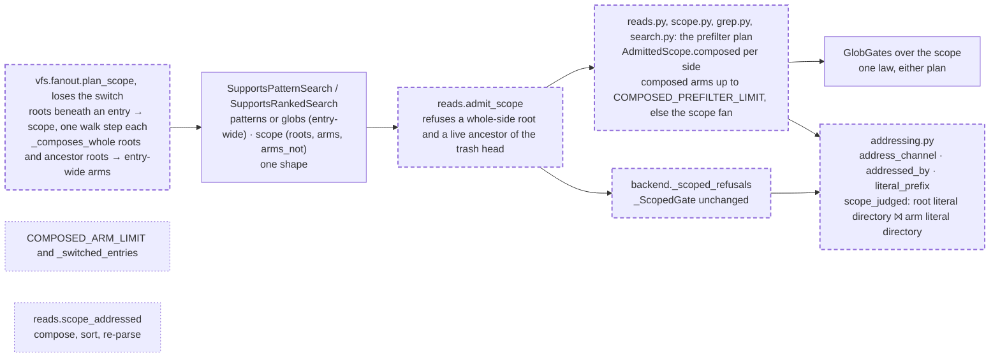

# Scope crosses the storage seam in one shape: roots strictly beneath an entry ride beside the arms, a root composition must read whole composes at every size, the prefilter is storage's own plan choice, and the anonymous posture gate judges exactly the paths composition judges, building a scope's paths from each root's and each arm's literal directory instead of composing and re-parsing their text

A refactor of the storage seam's contract for `glob`, `grep` and `search`, and a structural one. It adds the adapter module `src/vfs/storage/backends/database/addressing.py` and moves the pattern-addressing code into it from `reads.py` (decision 6). It adds two private methods, `AdmittedScope.composed` (decision 3) and `_Walk.rewritten` (decision 2); no class and no protocol method is added or removed, and the `scope` parameter already exists. It changes no public verb or parameter, no schema and no Rust. It fixes one inconsistency between today's two shapes, named in decision 12: a live scope root that is an ancestor of the trash view's head (`/.vfs`) means what its joined text means as one pattern at every scope size, so past the old limit of 200 its answer changes from the scope channel's (nothing from the trash view) to composition's (the tombstoned rows), and a direct storage caller that sends such a root on the scope is refused `invalid`, as one that sends a whole-side root is. It needs the engine legs: it edits `reads.py`, `scope.py`, `grep.py`, `search.py` and `backend.py` under `src/vfs/storage/backends/database/`, adds `addressing.py` there, and the two-channel spec's plan pins run again. It touches rights: the anonymous posture gate's computation changes, the set of paths it judges does not change against composition's reading for any input, and the order in which a refused call's records arrive does change (decisions 4, 5 and 12), so the security lens is mandatory and a leak test over both posture orders and all three verbs is a criterion. It touches the gate's size baseline and not its ladder: `MODULE_LINE_BASELINE` in `tests/lint/allowlist.py` sets its entries for `reads.py`, `backend.py`, `search.py` and `base.py` to each module's count at the landing, none above today's, and all four fall in the Design-faithful build (decision 6); `LAYERS` is unchanged, since the new module sits under `vfs.storage.backends` by prefix. It depends on no active spec. It builds on five landings: [the two-channel scope spec](2026-11-07-storage-takes-scope-roots-and-arms-as-two-channels.md), landed at `0867fbb`, whose `ScopeChannel`, scope fan, plan pins and posture hops it keeps; [bounded work has one home](2026-11-07-bounded-work-has-one-home.md), landed at `4a6d3e0`, whose `Deadline` and its `chunks` the gate and the planner take; [the router keeps routing](2026-11-07-the-router-keeps-routing.md), landed at `f753991`, which moved the planner this spec simplifies into `vfs.fanout` and left row K1 of the mutant ledger for this spec to retire; [the verbs take the names agents know](2026-11-09-the-verbs-take-the-names-agents-know.md), landed at `280a983`, which renamed glean to search; and [the gate and the review read the layer map and the size baseline](2026-11-07-the-gate-and-the-review-read-the-layer-map-and-the-size-baseline.md), landed at `b2a32c3`, whose ladder and size baseline this landing must pass. It lands first in the queue, and each later spec rebases onto it. The order, with the files each shares with this one as its own text names them at `5d47a21a`: [close leaves no SQLite side files](../active/2026-11-12-close-leaves-no-sqlite-side-files.md), which edits `engine.py`, `sync.py`, `tests/storage/database/test_statistics.py`, `tests/test_sync.py` and one tutorial page, and shares no file with this one; [search survives a chunk row deleted under its read](../active/2026-11-12-search-survives-a-chunk-row-deleted-under-its-read.md), which shares `search.py`, `tests/storage/database/test_search.py`, `tests/lint/allowlist.py` and `context/standards/mutant-ledger.md`; [the full pass is named rebuild and its pipeline leaves the backend](../active/2026-11-12-the-full-pass-is-named-rebuild-and-its-pipeline-leaves-the-backend.md), which says it edits every file it lists for this spec (`protocol.py`, `base.py`, `reads.py`, `grep.py`, `search.py`, `backend.py`, `tests/storage/database/test_grep.py`, `test_search.py`, `test_reads.py`, `test_rights.py`, `tests/base/test_dispatch.py` and `tests/support/storage_contract.py`) and also `tests/lint/allowlist.py` and the mutant ledger, moves code out of `reads.py`, `search.py` and `backend.py`, and lands after this one, on its line counts; and last [refresh, the incremental index verb](../active/2026-10-31-refresh-the-incremental-index-verb.md), which shares `backend.py`, `grep.py`, `search.py`, `protocol.py`, `tests/support/storage_contract.py`, `tests/storage/database/test_grep.py`, `tests/storage/database/test_search.py` and `tests/lint/allowlist.py`. [The release audit is a review](../active/2026-11-07-the-release-audit-is-a-review.md) edits `tests/lint/test_code_shape.py`, which this spec does not edit, and shares no file with it. It stands on [how search APIs carry scope roots beside patterns](../../research/2026-11-07-how-search-apis-carry-scope-roots-beside-patterns.md). No intention: it decides the end state of a seam the two-channel spec opened. It was amended after [its first spec review](../../reviews/2026-11-09-scope-crosses-the-seam-in-one-shape-spec-review.md) and again after [its second](../../reviews/2026-11-12-scope-crosses-the-seam-in-one-shape-spec-review.md), whose Dispositions answer each finding. `git diff f7539910 5d47a21a -- src tests` is empty, so every line cite below holds at both commits. A probe named EXECUTED ran against the live tree read-only, unless it says it ran on the Design-faithful build: a plain copy of the tree in the author's scratchpad with decisions 1 to 12 applied as this text gives them, its whole suite run there.

## The problem

READ at `f7539910`. Scope crosses the seam in one of two shapes chosen by a router constant. `COMPOSED_ARM_LIMIT: Final = 200` (`src/vfs/fanout.py:33-35`) and `_switched_entries` (`fanout.py:197-208`) decide per entry: while an entry's owned roots strictly beneath its side, times the call's arms and exclusion arms, stay within 200, `plan_scope` (`fanout.py:95-182`) composes each root with each arm into pattern text on the entry-wide channel (`patterns` for glob, `globs` for grep and search); past it, those roots ride beside the uncomposed arms as `scope=` (the two-channel spec's decision 3). EXECUTED: 2 roots by 1 arm, 10 by 20 and 200 by 1 compose 2, 200 and 200 patterns and send no scope; 201 by 1 and 10 by 64 send a scope of 201 and of 10 roots and compose nothing; 10 by 64 with the entry's whole side added composes 64. Every backend must serve both shapes, and the suite proves them equal: `test_both_shapes_answer_alike` in `tests/base/test_glob_namespace.py` and in `tests/base/test_grep_namespace.py` runs 12 and 12 calls twice each, with the limit patched to 0 and to `10**9`, 48 runs (EXECUTED: `pytest --collect-only` collects 24 nodes). `rg -n 'two shapes|composition limit' src` lists 17 lines in 7 files (EXECUTED): `base.py` 6, `protocol.py` 4, `search.py` 3, and one each in `fanout.py`, `scope.py`, `grep.py` and `reads.py`; `docs/explanation/glob-language.md:39` tells readers the same.

EXECUTED. The two shapes disagree for one root. A live root whose stored form is `/.vfs`, the parent of the trash view's head `/.vfs/trash`, is not a whole-side root (`_addresses_whole_side`, `fanout.py:211-213`), so past the limit it rides the scope. Composition reads its joined text through `address_of`, which hands `/.vfs/trash/x/**` to the trash view; the scope channel reads root and arm apart and finds no live row beneath `/.vfs/trash`. On the live tree, with `/x` tombstoned, `glob("trash/x/**", paths=("/.vfs",))` returns `/x/a.py` and `/x/b.py` composed and nothing on the scope channel, for a named caller and an anonymous one alike; `glob("/trash", paths=("/.vfs",))` answers `vfs.invalid` composed (the bare head is a directory, not a pattern) and nothing on the scope; and an anonymous `glob("{/trash,src/**}", paths=("/.vfs", "/secret"))` answers `vfs.invalid` composed and serves nothing on the scope. So today a call's answer for this root depends on how many other roots it names. (The second spec review's probe, re-run here.)

READ. For an anonymous caller the storage side rebuilds the composed shape to decide where the posture gate judges. `scope_addressed` (`src/vfs/storage/backends/database/reads.py:942-970`) composes every root with every arm through `composed_pattern`, sorts the product together with the entry-wide patterns, parses each composed pattern back through `address_channel`, and judges at the deepest directory its literal prefix names (`_addressed_paths`, `reads.py:973-980`, over `_literal_prefix`, `reads.py:1316-1318`); `_scoped_refusals` (`backend.py:1736-1772`) maps each judged path through `address_of(path).stored` (`backend.py:1760`), runs the work on the offload pool under the verb's wall, and refuses the whole call at the wall. The two-channel spec prices the gate at about 8.8 µs a judged path, 4.9 µs of it the composing and re-parsing and 3.9 µs the posture chain and the judgement (READ). EXECUTED on the author's machine: `scope_addressed` alone takes 1.66 s at 10,000 roots by 64 path arms, 640,000 judged paths.

EXECUTED. The obvious structural build, each root joined with each arm's literal prefix, does not judge where composition judges for a root that holds a glob metacharacter. Composition escapes a root through `escape_glob` into one-member classes (`src/vfs/pattern_matching/glob.py:150-159`), and the literal-prefix reader stops at the first `[`, so `/a*`, `/[x]` and `/{a,b}` under `src/**` are judged at `/` today, where the join judges `/a*/src`, `/[x]/src` and `/{a,b}/src`; under nested postures that moves a refusal. The judged order is composed-text order, not path order: a root `/r` with the arms `[ab]/**` and `0/**` is judged `['/r/0', '/r']`. An arm's literal directory cannot be read through `address_channel` either: an arm beginning `/.vfs/trash` names a directory beneath the root, which composition judges at `/r/.vfs/trash`, while `address_channel` would read it as the trash view. And the `/.vfs` root of the second paragraph breaks any rule that reads root and arm apart: `scope_addressed` answers `['/']` for `/.vfs` with the arm `/trash` (the composed text is the bare head, which `address_channel` refuses), where a join answers `['/.vfs']`.

READ, the memo. Five engines studied (zoekt, ripgrep, git, Lucene with OpenSearch, tantivy) carry roots as structured clauses beside the patterns and apply them during candidate generation; none composes pattern text from a root; the one that composes text at all, git's current-directory prefix, stores the root's length beside it as structured magic so the root can be told from the pattern again; and none offers two shapes for the same intent chosen by size. EXECUTED in the memo's study: ripgrep, which has no per-root channel, cannot apply `src/*.py` under two roots at all, which is the failure a roots field prevents.

READ. `tests/lint/allowlist.py` holds `reads.py` at 1,318 lines, `backend.py` at 1,997, `search.py` at 1,248 and `base.py` at 3,184, each its exact count (EXECUTED, `wc -l`), and a listed module that grows fails `tests/lint/test_code_shape.py::test_a_listed_module_never_grows_and_an_unlisted_one_stays_under_the_ceiling`. [The mutant ledger](../../standards/mutant-ledger.md)'s row K1 pins `_switched_entries`' comparison and row W4 pins `scope_addressed`'s reached-count check; both name code this spec removes.

## Architecture

Dashed is what this spec adds or changes; dotted is what it retires.

Page this changes: none; the architecture folder was retired on 2026-10-31, and the landing notes will say so in one line.

Terms. A **whole-side root** is a root whose stored form in its entry is `/`: the entry's bind path or its trash view's head. A **view-ancestor root** is a live root whose stored form is a proper ancestor of the trash view's head, other than `/`; today that is `/.vfs` alone. An **ancestor root** is a root above a nested entry's bind path. A **side** is one side of the tombstone, live or trashed; a root under the trash head is stored without the head. The **composed reading** of a root and an arm is what their joined text means as one pattern: `address_of` and `address_channel` over `composed_pattern(root, arm)`. A **prefilter** is the SQL that fetches candidates; the **law** is the judgement every candidate passes after it. An arm's **literal directory** is the directory its text names before its first `*`, `?` or `[`, relative to the root it is composed under. A root's **literal directory** is the directory composition reads from it: the root itself when it holds no metacharacter of the pattern language (`*`, `?`, `[`, `]`, `{`, `}`), and otherwise the deepest directory above its first one.

## Decisions

### 1. Roots strictly beneath an entry's side always ride `scope.roots` beside `arms` and `arms_not`, except the roots composition must read whole (decision 12); those and ancestor roots compose into the entry-wide channel as today; `COMPOSED_ARM_LIMIT` and `_switched_entries` are removed

This departs from the two-channel spec's decision 3, which kept composing below the limit, and completes its decision 7. The seam then has one shape, the shape the memo's five engines share, and the conformance suite proves one law instead of the equality of two. What still composes is bounded: at most three roots an entry that composition reads whole (two whole-side roots and one view-ancestor root) and at most the bind depth of ancestor roots, each times the arms. A root's literal path, grep's find-operand law, rides the entry-wide channel as it does today. The planner's cost becomes linear in the roots: one rewrite into entry coordinates per root and no product. Every backend that serves `SupportsPatternSearch` or `SupportsRankedSearch` already takes `scope` (the parameter has been in the protocol since the two-channel landing, and every conformance leg proves it), so no backend learns anything new; one that ignored `scope` was already wrong past the limit and is now wrong at any size, which the contract twins catch.

### 2. Rewriting a root into its entry's coordinates is a step of the planning walk, under the walk's deadline and cadence

`_Walk` gains `rewritten(root: Path, key: Path) -> Path`, which reads the deadline before every `CHECK_EVERY`th step, the same count `residuals` advances, and answers `root.without_mount(key)`; `plan_scope` calls it where it now calls `root.without_mount(key)`. After decision 1 a glob over roots beneath one entry residuates nothing, so without this step the walk would read no clock over caller-sized input, against bounded work's law that a loop over the caller's items reads its deadline every `CHECK_EVERY` of them. With it a walk stopped at its wall still drops whole roots and keeps every undecided skip, as today. EXECUTED on the Design-faithful build: `test_planning_past_the_wall_truncates` passes unchanged.

### 3. The prefilter is storage's own plan choice, made once per side by `AdmittedScope.composed`: when a side's roots times the arms is at least 1 and at most `COMPOSED_PREFILTER_LIMIT`, the read builders prefilter with the composed patterns, otherwise with the scope fan; the law is `GlobGates` over the scope in both

`COMPOSED_PREFILTER_LIMIT: Final = 200` sits in `reads.py` beside `ROOT_ARM_BINDS`, with this two-line comment, which names no document: "At most this many composed patterns on a side, a scope prefilters as composition did: within one statement's measured OR-fan sweet spot, and a tighter fetch than the roots alone." `AdmittedScope.composed(self, *, trashed: bool) -> tuple[str, ...] | None` answers `composed_pattern(root, arm)` for each stored root on that side and each expanded arm, deduplicated in root-then-arm order, when `0 < len(roots) * len(arms) <= COMPOSED_PREFILTER_LIMIT`, and `None` otherwise: no root on the side, no arm, or past the limit. Exclusion arms never prefilter in SQL, as today, so they do not count. The method reads the constant at call time, so one patch of `reads.COMPOSED_PREFILTER_LIMIT` reaches glob, grep and search, and one spy on `AdmittedScope.composed` sees every verb's choice. Glob: for each side, a tuple becomes one `pattern_arm` per pattern, each compiled by `compile_filter` and built with the side's `trashed` flag, in the same fan as the entry-wide arms; `None` builds that side's `scope_fan` as today, with `scope_facts` built once when any side holds roots. Grep and search: `scope_channels(admissions, side, composed)` takes the side's answer; with a tuple, the allow-list and the pushdown both compile `[*admissions, *composed]`, the scope's roots and arms stay empty, and the new field `SearchChannels.prefilter` holds the patterns compiled by `compile_filter`, which `entries_for_scan` receives as `(*gates.admissions, *channels.prefilter)`; with `None` the channels are today's. The gates are compiled from the scope in both plans, so `judge_rows` and `passes_gates` decide every candidate, and the choice of prefilter cannot change an answer that is not truncated; a truncated answer is marked under either plan and may carry different rows, as the two shapes' truncated answers could today, because the scan tier cuts its path-ordered candidates at `limit + 1` before the law and a wall stops either plan at a different row. Both statement shapes therefore stay, and both plan pins stay. The reason for the composed plan: below the limit it is the tight prefilter today's small calls run (the two-channel spec measured 38,000 candidates composed against 54,000 for the roots alone at 2,000 roots by 8 arms, READ). The reason for 200: it is the fan's measured arm ceiling, `_PATTERN_ARM_CEILING` (`dialects.py:739-741`, READ), the value the router's limit took, so a composed prefilter never needs more than one chunk of the fan. The reason the zero case takes the fan: a scope with no arm keeps today's root clauses instead of an unrestricted scan.

### 4. The anonymous posture gate judges, for every scope `admit_scope` admits, exactly the set of paths composition's reading judges, built from each root's literal directory and each arm's literal directory and never from composed text

The arms are expanded once through `expand_channel` (idempotent on the admitted arms the backend passes). Each arm's literal directory (`_arm_directory`) is the empty string for a name arm (no `/`); for a path arm it is the arm anchored as composition anchors it (`effective_pattern(ROOT, arm)`), cut at its first `*`, `?` or `[` by `literal_prefix`, then cut back to before its last `/`: `src/**` and `src/a*.py` give `/src`, `/x/*.py` gives `/x`, `a/b` gives `/a`, and `*.py`, `**`, `[ab]/**`, `*/foo` and `**/x.py` give the empty string. The arm's text is read directly and never through `address_channel`, because an arm beginning `/.vfs/trash` names a directory beneath the root. The literal directories are deduplicated in arm order. Each root is read once (`_root_base`): its stored form on its side, `address_of(str(root)).stored`, and then that form as composition reads it, `literal_prefix(escape_glob(stored))`. A root that reads back whole holds no metacharacter and is judged at `stored + directory` for each arm's literal directory. A root that does not is judged at one path whatever the arms: the deepest directory above its first metacharacter, by `_addressed_paths`' rule, so `/a*`, `/[x]` and `/{a,b}` are judged at `/` and `/d/k*0` at `/d`. The only root whose joined text the trash view can claim, the view-ancestor root, never reaches the gate's scope (decision 12), so for every root the gate sees, the joined text and the root read apart name the same directory. The reason is the two-channel spec's decision 6, that a performance change must not move where a rights gate is judged, and this spec's title. The rule reproduces composition: composition judges each (root, arm) at the directory the composed text's literal prefix names; `escape_glob` turns each metacharacter into a class that begins with `[`, so the escaped root's literal prefix stops exactly at the root's first metacharacter; canonicalization collapses only `**` components, all after the first `*`; and admitted roots and arms compose without a refusal. EXECUTED, the comparison made as the backend makes it, after `address_of(path).stored`, against the live `scope_addressed`: of the second review's 39 adversarial cases, the 10 that the new admission refuses (the namespace root, the trash head, the trailing-slash arm, the refusable arm and the six `/.vfs` cases) never reach the gate, and the other 29 judge equal sets, equal also at the function; over 40,000 random cases built from the review's root parts and arm pool, with `/.vfs` prepended to three in ten, the 16,118 the new admission admits judge equal sets in every one; and at 10,000 roots by 64 path arms the rule builds the 640,000 paths in 0.13 s where `scope_addressed` takes 1.66 s, on the author's machine. The memo's study shows the prior art builds the judged fact from the structured root and the pattern's literal prefix, as git keeps the prefix length beside its composed text, and never by composing text and parsing it back.

### 5. The gate's merge with the entry-wide channel, its order, its fallbacks and its three deadline checks are fixed here: entry-wide paths first, then each root's paths in root order and arm order, each path at its first appearance; the order of a refused call's records changes and nothing else does

`scope_judged(patterns: Sequence[str], scope: ScopeChannel, *, deadline: Deadline) -> list[str] | None` replaces `scope_addressed` with the same signature and return contract, and works in this order. First, the entry-wide `patterns` are addressed through `address_channel` in `deadline.chunks`, each pattern's path appended in first-appearance order, `addressed_by`'s order; a refusable pattern answers `[ROOT]` at once, the refusal and not the posture answering it, as today; the entry-wide check then answers `None` when fewer patterns were reached than given. Second, the arms are expanded; a refusable arm answers `[ROOT]` (unreachable from the backend, whose `admit_scope` refuses first, and kept so the function equals `scope_addressed` on every scope `admit_scope` admits). Third, when the scope has no arm or no root, the answer is the entry-wide paths, or `[ROOT]`, the whole mount, when there is no entry-wide pattern either, as today. Fourth, the roots are read in `deadline.chunks` in `scope.roots` order, and the roots check answers `None` when fewer roots were read than given. Fifth, the pairs of root and arm directory are joined in `deadline.chunks` over their product, root order then arm order, each judged path appended at its first appearance after the entry-wide ones, and the pairs check answers `None` when fewer pairs were joined than the product. `_scoped_refusals` turns `None` into the whole call's wall refusal, as today; the rows piped into a search are appended by the backend after these, as today. Each of the three checks has a case no other check masks, and each case is a criterion (criterion 6): the entry-wide check alone sees a stop when the scope has no arm, since the function then returns before any later check; the roots check alone sees a deadline already past with no entry-wide pattern, where deleting it answers `[]`; and the pairs check alone sees a stop inside the product, where deleting it answers the paths joined so far. EXECUTED with a counted fake clock and each check deleted in turn: 70 entry-wide patterns and a scope with no arm, the clock past the wall after its first read, answer `None` as designed and 64 paths without the entry-wide check; an expired deadline with no entry-wide pattern answers `None` as designed and 0 paths without the roots check; 70 roots by 6 arms with the clock past the wall after its fifth read (one for the empty entry-wide channel, three for the two chunks of roots and their end, one before the first chunk of pairs) answer `None` as designed and 64 paths without the pairs check. The judged set is therefore composition's and the order is new: `['/r', '/r/0']` where today it is `['/r/0', '/r']`, and with the entry-wide `/z/*.md` beside it `['/z', '/r', '/r/0']`. `posture_refusals` emits refusals in judged order (`rights.py:449-464`), so a refused call's records arrive in the new order. The reason: composed-text order can be reproduced only by composing the text this spec removes, while this order is linear, deterministic and follows the caller's own order. A scope with no arm judges nothing of its own; that departs from the first review's suggested "a scope with no arm judges each root", because today's gate judges no root there (EXECUTED: a root `/r` with no arm is judged `['/']`, and `['/z']` beside `/z/*.md`).

### 6. The pattern-addressing code moves from `reads.py` into a new adapter module, `src/vfs/storage/backends/database/addressing.py`

`address_channel` and `addressed_by` move with their bodies unchanged; `literal_prefix` moves renamed from `_literal_prefix` and made public, because `pattern_arm` in `reads.py` still reads it; and `scope_judged` joins them. In the trailing helpers, `_addressed_paths` moves under its own name with its body unchanged, beside the two new helpers, `_arm_directory(arm: str) -> str` and `_root_base(root: Path) -> tuple[str, bool]`. `reads.py` and `scope.py` import `address_channel` (and `reads.py` `literal_prefix`) from it, and `backend.py` imports `addressed_by` and `scope_judged` in one line beside its `reads` import block. It imports from `vfs.deadline`, `vfs.paths` and `vfs.pattern_matching` only, so no cycle can form, and it never imports `composed_pattern`. The reason: these are one concern, where a pattern or a scope points and where an anonymous caller is judged, and `reads.py` is held at its exact count of 1,318 lines, which the size gate refuses to let grow while decision 3 adds to it. EXECUTED on the Design-faithful build, with the docstrings of decision 7 written: `reads.py` falls from 1,318 to 1,254 lines, `backend.py` from 1,997 to 1,996, `search.py` from 1,248 to 1,245 and `base.py` from 3,184 to 3,179; `addressing.py` holds 152, `scope.py` 335, `grep.py` 647, `fanout.py` 279 and `protocol.py` 546, none near the 1,000-line ceiling; `ruff check`, `ruff format --check` and `ty check` pass on its `src/`, and `test_a_listed_module_never_grows_and_an_unlisted_one_stays_under_the_ceiling` and `test_imports_point_down_the_ladder` pass with those four entries. The landing's own counts may differ by its wording; its entries take its counts.

### 7. The protocol docstrings, the router's and the adapter's say one shape: `patterns` and `globs` are the entry-wide channel, `scope` carries every root strictly beneath the entry with the arms, and a backend reads the law from the scope and chooses its own prefilter

The 17 lines `rg -n 'two shapes|composition limit' src` lists at `f7539910` are rewritten: `protocol.py:47-48`, `:256-258` and `:317-319`; `base.py:303`, `:1288-1291`, `:1403`, `:1980` and `:2192`, with `_glob_dispatches`' docstring (`base.py:2102-2120`, which also names `COMPOSED_ARM_LIMIT`), the first line of `_grep_dispatches`' (`base.py:2178`) and `_scoped`'s (`base.py:3182`, "nothing below the limit"); `fanout.py`'s module docstring, `ScopePlan`'s and `plan_scope`'s; `reads.py:340` (`glob_rows`) and `admit_scope`'s; `grep.py:183`; `search.py:4-6` and `:274-276`; `scope.py:3-6`; and `backend.py`'s `_scoped_refusals` docstring. `docs/explanation/glob-language.md:39` loses its sentence on the router's limit and says the roots ride beside the arms. No new text may use the words "composition limit" or "two shapes"; the limit is called "the composed prefilter's limit". The two-channel spec's criterion 13 grep is replaced by criterion 9 here.

### 8. The equality pin of the two-channel spec's criterion 5 becomes a prefilter-equality pin: the 24 calls run with `reads.COMPOSED_PREFILTER_LIMIT` patched to 0 and to `10**9`, and each call's rows and errors are equal under both

The router has one shape, so the router-side patch is gone; the two storage plans must still answer alike, and that is what the pin proves. A spy on `AdmittedScope.composed` records, per run, whether each side that holds roots took the composed plan: every side takes the fan under 0 and the composed plan under `10**9`. A call the posture gate refuses whole reaches no prefilter in either run, so for it both records are empty and its refusals are equal. EXECUTED by the second review on its copy of the tree at the limit 200: the 24 calls pass, 4 of them refused whole by the gate with no prefilter reached (glob `anonymous-private-src`, and grep `anonymous-private-roots`, `anonymous-private-src` and `anonymous-path-arm-private-src`). None of the 24 calls holds a view-ancestor root, so decision 12 does not touch them. The conformance rows `test_scope_channel_answers_as_composition` and its two twins stay as the law's pins against composition's answer, since composition is now the oracle and no longer a live shape.

### 9. The contract's three scope twins run under both prefilter plans on every backend

`test_scope_channel_answers_as_composition`, `test_scope_channel_greps_as_composition` and `test_scope_channel_searches_as_composition` are parametrized by `plan` in (`composed`, `fan`); the `fan` case patches `reads.COMPOSED_PREFILTER_LIMIT` to 0. The reason: every one of their 163 cases has at most 6 pairs of root and arm (EXECUTED), so under the declared limit no case would reach the scope fan, and the fan's escaped `LIKE` for roots such as `/[x]` and `/é` would lose its row-level proof on Postgres, MariaDB, SQL Server and Oracle. Every leg's backend is the database adapter, so the patch reaches every leg. EXECUTED: the three twins pass on the SQLite leg of the Design-faithful build at the declared limit, and on the second review's copy with every scope forced onto the fan. The view-ancestor root is not among their cases, because storage refuses it on the scope; it is pinned by criterion 11 instead.

### 10. The leak test runs both posture orders, plain roots, roots holding metacharacters and the view-ancestor root, under both prefilter plans, for glob, grep and search

At storage, a mount whose root is private to everyone (`none`) holds 201 plain roots `/r000` to `/r200` and the three roots `/a*`, `/[x]` and `/{a,b}`, each holding `a.py` and `src/c.py`. In one posture order each root is private and its `src` readable (`read`); in the other each root is readable and its `src` private. Each root set is asked alone, so the plain roots' refusals cannot hide the metacharacter roots' answer. The anonymous call is `glob` with no entry-wide pattern, `grep` with the pattern `needle` and `search` with the query `needle`, each with the scope's one arm `src/**`, under each plan: 2 root sets, 2 orders, 2 plans, 3 verbs, 24 runs. The view-ancestor root, which storage refuses on the scope, is asked through the router: a namespace whose root is private holds `/t/a.py` and `/t/src/c.py`, `/t` deleted so both are tombstoned, postured in the same two orders; the anonymous call is `glob("trash/t/src/**", paths=("/.vfs",))`, `grep("needle", paths=("/.vfs",), globs=("trash/t/src/**",))` and `search("needle", paths=("/.vfs",), globs=("trash/t/src/**",))`: 2 orders, 3 verbs, 6 runs. The reference is composition's: the judged paths are the live `addressed_by` over `composed_pattern` of every root and arm, both still public in the tree, mapped through `address_of(path).stored`; the expected refusals are those judged paths whose posture in the test's own table is `none` (the router's probe adds its own record for the root `/.vfs` itself, which the reference leaves aside); and the expected rows, when nothing is refused, are a system caller's rows of the same call kept where the table's posture at the row's path is not `none`. The gate touches rights, so this is the leak test the first paragraph's flag requires. EXECUTED on the live tree, where every run's reference is today's answer: the 16 glob and grep runs at storage pass (the limit's patch made non-raising), so do the 4 search runs at the declared plan, and the 6 view-ancestor runs show composition's reading (judged at `/t/src`, the tombstoned `/t/src/c.py` served when `/t/src` is readable and the call refused at `/t/src` when it is private) with no row whose posture is `none` in any run. In both posture orders the metacharacter roots' reference refusals (`{'/'}`) differ from the naive join's, so the test fails on the design the first review's H1 found, and the view-ancestor runs fail on a design that reads `/.vfs` on the scope, which serves nothing and judges at `/.vfs/trash/t/src`.

### 11. The mutant ledger's rows K1 and W4 are rewritten at the landing to the mutations that now pin decisions 1, 5 and 12

K1 names `_switched_entries`, which decision 1 removes; the router spec left its retirement to this spec. It becomes the staging test's mutation in `plan_scope`, in three directions, each executed at the landing on a scratch copy: `_composes_whole` answering false for a whole-side root (it then rides the scope and storage refuses the call), answering false for the view-ancestor root (it then rides the scope and storage refuses the call), and the staging test made false (every root composes, the old shape at any size). W4 names `scope_addressed`'s reached-count check; it becomes `scope_judged`'s three checks, one direction each, each named by the stage it guards and killed by its own case of criterion 6: the entry-wide check (`reached < len(patterns)`), the roots check (`len(bases) < len(scope.roots)`) and the pairs check (`pairs == len(bases) * len(directories)`). Each row's killers are the ones the landing proves, recorded as the ledger records them.

### 12. A root composition must read whole composes into the entry-wide channel at every size: a whole-side root, as today, and a live root that is a proper ancestor of the trash view's head; `admit_scope` refuses such a root on the scope

`_addresses_whole_side` becomes `_composes_whole(root, key)`, true when the root's stored form in its entry is `/`, or when it is live and `TRASH_ROOT` lies beneath it (`TRASH_ROOT.startswith(stored + "/")`, today `/.vfs` alone). `admit_scope` refuses a live root with that property as it refuses a whole-side root, with the detail "holds the trash view's head; send its patterns on the entry-wide channel". The principle, the session lead's ruling: a root and an arm mean what the same text means written as one pattern, at every scope size. Composition already gives such a root its meaning, through the trash view, the bare-head refusal and grep's and search's refusal to mix the view with live paths, so the mechanism with the lowest cost on the path where no root is a view ancestor is to let composition keep doing it: one string comparison per root in the planner, beside the stored form the whole-side test already reads, and one in `admit_scope`; nothing in the gate, the prefilter or the law. The composition is bounded at one root an entry, times the arms. Rejected: re-rooting in storage each pair whose joined literal prefix enters a view, because every verb's prefilter, law and gate would need the split, and each would have to reproduce composition's bare-head `invalid` and grep's and search's side-mixing refusal, more code doing what composition already does, paid by a per-root check in storage anyway; answering `[ROOT]` in the gate for a pair whose composed text `address_channel` refuses (the second review's other option), because it fixes the judged set and leaves the rows wrong, which the ruling forbids; and teaching the scope's law the view, judging each candidate's joined text through `address_of`, because it puts view addressing into the native pair judge and charges it per row on every scoped call. What changes, named as the fix of an inconsistency between today's two shapes: past 200 owned roots, a call that names `/.vfs` now answers as composition answers it below 200 (the tombstoned rows for `trash/x/**`, `vfs.invalid` for `/trash`), where today it answered as the scope channel did; and a direct storage caller that sends `/.vfs` on the scope is refused `invalid` where today it was served the scope's reading. Against composition's reading the judged set, the refusals and the rows are unchanged for every input. EXECUTED on the Design-faithful build: the second review's four router calls give, at every size, exactly the rows and errors the live tree gives them composed, for a named caller and an anonymous one; and on the live tree, `grep("needle", paths=("/.vfs",), globs=("*.txt",))` serves `/.vfs/state/s.txt` composed, the answer the storage-level case of `test_a_meta_root_marks_its_pairs` gets from the scope today.

## Intent

After this spec, a scoped search crosses the storage seam one way, roots beside arms, with composition gone from the router except where it is bounded or where the text means more than its parts; a root and an arm mean what their joined text means at every scope size; storage picks its own prefilter from the roots and arms it holds and proves both plans answer alike; an anonymous caller is refused at exactly the paths composition refuses it at, computed as paths, with its refusal records in the caller's order; and the docstrings, the planner, the guide page and the conformance suite each describe one shape.

## Design

**`src/vfs/fanout.py`.** `plan_scope` loses the switch. For each root and each capable entry it reaches, a root `_composes_whole` names and an ancestor root compose as today, and any other root appends `walk.rewritten(root, key)` to its owning entry's channel, decisions 1, 2 and 12. `COMPOSED_ARM_LIMIT`, `_switched_entries` and the `switched` set go; `_addresses_whole_side` becomes `_composes_whole`; `_scope_channels` builds one `ScopeChannel` per entry with roots. The module docstring, `ScopePlan`'s (`scopes` maps each entry owning a root strictly beneath its side) and `plan_scope`'s composition paragraph name the two bounded kinds that compose.

**`src/vfs/storage/backends/database/addressing.py`**, new. Module docstring; `address_channel` and `addressed_by` moved unchanged, `literal_prefix` moved and made public, and `scope_judged` as decisions 4 and 5 give it; in the trailing helpers `_addressed_paths` moved unchanged, `_arm_directory` and `_root_base`.

**`src/vfs/storage/backends/database/reads.py`.** Loses `address_channel`, `addressed_by`, `scope_addressed`, `_addressed_paths` and `_literal_prefix`, and imports `address_channel` and `literal_prefix` from `addressing.py`; gains `COMPOSED_PREFILTER_LIMIT`, `AdmittedScope.composed` and `glob_rows`' per-side plan choice, decision 3; `admit_scope` refuses a view-ancestor root, decision 12; the docstrings of `glob_rows` and `admit_scope` say so. Its line count falls.

**`scope.py`, `grep.py`, `search.py`.** `SearchChannels` gains `prefilter: tuple[GlobFilter, ...] = ()`; `scope_channels(admissions, scope, composed=None)` builds the composed plan's channels when `composed` is a tuple; `scope.py` imports `address_channel` from `addressing.py`. `grep_rows` and `search_rows` pass `scope.composed(trashed=trashed)` when they hold a scope and hand `entries_for_scan` `(*gates.admissions, *channels.prefilter)`. Their docstrings say one shape.

**`backend.py`.** Imports `addressed_by` and `scope_judged` from `addressing.py` in place of the two names in its `reads` import block; `_scoped_refusals` calls `scope_judged`; `_ScopedGate` keeps its fields. **`rights.py`** is unchanged: bounded work gave it its `Deadline`, and its rule does not change.

**`src/vfs/storage/protocol.py`, `src/vfs/base.py`, `docs/explanation/glob-language.md`.** The text of decision 7; `base.py` changes docstrings only.

**Tests first.** Each node of the acceptance criteria is written and seen failing on the base before the code that passes it; the failure each sees is named in its criterion.

**Existing tests bound to what this spec changes**, each with its fate, drawn from the whole suite run on the Design-faithful build (EXECUTED). There, before any test was edited, `tests/storage/database/test_reads.py` and `tests/storage/database/test_rights.py` failed to collect, and 15 nodes and the 24 both-shapes nodes failed; with the two modules' imports moved to `addressing.py`, nothing else in `src`'s reach failed. The suite's other failures there were environmental (the copy held no `AGENTS.md`, and its `tests/scripts/` and context lint read files outside it); the code-shape lint, the size baseline and the ladder passed.

- `tests/storage/database/test_reads.py` imports `addressed_by` from `vfs.storage.backends.database.addressing` and no longer imports `scope_addressed`; `tests/storage/database/test_rights.py` imports `addressed_by` from `addressing` too. Without these both modules fail to collect.
- `tests/test_fanout.py::test_an_entry_past_the_composition_limit_rides_its_roots_as_a_scope[200]` and `[201]` are replaced by criterion 1's node.
- `tests/test_fanout.py::test_plan_scope_is_a_pure_function` plans 200 roots beneath `/m` and the whole-side root `/m` itself: the counter on `composed_pattern` reads 1 after the first plan and 2 after the second, the two plans are equal, and the scope holds the 200 roots both times.
- `tests/test_fanout.py::test_the_walk_stops_at_its_wall_and_keeps_undecided_skips` keeps its assertions on the plan, the skips and the 2 clock reads; its residuation count becomes 0, since the roots ride the scope and the walk's steps are rewrites.
- `tests/base/test_glob_namespace.py::test_planning_leaves_the_loop` patches the removed limit and fails on that patch. It takes a load that still residuates: the 64-arm pattern `_arms("x") + "*.txt"` with `paths=("/",)`, a whole-side root that composes, and the 31 exclusion groups of `test_one_large_root_stops_inside_its_walk`, over 8 `RecorderStorage` mounts, about 2,048 arms residuated against each of 9 entries; it keeps its assertion `end > start`.
- `tests/base/test_glob_namespace.py::test_both_shapes_answer_alike[call]` and `tests/base/test_grep_namespace.py::test_both_shapes_answer_alike[call]`, 24 nodes, become criterion 4's `test_both_prefilters_answer_alike[call]`.
- `tests/base/test_dispatch.py::test_many_roots_into_one_entry_produce_one_batched_call`, `test_glob_scope_root_inside_a_mount_reads_root_relative` and `test_fanout_scoped_routes_only_the_target_terminal[glob|grep|search]` assert the scopes criterion 2 names.
- `tests/base/test_grep_namespace.py::test_grep_root_admissions_judge_once_per_call` asserts `[1, 1, 1]` for its non-path set builds: the router's one for the root admissions and one per entry for the scope's name arm, which storage builds once per call; 20 roots judged one set each would still fail it.
- `tests/storage/database/test_reads.py::TestScopeChannel::test_the_scope_fan_keeps_the_multi_index_or` globs 20 roots by 2 arms, 40 pairs, so it patches `reads.COMPOSED_PREFILTER_LIMIT` to 0 to keep pinning the fan's statement.
- `tests/storage/database/test_reads.py::TestScopeChannel::test_a_whole_side_scope_root_is_refused` gains the case `/.vfs`, with decision 12's detail.
- `tests/storage/database/test_reads.py::TestScopeChannel::test_scope_addressed_is_addressed_by_over_the_composition` and `test_scope_addressed_past_its_deadline_addresses_nothing` leave for a new `tests/storage/database/test_addressing.py` as criterion 6's two nodes.
- `tests/storage/database/test_grep.py::TestScopeChannel::test_a_meta_root_marks_its_pairs` fails on the build: its second case sends the root `/.vfs` on the scope, which decision 12 refuses. That case asserts the `invalid` refusal at storage, and its answer moves to the router, `grep("needle", paths=("/.vfs",), globs=("*.txt",))` serving `/.vfs/state/s.txt` before and after a reindex; its first case, the root `/.vfs/state`, stays at storage.
- `tests/storage/database/test_grep.py::TestScopeChannel::test_scope_roots_join_the_allow_list` is parametrized over both plans, `nominated == [12]` in each, so the fan plan's `root/**` arms stay pinned.
- `tests/storage/database/test_rights.py::TestPostureGate::test_an_anonymous_scope_is_judged_where_composition_judges` asserts decision 5's list, order included, and its set equality with composition's reading after `address_of`; its bare-channel half (no `/` among the judged paths) stays.
- `tests/storage/database/test_rights.py::TestPostureGate::test_a_gate_past_its_wall_refuses_the_call` fails on the build: its trip-wire on `reads.composed_pattern` never fires, since the gate no longer calls it. The trip-wire moves to `addressing.address_of`, which `scope_judged` calls once per root: the clock passes the wall after the first root, and the node asserts the wall refusal, no read body, and between 1 and 200 roots read.
- `tests/storage/database/test_rights.py::TestPostureGate::test_a_named_caller_builds_no_scope_paths` passes on the build, its spy on `reads.composed_pattern` seeing no call because 402 pairs take the fan plan; the spy moves to `backend.scope_judged`, so it still guards what its docstring says, no judged path built for a named caller, at any plan.
- Comments and docstrings that say "composition limit" in `tests/support/scope_worlds.py:4`, `tests/base/test_dispatch.py:813` and `:833`, `tests/base/test_grep_namespace.py:209` and `tests/base/test_glob_namespace.py:831` say one shape.

**Scale.** Planning: one rewrite per root, linear, the deadline read every `CHECK_EVERY` steps (decision 2), and one string comparison per root for `_composes_whole`; whole-side, view-ancestor and ancestor compositions bounded by three roots an entry and the bind depth, times the arms. Admission: one further comparison per root. SQL building: on each side at most `COMPOSED_PREFILTER_LIMIT` composed patterns, composed and compiled on the loop in time bounded by the limit, in the fan chunked by `arm_budget`; past it the two-channel spec's root clauses plus arm facts, chunked by the same budgets. Statements: unchanged from the two-channel spec, every chunk under the tightest engine's bind and `IN`-list budgets, Oracle's `IN` cap touching only the wanted-ext membership. The gate: A arm expansions, R root readings and R times P joins, each pass chunked under the wall; the same judged set, R times P paths, still a product of the caller's inputs, paid only by anonymous callers, off the loop and refused whole at the wall. The direction stays the one `_scoped_refusals` names, judging each root once from the posture in force at it, linear in the roots. The saving is the composing and re-parsing, about 4.9 µs of the two-channel spec's 8.8 µs a judged path, which falls to a string join; the posture chain and the judgement, about 3.9 µs a path, stay. A new cost and a new outcome: a small scoped anonymous call, composed at the router and judged inline today, now takes `_scoped_refusals`' two offload hops under the verb's wall, so it can now meet the wall refusal; both are bounded, and the refusal is a refusal, never a row.

## Scope

In: decisions 1 to 12. Source files: `src/vfs/fanout.py`, `src/vfs/base.py` (docstrings), `src/vfs/storage/protocol.py` (docstrings), and under `src/vfs/storage/backends/database/`: the new `addressing.py`, `reads.py`, `scope.py`, `grep.py`, `search.py` and `backend.py`. Tests: `tests/test_fanout.py`, `tests/base/test_glob_namespace.py`, `tests/base/test_grep_namespace.py`, `tests/base/test_dispatch.py`, `tests/storage/database/test_reads.py`, the new `tests/storage/database/test_addressing.py`, `tests/storage/database/test_rights.py`, `tests/storage/database/test_grep.py`, `tests/storage/database/test_search.py`, `tests/support/storage_contract.py` and `tests/support/scope_worlds.py` (docstring). Gate: `tests/lint/allowlist.py`, whose `MODULE_LINE_BASELINE` entries for `reads.py`, `backend.py`, `search.py` and `base.py` each take that module's count at the landing, none above 1,318, 1,997, 1,248 and 3,184; `tests/lint/test_code_shape.py` is unchanged. Docs: `docs/explanation/glob-language.md`. Standards: rows K1 and W4 of `context/standards/mutant-ledger.md`. And this spec's landing notes. `rights.py` is not edited.

Out: judging the anonymous gate at the bare root instead of at the places composition judges, which changes a rights answer under nested postures and is a policy decision for a spec of its own if the posture semantics ever change; a per-dialect prefilter limit, which would be a profile field only when a leg shows 200 is wrong for it; the recorded output cells of `examples/search_walkthrough.ipynb`, which quote `search.py`'s docstring as it stood when the notebook last ran and are refreshed when it next runs; [the SQLite statistics step](2026-11-07-sqlite-gathers-planner-statistics-after-each-write.md), landed.

## Acceptance criteria

Counts and states, never clocks; a fake clock counts its reads. Criteria 1 to 9 and 11 each fail on the tree at `f7539910` for the reason they name and pass after the build; criterion 10 is the standing gate, which holds on both trees by design.

1. `tests/test_fanout.py::test_every_root_beneath_an_entry_rides_its_scope[roots-arms]`, parametrized over 2 roots by 1 arm, 10 by 20, 200 by 1 and 201 by 1, all owned by one entry: each plan gives that entry a `ScopeChannel` holding every root rewritten into its coordinates, no composed member, and a count of 0 on `composed_pattern`; a further case of 10 roots by 64 arms with the whole-side root added counts 64 compositions and leaves the whole-side root out of the scope's roots; and a case of 201 roots by 1 arm with `/m/.vfs` added counts 1 composition and leaves `/.vfs` out of the scope's roots. Fails on the base for the first three cases, which compose 2, 200 and 200 patterns and send no scope (EXECUTED), and for the last, which sends `/.vfs` on the scope.
2. The rewritten `tests/base/test_dispatch.py` nodes, each failing on the base, where the call composes: `test_many_roots_into_one_entry_produce_one_batched_call` sees `patterns == ()` and `scope == ScopeChannel(roots=(Path("/d0"), …, Path("/d7")), arms=("*.py",), arms_not=())`; `test_glob_scope_root_inside_a_mount_reads_root_relative` sees `patterns == ()` and the scope roots `("/sub",)` with the arm `"/x/*.py"`; `test_fanout_scoped_routes_only_the_target_terminal[glob]` sees `patterns == ()` and the scope `(("/src",), ("*.py",), ())`, and its `[grep]` and `[search]` cases see `globs == ("/src",)` and the scope `(("/src",), ("**",), ())`; `tests/base/test_grep_namespace.py::test_grep_root_admissions_judge_once_per_call` sees `[1, 1, 1]`. The existing `tests/base/test_dispatch.py::test_ten_thousand_roots_stay_two_calls`, `test_cap_expansion_across_many_roots_stays_one_call` and `tests/base/test_grep_namespace.py::test_ten_thousand_roots_stay_two_calls` pass unchanged (EXECUTED on the build).
3. `tests/storage/database/test_reads.py::TestScopeChannel::test_the_prefilter_plan_switches_on_the_product`: 10 roots and 20 arms make 200 `pattern_arm` calls and 0 `scope_root_arm` calls; 10 roots and 21 arms make 0 and 10; 1 root and no arm makes 0 and 1. `tests/storage/database/test_grep.py::TestScopeChannel::test_the_prefilter_plan_switches_on_the_product`, on a store never reindexed so the scan side runs, sees a spy on `AdmittedScope.composed` answer a tuple of 200 patterns at 10 by 20 and `None` at 10 by 21, and 200 and 0 calls of `scope.py`'s `pattern_arm`; `tests/storage/database/test_search.py::TestScope::test_the_prefilter_plan_switches_on_the_product` sees the same two answers of the spy. All three fail on the base, which has no `COMPOSED_PREFILTER_LIMIT` and no `AdmittedScope.composed`.
4. `tests/base/test_glob_namespace.py::test_both_prefilters_answer_alike[call]` over the 12 calls of `SCOPED_GLOB_CALLS`, and `tests/base/test_grep_namespace.py::test_both_prefilters_answer_alike[call]` over the 12 of `SCOPED_GREP_CALLS`: each call run with `reads.COMPOSED_PREFILTER_LIMIT` patched to 0 and to `10**9`, 48 runs; in each call the rows and the errors are equal under both, and the spy on `AdmittedScope.composed` records only the fan plan under 0 and only the composed plan under `10**9`, or, for the 4 calls the posture gate refuses whole, nothing in either run. Fails on the base, where the constant does not exist.
5. `tests/support/storage_contract.py::test_scope_channel_answers_as_composition[plan]`, `test_scope_channel_greps_as_composition[plan]` and `test_scope_channel_searches_as_composition[plan]`, `plan` in (`composed`, `fan`): each of the 163 cases (144, 3 multi-root and 16 trash-side) answers as composition under both plans on every leg that runs them. The `fan` case fails on the base, where the patch has no constant to patch; the `composed` case is today's row and passes on both trees.
6. `tests/storage/database/test_addressing.py::test_scope_judged_judges_what_composition_judges`: for the roots `/r000` to `/r069`, `/a*`, `/[x]`, `/{a,b}`, `/a]b`, `/.vfs/trash/t`, `/.vfs/trash/k*0` and `/.vfs/trash/.vfs`, the arms `src/**`, `*.py`, `[ab]/**`, `0/**`, `/.vfs/trash/**`, `trash/x/**` and `{c,d}/x.py`, and the entry-wide `/z/*.md`, the set `scope_judged` answers, mapped through `address_of(path).stored` as the backend maps it, equals the set of `addressed_by(sorted(composed))` over every root composed with every arm, mapped the same way; for the root `/r` and the arms `[ab]/**` and `0/**` it answers `['/r', '/r/0']`, and `['/z', '/r', '/r/0']` beside `/z/*.md`; the entry-wide `a**b` answers `['/']`; a scope with no arm answers `['/']` with no entry-wide pattern and `['/z']` beside `/z/*.md`; and with no entry-wide pattern, a counter on `addressing.expand_channel` reads exactly 1 call for 70 roots by 6 arms, the arms expanded once and never per root. `tests/storage/database/test_addressing.py::test_scope_judged_stops_at_each_check`, one case per check of decision 5, with a fake clock whose reads are counted: 70 entry-wide patterns and one root with no arm, the clock past the wall from its second read, answer `None`, not 64 paths; `Deadline(at=-1.0)` with no entry-wide pattern answers `None`, not `[]`; and 70 roots by 6 arms with no entry-wide pattern, the clock past the wall from its sixth read, answer `None`, not 64 paths (EXECUTED: each case answers as quoted with its check deleted and `None` with it kept). Both nodes fail on the base, where the module does not exist.
7. `tests/storage/database/test_rights.py::TestPostureGate::test_a_scoped_anonymous_call_leaks_nothing_under_either_posture_order[verb-plan-order-roots]`, decision 10's 24 storage runs, and `tests/base/test_glob_namespace.py::test_a_view_ancestor_root_leaks_nothing_under_either_posture_order[verb-order]`, its 6 router runs: in each, the set of the paths of the gate's `unauthenticated` refusals equals the reference's, the rows equal the reference's rows, and no returned row lies where the test's posture table says `none`. The storage runs fail on the base only because the plan's patch has no constant; the router runs pass on the base, whose answer for one root below the limit is composition's, and are the guard of decision 12's reading; every reference is today's answer (EXECUTED on the live tree, decision 10).
8. The rewritten `tests/storage/database/test_rights.py::TestPostureGate` nodes: `test_an_anonymous_scope_is_judged_where_composition_judges` asserts decision 5's order for its 201 roots and its two arms; `test_a_gate_past_its_wall_refuses_the_call` counts between 1 and 200 calls of `addressing.address_of` before the wall refusal and no `glob_rows` call; `test_a_named_caller_builds_no_scope_paths` counts 0 calls of `backend.scope_judged`. All three fail on the base, where the first sees composed-text order and the other two have no `addressing` module or `scope_judged` to spy (the first two fail on the build before their rewrite, EXECUTED). `test_a_gate_past_its_wall_at_any_stage_refuses_the_call` and `test_the_pure_steps_read_their_deadline_every_64_paths` pass unchanged.
9. The greps, each listing lines on the base: `rg -n 'two shapes|composition limit' src docs/explanation/glob-language.md` exits 1; `rg -n 'composition limit|COMPOSED_ARM_LIMIT|switched_entries|scope_addressed' src tests` exits 1; `rg -n 'composed_pattern' src/vfs/storage/backends/database/addressing.py` exits 1; and `rg -n 'COMPOSED_ARM_LIMIT|_switched_entries|scope_addressed' context/standards/mutant-ledger.md` exits 1, with rows K1 and W4 rewritten as decision 11 says and their killers proven at the landing.
10. The standing gate. The two-channel spec's plan pins `test_the_roots_alone_plan_is_index_served` and `test_the_scope_fan_plan_is_index_served` pass on every leg over the `plan_store` fixture, whose 2,000 roots by 8 arms take the fan plan; `test_the_scope_fan_keeps_the_multi_index_or`, with the limit patched to 0, and `test_every_scope_statement_fits_the_budget` pass. `tests/lint/test_code_shape.py::test_a_listed_module_never_grows_and_an_unlisted_one_stays_under_the_ceiling` passes with the four entries the Scope names, and `tests/lint/test_code_shape.py::test_imports_point_down_the_ladder` with `LAYERS` unchanged. Every other existing test passes. `uv run pytest tests/storage/test_conformance.py -m "postgres or mariadb or mssql or oracle"` with all four `VFS_TEST_<ENGINE>_URL` variables set, through the `db_test` skill, exits 0. `scripts/ci.sh` is green on the tree as committed, and the landing notes record the measured worker time of the whole gate at 10,000 roots and 64 path arms beside the two-channel spec's figure.
11. Decision 12's pins. `tests/test_fanout.py::test_a_view_ancestor_root_composes_at_every_size`: the root `/m/.vfs` beside 0 and beside 201 other roots of the entry `/m`, with the arm `trash/x/**`, composes `/.vfs/trash/x/**` into the entry's members in both cases and never appears among the scope's roots. `tests/base/test_glob_namespace.py::test_a_view_ancestor_root_reads_its_joined_text_at_every_size`: with `/x/a.py` and `/x/b.py` tombstoned, `glob("trash/x/**", paths=("/.vfs", *201 other roots))` serves `/x/a.py` and `/x/b.py`, as the same call with `/.vfs` alone does, and `glob("/trash", paths=("/.vfs", *201 other roots))` answers `vfs.invalid`. Both fail on the base past 200 roots, where `/.vfs` rides the scope and the trash view is lost (EXECUTED on the live tree with the scope forced: no row and no `invalid`).

## Landing notes

Built on 2026-11-13 in the working tree over `5d47a21a`, by a sub-agent of the session lead (Claude Fable 5.2) who wrote the code from this spec's text and its two reviews, and left uncommitted for a code review by an agent who did not write it. No text above these notes was changed by the build. The order of work was tests first, then `addressing.py`, the planner, the read builders, the backend, the docstrings and the guide page, the size baseline, and the mutant ledger last. Nothing under `crates/` changed; `cargo test -p vfs-core` passes 115 and 2.

Tests first, each seen failing before the code that passes it. With every test file written and `src/` untouched, the ten affected files gave 37 failed and 3 collection errors: `tests/base/test_glob_namespace.py`, `tests/storage/database/test_rights.py` and the new `tests/storage/database/test_addressing.py` could not import `vfs.storage.backends.database.addressing`. The 37 were 7 planner nodes and 5 dispatch nodes on their composed members and missing scopes; `test_grep_root_admissions_judge_once_per_call` on `[1]`; the glob switch node's `10-20` case on 0 pattern arms where 200; the 2 grep and 2 search switch cases and the twelve grep `test_both_prefilters_answer_alike` nodes on `AdmittedScope` having no `composed`; the three `fan` twins, `test_the_scope_fan_keeps_the_multi_index_or` and the `fan` case of `test_scope_roots_join_the_allow_list` on the missing constant; the `/.vfs` case of `test_a_whole_side_scope_root_is_refused`; and `test_a_meta_root_marks_its_pairs` on a served row where a refusal is due. Then `addressing.py` alone was added, with no other source change, so the tree still behaved as the base: the three modules collected and 40 of their nodes failed. The three rewritten `TestPostureGate` nodes failed on composed-text order (`['/r000', …]` where `['/z', '/r000/src', '/r000', …]`), on `backend` having no `scope_judged`, and on no wall refusal. The 24 storage leak runs failed on `reads` having no `COMPOSED_PREFILTER_LIMIT`, and passed, all 24, with that one patch made non-raising, so every reference is the base's own answer. The twelve glob `test_both_prefilters_answer_alike` nodes failed on the missing method. `test_a_view_ancestor_root_reads_its_joined_text_at_every_size` failed on `[]` where `/x/a.py` and `/x/b.py` are due beside 201 roots. The six router leak runs passed there, as criterion 7 says they do. The two nodes of `test_addressing.py` named by criterion 6 were red as the collection error alone; each check they pin is since proven by its own mutant.

What was built, by decision. 1 and 12: `plan_scope` has no switch; a root strictly beneath its owning entry is staged onto that entry's scope channel through `walk.rewritten`, and `_composes_whole` (the stored form is `/`, or the root is live and `TRASH_ROOT` begins with its stored form and a slash) sends the roots composition must read whole, at most three an entry, to composition beside the ancestor roots. `COMPOSED_ARM_LIMIT`, `_switched_entries` and `_addresses_whole_side` are gone. 2: `_Walk.rewritten` and `_Walk.residuals` both call one private `_step`, which holds the count and the deadline read. 3: `COMPOSED_PREFILTER_LIMIT: Final = 200` stands beside `ROOT_ARM_BINDS` under the decision's two-line comment; `AdmittedScope.composed` is the one plan choice; `glob_rows` builds each side's entry-wide and composed arms in one loop and that side's root clauses when `composed` answers `None`; `scope_channels` takes the side's answer and `SearchChannels.prefilter` carries the compiled patterns to `entries_for_scan` in grep and search. 4, 5 and 6: `addressing.py` holds `address_channel`, `addressed_by` and `_addressed_paths` with their bodies unchanged, `literal_prefix` public, and `scope_judged` with `_root_base` and `_arm_directory`; it imports from `vfs.paths` and `vfs.pattern_matching` and, for types, `vfs.deadline`. 7: the docstrings of `protocol.py`, `base.py`, `fanout.py`, `reads.py`, `grep.py`, `search.py`, `scope.py` and `backend.py` say one shape, and the guide page says the roots ride beside the arms. 8 to 10: the tests below. 11: rows K1 and W4. 12 at storage: `admit_scope` refuses a live root above the trash head with the detail the decision gives.

Per criterion, each node run on the finished tree, with the nodes the code review's round added named where they fall. 1: `test_every_root_beneath_an_entry_rides_its_scope` passes its seven cases, the two further cases being cases of the same node (`10-64-whole-side` counts 64 compositions and 64 members with a scope of 10 roots; `201-1-view-ancestor` counts 1 and 1 with a scope of 201) and the seventh, `2-1-tombstoned-meta-root`, the review's: `/m/.vfs/trash/.vfs` rides the scope with 0 compositions. 2: the five rewritten router nodes pass with the scopes the criterion names, and the three ten-thousand-root nodes pass with their assertions unchanged. 3: the glob node counts 200 and 0, 0 and 10, 0 and 1; the grep node sees the spy answer 200 patterns and then `None`, with 200 and 0 calls of `scope.py`'s `pattern_arm`; the search node sees the same two answers on each of its three calls, counts 200 and 0 calls of `scope.py`'s `pattern_arm` in the overlay world, and serves `/d00/x.e00` with the root's literal on `globs` beside the scope. 4: the 24 calls pass, 48 runs, and a 25th glob call the review asked for, `meta-root`, passes its 2; the spy records the fan under 0 and the composed plan under `10**9` for 21 calls and nothing in either run for the 4 the gate refuses whole, which the two files name (`anonymous-private-src` for glob; `anonymous-private-roots`, `anonymous-private-src` and `anonymous-path-arm-private-src` for grep). 5: the three twins pass under both plans on the SQLite leg, 6 passed; the memory leg skips them as proven by that leg, 6 skipped where 3 were. 6: both nodes pass; the set over 77 roots and 8 arms, one of them the name arm `Makefile` with no metacharacter, equals composition's with and without `/z/*.md`, two roots under `Makefile` and `src/Makefile` are judged `['/r', '/r/src', '/s', '/s/src']`, 70 plain roots by two arms give the 141 paths in decision 5's order, the two small lists are `['/r', '/r/0']` and `['/z', '/r', '/r/0']` where composition's order is `['/r/0', '/r']`, `expand_channel` is called once for 420 judged paths, and the three stops answer `None` on 2, 2 and 6 clock reads. 7: the 24 storage runs and the 6 router runs pass. 8: the three rewritten nodes pass, the wall node reading between 1 and 200 roots in scope order before the refusal, and the two unchanged nodes pass. 9: the four greps exit 1. 10: the plan pins, `test_the_scope_fan_keeps_the_multi_index_or` with its patch, `test_every_scope_statement_fits_the_budget`, the size node and the ladder node pass; the gate's result is in the paragraph before the changelog and the engine legs in their own line. 11: both nodes pass.

Counts, as the tree stands after the code review's two rounds. The suite collects 4,975 nodes where the base collected 4,908, 67 more: 7 in `tests/test_fanout.py`, 9 in `tests/base/test_glob_namespace.py`, 10 in `test_reads.py`, 5 in `test_addressing.py`, 24 in `test_rights.py`, 3 in `test_grep.py`, 2 in `test_search.py`, 1 in `tests/test_paths.py` and 6 from the twins' second plan. As first built it collected 4,963, 55 more; the review's first round added 9 (1, 2, 5 and 1 in the first, second, third and eighth of those files), making 4,972, and its re-read 3 more in `test_reads.py`. Module sizes by `wc -l`: `reads.py` 1,318 to 1,268 and `backend.py` 1,997 to 1,996, both entries of `MODULE_LINE_BASELINE` lowered to those counts (`reads.py` stood at 1,269 as first built); `search.py` 1,248 and `base.py` 3,184, both unchanged with their entries; `addressing.py` 198, `scope.py` 329 to 349, `grep.py` 648 to 650, `fanout.py` 291 to 296, `protocol.py` 550 to 554 and `paths.py` 893 to 907, none over the ceiling and none with an entry. `LAYERS` and `tests/lint/test_code_shape.py` are unchanged.

The ledger. Each mutation was applied to the tree as built by an edit, checked with `cmp` to differ from its scratch copy, run over its row's scope, restored from the copy and checked with `cmp` to be identical. K1 as first built, over `tests/test_fanout.py` and `tests/base/`, 731 nodes: `_composes_whole` false for a whole-side root, 19 failed; false for the view-ancestor root, 10 failed, with `test_a_meta_root_marks_its_pairs` an eleventh outside the scope; the staging test made false, 40 failed. K1 as it stands, replayed after the code review's round moved the test into `Address.holds_trash_head`, over `tests/test_paths.py`, `tests/test_fanout.py` and `tests/base/`, 1,097 nodes: the whole-side half dropped from the predicate, 20 failed, with two refusal cases of `test_reads.py` outside the scope; the predicate cut to the whole-side half, 8 failed, with the `/.vfs` refusal case and `test_a_meta_root_marks_its_pairs` outside the scope; `not self.trashed and` dropped, the mutant the review found alive, 2 failed, with both cases of `test_a_tombstoned_root_stored_at_the_meta_root_is_admitted` outside the scope; the staging test made false, 42 failed. The first two counts moved because storage now reads the planner's own test: a mutated predicate is admitted on the scope where the first build's storage refused it, so the router nodes that saw a refusal see a wrong answer or none. W4, over `test_addressing.py` and `test_rights.py`, 65 nodes: the entry-wide check deleted, 1 failed, `test_scope_judged_stops_at_each_check[entry-wide]`, on 64 paths where `None`; the roots check deleted, 1 failed, `[roots]`, on `[]`; the pairs check deleted, 1 failed, `[pairs]`, on 64 paths. `addressing.py` is byte for byte what it was when W4 was run. Four more mutants were executed the same way on the first build and are not ledger rows, since the Scope names K1 and W4 alone: `<=` made `<` in `AdmittedScope.composed` fails the three `[10-20]` switch cases; its `0 <` dropped fails the glob node's `[1-0]` case alone; the view-ancestor refusal deleted from `admit_scope` fails the `/.vfs` refusal case and `test_a_meta_root_marks_its_pairs`; and `rewritten` made to skip its step fails `test_the_walk_stops_at_its_wall_and_keeps_undecided_skips` and `test_planning_past_the_wall_truncates`. Four more were executed after the code review's round, each on the tree as it stands: the name-arm guard deleted from `_arm_directory`, which the review found alive, fails `test_scope_judged_judges_what_composition_judges` on `/r042Makefile` and its like, 1 of 65; `*channels.prefilter` dropped from search's overlay fetch fails `test_search.py`'s `[10-20]` switch case on 0 pattern arms where 200, 1 of 55; `marked_only` dropped from glob's law fails the three cases of `test_an_unmarked_pattern_never_admits_a_meta_row_under_either_plan`, `test_a_wildcard_headed_pattern_hides_the_meta_root_at_every_size` and `test_both_prefilters_answer_alike[meta-root]`, 5 of 180; and `marked=meta_scoped` dropped from glob's gates fails 9 of 867, those nodes less the both-prefilters one with `test_glob_meta_bypass_is_per_pattern_not_query_wide`, both cases of the tombstoned-root node and `test_meta_addressing_serves_its_own_subtree` on two legs. One more was executed after the review's re-read, the mutant it found alive: `marked_only` made `not trashed and _under_meta_root(mapping["path"])` in `glob_rows`, so the meta rule holds on the live side alone, fails the three cases of `test_an_unmarked_pattern_never_admits_a_tombstoned_meta_row_under_either_plan` on `/.vfs/gone/g.txt` served beside `/dead/d.txt`, 3 of the 2,879 nodes of `tests/storage` and `tests/base`, where it passed all of them before the node.

The gate's worker time, measured on this machine while other suites ran on it (load average between 7 and 15), by a scratch probe that calls the gate's two pure hops as the backend calls them, over 10,000 roots and 64 path arms with distinct directories, 640,000 judged paths, three rounds: the whole gate took 1.56 to 2.50 s, 2.4 to 3.9 µs a path, of which `scope_judged` took 0.21 to 0.44 s, the stored forms and the ancestor chain 1.0 to 1.7 s, and the refusals under one posture row 0.3 to 0.45 s. The retired composing function's body, re-typed in the probe, took 2.2 to 2.4 s in the same rounds where `scope_judged` took 0.21 to 0.44 s. The two-channel spec's figure for the whole gate at this shape is about 5.7 s, 8.8 µs a path, on its author's machine.

Departures from the signed text, none of which changes a decision. First, the second review's L10: `tests/storage/database/test_reads.py` drops `scope_addressed`, `addressed_by`, `composed_pattern`, `Deadline` and `deadline_module`, none of which it uses once the two nodes leave, where the Design's fate line keeps `addressed_by`; ruff refuses each. `test_rights.py` keeps `reads_module`, against L10's fix text, because criterion 7's leak node lives in that file and patches the limit through it. This build wrote its tests before its code, so it did not count the unedited nodes that fail on the built tree; the review's count of 14 beside the 24 stands as the review's own. Second, L9: the first paragraph's queue still leaves out [the scan tier reveals nothing about rows a caller cannot read](../active/2026-11-12-the-scan-tier-reveals-nothing-about-rows-a-caller-cannot-read.md), which shares `scope.py`, `grep.py`, `search.py`, `test_grep.py`, `test_search.py`, the allowlist and the ledger and lands after search survives, and still says close edits one tutorial page; the paragraph is left as signed. Third, decision 6 puts `backend.py`'s new import beside its `reads` block; ruff's import order puts it above the `descent` line, and the count is the same. Fourth, the first paragraph says all four held modules fall; `search.py` and `base.py` hold their counts, their docstrings reworded line for line, which the Scope's "none above" allows. Fifth, criterion 3 says the three switch nodes fail on the base; the glob node fails there through its `10-20` case alone, since the base always took the fan. Sixth, criterion 11's router node asserts the errors as well as the rows: no row is stored at `/.vfs`, so the root's own probe answers `not_found` for it at every size, and the bare-head call carries that record beside its `invalid`. Seventh, `test_addressing.py` holds a third node, `test_scope_judged_past_its_deadline_judges_nothing_beside_an_entry_wide_pattern`, which keeps the second assertion of the node that moved, and the first node also pins a refusable arm and a scope with no root. Eighth, the Scale paragraph says each pass of the gate is chunked under the wall; the gate's pass over the arms (their expansion and their literal directories) reads no deadline, as decision 5 gives it, and is linear in arms admission has already expanded. Ninth, the code review's round reached three files the Scope does not list, by the session lead's rulings on its findings: `src/vfs/paths.py` and `tests/test_paths.py` for the one predicate, and the rows of `tests/support/scope_worlds.py`'s main world, where the Scope names its docstring alone. Tenth, the same round made glob's law carry the meta rule, which no decision names: decision 3 promises that the prefilter cannot change an answer, the build as first made broke that promise for one kind of row, and the paragraph after "Flagged to Clay" says how it is kept.

Decided at the build, each a choice the Design leaves open. The leak worlds are two SQLite mounts, one per posture order, each holding both root sets, built once per session through `build_once` and opened from copies per module, because posting 613 postures costs about seven seconds; the 24 runs are marked `slow`. The test's own posture table is a `GrantWorld` read through the grants oracle's `everyone_rank`, in both leak nodes, and it lists a root's posture only where it differs from the mount root's. The router leak node sets its postures before it deletes `/t`. `test_a_meta_root_marks_its_pairs` asks the router through an `AsyncVirtualFileSystem` over the same store. The both-prefilters nodes name the calls the gate refuses whole. `_root_base` returns the `tuple[str, bool]` the Design gives, unpacked where it is joined. Two docstrings in `tests/base/test_glob_namespace.py` that said "past the limit" say what they guard now.

Flagged to Clay. As first built the test `TRASH_ROOT.startswith(stored + "/")` stood twice, in `fanout._composes_whole` and in `reads.admit_scope`, as decision 12 gives it; the code review's L2 moved it into one predicate, and a second storage view head under `/.vfs` would be added there. `ScopeChannel`'s docstring in `vfs/pattern_matching/glob.py` still says the channel is composition over every root and arm; that holds for every scope `admit_scope` admits, and the file is outside this Scope. A small anonymous scoped call can now meet the wall refusal, as the Scale paragraph names. `tests/storage/database/test_reads.py::TestScopeChannel::test_ten_thousand_roots_and_64_arms_build_10064_sql_arms` came back empty once, in the first run of the gate under load, and passed alone three times of three in 3.2 s each; the second review saw the same node fail on the unchanged base under load. The first run of the gate also failed `tests/lint/test_context_shape.py::test_specs_have_their_sections` on another agent's spec that was half written at that moment; the lint tier passed 38 once that file was whole.

After the code review, which ended "Does not land yet" on 2026-11-13 on three Highs with three Lows, each finding was answered in the tree, tests first, and in the review's Disposition; no text above these notes changed. H1, found by the review: glob's law carried no meta rule, so the rule that hides `/.vfs` lived only in each SQL arm, and a row beneath the meta root that a meta root's clause or a meta-headed arm had fetched could be admitted by any other pattern of the call. The two plans fetch different rows there, so they answered differently: `storage.glob(patterns=("/.vf?/**",), scope=ScopeChannel(roots=(Path("/.vfs/state"),), arms=(".vf?/**",)))` served `/.vfs/state/s.txt` on the fan plan and nothing on the composed plan, and two entry-wide patterns with no scope showed the same row on the base. Three nodes were written and seen failing on the tree as first built: `test_reads.py::TestScopeChannel::test_an_unmarked_pattern_never_admits_a_meta_row_under_either_plan` (its `fan` case on the scoped call, its `declared` and `composed` cases on the unscoped pair of patterns), `tests/base/test_glob_namespace.py::test_a_wildcard_headed_pattern_hides_the_meta_root_at_every_size` (on the call with 203 roots), and `test_both_prefilters_answer_alike[meta-root]`, a call of `.vf?/**` over the namespace root and `/.vfs/state` against a main world that now holds `/.vfs/state/s.txt` and the lookalike `/.vfx/k.txt`. The fix is two edits in `reads.py`: glob's side gates are compiled with `marked=meta_scoped`, and a row beneath the meta root is admitted only by a marked admission or a pair under a marked root, as `passes_gates` already does for grep and search. It adds no statement and no hop; the one new per-row step is a prefix test on the path inside the admit loop that already ran, and the 10,000-root and 10,000-row pins pass unchanged. Every existing glob node of the meta root and the trash view passes unchanged. The answer that changes: a row beneath `/.vfs` is no longer served to a pattern that does not name the meta subtree because another pattern or root of the same call named it. H2: `ARMS` gains `Makefile`, and one ordered assertion pins a name arm with no metacharacter. H3: `test_a_tombstoned_root_stored_at_the_meta_root_is_admitted`, under both plans, and the planner case `2-1-tombstoned-meta-root`. L1: the search switch node counts the scan side's pattern arms and makes its second call with the root's literal on `globs`. L2: `Address.holds_trash_head` in `vfs.paths` is the one test, read by `fanout._composes_whole` and by `reads.admit_scope`, which keeps its two details; `tests/test_paths.py::TestCheckMutablePath::test_an_address_holds_the_trash_head_only_at_or_above_it` pins it over three paths that hold the head and nine that do not. L3: the eighth departure above. Each mutant the review found alive now dies, and K1 was replayed on the one predicate, as the ledger paragraph records. Four comment blocks this build had reworded in `tests/base/test_dispatch.py` and `tests/base/test_grep_namespace.py`, each over the two-line rule, are docstrings.

After the code review's re-read of 2026-11-13, which closed those six findings and raised one more High, H4, a missing pin with the code unchanged: the trash side of glob's meta rule was held by no test, since every node that pinned its hiding half asked the live side. `test_reads.py::TestScopeChannel::test_an_unmarked_pattern_never_admits_a_tombstoned_meta_row_under_either_plan`, three cases for the limits 0, 200 and `10**9`, is the one trash-side case the finding names: with `/.vfs/gone/g.txt` and `/dead/d.txt` tombstoned, the pattern `/.vfs/trash/**/*.txt` beside the scope root `/.vfs/trash/.vfs/gone` answers `/dead/d.txt` alone under the arm `[z]*` and both rows under the arm `**`. The reviewer's expected answers were checked against the code before they were written down, and both hold; the node passed on the tree as it stood and fails, all three cases, under the reviewer's mutant. This round changed tests and documents only: `tests/storage/database/test_reads.py`, the review's Disposition and these notes. No file under `src/` was edited, and `reads.py`, the one file mutated, was restored from its scratch copy and is byte for byte what it was. The engine legs in the line below were run before this test-only change, and `src/` is byte-identical since.

What did not run. The other CI legs, 3.11, 3.12 and 3.14, are CI's on the push. No Docker was started by the builder, so the four real-engine legs of criterion 10 did not run in the build.

Engine legs: run by the session lead through the `db_test` cycle on the tree as it lands, after the code review's fixes, one engine at a time and each torn down with its volume. Postgres 392 passed; MariaDB 382 passed, 8 skipped; SQL Server 392 passed; Oracle 387 passed. An earlier cycle on the tree as first reviewed gave the same counts but for one Postgres node, `tests/storage/test_conformance.py::TestPostgresRankingPin::test_ordered_top10_matches_the_pin`, which failed once in the leg and passed five times of five alone; it passed in this cycle.

Architecture page: none; the architecture folder was retired on 2026-10-31.

Reviews: [the first spec review](../../reviews/2026-11-09-scope-crosses-the-seam-in-one-shape-spec-review.md) ended "Not yet" on 2026-11-09, and its standing verdict is its last dated line, the second reviewer's re-read of 2026-11-13: "Fit to build". [The second spec review](../../reviews/2026-11-12-scope-crosses-the-seam-in-one-shape-spec-review.md) ended "Not yet" on 2026-11-12, and its standing verdict is the last line of its re-read of 2026-11-13: "Fit to build", with the two Low write-ins L9 and L10 that the departures above answer. Both name the digest of this file beginning `8cb9f6a7e21a`, as it stood before these notes were written. [The code review](../../reviews/2026-11-13-scope-crosses-the-seam-in-one-shape-code-review.md) read the working tree over `5d47a21a` and ended "Does not land yet" on 2026-11-13 on three Highs, H1 to H3, with three Lows, L1 to L3; its re-read of the same day closed those six and raised a fourth High, H4; every finding is answered in its Disposition, and its standing verdict is the last dated line of its Verdict section.

`scripts/ci.sh` on the working tree as built, with these notes written and before the code review and the spec's move to the archive, exited 0: install, lint, format and types PASS; 4,954 passed and 9 skipped; coverage 100% over 13,248 statements; 44 docs examples; the wheel 9 MB under the 50 MB budget; all legs green. The run before it, made before these notes, had the same 100% and failed two nodes, the two named under "Flagged to Clay". `uv run pytest tests/lint -q -n 0` passes 38. Run again on the tree as it stands after the code review's findings were answered, with the notes and the review's Disposition written, it exited 0: the same legs PASS; 4,963 passed and 9 skipped; coverage 100% over 13,247 statements; 44 docs examples; the wheel 9 MB; all legs green; `ruff check`, `ruff format --check` and `ty check` over `src/` and `tests/` at zero, and the lint tier 38 passed. Run a third time after the re-read's test-only round, it exited 0: the same legs PASS; 4,966 passed and 9 skipped; coverage 100% over the same 13,247 statements; 44 docs examples; the wheel 9 MB; all legs green; the three checks at zero and the lint tier 38 passed. The session lead ran it twice more on the same tree, after the first round's fixes and after the re-read's, each exit 0 with the builder's counts, and a last time with the review's standing verdict "Lands", the engine-legs line written and this file moved to the archive with its links to the queued specs rewritten to `../active/`. The landing is two commits made together: the queued specs this file links, with their reviews and memos, are committed just before it as documents, because a link to an uncommitted file is dead on a fresh clone; three rendering fix specs of 2026-11-13 stay uncommitted until their fixes land and nothing committed links them. A fresh clone still fails `test_links_resolve` on twelve links that are none of this landing's: two research memos of 2026-11-09 and their study files link `refresh.log` and `licenses.log`, which `.gitignore` hides.

**Changelog:** Fixed — a glob, grep or search scoped to `/.vfs` beside more than 200 other paths of one mount answers as the same call does with `/.vfs` alone (the trash view's rows for `trash/x/**`, `vfs.invalid` for `/trash`), where it used to lose the trash view; a glob serves a row beneath `/.vfs` only to a pattern or a path that names `/.vfs`, where a wildcard-headed pattern such as `.vf?/**` used to serve it once another pattern or path of the same call named the meta subtree; the records of an anonymous scoped call refused by posture arrive in the order the caller named its paths; and a storage backend called directly with `/.vfs` as a scope root refuses it as `invalid`.

## One line

Scope crosses the seam one way, roots beside arms, except the roots whose joined text means more than their parts; storage chooses and proves its own prefilter; and the anonymous gate is judged at exactly the places composition judges, by reading each root and each arm as paths instead of composing and re-parsing text.
