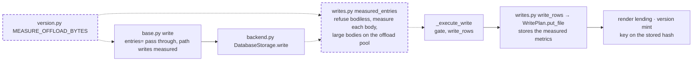

# Storage measures every body it stores: a write's `content_hash`, `size_bytes` and `lines` come from the staged body, and a file write with no body is refused

A fix that touches the write path of the database backend and needs the engine legs: not structural, no public API or schema format change. It closes the medium finding `vfs/storage/database/write-trusts-caller-authored-content-hash` of the 0.1.0a1 security audit (run `vfs-run-1-2026-11-07` at commit `3586750`). No intention and no research: one defect, and the measurement law already exists in `vfs.models`. It depends on nothing unlanded, and it shares ground with five active specs, none built: [the integrity spec](../active/175-integrity-verify-on-read-and-scrub/spec.md) moves the same constant, gives `write_rows` an executor and owns a per-call `measure_all`, so this spec lands first and 175 then replaces `measured_entries`' hop with `measure_all` rather than moving the constant again; [the write-preconditions spec](../active/174-write-preconditions-and-the-guarded-append/spec.md) changes `writes.py` and trusts `content_hash`, which this spec makes measured; [the render-at-write spec](../active/159-render-at-write/spec.md) adds a write-path hop on the same pool and, when it lands, updates criterion 4's count; [the grant-gate spec](2026-11-07-the-grant-gate-judges-the-subtree.md) and [the read-only-rule spec](2026-11-07-a-read-only-rule-gates-the-verbs-that-reach-beneath.md) change `base.py` elsewhere; [the refresh spec](../active/2026-10-31-refresh-the-incremental-index-verb.md) changes `backend.py` and `storage_contract.py` elsewhere. The audit's evidence becomes readable in the tree at `context/reviews/2026-11-07-0-1-0a1-security-audit/agents/v15-p3/artifacts/evidence/` when the release-audit spec lands.

## The problem

READ at `3586750`. `write_rows` (`src/vfs/storage/backends/database/writes.py:153-170`) hands `entry.content_hash`, `entry.size_bytes` and `entry.lines` from the caller's `Entry` to `WritePlan.put_file`, and `_material_values` (`writes.py:1172`) stores them. Nothing in storage measures the body it stages. The `Entry` validator measures only when it has a body and no vouched metrics (`src/vfs/models/entry.py:229-242`), the vouching door is a public context key (`MEASURED_BODY = "measured_body"`, `entry.py:55`), and `Entry` is a mutable model: a field set after validation is not re-checked (EXECUTED: `e = Entry(path='/a.txt', content='x'); e.content_hash = 'f' * 64` succeeds).

READ. A row's `content_hash` is trusted as proof of byte identity in three places: the render stage lends a settled rendering between rows of one hash (`render.py:206`, `287`, `342`), the version mint skips a pre-image whose hash equals the staged one (`versions.py:145`), and `_replace_bodies` (`writes.py:987`) leaves the stored body in place for a row staged with no body.

EXECUTED by the audit's two verifiers on InMemoryStorage: a principal with write rights only on its own prefix, writing a bodiless entry that names another principal's file hash, received that file's rendered text after a reindex; and a principal that wrote its own bytes under a public document's hash had its text served as another principal's later upload of that document. The evidence is in the audit's run folder at `agents/v15-p3/artifacts/evidence/`.

## Architecture

Dashed is what this spec adds.

Page this changes: none; the architecture folder was retired on 2026-10-31, and the landing notes will say so in one line.

Terms. A **body** is an entry's `content` (text) or `data` (bytes); the body measured is `data` when it is not `None`, else `content`, the choice `_replace_bodies` makes. A **bodiless** content-kind entry is one of kind file, chunk or version whose `content` and `data` are both `None`. An entry whose `source` is `"bytes"` and whose `data` is `None` is bodiless too, because the text of a bytes row is a rendering only storage makes.

## Decisions

### 1. `DatabaseStorage.write` replaces each content-kind entry's `content_hash`, `size_bytes` and `lines` with `measure_text` or `measure_bytes` of its own body before the writer transaction opens

Storage is the last trusted point before the row, and the three readers of the hash take it as a fact about the stored bytes. Measuring at the router cannot hold that, because an entry may be changed after the router sees it and the vouching door is a public key. The measurement law is the one `vfs.models` already owns, so a re-measured hash equals the router's for an honest entry.

### 2. Every bodiless content-kind entry of the batch is reported, one `invalid` error at each path with the detail `a file write needs a body: content or data`, and the whole batch is refused before a statement runs

A bodiless write has no bytes to measure, so any metrics it carries are unverifiable, and it would leave the previous body in place under a new hash. A write's batch is already all-or-nothing and classifies every failing entry (`write_rows`'s docstring), so an ETL batch with many bodiless rows learns them all in one round trip. Measurement runs before `_execute_write`, so a bodiless batch answers `invalid` before the permission gate and the readiness check, as the router's parameter gate refuses a bodiless path write before dispatch; a principal the gate refuses still pays for hashing its own batch, as the router already does for a path write.

### 3. The event loop measures at most `MEASURE_OFFLOAD_BYTES` (100,000) per call: when the call's bodies total less than it, each body judged by `len(body)` as the router judges one body, they are measured inline; otherwise every body of the call is measured in one `call_offloaded` hop

A sha256 blocks the event loop the way the router's own offload already avoids (`base.py:313-330`), and a per-body rule fails on a batch: ten thousand bodies just under the threshold would hold the loop for their whole sum (the integrity spec rejects the per-body rule for the same reason). Bounding the call's inline total keeps every call's loop time under one small body's hash, and one hop for the rest keeps the cost one thread round trip, however many entries. The constant moves from `base.py` to `vfs/models/version.py` beside `measure_text`, and both the router and storage import it, so the threshold has one owner.

### 4. The router and the validator keep measuring as they do today, so every body is measured twice

Every body is measured twice: once when its `Entry` is validated, inline or through the router's hop for a path write past the threshold, and once by storage. Dropping the first would make the validator hash large bodies on the loop. The cost is a second linear pass, a sha256 plus a line count for text. The landing notes record it as the profile, with storage-only measurement as the direction if it ever shows in a measurement.

### 5. `mime_type`, `owner_id` and `source` are not re-derived

They are declared facts, not measurements of the bytes: `sniff_mime` already keeps a caller's declared type where no magic matches, and every renderer treats its input as hostile; `owner_id` is judged by the write gate. Only the three measured columns are the subject of this spec.

## Intent

After this spec, the hash, size and line count a row carries are always storage's own measurement of the body stored with it. A write that names another body's hash, or carries no body at all, cannot make the render stage lend a rendering or the version mint skip a version on the strength of a hash it chose.

## Design

**`src/vfs/models/version.py`.** `MEASURE_OFFLOAD_BYTES: Final = 100_000` beside `measure_bytes`, exported from `vfs.models`; `base.py` imports it and drops its own.

**`src/vfs/storage/backends/database/writes.py`.** `async def measured_entries(entries: list[Entry], executor: Executor) -> list[Entry] | list[ResultError]`: every bodiless content-kind entry returns its `invalid` error of decision 2; otherwise each content-kind entry becomes `entry.model_copy(update=metrics._asdict())` with metrics from its body, measured inline or in one `call_offloaded` hop over the whole call by decision 3, directories passed through. About 30 lines, in the module's public section beside `write_rows`. `write_rows`' docstring gains: its entries are already measured by `measured_entries`; it stores the metrics it is handed.

**`src/vfs/storage/backends/database/backend.py`.** `write` calls `measured_entries(entries, host.offload_executor)` before `_execute_write`; errors return `Result(ops=("write",), errors=errors)`. The module docstring of `offload.py` and the `offload_executor` docstring in `engine.py` name write's measurement hop.

**Tests first.** The criteria's tests go into `tests/support/storage_contract.py` under a new banner `# Storage measures the body it stores`, after the Bytes bodies banner, so they run on every `StorageContract` leg; criterion 4's goes into `tests/storage/database/test_offload.py`. All are seen failing before the code changes.

**Scale.** One pass over the batch; the loop measures at most 100,000 bytes per call and the offloaded hop handles the rest, so the hop count is at most one per call, not per entry. Memory is the bodies the call already holds.

## Scope

In: decisions 1 to 5. Files: `src/vfs/models/version.py`, `src/vfs/models/__init__.py`, `src/vfs/base.py` (the constant's import), `src/vfs/storage/backends/database/writes.py`, `src/vfs/storage/backends/database/backend.py`, `src/vfs/storage/backends/database/offload.py` and `engine.py` (docstrings), `tests/support/storage_contract.py`, `tests/storage/database/test_offload.py`, and this spec's landing notes.

Out: the render donor's tombstone filter, which the audit noted as hardening and which is harmless once every hash is measured (same bytes, same rendering); `edit`, whose new body storage computes itself; the transfer verbs, which copy stored, measured columns; `MEASURED_BODY` itself, which stays the router's door into the validator.

## Acceptance criteria

Counts and states, never clocks. Tests are methods of the contract in `tests/support/storage_contract.py`, run on every `StorageContract` leg, unless their path says otherwise.

1. An `Entry(path='/a.txt', content='hello')` whose `content_hash` is then set to `'f' * 64`, and whose `size_bytes` is set to 1, is stored with `content_hash == measure_text('hello').content_hash` and `size_bytes == 5`, read back by `stat`. Test: `test_a_write_stores_its_own_measurement_not_the_entrys`.
2. An entry validated with `context={MEASURED_BODY: BodyMetrics('0' * 64, 1, 1)}` over `content='hello'` is stored with the measured hash, size and lines of `'hello'`. Test: `test_a_vouched_measurement_is_not_trusted_by_storage`.
3. A batch of `Entry(path='/a.txt', content='x')`, `Entry(path='/b.pdf', source='bytes')` and `Entry(path='/d.pdf', source='bytes', content='hello')` answers one `invalid` at `/b.pdf` and one at `/d.pdf`, each with the detail of decision 2, and `stat` of all three answers `not_found`; an existing `/c.pdf` overwritten by a bodiless entry keeps its stored hash and body. Test: `test_a_bodiless_file_write_is_refused_whole`.
4. Counting calls of `vfs.storage.backends.database.writes.call_offloaded` by replacing that module attribute: a write of three entries of 150,000, 150,000 and 10 bytes takes exactly one call, ten entries of 1,000 bytes take zero, and 2,000 entries of 99 bytes take one; all stored hashes equal `measure_bytes` of their data. Test: `tests/storage/database/test_offload.py::test_large_bodies_are_measured_in_one_offloaded_hop`.
5. Two principals' bytes rows of different content can no longer share a hash: after the first principal writes `/carol/n.pdf` and a reindex, a second principal's write naming that hash with its own different bytes stores the hash of its own bytes, and its rendering after a reindex is its own text. Test: `test_a_rendering_is_never_lent_across_different_bodies`.
6. Every existing node of `tests/support/storage_contract.py`, `tests/support/grants_contract.py`, `tests/base/test_write_at_scale.py` and `tests/storage/database/test_writes.py` passes unchanged, the engine legs pass, and `scripts/ci.sh` is green at 100% coverage on the tree as committed.

## Landing notes

Landed 2026-11-07 on `main` as one commit over `97c270a`, after [the spec review](../../reviews/2026-11-07-storage-measures-every-body-it-stores-spec-review.md) (one High, one Medium and seven Lows, all fixed, re-signed "Fit to build") and [the code review](../../reviews/2026-11-07-storage-measures-every-body-it-stores-code-review.md) (two Highs, two Mediums and six Lows; re-signed "Lands"). The code review was one fresh reviewer running the five lenses in order plus the security lens. Its first High was a real defect in the first build: a caller that changed an entry's body while the offloaded hop ran had the new body stored under the old body's hash; `measured_entries` now copies every entry before it reads any body.

Tests first, EXECUTED: the five criterion nodes were written before the code changed and failed for the right reason (the forged and vouched hashes were stored, the bodiless batch wrote, a forged hash took another body's rendering, and `writes.call_offloaded` did not exist). The code review's added nodes each fail under their mutant: copying from the caller's entries, a hop that returns each entry's own metrics, metrics numbered by body position, a dropped `lines`, and `<=` at the inline total.

The gate, EXECUTED on the tree as committed: lint, format, types, docs examples and wheel size PASS; 4,606 passed; 100% coverage of 12,354 statements.

The engine legs, EXECUTED with fresh containers on the first build: Postgres 378 passed, MariaDB 368 passed and 8 skipped, SQL Server 378 passed, Oracle 373 passed. After the review's fix the reviewer re-ran the five measurement contract nodes on each engine: 5 passed on each.

Differences from the spec as written: `measured_entries` returns `(measured, refused)`, exactly one of them non-empty, so `backend.py` needs no cast; the spec's Design named a union. Criterion 2's line count is not observable through any verb, so the contract asserts hash and size and a database-backend test reads the stored `lines` column. The measured body is copied from a snapshot of each entry, as the code review's first finding required.

Follow-ups, none blocking: the "data, else content" body rule now has three homes, `_body` in `writes.py`, the router's `_authored_entry` and the value cap in `staging.py`; one `Entry` method naming the stored body would serve all three. When the integrity spec replaces this hop with `measure_all`, the swap and forged-hash tests in `tests/storage/database/test_offload.py` keep it honest.

Architecture pages: unchanged; the folder was retired on 2026-10-31.

**Changelog:** Security — storage now measures the hash, size and line count of every body it stores and refuses a file write with no body, so a write can no longer name a hash its bytes do not have, and a rendering is never lent between different bodies.

## One line

Storage now measures the hash, size and line count of every body it stores and refuses a file write with no body, so a caller can no longer name a hash that its bytes do not have.
