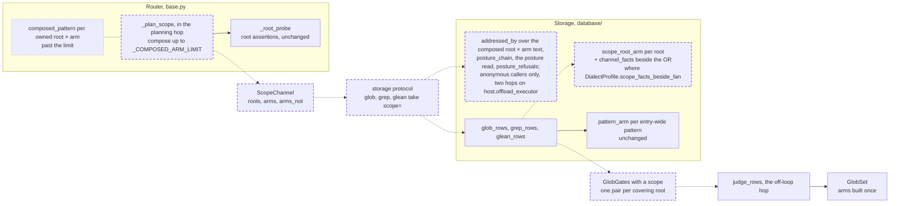

# Storage takes scope roots and arms as two channels: past one fan chunk, the router stops composing every arm under every root, so a scoped call builds roots plus arms SQL arms, not their product

A change to how scope crosses the storage seam: the router's dispatch and planning (`src/vfs/base.py`), the pattern layer (`src/vfs/pattern_matching/glob.py`), the storage protocol (`src/vfs/storage/protocol.py`), and the database backend's glob, grep and glean SQL and its anonymous posture gate (`src/vfs/storage/backends/database/`). No router verb's parameters, no schema and no rights rule change. The storage protocol's `glob`, `grep` and `glean` gain one parameter, and the dialect profiles one field, so the engine legs are needed: the conformance suite (`tests/storage/test_conformance.py`) and this spec's plan pins against Postgres, MariaDB, SQL Server and Oracle, through the `db_test` skill. It removes the last loop hold of the medium finding `vfs.pattern_matching.glob._translate:backtracking-wildcards` of the 0.1.0a1 security audit (run `vfs-run-1-2026-11-07` at commit `3586750`). That hold is the one [glob matching runs off the loop under the wall](../active/2026-11-07-glob-matching-runs-off-the-loop-under-the-wall.md) names and leaves: storage builds one SQL arm per composed pattern on the loop, about 51 µs each (that spec's reviewer's measurement), so a fan-out scoped by 10,000 paths with a 64-arm pattern reaches storage as 640,000 patterns and holds the loop about 33 s. The developer decided this is fixed in 0.1.0a1, not carried, so the audit record that [the release-audit spec](../active/2026-11-07-the-release-audit-is-a-review.md)'s decision 8 lands waits on both specs, as that decision already requires for every medium. A fix. It depends on the off-loop spec, which is active and not built; this spec lands after it, on its `GlobSet`, its `GlobGates` and `judge_rows`, and its planning hop. The native binding does not change, so `PROTOCOL_VERSION` stays at that spec's 13. It adds one public name, `ScopeChannel`, to `vfs.pattern_matching`, and changes the storage protocol's three search signatures. It departs from the landed decision that scope crosses the storage seam only as pattern text (decision 7). No intention and no research memo: the cost is plain in the source, and the measurements below were run for this spec. Four other active specs touch the same code, none built: [the storage seam as the kernel](../active/179-the-storage-seam-as-the-kernel/spec.md) rewrites the storage protocol and counts native calls in its fixture F9; [the listing cursor](../active/176-the-listing-cursor/spec.md) pages `_glob_dispatches` and `_root_probe`; [the public surface regrouped by kernel group](../active/181-the-public-surface-regrouped-by-kernel-group/spec.md) moves the rows-in-hand filters into `vfs.chain`; and the older draft [a deadline for fan-out](../active/051-fanout-deadline-budget/spec.md) bounds `_route_fanout`. Each carries the `scope` parameter as this spec leaves it. Those four specs are earlier, committed documents, so they are not edited to name this one (the context README's rule that links point backward); this spec names each of them in its dependencies line, which is where the overlap is found.

## The problem

READ at `c544934`. The router composes scope into pattern text. `_glob_dispatches` builds each entry's members with `_composed_members` (`src/vfs/base.py:2331`, `:2453-2475`), which calls `composed_pattern(root, pattern)` for every scope root and every arm and residuates the result against the entry's bind path. Exclusions compose the same way (`base.py:2356`). Grep and glean do the same through `_grep_admissions` (`base.py:2407`, `:2434-2451`), with `**` as the arm when the caller sends no globs, plus one literal per root that passes the caller's globs. So one call scoped by R roots with A arms reaches an entry as R × A patterns.

READ. Storage turns each pattern into SQL on the loop. `glob_rows` builds one `pattern_arm` per pattern (`src/vfs/storage/backends/database/reads.py:352-357`, `:500-538`); grep's and glean's scan side builds one per admission glob (`src/vfs/storage/backends/database/scope.py:270`); grep and glean also compile the whole channel into segment terms (`grep.py:215`, `glean.py:269`, `src/vfs/storage/backends/database/pathterms.py:131-147`). Every builder is linear in the patterns it receives, so the product reaches all of them.

READ. Storage also judges an anonymous caller from the patterns. `DatabaseStorage.glob`, `grep` and `glean` pass `addressed_by(patterns)` to `_viewed` (`src/vfs/storage/backends/database/backend.py:479`, `:524`, `:581`), eagerly, for every caller; `addressed_by` (`reads.py:654-675`) admits each pattern again and names the deepest directory of its literal prefix. `_viewed` hands those paths to `unauthenticated_refusals` (`src/vfs/storage/backends/database/rights.py:397-413`), which reads the posture rows of their whole ancestor chain in one chunked read and refuses an anonymous call when any judged path's deepest covering posture gives everyone less than the verb's rung (`backend.py:1588-1598`). So the places an anonymous call is judged are the composed patterns' literal directories: for `composed_pattern("/a", "src/**")` that is `/a/src`, not `/a`.

EXECUTED by the author on SQLite (`/private/tmp/claude-501/-Users-claygendron-Git-Repos-vfs/d11bcc98-d265-4b56-89cb-1af47d18fa3d/scratchpad/two-channel/probe.py`), and EXECUTED again for this spec with the same result: `pattern_arm` costs about 53 µs for a composed arm, 36 µs for a root-prefix arm (`root/**`) and 52 µs for a bare arm. 10,000 roots × 64 arms is 33.7 s on the loop today (33.6 s in the re-run), against about 0.36 s for 10,000 root-prefix arms plus 64 bare arms.

EXECUTED for this spec (`/private/tmp/claude-501/-Users-claygendron-Git-Repos-vfs/d11bcc98-d265-4b56-89cb-1af47d18fa3d/scratchpad/two-channel/probe_rows.py`): a dedicated root clause, the strict-descendant LIKE (`descendant_filter`, `src/vfs/storage/backends/database/descent.py:198-207`) beside the call's shared facts, costs 9.8 µs to build, 98 ms for 10,000 roots. The 64 arms' root-independent facts, built once by the existing `channel_facts` (`scope.py:181-212`), cost 1.5 ms and 128 binds. Fetching 56,001 rows through the async session cost 243 ms, about 4.3 µs a row of loop time, and held the loop for one 144 ms stretch.

EXECUTED for this spec with the real gate (`/private/tmp/claude-501/-Users-claygendron-Git-Repos-vfs/d11bcc98-d265-4b56-89cb-1af47d18fa3d/scratchpad/two-channel/probe_posture.py`), on the 50,000-file store below: 2,000 roots × 32 path arms gave 64,000 judged paths. `addressed_by` over their composed patterns took 315 ms (4.9 µs a path), and `unauthenticated_refusals` for an anonymous caller took 251 ms (3.9 µs a path): about 8.8 µs a judged path, so about 5.7 s for the 640,000 judged paths of 10,000 roots × 64 path arms with distinct literal directories.

EXECUTED for this spec on a 50,000-file SQLite store (2,000 directories of 25 files; `/private/tmp/claude-501/-Users-claygendron-Git-Repos-vfs/d11bcc98-d265-4b56-89cb-1af47d18fa3d/scratchpad/two-channel/probe_shapes.py`), 2,000 roots × 8 arms, four shapes of the candidate fetch, after `ANALYZE`:

| Shape | Statements | Candidate rows | Build | Execute | Plan |
|---|---|---|---|---|---|
| today: every arm composed under every root | 80 | 38,000 | 1,079 ms | 960 ms | multi-index OR on `ix_vfs_entries_path` |
| roots alone, LIKE prefix | 10 | 54,000 | 20 ms | 204 ms | multi-index OR on `ix_vfs_entries_path` |
| roots, AND the arms' facts beside the OR | 10 | 46,000 | 20 ms + 2 ms | 98 ms | multi-index OR on `ix_vfs_entries_path` |
| roots alone, as byte ranges | 10 | 54,000 | 32 ms | 64 ms | multi-index OR on `ix_vfs_entries_path` |

EXECUTED on the same store before `ANALYZE`: every shape kept the multi-index OR with no SCAN, but every arm seeked `ix_vfs_entries_deleted_at (deleted_at=?)` and so walked every live row. Today's composed fan executed in 77,135 ms and roots alone in 8,416 ms. READ: nothing in the backend runs `ANALYZE` on SQLite, and the existing plan pin (`tests/storage/database/test_reads.py:502-525`) asserts the multi-index OR and no SCAN, not which index each arm seeks. This is a defect of today's fan, named here and left to its own spec (Scope); when SQLite gathers planner statistics is being researched separately.

READ. No index of the entries table leads with `name` (`src/vfs/models/rows.py:428-498`): the path, kind, ext, owner, entry-id, (ext, kind), (encoded, kind), (everyone_level, path), deleted_at, trash-root, content-hash and render-status indexes. INFERRED from that: the arms' facts conjunct, an OR whose branches each hold a `name` test, cannot be an index-served access path on any engine, because an OR is index-served only when every branch is; so a planner should keep the root OR as the access path and apply the facts as a filter. That is the expectation decision 5's plan pins test, not evidence.

EXECUTED for this spec (`/private/tmp/claude-501/-Users-claygendron-Git-Repos-vfs/d11bcc98-d265-4b56-89cb-1af47d18fa3d/scratchpad/two-channel/probe_equiv.py`): 14 roots (with `[x]`, `a*`, `{a,b}`, `a]b`, `!x`, `-` and `é` in them, nested and overlapping ones, a meta root and two roots under the trash head) × 16 arms (path arms, name arms, `**`, `/**`, `**/**/x` and classes) × 111,150 paths gave 24,897,600 verdicts. Each verdict compared the composed pattern with the law of decision 8. There were 0 mismatches.

READ. The landed design forbids a path channel. ADR 031, carried by [the pattern-only glob seam](../archive/092-pattern-only-glob-seam/spec.md), decided that "scoping crosses the storage seam only as pattern text", batched one call per entry in one transaction, with root assertions on a router-side probe; it replaced per-root transactions (4 to 17 times slower at 10,000 roots) and a dual scoping channel whose subsumption rule silently dropped a covered root's existence assertion. Its rendering rules put every fact inside the arms of a pure OR, because one conjunct beside the fan demoted SQLite's multi-index OR to a scan in a measured case (`AND ext IN (…)`, about 350 times slower); `pattern_arm`'s docstring generalizes that to "every engine" (`reads.py:511-517`). [The path segment index](../archive/104-path-segment-index/spec.md) restated "no path channel crosses the seam". The code says the same: `glob_rows`' docstring (`reads.py:319`), `grep_rows`' (`grep.py:182`), glean's (`glean.py:5`, `:240`), the protocol's (`src/vfs/storage/protocol.py:48`, `:252`, `:304`) and the router's (`base.py:1305`).

## Architecture

Dashed is what this spec adds; dotted is what it retires.

Drawn on the tree the off-loop spec leaves: its `judge_rows` and `GlobSet` are solid because they land first.

Page this changes: none; the architecture folder was retired on 2026-10-31, and the landing notes will say so in one line.

Terms. An entry's **owned roots** are the call's scope roots whose owning entry it is, rewritten in its coordinates. A root **addresses the whole side** when its stored form is `/`: the entry's own bind path, or the trash head. A root **covers** a row when the row's path is strictly beneath it. A row's **remainder** after a root that covers it is the row's path with the root's text cut from its front; it begins with `/`. The **arms** are the caller's expanded patterns, uncomposed; for grep and glean with no caller globs, the one arm `**`. A **pair** is one row judged against one covering root: its remainder and its name. A **judged path** is a path where an anonymous caller's posture is read.

## Decisions

### 1. Storage's `glob`, `grep` and `glean` take an optional `scope: ScopeChannel | None` beside their entry-wide pattern channels

`ScopeChannel` is a frozen value type in `vfs.pattern_matching.glob`: `roots: tuple[Path, ...]` in entry coordinates, `arms: tuple[str, ...]` and `arms_not: tuple[str, ...]`. A row is admitted when an entry-wide pattern admits it, or when a root covers it and its remainder matches an arm (a path arm, anchored) or its name matches an arm (a name arm). A row is excluded when an entry-wide exclusion matches it, or when a root covers it and its remainder or name matches an `arms_not` arm. A grep or glean call is unrestricted only when its `globs` is empty and `scope` is `None`. One typed parameter rather than three loose tuples follows how-we-code's "small named types over bare tuples", and keeps the three fields together where every consumer reads them together. The entry-wide channels keep their meaning, so every caller that sends no scope is unchanged.

### 2. A scope root is a path strictly beneath its side's entry root: the seam refuses, as `invalid`, a root whose stored form is `/`, and admits `arms` and `arms_not` through the shared admission gate

A root that addresses the whole side has nothing to cut. Its composition is the identity for a path arm, and for a name arm it adds only the `/**/` float the entry-wide channel already gives, so it rides there instead. Refusing it at the seam keeps decision 8's remainder rule one rule, with no special root. The refusal text is "scope root '/' addresses the whole entry; send its patterns on the entry-wide channel". The arms go through the same `expand_channel` admission as every other glob channel, so a defective arm refuses the call whole before any row is touched, as today.

### 3. The router keeps composing while an entry's composed arms stay within `_COMPOSED_ARM_LIMIT`, and sends the scope channel past it

For each capable entry, planning counts the entry's owned roots that do not address the whole side, times the call's arms and exclusion arms. While that product is at most `_COMPOSED_ARM_LIMIT`, it composes exactly as today. Past it, it sends those roots, the arms and the exclusion arms as the entry's `scope`. `_COMPOSED_ARM_LIMIT` is the router's own plan constant, 200, set equal to the fan's measured arm ceiling (`dialects.py:663`); the router cannot read a dialect's chunk, so below the limit a composed fan may still take more than one statement, as it does today. Below the limit, today's tight prefilter, statement shapes, request bodies and tests stay as they are: the 2,000 × 8 composed fan fetched 38,000 candidates where roots alone fetched 54,000 (The problem). Past the limit, composition costs one SQL arm per product element, 53 µs each; the two channels cost one root clause per root, at 9.8 µs, plus one fact per arm. The switch is a plan choice, not a cap: every call is served either way. These keep today's composition at every size, because they are bounded: roots that address the whole side, which are at most two per entry (its bind path and the trash head); and roots above a nested entry, which are ancestors of its bind path, at most its segments.

### 4. The scope fan is one dedicated root clause per root, with the call's per-row facts inside it, and where the profile allows, the arms' root-independent facts as one conjunct beside the OR of root clauses, charged once per statement

`scope_root_arm(entry, root, wanted, profile, membership_budget, *, kind, trashed)` in `reads.py` is `path != '/'`, the strict-descendant LIKE on the escaped root, the kind fact, the caller's wanted-ext membership, and the liveness terms with the meta exclusion lifted when the root names the meta subtree. That is `pattern_arm`'s fact set without the pattern translation and the derived extension, at a quarter of its build cost (The problem). The LIKE prefix, not a byte range, is the root form. The byte range executed fastest on SQLite (64 ms against 204 ms), but it rests on bytewise ordering, which Oracle has only as the `NLS_SORT=BINARY` default (`src/vfs/models/rows.py:208-212`); the LIKE prefix is the descendant test the backend already rests on everywhere. The arms' facts are `channel_facts` over the compiled arms: each arm's leaf-name and derived-extension facts, which hold whatever the root, because a composed pattern's last component is the arm's. They ride beside the OR, so their binds are charged once per statement; inside each root clause they would be charged once per root, and SQL Server's ~2,100 binds would leave about ten roots a statement. They ride under the rules `pushdown_terms` already applies: only when every arm pins a fact, when the arms number at most the channel fan, and when their binds fit half the membership budget; otherwise the statement declines them and fetches more candidates. They also ride only where decision 5 allows. `ROOT_ARM_BINDS` counts the root clause's fixed binds (the root-row exclusion, the LIKE, the kind fact and the liveness terms), and the chunk is `arm_budget(profile, parameter_budget - fact_binds, ROOT_ARM_BINDS + ride.binds)`. So no statement grows with the roots: one statement per chunk, on the least generous engine. The roots use LIKE, not `IN`, so Oracle's 1,000-element `IN` cap binds only the wanted-ext membership, which is already chunk-aware. Scope statements and entry-wide pattern statements are separate statements of the same call, in its one session, so the arms' facts never narrow the entry-wide arms.

### 5. The facts conjunct rides beside the root OR only on a dialect whose profile declares `scope_facts_beside_fan`, and a profile declares it only where its plan pin passes; elsewhere the scope fan sends the roots alone

The departure from the pure-OR rule is evidenced on SQLite (The problem) and inferred elsewhere, and a planner that turned the facts into the access path would regress exactly the wide calls this spec serves, with no row test to see it. So the evidence becomes part of the build. `DialectProfile` gains `scope_facts_beside_fan: bool = False`, a fact SQLAlchemy takes no position on: whether this engine keeps an index-served root OR with one OR of name and extension facts beside it. Each engine leg runs two plan pins over one named store (criterion 6). The store is The problem's 50,000-row shape, 2,000 directories of 25 files, built by the `plan_store` fixture under the `slow` marker and planned at 2,000 roots × 8 arms. Before any plan read, each engine gathers statistics with its own command: `ANALYZE` on Postgres, `ANALYZE TABLE` on MariaDB, `UPDATE STATISTICS ... WITH FULLSCAN` on SQL Server, `DBMS_STATS.GATHER_TABLE_STATS` on Oracle, and `ANALYZE` on SQLite. A cost-based planner scans a few-page table whatever its WHERE says, so a pin over the contract's few rows would prove nothing. The baseline pin reads the roots-alone statement; the facts pin reads decision 4's statement with the facts beside it. Each reads the engine's own plan: `EXPLAIN` on Postgres and MariaDB, the showplan XML on SQL Server, `DBMS_XPLAN` on Oracle, and `EXPLAIN QUERY PLAN` on SQLite. Each asserts the access by plan operator on the path index, never by time. A profile declares the field only when both pins are index-served on its engine, in the landing that shows them passing, and the landing notes record both plans per engine. If the baseline itself is not index-served, the failure names the root OR, not the conjunct. EXECUTED on the engine legs of the build: SQLite, Postgres, MariaDB and SQL Server serve both statements from the path index; Oracle full-scans both, as it full-scans today's composed fan, so the Oracle profile does not declare the field. A dialect without the field, and `GENERIC`, sends the roots alone: the same statements without the conjunct, more candidates, the same rows. That costs candidate rows (decision 10) and nothing else. `pattern_arm`'s docstring is narrowed from 'every engine' to SQLite, the engine the field study measured; its Postgres reading (`indxpath.c`) is about an arm no index serves, not a conjunct beside the fan.

### 6. Past the switch, storage judges an anonymous caller at exactly the places composition judges today: each root joined with each path arm, read through `addressed_by` of their composed text, and each root alone for its name arms

A performance change must not move where a rights gate is judged. Judging at the bare root would answer an anonymous caller differently on each side of the switch: with `/a` private and `/a/src` public, `glob("src/**")` over `/a` is served today and would be refused; with the postures reversed it is refused today and would be served, its rows then hidden by the view rather than refused by name. For an anonymous caller with a scope, `_viewed` judges `addressed_by(sorted((*patterns, *composed)))`, where `composed` is `composed_pattern(root, arm)` for each scope root and arm. That is the list composition would have sent, so the judged paths, their order and the empty-channel rule are today's: an empty entry-wide channel beside a scope adds no judgement at `/`. Today `addressed_by(())` answers `['/']`, and composition never dispatches an entry whose channel is empty, so judging the entry-wide channel apart would judge a scoped call at `/` where composition never does. The order is the sorted order of that combined list, as composition's members are sorted (`base.py:2355`). That is roots × the path arms' distinct literal directories judged paths, a product, but only for callers judged by posture: a named caller is never refused there (`rights.py:392`), so the backend builds them only when the caller is anonymous. Today `addressed_by` runs over every composed pattern for every caller. Measured with the real code, a judged path costs about 8.8 µs (The problem), about 5.7 s at 10,000 roots × 64 path arms with distinct directories. So the pure work runs on the backend's offload executor, in two hops around the posture read. The first builds the judged paths and their ancestor chain, and returns the chain deduplicated, sorted and cut into `membership_budget` chunks. The read in the session issues those chunks as given, so the loop holds one statement's build at a time and never the chain's sort (0.47 to 0.56 s at 10,000 × 64, this spec's reviewer measured). The read in the session checks the deadline before each chunk, and a read that reaches it refuses the call whole with the same `unauthenticated` record. The second hop judges each path. `unauthenticated_refusals` splits into those pure steps beside its read, and its rule is unchanged. The gate runs under a wall, and a gate that reaches it refuses the whole call. Its deadline is the backend's wall for the verb (`glob_wall_seconds`, `grep_wall_seconds` or `glean_wall_seconds`), read when the gate starts. Both hops check it every 64 judged paths. A wall need not make the check partial. A gate that cannot finish refuses the anonymous call whole, with the kind the existing posture refusal uses, `unauthenticated` (`rights.py:392-394`), and the detail "the anonymous posture check reached the wall-time budget; narrow the roots or the arms, or authenticate". It never serves part of the call, because a refusal is the safe failure for a rights gate. Without the wall, an anonymous call would hold one offload worker for R × P × about 8.8 µs, and every walled hop queued behind it on the host's one pool would lose that time. The direction is to judge each root once from the `posture_beneath` map (`src/vfs/storage/backends/database/labels.py:139-152`): the posture in force at the root and the rows beneath it. Then the gate is linear in the roots and the posture rows beneath them, not their product with the arms.

### 7. This departs from ADR 031 and its two specs: scope may cross the seam as roots beside the arms, and the scope fan may carry one conjunct beside its OR

The pattern-only rule was chosen against two failures: per-root transactions, and a dual channel that lost a root's existence assertion. Neither comes back. The scope rides in the same one call per entry, in one transaction and one snapshot. Root assertions stay on the router's probe, which this spec does not touch, and the scope channel asserts nothing: a root that does not exist simply covers no row. No root is ever folded into another: nested roots both ride. What the rule cost at scale is the product, 33.7 s of SQL building for one call (The problem), and the rule has no form that avoids it. The rendering rule against a conjunct beside the fan was measured on an `ext IN` term, which SQLite could seek instead of the fan. The arms' facts are an OR of leaf-name and extension facts that no index can serve. Decision 5 makes each engine prove that it keeps the root OR before it carries them.

### 8. Exact matching compiles each arm once and judges, off the loop, one pair per covering root: the remainder against path arms and the name against name arms

`compile_gates` takes the call's `ScopeChannel` beside its entry-wide channels. `GlobGates` then holds a second set, the arms and the exclusion arms, built once on the worker under the off-loop spec's lock and wall. The arms are compiled as given: a path arm anchored with a leading `/`, a name arm as a name pattern. `judge_rows` builds the pairs on the worker. For each candidate row it walks the row's ancestors (at most its segments) against the hashed roots of its side, then makes one pair per covering root. Every candidate, from either statement, is judged against the entry-wide set and against each of its pairs. It is admitted when either admits it, and refused when any exclusion of either matches. The equivalence with composition holds as follows.

- **Path arms.** `escape_glob` turns every metacharacter of a root into a one-member class (`glob.py:122-132`), so a composed path arm is the root's literal steps followed by the anchored arm's program (`glob.py:360-364`). It therefore matches a path exactly when the path begins with the root's text and the anchored arm matches the rest. The anchored arm begins with a separator, so the rest begins with `/`, and the row is strictly beneath the root.
- **Name arms.** A composed name arm is `root/**/arm` canonicalized (`glob.py:367-383`), which matches exactly the strict descendants of the root whose last segment matches the arm. A name arm holds no `/`, and the middle `**` absorbs every segment between.
- **Roots that hold `**`.** A root's `**` escapes to `[*][*]`, so canonicalization never collapses it.
- **Nested and overlapping roots.** Composition admits a row when any composed arm matches it and excludes it when any composed exclusion does. That is the OR over the row's pairs, so both laws read every covering root.
- **The trash side.** `address_of` strips the head from the composed text, which is the head stripped from the root followed by the same arm. So the stored root and the stored path give the same verdict.
- **The meta subtree.** A composed admission is marked when its head names the meta subtree, and for a root other than `/` that is the root's head. A pair's admission is therefore marked when its root is `/.vfs` or beneath it.

The probe of The problem checked this over 24,897,600 verdicts with 0 mismatches. Criteria 3 and 4 pin it at the pattern layer and through every backend. Building only the arms is also why residency falls: the scope set holds the arms' programs, 64 at 10,000 × 64, where the off-loop spec's sets would hold 640,000 composed programs.

### 9. Grep and glean read the scope on every tier: the allow-list, the pushdown, the scan fan, and one tombstone side per search

The segment allow-list compiles the entry-wide globs plus one `escape_glob(root) + "/**"` per scope root. That is linear in the roots, a superset of the admitted rows, and void past the channel fan, as today's composed channel is. The arms' segment terms are relative to the roots, so they never join it. The pushdown's channel facts are `channel_facts` over the entry-wide globs and the scope arms together. That is sound, because every admitted row matches an entry-wide glob or a scope arm's leaf. The scan side runs decision 4's scope statements beside its pattern statements, under its existing deadline and limit. `trash_scope` reads the roots with the globs, so a search that mixes the trash view with live paths still refuses, across both channels. Grep and glean also keep one literal `pattern_arm` per admitted root on the entry-wide channel, about 36 µs each, so a 10,000-root grep builds about 0.1 s of root clauses plus about 0.36 s of literal arms; both are linear in the roots.

### 10. The looser prefilter costs more candidate rows, about 4.3 µs of loop time each to fetch, and the rows strictly beneath the call's roots bound it

Past the composition limit, the scope fan drops what composition carried in SQL beyond the arms' leaf facts: a path arm's directory prefix and its depth, and the arms' facts when they decline. The 2,000 × 8 case fetched 46,000 rows with the facts and 54,000 without, against 38,000 composed. A path arm such as `src/**` with no leaf fact fetches every row under each root, where composition fetched only `root/src/`. Each extra row costs about 4.3 µs of loop time to materialize, and its matching runs off the loop. What bounds the candidates is the rows strictly beneath the caller's roots, on the call's side, passing the call's kind, extension and liveness facts. That is the scope the caller named, and storage glob materializes its candidates whole today too. At 10,000 roots the build falls from 33.7 s to about 0.1 s; the fetch grows by the rows composition would have excluded. The direction is root-relative segment terms in the segment index, so that a path arm's directory prefix can narrow nomination without composing it per root.

### 11. Planning composes only what decision 3 keeps, in the off-loop spec's planning hop, under its wall

`_plan_scope` resolves owners on the loop and walks off it, as the off-loop spec decides. It now composes and residuates only three things. The first is an entry's owned roots while they stay within the composition limit. The second is roots that address the whole side. The third is roots above a nested entry, plus `_glob_reaches` for the skips. Past the limit, an owned root costs the walk one rewrite into entry coordinates, not a residuation per arm. So the walk's residuations per entry are bounded by the limit, the entry's bind depth and the call's arms, whatever the number of roots. It checks its deadline every 64 residuations, and that rule does not change. The plan it returns gains the scope per entry. The admissions' literal renders of each admitted root stay on the entry-wide channel: one per root, linear.

### 12. `PROTOCOL_VERSION` stays at 13, and the engine legs run

The native binding gains nothing, because the scope set is the off-loop spec's `GlobSet` with other programs. The storage modules and their SQL change on every engine, and decision 5's plan pins can only pass on the engines themselves, so the conformance suite and the pins run on Postgres, MariaDB, SQL Server and Oracle.

## Intent

After this spec, a scoped glob, grep or glean builds SQL linear in its roots plus its arms. A call scoped by 10,000 paths with a 64-arm pattern builds 10,064 SQL arms, not 640,000, and the loop work that was about 33 s falls to about 0.1 s of clause building for glob. Grep and glean also keep one literal `pattern_arm` per admitted root, about 0.36 s at 10,000 roots, linear in the roots. Every row it returns is the row composition returns, and an anonymous caller is judged at the same places, in the same order, on each side of the switch. The one exception is an anonymous gate that reaches its wall above the switch: it refuses the call whole, as `unauthenticated`, and never serves part of it. A call whose composed arms stay within the limit is served exactly as today. Root assertions, the one call per entry and its one snapshot do not change. The price past the limit is a looser prefilter: more candidate rows, each about 4.3 µs of loop time to fetch, bounded by the rows beneath the caller's roots, and matched off the loop. With this spec and the off-loop spec landed, the medium finding's fix is complete.

## Design

**`src/vfs/pattern_matching/glob.py` and `__init__.py`.**

- `ScopeChannel`, a frozen dataclass with `roots: tuple[Path, ...]`, `arms: tuple[str, ...]` and `arms_not: tuple[str, ...] = ()`. Its docstring states decision 1's law and decision 8's remainder rule. `__init__.py` exports it.
- `compile_gates(..., scope: ScopeChannel | None = None)` builds a scope part beside the entry-wide part. `GlobGates` gains `scope_roots`, a frozenset per side, and a second set built under the same lock.
- `GlobGates.pairs(path, name)` yields the remainder and name for each covering root. A pair's admission bit is the marked bit when its root is `/.vfs` or beneath it.

**`src/vfs/storage/backends/database/offload.py`.** `judge_rows` builds the pairs in its worker, checking the deadline every 64 rows; a row not reached is unjudged. Every candidate, from either statement, is judged against the entry-wide set and against each of its pairs; it is admitted when either admits it and refused when any exclusion of either matches.

**`src/vfs/storage/protocol.py`.** `SupportsPatternSearch.glob` and `grep`, and `SupportsGlean.glean`, gain `scope: ScopeChannel | None = None`. The docstrings at `protocol.py:48`, `:252` and `:304` say that scope crosses as pattern text, or as roots beside the arms past the router's composition limit, in the same one call and snapshot, with root assertions on the router's probe.

**`src/vfs/storage/backends/database/dialects.py`.** `DialectProfile.scope_facts_beside_fan: bool = False`, its docstring naming the plan pin that licenses it. The SQLite profile declares it, on the after-`ANALYZE` plan The problem records. Each server profile declares it in this landing only if its pin passes on its leg, and the landing notes record which.

**`src/vfs/storage/backends/database/reads.py`.**

- `ROOT_ARM_BINDS` and `scope_root_arm` (decision 4).
- `glob_rows` admits the scope: roots addressed per side, a root whose stored form is `/` refused (decision 2), and the arms through `expand_channel`. It then runs the pattern statements as today and the scope statements per side. Each chunk's WHERE is `or_(*root_clauses)`, with the arms' facts beside it when `profile.scope_facts_beside_fan` holds and decision 4's rules admit them. Candidates from both merge by path.
- The docstring states the departure (decision 7) in place of "Scoping arrives purely as pattern text". `pattern_arm`'s docstring is narrowed as decision 5 says.

**`src/vfs/storage/backends/database/scope.py`.** `trash_scope` reads the scope's roots beside the globs; `scope_exclusions` is unchanged, because the scope's exclusion arms are judged under its roots. `pushdown_terms` keeps its signature and takes a facts channel of the globs plus the scope's arms; `channel_facts` and `CHANNEL_ARM_BINDS` move to `reads.py`, which the scope fan builds from, to keep the import direction. `entries_for_scan` runs the scope statements beside its pattern statements, under the same profile field.

**`src/vfs/storage/backends/database/grep.py` and `glean.py`.** Each takes `scope`. It compiles the allow-list channel from the globs plus one `escape_glob(root) + "/**"` per root, and passes the scope to `compile_gates`, the pushdown and the scan side. The docstrings at `grep.py:182`, `glean.py:5` and `:240` name both shapes.

**`src/vfs/storage/backends/database/rights.py` and `labels.py`.** `unauthenticated_refusals` splits into two pure steps beside its read. `posture_chain(paths, membership_budget, *, deadline)` returns the chain deduplicated, sorted and chunked, or `None` past the deadline. `posture_refusals(authority, postures, paths, rung, *, deadline)` returns the refusals, or `None` past the deadline. `labels.py` gains `posture_rows_for_chunks`, which issues pre-sorted chunks as given; `posture_rows` keeps its sort for every other caller. The rule is unchanged, and the named-caller short-circuit stays first.

**`src/vfs/storage/backends/database/backend.py`.** `DatabaseStorage.glob`, `grep` and `glean` take `scope` and pass it through. `_viewed` takes the scope beside the entry-wide addressed paths. For an anonymous caller with a scope, `_viewed` judges `addressed_by(sorted((*patterns, *composed)))`, where `composed` is `composed_pattern(root, arm)` for each scope root and arm. That is the list composition would have sent, so the judged paths, their order and the empty-channel rule are today's: an empty entry-wide channel beside a scope adds no judgement at `/`. It runs decision 6's two hops on `host.offload_executor` around the posture read, under the verb's wall, and refuses the call whole with decision 6's `unauthenticated` record when either hop reaches it. For every other caller it builds no scope path, and `addressed_by` runs once, over the entry-wide patterns alone, as today. `InMemoryStorage` inherits all of it.

**`src/vfs/base.py`.** `_COMPOSED_ARM_LIMIT: Final = 200`, with a two-line comment saying what it switches. `_plan_scope` applies decision 3 per entry and returns each entry's scope beside its members. `_glob_dispatches` and `_grep_dispatches` pass `scope=` to `_dispatch_entry` when the plan holds one. The docstring at `base.py:1305` and the fan-out docstrings say which shape crosses.

**`tests/support/plan_store.py`.** The `plan_store` fixture builds The problem's store on the leg's engine: 2,000 directories `/dNNNNN`, each with 25 files over `a/` and `b/` with the extensions `py`, `ts`, `md`, `txt` and `rs`, 50,000 files and 56,001 rows in all: 6,001 directories, the root included; the 54,000 rows strictly beneath the 2,000 roots are the roots-alone candidates. It is written through `DatabaseStorage.write` in batches of 10,000, and its engine's statistics step runs before it is yielded. It is marked `slow` with the tests that use it.

**`tests/support/base_doubles.py`.** `RecorderStorage` records `scope` with the call, and the grep double's `scopes` list records the scope's roots beside its globs.

**Existing tests that change.** `tests/base/test_dispatch.py::test_ten_thousand_roots_stay_two_calls` asserts `patterns == ()`, `len(scope.roots) == 10_000` and `scope.arms == ("*.parquet",)`, with the probe unchanged. `tests/base/test_grep_namespace.py::test_ten_thousand_roots_stay_two_calls` asserts 10,000 entry-wide literals, where today it asserts 20,000 globs, plus a scope of 10,000 roots with the arm `**`. Both still make two calls.

**Tests first.** The new nodes are seen failing before the code changes. The storage nodes raise `TypeError` on the unknown `scope` parameter. The counting node sees 640,000 `pattern_arm` calls today. The two router tests above fail on today's 10,000 and 20,000 composed patterns. The plan pins fail on the unknown profile field.

**Scale.** What grows is a call's roots R, its arms A, the path arms' distinct literal directories P, and the rows N beneath its roots.

- **SQL building:** R root clauses plus A arm facts, R + A, where today it is R × A. At 10,000 × 64 that is 10,064 against 640,000, about 0.1 s against 33.7 s on the loop. Grep and glean add one literal per admitted root, about 0.36 s at 10,000.
- **Statements:** one per chunk of roots per side. The chunk is decision 4's `arm_budget` over the parameter budget left after the facts' binds, so every statement fits the tightest engine: SQL Server's ~2,100 binds, and Oracle's 1,000-element `IN` cap on the wanted-ext membership.
- **The anonymous gate:** R × P judged paths plus an ancestor chain about twice that size (1,290,001 at 10,000 × 64, this spec's reviewer measured), about 8.8 µs a judged path, about 5.7 s of worker time at 10,000 × 64 distinct directories. It is paid only by callers judged by posture, off the loop in two hops, with the chain sorted and chunked on the worker and one chunked posture read. It runs on the host's one offload pool of `os.cpu_count()` workers (`offload.py:87`), shared with grep's verify, reindex, write's measurement, edit and every `judge_rows` hop. So an anonymous gate holds one worker for up to the verb's wall, 10 s by default. Every walled hop queued behind it loses that wait from its budget, because the off-loop spec cuts budgets at worker start; a few concurrent anonymous wide calls can therefore truncate named callers' hops (INFERRED). The wall bounds each gate, a gate that reaches it refuses its call whole, and the `posture_beneath` direction (decision 6) makes the gate linear. Named callers pay nothing for the scope, where today every caller pays `addressed_by` over every composed pattern on the loop.
- **Candidates:** at most N, plus the rows the entry-wide patterns admit. Each costs about 4.3 µs of loop time to fetch, and its matching runs off the loop (decision 10).
- **Pairs:** at most the candidates times their covering roots, which is at most their depth.
- **Programs:** the arms and the entry-wide patterns, never R × A.
- **Planning:** at most the composition limit, plus whole-side roots and ancestor roots, times the arms per entry. It runs in the off-loop spec's hop, under its wall.

The SQLite plan without statistics seeks the tombstone index per arm. That is today's defect too, and it is left to its own spec (Scope).

## Scope

In: decisions 1 to 12. Files: `src/vfs/pattern_matching/glob.py`, `src/vfs/pattern_matching/__init__.py`, `src/vfs/storage/protocol.py`, `src/vfs/storage/backends/database/offload.py`, `dialects.py`, `reads.py`, `scope.py`, `grep.py`, `glean.py`, `rights.py`, `labels.py`, `backend.py`, `src/vfs/base.py`, `tests/support/base_doubles.py`, `tests/support/storage_contract.py`, `tests/support/plan_store.py` (the `plan_store` fixture), `tests/support/scope_worlds.py` (criterion 5's shared worlds), `tests/support/shared_builds.py`, `tests/storage/test_conformance.py`, `docs/explanation/glob-language.md` (its sentence that backends never receive scope as paths), `tests/pattern_matching/test_glob.py`, `tests/storage/database/test_reads.py`, `test_grep.py`, `test_glean.py`, `test_offload.py`, `test_rights.py`, `tests/base/test_dispatch.py`, `tests/base/test_glob_namespace.py`, `tests/base/test_grep_namespace.py`, and this spec's landing notes.

Out: SQLite's per-arm seek of the tombstone index on a store without statistics, measured in The problem. It needs its own spec: a pin on which index each arm seeks, and either provisioned statistics or a tombstone term the planner cannot seek. When SQLite gathers planner statistics is being researched separately. The landing notes carry the statistics-free tombstone-index seek into the release-audit record as a known defect of today's fan, so it outlives this spec's archive. The release-audit spec is not this spec's to edit, so that line is one the author adds to the record when the record is written. Also out: root-relative segment terms in the segment index (decision 10's direction); a byte-range root clause where the engine pins bytewise order; the router's root probe, which this spec does not change.

## Acceptance criteria

Counts and states, never clocks.

1. `tests/storage/database/test_reads.py::TestScopeChannel::test_ten_thousand_roots_and_64_arms_build_10064_sql_arms`: a `DatabaseStorage.glob` with a scope of 10,000 roots and 64 arms makes 10,000 `scope_root_arm` calls, passes 64 arms to `channel_facts`, and makes 0 `pattern_arm` calls. `tests/base/test_glob_namespace.py::test_a_wide_scoped_glob_builds_roots_plus_arms` makes the same three counts through the router, for `glob` with a 64-arm pattern and 10,000 paths on an `InMemoryStorage` mount.
2. `tests/base/test_dispatch.py::test_ten_thousand_roots_stay_two_calls` and `tests/base/test_grep_namespace.py::test_ten_thousand_roots_stay_two_calls` pass with the edits the Design names. Every other test of `tests/base/test_dispatch.py` passes; `test_cap_expansion_across_many_roots_stays_one_call`, whose 64 arms × 1,000 roots pass the limit, asserts `patterns == ()` and a scope of 1,000 roots and 64 arms, still two calls; and `tests/base/test_glob_namespace.py::test_planning_leaves_the_loop` (2,000 roots × 65 arms) patches `_COMPOSED_ARM_LIMIT` to 10**9 so its walk still composes.
3. `tests/pattern_matching/test_glob.py::TestScopeChannel::test_the_scope_law_agrees_with_composition`, marked `slow`: The problem's 14 roots and 16 arms against every path of one to three segments over its 18 segments, plus every four-segment path beneath `/a/b`, `/a/**` and `/.vfs/state` (7,146 paths), give 1,600,704 verdicts. Each equals the composed pattern's, and every (root, arm) pair matches at least one path.
4. `tests/support/storage_contract.py` gains `test_scope_channel_answers_as_composition`, `@needs("glob")`, and its grep and glean twins. Each runs on every backend whose engine no other leg already proves (the in-memory backend skips, its SQLite engine proven by the file-backed leg): 6 roots (`/a`, `/a/b`, `/[x]`, `/a*`, `/é`, `/.vfs/state`) × 8 arm sets × 3 exclusion sets, 144 cases per verb, plus 16 trash-side cases over tombstoned rows. In every case the call with `scope=` returns the same paths, in the same order, as the call with the composed patterns.
5. `tests/base/test_glob_namespace.py::test_both_shapes_answer_alike[call]` runs the 12 calls of its parametrized `SCOPED_GLOB_CALLS`, and `tests/base/test_grep_namespace.py::test_both_shapes_answer_alike[call]` the 12 of `SCOPED_GREP_CALLS`. Each runs with `_COMPOSED_ARM_LIMIT` patched to 0 and to 10**9, and each call's rows and errors are equal under both, 48 runs in all. The fixture is a namespace with a second mount beneath `/m/p000`, a posture fixture, and tombstoned rows. The posture fixture makes the mount root `/` private to everyone in both anonymous calls. Every call finishes inside the posture gate's wall. The one place the two shapes may answer differently is a gate that reaches its wall above the switch, which refuses (criterion 12).
    - `SCOPED_GLOB_CALLS`, 12 calls:
        - `*.py` over 250 directories;
        - `src/**` over 250 directories;
        - `{a,b}/*.txt` over 120 directories;
        - `*.py` over 250 directories with `globs_not=("**/test_*",)`;
        - `**` over 250 directories with `ext=("md",)`;
        - `*.py` over `/m` and 250 directories beneath it, a whole-side root beside more than 200 owned products;
        - `*.py` over 250 directories, one holding the nested mount;
        - `*` over `/.vfs/trash` and 250 trashed directories under it;
        - `*.py` over 125 nested pairs `/p…` and `/p…/q`;
        - `[ab]*` over 250 directories whose names hold `[`, `*` and `{`;
        - an anonymous `src/**` over 201 roots, each private with its `src` public;
        - the same anonymous call over the reverse postures.
    - `SCOPED_GREP_CALLS`, 10 calls:
        - `needle` over 250 directories;
        - the same with `globs=("*.py",)`;
        - the same with `globs_not=("*.md",)`;
        - the same with one directory holding the nested mount;
        - over `/m` and 250 directories;
        - over 250 trashed directories under `/.vfs/trash`;
        - `output_mode="files"` over 250 directories;
        - over 125 nested pairs;
        - the two anonymous calls on the two posture fixtures;
        - the two `anonymous-path-arm-*` calls, `globs=("src/**",)` on the two posture fixtures.
6. The plan pins, by plan operator, never time.
    - `tests/storage/database/test_reads.py::TestScopeChannel::test_the_scope_fan_keeps_the_multi_index_or` reads the recorded scope statement under `EXPLAIN QUERY PLAN`, on a store before and after `ANALYZE`. Both times the plan holds a `MULTI-INDEX OR` and no `SCAN`. After `ANALYZE`, every branch seeks `ix_vfs_entries_path`.
    - `tests/support/storage_contract.py` gains `test_the_roots_alone_plan_is_index_served` and `test_the_scope_fan_plan_is_index_served`, both marked `slow`. Both run on the Postgres, MariaDB, SQL Server and Oracle legs over the `plan_store` fixture's 50,000 rows at 2,000 roots × 8 arms, after the engine's own statistics step: `ANALYZE`; `ANALYZE TABLE`; `UPDATE STATISTICS ... WITH FULLSCAN`; `DBMS_STATS.GATHER_TABLE_STATS`. The first reads the roots-alone statement and the second decision 4's statement with the facts beside it, each reads by plan operator, and asserts it where the profile declares `scope_facts_beside_fan`; on a profile without the field the roots-alone pin asserts nothing of its plan and the facts pin counts the backend's scope statements carrying no facts conjunct. The expected operators where the field is declared:
        - Postgres: `EXPLAIN` shows a `BitmapOr` of `Bitmap Index Scan` nodes on the path index;
        - MariaDB: `EXPLAIN` shows a `range` or `index_merge` access on the path key;
        - SQL Server: the showplan XML shows an `Index Seek` on the path index;
        - Oracle: `DBMS_XPLAN` is read and recorded; Oracle declares no field (decision 5).
    - The SQLite pins run over the same `plan_store` after `ANALYZE`, both statements.
    - Each dialect counts one of two ways. Either its profile declares `scope_facts_beside_fan` and both its pins pass, or it declares no such field and a recorded-statement count shows its scope statements carry no facts conjunct. Five dialects, five passes, and the landing notes record both plans per engine.
7. `TestScopeChannel::test_every_scope_statement_fits_the_budget`: with the SQL Server profile's parameter budget, each recorded scope statement binds at most that budget, and 10,000 roots make exactly `ceil(10_000 / chunk)` scope statements, with `chunk` computed by the test from decision 4's `arm_budget` expression.
8. `TestScopeChannel::test_a_whole_side_scope_root_is_refused`: a scope root of `/`, and one of `/.vfs/trash`, each answer `invalid` with decision 2's text and issue 0 SQL statements.
9. `tests/storage/database/test_offload.py::TestJudgeRows::test_nested_roots_judge_one_pair_per_covering_root`: with roots `/a` and `/a/b`, the row `/a/b/x` is judged as 2 pairs and the row `/a/c` as 1.
10. `tests/storage/database/test_grep.py::TestScopeChannel` has three new nodes, all passing:
    - `test_a_meta_root_marks_its_pairs`: a scope root `/.vfs/state` admits `/.vfs/state/s.txt`, and a root `/.vfs` with the arm `*.txt` admits `/.vfs/state/s.txt`.
    - `test_scope_roots_join_the_allow_list`: 3 roots nominate only rows beneath them, a count.
    - `test_mixing_the_trash_view_across_channels_refuses`: `invalid`.
11. `tests/base/test_glob_namespace.py::test_planning_composes_only_the_bounded_pairs`: 10,000 roots inside one entry, with one nested mount beneath one of them and a 64-arm pattern. A counter on `composed_pattern` inside `_plan_scope` reads 64: the one ancestor root's arms against the nested entry.
12. `tests/storage/database/test_rights.py::TestPostureGate` has three new nodes, all passing:
    - `test_an_anonymous_scope_is_judged_where_composition_judges`: for 201 roots and the arms `src/**` and `*.py`, the judged paths equal `addressed_by` over the composed patterns, as sets, and both pure steps run on a thread whose name starts `vfs-offload`.
    - The same node also runs a glob whose entry-wide patterns are `()`, and `/` is not among its judged paths.
    - `test_a_named_caller_builds_no_scope_paths`: for a named caller's scoped call, a counter on `composed_pattern` inside the backend reads 0, and `addressed_by` is called once, over the entry-wide patterns alone.
    - `test_a_gate_past_its_wall_refuses_the_call`: with a fake clock that passes the deadline after the first judged path, an anonymous scoped glob over 201 roots with the arm `src/**`, 201 judged paths, answers exactly one error, kind `unauthenticated`, whose detail is "the anonymous posture check reached the wall-time budget; narrow the roots or the arms, or authenticate", and the read body (`glob_rows`) is called 0 times.
13. `rg -nU '(only|purely) as pattern\s+text' src` exits 1, and the docstrings at `base.py:1305`, `protocol.py:48`, `:252`, `:304`, `reads.py:319`, `grep.py:182`, `glean.py:5` and `:240` each name both shapes.
14. Every other existing test passes. `uv run pytest tests/storage/test_conformance.py -m "postgres or mariadb or mssql or oracle"` with all four `VFS_TEST_<ENGINE>_URL` variables set, through the `db_test` skill, exits 0. `scripts/ci.sh` and `cargo test -p vfs-core` are green on the tree as committed.

## Landing notes

Landed 2026-11-08 on `main` as one commit over `d9ccc64`, after [the spec review](../../reviews/2026-11-07-storage-takes-scope-roots-and-arms-as-two-channels-spec-review.md) (three reads: H1, H2, M1 to M4 and L1 to L17, all fixed and confirmed or kept with a reason; signed "Fit to build") and [the code review](../../reviews/2026-11-07-storage-takes-scope-roots-and-arms-as-two-channels-code-review.md) (one Medium, the suite past its one-minute budget, reduced from about 100 s to about 82 s and then kept by Clay's word on 2026-11-08; ten Lows fixed, deferred to the structural research or informational; re-signed "Lands"). The architecture folder was retired on 2026-10-31, so no page changes. The spec was built by a fresh sub-agent of the author's session from its text alone.

Changed during the build, in the spec as written above: decision 5's expectation became a measurement (Oracle full-scans both statements, as it full-scans today's composed fan, so its profile declares no field); criterion 6 asserts plan operators only where the field is declared; `channel_facts` and `CHANNEL_ARM_BINDS` moved to `reads.py`; `scope_exclusions` is unchanged; and `tests/support/scope_worlds.py`, `tests/support/shared_builds.py`, `tests/storage/test_conformance.py` and `docs/explanation/glob-language.md` joined the Scope.

The plans, EXECUTED on the build's and the code review's engine legs over the 56,001-row `plan_store` after each engine's statistics step, the roots-alone statement and the one with the facts beside it alike: SQLite a `MULTI-INDEX OR` whose every branch searches `ix_vfs_entries_path`; Postgres a `BitmapOr` of `Bitmap Index Scan` on the path index, the facts a `Filter`; MariaDB `range` on `ix_vfs_entries_path`; SQL Server `Index Seek` with a key lookup and a `Filter`, no scan; Oracle `TABLE ACCESS FULL` on both, so `scope_facts_beside_fan` is declared by SQLite, Postgres, MariaDB and SQL Server and not by Oracle or `GENERIC`.

Tests first, EXECUTED: every new node was run on the old tree first and failed (an `ImportError` on `ScopeChannel`, a `TypeError` on the `scope` keyword, the router's 10,000-root nodes composing 640,064 patterns and the storage glob reaching its wall on 640,000 arms). The build ran eighteen mutants and the code review more; each fails a test. The suite cost: the tests step takes about 82 s against AGENTS.md's one-minute budget, kept for now by Clay's word; a Core bulk insert for the plan store, or a faster write path, is the named way back under the minute.

Left for later, found by the build or the review and outside this change: `Result.merge` is quadratic in its errors (about 85 s for a 10,000-root call with missing roots); SQL Server's container ran out of memory once under the concurrent legs (error 701), not reproduced alone; and the deadline-cadence names and module sizes this change adds are counted for the structural specs the research memos of 2026-11-07 inform.

The gate, EXECUTED on the tree as committed: lint, format, types, docs examples and wheel size PASS; 4,785 passed and 5 skipped (the in-memory class's plan pins and batteries, whose SQLite engine the file-backed leg proves); 100% coverage. The engine legs, EXECUTED by the code review: Postgres 354, MariaDB 345 and 8 skipped (the MySQL-only nodes), Oracle 351, SQL Server 356 run alone.

**Changelog:** Fixed — a scoped `glob`, `grep` or `glean` sends storage its roots and its arms side by side instead of every arm composed under every root, so the SQL grows with roots plus arms, a 10,000-root call no longer reaches the composition limit, and an anonymous caller is judged exactly where it was judged before.

## One line

Past the router's composition limit, a scoped search sends storage its roots and its arms side by side instead of every arm composed under every root. The SQL a call builds then grows with roots plus arms, each arm is matched once against each row's remainder off the loop, and an anonymous caller is still judged exactly where composition judged it.
