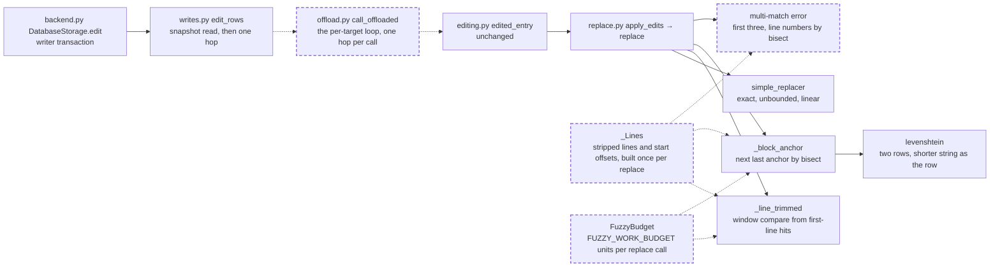

# The fuzzy edit match is linear and budgeted: `replace()`'s fallbacks precompute their lines, find anchors by bisection, spend a work budget per match, and run off the event loop

A fix to the edit engine (`src/vfs/storage/replace.py`) and to how `edit_rows` runs it: not structural, no public API, schema, rights or SQL change, so the engine legs are not needed. It closes the medium finding `vfs/storage/replace.py:fuzzy-replacers-quadratic-inline-in-writer-transaction` of the 0.1.0a1 security audit (run `vfs-run-1-2026-11-07` at commit `3586750`). No intention and no research: the costs are plain in the source and the audit's verifiers measured them. It depends on nothing unlanded. Three active specs, none built, rewrite the same code and rebase on this one, which lands first: [the integrity spec](../active/175-integrity-verify-on-read-and-scrub/spec.md) rewrites `edit_rows` and gives the write path an executor parameter, which this spec's `executor` parameter on `edit_rows` anticipates; [the replay spec](../active/177-replay-the-contract-and-the-request-key/spec.md) changes what `apply_edits` returns; [the storage-seam spec](../active/179-the-storage-seam-as-the-kernel/spec.md) moves `edit` onto read plus write over the replace engine, which keeps this spec's budget and hop.

## The problem

READ at `b25bcd6`. When an edit's old text has no exact match, `replace()` (`src/vfs/storage/replace.py:258-339`) falls back to `line_trimmed_replacer` and then `block_anchor_replacer`. Their costs grow with the square of the input. `block_anchor_replacer` scans forward from every line equal to the first anchor to the end of the file when the last anchor never appears (`replace.py:179-185`). Its similarity step visits every middle line of every candidate and calls `levenshtein` (`replace.py:61-82`), which fills a full matrix in Python. `line_trimmed_replacer` recomputes each match's start with a sum over every earlier line (`replace.py:145`), and `replace()` splits the whole content again for each match it lists in the multi-match error (`replace.py:321-325`).

READ. `edit_rows` (`src/vfs/storage/backends/database/writes.py:273-323`) runs this matching inline in the coroutine, inside the writer transaction, once per target, through `edited_entry` (`src/vfs/storage/editing.py:27-45`), and nothing caps the size of the old text, the file or the work. Every other verb that runs real CPU hops off the loop through the offload seam (`offload.py:1-16`).

EXECUTED by the audit's two verifiers through the public `edit` verb on InMemoryStorage: each shape cost about four times as much per doubling of input, and the event loop was blocked for the whole edit, 2.6 to 4.0 seconds for a 24 KB file. Every such edit returned `invalid` and changed nothing. EXECUTED by this spec's reviewer: a near-miss of a real 300-line block of `backend.py` matches as `block_anchor` today and costs 1,575,634 Levenshtein cells; a 150-line block costs 582,253. The audit's evidence is in its run folder at `agents/v16-p3/artifacts/evidence/` and `agents/f15-p5/artifacts/evidence/`.

## Architecture

Dashed is what this spec adds.

Page this changes: none; the architecture folder was retired on 2026-10-31, and the landing notes will say so in one line.

Terms. A **work unit** is one comparison of a content line with a find line in either fuzzy replacer beyond the first comparison at each content line, which is the linear pass and is not charged, including each middle line the block-anchor similarity visits, plus one unit per Levenshtein cell. The **fuzzy fallback** is the two replacers after the exact one.

## Decisions

### 1. Each `replace()` call splits the content once into a `_Lines` value holding the raw lines, their stripped forms and each line's start offset, and both fuzzy replacers and the multi-match error read it

Every quadratic cost above comes from recomputing a per-line fact inside a per-line loop. Computed once, a line's offset is a list lookup and its line number a bisection, so building a match or a line number stops costing a pass over the content.

### 2. The block-anchor fallback finds each first anchor's next last anchor with `bisect_left` over the sorted indices of the last-anchor lines

The current forward scan reads to the end of the file for every first anchor when the last anchor is absent. A sorted index list built once and one bisection per first anchor finds the same pair, the first last anchor at least two lines below, at logarithmic cost.

### 3. `levenshtein` keeps two rows, with the shorter string as the row

The answer is the same and the memory falls from the product of the lengths to the shorter length. Its time stays the product, which decision 4 bounds.

### 4. Each `replace()` call, one per target and edit, spends at most `FUZZY_WORK_BUDGET = 4_000_000` work units in its fuzzy fallback; when the budget runs out that call fails with a refusal that names the exact-match requirement, and, a failed edit failing the batch, nothing is edited

Exact matching is untouched and unbounded: an edit whose old text appears exactly costs one linear search at any size. The fallback is a heuristic for near-misses, and its worst cases are products of the file's and the old text's sizes. The first comparison at each content line is the linear pass and is not charged, so the budget prices only the work beyond one pass over the content, and a call's fuzzy work is linear in its targets and edits; it runs off the loop (decision 6). AGENTS.md allows this because it bounds a heuristic's superlinear search per match, not the size of a file, a batch or a corpus, and the refusal tells the caller how to proceed: send the exact old text. Four million units fit a near-miss of a real 300-line block of code (1,575,634 cells, measured) with room for a second, and refuse what the audit measured. A replacer calls `spend` with a step's units before doing that step, so no call does more work than the budget allows. Each middle-line visit spends `len(a) * len(b) + 1` before it runs, whether or not it reaches `levenshtein`; that `+ 1` is the visit's one unit, so an empty middle line still costs one. A replacer that spends its budget mid-scan gives no verdict: `replace()` returns the budget refusal even when matches were found before the budget ran out, because uniqueness was not established.

### 5. The multi-match failure lists the first three matches with their context and counts the rest, and computes every line number from the offsets of decision 1; `ReplaceResult.matches` still carries every match

An error that lists every match grows with the match count and splits the content once per match. Three are enough to show the caller why its old text is ambiguous; the count says how many more there are. Each kept match holds its matched text, so the list's bytes are bounded by the budget times the longest matched line, a residual this spec accepts; building a fuzzy match's text only for the matches used is the direction.

### 6. `edit_rows` takes an `executor` and runs its per-target loop in one `call_offloaded` hop per call, after the snapshot read and before `_finish`

The per-target loop awaits nothing: it reads the snapshot and the staged plan, calls `edited_entry`, and stages the result. Running it whole on the backend's offload pool keeps the loop free for every other coroutine while one call matches, at one thread round trip per call, which the offload seam already pays for grep and write. The writer transaction stays open across the hop, so the lock is held for the matching, which is linear in the call's targets and edits plus at most the budget per match, as a write batch's statements are linear in its entries.

### 7. The public names keep today's signatures: `line_trimmed_replacer`, `block_anchor_replacer`, `get_line_number`, `get_context_lines` and `apply_edits` are thin wrappers, and `replace()` takes an optional budget

The 39 existing test functions and the replay and storage-seam specs call these shapes. The wrappers build their own `_Lines` and a fresh budget and call the private `_line_trimmed` and `_block_anchor`; `REPLACERS` keeps its three public functions for the order test. `replace(..., budget=None)` makes a fresh budget when none is given, so every call has its own bound.

## Intent

After this spec, an edit whose old text misses costs time linear in the file and the old text, plus at most a fixed amount of fuzzy work per match, and that work runs off the event loop. A near-miss of a real 300-line block of code (1,575,634 cells, measured) still matches as today; the cost grows with the block's line count times the square of its line length, and with the number of lines equal to its first line; a miss the fuzzy fallback cannot settle within its budget answers `invalid`, saying to send the exact old text, and nothing is edited. Every exact edit, and every fuzzy edit within the budget, gives the same result as today.

## Design

**`src/vfs/storage/replace.py`.** `_Lines` (a frozen dataclass: `raw`, `stripped`, `starts`) built by `_lines_of(content)`; `FuzzyBudget` with `spend(units) -> bool` and `exhausted`, one per `replace()` call, and the module constant `FUZZY_WORK_BUDGET: Final = 4_000_000`; private `_line_trimmed(lines, find, budget)` and `_block_anchor(lines, find, budget)`; the public replacers and `get_line_number`, `get_context_lines` as the wrappers of decision 7; `replace(content, old, new, replace_all=False, budget=None)` builds one `_Lines` per call and returns the budget refusal when the budget is exhausted after a fuzzy replacer runs; `levenshtein` keeps two rows. The refusal text is "old_string has no exact match, and the fuzzy fallback reached its work budget. Send the exact text to replace." `apply_edits(content, edits)` keeps its signature; each `replace()` it calls makes its own budget.

**`src/vfs/storage/backends/database/writes.py`.** `edit_rows` takes `executor: Executor` and moves the body of its `for target in targets` loop into a private `_stage_edits(plan, live, missing, targets, edits)` it runs with `await call_offloaded(executor, lambda: _stage_edits(...))`.

**`src/vfs/storage/backends/database/backend.py`.** `edit` passes `executor=host.offload_executor`; `tests/storage/database/test_coherence.py`'s direct call passes `executor=host.offload_executor`. `offload.py`'s module docstring names edit's per-target matching as the fourth offloaded stage.

**Tests first.** `tests/storage/test_replace.py` and `tests/storage/database/test_offload.py` gain the criteria's nodes, seen failing before the modules change.

**Scale.** One split per `replace()` call; one bisection per first anchor; one work budget per match and one offload hop per edit call. Nothing grows with the square of the input, and a batch's fuzzy work is linear in its targets and edits; a line-trimmed window is charged the comparisons it made, so a call overruns the budget by at most one window, and a multi-match failure's match text is bounded by the budget times the longest matched line (decision 5).

## Scope

In: decisions 1 to 7. Files: `src/vfs/storage/replace.py`, `src/vfs/storage/backends/database/writes.py`, `src/vfs/storage/backends/database/backend.py`, `src/vfs/storage/backends/database/offload.py` (docstring), `tests/storage/test_replace.py`, `tests/storage/database/test_offload.py`, `tests/storage/database/test_coherence.py` (one call), and this spec's landing notes.

Out: moving the matching before the writer transaction, which the integrity and storage-seam specs reshape; a Rust kernel for the fallback, the direction if a measurement ever shows the budget binding on real edits; the router's parameter gate, which keeps no length cap on old or new text.

## Acceptance criteria

Counts and states, never clocks. Tests are in `tests/storage/test_replace.py` unless their path says otherwise.

1. For content `'b\n' + 'a\n' * L` and old text `'a\nx\nb'`, with `bisect_left` counted by replacing `replace.bisect_left`, the number of bisections is exactly `L` for `L` of 1,000 and 2,000, and `replace` fails with "old_string not found". Test: `test_the_anchor_search_bisects_once_per_first_anchor`.
2. Against content `'a\n' + 'x' * 2_400 + '\nb\n'`, old text `'a\n' + 'x' * 2_399 + 'y' + '\nb'` (5,760,000 cells) makes `replace` fail with the budget refusal, and against content `'a\n' + 'x' * 600 + '\nb\n'`, old text `'a\n' + 'x' * 599 + 'y' + '\nb'` (360,000 cells) matches as `block_anchor` exactly as today. Test: `test_the_fuzzy_fallback_stops_at_its_work_budget`.
3. For content `'a\n' * 4_000 + 'b'` and old text `'a\n' + '\n' * 4_000 + 'b'`, `replace` fails with the budget refusal, the units spent never exceed `FUZZY_WORK_BUDGET`, counted by wrapping `FuzzyBudget.spend`, and the wrapped `levenshtein` is called at most 4,000,000 times. Test: `test_empty_middle_lines_spend_the_budget`.
4. For content `'a\n' * 5_000` and old text `'  a\n' * 2_500 + 'b'`, `replace` fails with the budget refusal before the block-anchor fallback runs, counted by wrapping `replace._block_anchor`. Test: `test_the_line_trimmed_scan_spends_the_budget`.
5. A 300-line block of 60-character lines, each middle line differing from the content in one character, and the first and last lines equal, matches as `block_anchor` within the budget. Test: `test_a_300_line_near_miss_still_matches`.
6. For content `'a\n' * 12_000` and old text `'  a'`, `replace` fails with "Found 12000 matches", the error lists exactly three `Match at line` blocks for lines 1, 2 and 3, `ReplaceResult.matches` holds 12,000 matches, and `_lines_of` is called exactly once. Test: `test_a_many_match_failure_lists_three_and_splits_once`.
7. `levenshtein(a, b)` equals the full-matrix oracle in the test for every pair of 200 seeded random strings of length 0 to 30 over a three-letter alphabet. Test: `test_the_two_row_levenshtein_matches_the_matrix`.
8. An edit call over ten targets takes exactly one `call_offloaded` hop, counted by replacing `writes.call_offloaded`, and a call whose ten targets each miss with a near-miss of 500,000 cells succeeds on all ten. Test: `tests/storage/database/test_offload.py::test_an_edit_call_matches_in_one_hop_with_a_budget_per_match`.
9. Every one of the 39 existing test functions (45 nodes) of `tests/storage/test_replace.py`, the seven `test_edit_*` and `test_batch_edit_*` functions of `tests/support/storage_contract.py`, and `tests/storage/database/test_writes.py` pass unchanged, and `scripts/ci.sh` is green at 100% coverage on the tree as committed.

## Landing notes

Landed 2026-11-07 on `main` as one commit over `b25bcd6`, after [the spec review](../../reviews/2026-11-07-the-fuzzy-edit-match-is-linear-and-budgeted-spec-review.md) (four Highs, four Mediums and fifteen Lows over three rounds, all fixed, re-signed "Fit to build") and [the code review](../../reviews/2026-11-07-the-fuzzy-edit-match-is-linear-and-budgeted-code-review.md) (one High, two Mediums and nine Lows; re-signed "Lands"). The code review's High changed the budget's unit: the line-trimmed scan now compares a window line by line and charges only the comparisons it made, so a near-miss in a 45,000-record JSON file still edits; its first Medium is kept as the residual decision 5 names, and its second is pinned by a tied-candidates test.

Tests first, EXECUTED: the nine criterion nodes were written before the code changed and were seen failing against `b25bcd6`. The code review's six added nodes each fail under their mutant, and the reviewer's seventeen mutants are all killed.

The gate, EXECUTED on the working tree as reviewed: lint, format, types, docs examples and wheel size PASS; 4,620 passed; 100% coverage of 12,371 statements. The engine legs are not needed: no SQL statement, schema or rights path changed.

## One line

An edit whose old text misses now costs time linear in the file and the old text plus one fixed fuzzy budget per match, off the event loop, and a miss the budget cannot settle asks for the exact text.
