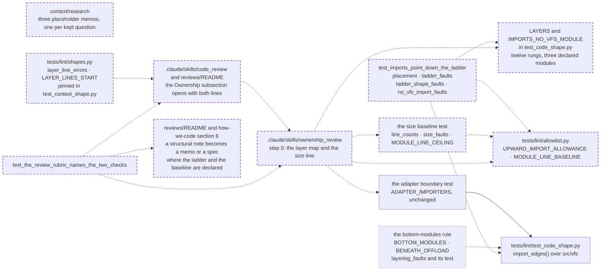

# The gate and the review read the layer map and the size baseline: one ladder of twelve rungs is the home of import direction, its four exceptions are held exact, three modules are declared to import no `vfs` module, each module over a thousand lines is held at its exact count, the code review's ownership lens states all of it and names every change to a declaration, and a structural note becomes a placeholder memo or a spec the day it is written

A process change that touches the gate (`tests/lint/`) and the review rubric (`.claude/skills/ownership_review/SKILL.md`, `.claude/skills/code_review/SKILL.md`, `context/reviews/README.md`, `context/standards/how-we-code.md`): not structural, no public API, schema, rights or engine change, no engine legs, and nothing under `src/` or `crates/` is edited. It depends on no active spec. It builds on three landings: [bounded work has one home](../archive/2026-11-07-bounded-work-has-one-home.md), landed at `4a6d3e0`, which supplies the import walk, the adapter boundary rule and the bottom-modules rule this spec retires (decision 4, which carries out what that spec's decision 10 said would happen); [the verbs take the names agents know](../archive/2026-11-09-the-verbs-take-the-names-agents-know.md), landed at `280a983`, whose module names this spec uses; and [the two-channel scope spec](../archive/2026-11-07-storage-takes-scope-roots-and-arms-as-two-channels.md), landed at `0867fbb`. It is not parallel-safe with two active specs that share its files. [The release audit is a review](../active/2026-11-07-the-release-audit-is-a-review.md), active, signed "Fit to build" and not built, adds a third kind to `review_errors` in `tests/lint/shapes.py`, nodes to `tests/lint/test_context_shape.py` and one sentence to `context/reviews/README.md`; its landing waits, by its own decision 8, on fixes that are not all specified yet, so this spec is expected first, and the two land in either order because each adds its own branch and its own nodes. [The router keeps routing](../active/2026-11-07-the-router-keeps-routing.md), active, reviewed "Not yet" and not built, lowers the router's entry in `tests/lint/allowlist.py` (its criterion 6) and adds two top-level modules, which decision 2 requires its landing to name on the ladder; this spec lands before it. Two more active specs share no file with this one and meet its gate when they land: [scope crosses the seam in one shape](../active/2026-11-07-scope-crosses-the-seam-in-one-shape.md), reviewed "Not yet", which lands after the router and edits the listed modules `reads.py`, `rights.py`, `search.py`, `backend.py` and `base.py`, and [refresh, the incremental index verb](../active/2026-10-31-refresh-the-incremental-index-verb.md), waiting on a new review of its own, which edits `backend.py`, `reads.py` and `search.py`; each lands with every baseline entry it touches equal to the new count (decision 6). It stands on [import direction and module size as fitness functions](../../research/2026-11-07-import-direction-and-module-size-fitness-functions.md). It has two spec reviews, and both ended "Not yet": [the review of 2026-11-09](../../reviews/2026-11-09-the-gate-and-the-review-read-the-layer-map-and-the-size-baseline-spec-review.md), whose every finding the second review confirmed closed, and [the review of 2026-11-12](../../reviews/2026-11-12-the-gate-and-the-review-read-the-layer-map-and-the-size-baseline-spec-review.md), a full review of the grown scope, with two Mediums and eight Lows on its first read and one more Medium and two Lows on its second. This draft answers each in that file's Disposition and is drawn against the tree at `4a6d3e0`. No intention: it adds two checks a review already should make.

## The problem

READ, [the memo](../../research/2026-11-07-import-direction-and-module-size-fitness-functions.md), its opening and section 3.3, on the tree at `acf1735`. Eleven changes landed on 2026-11-07. The structural review that followed found that the router had begun importing its thread pool, its wall budget and its byte chunker from inside the database adapter, that no lint refuses such an import, and that the router had grown from 3,257 lines to 3,622 by that day's last landing with no check reading the trend.

EXECUTED on 2026-11-12, one pipeline over the twelve code reviews dated 2026-11-07: `for f in context/reviews/2026-11-07-*-code-review.md; do awk '/^## Findings/{p=1;next} /^## /{p=0} p' "$f"; done | grep -cE '^([0-9]+|[HML][0-9]+)\. '` reports 75 numbered findings. The same lines filtered by `grep -ciE '\([^)]*ownership'` are ten, and every one of the ten is ranked Low. READ: two Ownership subsections of that day saw a structural fact and filed nothing. [The off-loop glob code review](../../reviews/2026-11-07-glob-matching-runs-off-the-loop-under-the-wall-code-review.md) writes "Noted, not filed: the 'judge, then admit' loop has four spellings". [The chained-grep code review](../../reviews/2026-11-07-chained-grep-verifies-off-the-loop-under-a-wall-code-review.md) saw the router import from the adapter and accepted it as following an older import and as waiting for two October drafts.

READ at `4a6d3e0`. The ownership lens, `.claude/skills/ownership_review/SKILL.md`, asks who owns each block and hunts duplication; it does not ask which rung a touched module sits on or which way the diff's imports point, and it does not read a module's line count. The code-review checklist in `context/reviews/README.md` names the five lenses in step 7 and the standards lines in step 9; neither names imports or size. EXECUTED: `context/reviews/` holds 26 code reviews and none has a line beginning `Layer map:`. `tests/lint/test_code_shape.py` holds nine tests. Three came with the bounded-work landing and read the import graph or the clock: the adapter boundary, a rule that `vfs.deadline` and `vfs.batching` import no `vfs` module and that nothing in `vfs.pattern_matching` or `vfs.results` imports `vfs.offload`, and the one home of the clock. So import direction is held today for one package and for three named modules, as special cases, and for nothing else. No test reads a module's size.

EXECUTED on 2026-11-12 at `4a6d3e0`, by a scratch probe that calls the live `import_edges()` and judges its rows. The package has 97 modules, and the walk returns 588 import edges, 418 at runtime and 170 under `if TYPE_CHECKING:`. Under the ladder the first review proposed, with the two new standard-library modules on its bottom rung, four imports point upward (three at runtime, one typing-only) and 32 imports run between two named units that share a rung. Under the twelve rungs of decision 1 the same four point upward and none runs between two units of one rung. The four are `src/vfs/base.py` importing `vfs.session`, `src/vfs/results/preview.py` and `src/vfs/results/render.py` importing `vfs.pattern_matching.grep`, and `src/vfs/models/signals.py` importing `vfs.storage.ranking` under `if TYPE_CHECKING:`. The six modules on the two lowest rungs import no `vfs` module of either kind. Eight scratch edits that the bottom-modules rule refuses were replayed on a copy of the tree, and so were the two cases the second review found; the gate of decisions 2, 3 and 4 refuses all ten (decision 4 names the runs).

EXECUTED, the same run. Nine modules exceed 1,000 lines as `wc -l` counts them: `base.py` 3,660, `backend.py` 1,997, `rights.py` 1,540, `reads.py` 1,318, `writes.py` 1,288, `search.py` 1,248, `engine.py` 1,139, `dialects.py` 1,112 and `sync.py` 1,086; the largest module under the ceiling is `models/rows.py` at 929. They were eight when this spec was first written and nine at `b85e3df`. READ, the memo: the router went from 3,257 lines to 3,710 between 2026-11-06 and 2026-11-08; the bounded-work landing took it to 3,660. READ, the memo: six public projects hold a layer ladder in CI with an exception list held exact, pylint's only size rule is a hard cap that projects raise and do not honour, and no lint tool ships a size ratchet.

## Architecture

Solid is what exists, dashed is what this spec adds, and dotted is what it retires. An arrow runs from a part to what it reads.

Page this changes: none; the architecture folder was retired on 2026-10-31, and the landing notes will say so in one line. The memos stand alone in the drawing because no part of the gate reads them; decision 5's table is where each exception meets its memo.

Terms. The **layer ladder** is the declared order of the package's parts, bottom first. A **rung** is one step of it. A **unit** is one name on the ladder, a module or a package; a module belongs to the unit that is its deepest named prefix. An import between two units is **downward** when it points to a lower rung, **upward** when it points to a higher one, and **sideways** when both units share a rung. A **typing-only** import is one under `if TYPE_CHECKING:`. The **declared set** is the modules that import no `vfs` module at all. A **baseline** is a committed list the lint holds exact against the tree.

## Decisions

### 1. The layer map is one declaration, `LAYERS` in `tests/lint/test_code_shape.py`, twelve rungs bottom first: `vfs.native`; then the leaves `vfs.deadline`, `vfs.batching`, `vfs.ops`, `vfs.authority` and `vfs.paths`; then `vfs.models`; then `vfs.results`; then `vfs.pattern_matching`; then `vfs.offload`; then the seam `vfs.storage` with `vfs.embedding` and `vfs.rendering`; then `vfs.storage.backends` with `vfs.params`, `vfs.rerank`, `vfs.permissions` and `vfs.exceptions`; then `vfs.base`; then `vfs.session` with `vfs.skills`; then `vfs.sync`; then `vfs` itself

The ladder names 23 units, and the table gives each rung with what places it. Every count in it is EXECUTED at `4a6d3e0`.

| Rung | Units | What places it |
|---|---|---|
| 0 | `vfs.native` | The seam to the compiled engine. It imports no `vfs` module, and it says of itself that it "imports nothing from the rest of vfs, so any module may import it". It sits alone at the bottom so that this is true on the ladder: every other unit may import it downward. |
| 1 | `vfs.deadline`, `vfs.batching`, `vfs.ops`, `vfs.authority`, `vfs.paths` | The leaves. None imports a `vfs` module of either kind today. The first two are held to that by declaration (decision 4); the other three are the vocabulary every layer speaks, and may come to import `vfs.native`. |
| 2 | `vfs.models` | Imports `vfs.authority`, `vfs.native` and `vfs.paths`. |
| 3 | `vfs.results` | Imports `vfs.models`, `vfs.ops` and `vfs.paths`. Every layer above answers in it. |
| 4 | `vfs.pattern_matching` | Imports `vfs.models`, `vfs.native` and `vfs.paths`, and `vfs.deadline` and `vfs.ops` for types. |
| 5 | `vfs.offload` | Imports `vfs.deadline` and `vfs.results` at runtime and `vfs.pattern_matching` for types; neither `vfs.results` nor `vfs.pattern_matching` imports it. |
| 6 | `vfs.storage`, `vfs.embedding`, `vfs.rendering` | The storage seam (the package, `protocol`, `replace`, `grants`, `ranking`, `editing`) and the two packages an adapter is handed. The seam imports rungs 1 to 4; the other two import `vfs.models`. |
| 7 | `vfs.storage.backends`, `vfs.params`, `vfs.rerank`, `vfs.permissions`, `vfs.exceptions` | What the router composes: the backends, and the router's own four modules (the ingress table, the cross-mount merge, the mount permission gate, the boundary's exceptions). No one of the five imports another. |
| 8 | `vfs.base` | The router. It imports every rung from 1 to 7. |
| 9 | `vfs.session`, `vfs.skills` | The session facade, typed against the router, and the skill authoring type, which no `vfs` module imports. |
| 10 | `vfs.sync` | The synchronous face. It imports `vfs.base` and `vfs.session`. |
| 11 | `vfs` | The package root, the public surface. It imports what it exports. |

A rung boundary is drawn where an import orders two units. Where the imports leave a unit's rung open, the unit sits just beneath the units that use it, so nothing lower can come to depend on it; the next paragraph gives those placements. Four orders are declared where no import decides them, and each is said here so a reviewer can weigh it. First, `vfs.native` sits beneath the leaves. No leaf imports it today. The order is declared because the seam's own docstring says any module may import it, and on a shared rung decision 3 would refuse the first of `vfs.ops`, `vfs.authority` or `vfs.paths` that needs a kernel, which the second review named as the first legitimate import the ladder would turn away. `vfs.deadline` and `vfs.batching` still may not import it: the declared set of decision 4 refuses that, whatever the rungs say. Second, `vfs.results` sits beneath `vfs.pattern_matching`. No import of `vfs.results` by the pattern layer exists; the order is the one the project declared when it commissioned the research (the brief names `vfs.results` at the bottom and the pattern layer above it), because the result envelope is the vocabulary every layer answers in. The two imports that run the other way are exceptions with a memo (decision 5). Third, `vfs.session` sits above `vfs.base`. The session is a facade over the router and is typed against it; the router's one import of the session is an exception with a memo. Fourth, `vfs.offload` sits beneath the seam on a rung of its own. No import crosses that boundary today, because only the backends and the router hop; the direction is declared so that a seam module that comes to need the hop imports it downward, and the hop never learns a storage type.

Five units are placed by who uses them. `vfs.embedding` and `vfs.rendering` import only `vfs.models` and are imported only by the backends, so they sit on the seam's rung, one beneath the backends. `vfs.permissions` and `vfs.exceptions` import nothing above `vfs.results` and are imported only by the router, the synchronous face and the root, so they sit with `vfs.params` and `vfs.rerank`, which the seam's own modules place there, on the rung beneath the router. `vfs.exceptions` says of itself that no filesystem node ever raises its exceptions, and `vfs.params` says it stays a leaf so schema consumers never import the router. Those four share the backends' rung and do not sit above it, because that says the most: a backend may not import them, and they may not import a backend. `vfs.skills` imports `vfs.models` and `vfs.paths` and no `vfs` module imports it; it sits with the faces and not beside the models it builds, so nothing beneath the router can come to depend on it.

This ladder is finer than the first review's fix text, which grouped these units on seven rungs. Both hold the same four exceptions. The seven-rung ladder leaves 32 imports running between units that share a rung, so it cannot say whether two units of one rung may import each other without admitting all 32. The twelve-rung ladder leaves none, which is what lets decision 3 refuse them.

`LAYERS` is a tuple of tuples of names in `tests/lint/test_code_shape.py`, beside `ADAPTER`. This departs from the first draft, which put it in `tests/lint/shapes.py`. That module holds the shape of documents under `context/`; since the bounded-work landing the import walk and every constant it judges by live in `test_code_shape.py`, and the layer map belongs beside the walk that reads it. The review reads the same declaration the lint reads, so there is one map. A writer of code should meet the map before the gate fails, so how we code, section 6, gains one line that says where the ladder and the baseline are declared and what each asks.

### 2. A module belongs to the unit that is its deepest named prefix, every top-level module and package of `src/vfs` is named exactly once, a new top-level module fails the gate until the landing that adds it names its rung, and a deeper name never sits on a lower rung than the package it is part of

`placement(module)` returns the rung and the unit of the longest name on the ladder that is the module or a dotted prefix of it. So `vfs.storage.backends.memory` belongs to `vfs.storage.backends` on rung 7, `vfs.storage.protocol` belongs to `vfs.storage` on rung 6, and a new module inside a named package takes that package's rung with no edit. Imports inside one unit are free: the ladder orders units, not the files within one.

`ladder_shape_faults` holds the map complete. It fails when a name appears on two rungs, when a name is no module or package of the tree, and when a module's unit is the root and the module is not the root itself, which covers a module directly beneath the root and any module in a folder the ladder does not name. The first review's fix text gave an unnamed module the top rung by default. This spec refuses it instead, because a default is a placement nobody chose: a new module that nothing imports would pass at the top with leave to import anything. The landing that adds a module names its rung in the same diff, and the review reads that placement (decision 7). The router spec's `vfs.fanout` and `vfs.chain` are the first to do so.

A deeper name is a name on the ladder that extends another, as `vfs.storage.backends` extends `vfs.storage`. It never sits on a lower rung than the nearest name it extends, the root aside, and `ladder_shape_faults` counts a deeper name that does as a fault. The reason is how Python imports: importing a part of a package runs the package first, and the walk records no edge for that. So whoever may import the part must be allowed to import the package, which holds exactly when the part's rung is no lower than the package's. A part named beneath its package tells the ladder the opposite, and the second review showed what follows: with `vfs.offload` made a package and a new part of it named on a rung beneath `vfs.results`, the result layer imported the part with no fault, and the package then failed to import on the cycle the retired rule was written against. The root is aside because every import in the package runs the root's `__init__`, which the walk has always left out. The one deeper name today, `vfs.storage.backends`, sits one rung above `vfs.storage` and is legal; no name declared today faults. The rule also refuses the redraw the centrality memo already set aside, naming `vfs.storage.ranking` on a low rung to dissolve an exception.

The root, `vfs`, is on the top rung and is the prefix of every module, so `placement` always answers. The walk already decides how `from vfs import X` is read: it is an edge to `vfs.X` when that is a module of the tree and to the root otherwise, and the root is above everything, so importing a name from the package root is upward from every other unit. No such edge exists today. The compiled extension `vfs._native` has no Python source and is not named. The walk records no edge for `from vfs import _native`, the form the `vfs.native` seam uses. An import of the extension as a module path (`import vfs._native`, or `from vfs._native import` a name) is an edge to a module with no name of its own; it takes the root's rung and so fails from every unit beneath the root. No edge to the extension exists today, so nothing needs an entry.

### 3. Every import between two units points to a lower rung: an import under `if TYPE_CHECKING:` is judged like any other, and two units that share a rung do not import each other

`ladder_faults` reads every row of `import_edges()`. A row whose importer and imported belong to one unit is skipped. A row that points to a higher rung is upward and is a fault unless its pair is in the allowance (decision 5). A row between two units of one rung is sideways and is always a fault.

Typing-only imports are judged because the rule this spec retires judged them (decision 4), and because a typing-only import upward is the same coupling in a reader's head: the lower layer's signatures are written in the higher layer's types. It is also one edit from a broken import. [The first review of the bounded-work spec](../../reviews/2026-11-09-bounded-work-has-one-home-spec-review.md), finding H1, found exactly that: a `Deadline` typed across two layers under `if TYPE_CHECKING:` left a two-way edge. This departs from the first draft of this spec, which judged runtime imports only. The memo records that the two tools disagree on the default (import-linter counts typing-only imports, tach skips them), so neither default is the precedent. The tree pays one allowance entry for the stricter rule: of its 170 typing-only imports, one points up.

Sideways imports are refused so that a rung means something: its units are independent, and none can form a cycle with a neighbour. A landing that needs one unit of a rung to import another declares the direction by giving one of them a rung of its own in `LAYERS`. That is a one-line edit the review reads (decision 7). It never takes an allowance entry, because once the rung is split the import is either downward or upward. No sideways import exists today.

### 4. The ladder is the one home of import direction: the bottom-modules rule the bounded-work landing added is removed, the property it held survives as a declared set of modules that import no `vfs` module, and the adapter boundary rule stays as it is

This carries out the last sentence of decision 10 of [bounded work has one home](../archive/2026-11-07-bounded-work-has-one-home.md), which added two lint rules over the walk and said the second is removed when the ladder lands. `BOTTOM_MODULES`, `OFFLOAD`, `BENEATH_OFFLOAD`, `layering_faults` and `test_the_bottom_modules_import_nothing_from_vfs_and_nothing_beneath_offload_imports_it` leave `tests/lint/test_code_shape.py`. Two rules about one thing would be two places to edit and two that can disagree. That rule was written as a special case because no ladder existed yet.

The retired rule refused two sets of imports, of either kind, and each keeps a holder.

The first set is every `vfs` import by `vfs.deadline` or `vfs.batching`. The ladder alone cannot hold it. A rung only says what a module may not reach, and anything placed beneath a module is in reach: the second review placed a new module on a new rung beneath the leaves, had `vfs.deadline` import it, and the ladder reported nothing. So the property is declared by name and checked by itself. `IMPORTS_NO_VFS_MODULE`, beside `LAYERS`, names the modules that import no `vfs` module at all, and `no_vfs_import_faults` fails on every row of the walk whose importer is one of them or a module beneath one, at runtime or typing-only, whatever rung either end sits on and whatever the allowance holds. No entry admits such an import. "Or a module beneath one" goes one step past the retired rule, which matched each name exactly: if a declared module is ever made a package, its parts are held too, its own `__init__` importing them included, so a declared module stays one file until a landing rewords the declaration, and decision 7 makes that a finding. `ladder_shape_faults` fails when a declared name is no module of the tree. This is the bounded-work landing's "imports the standard library only", in the sense the walk can see, as a named property of the map.

The set holds three modules, each because the property is true today and is stated as intended. `vfs.deadline` and `vfs.batching`: decisions 1 and 8 of the bounded-work spec, and each module's own docstring. `vfs.native`: its docstring says it imports nothing from the rest of `vfs`. `vfs.ops`, `vfs.authority` and `vfs.paths` also import no `vfs` module today, but no document says they must not, so they are not declared; the ladder holds them to their rung and no further.

The second set is every import of `vfs.offload` by a module of `vfs.pattern_matching` or `vfs.results`. Those run from rung 4 or rung 3 to rung 5, so each is upward, and the ladder holds them. The retired test also failed when one of its three named modules was missing; `ladder_shape_faults` fails when any name on the ladder or in the declared set is no module of the tree.

EXECUTED at `4a6d3e0`, on scratch copies, with `layering_faults` run beside the gate: the eight imports criterion 2 lists, the three replays of the bounded-work spec's criterion 9 among them, each give one fault under the retired rule and at least one from the gate, and so do the two cases the second review found, a new module on a rung beneath the leaves and a new part of the hop named beneath the result layer; the two reviews hold the runs. Three edits can still loosen what that rule held, each a finding under decision 7: a name removed from `IMPORTS_NO_VFS_MODULE`, an entry added to the allowance, and a change to `LAYERS` that reorders two modules that existed or adds a deeper name. One import the retired rule refused by name passes the gate: a new part of `vfs.results`, given a deeper name above `vfs.offload`, may import the hop. No cycle follows and nothing in the result layer can import that part, so what is left is a judgement of placement, and the added deeper name is the finding that asks it.

What the retired rule tested was "imports no `vfs` module", because the walk reads `vfs` imports alone. The stricter words in the two modules' docstrings, that they import the standard library only, were never held by a lint and are not held by this one; a rule about third-party imports is not a rule about direction, and Scope leaves it out.

The first rule stays untouched: `ADAPTER`, `ADAPTER_IMPORTERS`, `adapter_boundary_faults` and `test_no_module_outside_the_adapter_imports_it`. It is a different rule. The ladder says which way an import may point; the boundary says who may reach into one package at all. The router sits above the adapter, so the ladder would let it import the adapter's internals, and the boundary is what refuses that.

READ: [the mutant ledger](../../standards/mutant-ledger.md) holds no row whose target or scope is under `tests/lint/`, and none names the retired test (`grep -c 'tests/lint' context/standards/mutant-ledger.md` reports 0). The build changes no ledger row.

### 5. The ladder's exceptions are `UPWARD_IMPORT_ALLOWANCE` in `tests/lint/allowlist.py`, held exact, starting as the four upward imports the walk finds today, and each entry has a placeholder memo that holds its question

An entry is a pair of module names, importer then imported, matched exactly and never by prefix. It admits the import statements of that pair, of either kind. An entry that matches no upward import is stale and fails. This is the shape of `OPEN_QUESTION_ALLOWANCE`, which the lint already has, and of dify's migration baseline in the memo. The four entries, each EXECUTED at `4a6d3e0`:

| Entry | Where it is written | Kind | Its memo |
|---|---|---|---|
| `("vfs.base", "vfs.session")` | `src/vfs/base.py`, `from vfs.session import AsyncSession` | runtime | [which of the router and the session sits beneath the other](../../research/2026-11-12-which-of-the-router-and-the-session-facade-sits-beneath-the-other.md) |
| `("vfs.results.preview", "vfs.pattern_matching.grep")` | `src/vfs/results/preview.py`, `from vfs.pattern_matching.grep import split_lines` | runtime | [where the line law belongs](../../research/2026-11-12-where-the-line-law-split-lines-belongs.md) |
| `("vfs.results.render", "vfs.pattern_matching.grep")` | `src/vfs/results/render.py`, the same import | runtime | the same memo |
| `("vfs.models.signals", "vfs.storage.ranking")` | `src/vfs/models/signals.py`, `from vfs.storage.ranking import InDegree, Katz, PageRank` | typing-only | [where the centrality measures belong](../../research/2026-11-12-where-the-centrality-measures-the-signals-kernel-is-typed-against-belong.md) |

The four are kept and not moved here because each is a design question of its own, and this spec edits nothing under `src/`. Each is a structural note, so decision 9 applies to this spec first: each has a placeholder memo, written with this draft, that states the question, what is known, and the study that answers it. A memo may answer by moving the import or by redrawing a rung. The pattern layer imports nothing from `vfs.results`, so the line-law question could close by a redraw alone. The router and the session name each other in both directions, one at runtime and one for types, so that pair keeps one entry whichever sits beneath, until one side stops naming the other. The first draft sent the session import to the public-surface spec and the line-splitting imports to "the first spec to touch the renderer"; the first names no such move and the second is no document, so both references are gone. The spec that settles a question deletes its entry in the same landing, and the stale rule makes sure it does.

### 6. Module size is `MODULE_LINE_BASELINE` in `tests/lint/allowlist.py` over a ceiling of 1,000 lines: each entry equals its module's line count exactly, a module at or under the ceiling has no entry, and an unlisted module never exceeds the ceiling

A line count is the number of newline bytes in the file, which is the number `wc -l` prints and what every reader and `git show` sees. The ceiling is pylint's default. Nine modules exceed it today, so a hard cap would breed pragmas, and the memo found no mature ratchet to borrow; the baseline is the exact-list shape of decision 5 applied to a number. Keys are paths from the repository root. The baseline at `4a6d3e0`, EXECUTED:

| Module | Lines |
|---|---|
| `src/vfs/base.py` | 3,660 |
| `src/vfs/storage/backends/database/backend.py` | 1,997 |
| `src/vfs/storage/backends/database/rights.py` | 1,540 |
| `src/vfs/storage/backends/database/reads.py` | 1,318 |
| `src/vfs/storage/backends/database/writes.py` | 1,288 |
| `src/vfs/storage/backends/database/search.py` | 1,248 |
| `src/vfs/storage/backends/database/engine.py` | 1,139 |
| `src/vfs/storage/backends/database/dialects.py` | 1,112 |
| `src/vfs/sync.py` | 1,086 |

The build reads the list again on the tree it lands on and the landing notes record it. `size_faults` gives five faults. A listed module that holds more lines than its entry has grown: the fault names the file and both counts. A listed module that holds fewer, and is still over the ceiling, has a stale entry: the fault says to lower it. A listed module at or under the ceiling has an entry it no longer needs: the one fault says to remove it. An entry whose file does not exist names no module. An unlisted module over the ceiling has no entry.

The hold is equality, and that is the point. The first draft said "at most", under which a module that shrank kept its old entry as headroom and could grow back to it. With equality a module that shrinks takes its entry down in the same landing and cannot return. A landing that must add to a listed module moves or removes as much as it adds. A landing that raises an entry all the same meets the finding of decision 7, which says the two answers that close it. A module moved to a new path carries its entry to that path in the same landing, at its count there, which is no higher than the old entry; the review reads the move as one module and not as an added entry. Rust files are not in the baseline: the crate holds a generated table and the baseline is for hand-written modules; a later spec may add them.

### 7. The ownership lens begins with the layer map and the size line, the code review's Ownership subsection opens with both, and each line reports what one named command shows the diff did to the gate's six declarations

`.claude/skills/ownership_review/SKILL.md` gains a step 0. For each module of `src/vfs` the diff touches, it names the module's rung from `LAYERS`, lists every import the diff adds with the rung it points to, and states the module's line count before and after. It then runs `git diff <base>..<tip> -- tests/lint/test_code_shape.py tests/lint/allowlist.py`, or the same command against `HEAD` when the working tree is what is reviewed, and reads what it shows of six declarations: `LAYERS`, `IMPORTS_NO_VFS_MODULE`, `ADAPTER_IMPORTERS` and `MODULE_LINE_CEILING` in the first file, `UPWARD_IMPORT_ALLOWANCE` and `MODULE_LINE_BASELINE` in the second. The lint itself still reads no git; the command is the reviewer's.

Six kinds of change are each a finding of kind `misplacement` at `major`, which the review file ranks Medium, and the author answers it: an entry added to `UPWARD_IMPORT_ALLOWANCE`; an entry added to or raised in `MODULE_LINE_BASELINE`; a change to `LAYERS` that reorders two modules that existed before the diff, by a moved name or a split or merged rung, or that adds or drops a deeper name, whether the modules beneath that name are old or new; a name removed from `IMPORTS_NO_VFS_MODULE`; a name added to `ADAPTER_IMPORTERS`, or any change to the `ADAPTER` it guards; and a raised `MODULE_LINE_CEILING`. Each of the six loosens the gate or redraws a unit that existed. A module the diff moves or renames is the module it was: its new name is not a first placement, and a rung that differs from its old one is a reordering. A change that tightens the gate is named and is not a finding: a removed or lowered entry, the first placement of a new top-level module, a name added to the declared set, a name removed from the adapter's importers, a lowered ceiling. The landing that creates `MODULE_LINE_BASELINE` records each module at the count it finds and grows none, which criterion 9's empty diff under `src` holds; its entries are the baseline and are not findings. Every entry added or raised after it is.

An added or raised baseline entry closes in one of two ways, and the review can count each. The first: the lines move out in the same landing, the module is back at or under its old count, and the entry is not raised after all. The Disposition says "fixed", and the reviewer confirms it by `wc -l` and the command above. The second: the Disposition says "kept because", names what the landing added, and links the active spec or the placeholder memo that carries that module's reduction; decision 9 has the author write that memo the same day if no document exists. The reviewer opens the link and confirms it when the document names the module and a reduction of it. A Medium answered that way is answered with a reason the reviewer confirms, so the verdict may begin "Lands". A raise answered with neither, a sentence that the lines were needed and no link, is "Not confirmed": the Medium stands and the verdict is "Does not land yet". An added allowance entry closes the same two ways: the import moves so no entry is added, or the Disposition links the memo or spec that holds its question, as decision 5 does for the first four.

`.claude/skills/code_review/SKILL.md` section 4 and the template in `context/reviews/README.md` say the Ownership subsection opens with two lines. `Layer map:` gives the rungs and the added imports, then what the command shows for `tests/lint/test_code_shape.py`. `Size:` gives the line counts, then what the command shows for `tests/lint/allowlist.py`. Each line ends in one of a fixed set of closings, so every reviewer writes the same words and every closing holds the word decision 8's lint reads, `ladder` on the first line and `allowlist` on the second. Here "ladder" stands for the four declarations of the first file together.

The `Layer map:` line is written `Layer map: <module> on rung <n>, for each touched module; adds <import> to rung <n>, for each added import; <closing>.` Its closing is one of three. "ladder unchanged" when the command shows nothing for the first file, and an empty output is the only ground for those two words alone. "ladder unchanged, the file changed elsewhere:" and then what changed, when the file changed and none of its four declarations did. "ladder changed:" and then each change under its declaration's name, when one did, as in "ladder changed: `LAYERS` gains `vfs.fanout` on rung 7".

The `Size:` line is written `Size: <module> <lines before> to <lines after>, for each touched module; <closing>.` Its closing is one of two. "allowlist unchanged" when the command shows nothing for the second file. "allowlist changed:" and then each entry added, removed, raised or lowered, under its key, otherwise, as in "allowlist changed: `src/vfs/base.py` lowered from 3,660 to 3,190".

A diff that touches no module of `src/vfs` opens each line with "no module of `src/vfs` touched" in place of the modules and keeps the closing.

The reason is stated as it is. The lint compares each declaration with the tree as it stands. So it refuses an upward import, an import into the adapter, or a grown module only when the diff leaves the declarations alone. A diff that adds the import together with its allowance entry, adds the router to the adapter's importers, grows a module together with its baseline entry, raises the ceiling, or moves a rung to make an import legal passes the gate. No test can hold a committed list one-way without reading history, and this spec does not make the lint read git. The review is what holds the declarations one-way: one command puts every such edit in front of a reviewer, and the two lines make it a finding the author must answer. The lint and the review each cover what the other cannot see. The router's import from the adapter is the drift the problem section opens with, and one added name in `ADAPTER_IMPORTERS` would bring it back past both the ladder and the boundary, which is why that list is read with the rest.

### 8. The lint requires both lines in a code review dated on or after `LAYER_LINES_START`, the day after the build is finished

`shapes.layer_line_errors(name, date, text)` is a pure checker. For a date on or after `LAYER_LINES_START`, the text under `### Ownership` in the Lenses section must hold a line beginning `Layer map:` that contains the word `ladder`, and a line beginning `Size:` that contains the word `allowlist`. It reads the raw text, so a word inside backticks counts. Every closing decision 7 gives for a line holds that line's word, in the changed case as in the unchanged one, so a line written as decision 7 words it never fails this check. `review_errors` calls it for a code review with the first ten characters of the file name as the date. The lint already holds the review's shape, and a rubric line the lint cannot see is a rubric line a tired reviewer skips; the two words are the cheapest thing the lint can read that makes a reviewer say what happened to the declarations.

`LAYER_LINES_START` sits beside `PROCESS_START` and is the day after the day the build is finished. Every code review in the tree on that day was written before the rubric existed and is read as written. Every later one is written in this checkout, whose working tree already carries the rubric, because the project works in one checkout and never in a worktree. This spec's own code review carries both lines whatever its date. The first review's fix text set the constant to the day after the landing commit; the build day is used because the builder knows it, and a constant set after the code review signs would be an unreviewed change.

### 9. A structural finding ranked Low, or a Note, that names a duplication, a misplacement, an upward import or a growth becomes a placeholder memo or a spec the same day, linked from the Disposition

`context/reviews/README.md`'s ranking section says so, and `how-we-code.md` section 6 gains one line pointing at it. "Noted, not filed" produced the drift of 2026-11-07: two notes in that day's reviews named the four spellings of one loop and the router's import from the adapter, and neither became work. A placeholder memo is the process's own shape for an undecided choice; a spec is the shape for a decided one. The reviewer does not write the memo or spec; the author does, before the landing, and the Disposition links it. Decision 5's three memos are the rule applied to this spec's own exceptions.

## Intent

After this spec, an import that points up the ladder, across a rung, into the adapter, or out of a module declared to import no `vfs` module fails the gate with file and line, and so does a ladder that names a part beneath its package; a module over a thousand lines that grows, or any module that crosses a thousand, fails it too; every code review states, for each touched module, its rung, the direction of the imports the diff adds, its size before and after, and what one command shows the diff did to the gate's six declarations; a writer of code finds the ladder and the baseline named in how we code; and a structural note written in a review is a document in `context/` by the end of that day.

## Design

**`tests/lint/test_code_shape.py`** (284 lines today, about 420 after). `LAYERS: tuple[tuple[str, ...], ...]` as decision 1 lists, `IMPORTS_NO_VFS_MODULE = ("vfs.deadline", "vfs.batching", "vfs.native")` and `MODULE_LINE_CEILING = 1000`, all beside `ADAPTER`. `Placement`, a `NamedTuple` of `rung: int` and `unit: str`. Five pure functions and one reader, each pure one taking its declaration as an argument that defaults to the live one, so a test can hand it a small ladder, set, allowance or baseline:

- `placement(module, layers=LAYERS) -> Placement`: the deepest named prefix.
- `ladder_shape_faults(modules, layers=LAYERS, declared=IMPORTS_NO_VFS_MODULE) -> list[str]`: `LAYERS names <name> twice`; `LAYERS names <name>, which is no module of src/vfs`; `<module> has no rung: name it in LAYERS`, when a module's unit is the root and the module is not the root itself, which covers a module directly beneath the root and any module in a folder the ladder does not name; `LAYERS names <name> beneath <nearest>, the package it is part of`, where `<nearest>` is the longest other name, the root aside, that is a dotted prefix of `<name>`, and `<name>`'s rung is the lower; `IMPORTS_NO_VFS_MODULE names <name>, which is no module of src/vfs`.
- `ladder_faults(edges, allowance=UPWARD_IMPORT_ALLOWANCE, layers=LAYERS) -> list[str]`: `<path>:<line>: <importer> imports <imported>, which sits above it` for an upward row outside the allowance; `<path>:<line>: <importer> imports <imported>, which shares its rung` for a sideways row; `tests/lint/allowlist.py: (<importer>, <imported>) matches no upward import; remove the entry` for a stale entry.
- `no_vfs_import_faults(edges, declared=IMPORTS_NO_VFS_MODULE) -> list[str]`: `<path>:<line>: <importer> imports <imported>; it is declared to import no vfs module` for every row whose importer is a declared name or a module beneath one.
- `size_faults(counts, baseline=MODULE_LINE_BASELINE, ceiling=MODULE_LINE_CEILING) -> list[str]`: the five faults of decision 6, each beginning with the module's path. `line_counts(root=SRC) -> dict[str, int]` reads each `.py` file's bytes once and counts `b"\n"`.

Six tests. `test_imports_point_down_the_ladder` asserts `ladder_shape_faults`, `ladder_faults` and `no_vfs_import_faults` are all empty on the live tree. `test_the_ladder_refuses_what_the_retired_rule_refused` is parametrized over the eight rows of criterion 2. `test_the_ladder_names_a_stale_entry_and_an_unplaced_module` holds criterion 3. `test_a_listed_module_never_grows_and_an_unlisted_one_stays_under_the_ceiling` asserts `size_faults(line_counts())` is empty. `test_the_size_baseline_names_growth_staleness_and_a_missing_entry` holds criterion 6. `test_the_review_rubric_names_the_two_checks` reads the two skills, the reviews README and how we code for the phrases of criterion 8. Removed: `BOTTOM_MODULES`, `OFFLOAD`, `BENEATH_OFFLOAD`, `layering_faults` and the bottom-modules test. Untouched: `import_edges`, the adapter boundary and the clock's one home.

**`tests/lint/allowlist.py`.** `UPWARD_IMPORT_ALLOWANCE: frozenset[tuple[str, str]]`, the four pairs of decision 5. `MODULE_LINE_BASELINE: dict[str, int]`, every module over the ceiling on the tree as built with its count. The module docstring gains one sentence for each list.

**`tests/lint/shapes.py`.** `LAYER_LINES_START` beside `PROCESS_START`; `layer_line_errors(name, date, text)` as decision 8 says, reading the Ownership subsection from `raw_section_text(text, "Lenses")`; `review_errors` calls it in its code-review branch with `path.name[:10]`.

**`.claude/skills/ownership_review/SKILL.md`.** A step 0 before "Decompose the code into concerns, not lines", about thirty lines, as decision 7 says: the three statements per touched module, the `git diff` command, the six declarations by name, the six findings, the two answers that close a raised entry, and the two lines with their five closings word for word. Step 0 also carries decision 7's sentences on the first baseline: "The landing that creates `MODULE_LINE_BASELINE` records each module at the count it finds and grows none, which criterion 9's empty diff under `src` holds; its entries are the baseline and are not findings. Every entry added or raised after it is." **`.claude/skills/code_review/SKILL.md`** section 4, item 4, and **`context/reviews/README.md`**'s code-review checklist step 7 and its template's `### Ownership` block: the two opening lines, each written as decision 7 words it with its closings. **`context/reviews/README.md`** ranking section: decision 9's rule in one sentence, holding the words "placeholder memo or a spec".

**`context/standards/how-we-code.md`**, section 6, gains two lines. The first is decision 9's rule, holding the words "placeholder memo or a spec" and pointing at the reviews README. The second tells a writer of code the two rules exist: "Imports point down the ladder: `LAYERS` in `tests/lint/test_code_shape.py` is the layer map, a new top-level module names its rung in the landing that adds it, and a module over 1,000 lines is held at its exact count in `tests/lint/allowlist.py`."

**Tests first.** `tests/lint/test_context_shape.py` gains criterion 7's node, seen failing before `shapes.py` changes. In `test_code_shape.py` the pure-function nodes are written first and seen failing on the missing functions; the two live-tree nodes are then seen failing before the allowlist entries exist, the ladder test on four imports and the size test on every module over the ceiling. The retired rule and its test are removed last, after criterion 2's node passes.

**Scale.** One walk of 97 modules and 588 edges, the walk the adapter test already makes; one prefix lookup per edge, one membership test per edge for the declared set, and one file read per module for its size. Nothing here runs outside the lint.

**Countable today.** EXECUTED on 2026-11-12 at `4a6d3e0`: a throwaway build of the six functions and of `layer_line_errors`, about a hundred lines in the session scratchpad and never in the tree, meets criteria 1, 2, 3, 5, 6 and 7 as they are written, the thirteen states of criterion 3 and the live review file of criterion 7 included, and each of the five closings of decision 7 passes `layer_line_errors`. It is evidence that each criterion counts something on this tree; the build writes its own code, tests first.

## Scope

In: decisions 1 to 9. Files: `tests/lint/test_code_shape.py`, `tests/lint/allowlist.py`, `tests/lint/shapes.py`, `tests/lint/test_context_shape.py`, `.claude/skills/ownership_review/SKILL.md`, `.claude/skills/code_review/SKILL.md`, `context/reviews/README.md`, `context/standards/how-we-code.md`, and this spec's landing notes. Written with this draft and landing with it: the three placeholder memos decision 5 links, [which of the router and the session facade sits beneath the other](../../research/2026-11-12-which-of-the-router-and-the-session-facade-sits-beneath-the-other.md), [where the line law belongs](../../research/2026-11-12-where-the-line-law-split-lines-belongs.md) and [where the centrality measures belong](../../research/2026-11-12-where-the-centrality-measures-the-signals-kernel-is-typed-against-belong.md).

Out: moving any of the four upward imports, or redrawing a rung to dissolve one (each is the spec that follows its memo); a rule that the two standard-library modules import no third-party package, which is not a rule about direction and takes a spec of its own if it is wanted; declaring `vfs.ops`, `vfs.authority` or `vfs.paths` in the set that imports no `vfs` module, which no document asks for today; a size baseline for the Rust crate; import-linter or tach as a dependency, which the memo names as the step when the contracts outgrow a handful; the spec-review checklist, which already checks the Design against the constitution and gains nothing here; naming `vfs.fanout` and `vfs.chain` on the ladder, which belongs to the router spec's landing.

## Acceptance criteria

Counts and states, never clocks. Nodes are in `tests/lint/test_code_shape.py` unless a criterion names another file.

1. `test_imports_point_down_the_ladder` passes on the tree as committed, with `LAYERS` holding the twelve rungs and 23 names of decision 1, `IMPORTS_NO_VFS_MODULE` holding exactly the three names of decision 4, and `UPWARD_IMPORT_ALLOWANCE` holding exactly the four pairs of decision 5; `ladder_faults(import_edges(), allowance=frozenset())` returns one fault for each of the four pairs and no other, and `no_vfs_import_faults(import_edges())` returns none.
2. `test_the_ladder_refuses_what_the_retired_rule_refused` has eight cases. Each hands one hand-built `ImportEdge` to `ladder_faults`, with an empty allowance, and to `no_vfs_import_faults`; every fault names the row's path and line, and the counts are, ladder then declared set: `vfs.deadline` importing `vfs.results`, 1 and 1; `vfs.batching` importing `vfs.paths`, 1 and 1; `vfs.pattern_matching.glob` importing `vfs.offload`, 1 and 0; `vfs.results.kinds` importing `vfs.offload`, typing-only, 1 and 0; `vfs.pattern_matching.grep` importing `vfs.offload`, typing-only, 1 and 0; `vfs.deadline` importing `vfs.batching`, typing-only, 1 and 1; `vfs.batching` importing `vfs.deadline`, 1 and 1; and `vfs.deadline` importing `vfs.native`, 0 and 1. No row gives 0 and 0.
3. `test_the_ladder_names_a_stale_entry_and_an_unplaced_module` holds thirteen states, one to a sentence. On the live walk with `("vfs.base", "vfs.session")` removed from the allowance, `ladder_faults` returns exactly one fault, which begins `src/vfs/base.py:` and names `vfs.session`. With `("vfs.paths", "vfs.base")` added, it returns exactly one fault, which names that pair. One hand-built sideways row, `vfs.paths` importing `vfs.ops`, gives exactly one fault under an empty allowance, which says the two share a rung; with its own pair as the allowance it gives two, the sideways fault and the entry named as stale, because the allowance admits upward imports only. `ladder_shape_faults` returns exactly one fault for a ladder that names `vfs.models` on two rungs. It returns exactly one for a ladder that names `vfs.gone`. It returns exactly one, naming `vfs.fresh`, for a module list that holds `vfs.fresh`. It returns exactly one, naming `vfs.loose.anything`, for a module list that holds `vfs.loose.anything`. It returns exactly one for a declared set that names `vfs.gone`. It returns exactly one, naming `vfs.storage.ranking` and `vfs.storage`, for the live ladder with `vfs.storage.ranking` added to rung 0, and the same for rung 1, where the live ladder gives none. For a module list that also holds `vfs.offload.light`, it returns exactly one for a ladder that names `vfs.offload.light` on a new rung beneath `vfs.results`, and none when that name is on `vfs.offload`'s own rung or on a new rung above it. Under a ladder with one new rung beneath every other, holding `vfs.clock`, and an empty allowance, the rows `vfs.deadline` importing `vfs.clock` and `vfs.batching` importing `vfs.clock` each give no fault from `ladder_faults` and exactly one from `no_vfs_import_faults`. The row `vfs.deadline.clock` importing `vfs.native`, under an empty allowance, gives no fault from `ladder_faults` and exactly one from `no_vfs_import_faults`. The row `vfs.paths` importing `vfs.native`, under an empty allowance, gives no fault from either function.
4. `grep -cE 'BOTTOM_MODULES|BENEATH_OFFLOAD|layering_faults' tests/lint/test_code_shape.py` reports 0; `uv run pytest tests/lint --collect-only -q` lists no node whose name holds `bottom_modules`; `test_no_module_outside_the_adapter_imports_it` and `test_the_clock_the_deadline_and_the_cadence_have_one_home` pass with their bodies unchanged.
5. `test_a_listed_module_never_grows_and_an_unlisted_one_stays_under_the_ceiling` passes on the tree as committed; `MODULE_LINE_BASELINE` lists exactly the modules over 1,000 lines on that tree, each count equal to `wc -l` (nine modules at `4a6d3e0`, the table of decision 6), and the landing notes record the list as committed.
6. `test_the_size_baseline_names_growth_staleness_and_a_missing_entry` hands `size_faults` hand-built counts and a baseline with one entry of 1,200. A count of 1,201 gives one fault naming the file, 1,201 and 1,200. A count of 1,199 gives one fault that says to lower the entry. A count of 1,000 gives one fault that says to remove it. A baseline entry with no count gives one fault. An unlisted count of 1,001 gives one fault. An unlisted count of 1,000 and a listed count of 1,200 give none.
7. `tests/lint/test_context_shape.py::test_a_new_code_review_states_the_layer_map_and_the_size`: `layer_line_errors` on a text dated `LAYER_LINES_START` whose Ownership subsection holds both lines with their words returns an empty list; the same text with no `Size:` line returns one error naming `Size:`; with a `Size:` line that lacks `allowlist`, one error; with a `Layer map:` line that lacks `ladder`, one error; with both lines moved under `### Tests`, two errors; dated `2026-11-01` with neither line, none. With `LAYER_LINES_START` patched to `2026-11-12`, `review_errors` on `context/reviews/2026-11-12-bounded-work-has-one-home-code-review.md` returns exactly two errors, and unpatched it returns none.
8. `grep -c 'Layer map:'`, `grep -c 'Size:'`, `grep -c 'ladder unchanged'`, `grep -c 'ladder changed'`, `grep -c 'allowlist unchanged'` and `grep -c 'allowlist changed'` each report at least 1 for each of `.claude/skills/ownership_review/SKILL.md`, `.claude/skills/code_review/SKILL.md` and `context/reviews/README.md`. `grep -c 'ADAPTER_IMPORTERS'`, `grep -c 'MODULE_LINE_CEILING'`, `grep -c 'IMPORTS_NO_VFS_MODULE'` and `grep -c 'tests/lint/test_code_shape.py tests/lint/allowlist.py'` each report at least 1 for `.claude/skills/ownership_review/SKILL.md`. `grep -c 'placeholder memo or a spec' context/reviews/README.md context/standards/how-we-code.md` reports at least 1 for each, and `grep -c 'LAYERS' context/standards/how-we-code.md` reports at least 1. Test: `test_the_review_rubric_names_the_two_checks`.
9. `scripts/ci.sh` is green on the tree as committed, and `git diff --stat HEAD -- src crates` is empty before the landing commit.

## Landing notes

Built 2026-11-12 in the working tree over `4a6d3e0`, by a sub-agent of the session lead (Claude Fable 5.2), and left uncommitted for a code review by an agent who did not write it. No title, decision, Intent, Design, Scope or criterion text of this spec was changed by the build; this section is all the build wrote here. The order of work was the Design's: criterion 7's node, then `tests/lint/shapes.py`; the pure-function nodes, then the functions with both allowlist constants empty, then the entries; the rubric node, then the four rubric documents; the retired rule and its test last. Nothing under `src/` or `crates/` was edited, and the three placeholder memos were not edited.

Tests first, each seen failing for its own reason before the code that passes it. `tests/lint/test_context_shape.py::test_a_new_code_review_states_the_layer_map_and_the_size` failed with `AttributeError: module 'tests.lint.shapes' has no attribute 'LAYER_LINES_START'`. The nodes of `tests/lint/test_code_shape.py`, written with no function behind them: 13 failed and 9 passed, the thirteen on `NameError`, nine naming `ladder_faults` (the eight cases of criterion 2's node and criterion 3's node), one `ladder_shape_faults` (the live ladder node), two `size_faults` and one `line_counts`. With the functions written and `UPWARD_IMPORT_ALLOWANCE` and `MODULE_LINE_BASELINE` both empty: 3 failed and 19 passed; `test_imports_point_down_the_ladder` printed four lines and no other, `src/vfs/base.py:102: vfs.base imports vfs.session, which sits above it`, `src/vfs/models/signals.py:23`, `src/vfs/results/preview.py:31` and `src/vfs/results/render.py:21`; the size node printed nine lines, each `holds <count> lines, over the ceiling of 1000, with no entry in MODULE_LINE_BASELINE`, for the nine modules of the table below; criterion 3's node failed on its first state, which reads the committed allowance. With the entries written: 22 passed. `test_the_review_rubric_names_the_two_checks` then failed naming 25 missing phrases, ten in the ownership skill, six in the code-review skill, seven in the reviews README and two in how we code. Before the retired rule was removed, `layering_faults` was run on the eight rows of criterion 2 and gave one fault for each.

Per criterion, each command or node run on the finished tree. 1: `test_imports_point_down_the_ladder` passes; `LAYERS` holds 12 rungs and 23 names, `IMPORTS_NO_VFS_MODULE` the three names and `UPWARD_IMPORT_ALLOWANCE` the four pairs; over a walk of 97 modules and 588 edges, 170 of them typing-only, `ladder_faults(import_edges(), allowance=frozenset())` returns four faults, one for each pair at the four lines above, and `no_vfs_import_faults(import_edges())` and `ladder_shape_faults` return none. 2: the eight cases of `test_the_ladder_refuses_what_the_retired_rule_refused` pass at the counts written, ladder then declared set: 1 and 1, 1 and 1, 1 and 0, 1 and 0, 1 and 0, 1 and 1, 1 and 1, 0 and 1; every fault begins with the row's path and line. 3: `test_the_ladder_names_a_stale_entry_and_an_unplaced_module` passes with the thirteen states in the criterion's order, each asserted by the fault's whole text where the Design words it, and with the further assertions the departures below list. 4: `grep -cE 'BOTTOM_MODULES|BENEATH_OFFLOAD|layering_faults' tests/lint/test_code_shape.py` reports 0; `uv run pytest tests/lint --collect-only -q` lists 38 nodes, 37 as first built, and none holds `bottom_modules`; `test_no_module_outside_the_adapter_imports_it` and `test_the_clock_the_deadline_and_the_cadence_have_one_home` pass, and a `diff` of each function's text against `HEAD` is empty. 5: `test_a_listed_module_never_grows_and_an_unlisted_one_stays_under_the_ceiling` passes on the baseline below. 6: `test_the_size_baseline_names_growth_staleness_and_a_missing_entry` passes: 1,201 gives one fault naming the file, 1201 and 1200; 1,199 one that ends "lower the entry"; 1,000 one that ends "remove the entry"; an entry with no count one; an unlisted 1,001 one; an unlisted 1,000 beside a listed 1,200 none. 7: `tests/lint/test_context_shape.py::test_a_new_code_review_states_the_layer_map_and_the_size` passes: none, one naming `Size:`, one, one, two, none, and on [the bounded-work code review](../../reviews/2026-11-12-bounded-work-has-one-home-code-review.md) none unpatched and exactly two with the start patched to 2026-11-12. 8: `test_the_review_rubric_names_the_two_checks` passes, and each `grep -c` run as written reports, for `Layer map:`, `Size:`, `ladder unchanged`, `ladder changed`, `allowlist unchanged` and `allowlist changed` in that order: 3, 2, 2, 3, 1, 2 in `.claude/skills/ownership_review/SKILL.md` (2, 2, 2, 2, 1, 2 as first built, before the code review's L5 added two sentences); 1, 1, 2, 2, 1, 2 in `.claude/skills/code_review/SKILL.md`; 2, 2, 2, 2, 2, 2 in `context/reviews/README.md`; in the ownership skill `ADAPTER_IMPORTERS` 3 (2 as first built), `MODULE_LINE_CEILING` 2, `IMPORTS_NO_VFS_MODULE` 2 and the command's two paths 1; `placeholder memo or a spec` 1 in the reviews README and 1 in how we code; `LAYERS` 1 in how we code. 9: `scripts/ci.sh` is green, its totals in the paragraph before the changelog line, and `git diff --stat HEAD -- src crates` prints nothing.

The baseline as built, each count read by `wc -l` on this tree and equal to the table of decision 6: `src/vfs/base.py` 3,660; `src/vfs/storage/backends/database/backend.py` 1,997; `src/vfs/storage/backends/database/rights.py` 1,540; `src/vfs/storage/backends/database/reads.py` 1,318; `src/vfs/storage/backends/database/writes.py` 1,288; `src/vfs/storage/backends/database/search.py` 1,248; `src/vfs/storage/backends/database/engine.py` 1,139; `src/vfs/storage/backends/database/dialects.py` 1,112; `src/vfs/sync.py` 1,086. Nine entries; the largest module without one is `src/vfs/models/rows.py` at 929.

`LAYER_LINES_START` is `2026-11-13`. The build began and finished on 2026-11-12 by the machine's clock (07:45 to about 08:00 PST), the code review's findings were answered the same morning (08:21 to about 08:40 PST), and decision 8 sets the constant to the day after the build is finished. The two code reviews dated 2026-11-12 in the tree are read as written, and this spec's own code review carries both lines whatever its date.

Departures from the signed text, each with its reason; none changes a decision. One: the Design says six tests and the file gains seven. The seventh is `test_a_line_count_is_the_newline_bytes_of_a_file`, which builds a small tree under `tmp_path` and pins decision 6's sentence that a line count is the newline bytes of the file. No node of the six can see that law broken on this tree, where every module ends in a newline: with `line_counts` made to count text lines, the live size node passed and this node alone failed. Two: criterion 3's node holds one assertion beyond its thirteen states, the adapter named on the seam's rung, which faults against `vfs.storage.backends` and not against `vfs.storage`. The Design's fourth shape fault says the nearest name is the longest, and the live ladder has one deeper name, so no state of the thirteen tells the longest from the shortest; with `min` for `max` that assertion alone failed. Three: criterion 7's node also runs the five closings of decision 7, each behind the opening for a diff that touches no module, through `layer_line_errors`, which makes the Design's "Countable today" claim about them a pin. Four: sizes. The Design gives `tests/lint/test_code_shape.py` about 420 lines and it holds 616, 590 as first built; it gives the ownership skill's step 0 about thirty lines and it holds 94 at the file's 72 columns, 85 as first built, because the content the Design lists for it (three statements, the command, six declarations, six findings, two closings of a raise, two lines and five closings word for word, and the two sentences on the first baseline) does not fit in thirty. Five: the ownership skill changes in one sentence outside step 0. Its step 8 said to report the ownership table first; it now says the two lines of step 0, then the table, so the skill does not say two things. Six: how we code's second line is the Design's sentence word for word, with "Imports point down the ladder:" set in bold as the lead of every other line of that section is.

Decided at the build, each a choice the Design leaves open. The five size faults are worded here, since the Design words the ladder's faults and not these: `<path>: grew to <count> lines from its entry of <entry>; move out as many as were added`; `<path>: holds <count> lines, fewer than its entry of <entry>; lower the entry`; `<path>: holds <count> lines, within the ceiling of <ceiling>; remove the entry`; `<path>: MODULE_LINE_BASELINE names it, which is no module of src/vfs`; `<path>: holds <count> lines, over the ceiling of <ceiling>, with no entry in MODULE_LINE_BASELINE`. Counts print as plain integers, as the entries are written. A listed module at or under the ceiling gives the "remove" fault alone, whatever its entry, which is decision 6's "the one fault". `line_counts` keys each file by its path from the folder that holds `src`, so a scratch tree shaped `src/vfs/` gives the same keys as the repository. `ROOT = "vfs"` names the package root for the two places a shape fault sets it aside, and `Ladder` is an alias for the type of `LAYERS`. `placement` on a ladder that does not name the root raises for a module no name covers; the live ladder names it. In `layer_line_errors` a line "begins" at the margin, with no bullet or indent before `Layer map:` or `Size:`, and "the word" is matched at word boundaries, so `ladders` is not `ladder`; the pairs are one constant, `LAYER_LINES`, beside `LENS_SUBSECTIONS`. The reviews README's step 7 names the first file's four declarations where it gives the middle closing. Each new pin's docstring names the mutation it guards, as [the testing standard](../../standards/testing.md) asks.

Mutants, eighteen, each applied in place by one edit, run, restored from a copy in the session scratchpad, and the restored files checked by `cmp`, SHA-256, `ruff` and 37 passing nodes; every one was killed. In `ladder_faults`: the downward test turned round, 7 failures; the allowance read before the shared-rung test, 1; stale entries never reported, 1; typing-only rows skipped, 5. In `no_vfs_import_faults`: a declared name matched exactly and not beneath, 1; a downward import let through, 2. In `placement`: the shallowest name beneath the root for the deepest, 2. In `ladder_shape_faults`: the deeper-name fault never raised, 1; the nearest package taken as the shortest, 1, by the added assertion; an unnamed module passed, 1. In `size_faults`: `>=` for `>` at the ceiling, 1; the shrunk-entry fault dropped, which is "at most", 1; `<` for `<=` for a listed module at the ceiling, 1. In `line_counts`: text lines for newline bytes, 1, by the added node. In `layer_line_errors`: `<=` for `<` at the start date, 1; the lines read from the whole Lenses section, 1; a line accepted without its word, 1. In `review_errors`: the call removed, 1. No row was added to [the mutant ledger](../../standards/mutant-ledger.md): decision 4 says the build changes no ledger row, and the ledger still holds no row whose target or scope is under `tests/lint/` (`grep -c 'tests/lint'` reports 0).

After the code review, on 2026-11-12, its three Highs, one Medium and five Lows were answered in the tree under the session lead's rulings; no decision changed, no fault of the gate changed its wording, and the gate refuses and admits what it did. Tests first: every assertion was written before any other edit. The Highs were survived mutants, pins missing over behaviour that was right, so their assertions passed at once and each one's red is its mutant, in the next paragraph. H1: criterion 3's node gains six assertions that the allowance is exact and stale, an exact pair admitted, three near entries (the pair of units, and a prefix on either side) each leaving the upward fault and the entry reported stale, and an entry for a downward pair and for a same-unit pair each stale. H2: the same node gains three for "a dotted prefix", `vfs.results_cache` with no rung, `vfs.offloaded` on rung 0 with no "beneath" fault, and an importer `vfs.deadline2` outside the declared set. H3: criterion 7's node gains six, both lines under `### Adversarial`, a bulleted label, the label and the word on different lines, each word inside backticks, each word inside a longer word, and a `### Ownership` under another section. L1: a heading-shaped line inside a fenced block cut the Ownership subsection short and the checker reported two missing lines; `tests/lint/test_context_shape.py::test_a_heading_inside_a_fence_does_not_end_the_ownership_subsection`, a new node, was seen red on the code as built (`1 failed, 15 passed`, two errors where none is right) and passes on one new reader in `tests/lint/shapes.py`, `raw_subsection_lines`, which reads headings outside fences alone and returns the subsection's lines raw. L2: `no_vfs_import_faults` is handed a declared set of its own and `size_faults` two other ceilings. L3: the row `vfs.native` importing `vfs.clock` joins the two rows of criterion 3's clock state. L4: the allowlist's docstring names all three lists and says whose keys are paths under `context/`, and the checker's says "holds" for "opens". L5 and M1 are four sentences in step 0 of the ownership skill, quoted in the departures below. M1 itself is answered in the review's Disposition: the four first entries are kept, each with its memo.

Mutants after the code review, seventeen more, under the same protocol; every one was killed, each by 1 failure unless a count is given, and the two mutated files' SHA-256 are the same after the last as before the first. The eleven that had survived: in `ladder_faults`, an entry that also admits by dotted prefix, one that also admits by the pair of units, and one counted as used by a downward import of its pair; the dot dropped from the prefix test in `placement`, in the deeper-name check and in `no_vfs_import_faults`; in `layer_line_errors`, the subsection running on to the end of Lenses (2 failures, criterion 7's node and the fence node), the label anywhere in a line, the label and the word on different lines, the text read with code stripped, and the word as a substring. The three of L2 and L3: `declared` ignored for the live set, `ceiling` ignored for the live ceiling, and `vfs.native` removed from `IMPORTS_NO_VFS_MODULE`. Three more of the build's own: an entry counted as used by an import inside one unit; in `raw_subsection_lines`, the section ignored and the fence never tracked. With the eighteen of the build that is thirty-five, none surviving; the eighteen were not re-run, since the functions they mutate are unchanged but for the checker's reader, whose earlier mutant, lines read from the whole Lenses section, is replaced by the three reader mutants here.

Departures after the code review, each beyond the signed text and none changing a decision. Seven: criterion 3's node holds eleven assertions more (six for H1, three for H2, one for L2 and one row for L3), criterion 6's node two more, and criterion 7's node six more; the reason for each is the mutant it kills. Eight: `tests/lint/test_context_shape.py` gains a second node, where the Design gives it criterion 7's alone: the fence node of L1, which takes the lint from 37 nodes to 38. Nine: the Design has `layer_line_errors` read the Ownership subsection from `raw_section_text(text, "Lenses")`; it reads it from `raw_subsection_lines`, because a bound taken from the raw text ends at a fenced line that looks like a heading. `raw_section_text` is unchanged and every other caller of it is as it was. Ten: the Design has step 0 carry decision 7's two sentences on the first baseline word for word; the skill now reads "records each module at the count it finds and grows none, because it changes no file under `src`", since a skill reader does not hold this spec's criterion 9. The spec's own text keeps its words. Eleven: step 0 gains three sentences decision 7 does not hold. "When the working tree is what is reviewed, `git diff HEAD` shows no untracked file: also read `git status --porcelain` for untracked modules under `src/vfs` and untracked files under `tests/lint`, and read each as part of the diff." "The four entries the allowance was created with are answered the second way: each has a placeholder memo under `context/research/` that holds its question." "A change to `ADAPTER` is a change to the adapter boundary: read it together with `ADAPTER_IMPORTERS`, and report it on the `Layer map:` line under "ladder changed:", never as the file changed elsewhere." The first closes a hole for a new module not yet tracked; the second says for the allowance what the baseline sentences say for the baseline; the third gives decision 7's fifth kind of finding a closing, since `ADAPTER` is not one of the first file's four declarations. No closing changed in any of the four documents that repeat them. Twelve: the Design says the allowlist's docstring gains one sentence for each list; its first paragraph was also reworded, so the first line names all three lists.

Flagged to Clay. The testing standard says a pinned mutation also lands as a ledger row; the build followed decision 4 and added none, so the thirty-five above are recorded here alone, and whether pins on the lint's own functions take rows is a choice for a later spec. The code review's three unranked notes were left as they are, by the session lead's ruling: `LAYER_LINES_START` sits in a file step 0's command does not show, `from vfs import _native` is no edge of the walk, and a last line with no newline is not counted. An allowance entry admits every statement of its pair and either kind, so a second name imported across an admitted pair, or a typing-only import made a runtime one, is seen on the `Layer map:` line and not by the gate; the second spec review recorded both. Neither workflow triggers on `.claude/skills/**`, so an edit to the rubric alone runs no CI; `test_the_review_rubric_names_the_two_checks` runs when anything else does. The spec is still under `specifications/active/`; its move to the archive and the code review's link below belong to the landing.

What did not run. The other CI legs, 3.11, 3.12 and 3.14, are CI's on the push. The engine legs were not needed and no Docker was started: nothing under `src/` or `crates/` changed. `cargo test -p vfs-core` was not run, for the same reason.

Architecture page: none; the architecture folder was retired on 2026-10-31

Reviews: [the first spec review](../../reviews/2026-11-09-the-gate-and-the-review-read-the-layer-map-and-the-size-baseline-spec-review.md) ended "Not yet" on 2026-11-09, and its standing verdict is its last dated line, the fourth re-read of 2026-11-12: "Fit to build". [The second spec review](../../reviews/2026-11-12-the-gate-and-the-review-read-the-layer-map-and-the-size-baseline-spec-review.md), the full review of the grown scope, ended "Not yet" on 2026-11-12, and its standing verdict is its last dated line, the third re-read of the same day: "Fit to build". [The code review](../../reviews/2026-11-12-the-gate-and-the-review-read-the-layer-map-and-the-size-baseline-code-review.md) read the working tree over `4a6d3e0` and ended "Does not land yet" on 2026-11-12 on three Highs, H1 to H3, eleven survived mutants in all, and one Medium, M1, with five Lows, L1 to L5; every finding is answered in its Disposition, and its standing verdict is the last dated line of its Verdict section, the re-read of 2026-11-12: "Lands". One Low stands open at the landing, by the developer's choice to land the tree as signed: the second half of L2, where a mutant that reads the module constant in place of the `ceiling` argument in the listed branch of `size_faults` passes every node; the gate never hands that function a non-default ceiling, and the assertion that kills the mutant is given in the review's Disposition for the next landing that touches the file.

`scripts/ci.sh` on the working tree as built, before the code review: install, lint, format and types PASS; 4882 passed, 6 skipped, coverage 100 % over 13,202 statements; 44 docs fences; the wheel 9 MB under the 50 MB budget; all legs green. Run again after the code review's findings were answered: the same legs PASS; 4883 passed, 6 skipped, coverage 100 % over 13,202 statements; 44 docs fences; the wheel 9 MB; all legs green; `tests/lint` 38 passed. The bounded-work landing's notes record 4868 passed and 6 skipped on the tree that became `4a6d3e0`, which the build did not re-run; the fourteen more are the lint's, 23 nodes to 37 (both EXECUTED here), one node retired and fifteen added. `uv run ruff check src/ tests/`, `uv run ruff format --check src/ tests/` and `uv run ty check src/ tests/` are at zero.

**Changelog:** None — internal.

## One line

The gate learns one ladder of twelve rungs, three modules declared to import no `vfs` module, and a size baseline held at each module's exact count; the special-case import rule folds into them; and the code review's ownership lens names every rung, every added import, every size and every edit to a declaration, so the next upward import or growth is a finding before it is a habit.
