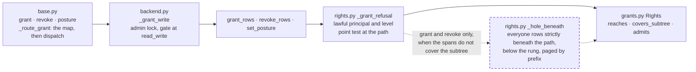

# The grant gate judges the subtree: `grant` and `revoke` need `read_write` everywhere their row reaches, not only at the path they name

A fix that touches rights and needs the engine legs: not structural, no public API or schema format change. It closes the one high finding of the 0.1.0a1 security audit (run `vfs-run-1-2026-11-07`, whose record joins `context/reviews/` with the release-audit spec of the same day), fingerprint `src/vfs/storage/backends/database/rights.py:grant-refusal:addressed-path-gate-ignores-posture-holes-beneath`, run `vfs-run-1-2026-11-07` at commit `3586750`; [release.md](../../standards/release.md) step 3 says a confirmed high is fixed and landed before the bump. No intention: the work is one defect. No research: the audit's verifiers reproduced the defect and the fix's shape is the subtree check the delete verbs already make. It depends on nothing unlanded.

## The problem

READ at `3586750`. The three admin verbs share one gate, `_grant_refusal` (`src/vfs/storage/backends/database/rights.py:1305-1336`). It reads the posture rows on the path's ancestor chain (line 1327), computes the everyone label at the path, and allows the call as soon as `gate.resolution.at("read_write").reaches(path, label)` holds (line 1332). `Rights.reaches` (`src/vfs/storage/grants.py:477-479`) is a point test: the everyone level at the path, or the caller's own spans covering that one path.

READ. A grant row covers its path and everything beneath it. `Rights.admits` (`grants.py:493-497`) returns true on `self.covers(path)` before it looks at a hole, so a principal's row at `/P` admits every row under `/P`, including rows inside a deeper posture that narrows everyone (a posture hole). The docstrings promise the opposite: `grant_rows` says "what it grants never exceeds its own level there" (`rights.py:909-910`), the router's `grant` says "nobody grants more than it holds" (`src/vfs/base.py:1614-1615`), and the archived row-grants spec requires attenuation (`context/specifications/archive/058-row-level-permission-grants/spec.md:74`). The delete, move and sweep verbs already judge the subtree through `WriteGate.subtrees` (`rights.py:730-761`), because "a posture hole can sit inside a writable directory" (spec 058, line 64). The grant verbs do not.

EXECUTED by the audit's two independent verifiers on InMemoryStorage, which runs this same code. The world: a fresh storage (root posture `read_write`, the default), `/team/hr/salaries.md` written by system, and `posture('/team/hr', 'none')`. eve, a named principal with no rows, is refused reading the file (`not_found`), refused granting at `/team/hr` (`not_found`) and refused deleting `/team` (`permission_denied`). Then `grant('/', 'eve', 'read')` answers ok and eve reads the file. `grant('/team', 'eve', 'read_write')` answers ok, then eve overwrites the file and sets `posture('/team/hr', 'read_write')`, after which anonymous reads it. Through `AsyncVirtualFileSystem` with no authority, an anonymous caller grants a principal it names at `/team` and that principal reads the file. A revoke at `/team` by eve removes bob's access inside the hole, where eve cannot see. The evidence is in the audit's run folder at `agents/v02-p3/artifacts/evidence/`.

READ. `posture` shares the gate but is not affected: the deepest everyone row decides each path (`labels.py`), so a posture at `/P` changes the label only of rows between `/P` and the next deeper posture. A caller who reaches `/P` through the label already holds that label on every row it changes.

## Architecture

The grant gate gains one paged read of the everyone rows strictly beneath the addressed path. Dashed is what this spec adds.

Page this changes: none; the architecture folder was retired on 2026-10-31, and the landing notes will say so in one line.

Terms. A **posture hole** is an everyone row (principal `*`) strictly beneath a path whose level is below the rung a verb needs. **Covering the subtree** means the caller's own spans hold the rung over a path and everything beneath it, with no gap (`Rights.covers_subtree`).

## Decisions

### 1. `grant` and `revoke` are refused with `permission_denied` when an everyone row strictly beneath the path stands below `read_write` and the caller's own spans do not cover that row's subtree

A row written or removed at `/P` changes what its principal holds on every path under `/P`, so the granter must hold `read_write` everywhere the row reaches, not only at `/P`. The everyone label is the only way a caller reaches `/P` without covering its subtree, and the label is cut by exactly the everyone rows beneath, so those rows are what the check reads. A caller whose own spans cover the hole's subtree already holds `read_write` there and passes. No other row narrows: principal and group rows only widen, their spans are unions of whole subtrees (so a caller whose spans cover `/P` covers its subtree), and the owner floor never enters the point test, so nobody reaches `/P` through it.

### 2. The check reads posture rows, not entry rows, so an empty hole refuses too

`WriteGate.subtrees` reads entry rows because a delete acts only on rows that exist; `test_a_hole_with_no_rows_beneath_blocks_nothing` pins that. A grant row also admits rows written later, so an empty `/open/empty` posture `none` beneath `/open` must refuse a grant at `/open`: the next file written there would otherwise be readable by the grantee.

### 3. The refusal is `permission_denied` naming the addressed path, for named and anonymous callers alike

This is what `WriteGate.subtrees` answers for a delete over a hole, so the two subtree gates agree. The caller already sees `/P` (the point test passed), so naming `/P` leaks nothing new about `/P`. It does tell the caller that something beneath `/P` is narrower than its own rights, which is the same one bit a refused delete of `/P` already gives. Anonymous gets the same answer as a named caller, because `unauthenticated_at` has already passed at `/P`.

### 4. The read is skipped when the caller's spans cover the subtree whole

`rights.whole` (system and whole-mount grants) or `rights.covers_subtree(path)` means nothing beneath can be a gap for this caller, so no statement is issued. Only a caller who reaches `/P` through the label pays the read.

### 5. The read is one statement per page of 1,000 everyone rows, keyset-paged by `path_prefix`, filtered to levels below the rung in SQL, and stops at the first uncovered row

The filter is `principal_id = '*'`, `level IN (the levels ranked below read_write)`, and `path_prefix` in the bytewise range `(P + '/', P + '0')`, or `path_prefix <> '/'` when `P` is the root. `grants.path_prefix` is a `BytewiseString`, so the bounds compare bytewise on every pinned engine, as `_beneath` relies on. On Oracle the column is a plain `VARCHAR2`, and the range and the keyset order rest on `NLS_COMP` and `NLS_SORT` at their `BINARY` defaults, the same accepted degradation `_refused_beneath` and every other range over a path column carry. Posture rows are few in practice and each page is bounded, so no statement grows with the number of holes, and no batch size is involved. The page size is the module constant `_POSTURE_PAGE` so a test can shrink it.

### 6. `posture` keeps the point gate

A posture at `/P` sets the everyone level only down to the next deeper everyone row, which keeps its own level. A caller who reaches `/P` through the label already holds that label on every row the new posture relabels, so the point test is exact for it. A caller who reaches `/P` through its spans covers its subtree; while a widening relabel is in flight its spans are that relabel's region less the posture rows beneath it, which still contains everything a posture at `/P` relabels. The gate takes a `subtree` flag that `grant_rows` and `revoke_rows` pass and `set_posture` does not.

### 7. Revoke is judged at `read_write` like grant, whatever level the removed row carried

Removing a row changes its principal's access across the whole subtree, inside holes included, so the revoker needs the same reach a granter needs. This keeps the three verbs on one rung, as they are today.

## Intent

After this spec, a caller who can write `/team` only because the mount is open cannot grant itself, or anyone, into a private `/team/hr` beneath it, and cannot revoke another principal's access there. Both calls answer `permission_denied` at `/team`, the same answer a delete of `/team` gives. A caller whose own grant rows cover `/team/hr`, and the system actor, grant there exactly as before, with no extra statement.

## Design

**The gate.** `_grant_refusal` in `src/vfs/storage/backends/database/rights.py` gains a keyword `subtree: bool`. After the point test passes, and only when `subtree` is true, it calls `_hole_beneath(session, tables, profile, rights, path)`; a true answer returns `denied(path)`. `grant_rows` and `revoke_rows` pass `subtree=True`; `set_posture` passes `subtree=False`.

**`_hole_beneath`.** A private helper beside `_beneath`, about 25 lines. It returns `False` at once when `rights.whole or rights.covers_subtree(str(path))`. Otherwise it pages `select(grants.c.path_prefix)` where `principal_id == EVERYONE_NAME`, `level` is in `[rung for rung, rank in LEVEL_RANK.items() if rank < rights.need]`, the range of decision 5 holds, and `path_prefix > last`, ordered by `path_prefix`, limited to `_POSTURE_PAGE`. The first page starts at `last = str(path)`, which the exclusive lower bound already passes (and which is `/` at the root, where `> '/'` and `<> '/'` agree); each later page starts after the last prefix read. `_hole_beneath` reads `_POSTURE_PAGE` as a module global at call time, so `monkeypatch.setattr(rights, "_POSTURE_PAGE", 2)` takes effect. A prefix with `not rights.covers_subtree(prefix)` returns `True`; a short page returns `False`. `_POSTURE_PAGE: Final = 1_000` sits under `_SUBTREE_PAGE`.

**Docstrings and docs.** `grant_rows` and `_grant_refusal` say the gate holds over the subtree; `AsyncVirtualFileSystem.grant` and `revoke` (`src/vfs/base.py`) say "at *path* and everywhere beneath it"; `docs/how-to/share-a-folder-with-grants.md:100` says the same in one sentence. The sync face and the session carry no docstring on these verbs, so nothing there changes.

**Tests first.** The criteria's tests go into `tests/support/grants_contract.py` under the grant-verbs banner and are seen failing (the hole tests answer ok) before the gate changes. They run on every `StorageContract` leg, the server engines included when their URLs are set.

**Scale.** No statement grows with a batch. The new read is paged at 1,000 rows and touches only everyone rows beneath one path.

## Scope

In: decisions 1 to 7. Files: `src/vfs/storage/backends/database/rights.py`, `src/vfs/base.py` (two docstrings), `docs/how-to/share-a-folder-with-grants.md`, `tests/support/grants_contract.py`, and this spec's landing notes.

Out: the router's PermissionMap subtree bypass (its own spec, from the same audit); the concurrent posture-label race and the server-engine collation leads (needs-validation records of the same audit, each waiting on a real engine); a closed default posture (a hardening note of the audit); `list_grants`, which reads and changes nothing.

## Acceptance criteria

Counts and states, never clocks. Every test is a method of `GrantsContract` in `tests/support/grants_contract.py`, run on every `StorageContract` leg.

1. On the world plus `/open/closed/k.md`, `posture('/open', 'read_write')` and `posture('/open/closed', 'none')`, dave's `grant('/open', 'dave', 'read')` and `grant('/', 'dave', 'read')` with `posture('/', 'read_write')` both answer `permission_denied` at the addressed path, no grant row for dave is written, and dave's read of `/open/closed/k.md` stays `not_found`. Test: `test_a_grant_over_a_posture_hole_is_refused`.
2. With system's `grant('/open', 'bob', 'read_write')` in that world, dave's `revoke('/open', 'bob')` answers `permission_denied`, bob's row is still listed by system's `grants('/open')`, with `granted_by` `system`, and bob still reads `/open/closed/k.md`. Test: `test_a_revoke_over_a_posture_hole_is_refused`.
3. With `/open/empty` posture `none` and no row beneath it, dave's `grant('/open', 'dave', 'read')` answers `permission_denied`, while dave's `delete('/open')` over the same world still succeeds as `test_a_hole_with_no_rows_beneath_blocks_nothing` pins. Test: `test_an_empty_posture_hole_refuses_a_grant_above_it`.
4. With system's `grant('/open/closed', 'dave', 'read_write')`, dave's `grant('/open', 'eve', 'read')` succeeds; system's grant at `/open` succeeds in every world above. Test: `test_a_caller_covering_the_hole_may_grant_above_it`.
5. Anonymous, with `posture('/', 'read_write')` and the `/open/closed` hole, gets `permission_denied` from `grant('/open', 'eve', 'read')`, and eve's read of the hidden file stays `not_found`. Test: `test_anonymous_cannot_grant_over_a_posture_hole`.
6. With `_POSTURE_PAGE` patched to 2 and three holes beneath `/open`, at `/open/a`, `/open/b` and `/open/c`, of which system's `read_write` grants to dave cover `/open/a` and `/open/b`, dave's grant at `/open` answers `permission_denied`; after system grants dave `read_write` at `/open/c` it succeeds; and each call issues exactly two hole-read statements, counted as in criterion 8. Test: `test_the_hole_read_pages_past_its_first_page`.
7. dave's `posture('/open', 'read')` over the `/open/closed` hole succeeds and `/open/closed/k.md` stays `not_found` to dave. Test: `test_posture_keeps_its_point_gate`.
8. Counted by a SQLAlchemy `before_cursor_execute` listener on `storage._host.engine.sync_engine` (the test skips a backend with no `_host`), the `SELECT` statements whose text names `vfs_grants`, matched case-insensitively and with any schema prefix: system's `grant('/open', 'eve', 'read')` issues exactly 1 (the posture chain), and dave's, with `/open` at `read_write` and no posture row beneath it, issues exactly 3 (the posture chain, his own rows, the hole read), where today's gate issues 2. Test: `test_the_hole_read_costs_one_statement_and_none_for_covered_callers`.
9. Every existing node of `tests/support/grants_contract.py` passes unchanged, and `scripts/ci.sh` is green at 100% coverage on the tree as committed.

## Landing notes

Landed 2026-11-07 on `main` as one commit over `3586750`, after [the spec review](../../reviews/2026-11-07-the-grant-gate-judges-the-subtree-spec-review.md) (one Medium and six Lows, all fixed, re-signed "Fit to build") and [the code review](../../reviews/2026-11-07-the-grant-gate-judges-the-subtree-code-review.md) (one High, the survived mutants, closed by two tests; re-signed "Lands"). The code review was one fresh reviewer running the five lenses in order plus the security lens, the method the reviews README allows, chosen by the developer for every fix of this release.

Tests first, EXECUTED: the nine criterion nodes were written before the gate changed, and twelve of the eighteen leg runs failed for the right reason (dave's grant and revoke over the hole answered ok); the six that passed were the covered-caller and posture-gate controls, which hold today and must keep holding. The code review's two added nodes, `test_a_sibling_hole_does_not_refuse_a_grant` and `test_a_posture_at_the_rung_beneath_does_not_refuse`, each fail under their mutant (`> path` for `> path + "/"`, and `rank <= need`), checked with the file restored from a scratchpad copy.

The gate, EXECUTED on the tree as committed: lint, format, types, docs examples and wheel size PASS; 4,584 passed; 100% coverage of 12,315 statements.

The engine legs, EXECUTED with fresh containers before the code review's two tests were added: Postgres 371 passed and 1 failed, the hybrid ranking pin `tests/ranking/pins.py:83`, which passed twice on a rerun alone and which the code review traced to a flake this change does not reach; MariaDB 362 passed, 8 skipped; SQL Server 372 passed; Oracle 367 passed. The nine criterion nodes ran on every engine. The two added nodes ran on the memory and SQLite legs only; they change no code path and no statement.

Differences from the spec as written: `_hole_beneath` takes no `profile`: its range is plain comparisons on the `BytewiseString` column, and it reads no dialect fact.

Follow-ups, none blocking: "the everyone rows strictly beneath a path" now has two predicate forms, `_hole_beneath`'s byte range in `rights.py` and `_deeper_postures`' `LIKE` in `labels.py`; one shared predicate in `labels.py` would keep them from drifting, but moving the relabel off its `LIKE` changes a landed statement and belongs to its own change. The hybrid ranking pin's Postgres flake belongs to whoever owns that pin.

Architecture pages: unchanged; the folder was retired on 2026-10-31.

**Changelog:** Security — `grant` and `revoke` now need `read_write` at the path and everywhere beneath it, so an open parent no longer lets a caller grant itself, or anyone, into a narrower posture beneath it, or revoke another principal's access there.

## One line

`grant` and `revoke` now need `read_write` across everything their row reaches, so an open parent no longer lets a caller grant itself into a private folder beneath it.
