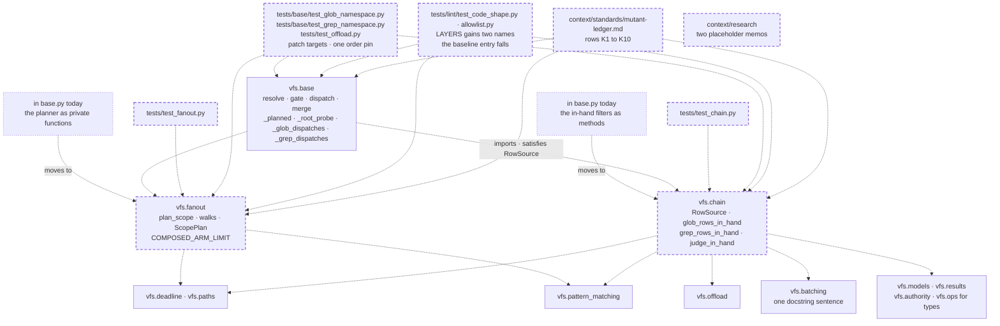

# The router keeps routing: the fan-out planner moves to `vfs.fanout` as pure functions, the rows-in-hand filters move to `vfs.chain` behind a row-source protocol, and `base.py` falls from 3,660 lines to under 3,200 without changing one answer

A refactor, structural: it adds the modules `src/vfs/fanout.py` and `src/vfs/chain.py` and moves code into them from `src/vfs/base.py`. It adds one internal port, the protocol `RowSource`, and seven other public names in two modules that `vfs` does not export; nothing joins `vfs.__all__`, and no protocol method or lifecycle is added. It changes no public API (`glob(observations=…)` and `grep(observations=…)` keep answering through the router), no schema, no rights rule and no engine. The engine legs are not needed: no file under `storage/` changes and no statement is built or changed. It touches the gate in two declarations, `LAYERS` in `tests/lint/test_code_shape.py` and `MODULE_LINE_BASELINE` in `tests/lint/allowlist.py`, as decisions 5 and 6 say. It depends on no active spec. It builds on four landings: [the two-channel scope spec](../archive/2026-11-07-storage-takes-scope-roots-and-arms-as-two-channels.md), landed at `0867fbb`, which gave the planner its present shape; [the verbs take the names agents know](../archive/2026-11-09-the-verbs-take-the-names-agents-know.md), landed at `280a983`; [bounded work has one home](../archive/2026-11-07-bounded-work-has-one-home.md), landed at `4a6d3e0`, whose `Deadline`, process pool and `judge_rows` the moved code takes; and [the gate-and-review spec](../archive/2026-11-07-the-gate-and-the-review-read-the-layer-map-and-the-size-baseline.md), landed at `b2a32c3`, whose ladder and size baseline this landing must pass. It is not parallel-safe with one active spec: [scope crosses the seam in one shape](../active/2026-11-07-scope-crosses-the-seam-in-one-shape.md), reviewed "Not yet" and not built, edits `src/vfs/fanout.py`, `tests/test_fanout.py`, docstrings of `src/vfs/base.py` and the two namespace test files, and lands after this one. [Refresh, the incremental index verb](../active/2026-10-31-refresh-the-incremental-index-verb.md), reviewed "Not yet" on 2026-11-09 and not built, shares neither new module; it shares `tests/test_offload.py`, where its rename of the full pass changes five lines and this spec changes two others, so the two land in either order. [The release audit is a review](../active/2026-11-07-the-release-audit-is-a-review.md), signed "Fit to build" and not built, shares no file with this spec. This spec takes the first slice of what two October drafts, not started, named as `src/vfs/chain.py`: [the storage-seam draft](../active/179-the-storage-seam-as-the-kernel/spec.md) and [the public-surface draft](../active/181-the-public-surface-regrouped-by-kernel-group/spec.md). It departs from the public-surface draft three times: `base.py` imports `vfs.chain`, and `vfs.chain` never imports the router, because the router calls the filters until chaining leaves the verbs; `_observation_rows` and `_cap_rows` stay on the router, because its own dispatch uses them; and the filters do not validate their flags with `vfs.params.param_violation`, as that draft has its public functions do, because the params gate stays on the router and the rung decision 5 gives `vfs.chain` refuses that import. It stands on [import direction and module size as fitness functions](../../research/2026-11-07-import-direction-and-module-size-fitness-functions.md) for the measurement and on the ownership rule in [how we code](../../standards/how-we-code.md) for the move; no further study would change a move of code that already has no router state. Its spec review is [the review of 2026-11-09](../../reviews/2026-11-09-the-router-keeps-routing-spec-review.md), which ended "Not yet" on one High, two Mediums and seven Lows; this draft answers each in that file's Disposition and is drawn against the tree at `b2a32c3`. A second, full review followed the growth from six decisions to eleven, [the review of 2026-11-12](../../reviews/2026-11-12-the-router-keeps-routing-spec-review.md), which ended "Not yet" on one Medium with seven Lows; this draft answers each of those in that file's Disposition. One commit has landed since `b2a32c3`: `3ea2465e` changes only files under `documentation/` and no file this spec reads or edits, so every figure stated here as executed at `b2a32c3` stands as measured. No intention: no caller gains or loses an experience.

## The problem

EXECUTED on 2026-11-12 at `b2a32c3`. `src/vfs/base.py` holds 3,660 lines by `wc -l`, the count `MODULE_LINE_BASELINE` holds it to, and 112 lines that contain `def `. Its router class, `AsyncVirtualFileSystem`, has 90 methods. READ ([the memo](../../research/2026-11-07-import-direction-and-module-size-fitness-functions.md), section 3.3): the file was 3,257 lines through 2026-11-06, 3,622 after the landings of 2026-11-07, and 3,710 with the two-channel work; the bounded-work landing took it to 3,660. Two coherent concerns in it need none of the router's state.

READ at `b2a32c3`. The first is the fan-out planner: `_plan_scope` with its plan type `_ScopePlan`, its limit `_COMPOSED_ARM_LIMIT`, the walk-chooser `_walks`, the walk's counter `_Walk` and its signal `_WallReached`, and nine helpers (`_path_covers`, `_switched_entries`, `_addresses_whole_side`, `_root_literal`, `_scope_channels`, `_root_members`, `_composed_members`, `_residual_renders`, `_glob_reaches`). `_plan_scope`'s docstring calls it "A pure function of the mount-table facts the router resolved on the loop" and the pattern text, and ends that sentence "so it runs on a worker". It is tested today only through router calls.

READ. The second is the rows-in-hand filters: the methods `_glob_rows_in_hand`, `_grep_rows_in_hand`, `_judged`, `_match_in_hand` and `_hit_row`, with the constants `_CHAINED_REFINE_GUIDANCE` and `_CHAINED_GLOB_REFINE_GUIDANCE`. They judge rows the caller holds, read an absent kind or body through the router's own `stat` and `read`, match on the process pool under a wall, and mint truncations. A filter over rows in hand resolves no path and dispatches to no entry.

EXECUTED on 2026-11-12 at `b2a32c3`, an `ast` probe over `src/vfs/base.py`, kept with its output in the session scratchpad and never in the tree. It asks three things of the code this spec moves. First, which names defined in `base.py` it reads that are not moving: none, for the planner and for the filters. `_path_covers`, which the review found missing from the first draft's list, is read by `_plan_scope`, `_composed_members` and `_glob_reaches` and by nothing that stays, so it is on the list now. Second, which attributes of `self` the five methods touch: `read` and `stat`, the two verbs; `_observation_rows` and `_cap_rows`, the router's gate around the filters; `_error`, once, for chained grep's invalid-pattern refusal; and each other. Third, where code that stays reads a name that moves. There are eight such reads: `glob` calls `_glob_rows_in_hand`; `grep` calls `_grep_rows_in_hand`; `_planned` calls `_walks` and `_plan_scope` and is annotated with `_ScopePlan`; `_scope_skips` and `_scoped` are annotated with `_ScopePlan`; and `_root_probe` calls `_judged`. The last is new to this pass. The review's probe did not report it, and its fix text would have kept `_judged` private to the new module; the call was already there at the commit the review read (EXECUTED: `git show b85e3df:src/vfs/base.py`). One docstring of code that stays names moving names, in two places: `_glob_dispatches` cites `_COMPOSED_ARM_LIMIT` and `_plan_scope`. The moved code is 442 lines and 19 `def ` lines: 221 and 13 for the planner, 221 and 6 for the filters.

EXECUTED, the same day, a scratch probe of three router calls under a fake clock, run on today's tree. Chained glob reads its wall before it materializes the caller's rows: handed a generator that moves the clock past the wall as it is drawn, it returns no row and one `truncated` warning. Chained grep reads its wall after: the same generator is served in full. A chained glob handed a batch that is not rows reads the clock once and refuses. No node of the suite pins the first of these: on the scratch build the Design describes, with the wall read moved beneath the materialization, all 709 nodes of `tests/base` and `tests/test_chain.py` passed and only the probe's two nodes for glob failed.

EXECUTED, the same day, on the same scratch build. With the invalid-pattern arm of chained grep made to raise, the suite outside `tests/lint`, `tests/scripts` and the new `tests/test_chain.py` gave 4,810 passed and none failed. So no test reaches that arm today.

READ. [The off-loop glob code review](../../reviews/2026-11-07-glob-matching-runs-off-the-loop-under-the-wall-code-review.md) noted and did not file that the "judge, then admit" loop has four spellings. EXECUTED: `grep -rn 'judge_rows(' src/vfs` lists five calls today, each followed by its own admission loop, and this spec moves one of them unchanged.

## Architecture

Solid is a module that exists, dashed is what this spec adds (a new file, or the rows, names and patch targets it adds to an existing one), and dotted is what leaves the router. An arrow runs from a part to what it imports, reads or pins; the two arrows labelled "moves to" run from the code that leaves to its new home.



Page this changes: none; the architecture folder was retired on 2026-10-31, and the landing notes will say so in one line. The memos stand alone in the drawing because nothing this spec builds reads them.

Terms. A **row source** is anything that answers `read` and `stat` over observations in the caller's coordinates; the router is one. The **planner** is the walk that turns a fan-out's roots, patterns and exclusions into each entry's members and scope channel. **Rows in hand** are observations a caller passes back to `glob` or `grep`. A **rung** is one step of the layer ladder, counted from 0 at the bottom, as the gate-and-review spec counts them.

## Decisions

### 1. `src/vfs/fanout.py` holds the planner, and four of its names are public because the router reads them: `plan_scope`, `walks`, `ScopePlan` and `COMPOSED_ARM_LIMIT`

`_plan_scope` becomes `plan_scope` and `_walks` becomes `walks`: `_planned` calls both, the first to plan and the second to choose whether the plan needs a worker. `_ScopePlan` becomes `ScopePlan`: `_planned`, `_scope_skips` and `_scoped` are annotated with it. `_COMPOSED_ARM_LIMIT` becomes `COMPOSED_ARM_LIMIT`: the router's docstring cites it and three tests patch it. Everything else keeps its private name, because only the planner reads it: `_Walk` and `_WallReached` sit beside `plan_scope`, as private types bound to one group do, and the nine helpers go under the module's Internal helpers banner. `_path_covers` is one of the nine: it moves with the planner because only the walk reads it. `_planned`, `_scope_skips` and `_scoped` stay on the router: the first makes the hop to the process pool, the second mints coverage records, and the third shapes a dispatch keyword. The planner has no `self`, takes plain data and returns plain data, so a module of its own lets `tests/test_fanout.py` pin the walk directly, where today every planner pin is a router call.

### 2. `src/vfs/chain.py` holds the rows-in-hand filters as async functions over a `RowSource`, they call only `read` and `stat` on it, and chained grep mints its invalid-pattern refusal itself

`glob_rows_in_hand(source, rows, *, arms, ext, ext_not, globs_not, kind, deadline, authority)` and `grep_rows_in_hand(source, rows, *, pattern, ext, ext_not, globs, globs_not, case_mode, fixed_strings, word_regexp, invert_match, before_context, after_context, output_mode, max_count, columns, authority)` each return a `Result`. `source` is a `RowSource`, a `Protocol` of two methods, `read` and `stat`, each taking keyword-only `observations`, `columns` and `authority`; `AsyncVirtualFileSystem` satisfies it and the router passes `self`. `rows` is the batch already materialized and type-checked (decision 4). The grep filter refuses an invalid pattern as `Result(ops=("grep",), errors=[classified(ErrorKind.invalid, detail=f"grep pattern {pattern!r}: {exc}")])`. That is the value `self._error` composes today, written out, because a row source has no `_error` and a filter that reached for one would need the router. The glob filter takes no `max_count`: the router applies the row cap (decision 4). This is the module the two October drafts named, with the behaviour unchanged, so the later spec that moves chaining onto the result type moves a function and not a method. The reason for the move is the ownership rule: a filter over rows in hand resolves no path and dispatches to no entry, so it is not routing.

### 3. `_judged` becomes the public `judge_in_hand`, because the router's root probe calls it; `_match_in_hand` and `_hit_row` keep their private names

The probe found one caller outside the filters: `_root_probe` judges the rows it statted through `_judged`. The helper moves with the filters, which call it twice, and the router imports it. It is not left on the router, because `vfs.chain` may not import the router. It is not copied, because one spelling of that loop is the point. The name changes by more than its underscore because `judged` is already a local name in both `_root_probe` and `_grep_dispatches`: an import called `judged` would be shadowed by the first, which would fail at the call with an unbound local, and hidden by the second. `judge_in_hand` reads beside `glob_rows_in_hand` and `_match_in_hand` and collides with nothing. `_match_in_hand` and `_hit_row` keep their names under the module's Internal helpers, because only chained grep calls them. The two guidance constants keep their private names in `vfs.chain` for the same reason. This departs from the review's fix text for L6, which kept `_judged` private; that text would have left the root probe calling a name the router no longer has.

### 4. The router keeps the gate around both filters, and chained glob's wall is read where it is read today: before the caller's rows are materialized, and handed down as a `Deadline`

The router runs, in today's order: the params gate, the channel expansion, the closed check, then for a chained call `_observation_rows` and the filter. `_observation_rows` and `_cap_rows` stay on the router, because `_dispatch_grouped_observations` and `_route_fanout` use them too. For grep the order is exactly today's: the rows are materialized and type-checked first, and the filter then takes its own two walls as it does now. For glob there is one statement to place. Today `_glob_rows_in_hand` reads `Deadline.after(WALL_TIME_BUDGET)` on its first line and materializes the rows on its second. The first draft moved the materialization out to the router and left the wall inside the filter, which exchanges the two. That is observable: a caller's iterable that is slow to draw spends the wall today and would not after, so a call that is truncated today would be served in full, and a refused batch would stop reading the clock (EXECUTED, the probe in the problem section). A refactor does not change an answer, so the order is kept: `glob` reads `Deadline.after(WALL_TIME_BUDGET)`, then calls `_observation_rows`, then hands the deadline to `glob_rows_in_hand`, then applies `self._cap_rows(filtered, "glob", max_count)` to what the filter returns. Passing the deadline down is the deadline module's own law, that a deadline is an argument. It also lets a test hand the filter a deadline that has passed, with no clock patched. Because no existing node sees the order, one new node pins it (decision 8). Chained grep keeps making its own deadlines inside `vfs.chain`, because it takes a wall only when a pattern must be judged and a second one for the matching stage, as today. Whether glob should read its wall after its gate, as grep does, is a behaviour change and not this spec's; nothing here depends on it.

### 5. `vfs.fanout` and `vfs.chain` are named in `LAYERS` on rung 7, the rung directly beneath `vfs.base`, in this landing

Decision 2 of the gate-and-review spec makes a new top-level module fail the gate until the landing that adds it names its rung. Its placement rule is: "where the imports leave a unit's rung open, the unit sits just beneath the units that use it, so nothing lower can come to depend on it". Only the router imports the two modules, and the router is on rung 8, so both sit on rung 7 with `vfs.storage.backends`, `vfs.params`, `vfs.rerank`, `vfs.permissions` and `vfs.exceptions`. That says the most the ladder can say: neither may import the other, a backend or the router; nothing beneath rung 8 may import either; and only the router and what is above it may. Their own imports would allow a lower rung (the planner reaches no higher than rung 4 and the filters no higher than rung 5), and the placement rule is why they do not take one. EXECUTED on a scratch copy holding a throwaway build of both modules: with the two names left out, `ladder_shape_faults` reports two faults, `vfs.chain has no rung` and `vfs.fanout has no rung`, and `ladder_faults` reports three upward imports by `vfs.base`; with both on rung 7, the walk of 99 modules and 608 edges, 179 of them typing-only, gives no shape fault, no upward import outside the four pairs `UPWARD_IMPORT_ALLOWANCE` already holds, no sideways import and no fault from the declared set. The allowance does not change. Under decision 7 of that spec the first placement of a new top-level module tightens the gate and is not a finding. `vfs.base` is neither moved nor renamed, so the two names are first placements and not a reordering; and the code they hold moved from rung 8 to rung 7, where it can import less. The code review's first line will close with: "ladder changed: `LAYERS` gains `vfs.fanout` and `vfs.chain` on rung 7". The first import this placement refuses is one the public-surface draft plans: its public `vfs.chain` functions validate their flags with `vfs.params.param_violation`, and `vfs.params` shares rung 7. The refusal is wanted. Today the params gate runs on the router before either filter is called, so the filters have no flag to validate, and an import of the ingress table by a filter would be a second gate. The spec that makes those functions public either leaves the params gate on the router, where decision 4 keeps it, or gives `vfs.chain` a rung of its own above `vfs.params` in a diff its review reads; splitting a rung is one line, and the gate-and-review spec's decision 7 makes it a finding the author answers. This spec needs neither. This replaces the first review's fix text for L5, which gave the two modules a rung of their own in `tests/lint/shapes.py`; the ladder lives in `tests/lint/test_code_shape.py` since `b2a32c3`, and a rung of their own between rungs 7 and 8 would let both modules import a backend, which nothing here needs.

### 6. The size baseline's entry for `src/vfs/base.py` is lowered to the file's exact new count in this landing, and neither new module takes an entry

Decision 6 of the gate-and-review spec holds each listed module at its exact `wc -l` count, so a module that shrinks takes its entry down in the same landing. The entry is 3,660 today. EXECUTED: the throwaway build leaves `base.py` at 3,188 lines and 93 `def ` lines, 472 and 19 fewer. The build writes the count it finds; criterion 11 bounds it at 3,200, the measured 3,188 with a margin of 12 lines for the wording of a docstring or a comment. `src/vfs/fanout.py` is 291 lines and `src/vfs/chain.py` 283 in the throwaway build, rebuilt from the Design's verbatim text, each under a third of the ceiling of 1,000, so neither takes an entry. A lowered entry is a change the review names and is not a finding. The code review's second line will close with: "allowlist changed: `src/vfs/base.py` lowered from 3,660 to" and the count.

### 7. Every existing router test keeps its assertions, and a name is patched on the module whose code reads it

That one sentence decides every patch target. A test patches a module's binding of a name; only code that looks the name up in that module sees the patch. After the move four kinds of case follow. A name read only inside a moved function is patched on the new module: `compile_verifier`, `CONTENT_BYTE_BUDGET`, chained grep's `WALL_TIME_BUDGET` and the matching stage's `call_offloaded` on `vfs.chain`; `composed_pattern`, `residuals` and `COMPOSED_ARM_LIMIT` on `vfs.fanout`. A name the router itself still reads stays on `vfs.base`: `plan_scope`, which `_planned` calls through the router's own import, so a patch on `vfs.fanout` would intercept nothing; chained glob's `WALL_TIME_BUDGET`, which `glob` reads (decision 4); the planning wall; and `judge_rows` for grep's root admissions, which `_grep_dispatches` calls directly. A name both modules read is patched on both when the test counts every use: the two `_spy_judges` helpers record "the executor each router judge hop ran on", and after the move a judge hop is read in `vfs.chain` (by `judge_in_hand`, for the chained filters and the root probe) and in `vfs.base` (by `_grep_dispatches`), so each helper patches `judge_rows` on both. A test whose assertion is that no call was made follows the same rule, read as: the module whose code would make the call. This departs from the review's closing text for M2, which sent the two fan-out tests to `vfs.base` alone. EXECUTED on the scratch build: with the spy on `vfs.base` alone, a mutant that makes the glob root probe judge a path-arm call's roots passes `test_a_path_arm_never_serves_a_scope_roots_own_row`; with the spy as this decision gives it, the mutant is killed. The Design holds the whole map, 31 patches in four files, and criteria 14 and 15 count it. No assertion changes what it asserts. One `assert` line of `tests/base/test_grep_namespace.py` reads `WALL_TIME_BUDGET` from `vfs.chain` where it read it from `vfs.base`, the same value. A move that changed an answer would be a different spec.

### 8. The planner and the filters gain direct pins, the wall order gains one, and each pin lands with its mutant as a row of the mutant ledger

Every public function of the two modules is pinned with no router: `plan_scope` by three test functions, `walks` by one, each filter by two and `judge_in_hand` by one, which is nine functions and ten nodes. One more node, in `tests/base/test_glob_namespace.py`, pins the order decision 4 keeps. Ten of the eleven nodes are seen failing on the missing modules; the order pin passes on the base, because it pins behaviour this spec keeps, and its red is its mutant. [The testing standard](../../standards/testing.md) says a pinned law is proven by the mutation it kills and that the mutation lands as a ledger row. Ten rows, K1 to K10, land with the pins; the Design lists each with the failures it gave on the scratch build. Three of the ten, K8, K9 and K10, exist to hold decision 7: each is the mutation one node guards, and that node passes under the mutant when its patch sits on `vfs.base`, where the name is still bound and nothing reads it for that call. K8 and K9 break an assertion that no call was made; K10 breaks a count of records behind a replaced `judge_rows`. The ledger holds no row today whose target or scope is the router or its tests (EXECUTED: `grep -c 'base.py' context/standards/mutant-ledger.md` and `grep -c 'tests/base' context/standards/mutant-ledger.md` each report 0), so no existing row is re-anchored.

### 9. `COMPOSED_ARM_LIMIT` moves with the planner and is removed by the one-shape spec that follows

[The one-shape spec](../active/2026-11-07-scope-crosses-the-seam-in-one-shape.md) removes the switch and names `vfs.fanout` as where it will find it. This spec moves the planner as the two-channel landing left it, so that spec edits one small module instead of the router. Row K1 pins the switch and goes stale when that spec lands; retiring it is that spec's.

### 10. Prose that names a moved function or a moved import is corrected in this landing, and prose that says "the router" for the chained path stays

Three pieces of prose are edited. `_glob_dispatches`'s docstring cites the limit as `vfs.fanout.COMPOSED_ARM_LIMIT` and says the planning walk is `vfs.fanout`'s, where it cites `_COMPOSED_ARM_LIMIT` and `_plan_scope` today. The two-line comment above the router's guidance constants names the two stages that stay, since chained glob's advice leaves. And one sentence of `src/vfs/batching.py`'s docstring says "the router and the database adapter both import it downward"; after the move the router no longer imports that module and `vfs.chain` does, so the sentence says "the chained filters and the database adapter". Four other pieces of prose say the router filters chained rows or hops for them: the module docstrings of `src/vfs/offload.py`, `src/vfs/pattern_matching/grep.py` and `src/vfs/storage/protocol.py`, and the comment on `WALL_TIME_BUDGET` in `src/vfs/deadline.py`. They stay as written, because the chained verbs still answer through the router and the two new modules are the router's own, imported by nothing else. EXECUTED: `grep` over `docs/` and `README.md` for every moved name finds nothing, so no page there changes.

### 11. The "judge, then admit" loop keeps its five spellings here, and a placeholder memo holds the question

This spec moves one spelling, `_judged`, unchanged and unifies none: giving the loop one home changes three storage modules, which is not a move. The first draft promised a memo for later. Under decision 9 of the gate-and-review spec a structural note becomes a document the day it is written, so the memo is written with this draft: [whether one spelling can serve the judge-then-admit step](../../research/2026-11-12-whether-one-spelling-can-serve-the-judge-then-admit-step.md). It counts five sites on today's tree where the review of 2026-11-07 counted four, and it decides nothing.

## Intent

After this spec, the router resolves, gates, dispatches and merges, and the two things it did besides have homes of their own: the walk that plans a scoped fan-out is a pure module pinned with no router, and the filters over rows in hand are a module that takes a row source and is pinned over a fake one. `base.py` is about 470 lines shorter, the gate holds it at its new count and holds both new modules beneath the router, and every verb answers exactly as before, the moment chained glob reads its wall included.

## Design

**The move, complete against the probe.** Everything in the two tables leaves `src/vfs/base.py`; nothing else in the file moves.

| In `base.py` today | In `src/vfs/fanout.py` | Why that name |
|---|---|---|
| `_COMPOSED_ARM_LIMIT`, with its two-line comment | `COMPOSED_ARM_LIMIT` | the router's docstring cites it; tests patch it |
| `_ScopePlan` | `ScopePlan` | annotates `_planned`, `_scope_skips`, `_scoped` |
| `_walks` | `walks` | `_planned` calls it |
| `_plan_scope` | `plan_scope` | `_planned` calls it |
| `_WallReached`, `_Walk` | the same names | only `plan_scope` and its helpers use them |
| `_path_covers`, `_switched_entries`, `_addresses_whole_side`, `_root_literal`, `_scope_channels`, `_root_members`, `_composed_members`, `_residual_renders`, `_glob_reaches` | the same names | only the planner calls them |

| In `base.py` today | In `src/vfs/chain.py` | Why that name |
|---|---|---|
| `_CHAINED_REFINE_GUIDANCE`, `_CHAINED_GLOB_REFINE_GUIDANCE` | the same names | only the filters read them |
| `AsyncVirtualFileSystem._glob_rows_in_hand` | `glob_rows_in_hand` | `glob` calls it |
| `AsyncVirtualFileSystem._grep_rows_in_hand` | `grep_rows_in_hand` | `grep` calls it |
| `AsyncVirtualFileSystem._judged` | `judge_in_hand` | `_root_probe` calls it (decision 3) |
| `AsyncVirtualFileSystem._match_in_hand`, `._hit_row` | `_match_in_hand`, `_hit_row` | only chained grep calls them |
| none | `RowSource` | new: the port the filters take |

What stays on the router, by name: `_observation_rows`, `_as_list`, `_cap_rows`, `_error`, `_closed_error`, `_planned`, `_scope_skips`, `_scoped`, `_root_probes`, `_root_probe`, `_glob_dispatches`, `_grep_dispatches`, `_classify_fanout_scopes`, `_route_fanout`, `_PathFilters`, `_Dispatches`, `_FanoutPlan`, `_SCOPED_REFINE_GUIDANCE` and `_PLANNING_REFINE_GUIDANCE`.

**`src/vfs/fanout.py`** (new; 291 lines in the throwaway build). In file order. First the module docstring, verbatim; it names the router in words and never as `vfs.base`:

```python
"""The fan-out planner: a scoped call's roots, patterns and exclusions, planned entry by entry.

A fan-out that names scope roots, path-arm patterns or capability skips
is planned before it is dispatched. :func:`plan_scope` composes each
pattern under each root into every entry the root reaches, residuates
the composed text into that entry's coordinates, and returns a
:class:`ScopePlan` of plain data. Past :data:`COMPOSED_ARM_LIMIT`
composed arms, an entry's owned roots ride beside the uncomposed arms
as its scope channel instead.

    plan = plan_scope(owners, keys, skip_paths, roots, patterns, exclusions, reach, literals, deadline)

The walk is pure: it reads no mount table, no router and no storage,
only the facts its caller resolved and the pattern text. So the router
runs it on a worker under a deadline, and a test runs it with no router
at all. :func:`walks` says whether a call's plan needs the worker.
"""
```

Then the imports. At runtime: `Final`, `NamedTuple` and `TYPE_CHECKING` from `typing`; `CHECK_EVERY` from `vfs.deadline`; `ROOT` and `address_of` from `vfs.paths`; `ScopeChannel`, `composed_pattern`, `escape_glob`, `render_residual` and `residuals` from `vfs.pattern_matching`. Under `if TYPE_CHECKING:`: `Mapping` and `Sequence` from `collections.abc`; `Deadline` from `vfs.deadline`; `Path` from `vfs.paths`. The deadline comes from `vfs.deadline`; the planner imports nothing from `vfs.offload`. Then the constants and shared types: `COMPOSED_ARM_LIMIT` with its comment, then `ScopePlan`. Then one banner, "The planning walk", holding `walks`, `_WallReached`, `_Walk` and `plan_scope` in that order. Then the Internal helpers banner and the nine helpers, `_path_covers` first and the rest in their present order. Every body is today's, with the four renames applied inside it.

**`src/vfs/chain.py`** (new; 283 lines in the throwaway build). In file order. First the module docstring, verbatim; it too names the router in words alone:

```python
"""Filters over rows in hand: chained glob and chained grep, which resolve no path and dispatch to no entry.

A caller that holds rows hands them back to ``glob`` or ``grep`` as
*observations*. The router gates the call and passes the rows here.
These functions judge them against the glob gates, match their bodies,
and serve each row as held. Storage is reached only for a fact a row
lacks, and only through the :class:`RowSource` the caller hands in:
``stat`` for a missing kind, ``read`` for absent content.

    kept, completed = await judge_in_hand(gates, rows, deadline)

Each stage that matches rows runs on the process pool under a wall, and
a stage that reaches it returns what it finished and one ``truncated``
warning. :func:`judge_in_hand` is the judge-then-admit step both
filters share; the router's root probe calls it for the rows it statted.
"""
```

Then the imports. At runtime: `Final`, `Protocol` and `TYPE_CHECKING` from `typing`; `byte_chunked` from `vfs.batching`; `WALL_TIME_BUDGET` and `Deadline` from `vfs.deadline`; `CONTENT_KINDS` from `vfs.models`; `CONTENT_BYTE_BUDGET`, `call_offloaded`, `judge_rows`, `offload_pool` and `wall_truncation` from `vfs.offload`; `extract_extension` from `vfs.paths`; `PatternError`, `compile_gates`, `compile_verifier` and `match_texts` from `vfs.pattern_matching`; `ErrorKind`, `Result` and `classified` from `vfs.results`. Under `if TYPE_CHECKING:`: `Authority` from `vfs.authority`; `Observation` from `vfs.models`; `CaseMode` and `GrepOutputMode` from `vfs.ops`; `ObjectKind` and `Path` from `vfs.paths`; `ContentMatcher`, `GlobGates` and `GrepHit` from `vfs.pattern_matching`; `ResultError` from `vfs.results`. Then the two guidance constants, each under its own comment, and `RowSource`, verbatim; the first comment is today's line and the second is new:

```python
# Chained grep's truncation advice: a chained call cannot take paths, so it never says to scope with them.
_CHAINED_REFINE_GUIDANCE: Final = "narrow the pattern, add globs or ext filters, or send fewer rows"

# Chained glob's truncation advice: its one stage is the filter over the rows in hand.
_CHAINED_GLOB_REFINE_GUIDANCE: Final = "narrow the pattern or its exclusions, or send fewer rows"


class RowSource(Protocol):
    """Who holds the rows' storage: the two reads a filter makes for a fact a row lacks."""

    async def read(
        self, *, observations: list[Observation], columns: frozenset[str], authority: Authority | None
    ) -> Result: ...

    async def stat(
        self, *, observations: list[Observation], columns: frozenset[str], authority: Authority | None
    ) -> Result: ...
```

Then three banners. "The filters" holds `glob_rows_in_hand` and `grep_rows_in_hand`. "Judge, then admit" holds `judge_in_hand`. Internal helpers holds `_match_in_hand` and `_hit_row`. The bodies are today's with six kinds of edit and no other. One: `self` and `observations` become the parameters `source: RowSource` and `rows: list[Observation]`, and the three lines that call `_observation_rows` and return its refusal go from each filter. Two: `glob_rows_in_hand` loses its first line, the `Deadline.after`, and its `max_count` parameter, gains the keyword `deadline: Deadline` between `kind` and `authority`, and returns `Result(ops=("glob",), observations=kept, errors=errors)` with no cap; its docstring is the one below, which rewords the clause about the wall and adds a last sentence. Three: `self.stat` and `self.read` become `source.stat` and `source.read`, with the same keywords. Four: `self._judged`, `self._match_in_hand` and `self._hit_row` become `judge_in_hand`, `_match_in_hand` and `_hit_row`. Five: the invalid-pattern arm returns the `Result` of decision 2. Six: the three `@staticmethod` lines go. Every other docstring and comment of the moved code moves as it stands. `glob_rows_in_hand`'s docstring, verbatim:

```python
    """Chained glob: filter rows in hand, fetching only a missing kind fact.

    The path gates run over the rows as held — admission by any
    expanded arm, rejection by exclusion globs and the ext facts, no
    meta rule, duplicates and order preserved — judged in one hop on
    the process pool under *deadline*, the wall the caller read before
    it materialized the rows; a row the engine did not judge before it
    is dropped, with one ``truncated`` warning. A *kind* filter judged
    against a row that carries no kind stats exactly those rows in one
    batch — the load-bearing fact is fetched, never guessed — and a row
    that cannot be statted classifies loudly beside the healthy rows.
    The row cap is the caller's to apply.
    """
```

**`src/vfs/base.py`.** The moved code goes. The chained branch of `glob` becomes:

```python
        if observations is not None:
            if not self._bindings:
                return self._closed_error("glob")
            deadline = Deadline.after(WALL_TIME_BUDGET)
            rows, invalid = self._observation_rows("glob", observations)
            if invalid is not None:
                return invalid
            filtered = await glob_rows_in_hand(
                self,
                rows,
                arms=arms,
                ext=ext,
                ext_not=ext_not,
                globs_not=globs_not,
                kind=kind,
                deadline=deadline,
                authority=authority,
            )
            return self._cap_rows(filtered, "glob", max_count)
```

The chained branch of `grep` keeps its closed check, then runs `rows, invalid = self._observation_rows("grep", observations)`, returns `invalid` when it is not `None`, and returns `await grep_rows_in_hand(self, rows, …)` with the fifteen keywords it passes today. In `_root_probe`, `await self._judged(gates, list(result.observations), deadline)` becomes `await judge_in_hand(gates, list(result.observations), deadline)`, and the local it is assigned to keeps its name. In `_planned`, `_walks` becomes `walks` and both uses of `_plan_scope` become `plan_scope`; its return annotation, `_scope_skips`'s parameter and `_scoped`'s parameter say `ScopePlan`. `_glob_dispatches`'s docstring changes in two places and the comment above `_SCOPED_REFINE_GUIDANCE` is rewritten for the two constants that stay. The three pieces of text after the edit, with the docstring's line breaks left to the build:

```text
:data:`~vfs.fanout.COMPOSED_ARM_LIMIT` receives those roots beside the uncomposed arms as its ``scope=`` channel instead

That planning walk, :mod:`vfs.fanout`'s, runs in one hop on the process pool under its own wall; a walk that reaches it dispatches the roots it planned whole and says so.

# The truncation advice of a fan-out's glob stages: its root probe and
# admissions, and its planning walk.
```

Imports of `base.py`. Added at runtime: `from vfs.chain import glob_rows_in_hand, grep_rows_in_hand, judge_in_hand` and `from vfs.fanout import plan_scope, walks`. Added under `if TYPE_CHECKING:`: `from vfs.fanout import ScopePlan`. Removed, because nothing that stays reads them: the whole line `from vfs.batching import byte_chunked`; `CHECK_EVERY` from `vfs.deadline`; `CONTENT_KINDS` from `vfs.models`; `CONTENT_BYTE_BUDGET` from `vfs.offload`; `address_of` and `extract_extension` from `vfs.paths`; `compile_verifier`, `composed_pattern`, `escape_glob`, `match_texts`, `render_residual` and `residuals` from `vfs.pattern_matching`; and, under `if TYPE_CHECKING:`, `ContentMatcher` and `GrepHit`. Everything else stays, `WALL_TIME_BUDGET`, `Deadline`, `judge_rows`, `call_offloaded`, `offload_pool`, `wall_truncation`, `compile_gates`, `ScopeChannel`, `Mapping` and `Sequence` among them. EXECUTED: these three import lists are what `ruff check` and `ty check` pass on the throwaway build, with nothing unused and nothing undefined.

**`src/vfs/batching.py`.** One sentence of the module docstring: "It imports the standard library only, so the chained filters and the database adapter both import it downward." No code changes.

**`tests/lint/test_code_shape.py`.** In `LAYERS`, the rung that holds `vfs.params` gains two names after `vfs.exceptions`, in the order `"vfs.fanout"`, `"vfs.chain"`. The rung then passes 120 columns, so `ruff format` writes it one name to a line. Nothing else in the file changes. **`tests/lint/allowlist.py`.** The entry `"src/vfs/base.py": 3660` takes the file's count as built. `UPWARD_IMPORT_ALLOWANCE` does not change.

**The patch map.** EXECUTED: `grep -rnE 'setattr\(base_module|_counted\(monkeypatch, base_module|_trace_verifiers\(monkeypatch, base_module' tests` lists 31 patches of a `vfs.base` name today, in four files; no other file under `tests/` patches one. Each row below is a test or a shared helper, the name it patches, and where the patch goes. Each of the three edited files imports the new modules beside its `base_module`: `from vfs import chain as chain_module` in all three, and `from vfs import fanout as fanout_module` in the two namespace files.

| File | Test or helper | Name | After the move | The code that reads it |
|---|---|---|---|---|
| `tests/base/test_glob_namespace.py` | `_spy_judges`, the helper of `test_chained_glob_judges_once_on_the_process_pool` and `test_a_path_arm_never_serves_a_scope_roots_own_row` | `judge_rows` | `vfs.chain` and `vfs.base`, the same spy on both; `real` is read from `vfs.chain` | `judge_in_hand`; `_grep_dispatches` |
| the same | `test_chained_glob_truncates_at_the_wall` | `WALL_TIME_BUDGET` | `vfs.base`, unchanged | `glob` |
| the same | `test_the_root_probe_builds_each_name_arm_once` | `AsyncVirtualFileSystem._root_probe` | `vfs.base`, unchanged | the class |
| the same | `test_a_root_probe_past_its_wall_warns` | `judge_rows` | `vfs.chain` | `judge_in_hand`, for the probe |
| the same | `test_planning_leaves_the_loop` | `_COMPOSED_ARM_LIMIT` | `vfs.fanout`, as `COMPOSED_ARM_LIMIT` | `_switched_entries` |
| the same | `test_planning_leaves_the_loop` | `_plan_scope` | `vfs.base`, as `plan_scope` | `_planned` |
| the same | `test_planning_past_the_wall_truncates` | `WALL_TIME_BUDGET` | `vfs.base`, unchanged | `_planned` |
| the same | `test_planning_past_the_wall_truncates` | `composed_pattern` | `vfs.fanout` | `_composed_members` |
| the same | `test_planning_past_the_wall_truncates` | `_plan_scope` | `vfs.base`, as `plan_scope` | `_planned` |
| the same | `test_one_large_root_stops_inside_its_walk` | `residuals` | `vfs.fanout` | `_Walk.residuals` |
| the same | `test_planning_composes_only_the_bounded_pairs` | `composed_pattern`, through `_counted` | `_counted` is handed `fanout_module` | `_composed_members` |
| the same | `test_both_shapes_answer_alike` | `_COMPOSED_ARM_LIMIT` | `vfs.fanout`, as `COMPOSED_ARM_LIMIT` | `_switched_entries` |
| `tests/base/test_grep_namespace.py` | `_counting_verifiers`, a helper of three chained tests | `compile_verifier` | `vfs.chain` | `grep_rows_in_hand` |
| the same | `_counted_hops`, a helper of three chained tests | `call_offloaded` | `vfs.chain` | `_match_in_hand` |
| the same | `test_chained_grep_matches_in_byte_batches_on_the_process_pool`, `test_a_batch_the_matcher_could_not_finish_truncates` | `CONTENT_BYTE_BUDGET` | `vfs.chain` | `_match_in_hand` |
| the same | `test_chained_grep_truncates_at_the_wall`, `test_chained_grep_past_the_wall_reads_nothing` | `WALL_TIME_BUDGET` | `vfs.chain` | `grep_rows_in_hand`, `_match_in_hand` |
| the same | `test_each_batch_gets_the_wall_budget_cut_at_worker_start` | `compile_verifier`, and its read of `WALL_TIME_BUDGET` | `vfs.chain` for both | `grep_rows_in_hand`, `_match_in_hand` |
| the same | `test_close_never_waits_for_a_running_batch`, `test_a_batch_queued_at_close_still_finishes` | `compile_verifier` | `vfs.chain` | `grep_rows_in_hand` |
| the same | `_spy_judges`, the helper of `test_chained_grep_filters_once_on_the_process_pool` and `test_grep_root_admissions_judge_once_per_call` | `judge_rows` | `vfs.chain` and `vfs.base`, the same spy on both; `real` is read from `vfs.chain` | `judge_in_hand`; `_grep_dispatches` |
| the same | `test_an_unfinished_filter_and_matching_stage_record_once` | `judge_rows`, `WALL_TIME_BUDGET` | `vfs.chain` for both | `judge_in_hand`, `_match_in_hand` |
| the same | `test_an_unfinished_root_admission_hop_warns`, `test_a_root_never_judged_is_never_admitted` | `judge_rows` | `vfs.base`, unchanged | `_grep_dispatches` |
| the same | `test_a_planning_stop_keeps_every_undecided_skip` | `WALL_TIME_BUDGET` | `vfs.base`, unchanged | `_planned` |
| the same | `test_both_shapes_answer_alike` | `_COMPOSED_ARM_LIMIT` | `vfs.fanout`, as `COMPOSED_ARM_LIMIT` | `_switched_entries` |
| `tests/test_offload.py` | `test_every_hop_rides_the_process_pool` | `compile_verifier`, through `_trace_verifiers` | `_trace_verifiers` is handed `chain_module` | `grep_rows_in_hand` |
| the same | `test_every_hop_rides_the_process_pool` | `measure_text` | `vfs.base`, unchanged | `_authored_entry` |
| `tests/base/test_dispatch.py` | `test_a_large_body_is_measured_off_the_loop` | `call_offloaded` | `vfs.base`, unchanged; the file is not edited | `_authored_entry` |

Of the 31 patches, 23 change their module or their name and 8 stay as they are. Wherever a test reads the real function before replacing it (`real = base_module.compile_verifier`, `real = base_module._plan_scope` and the like), the read moves with the patch. EXECUTED on the scratch build with the map applied: the four files give 375 passing nodes, 374 today and the order pin. Three wrong targets leave a node green that no longer sees its call, because `vfs.base` still binds the name: `_spy_judges` or `_counted_hops` on `vfs.base` alone, which rows K8 and K9 hold and which each also fail a sibling node of the same helper; and the `judge_rows` patch of `test_an_unfinished_filter_and_matching_stage_record_once` on `vfs.base`, which fails nothing and which row K10 holds. EXECUTED on the scratch build: each of the 33 patch sites the map leaves was moved, alone, to each of the other two modules, 66 runs of the file that holds it. 64 fail at least one node. Two leave every node green: the K10 target, and the `vfs.base` half of the glob file's `_spy_judges` moved to `vfs.chain`, where it repeats the other half. That second one is harmless: no glob path reads `judge_rows` through `vfs.base`, so that half sees no call wherever it sits, and with it dropped altogether the file's 75 nodes pass and K8 is still killed. It stays as the helper's guard for a judge hop the router itself might come to make. Every pair of sites inside one test or helper was moved together too, 32 runs: 30 fail a node, and the two that do not are a dual spy's halves exchanged, which is the same two targets. Every other wrong target fails loudly: a name `base.py` no longer imports raises on the read, and `plan_scope` patched on `vfs.fanout` fails both planning tests on their empty records.

**`tests/test_fanout.py`** (new), four functions and five nodes, with no router and no storage. **`tests/test_chain.py`** (new), five functions and five nodes over a fake source: a small class with `read` and `stat` of the protocol's shape that records each call's keywords and answers from canned rows. **`tests/base/test_glob_namespace.py`** gains `test_chained_glob_reads_its_wall_before_it_materializes_the_rows`: it patches `vfs.deadline.monotonic` with a clock a list cell drives, hands `glob` a generator whose first step sets the clock to `1e12` and which then yields two rows that match, and reads the result. The call carries `# ty: ignore[invalid-argument-type]`, since the parameter is typed as a list, and the file's `TYPE_CHECKING` import of `collections.abc` gains `Iterator`. The criteria give every node's numbers. Each new node's docstring names the mutation it guards, in the "Guards:" form the neighbouring nodes use.

**`context/standards/mutant-ledger.md`** gains ten rows after W5. Each mutation was applied to the scratch build, run and restored from a copy; the build applies each again on the real tree under the safe-restore rule and records its own count and date. The provenance column says "the router keeps routing".

| id | Mutation | Target | Scope | Failures on the scratch build |
|---|---|---|---|---|
| K1 | the switch at the limit is off by one: `count * arms > COMPOSED_ARM_LIMIT` becomes `>=` in `_switched_entries` | `src/vfs/fanout.py` | `tests/test_fanout.py` | 2: the 200-root case of the limit node, and the purity node |
| K2 | a stopped walk loses what it owes, two mutations: `kept.update(skip_paths[decided:])` deleted from `plan_scope`'s `_WallReached` arm; or that arm reporting every root as planned | `src/vfs/fanout.py` | `tests/test_fanout.py` + `tests/base/` | 2 each: the wall node, with `test_a_planning_stop_keeps_every_undecided_skip` for the first and `test_planning_past_the_wall_truncates` for the second |
| K3 | `walks` forgets the path arms: it returns `bool(roots or skips)` | `src/vfs/fanout.py` | `tests/test_fanout.py` + `tests/base/` | 1: `test_walks_is_true_exactly_when_planning_residuates`, the only one |
| K4 | chained grep reads every candidate: `absent = list(candidates)` | `src/vfs/chain.py` | `tests/test_chain.py` + `tests/base/` | 8: the read node and seven router nodes |
| K5 | chained glob stats every kept row: `lacking = list(kept)` | `src/vfs/chain.py` | `tests/test_chain.py` + `tests/base/` | 2: the stat node and `test_chained_kind_filters_on_the_held_fact_without_storage` |
| K6 | the invalid-pattern refusal answers under another op: `ops=("grep",)` becomes `ops=("glob",)` in `grep_rows_in_hand` | `src/vfs/chain.py` | `tests/test_chain.py` | 1: the refusal node, the only node that reaches the arm |
| K7 | chained glob's wall is read after the rows are drawn, two mutations: in `AsyncVirtualFileSystem.glob`, the `Deadline.after` line moved beneath the `_observation_rows` check; or `glob_rows_in_hand` judging under `Deadline.after(WALL_TIME_BUDGET)` in place of the deadline it is handed | `src/vfs/base.py`, `src/vfs/chain.py` | `tests/base/test_glob_namespace.py` + `tests/test_chain.py` | 1 for the first, the order pin alone; 3 for the second, with `test_chained_glob_truncates_at_the_wall` and the handed-deadline node |
| K8 | a judge hop the spy must see: in `_glob_dispatches`, the probe's gates built when the call has no name arm, from one arm that admits no root (`compile_gates(name_arms or ("never-a-name",), …)` with the `if name_arms else None` dropped), so the answer is unchanged and one hop is made | `src/vfs/base.py` | `tests/base/test_glob_namespace.py` | 2: `test_a_path_arm_never_serves_a_scope_roots_own_row`, on its empty spy list, and `test_planning_past_the_wall_truncates`; with `_spy_judges` on `vfs.base` alone the first passes under the mutant |
| K9 | chained grep's matching stage hops past its wall: the `deadline.expired()` check before each batch deleted from `_match_in_hand` | `src/vfs/chain.py` | `tests/base/test_grep_namespace.py` | 3: `test_chained_grep_truncates_at_the_wall`, on its empty hop list, and both cases of `test_each_batch_gets_the_wall_budget_cut_at_worker_start`; with `_counted_hops` on `vfs.base` alone the first passes under the mutant |
| K10 | chained grep carries both walls' records: `errors.extend(truncation if filtered else […])` becomes `errors.extend(truncation)` followed by the filter's record when the filter did not finish | `src/vfs/chain.py` | `tests/base/test_grep_namespace.py` | 1: `test_an_unfinished_filter_and_matching_stage_record_once`, alone among the 737 nodes of `tests/base`, `tests/test_offload.py` and `tests/test_chain.py`; with that node's `judge_rows` patch on `vfs.base` all 737 pass under the mutant |

**Tests first.** `tests/test_fanout.py` and `tests/test_chain.py` are written first and seen failing at collection on the missing modules. The order pin is written and seen passing on the base. The two modules are then created by the move, and `test_imports_point_down_the_ladder` and `test_the_ladder_names_a_stale_entry_and_an_unplaced_module` are seen failing on the two missing rungs before `LAYERS` gains the names. The patch targets change in the same commit as the move. `test_a_listed_module_never_grows_and_an_unlisted_one_stays_under_the_ceiling` is seen failing with "fewer than its entry of 3660; lower the entry" before the entry is lowered. The mutations of the ten ledger rows are run last.

**Scale.** A move. No loop, statement or structure changes, and no statement reaches a database from the moved code. A 10,000-row chained call makes the hops it makes today: one judge hop, one `read` or `stat` call for the rows that lack a fact, and one matching hop per batch of `CONTENT_BYTE_BUDGET`. The planner's walk stays under its wall, its deadline read every `CHECK_EVERY` residuations. Per verb call, the multiplier this rides on, the only added work is one function call in place of one method call.

**Countable today.** EXECUTED on 2026-11-12 at `b2a32c3`: a throwaway build of the whole landing in a scratch copy of the tree, under the session scratchpad and never in the repository. `ruff check`, `ruff format --check` and `ty check` over `src/` and `tests/` are at zero on it. Outside `tests/lint`, 4,851 nodes pass, 6 are skipped and 5 fail, the five being nodes of `tests/scripts` that read files the copy does not hold; that is today's 4,845 passing nodes and the eleven new ones. The ladder, adapter, clock and size nodes of the code-shape lint pass with the two names on rung 7 and the entry at 3,188. The build was then remade from this Design's verbatim blocks, which changed docstrings and comments alone: the blocks pass `ruff format --check` as written, `ruff check` and `ty check` stay at zero, `base.py` stays at 3,188 lines and 93 `def ` lines, `fanout.py` at 291 and `chain.py` at 283, and the four patched test files with the two new ones give 385 passing nodes. Each number in the criteria below was read from that build. It is evidence that each criterion counts something on this tree; the build writes its own code, tests first.

## Scope

In: decisions 1 to 11. Files: `src/vfs/fanout.py` (new), `src/vfs/chain.py` (new), `src/vfs/base.py`, `src/vfs/batching.py` (one docstring sentence), `tests/test_fanout.py` (new), `tests/test_chain.py` (new), `tests/base/test_glob_namespace.py`, `tests/base/test_grep_namespace.py`, `tests/test_offload.py`, `tests/lint/test_code_shape.py` (the two names in `LAYERS`), `tests/lint/allowlist.py` (the baseline entry), `context/standards/mutant-ledger.md` (rows K1 to K10), and this spec's landing notes. Written with this draft and landing with it, two placeholder memos: [the one decision 11 links](../../research/2026-11-12-whether-one-spelling-can-serve-the-judge-then-admit-step.md), and [the one on the coverage gate](../../research/2026-11-12-what-the-coverage-gate-measures-when-an-ellipsis-excludes-a-whole-function.md), which the second spec review's note raised and which this spec only links.

Out: moving chaining onto the result type and the public `vfs.chain` functions, which [the public-surface draft](../active/181-the-public-surface-regrouped-by-kernel-group/spec.md) describes; one spelling of the judge-then-admit loop, which waits on the memo of decision 11; reading chained glob's wall after its gate, a behaviour change that takes a spec of its own if it is wanted; the root probes, the dispatch builders and `_planned`, which are dispatch and stay; removing the composition switch and the seam's shape, which [the one-shape spec](../active/2026-11-07-scope-crosses-the-seam-in-one-shape.md) decides; `tests/base/test_dispatch.py`, which patches no moved name; the coverage exclusion that leaves 84 of the 113 statements of `src/vfs/fanout.py` and 50 of the 107 of `src/vfs/chain.py` outside the gate's 100%, as the same code is outside it in `base.py` today, which [the placeholder memo on the coverage gate](../../research/2026-11-12-what-the-coverage-gate-measures-when-an-ellipsis-excludes-a-whole-function.md) holds and the note beside criterion 17 states; the four pieces of prose decision 10 leaves; the partial module listings in `docs/contributing.md` and `CONTRIBUTING.md`, which name no moved code and already omit `offload.py`, `deadline.py` and `batching.py`; the notebook `examples/glob_residuation.ipynb`, which cites `base.py` by line number seven times, runs in no gate, imports nothing from `vfs.base`, and was stale before this spec (its `base.py:1960` is inside a docstring today); and the five `src/vfs/base.py:<line>` citations in `context/standards/how-we-code.md` and `context/standards/constitution.md`, which are stale at `b2a32c3` already (line 279 is blank and no longer `_FanoutPlan`) and belong to a pass over those standards.

## Acceptance criteria

Counts and states, never clocks. Criteria 1 to 4 are nodes of `tests/test_fanout.py`, and 5 to 9 of `tests/test_chain.py`.

1. `test_plan_scope_is_a_pure_function`: built from literal paths with no router, 200 roots strictly beneath one entry and the one arm `*.txt`. Two calls of `plan_scope` with equal arguments return equal `ScopePlan`s. A counter on `vfs.fanout.composed_pattern` reads 200 after the first call and 400 after the second. The plan is `completed`, its `roots` are the 200 given, and the entry has 200 members.
2. `test_the_walk_stops_at_its_wall_and_keeps_undecided_skips`: `vfs.deadline.monotonic` is patched with a clock that returns 0.0 on its first read and `1e12` on every later one, and the deadline is `Deadline(at=10.0)`. With 100 roots owned by the root entry, one name arm and two skip paths, the plan has `completed` false, `roots` equal to the first 64 roots, and both skip paths kept; a counter on `vfs.fanout.residuals` reads 64 and the clock was read twice. Under a fresh clock of the same kind, with no root, one name arm, 100 skip paths `/b000` to `/b099` and the one reach pattern `/a/*.txt`, the plan has `completed` false, no root, and `skips` equal to the last 36 skip paths.
3. `test_an_entry_past_the_composition_limit_rides_its_roots_as_a_scope`, two cases, each with one arm and roots strictly beneath one entry. 200 roots give that entry 200 composed members and no scope channel. 201 roots give it no composed member and one `ScopeChannel` holding the 201 roots in the entry's coordinates, the arm, and no exclusion arm.
4. `test_walks_is_true_exactly_when_planning_residuates`: `walks` is false for name arms alone, and true for each of four calls that add one thing: a root, a path-arm pattern, a path-arm exclusion, a skip path.
5. `test_chained_grep_reads_absent_content_through_the_source_only`: three rows of kind `file` are searched for `needle`. The first holds content that matches, the second holds no content, and the third holds content that does not match; the fake source's `read` answers the second row with content that matches. `grep_rows_in_hand` calls the source once: `read`, with exactly the second row, `columns == frozenset({"content"})` and the authority it was given. `stat` is never called. The result holds the first row and the second, in that order, and no error.
6. `test_chained_glob_stats_only_the_rows_without_a_kind`: four rows whose paths all match the arm are filtered with `kind="file"`. The first is a file, the third a directory, and the second and fourth carry no kind; the fake source's `stat` answers the second as a file and the fourth as a directory. `glob_rows_in_hand` calls the source once: `stat`, with exactly the second and fourth rows, an empty `columns` and the authority it was given. `read` is never called. The result holds the first two rows, has `ops == ("glob",)` and no error.
7. `test_an_invalid_pattern_is_refused_before_the_source_is_touched`: `grep_rows_in_hand` with the pattern `(` calls neither method of the source and returns `ops == ("grep",)`, no row, and exactly one error, of kind `ErrorKind.invalid`, with no path, whose message begins with the message of `classified(ErrorKind.invalid, detail="grep pattern '(': ")`.
8. `test_chained_glob_past_its_deadline_serves_what_was_judged`: `glob_rows_in_hand` over two matching rows with `deadline=Deadline(at=-1.0)` returns no row and exactly one error, of kind `ErrorKind.truncated`, and calls neither method of the source.
9. `test_judging_in_hand_keeps_order_and_duplicates`: `judge_in_hand` over three rows, the first and third the same path matching `*.txt` and the second not matching, with `Deadline.never()`, returns the first and third rows in order and `completed` true.
10. `tests/base/test_glob_namespace.py::test_chained_glob_reads_its_wall_before_it_materializes_the_rows`: as the Design builds it, the call returns no row and exactly one error, of kind `ErrorKind.truncated` and severity warning. It passes on the commit before this landing and on the tree as committed.
11. `wc -l src/vfs/base.py` reports at most 3,200 on the tree as committed, and the `MODULE_LINE_BASELINE` entry for `src/vfs/base.py` equals that count. `grep -c 'def ' src/vfs/base.py` reports 93. `wc -l` reports at most 400 for each of `src/vfs/fanout.py` and `src/vfs/chain.py`, and `MODULE_LINE_BASELINE` holds nine entries. Test: `tests/lint/test_code_shape.py::test_a_listed_module_never_grows_and_an_unlisted_one_stays_under_the_ceiling`.
12. `LAYERS` holds 12 rungs and 25 names, with `vfs.fanout` and `vfs.chain` on the rung that holds `vfs.params`; `UPWARD_IMPORT_ALLOWANCE` holds the same four pairs; and `git diff HEAD -- tests/lint/test_code_shape.py tests/lint/allowlist.py`, run before the landing commit, shows no change outside that one rung and that one entry. Test: `tests/lint/test_code_shape.py::test_imports_point_down_the_ladder`.
13. `grep -cE '_plan_scope|_ScopePlan|_walks\b|_path_covers|_COMPOSED_ARM_LIMIT|_CHAINED_|_glob_rows_in_hand|_grep_rows_in_hand|_judged\b|_match_in_hand|_hit_row|_WallReached|\b_Walk\b|_switched_entries|_addresses_whole_side|_root_literal|_scope_channels|_root_members|_composed_members|_residual_renders|_glob_reaches' src/vfs/base.py` reports 0, where it reports 71 today. `grep -c 'vfs\.base' src/vfs/fanout.py src/vfs/chain.py` reports 0 for each.
14. `uv run pytest tests/base/test_glob_namespace.py tests/base/test_grep_namespace.py tests/base/test_dispatch.py tests/test_offload.py` passes 375 nodes, one more than on the commit before. Run before the landing commit, `git diff HEAD -- tests/base/test_grep_namespace.py | grep -c '^-.*assert'` reports 1, the read of `WALL_TIME_BUDGET` the patch map names, and the same command reports 0 for `tests/base/test_glob_namespace.py` and for `tests/test_offload.py`. `git diff --stat HEAD -- tests/base/test_dispatch.py` is empty.
15. The patch map is countable by module. `grep -cE 'setattr\(base_module|_counted\(monkeypatch, base_module|_trace_verifiers\(monkeypatch, base_module'` reports 6 for `tests/base/test_glob_namespace.py`, 4 for `tests/base/test_grep_namespace.py`, 1 for `tests/test_offload.py` and 1 for `tests/base/test_dispatch.py`. The same command with `chain_module` in place of `base_module` reports 2, 12, 1 and 0. With `fanout_module` it reports 5, 1, 0 and 0.
16. `context/standards/mutant-ledger.md` holds ten rows, K1 to K10, and each mutation of each row, applied to the tree as built under the safe-restore rule, gives at least one failure in its row's scope; the landing notes record each count. Two wrong-target runs are recorded beside them. With K8's mutation applied and `_spy_judges` reduced to `vfs.base` alone, `test_a_path_arm_never_serves_a_scope_roots_own_row` passes. With K10's mutation applied and the `judge_rows` patch of `test_an_unfinished_filter_and_matching_stage_record_once` moved to `vfs.base`, that node passes, and so does every node of `tests/base/test_grep_namespace.py`.
17. `scripts/ci.sh` is green on the tree as committed, and `uv run pytest --collect-only -q` collects eleven nodes more than on the commit before the landing, which collects 4,889. A note beside this criterion, so the green is not read for more than it says: the gate's 100% coverage does not hold the two new modules. The coverage configuration's ellipsis pattern leaves out, whole, every function whose signature holds an ellipsis, as `tuple[str, ...]` does. EXECUTED on the scratch build with `coverage`'s own analysis: 8 of the 13 functions of `src/vfs/fanout.py`, `plan_scope` and `walks` among them, are outside the measure, which counts 29 of that module's 113 statements; both filters of `src/vfs/chain.py` are outside, and it counts 57 of 107. The same code is outside the measure in `base.py` today, so the move changes nothing here. What holds the two modules is criteria 1 to 10 and the ledger rows of criterion 16. [The placeholder memo on the coverage gate](../../research/2026-11-12-what-the-coverage-gate-measures-when-an-ellipsis-excludes-a-whole-function.md) holds the question of what the exclusion should be.

## Landing notes

Built on 2026-11-12 over `3ea2465e` by the session lead, who is an agent (Claude Fable 5.2) and wrote the code from this spec's text; the spec's author and both reviewers were separate agents. Nothing under `crates/` or `storage/` changed, so no engine leg ran.

The move. `src/vfs/fanout.py` (291 lines) holds the planner and `src/vfs/chain.py` (283 lines) the rows-in-hand filters, each with the module docstring, imports, comments and `RowSource` block the Design gives verbatim. `src/vfs/base.py` fell from 3,660 lines to 3,184 and from 112 `def ` lines to 93. Criterion 13's count of old spellings in `base.py` is 0, where it was 71, and `grep -c 'vfs\.base'` reports 0 for each new module. `ruff check`, `ruff format --check` and `ty check` over `src/` and `tests/` are at zero.

Tests first, in the Design's order. `tests/test_fanout.py` and `tests/test_chain.py` were written first and seen failing at collection, each with `ModuleNotFoundError` on its missing module. The order pin was written and seen passing on the base. With the two modules created and `LAYERS` unchanged, `tests/lint/test_code_shape.py` gave 3 failed and 19 passed: `test_imports_point_down_the_ladder` on `vfs.chain has no rung`, `vfs.fanout has no rung` and three upward imports by `vfs.base`; `test_the_ladder_names_a_stale_entry_and_an_unplaced_module` on its first live state; and the size node on "holds 3184 lines, fewer than its entry of 3660; lower the entry". With the two names on the rung and the entry lowered, all 22 pass.

Criteria 1 to 9: the five nodes of `tests/test_fanout.py` and the five of `tests/test_chain.py` pass with the numbers each criterion states. In the fan-out nodes the one entry is bound at `/m`, so "in the entry's coordinates" is visible in the 201-root case (the channel's roots are `/r000` to `/r200`); criterion 2's first case hands the one reach pattern `*.txt`. Criterion 10: the order pin passes before and after the move. Criterion 11: `wc -l src/vfs/base.py` reports 3,184, the `MODULE_LINE_BASELINE` entry is 3,184, `grep -c 'def '` reports 93, the new modules hold 291 and 283 lines, and the baseline holds nine entries. Criterion 12: `LAYERS` holds 12 rungs and 25 names with `vfs.fanout` and `vfs.chain` on the rung that holds `vfs.params`, `UPWARD_IMPORT_ALLOWANCE` is unchanged, and the diff of the two lint files is that one rung and that one entry. Criterion 14: the four files pass 375 nodes; the removed-assert count is 1 for the grep file, 0 for the glob file and 0 for `tests/test_offload.py`; `tests/base/test_dispatch.py` has no diff. Criterion 15: the patch counts are 6, 4, 1 and 1 on `base_module`, 2, 12, 1 and 0 on `chain_module`, and 5, 1, 0 and 0 on `fanout_module`. Criterion 17: `scripts/ci.sh` ended "All legs green" with 4,894 passed and 6 skipped at 100% of 13,215 statements, 44 docs examples and a 9 MB wheel; `uv run pytest --collect-only -q` collects 4,900, eleven more than the 4,889 before.

Criterion 16, the ten ledger rows, each mutation applied to the tree as built by an edit, run over its row's scope, and restored from a scratchpad copy checked with `cmp`. K1: 2 failed (the 200-root case and the purity node). K2: 2 failed for each mutation (the wall node with `test_a_planning_stop_keeps_every_undecided_skip`, and with `test_planning_past_the_wall_truncates`). K3: 1 failed of 710. K4: 8 failed. K5: 2 failed. K6: 1 failed. K7: 1 failed for the first mutation, the order pin alone, and 3 for the second. K8: 2 failed. K9: 3 failed. K10: 1 failed, alone among 737 nodes. The wrong-target runs: with K8 applied and the glob file's `_spy_judges` on `vfs.base` alone, `test_a_path_arm_never_serves_a_scope_roots_own_row` passes; with K10 applied and that node's `judge_rows` patch on `vfs.base`, all 61 nodes of the grep file pass; and, beyond what the criterion asks, with K9 applied and `_counted_hops` on `vfs.base`, `test_chained_grep_truncates_at_the_wall` passes. One run was discarded and repeated: the first attempt at K7's second mutation matched two places, the edit was refused, and the suite ran green on unchanged code; every later run checks the file differs from its copy before it counts.

Departures from the signed text, none of which changes a decision. First, `base.py` holds 3,184 lines where the throwaway builds held 3,188: the `vfs.pattern_matching` import fits one line once six names leave it, and the two changed sentences of `_glob_dispatches`'s docstring break where the build put them, which the Design leaves to the build; criterion 11's bound of 3,200 holds. Second, `chain.py` holds 283 lines where the signed draft said 284; the second spec review's L8 measured 283 from the same text, and the build followed the text, with the invalid-pattern refusal as the one expression decision 2 gives. Third, L8 and L9 of the review of 2026-11-12 were write-ins left on the signed text at the build; after the code review's L2 the spec's author applied both, so the body now says 283 lines, 50 of 107 statements outside the coverage measure, and two placeholder memos, and that review's Disposition records the edit. Fourth, the judge node asserts the kept rows are the very objects handed in, which is stricter than "returns the first and third rows".

After the code review, which ended "Does not land yet" on one Medium with two Lows. M1: `tests/base/test_glob_namespace.py` gains `test_chained_glob_refuses_a_batch_that_is_not_rows` and `tests/base/test_grep_namespace.py` its twin, four cases each, with the review's fix text; with the `if invalid is not None: return invalid` branch deleted from the chained branch of each verb all eight cases fail, four per verb, and the two mutations are row K11. L1: the invalid-pattern node asserts the whole message against the one `compile_verifier` raises, and fails with `{exc}` dropped from the refusal, which is row K12. L2: answered by the third departure above. The ledger so holds twelve rows for this landing, K1 to K12, where criterion 16 counts ten. Two more departures follow from the eight new nodes, both in counts the criteria state for the tree before this round: the four files of criterion 14 pass 383 nodes where it says 375, and criterion 17's collection is 4,908, nineteen more than the 4,889 before, where it says eleven. Criterion 7's node is stricter than its "begins with". Criterion 15's patch counts are unchanged, since the new nodes patch nothing. `scripts/ci.sh`, run again on the answered tree, ended "All legs green" with 4,902 passed and 6 skipped at 100% of 13,215 statements.

What the code review's two lines will report: "ladder changed: `LAYERS` gains `vfs.fanout` and `vfs.chain` on rung 7", a first placement and not a finding; and "allowlist changed: `src/vfs/base.py` lowered from 3,660 to 3,184", a lowered entry and not a finding.

Outside the coverage measure, as the note beside criterion 17 says: the exclusion pattern in `pyproject.toml` leaves most of `vfs.fanout` and about half of `vfs.chain` uncounted, so the gate's 100% says little about them; the ten direct nodes and the ledger rows K1 to K12 are what hold the two modules, and [the coverage memo](../../research/2026-11-12-what-the-coverage-gate-measures-when-an-ellipsis-excludes-a-whole-function.md) holds the question.

Reviews: [the first spec review](../../reviews/2026-11-09-the-router-keeps-routing-spec-review.md) ended "Not yet" on 2026-11-09, and its standing verdict is its last dated line, the confirmation pass of 2026-11-12: "Fit to build". [The second spec review](../../reviews/2026-11-12-the-router-keeps-routing-spec-review.md), the full review of the amended draft, ended "Not yet" on 2026-11-12, and its standing verdict is its last dated line, the confirmation pass of the same day made after its two last write-ins were applied: "Fit to build". [The code review](../../reviews/2026-11-12-the-router-keeps-routing-code-review.md) read the working tree over `3ea2465e` and ended "Does not land yet" on 2026-11-12 on one Medium, M1, with two Lows, L1 and L2; every finding is answered in its Disposition, and its standing verdict is the last dated line of its Verdict section, the re-read of the same day: "Lands". The two spec reviews' last lines name the digest of this file as it stood before this paragraph and the links to the active folder were written at the landing; their verdicts rest on the body above these notes.

Architecture page: none; the architecture folder was retired on 2026-10-31.

**Changelog:** None — internal.

## One line

The planner and the in-hand filters leave the router for two small modules beneath it, each pinned with no router, the gate holds the router at its new size, and no verb answers differently, down to the moment a chained glob reads its wall.
