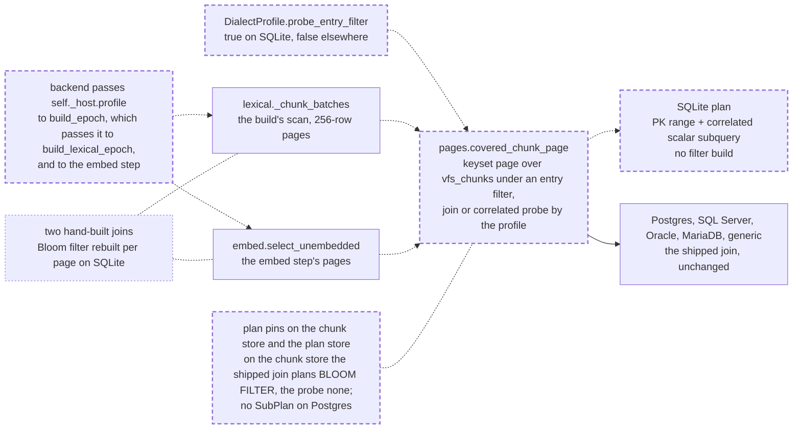

# The chunk page's entry filter takes the shape each planner serves: on SQLite the index build's and the embed step's keyset pages carry it as a correlated probe the planner leaves alone, so no Bloom filter is rebuilt per page, and on every other engine the join stays as it is

A fix to the database backend's two keyset scans over the chunk table, the lexical build's (`src/vfs/storage/backends/database/lexical.py`, `_chunk_batches`) and the embed step's (`embed.py`, `select_unembedded`), through one new module that builds the page in the shape the dialect profile declares (`pages.py`) and one new `DialectProfile` field (`dialects.py`). It is structural because it adds a module, so the spec review scores structure. It changes no public API, no schema format, no index format, no rights rule and no stored byte: the rows every build writes are the same rows, pinned by digest in the research and by the existing build tests here. It needs the engine legs through the `db_test` skill, because it edits statements under `storage/backends/database/` and the point of the profile field is that the other four engines keep the plan they have. It stands on [the tokenizer memo](../../research/2026-11-09-is-the-lexical-tokenizer-optimal.md) and its [study 03](../../research/studies/2026-11-09-is-the-lexical-tokenizer-optimal/03-the-lexical-builds-chunk-scan.md), which measured the scan by timer, read the cause in SQLite's source and measured nine alternatives on SQLite and Postgres with identical epoch rows. No intention: it corrects the cost of a landed change. It corrects a consequence of [the planner-statistics spec](../archive/2026-11-07-sqlite-gathers-planner-statistics-after-each-write.md), landed as `2d263fb`, whose statistics are what make SQLite's planner choose the filter, and it keeps that spec's decisions whole: without the statistics the page is worse. It depends on no active spec and shares no file with one: [the overlay kernel spec](../active/2026-11-09-the-overlay-counts-in-the-engine-and-the-scan-tier-shares-one-budget.md) edits `glean.py`, `grep.py` and `scope.py`, [bounded work has one home](../active/2026-11-07-bounded-work-has-one-home.md) edits `offload.py` and the readers, and [the refresh spec](../active/2026-10-31-refresh-the-incremental-index-verb.md) edits `indexing.py`, `lexical.py` and `backend.py` and will call `build_epoch` and `build_lexical_epoch` with the `profile` parameter this spec gives each of them, whichever of the two lands second taking the other's signatures; it can land in any order with them.

## The problem

READ at `b85e3df`. `_chunk_batches` (`lexical.py:139-170`) feeds the lexical builder every chunk of a `chunked ∧ indexable ∧ live` entry in ascending chunk id, by keyset pages of `_SCAN_PAGE_ROWS = 256`: `SELECT chunks.id, chunks.entry_id, chunks.content FROM vfs_chunks JOIN vfs_entries ON entry_id WHERE chunked AND indexable AND deleted_at IS NULL AND chunks.id > :last ORDER BY chunks.id LIMIT 256`, re-executed until a page is empty. The docstring gives the reason for pages rather than a cursor: the caller writes `lex_docs` between batches on the same connection, and a driver without multiple active result sets, SQL Server over ODBC, refuses a write while a cursor is open. `select_unembedded` (`embed.py:208-226`) is the same shape for the embed step: chunks joined to entries under `chunked AND deleted_at IS NULL`, `embedding IS NULL`, a correlated `NOT EXISTS` over the refusals table, `id > :after ORDER BY id LIMIT :limit`. Neither function receives the dialect profile.

EXECUTED in study 03 on a copy of the 100,000-file SQLite store (103,921 entries, 462,963 chunks, statistics gathered) with one file rewritten so the whole index rebuilds: `reindex()` 74.6 s; `build_lexical_epoch` 60.6 s; the scan, timed around each page execute in two samples, 35.06 and 35.12 s over 1,809 pages at a median of 19.08 ms a page, flat from the first page to the last; the builder 17.1 s, the inserts 6.8 s. The gram feed streamed the same 681 million characters in 2.8 s with a server-side cursor.

EXECUTED in study 03, `EXPLAIN QUERY PLAN` of the exact page on SQLite 3.50.4: `SEARCH vfs_chunks USING INTEGER PRIMARY KEY (rowid>?)`, `BLOOM FILTER ON vfs_entries (entry_id=?)`, `SEARCH vfs_entries USING INDEX ix_vfs_entries_entry_id (entry_id=?)`; no sort, no full scan. `sqlite3_stmt_status` after one page: 916,385 virtual-machine steps, against 1,544 for the same page without the join and 2,313 for the join without the entry filter, with `filter_miss=256, filter_hit=0`: the filter admits every probe and excludes nothing, because every chunk's entry qualifies, and about 914,000 steps a page construct it over the 103,921 entry rows. Ids-only costs the same as ids with content, so the bytes are not the cost. READ in SQLite's `src/where.c` at `3d17c3f9e`: `whereCheckIfBloomFilterIsUseful` sets the filter when the inner table has `ANALYZE` statistics, the lookup's terms are expected to cull, and the outer loop's estimated searches exceed the inner table's estimated rows, an estimate that ignores the `LIMIT`; `sqlite3ConstructBloomFilter` emits the construction behind an `OP_Once`, once per execution, so a page re-executed 1,809 times builds the filter 1,809 times. The optimization shipped in SQLite 3.38.0.

EXECUTED by the spec reviewer on 2026-11-09 with synthetic `sqlite_stat1` rows over 11,441 entries, reloaded by `ANALYZE sqlite_schema`: the planner builds the filter only when its estimate of the outer range, about a quarter of the chunk count with no regard for the `LIMIT`, exceeds the entry count, which on this schema is about 4 to 5 chunks per entry (the `BLOOM FILTER` line is absent at 1.0, 2.0, 3.0 and 4.0 chunks per entry and present at 5.0, 8.0, 10.0 and 44.0). The study's store sits at 4.6 chunks per entry and the reference deployment at 10; a store of one chunk a file, or of bodies too short to cut a chunk, plans the plain nested loop and never pays the filter, which is why the pin store below is built with long bodies.

EXECUTED in study 03: with the store's `sqlite_stat1` rows deleted the plan is entries-outer with a temp B-tree sort per page at 68.5 ms, worse; with `ANALYZE` run again the filter plan returns. So the statistics the landed spec gathers are not the thing to remove. Of eight spellings of the same page, `CROSS JOIN`, `likelihood`, `likely`, unary plus on the terms, the filter in the `ON` clause and a correlated `EXISTS` all keep the Bloom plan (the planner flattens `EXISTS` into the join); `entry_id IN (SELECT ...)` plans a full entry scan and a sort per page at 91 to 105 ms; the one spelling the planner leaves in place is a correlated scalar subquery compared to a constant, `(SELECT 1 FROM vfs_entries WHERE entry_id = vfs_chunks.entry_id AND <terms>) = 1`: `SEARCH vfs_chunks USING INTEGER PRIMARY KEY`, `CORRELATED SCALAR SUBQUERY`, one unique-index probe per row, 6,409 steps and 0.43 ms a page in-process, 3.64 s for the whole scan inside the build against 35.06, with the same statement count, no client state, and the four lexical tables' row counts and SHA-256 digests identical to the baseline's.

EXECUTED in study 03 on Postgres 17 over the same store: the shipped page plans as a nested loop over the chunk primary key with a memoized unique-index probe and no filter step, 0.3 to 0.7 ms of execution and 3.8 ms a page through the driver, 7.9 s for the scan; the scalar subquery is a regression there, because Postgres cannot estimate a SubPlan filter's selectivity, inflates its cost past `jit_above_cost`, and JIT-compiles every page at 5 to 7 ms. The other three engines were not measured.

EXECUTED today, `EXPLAIN QUERY PLAN` on the same store (the script `explain_pages.py` in the session scratchpad): the embed step's page, with and without its refusal `NOT EXISTS`, carries the same `BLOOM FILTER ON vfs_entries (entry_id=?)` step; the refusal term itself plans as a correlated scalar subquery on the refusals table's unique index and is not the problem. The other keyset scans in the backend, the segment collection in `signals.py`, the subtree and posture pages in `rights.py`, read one table each with no join and carry no filter.

INFERRED in study 03, section 6, from [AGENTS.md](../../../AGENTS.md) "The reference deployment": the filter's cost is paid once per page and scales with the entry count, so it is quadratic in the corpus; at the reference's 11,000,000 entries and 100,000,000 chunks the shipped shape is about 1.34 s a page over about 390,000 pages, about 145 hours per rebuild on SQLite, where any filter-free shape is about 7 CPU-minutes a day. SQLite is the dev and test default and a store some deployments will run.

## Architecture

Dashed is what this spec adds; dotted is what it retires.

Page this changes: none; the architecture folder was retired on 2026-10-31, and the landing notes will say so in one line.

Terms. A **chunk page** is one keyset page of chunk rows, `id > last ORDER BY id LIMIT n`, read whole before the caller writes. The **entry filter** is the set of terms on the entry row that make a chunk's entry covered: `chunked`, `indexable` and live for the build, `chunked` and live for the embed step. A **correlated probe** is the filter spelled as a scalar subquery on the entry table compared to a constant, one unique-index lookup per chunk row. The **chunk store** is the pin fixture whose chunk table is filled to a ratio above the filter's trigger, so the shipped join plans the filter there and a pin against it can go red.

## Decisions

### 1. One builder, `covered_chunk_page` in a new module `pages.py`, makes every keyset page over the chunk table that carries an entry filter, and both scans use it

Two sites hand-build the same shape today and both fall into the same planner trap; a third would too. The function takes the tables, the profile, the columns to select, the entry terms, the extra chunk terms, `after` and `limit`, and returns the `Select`. The module is new because neither existing owner fits: `indexing.py` imports `lexical.py` for the build, so `lexical.py` cannot import from it without a cycle; `membership.py` and `scope.py` build verb-side predicates; `dialects.py` holds budgets and profiles and no statements. The module sits beside `membership.py` as the other dialect-shaped statement builder, imports `dialects` and the SQLAlchemy core and nothing above them, and its docstring states the trap in the words of the problem section.

### 2. `DialectProfile.probe_entry_filter: bool = False`, true on `SQLITE` only, decides the shape; every other profile, the generic floor included, keeps the join

The choice is one SQLAlchemy takes no position on, which is the test AGENTS.md sets for a profile field, and it sits beside `rarity_hint`, the field [the statistics spec](../archive/2026-11-07-sqlite-gathers-planner-statistics-after-each-write.md) added for the same planner's other blind spot. SQLite is the one engine measured to rebuild a filter per execution; Postgres is measured to serve the join at the driver's floor and to JIT-compile the probe into a regression; SQL Server, Oracle and MariaDB are unmeasured, and the shipped join is what they run today, so they keep it until the engine legs read their plans, which the last section names. The field's docstring in `DialectProfile` says why in three sentences and names the direction: a planner that takes the `LIMIT` into its filter estimate would let SQLite take the join back.

### 3. The probe is `(SELECT 1 FROM vfs_entries WHERE vfs_entries.entry_id = vfs_chunks.entry_id AND <terms>) = 1`, built as `select(literal_column("1"))` correlated to the chunk table, `scalar_subquery()`, compared to `1`

It is the one spelling of eight that SQLite's planner does not flatten into the join: `EXISTS` is flattened and filtered (1,020,562 steps a page), `IN (SELECT ...)` plans a full scan and a sort, and the hint functions and join rewrites change nothing. The reviewer read SQLite's `src/select.c` at `3d17c3f9e`: the one rewrite of a `WHERE` subquery is `existsToJoin`, which matches an `EXISTS` node only, so a scalar subquery compared to a constant is outside every rewrite the planner has, on every supported version. A chunk whose entry does not qualify yields `NULL = 1`, which is not true, so it is dropped exactly as the join drops it. The constant is `literal_column("1")` and not `literal(1)`, so the compiled text reads `(SELECT 1 \nFROM vfs_entries` with no bind and no `AS anon_1` label, which adds no bind for the selected constant (the page's binds are `id > ?`, `LIMIT ?`, `OFFSET ?` today and the comparison's `= ?` is the one the probe adds) and lets the compile test assert the study's spelling. The subquery is correlated to the chunk table explicitly (`.correlate(chunks)`) so SQLAlchemy never lifts the entry table into the outer `FROM`.

### 4. The statistics stay, and `rarity_hint` is untouched

Study 03 deleted the store's `sqlite_stat1` rows and the page got worse, 68.5 ms with a temp B-tree sort, and better again with `ANALYZE`; the landed spec's reasons stand and this spec changes nothing it decided. The overlay fetch's rarity hint is a different statement on a different index and is not part of this change.

### 5. The page size stays `_SCAN_PAGE_ROWS = 256` and the keyset shape stays

Bigger pages only amortize the filter: 12.65 s at 1,024 rows, 3.67 s at 16,384 with 24 MB of content held a page, and the filter is still built once per page. The keyset shape is the docstring's SQL Server rule, no cursor open while the build writes, and the probe keeps it with the same statement count. The reason for the rule moves from the function's docstring into the module docstring of `pages.py`, and `_chunk_batches`' docstring keeps one sentence pointing there.

### 6. The three other filter-free shapes are not taken: the drained id set, the two-phase fetch and the streaming cursor

The Python set of qualifying entry ids is the one spelling good on both engines (3.34 s on SQLite, within noise on Postgres), but it holds one 26-character id per covered entry, about 1.1 GB at the reference's 11,000,000 entries, and AGENTS.md makes a whole-corpus structure affordable in the rebuild only when bounded in memory; the probe holds nothing. The two-phase fetch holds every chunk id and entry id pair, about 1.5 GB at 100,000,000 chunks, and is slower on Postgres. The streaming cursor is the fastest shape and the one the rule forbids unless the writes take a second connection, which is a lifecycle this fix does not open. The two-phase fetch is named as the shape to reach for when a build must also skip chunk rows by id.

### 7. The embed step's `select_unembedded` takes the same page builder, with its refusal `NOT EXISTS` carried as an extra chunk term

Its page carries the same filter build on SQLite (EXECUTED above), and the embed step runs inside `reindex()` on every chunk without a vector, so it pays the same per-page charge whenever an embedder is configured. The refusal term is a correlated scalar subquery on the refusals table's unique index already and is passed through unchanged.

### 8. The profile reaches the scans through their signatures: `build_epoch`, `build_lexical_epoch` and `select_unembedded` each gain a trailing `profile` parameter, `_chunk_batches` takes it from the build, and the backend passes `self._host.profile` at its two call sites

The backend holds the profile as `self._host.profile` (`backend.py:317`) and passes it to every statement builder that is dialect-shaped; these two were not, because their statements were not. The build's path is two calls deep: `backend.py:1486` calls `build_epoch(session, tables, state, self._host.offload_executor)` in `indexing.py`, which calls `build_lexical_epoch`, so `build_epoch(session, tables, state, executor, profile)` gains the parameter and passes it on, and the backend passes `self._host.profile` there. The embed step's path is one call: the `partial(select_unembedded, tables=tables, after=last, limit=EMBED_PAGE_ROWS, key=key)` at `backend.py:1544` gains `profile=self._host.profile`. [The refresh spec](../active/2026-10-31-refresh-the-incremental-index-verb.md), which adds a delta build beside the full one, calls both `build_epoch` and `build_lexical_epoch` and takes both new signatures when it is built.

### 9. The plan is pinned by operator on a store whose chunk table is filled past the filter's trigger: the chunk store in the suite on SQLite, and the plan store with the same bodies added on the engine legs; the pin's red is asserted on the same store

The filter appears only above about 4 to 5 chunks per entry (the problem section's threshold), and the stores the plan pins use today, `tests/support/plan_store.py`'s 50,000-file store and `test_statistics.py`'s 11,201-row `large_store`, write bodies of `x`, which cut no chunk row before or after `reindex()`; on either, the shipped join already plans no filter and a pin against it could never go red. So `tests/storage/database/test_statistics.py` gains a module-scoped `chunk_store` fixture: 200 text files under one root, each body about 20,480 characters of word text so the 2,048-character chunker cuts ten chunks a file, written through the backend, `reindex()` run, statistics settled through the host's own `settle_statistics()`, about 2,000 chunks over about 200 entries, a ratio of 10 as the reference deployment's. `tests/support/plan_store.py` gains `chunk_page_plans(storage) -> dict[str, str]`, the plan text of the build's page and the embed step's page keyed `build` and `embed`, read at the store's median chunk id through a per-engine plan-text reader split out of the existing readers, and `shipped_join_plan(storage) -> str`, the plan text of the build's page spelled as the join on the same store, which is the red. `build_plan_store` writes the same 200 bodies under a root outside `PLAN_ROOTS` and runs `reindex()`, and `PlanReadings` gains `chunk_pages: dict[str, str]`, filled by `_measured`. On SQLite the pin is three counts: the shipped join's plan on the chunk store has one line containing `BLOOM FILTER` (so the store does trigger the filter and the pin is live), the builder's plan of both pages has no line containing `BLOOM FILTER` and exactly one `CORRELATED SCALAR SUBQUERY` line whose next step searches `vfs_entries`, and the build's page has exactly one `CORRELATED SCALAR SUBQUERY` line in all; the embed page has two, because its refusal `NOT EXISTS` plans as a correlated subquery on the refusals index (the problem section's EXECUTED reading), so its count is of the entry probe alone. On Postgres the pin is that no line contains `SubPlan` and one line contains `Index Scan using vfs_chunks_pkey`. This is a count of plan operators, never a clock, which is the rule the plan pins already follow.

### 10. No behaviour changes, so no format bumps: `INDEX_FORMAT_VERSION` stays 4 and `SCHEMA_FORMAT_VERSION` is untouched

Study 03's nine variants, the probe among them, wrote the same row counts and the same SHA-256 over every row of `lex_docs`, `lex_df`, `lex_stats` and `lex_postings` as the baseline; the embed step's rows are selected by the same predicate on the same columns. The existing build and embed tests pin the rows, and the keyset test pins the shape.

## Intent

After this spec, a full rebuild of a 100,000-file SQLite store spends about 3.6 s reading its chunks instead of 35 s, and the lexical build falls from about 61 s to about 29 s, the same index rows written in the same order, with the same statement count and no new client-side state; a rebuild at ten times the corpus pays ten times the scan and not a hundred, so the daily rebuild on a SQLite store at the reference scale is hours and not days; Postgres, SQL Server, Oracle, MariaDB and an unknown engine issue the statements they issue today; and a reader of `pages.py` learns in its docstring why the page is shaped two ways and which engine measurement would let the shapes merge.

## Design

The module (`src/vfs/storage/backends/database/pages.py`, under 120 lines): a module docstring stating the trap and the rule; `def covered_chunk_page(tables, profile, columns, entry_terms, *, after, limit, chunk_terms=()) -> Select`, which on `profile.probe_entry_filter` selects `columns` from `chunks` under `chunks.c.id > after`, `*chunk_terms` and `select(literal_column("1")).where(entry.c.entry_id == chunks.c.entry_id, *entry_terms).correlate(chunks).scalar_subquery() == 1`, and otherwise from `chunks.join(entry, entry.c.entry_id == chunks.c.entry_id)` under the same chunk terms and `*entry_terms`, both `.order_by(chunks.c.id).limit(limit)`. Tests: `tests/storage/database/test_pages.py` (new), compiling the statement on the `sqlite` and `postgresql` dialects with literal binds and asserting the spelling of each.

The profile (`dialects.py`): `probe_entry_filter: bool = False` in `DialectProfile` after `rarity_hint`, a paragraph in the class docstring beside `rarity_hint`'s, and `probe_entry_filter=True` in `SQLITE`. Tests: `tests/storage/database/test_dialects.py::TestDialectPolicy` gains a node pinning the field on every profile.

The build (`lexical.py`): `build_lexical_epoch(session, tables, epoch, executor, profile)`; a public `lexical_scan_page(tables, profile, *, after) -> Select` builds the scan's page with `covered_chunk_page(tables, profile, [chunks.c.id, chunks.c.entry_id, chunks.c.content], [entry.c.chunked, entry.c.indexable, entry.c.deleted_at.is_(None)], after=after, limit=_SCAN_PAGE_ROWS)`, and `_chunk_batches(session, tables, profile)` executes it page after page; the docstring keeps the keyset sentence and points at `pages.py`. The embed step (`embed.py`): a public `unembedded_page(tables, after, limit, key, profile) -> Select` builds its page with the same function, entry terms `chunked` and live, chunk terms `embedding IS NULL` and `~_refused(tables, key)`, and `select_unembedded(session, tables, after, limit, key, profile)` executes it. The two page builders are public so the plan pins compile exactly the statement the backend runs rather than a copy of its columns and terms. The backend and the index phase: `indexing.py`'s `build_epoch(session, tables, state, executor, profile)` passes `profile` to `build_lexical_epoch`; `backend.py:1486` passes `self._host.profile` to `build_epoch`, and the `partial(select_unembedded, ...)` at `backend.py:1544` gains `profile=self._host.profile`.

The pins (`tests/support/plan_store.py`): the existing per-engine readers are split into a plan-text reader per engine (`_sqlite_plan_text(session, literal) -> str` and its four siblings) and the `PlanReading` judgement over it, so `read_plan` is unchanged in result; `async def chunk_page_plans(storage) -> dict[str, str]` compiles `lexical_scan_page` and `unembedded_page` with literal binds at the store's median chunk id and reads each through the plan-text reader, and `chunk_page_statements(storage) -> dict[str, str]` returns the literal statements themselves; `async def shipped_join_plan(storage) -> str` compiles `lexical_scan_page` under the store's profile with `probe_entry_filter` replaced by `False`, which is the join every other engine runs; `build_plan_store` writes 200 bodies of about 20,480 characters under `/chunks` after the 50,000 files and calls `reindex()` before the statistics step, and the server engines' statistics command gathers `vfs_chunks` as well as `vfs_entries`; `PlanReadings` gains `engine: str` (the profile's name, so the conformance row judges by the engine's own operators), `chunk_pages: dict[str, str]` and `chunk_statements: dict[str, str]`, and `decoded` carries them. The join check on a server statement is a regex that admits the schema-qualified `JOIN <schema>.vfs_entries`. `tests/storage/database/test_statistics.py` gains the module-scoped `chunk_store` fixture (decision 9) beside `large_store`, and `TestPlannerStatistics` gains two nodes on it: the red, that `shipped_join_plan` contains `BLOOM FILTER`, and the pin, that neither page's plan does and each has one `CORRELATED SCALAR SUBQUERY` line; `tests/support/storage_contract.py` gains the conformance row over `plan_store.chunk_pages`, asserting the Postgres operators on Postgres and the join's reading on the other three engines.

Order of work: the `pages.py` compile tests red, the module green; the profile field and its pin; the two callers moved onto the builder with the profile threaded, the existing build, keyset and embed tests green unchanged; the `chunk_store` fixture and the red node green first (the shipped join does plan the filter there), then the pin node red against the hand-built join and green on the builder; the plan store's bodies, `chunk_pages` and the conformance row; the docstrings; `scripts/ci.sh`; the four engine legs with their plans read.

## Scope

In: decisions 1 to 10. Files: `src/vfs/storage/backends/database/pages.py` (new), `dialects.py`, `lexical.py`, `embed.py`, `indexing.py`, `backend.py`, `tests/storage/database/test_pages.py` (new), `test_dialects.py`, `test_statistics.py`, `test_lexical.py`, `test_embed.py`, `tests/support/plan_store.py`, `tests/support/storage_contract.py`.

Out: the plans of SQL Server, Oracle and MariaDB for the probe, which the engine legs read for the join only; whether any of them should take the probe is the experiment the last section of the memo names, and a profile flip once measured. Out: a second connection for the build's writes, which would admit the streaming cursor; a lifecycle question for a spec of its own. Out: the Postgres first build on an unanalysed schema (759 s against 80 s in study 03), an experiment named in the memo. Out: the gram feed's streaming scan, which has no join and no problem. Out: the lexical builder's own cost, [its own spec](../active/2026-11-09-the-lexical-builder-interns-each-term-once.md).

## Acceptance criteria

1. `covered_chunk_page` compiled on the `sqlite` dialect for the build's columns and terms contains `(SELECT 1 `, `FROM vfs_entries` and `) = 1`, no `anon_1` and no `JOIN`; compiled on the `postgresql` dialect it contains `JOIN vfs_entries` and no `SELECT 1`. Test: `tests/storage/database/test_pages.py::test_the_page_probes_on_sqlite_and_joins_elsewhere`.
2. `SQLITE.probe_entry_filter` is `True` and it is `False` on `POSTGRESQL`, `MSSQL`, `MARIADB`, `ORACLE` and `GENERIC`. Test: `tests/storage/database/test_dialects.py::TestDialectPolicy::test_the_entry_probe_is_declared_on_sqlite_only`.
3. On the `chunk_store` fixture (200 files of ten chunks each, reindexed, statistics settled), the SQLite plan of the build's page spelled as the shipped join has exactly one line containing `BLOOM FILTER`; the plan of the builder's page, for the build's columns and terms and for the embed step's, has no line containing `BLOOM FILTER` and exactly one `CORRELATED SCALAR SUBQUERY` line followed by a `SEARCH vfs_entries` step; and the build's page has exactly one `CORRELATED SCALAR SUBQUERY` line in all (the embed page has a second, its refusal term's). Tests: `tests/storage/database/test_statistics.py::TestPlannerStatistics::test_the_chunk_store_makes_the_shipped_join_build_a_filter` and `::test_the_chunk_pages_build_no_filter_per_page`, both on `chunk_store`.
4. On Postgres, `plan_store.chunk_pages` has for both pages no line containing `SubPlan` and one line containing `Index Scan using vfs_chunks_pkey`; on SQL Server, Oracle and MariaDB each page's plan text is non-empty, the compiled statement joins `vfs_entries` (schema-qualified on a server), and the plan is pasted into the landing notes with one line saying whether it holds a per-execution build on the entry side (a `Hash Match` or bitmap operator on SQL Server, a `JOIN FILTER CREATE` on Oracle, a hash join on MariaDB), which is the reading that would flip that engine's `probe_entry_filter`. Test: `tests/support/storage_contract.py::StorageContract::test_the_chunk_page_plan_is_the_engines_own`, marked `slow`, run through `db_test`.
5. A rebuild with `_SCAN_PAGE_ROWS` patched to 1 over five bodies issues six page statements, each containing `LIMIT` and `vfs_chunks.id >`, exactly as today. Test: the existing `tests/storage/database/test_lexical.py::TestBatchBudgets::test_the_scan_reads_keyset_pages_never_an_open_cursor`, unchanged.
6. The four lexical row sets a rebuild writes on SQLite are unchanged: the existing nodes `TestBuild::test_reindex_builds_the_four_row_sets_under_the_gram_epoch`, `TestBuild::test_ineligible_entries_have_no_lexical_rows`, `TestBuild::test_a_trashed_entry_leaves_the_next_epoch` and `TestBuild::test_the_fidelity_referee_holds_on_sqlite` pass unchanged. Tests: those nodes in `tests/storage/database/test_lexical.py`.
7. The embed step's pages select the same rows: the existing `tests/storage/database/test_embed.py::TestStep::test_a_later_page_borrows_a_vector_already_stored`, `::TestStep::test_a_lost_lease_stops_between_pages` and `::TestStep::test_trashed_entries_are_not_embedded_nor_counted` pass unchanged.
8. `INDEX_FORMAT_VERSION` is 4. Test: the existing `tests/storage/database/test_lexical.py::TestFingerprint::test_the_declared_format_version`.
9. `pages.py` imports nothing from `indexing`, `lexical`, `embed` or `backend`. Test: `tests/storage/database/test_pages.py::test_the_module_imports_downward`, reading the module's import names.
10. The conformance suite's existing rows pass on the four engines through `db_test`, and the rebuild row counts on each engine equal SQLite's for the same corpus. Evidence: the legs' pass counts in the landing notes.

## Landing notes

Built 2026-11-09 over `b85e3df`, after [the statistics spec](../archive/2026-11-07-sqlite-gathers-planner-statistics-after-each-write.md) and [the directory-flag fix](../archive/2026-11-08-a-directory-is-never-awaiting-the-index.md) had landed; no active spec's code was in the tree, so no rebase was needed. Tests first: the compile test was red before `pages.py` existed, the profile pin before the field existed, and the chunk-store pin red against the shipped join (`BLOOM FILTER ON vfs_entries (entry_id=?)` on the 2,200-chunk store) before the callers moved onto the builder; the red companion node was green first, as the order of work asked, proving the store triggers the filter. Reviews: [the spec review](../../reviews/2026-11-09-the-chunk-page-filter-takes-the-shape-each-planner-serves-spec-review.md) and [the code review](../../reviews/2026-11-09-the-chunk-page-filter-takes-the-shape-each-planner-serves-code-review.md).

Per criterion. 1: `test_pages.py::test_the_page_probes_on_sqlite_and_joins_elsewhere` passes; the SQLite compile reads `(SELECT 1 \nFROM vfs_entries ... ) = 1` with no `anon_1` and no `JOIN`, the Postgres compile `JOIN vfs_entries` with no `SELECT 1`. 2: `TestDialectPolicy::test_the_entry_probe_is_declared_on_sqlite_only` passes, `SQLITE` true and the five others false. 3: on the module-scoped `chunk_store` (200 files of 20,480 characters, 2,200 chunks over 202 entries, `sqlite_stat1` reading `ix_vfs_chunks_entry_id 2200 11`), `test_the_chunk_store_makes_the_shipped_join_build_a_filter` finds one `BLOOM FILTER` line on the join and `test_the_chunk_pages_build_no_filter_per_page` finds none on either page, one `CORRELATED SCALAR SUBQUERY` followed by `SEARCH vfs_entries` on each, and one subquery in all on the build page; the embed page's second subquery is the refusal term's, on the refusals index, as the problem section read it. The mutant, `probe_entry_filter=True` removed from `SQLITE`, turns the pin and criterion 1 red. 4: `StorageContract::test_the_chunk_page_plan_is_the_engines_own` passes on all five engines; the plans are recorded below. 5 to 8: the named existing nodes pass unchanged; `INDEX_FORMAT_VERSION` is 4. 9: `test_the_module_imports_downward` passes; `pages.py` imports SQLAlchemy and, for typing only, `dialects` and `models.rows`. 10: recorded below.

The engine plans, each page read at the store's median chunk id on the plan store with its 200 chunk bodies reindexed and both tables analyzed. SQLite: both pages a primary-key range with one correlated unique-index probe, no filter. Postgres: a memoized nested loop over `Index Scan using vfs_chunks_pkey`, no `SubPlan`, on both pages; the embed page's only sequential scan is of the empty refusals table on the refusal side. MariaDB: a primary-key `range` with an `eq_ref` probe of `ix_vfs_entries_entry_id` per row on both pages, no hash join; the embed page materializes the one-row refusals subquery. SQL Server: nested loops of seeks on both pages, no `Hash Match` and no bitmap; the one scan is of the one-row refusals table. Oracle, the build page: nested loops, a primary-key range then `INDEX UNIQUE SCAN` of `IX_VFS_ENTRIES_ENTRY_ID`, no `JOIN FILTER CREATE`. Oracle, the embed page: no `JOIN FILTER CREATE` either, but a `HASH JOIN` whose probe input is `TABLE ACCESS FULL` of `VFS_ENTRIES`, about 50,000 rows, on every page, followed by a sort; a per-execution cost that grows with the entry count, the class this spec removes on SQLite, under `dynamic sampling` because the refusals table had no gathered statistics. Flagged to the developer: that Oracle reading is the evidence for the probe measurement on Oracle the Out section names; the profile was not flipped, because the probe's own Oracle plan is unmeasured.

Deviations from the Design. The embed page's subquery count is of the entry probe alone, because its refusal term is a correlated subquery of its own (criterion 3 and decision 9 were corrected to say so after the spec review signed; the measured fact was already in the problem section). The two page builders, `lexical_scan_page` and `unembedded_page`, are public so the plan pins compile the statement the backend runs, and `shipped_join_plan` compiles the build page under the profile with `probe_entry_filter` replaced by `False`, the statement every other engine runs, instead of a hand-built join. `PlanReadings` carries `engine` and `chunk_statements` beside `chunk_pages`, because the conformance row judges by the engine's own operators and reads the join from the statement, through a regex that admits the schema-qualified server spelling. The plan store's statistics command gathers `vfs_chunks` as well as `vfs_entries` on the server engines, so the chunk-page plans rest on statistics and not on autovacuum timing. The 200 bodies are written after the 50,000 files and before the one `reindex()`, so every entry is chunked as on a rebuilt store; reindexing before the short files were written left them unchunked and changed the Postgres and Oracle plans to ones a rebuilt store never shows. Criterion 4's plans are recorded as one reading per engine rather than pasted; each leg publishes the plan text in `plan-store-<engine>.json` under the session's shared temporary directory, where the `db_test` cycle leaves it to read, and the code review quotes the operator lines of each. After the code review's four Lows: the profile docstring names the three engines' measured join plans where it said they were unmeasured (L2); `PlanReadings` carries `probes`, the profile's `probe_entry_filter`, and the conformance row branches on that declared fact for the probe-or-join check, keeping the engine's name for Postgres's operator counts only (L3); the compile test takes the build page from `lexical_scan_page` instead of re-spelling its columns and terms (L4); and this sentence records L1. The mutant ledger's anchor for the dropped `deleted_at IS NULL` term moves from `_chunk_batches` to `lexical_scan_page`, where the term now lives.

One fix outside the spec, asked for by the developer on 2026-11-09 after the full suite hung on this tree: three embed tests patched the process-wide `asyncio.sleep` to return at once so the retry-after sleep would not wait, and the reindex lease heartbeat sleeps through the same name, so while the patch was live the heartbeat task spun without pausing and the reindex starved behind it, a hang that depended on scheduling (one run hung past twenty minutes, the implementer saw one flake in the same family). `embed.py` now imports `sleep` from `asyncio` as its own name, the way every module imports `monotonic` from `time`, and the three tests patch `embed_module.sleep`; `test_retry_after_is_honoured_once` now asserts the recorded delays are exactly the retry's, where it had to filter the heartbeat's out. No behaviour changes.

Architecture pages: none; the folder was retired on 2026-10-31.

Criterion 10, the engine legs: the `db_test` cycle on this tree, fresh containers: Postgres 388 passed, MariaDB 378 passed and 8 skipped, SQL Server 388 passed, Oracle 383 passed, no failures; each count is one node over the directory-flag landing's, the new conformance row. The 200-body corpus reindexed on each engine wrote the same rows as SQLite: `vfs_chunks` 2,200, `vfs_lex_docs` 2,200, `vfs_lex_df` 210, `vfs_lex_stats` 1, `vfs_lex_postings` 510. SQL Server's first runs beside a concurrent plan-store dump on the same container failed with error 701, insufficient memory in the resource pool, and one fresh run had three teardown deadlocks (1205) on the schema drop; the clean run was alone on a recreated container. After the code review's L3 changed the conformance row, the row re-ran on fresh containers, one engine at a time: 2 passed on each of Postgres, MariaDB, SQL Server and Oracle (the chunk-page row and the roots-alone plan pin that shares its fixture).

`scripts/ci.sh` on the tree as committed, the spec already moved to the archive: install, lint, format and types PASS; 4831 passed, 6 skipped, coverage 100 %; 44 docs fences; the wheel 9 MB under the 50 MB budget; all legs green. The plan store's SQLite build grew by the one `reindex()` over its 56,200 rows, about 5 s on one worker. The whole suite on a quiet machine, Docker Desktop idle, the engines down: 133.6 s on this tree against 134.5 s on a scratch clone of `b85e3df`, so the change adds nothing the clock can see; both sit above the one-minute budget AGENTS.md names, a machine-day effect to look at on its own, not this landing's. Did not run: nothing.

**Changelog:** Changed — on SQLite the index build's and the embed step's chunk pages spell their entry filter as a correlated probe, so a rebuild no longer rebuilds a Bloom filter over every entry row on each of its pages and the scan is linear in the chunks; every other engine issues the join it issued before.

## One line

The build's and the embed step's chunk pages are made by one builder that spells the entry filter as a correlated probe on SQLite, where the planner would otherwise rebuild a Bloom filter on every page, and as the join everywhere else, so the same rows are read at a tenth of the cost and the rebuild stops being quadratic in the corpus.
