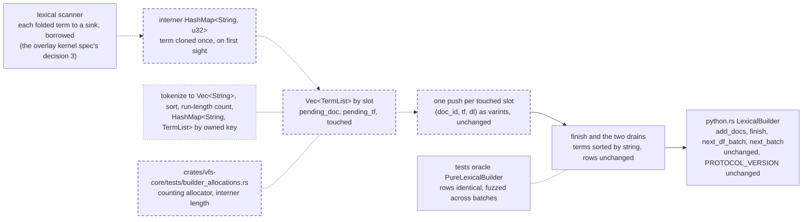

# The lexical builder interns each term once: the engine's BM25 accumulator takes its tokens from the borrowed-term scanner, counts a document's terms in place against an interner that clones a term only the first time the corpus sees it, and writes byte-identical rows at half the cost and a sixteenth of the allocations

A refactor to the Rust engine's lexical builder (`crates/vfs-core/src/lexical.rs`, `LexicalAccumulator`): it touches the engine, so `cargo test -p vfs-core`, the wheel reinstall and the oracle parity tests are criteria. It changes no binding, so `PROTOCOL_VERSION` stays at 14 after [the overlay kernel spec](2026-11-09-the-overlay-counts-in-the-engine-and-the-scan-tier-shares-one-budget.md) lands (13 if this spec were to land first, which it does not); it changes no public API, no schema format, no stored byte and no rights rule; `INDEX_FORMAT_VERSION` stays at 4 and `TOKENIZER_VERSION` at 1 because every row the builder drains is byte-identical to today's, which the existing oracle parity tests pin on every push. It does not need the engine legs: no statement under `storage/backends/database/` changes, and the builder's output is engine-independent by construction. It stands on [the tokenizer memo](../../research/2026-11-09-is-the-lexical-tokenizer-optimal.md), its [study 01](../../research/studies/2026-11-09-is-the-lexical-tokenizer-optimal/01-how-mature-tokenizers-produce-terms.md) (how tantivy, Lucene and zoekt intern terms) and its [study 02](../../research/studies/2026-11-09-is-the-lexical-tokenizer-optimal/02-where-the-sixty-four-microseconds-go.md) (the measured builder variant with identical drained rows). No intention: the audience gains no experience, the rebuild gets cheaper. It depends on one active spec: [the overlay kernel spec](2026-11-09-the-overlay-counts-in-the-engine-and-the-scan-tier-shares-one-budget.md), "Fit to build", whose decision 3 lifts the tokenizer's scanning loop into a private scanner that hands each folded term to a closure as a borrowed slice; this builder is that scanner's second consumer and lands after it. It shares `lexical.rs` with that spec and with no other active spec, and the overlay kernel spec's Disposition records this spec as the scanner's second consumer and its landing notes name it in one line; [the refresh spec](../active/2026-10-31-refresh-the-incremental-index-verb.md)'s `finish_under` for delta statistics is a method on the same accumulator, and whichever of the two lands second takes the other's shape of the struct.

## The problem

READ at `b85e3df`. `LexicalAccumulator::add_doc` (`crates/vfs-core/src/lexical.rs:435-467`) calls `tokenize(content)` for a `Vec<String>`, takes its length as the document length, sorts the vector, run-length counts it into a reused `counts: Vec<(String, u32)>` by moving each first-seen `String` in and dropping its duplicates, then for each `(term, tf)` looks the term up in `terms: HashMap<String, TermList>` by `get_mut(&term)` and either pushes `(doc_id, tf, dl)` onto the list as three varints or inserts the `String` as a new key with a fresh list. So every emitted occurrence allocates a `String` in the tokenizer's `emit`; the ones that are duplicates within the document are freed by the run-length step, the ones already in the map are freed after the lookup, and only a term new to the corpus keeps its allocation. The binding `LexicalBuilder.add_docs` (`python.rs:372`) receives `Vec<(i64, PyBackedStr)>` and calls `add_doc` under `py.detach`; Python passes chunk bodies and tokenizes nothing. `finish` (`lexical.rs:470-510`) collects the map into a vector, sorts it by term, computes each term's idf, block maxima and summary, and the two drains hand rows out in term order.

EXECUTED in study 02, section 5, pure Rust on this machine (Apple M1 Pro, rustc 1.97.1): on 2,000 generated prose bodies of 7,167 bytes (corpus A) `add_doc` costs 181.5 µs a body with 1,147 allocations and 105 reallocations, against 61.2 µs for its own tokenizer, so the sort, the count and the allocations are two thirds of the builder; on 943 repository files of 20,367 bytes mean (corpus B) 450.4 µs and 3,158 allocations; on 20,000 chunks sampled from the 100,000-file store at 1,478 bytes (corpus C), the shape the build actually feeds, 39.9 µs and 235 allocations a chunk. `finish` and the block drain add 13 µs per corpus-A body, so `add_doc` is 93 per cent of the builder's CPU. A variant that keeps `TermList`, the sealing, `finish` and both drains as written and replaces only the per-document counting, the tokenizer handing each term to a sink as a borrowed `&str`, the sink looking it up in an interner `HashMap<String, u32>` and cloning only a corpus-new term, each `TermList` carrying a pending document and term frequency the sink bumps in place with a touched list of the slots the document reached, and one `push` per touched slot once the length is known, drains identical rows at 91.8 µs a corpus-A body and 68 allocations, 217.7 µs on corpus B, and 20.2 µs a corpus-C chunk with 8 allocations, under the default hasher; with an FNV-1a hasher 81.9, 195.8 and 17.8; fed by the combined tokenizer variant another 10 µs lower. The allocations that remain are the vocabulary's first-sight cost, one `String` and three posting streams' first push per corpus-new term, amortised over the corpus: four per distinct term fits all three corpora (corpus A 33,294 terms × 4 over 2,000 bodies is 66.6 against the measured 68; corpus B 50,347 × 4 over 943 is 213.6 against 216; corpus C 35,764 × 4 over 20,000 is 7.2 against 8), so the per-chunk figure is a function of how many terms the corpus has not yet seen, not of the chunk; the 94 reallocations a body are the posting streams and the touched list growing.

EXECUTED in study 02, section 6, and [study 03](../../research/studies/2026-11-09-is-the-lexical-tokenizer-optimal/03-the-lexical-builds-chunk-scan.md), section 2: in a full rebuild of the 100,000-file store the builder's `add_docs` is 17.1 to 17.6 s of the 74.6 s rebuild over 462,963 chunks, 37.9 µs a chunk, matching the bench within 5 per cent; the projection of the variant is 9 to 11 s saved per 100,000-file rebuild and 17 to 21 CPU-minutes a day at the reference deployment's 11,000,000 visits, the second-largest saving the research found after the chunk scan's.

READ in study 01, sections 2 to 7: tantivy's indexer hashes term bytes into an arena that copies a key only on first sight (`ArenaHashMap::mutate_or_create`), Lucene's `BytesRefHash.add` interns once, and zoekt builds no string at all; steady-state allocation per token is zero in every engine studied, and the designs that allocate per term are the non-engines.

## Architecture

Dashed is what this spec adds; dotted is what it retires.

Page this changes: none; the architecture folder was retired on 2026-10-31, and the landing notes will say so in one line.

Terms. The **interner** is the map from a term to its slot, holding the one owned copy of each distinct term in the corpus. A **slot** is a term's index into the vector of term lists. A **touched slot** is one whose term occurred in the document being counted.

## Decisions

### 1. The accumulator keys its term lists by slot through an interner, and a term is cloned exactly once, when the corpus first sees it

`terms: HashMap<String, TermList>` becomes `interner: HashMap<String, u32>` beside `lists: Vec<TermList>`; a lookup is `interner.get(term)` on a borrowed `&str`, which the standard map serves without an owned key, and a miss inserts `term.to_owned()` with the next slot. This is the shape every engine in study 01 uses and the one measurement in study 02 that halves the builder with identical rows: the allocations fall from 1,147 to 68 a corpus-A body, and the ones that remain are the vocabulary's first-sight cost, one `String` and three posting streams per corpus-new term, amortised over the corpus. The interner holds the same one copy of each term the map key held before, so the term strings' residency is unchanged.

### 2. A document's terms are counted in place: each `TermList` carries `pending_doc: i64` and `pending_tf: u32`, the sink bumps them, a touched list records the slots the document reached, and once the document's length is known each touched slot pushes one posting

The sort and the run-length count go, and with them the `counts` vector of owned strings. Per term occurrence the work is one hash and one compare-and-increment; per distinct term in the document, one `push(doc_id, tf, dl)` exactly as today, so the varint streams, the sealing at `BLOCK_SIZE` and `df` are written by the same code in the same order. The pending fields cost 16 bytes a term list against the docstring's measured 660 bytes a term, under 3 per cent, and the docstring's residency sentence gains that clause. The touched list is a reused `Vec<u32>` cleared per document, so it allocates only on growth. `pending_doc` starts at 0, which no accepted document id equals because `add_doc` refuses `doc_id <= last_doc_id` from a `last_doc_id` of 0, so a fresh list's first occurrence always takes the set-and-touch branch.

### 3. The tokens come from the scanner the overlay kernel spec adds, each folded term handed to the sink as a borrowed `&str`; `tokenize` itself is no longer called by the builder

The scanner is one private function with a closure parameter, written for the overlay's counts kernel; the builder is its second consumer, with a closure that does decisions 1 and 2. The document length is the count of terms the scanner emits, which is what `tokenize(content).len()` counted, since the scanner applies the same length rules before it emits. Study 02 measured the two changes composing: the borrowed sink is what both need, and the tokenizer's own variants save at most 5.8 µs a chunk where the counting change saves 20 to 24. The builder asks one thing of the scanner: each emitted term arrives as a borrowed `&str`, folded, with the two length rules applied, once per token in input order, from a free function whose closure parameter is `FnMut(&str)`, so the closure can borrow the accumulator's fields disjointly; the scanner's two reusable buffers are owned by the accumulator and cleared per document, so the scanner allocates only on growth. If the overlay kernel spec is unbuilt when this spec is built, this spec lifts the scanner itself per that spec's decision 3 and that spec's landing takes it as already present.

### 4. The hasher stays the standard library's default

FNV-1a measured 9 to 10 µs a body faster on short keys and is a probe of what the hash costs, not a proposal: the default hasher is keyed and collision-resistant, a corpus is untrusted input, and study 02 names the adversarial-corpus probe-length experiment as unsettled. The interner's hash is per occurrence, so a faster hasher is a later, measured decision if the probe lengths justify it.

### 5. `finish` and the two drains are unchanged in what they compute and emit: the interner is collected into `(term, list)` pairs and sorted by term string exactly as the map was

The drained rows are the contract: `lex_df`, `lex_stats` and `lex_postings` rows and their order, pinned byte for byte against the pure-Python oracle by the existing `tests/test_native.py::TestLexicalParity::test_rows_identical` and `test_fuzz_rows_identical_across_batch_boundaries`, and by the storage build's fidelity referee. Because the rows do not change, `INDEX_FORMAT_VERSION` stays at 4, `TOKENIZER_VERSION` at 1, and the options fingerprint is unchanged, so no store rebuilds on upgrade.

### 6. The binding is unchanged, so `PROTOCOL_VERSION` does not move for this spec

`LexicalBuilder.add_docs`, `finish`, `next_df_batch` and `next_batch` keep their signatures and semantics; the accumulator's public Rust surface (`new`, `add_doc`, `finish`, the drained type) keeps its signatures and gains one accessor, `pub fn distinct_terms(&self) -> usize`, the interner's length, which the integration test reads and the binding does not expose; the refresh spec's `finish_under` is added beside them when that spec is built. The seam's protocol constant counts binding surface, and none changes here.

### 7. The allocation count is pinned by an integration test with a counting allocator that counts only while a thread-local flag is armed, on a fixed fixture, as a first-sight cost model and a steady-state bound: operations, never clocks

`crates/vfs-core/tests/builder_allocations.rs` installs a counting `#[global_allocator]` in its own test binary, wrapping `System` in an atomic counter that increments only while a `thread_local!` flag with a `const` initialiser is armed, so the harness's own thread and any parallel test count nothing; the test arms the flag around each measured region. The fixture is a Zipf draw with seed 7 from a word list of 2,000 words, 200 chunks of about 1,500 bytes, generated in the test. The first pass feeds the 200 chunks once and asserts its allocations are at most four per distinct term (read back through `distinct_terms()`) plus 24 per chunk, the first-sight cost model the problem section states. The second pass feeds the same 200 chunks again under new doc ids and asserts fewer than 24 allocations a chunk, the steady state where every term is already interned, and that `distinct_terms()` did not grow, which pins "cloned once, on first sight" directly; a per-token `String` anywhere in the path would put the second pass near 215 a chunk, so this assertion is the guard against the saving regressing. Time is not asserted anywhere.

### 8. The builder's module docstring states the shape and the number: one owned copy of each term, counted in place, with the allocations that remain being the vocabulary's first-sight cost amortised over the corpus

The docstring at `lexical.rs:1-26` says the builder "streams documents once — tokenize, count, append each posting to its term's open block"; it now says how the count is made, that a term is interned once, that the allocations that remain are one string and three posting streams per corpus-new term with the reallocations being those streams and the touched list growing, and its residency sentence gains the pending fields' 16 bytes a term.

## Intent

After this spec, a full rebuild of the 100,000-file store spends about 8 s in the lexical builder instead of about 17, writes the same `lex_docs`, `lex_df`, `lex_stats` and `lex_postings` rows byte for byte in the same order, and allocates about one string per distinct term in the corpus instead of one per word in every chunk; nothing a caller sees changes, no store rebuilds on upgrade, and the daily rebuild at the reference scale saves about 20 CPU-minutes.

## Design

The engine (`crates/vfs-core/src/lexical.rs`): `LexicalAccumulator { interner: HashMap<String, u32>, lists: Vec<TermList>, touched: Vec<u32>, the scanner's two reusable buffers, n_docs, total_dl, last_doc_id }` with `pub fn distinct_terms(&self) -> usize`; `TermList` gains `pending_doc: i64` (starting at 0) and `pending_tf: u32`; `add_doc` runs the scanner with a closure that looks the term up or interns it, and on a slot whose `pending_doc != doc_id` sets it and `pending_tf = 1` and records the slot in `touched`, else increments `pending_tf`, counting `dl` as it goes, then for each touched slot calls `push(doc_id, pending_tf, dl)` and clears the touched list; `finish` builds `Vec<(String, TermList)>` from the interner's entries by slot and sorts by term as today. Rust tests in the module: `builder_interns_a_term_once` (two documents of the same words, `distinct_terms()` equal to the distinct count), and the existing tests untouched, `builder_blocks_and_summaries` among them pinning the rows. `crates/vfs-core/tests/builder_allocations.rs` (new) per decision 7, with its fixture chunks generated deterministically in the test from the seeded Zipf draw. `python.rs`: unchanged.

The Python side: unchanged. `tests/test_native.py::TestLexicalParity` and `TestLexicalBuilderContract`, `tests/models/test_lexical.py::TestBuilder`, and `tests/storage/database/test_lexical.py::TestBuild` pass unchanged; `tests/models/test_lexical.py::TestBuilder::test_document_length_counts_every_token_not_distinct_terms` is the node that pins decision 3's length rule. The wheel reinstall follows the Rust edit.

Order of work: the allocation test and `builder_interns_a_term_once` red; the accumulator rewritten on the scanner, green; `cargo test -p vfs-core`; the wheel reinstall; the Python parity and contract suites green unchanged; the docstring; `scripts/ci.sh`.

## Scope

In: decisions 1 to 8. Files: `crates/vfs-core/src/lexical.rs`, `crates/vfs-core/tests/builder_allocations.rs` (new), `crates/vfs-core/Cargo.toml` only if the counting allocator needs a dev-dependency (the standard library's `System` allocator wrapped in an atomic counter needs none).

Out: the hasher (decision 4), after the adversarial-corpus experiment the memo names. Out: the tokenizer's own variants beyond the borrowed sink, the ASCII run path among them, which the overlay kernel spec or a later one takes. Out: the `tokenize` pyfunction's return shape for the query path, named in the memo. Out: the chunk scan that feeds the builder, [its own spec](2026-11-09-the-chunk-page-filter-takes-the-shape-each-planner-serves.md). Out: the lexical inserts, 6.8 s of the rebuild, bounded by the row budget already. Out: the delta build's `finish_under`, [the refresh spec](../active/2026-10-31-refresh-the-incremental-index-verb.md)'s decision 11.

## Acceptance criteria

1. The builder's drained rows are byte-identical to the pure-Python oracle's on every fixture corpus and under fuzzing across batch boundaries. Tests: the existing `tests/test_native.py::TestLexicalParity::test_rows_identical` and `::test_fuzz_rows_identical_across_batch_boundaries`, unchanged.
2. Over the 200 fixture chunks (a Zipf draw, seed 7, 2,000-word list) the first pass makes at most four allocations per distinct term plus 2 per chunk, and the second pass over the same chunks under new doc ids makes fewer than 2 allocations a chunk and leaves `distinct_terms()` unchanged; the allocator counts only while the test's thread-local flag is armed. The allowance was 24 a chunk when this spec was signed and was tightened to 2 at the code review, a bound that implies decision 7's. Tests: `crates/vfs-core/tests/builder_allocations.rs::the_first_pass_pays_four_allocations_a_distinct_term` and `::a_second_pass_interns_nothing_and_allocates_under_two_a_chunk`.
3. Two documents of the same words leave `distinct_terms()` at one per distinct term, and the existing block-and-summary fixture drains the rows it drains today. Tests: `crates/vfs-core/src/lexical.rs` tests `builder_interns_a_term_once` and `builder_blocks_and_summaries`, the latter unchanged.
4. A document's length counts every emitted token, not its distinct terms. Tests: the existing `tests/test_native.py::TestLexicalParity::test_rows_identical` and `::test_fuzz_rows_identical_across_batch_boundaries`, which compare the lengths `add_docs` returns and the `dls` bytes against the oracle; in the crate, `builder_interns_a_term_once` asserts the decoded `dls`; the oracle's own rule is `tests/models/test_lexical.py::TestBuilder::test_document_length_counts_every_token_not_distinct_terms`. All but the crate test are unchanged.
5. Non-increasing doc ids and feeding after `finish` are refused, and an empty builder drains nothing. Tests: the existing `tests/test_native.py::TestLexicalBuilderContract` nodes and `tests/models/test_lexical.py::TestBuilder::test_non_increasing_doc_ids_are_refused`, `::test_feeding_after_finish_is_refused`, `::test_an_empty_corpus_has_zero_stats_and_no_rows`, unchanged.
6. `INDEX_FORMAT_VERSION` is 4, `TOKENIZER_VERSION` is 1 and the options fingerprint is the value it returns before the change. Tests: the existing `tests/storage/database/test_lexical.py::TestFingerprint::test_the_declared_format_version` and `tests/models/test_lexical.py::TestFormula::test_options_fingerprint_reads_the_live_constants`, unchanged.
7. `vfs._native.PROTOCOL_VERSION` equals `EXPECTED_PROTOCOL`, unchanged by this spec. Test: the existing `tests/test_native.py::TestSeamGate::test_the_live_extension_speaks_the_expected_protocol`.
8. A rebuild on SQLite writes the same four row sets. Tests: the existing `tests/storage/database/test_lexical.py::TestBuild::test_reindex_builds_the_four_row_sets_under_the_gram_epoch` and `::test_the_fidelity_referee_holds_on_sqlite`, unchanged.
9. `cargo test -p vfs-core` passes, and `scripts/ci.sh` is green after the wheel reinstall. Evidence: the test counts in the landing notes.

## Landing notes

Built 2026-11-11 over `f1e17f0`, the overlay kernel landing, so the scanner `scan_terms` was already in `lexical.rs` with its `FnMut(&str)` closure parameter and `PROTOCOL_VERSION` was 14; the builder is its second consumer and nothing was lifted here. Tests first: `builder_interns_a_term_once` was red as a compile error on the missing `distinct_terms()`, and with a one-line accessor on the old builder the two allocation nodes were red on their bounds as first written, "49738 allocations for 1967 distinct terms over 200 chunks; the bound is 12668" and "43841 allocations over 200 already-seen chunks; the bound is 4800"; the reviewer reproduced both. Built by a sub-agent of the author's session, reviewed by a fresh one.

Per criterion. 1: `tests/test_native.py::TestLexicalParity::test_rows_identical[fixture]`, `[spanning]`, `[sparse-ids]` and `[unicode]` and `::test_fuzz_rows_identical_across_batch_boundaries` pass unchanged; the reviewer's differential fuzzes found no mismatch, the new builder against `f1e17f0`'s on 3,036 corpora under five row-cap pairs and the installed engine against the oracle on 600 corpora and 74,946 documents. 2: `crates/vfs-core/tests/builder_allocations.rs::the_first_pass_pays_four_allocations_a_distinct_term` and `::a_second_pass_interns_nothing_and_allocates_under_two_a_chunk` pass; the fixture is 200 chunks of 1,505 bytes and 215 tokens each with 1,967 distinct terms, the first pass makes 8,108 allocations against a bound of 8,268 and the second 241 against 400, with `distinct_terms()` still 1,967, the same counts on every run. 3: `lexical::tests::builder_interns_a_term_once` passes and `lexical::tests::builder_blocks_and_summaries` passes unchanged. 4: the two parity nodes of criterion 1 pass, the crate test asserts the decoded lengths `[[4, 4], [4, 4], [4, 4]]`, and the oracle's `tests/models/test_lexical.py::TestBuilder::test_document_length_counts_every_token_not_distinct_terms` passes unchanged. 5: the eight `tests/test_native.py::TestLexicalBuilderContract` nodes (four tests on the oracle and on the engine) and `tests/models/test_lexical.py::TestBuilder::test_non_increasing_doc_ids_are_refused`, `::test_feeding_after_finish_is_refused` and `::test_an_empty_corpus_has_zero_stats_and_no_rows` pass unchanged. 6: `tests/storage/database/test_lexical.py::TestFingerprint::test_the_declared_format_version` and `tests/models/test_lexical.py::TestFormula::test_options_fingerprint_reads_the_live_constants` pass unchanged. 7: `tests/test_native.py::TestSeamGate::test_the_live_extension_speaks_the_expected_protocol` passes, the live extension reports 14 and `python.rs` is untouched. 8: `tests/storage/database/test_lexical.py::TestBuild::test_reindex_builds_the_four_row_sets_under_the_gram_epoch` and `::test_the_fidelity_referee_holds_on_sqlite` pass unchanged. 9: `cargo test -p vfs-core` 105 passed in the library, one more than `f1e17f0`'s 104, and 2 passed in `builder_allocations`; the named Python nodes 22 passed, and the three files they live in 131 passed, 132 with `tests/test_oracles.py`, after `uv sync --all-extras --group dev --reinstall-package vfs-py`.

The allocation ledger, counted on the fixture: the first pass's 8,108 is 7,868 for four a distinct term (its string and the first push into each of three posting streams), 200 for the scanner's parts vector, one a chunk, 25 for the block offsets of the 25 terms that seal a first block, 11 for the interner's table doubling and 4 for the first allocation of the vector of term lists and of the three reused buffers; the second pass's 241 is the 200 and 41 first seals. A builder fed one document of one term makes 10 allocations, the same document again 1, an empty document 0.

Residency, measured with a tracking allocator on release builds, bytes a distinct term, on vocabularies of 200,000, 262,144, 262,145 and 400,000 terms with every term in two documents of 200 terms. Live after feeding: 211.6, 306.0, 306.0 and 211.6 at `f1e17f0`; 243.1, 226.0, 354.0 and 243.0 as landed. Peak inside `finish`: 368.0, 442.0, 442.0 and 368.0 at `f1e17f0`; 400.0, 400.0, 464.0 and 400.0 as landed; the tree the code review first read stood at 567.8, 528.0, 656.0 and 567.8, its finding M1. Live after `finish`: 232.0 at `f1e17f0`, 248.0 as landed. The structure behind it, by `size_of`: a term list is 128 B where it was 112, an interner entry is 32 B, and a term's slot is 160 B where the map's entry was 136. On study 02's corpus A (2,000 bodies, 33,294 terms, 1,214,148 postings): 567.7 fed and 678.7 at the peak as landed against 501.8 and 637.8. The builder's three reused buffers stay at their high-water marks until `finish` returns: one body of 1,000,000 characters leaves 4,000,749 B live where `f1e17f0` left 741, and 489 B after `finish`.

A bench, not a criterion and in no test: study 02's `tokbench` harness copied to the session scratchpad and built in release against `f1e17f0`'s `lexical.rs` and against the landed one, median of seven passes on this machine. Corpus A, 2,000 bodies of 7,167 bytes: `add_doc` 178.5 µs a body before and 84.2 after, 1,146.7 allocations a body before and 68.3 after, 105.3 reallocations and 93.9; `add_doc`, `finish` and the block drain together 188.6 µs and 96.4. Corpus B, the repository's own 951 files of 20,475 bytes mean: `add_doc` 453.5 µs and 211.6, 3,178.7 allocations and 215.5; the whole build 482.2 µs and 235.9. The harness's own row parity read "identical rows" for all four of the study's variants on both corpora in both builds. The per-chunk corpus C was not run, the store it sampled was not kept; the reviewer's own clock on 20,000 generated chunks of about 1,500 bytes was 60.2 µs a chunk before and 24.6 after.

Deviations from the spec, each with its reason. The scanner still allocates once a document: decision 3 says the two buffers the accumulator owns leave the scanner allocating "only on growth", and `scan_terms` as it landed with the overlay kernel builds a local parts vector on every call, which borrows from the character buffer and so cannot simply become a third field; changing the shared scanner is outside this spec's Scope, the vector is the 200 of the second pass's 241, and the docstring names it. The allocation test holds a static mutex around each measured region, because decision 7's counter is the process's and the file's two tests arm on parallel threads; the flag and the atomic counter are as the decision states. The allocator counts fresh allocations only and forwards `realloc` uncounted, the model the problem section states, where stream growth is reallocation; without that override the trait's default `realloc` would call the counted `alloc`. The first pin also refuses a count of zero, so a silent allocator cannot pass it. The per-chunk allowance is 2, not decision 7's 24, and the second node is `a_second_pass_interns_nothing_and_allocates_under_two_a_chunk`: the code review's L2 showed four small regressions passing under 24, and under 2 all four fail. `builder_interns_a_term_once` asserts each term's `df`, decoded counts and decoded lengths beside `distinct_terms()`, the lengths added for the code review's L1, which showed criterion 4's named node runs the oracle and never the engine; criterion 4 now names the nodes that do. The pending count lives in two `TermList` methods, `count` and `post_pending`, where the Design writes it inline. `finish` lays the terms out by slot and zips them with the lists, consuming both vectors; the first build took each list out of a vector it then kept, the code review's M1. The residency cost is 24 B a term slot and measured 31 to 48 B a term while feeding, not the 16 B of decisions 2 and 8, which counted the pending fields and not the slot index or the two containers' growth slack; the docstring states the measured figures and the decisions stay as signed. The slot index is a checked conversion that stops loudly, instead of wrapping, once the vocabulary outgrows a `u32`, which the lists alone pass 500 GB before reaching. `context/standards/mutant-ledger.md`, a file the Scope does not list, gains rows L13 to L17 for the five mutations the new pins kill.

Flagged to Clay. Neither `scripts/ci.sh` nor any CI job runs `cargo test -p vfs-core`, so the two allocation pins and the crate's 105 module tests run in no gate today: a string per token would leave every Python test green. The scanner's per-document parts vector is a follow-up for whichever spec next touches the scanner. A `usize` slot index would remove the slot bound at no cost in the interner entry, 32 B either way, and was not taken because decision 1 names `u32`. The Intent's figure of about 8 s in the builder for the 100,000-file rebuild was not measured; that store was not available to this build.

What did not run. The engine legs: not needed, no file under `src/vfs/storage/` changes and the builder's rows are the same on every engine. The other CI legs, 3.11, 3.12 and 3.14: CI's on the push. The 100,000-file rebuild and corpus C, above.

Architecture pages: unchanged.

Reviews: [the spec review](../../reviews/2026-11-09-the-lexical-builder-interns-each-term-once-spec-review.md) signed "Fit to build" on 2026-11-09 after H1 and M1 were fixed; [the code review](../../reviews/2026-11-11-the-lexical-builder-interns-each-term-once-code-review.md) found M1, L1 to L6 and four notes, each answered in its Disposition, and was re-signed "Lands" on 2026-11-12 after the reviewer measured M1 closed.

`scripts/ci.sh` on the tree as committed, after the spec's move to the archive: install, lint, format and types PASS; 4849 passed, 6 skipped, coverage 100 %; 44 docs fences; the wheel 9 MB under the 50 MB budget; all legs green.

**Changelog:** Changed — the index build's lexical builder counts each document's terms in place against one interned copy of each term instead of sorting and cloning every word, about half the builder's CPU and a sixteenth of its allocations a document, with every stored row unchanged, so no store rebuilds on upgrade.

## One line

The lexical builder stops sorting and cloning every word of every chunk and instead counts each document's terms in place against an interner that keeps one copy of each term, so the index build's Rust cost halves and its rows do not change by a byte.
