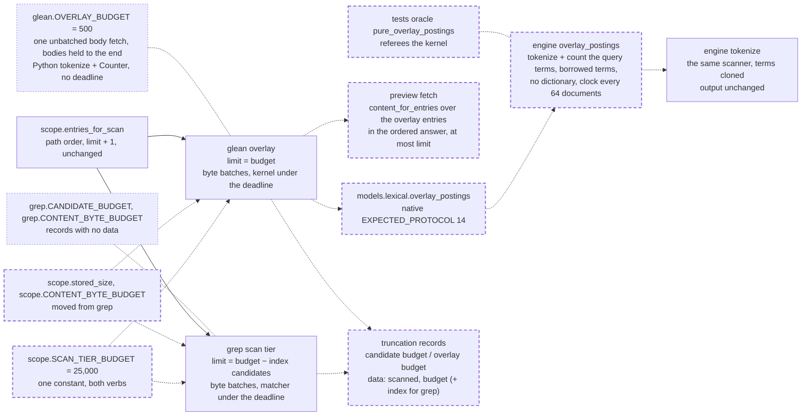

# The overlay counts in the engine and the scan tier shares one budget: glean's overlay tokenizes and counts its dirty bodies in a Rust kernel, reads them in byte batches under the deadline as grep does, and both verbs cut the dirty rows at one measured count whose record says what was scanned

A feature to the database backend's two content readers (`src/vfs/storage/backends/database/glean.py`, `grep.py`, `scope.py`) and the engine (`crates/vfs-core/src/lexical.rs`, `python.rs`, with `src/vfs/models/lexical.py` and `src/vfs/native.py` on the Python side of the seam): it touches the engine, so `cargo test -p vfs-core`, the wheel reinstall and a `PROTOCOL_VERSION` bump from 13 to 14 are criteria, and it needs the engine legs through the `db_test` skill because every reader change is under `storage/backends/database/`. It changes no public API (`VirtualFileSystem` and the storage protocol keep every signature; what changes is a record's `data` and the cost of a call), no schema format, no rights rule, no stored byte, and the index's `TOKENIZER_VERSION` and options fingerprint are unchanged because the tokenizer's output is unchanged. It stands on [the dirty-row budgets memo](../../research/2026-11-09-the-dirty-row-budgets-of-grep-and-glean.md) and its three studies, which measured the two verbs' scan tiers, inventoried their budgets and prototyped the kernel; no intention, because the audience's experience is unchanged except that glean sees what grep sees. It depends on no decision of another spec. It shares files with two active specs and lands in whichever order the owner chooses, the later one taking the earlier one's paths: [bounded work has one home](../active/2026-11-07-bounded-work-has-one-home.md) moves `CONTENT_BYTE_BUDGET`, `byte_chunked`, `VerifyOffload` and the wall into `vfs.offload` and types the deadline, so if it lands first this spec imports from there and passes its `Deadline`, and if this spec lands first that spec moves the overlay's new call sites with the rest; [scope crosses the seam in one shape](../active/2026-11-07-scope-crosses-the-seam-in-one-shape.md) edits the same readers' scope plumbing and not their budgets; if this spec lands first, the bounded-work spec's landing notes say `PROTOCOL_VERSION` stays at 14, not 13, and that its `python.rs` budget sites are five, not four. [The verbs take the names agents know](../active/2026-11-09-the-verbs-take-the-names-agents-know.md), active, renames `glean.py` to `search.py`, `tests/storage/database/test_glean.py` to `test_search.py` and the verb to `search`, and its decision 11 says it lands before every active spec that names them, so this spec is built against those names when that spec has landed: every `glean.py`, `test_glean.py` and `glean` below reads `search.py`, `test_search.py` and `search` by that spec's rule, and the landing notes carry the mapping in one line. [The refresh spec](../active/2026-10-31-refresh-the-incremental-index-verb.md)'s decision 23, that the staleness traits are unchanged, stays true under this spec; what refresh changes is how many rows the overlay holds between passes, and what this spec changes is what each row costs and where the cut sits.

## The problem

READ at `b85e3df`. Both verbs partition on `vfs_entries.encoded` and serve the `NOT encoded` content rows from their live bodies through one shared nomination helper, `entries_for_scan` in `scope.py:224-312`, which orders by path, fetches `limit + 1` and prunes the merge to the lowest `limit + 1` paths. Grep bounds that tier three ways: by count, `CANDIDATE_BUDGET = 25_000` (`grep.py:127`) less the index candidates, the scan skipped and the record saying "with the unindexed overlay not consulted" when the index side alone fills the pool (`grep.py:291-297`); by bytes, bodies fetched, matched and released in `CONTENT_BYTE_BUDGET = 32 MiB` batches metered by stored `size_bytes` (`grep.py:132, 356, 616-618`); and by wall, the deadline consulted before each batch and cut at worker start inside the matcher by `VerifyOffload` (`grep.py:357-393`, `offload.py:180-205`). Glean bounds its overlay one way: by count, `OVERLAY_BUDGET = 500` (`glean.py:154`, applied at `glean.py:419, 437, 990`); `_overlay` fetches every admitted body in one `content_for_entries` call (`glean.py:986`), and the tokenize-and-score hop at `glean.py:988` is `call_offloaded(executor, partial(_overlay_blocks, docs, terms, stats))` with no deadline, over a loop (`glean.py:1016-1044`) that calls `tokenize(content)`, builds a `Counter` of every token and reads the two to four query terms out of it.

READ. The 25,000 was measured: spec 103's sweep at about 75 µs a candidate, taken by spec 141 (`grep.py:120-127` states the derivation). The 500 was declared: spec 132 line 94 says "`SCOPE_ID_BUDGET = 5,000` and `OVERLAY_BUDGET = 500` are declared, refereed constants, not measured optima", and the glean memo of 2026-08-26 at line 136 had recommended the overlay be "bounded like grep's scan tier by the same candidate budget and deadline". Grep's truncation records carry `data=None` (`grep.py:394-396`); glean's overlay record carries `{"scanned", "budget"}` (`glean.py:437`). Neither says how many dirty rows were left out.

EXECUTED in [study 02](../../research/studies/2026-11-09-the-dirty-row-budgets-of-grep-and-glean/02-the-dirty-set-cost-curve.md) on an M1 Pro over 10,000- and 100,000-file SQLite stores and a 100,000-file Postgres store, dirtied at 500 to 25,000 rows: a dirty row costs grep's scan tier 17 to 25 µs and about 7 KB of body (10 to 13 µs on the five-pattern slope), and glean's overlay with its budget lifted 155 to 180 µs and the same 7 KB, of which 135 to 146 µs is the tokenize-and-count loop and 20 to 26 µs the three SQL legs; the figures are the same on both store sizes; Postgres adds about 45 µs of body transfer to both verbs. Neither verb reached the 10 s wall inside its count on either engine. A sentinel file written last with a path sorting last was found by grep up to 10,001 dirty rows and lost at 25,001, found by glean with the lifted budget at the same levels, and lost by glean at the default budget from 501 dirty rows on. On the 100,000-file store a common word's index side took 24,872 of grep's 25,000 and left the scan tier 128 rows with a record that did not say so.

EXECUTED in [study 03](../../research/studies/2026-11-09-the-dirty-row-budgets-of-grep-and-glean/03-the-overlay-counts-kernel-spike.md): the engine's `tokenize` in pure Rust runs at 64 µs per 7,167-byte body, so 23 µs of the 87 µs Python sees is materializing 1,092 Python strings a body; a dictionary of every token costs about 60 µs a body in Rust as in Python; a fused kernel that tokenizes with the engine's rules and tables, hands each folded term to the counter as a borrowed slice and compares it against the two to four query terms runs at 41 to 43 µs a body; the pyo3 crossing costs under 2 µs a document at either granularity. Routed through a prototype of that kernel inside the verb on the 100,000-file store, the overlay fell from 159 to 185 µs a dirty row to 59 to 65, with the same ten paths in the same order and a maximum score difference of zero on every query at 5,000, 10,000 and 25,000 dirty rows, the same statement count and bytes, and the same sentinel behaviour.

INFERRED in the memo from [AGENTS.md](../../../AGENTS.md) "The reference deployment": at about 104 organic writes a minute the dirty set passes 500 about five minutes after any index pass, so under every cadence the overlay's record is a constant and glean's ranking is short of most of the files written since the last pass; the dirty set is write rate times cadence and not corpus size, and the measured cost never depended on corpus size either.

## Architecture

Dashed is what this spec adds; dotted is what it retires.

Page this changes: none; the architecture folder was retired on 2026-10-31, and the landing notes will say so in one line.

Terms. The **scan tier** is the set of `NOT encoded` content rows a verb reads from live bodies; glean's scan tier is also called the **overlay**. The **scan-tier budget** is the count at which either verb cuts the path-ordered list of those rows. The **overlay counts kernel** is the engine function that, given a batch of bodies and the folded query terms, returns each body's token count and the term frequency of each query term.

## Decisions

### 1. One constant, `SCAN_TIER_BUDGET = 25_000` in `scope.py`, is the count at which both verbs cut the dirty rows; `grep.CANDIDATE_BUDGET` and `glean.OVERLAY_BUDGET` retire

The two verbs nominate the same rows through one helper in one order and drop from the same end of the same list, so the cut is one fact about the scan tier and belongs with the helper that owns it. The number is grep's, because grep's was measured and glean's was declared, and because study 03 showed glean can afford it: at 60 µs a row a full 25,000-row overlay is 1.5 s on SQLite and about 2.8 s projected on Postgres, inside the 10 s wall with the index side's worst measured case added. The constant does not vary with store size: the memo's dirty set is write rate times cadence, and the per-row cost was the same on 10,000 and 100,000 files. Every site that read either old name reads the new one, and tests that patched the old names patch `SCAN_TIER_BUDGET` on the module they exercise.

### 2. Grep applies the budget as the remainder of a pool its index side draws from first; glean applies it as the overlay's whole count

Grep's index candidates and scan rows compete for the same verify work, so one pool is the honest bound and the "overlay not consulted" case stays. Glean's index side is a chunk depth, `FUSION_K`, with no entry pool to subtract from, so its overlay count is the budget itself. The memo's inventory names this the one shape difference justified by structure; the number is shared, the application is each verb's own.

### 3. The engine gains `overlay_postings`, a fused tokenize-and-count over a batch of bodies for a short list of query terms, and `tokenize` becomes a thin wrapper over the same scanner

In `crates/vfs-core/src/lexical.rs` the scanning loop of `tokenize` (character classes, case folding through the generated tables, identifier splitting on `_` and case change, the two length rules) is lifted into one private scanner that hands each folded term to a closure as a borrowed `&str`. `tokenize(content) -> Vec<String>` calls it and clones each term, so its output is byte-identical and every tokenizer test, `TOKENIZER_VERSION` and the options fingerprint are untouched. `overlay_postings(docs: &[(i64, &str)], terms: &[&str], deadline: Option<Instant>) -> OverlayOutcome` calls it and, per body, counts the tokens and matches each against the query terms, with no dictionary of the body's tokens, because study 03 measured a dictionary of every token at about 60 µs a body in Rust. The match is a linear compare while the query has at most eight terms, measured at under 1 µs a body per term, and a hash map from each term to its first position built once per call past eight (a term repeated in the query resolves to its first position on both paths and that position's count is copied to the repeats; the verb never sends a repeat, because `glean_rows` dedupes the query's terms, so the rule is the kernel's contract for its direct callers and the oracle's parity), because the query's length has no ceiling (`params.py` declares `query` without one) and a linear compare over two hundred terms would cost about 200 µs a body, while hashing every token costs about the dictionary's 60 µs whatever the query, so the map is the fallback and not the default; both are exact on the folded term, which is what the index stores and what `Counter.get(term)` did. It returns, per query term in the caller's order, the postings `(doc_id, tf, dl)` of the bodies where the term occurs, in the order the bodies were given, the number of bodies it counted, their summed token count, and whether every body was reached.

### 4. The kernel reads the clock every 64 documents and stops between documents when the deadline has passed, returning what it reached

This is the law grep's matcher already obeys (`verify.rs` checks its deadline between bodies) and the cadence [bounded work has one home](../active/2026-11-07-bounded-work-has-one-home.md) declares as `CHECK_EVERY = 64`; a check every document would cost about 20 ns against 40 µs of work and buy nothing, and 64 documents is about 2.6 ms of overrun at most. A batch that stops early reports `completed = false`; the postings it returns are those of the bodies it reached, which the caller scores, and the record names the wall. When that spec lands, the check moves onto its Rust deadline module with the rest.

### 5. The binding is `overlay_postings(docs, terms, *, budget)` on `vfs._native`, bodies borrowed and the work detached from the GIL, and `PROTOCOL_VERSION` goes from 13 to 14

The shape is `count_lines`'s: `docs: Vec<(i64, PyBackedStr)>` borrows the Python strings without copying, `terms: Vec<String>`, `budget: Option<f64>` seconds converted to an `Instant` through `deadline_after`, the checked conversion the glob bindings use and not the unchecked `Duration::from_secs_f64` that `count_lines` uses today, the work under `py.detach`, the result `(Vec<Vec<(i64, u32, u32)>>, u64, u64, bool)`: the postings per term, the bodies reached, the summed token count and the completed flag; the bounded-work spec's `Deadline::after` takes the conversion's place when that spec lands. The seam's protocol constant counts the binding surface, and a new function is a new surface, so the constant bumps and `EXPECTED_PROTOCOL` in `native.py` follows; the subprocess pin in `tests/test_native.py` holds the pair. The Python owner is `vfs.models.lexical.overlay_postings(docs, terms, *, budget) -> OverlayPostings`, a `NamedTuple` of `postings`, `reached`, `total_dl` and `completed`, because the seam rule puts per-surface dispatch with the surface's owner and `models/lexical.py` owns the tokenizer.

### 6. The overlay fetches and counts its bodies in `CONTENT_BYTE_BUDGET` batches metered by stored `size_bytes`, sequentially, the deadline consulted before each batch and cut at worker start inside each

This is grep's law at `grep.py:354-362` applied to the overlay: `_overlay` iterates `byte_chunked(admitted, stored_size, CONTENT_BYTE_BUDGET)`, fetches one batch's bodies with `content_for_entries`, hands them to the kernel with `budget = max(0.0, deadline - monotonic())`, and accumulates postings; the surrogate-id fetch rides per batch too, so the three SQL legs issue one statement each per batch (per membership chunk on an engine whose cap is smaller than a batch). With decision 7, residency is bounded at one batch or one body, whichever is larger, instead of every admitted body at once, which the inventory measured at 2 MB at the 4 KB median and 100 MB at the 200 KB tail for 500 rows and which would grow linearly with decision 1's count. The three scan-tier laws live in one module: `CONTENT_BYTE_BUDGET` moves from `grep.py:132` to `scope.py` beside `SCAN_TIER_BUDGET`, `grep._content_size` moves there as `stored_size`, the one metering function both verbs use, and both verbs import `byte_chunked` from `dialects.py` as grep does today; if the bounded-work spec lands first, all three names come from `vfs.offload` instead. The deadline before a batch and the cut inside it are the two places grep reads the clock, and the overlay now reads it at the same two.

### 7. The overlay keeps no body past its batch; the preview texts of the overlay entries that make the answer are fetched once more, after the order is settled, at most `limit` of them

Today `_overlay` holds every admitted body until the scores are known and cuts previews from them (`glean.py:986-993`, "never from a second read"). Keeping only the bodies with a nonzero term frequency would not bound that: for a term present in every dirty body it is the whole overlay, 25,000 bodies at decision 1's count, about 175 MB at the 7 KB median and gigabytes at the 200 KB tail, where today's 500 holds 3.5 MB. So `_overlay` returns hits only, and after `_order(fused.entries, rows)[:limit]` one `content_for_entries` over the overlay entries in the ordered answer, at most `limit` ids and so one statement at the default `limit` of 10, supplies the bodies `_Sources` cuts previews from; the indexed entries' previews come from `_chunk_texts` as today. The preview is then a second read of a live body, and a write landing between the count and the fetch yields a preview from the newer body; that is the staleness the overlay already carries, since it scores live bodies that the next call may see differently, and the preview is cut from the live body as `read` would return it; glean projects no content column. A purge landing between the two reads on an engine with no isolation pin (SQL Server and Oracle read each statement at its own point) leaves the entry's body absent from the second read, and the entry is then dropped from the answer as a lawful absence, the way grep's verify tier leaves a body that did not come back, never an exception out of the verb. The slice to `limit` runs before the drop, so the answer is then short of `limit` by the vanished entries while candidates sit below the cut, with no record, because `truncated` would name a budget that was not hit and `not_found` a path the caller never named; the window is a purge of an answering entry between two statements on two engines, and the next call answers in full. This is the statement-level consistency every multi-statement read in both verbs already has on the two engines that pin no `op_isolation`, the one departure from Article 5's one coherent point-in-time view this spec touches; SQLite's `BEGIN` and the `REPEATABLE READ` pin on Postgres and MariaDB make the preview read see the counted body exactly there; it adds one point in time and no new kind, and it expires when those two profiles declare a snapshot isolation for op connections, which waits on an experiment on its lock cost. The `_overlay` docstring's "never from a second read" is rewritten to say so.

### 8. Postings accumulate across batches per term and are sorted by doc id before block encoding; the idf law, the mean length and the block assembly are unchanged

The block codec restarts deltas per block and requires increasing ids within one, and batches arrive in path order, not surrogate order, so each term's postings are sorted once before `chunked(postings, BLOCK_SIZE)`; this replaces the sort of `docs` at `glean.py:987`. `n_docs` is `stats.n_docs` plus the sum of `reached` over the batches, and `avg_dl` on a never-indexed store is the summed `total_dl` over that same sum, so a body the kernel never reached under a wall is in neither statistic and the idf of a term absent from the base is computed over bodies that were read; with every body reached these are the counts the Python path used. The base-idf-or-overlay-df rule and `encode_block` are the same code on the same numbers, so the hits and scores are the ones the Python path produced, which study 03 observed at zero difference and criterion 6 pins. `score_blocks` takes `SCAN_TIER_BUDGET` as its `k`, as it took `OVERLAY_BUDGET`.

### 9. Both verbs' count records carry `data`: glean's `{"scanned", "budget"}` as today, grep's `{"scanned", "index", "budget"}`

A caller of glean already reads how many rows the overlay scanned against its budget. A caller of grep reads nothing (`data=None`), and study 02 showed the case that matters: a common word's index side took 24,872 of 25,000 and the scan tier received 128, with a bare "candidate budget" record. Grep's record now carries the scan rows it nominated, the index candidates it admitted and the budget, so an agent can see that the dirty set was all but left out; the "overlay not consulted" variant carries `scanned = 0`. The reason words, "candidate budget" and "overlay budget", the severity, the kind and the guidance sentence are unchanged, and the wall record's `data` stays `None` in both verbs. Neither record reports the dirty total, which the memo leaves to an experiment on its cost at 10,000,000 rows.

### 10. A wall reached inside the kernel hop records the wall once, scores the bodies the kernel reached, and leaves the rest absent

This is the matcher's law at `grep.py:388-393`: bodies the worker never reached are unverified, so the record must say so, and the call still answers from what it has. `_record_wall` already writes the record once per call; the overlay's judge hop and the new kernel hop both feed it.

### 11. A pure-Python oracle, `pure_overlay_postings` in `tests/support/oracles/lexical.py`, referees the kernel, and the parity test runs over bodies that exercise every tokenizer rule

The oracle is `pure_tokenize` plus a `Counter`, the shape `_overlay_blocks` has today, over the same documents and terms; the parity test compares the engine's postings, total length and order with the oracle's on generated bodies carrying non-ASCII letters, mixed-case identifiers, underscores, digit-led pieces and terms over the byte cap, because study 03's prose bodies were ASCII and exercised none of these. The engine rule in AGENTS.md makes the oracle the referee and gives it no coverage obligation.

### 12. The kernel takes bodies as text; a profile whose bodies arrive as bytes decodes them in Python as today

`_text` at `glean.py:996` decodes a bytes body with `surrogatepass` before tokenizing, and the kernel borrows the resulting `str`. A bytes-accepting binding that decodes in Rust would save that pass on the engines that declare `content_bytes`; study 02 did not measure it apart from the body fetch, so it is out of scope until it is.

### 13. The staleness traits, the nomination order, the `allow_scan` gate and grep's `max_count` are unchanged

`grep_staleness` and `glean_staleness` stay `"overlay"`, as [the refresh spec](../active/2026-10-31-refresh-the-incremental-index-verb.md)'s decision 23 says. Path order stays because the memo names recency or a stable hash as an experiment on the cost of sorting by a stamp, not a measured result. Nothing about which rows are nominated changes; what changes is how many and what each costs.

## Intent

After this spec, an agent that writes a file and runs `glean` a moment later finds it ranked whenever `grep` would have found it, because both verbs read the same dirty rows up to the same count: on a store with 2,500 files written since the last index pass, a glean call reads them in byte-bounded batches, counts the query terms in the engine in about 0.15 s and 17 MB of body, and ranks every one of them, where today it ranked the 500 whose paths sort first and warned on every call; when the dirty set outgrows the count, both verbs drop the same late-sorting rows and each record says how many rows were scanned against which budget, and grep's says how much of its pool the index side took; a glean call whose wall expires inside the count returns what it reached with one wall record, as grep does, and a write path, a stored byte and the index are exactly as they were.

## Design

The engine (`crates/vfs-core/src/lexical.rs`): the scanner lifted out of `tokenize` as a private function taking the body, two reusable buffers and a closure receiving each folded term; `tokenize` re-expressed over it with the clone; `pub fn overlay_postings(docs, terms, deadline) -> OverlayOutcome` with `pub struct OverlayOutcome { postings: Vec<Vec<(i64, u32, u32)>>, reached: u64, total_dl: u64, completed: bool }`, the term match linear to eight terms and a `HashMap` from term to first position past that, the deadline read every 64 documents; the crate root re-exports both. Tests in the module: `overlay_postings_agrees_with_tokenize_counts` over a mixed-script fixture with a two-term and a twenty-term query, `overlay_postings_stops_between_documents_at_the_deadline` asserting `reached` and `completed`, `tokenize_output_is_unchanged` against the existing fixture. `crates/vfs-core/src/python.rs`: `#[pyfunction] overlay_postings(py, docs: Vec<(i64, PyBackedStr)>, terms: Vec<String>, budget: Option<f64>)` converting the budget through `deadline_after`, under `py.detach`, registered in the module, `PROTOCOL_VERSION = 14`. The wheel reinstall follows.

The seam (`src/vfs/native.py`): `EXPECTED_PROTOCOL = 14`. The owner (`src/vfs/models/lexical.py`): `class OverlayPostings(NamedTuple)` and `def overlay_postings(docs, terms, *, budget) -> OverlayPostings` calling `extension().overlay_postings`. Tests: `tests/models/test_lexical.py::TestOverlayPostings` (parity with the oracle on mixed bodies, the deadline stop, the empty batch), `tests/test_native.py` gains the node pinning 14. Oracle: `tests/support/oracles/lexical.py::pure_overlay_postings`.

The shared budget (`src/vfs/storage/backends/database/scope.py`): `SCAN_TIER_BUDGET: Final = 25_000` with the derivation comment moved from `grep.py:120-127`, `CONTENT_BYTE_BUDGET` moved from `grep.py:132` with its comment, and `def stored_size(mapping) -> int` moved from `grep._content_size`. grep (`grep.py`): `CANDIDATE_BUDGET` and `CONTENT_BYTE_BUDGET` deleted, every site reads the `scope` names; the truncation loop builds `data` per reason, the count record carrying `{"scanned": scan nominees, "index": index candidates admitted, "budget": SCAN_TIER_BUDGET}`; `_content_size` deleted in favour of `stored_size`. glean (`glean.py`): `OVERLAY_BUDGET` deleted, `limit=SCAN_TIER_BUDGET` and the record's `budget` read it; `_overlay` rewritten over `byte_chunked(admitted, stored_size, CONTENT_BYTE_BUDGET)` with a per-batch surrogate fetch, body fetch, `call_offloaded` of a one-line `_count_overlay` helper that calls `overlay_postings` with the budget cut at worker start, accumulation of postings, `reached` and `total_dl` in a private `_OverlayCount` named tuple, no body kept past its batch; it returns the hits and a `completed` flag, the shape `_entries_for_chunks` and `_vector_leg` already return, and the caller feeds the flag to `_record_wall`. `_overlay_blocks` takes the `_OverlayCount` instead of the bodies, still offloaded, sorts each term's postings by doc id and assembles blocks as today. After `_order(...)[:limit]`, `_overlay_bodies` runs one `content_for_entries` over the overlay entries in the ordered answer and none when there are none, supplying `_Sources.bodies`; an overlay entry whose body did not come back is dropped from the answer. The `Counter` import goes; `tokenize` stays, because the query is still tokenized at the top of `glean_rows`. `src/vfs/base.py` imports `CONTENT_BYTE_BUDGET` from `scope` instead of `grep`, and `src/vfs/_native.pyi` declares the new binding. The module docstring's freshness paragraph says the bodies are counted by the engine in byte batches under the wall and that overlay previews come from one bounded read of the entries that answer; `_overlay`'s docstring loses "never from a second read" and says what decision 7 says. Tests: `tests/storage/database/test_glean.py::TestOverlay` and `TestBudgets` nodes below; `tests/storage/database/test_grep.py` nodes below.

The conformance suite (`tests/support/storage_contract.py`): one `slow` row writing 600 files past an index pass with the last one sorting last and holding a unique term, asserting both verbs return it and glean carries no overlay record; it runs on every engine through `db_test`.

Order of work: the engine tests and the oracle, red; the scanner refactor and the kernel, green, `cargo test`, the binding and the protocol bump, the wheel reinstall; the owner wrapper and its parity tests; the shared budget constant and the grep record change with their tests; the overlay rewrite with its tests, written red first against the Python path's behaviour where they pin behaviour (batches, residency, the wall inside the hop) and against the old constant where they pin the budget; the conformance row; the docstrings; `scripts/ci.sh`; the four engine legs.

## Scope

In: decisions 1 to 13. Files: `crates/vfs-core/src/lexical.rs`, `crates/vfs-core/src/lib.rs`, `crates/vfs-core/src/python.rs`, `src/vfs/native.py`, `src/vfs/_native.pyi`, `src/vfs/base.py`, `src/vfs/models/lexical.py`, `src/vfs/storage/backends/database/scope.py`, `grep.py`, `glean.py`, `tests/support/oracles/lexical.py`, `tests/models/test_lexical.py`, `tests/test_native.py`, `tests/storage/database/test_glean.py`, `test_grep.py`, `tests/support/storage_contract.py`.

Out: the per-term `String` clone inside the engine's `tokenize`, about 22 µs of its 64 per body, which the index build pays on every chunk; it is a build-side change whose multiplier is the rebuild, and it takes its own spec after the memo's named experiment measures it inside `reindex()`. Out: a byte-level scanner for ASCII bodies, measured at 24 µs against 41, which is a second code path for 17 µs a body and waits for a measured need. Out: a bytes-accepting binding for the `content_bytes` profiles (decision 12). Out: the nomination order, recency or hashed against path, and the dirty total in a record, each the memo's named experiment. Out: the index tier's second probe on a wholly dirty store, a design question study 02 raised for the refresh spec. Out: any change to the wall, `WALL_TIME_BUDGET`, or to the records' reason words.

## Acceptance criteria

1. `scope.SCAN_TIER_BUDGET` is 25,000, and the `*_BUDGET` attributes of the `grep` and `glean` modules are exactly the shared pair plus `WALL_TIME_BUDGET`, with `POSTING_BYTE_BUDGET` on grep and `SCOPE_ID_BUDGET` on glean, so neither has `CANDIDATE_BUDGET` or `OVERLAY_BUDGET`. Test: `tests/storage/database/test_glean.py::TestOverlay::test_the_overlay_reads_the_shared_scan_tier_budget`; evidence: `grep -rn 'OVERLAY_BUDGET\|CANDIDATE_BUDGET' src tests` prints nothing from `src/` or the live tests, in the landing notes; the archived documents of the ranking fixture corpus under `tests/fixtures/ranking/vfs_native/corpus/` are data and may name the old constants.
2. With `SCAN_TIER_BUDGET` patched to 2 on the glean module, a glean over three dirty files returns one truncation record of kind `truncated`, severity `warning`, data `{"scanned": 2, "budget": 2}`, and `success` true. Test: `tests/storage/database/test_glean.py::TestOverlay::test_the_overlay_budget_truncates_loudly`.
3. With `SCAN_TIER_BUDGET` patched to 2 on the grep module and three indexed matches plus one dirty match, grep's record says "overlay not consulted" and carries `{"scanned": 0, "index": 2, "budget": 2}`; with no index candidates and three dirty matches it carries `{"scanned": 2, "index": 0, "budget": 2}`. Tests: `tests/storage/database/test_grep.py::TestBudgets::test_a_saturated_index_side_names_the_skipped_overlay` and `::test_the_candidate_budget_record_says_what_each_tier_took`.
4. On generated bodies holding non-ASCII letters, camel-case and underscored identifiers, digit-led pieces and a term over 64 bytes, for a two-term query and a twenty-term query, `vfs.models.lexical.overlay_postings` returns the same per-term postings, `reached` equal to the body count, the same total length and `completed` true as `pure_overlay_postings`. Test: `tests/models/test_lexical.py::TestOverlayPostings::test_the_engine_agrees_with_the_oracle_on_mixed_bodies`.
5. `tokenize` is unchanged: every node of `tests/models/test_lexical.py::TestTokenizer` passes unchanged, `TOKENIZER_VERSION` is 1 and `options_fingerprint()` is the value it returns at `b85e3df`. Tests: the existing class and `::TestOverlayPostings::test_the_tokenizer_and_its_fingerprint_are_unchanged`.
6. On a store with twelve dirty files and three indexed ones, glean's paths, order and scores equal those computed by the oracle path (the pure tokenizer, a `Counter`, and `pure_score_blocks` over the same statistics). Test: `tests/storage/database/test_glean.py::TestOverlay::test_the_kernel_overlay_scores_as_the_oracle_does`.
7. With `CONTENT_BYTE_BUDGET` patched to one body's size on the glean module, a glean over five dirty bodies issues five body-fetch statements and five surrogate-id statements in the overlay, one each per batch, plus one preview fetch, and returns the same hits as with the default budget; with the default budget it issues one of each plus the one preview fetch. Test: `tests/storage/database/test_glean.py::TestOverlay::test_the_overlay_fetches_bodies_in_byte_batches`.
8. A kernel call with `budget=0.0` over two bodies returns `completed` false, `reached` 0 and no postings; inside glean, `overlay_postings` patched to return the first body's postings with `reached` 1 and `completed` false (the `_SetSpy(unfinished=True)` shape of `test_glean.py:603`) yields one wall record, `success` true, the index side's hits and the one reached overlay hit. Tests: `tests/models/test_lexical.py::TestOverlayPostings::test_an_exhausted_budget_stops_between_documents`; `tests/storage/database/test_glean.py::TestBudgets::test_a_wall_inside_the_overlay_hop_records_once_and_keeps_what_was_reached`.
9. After a glean at `limit=2` over five dirty bodies of which three hold a query term, `_overlay` returns no bodies, and the preview fetch reads exactly the two overlay entries in the answer. Test: `tests/storage/database/test_glean.py::TestOverlay::test_overlay_previews_come_from_one_bounded_fetch_of_the_answer`.
10. `vfs._native.PROTOCOL_VERSION` and `vfs.native.EXPECTED_PROTOCOL` are both 14, and the mismatch subprocess pin still refuses the import. Tests: `tests/test_native.py::TestSeamGate::test_the_protocol_version_is_14` and the existing `::TestSeamGate::test_protocol_mismatch_fails_the_import`.
11. `cargo test -p vfs-core` passes with `overlay_postings_agrees_with_tokenize_counts`, `overlay_postings_stops_between_documents_at_the_deadline` and `tokenize_output_is_unchanged` among the nodes. Evidence: the test count in the landing notes.
12. On every engine, after an index pass and 600 writes whose last file sorts last and holds a unique term, grep and glean both return that file and glean carries no overlay record. Test: `tests/support/storage_contract.py::StorageContract::test_both_verbs_see_the_six_hundred_and_first_dirty_row`, marked `slow`, run on SQLite in the suite and on the four engines through `db_test`.
13. A glean over a dirty store whose answer holds overlay entries issues, for one byte batch, one nominee fetch, one surrogate fetch, one body fetch and one preview fetch, one statement more than the Python path at `b85e3df`; a glean whose answer holds no overlay entry issues no preview fetch. Test: part of criterion 7's node, asserting the counts at the default budget, and `tests/storage/database/test_glean.py::TestOverlay::test_no_preview_fetch_when_the_overlay_does_not_answer`.
14. The traits still declare `grep_staleness` and `glean_staleness` as `"overlay"`. Test: the existing `tests/storage/database/test_glean.py::TestBudgets::test_traits_declare_the_lexical_leg_and_its_overlay`.
15. With `content_for_entries` patched so that its second call, the preview read, lacks the best answering entry's body, a glean at `limit=2` over three dirty files returns `success` true, the remaining overlay entry's path and no error, and the fetch ran exactly twice. Test: `tests/storage/database/test_glean.py::TestOverlay::test_an_overlay_entry_purged_before_the_preview_read_is_absent`, engine-free because SQLite's snapshot hides the interleaving the code review reproduced on Oracle and SQL Server.

## Landing notes

Built 2026-11-10 over `682182f`, after [the chunk-page filter spec](2026-11-09-the-chunk-page-filter-takes-the-shape-each-planner-serves.md) had landed; of the specs this one shares files with, none had landed, so the paths are the ones the Design names: `CONTENT_BYTE_BUDGET`, `stored_size` and `byte_chunked` come from `scope.py` and `dialects.py`, not `vfs.offload`, and [the verbs take the names agents know](../active/2026-11-09-the-verbs-take-the-names-agents-know.md) had not landed, so the files are `glean.py` and `test_glean.py` and the verb is `glean`; that spec's decision 11, which puts the rename ahead of every spec naming `glean.py`, is for its author to reword, since this spec landed first. Tests first: the three Rust nodes were red as compile errors before `overlay_postings` existed, the four owner and seam nodes red through the stale-protocol `ImportError` before the bump, eight glean nodes and six grep nodes red on the old code (the reviewer reproduced six of them red by laying the `682182f` copies of `grep.py`, `glean.py` and `base.py` over a scratch copy of `src/`), and the conformance row red by the memo's own measurement, the 500-row cut excluding the 601st file. Built by a sub-agent of the author's session, reviewed by a fresh one.

Per criterion. 1: `TestOverlay::test_the_overlay_reads_the_shared_scan_tier_budget` passes; `grep -rn 'OVERLAY_BUDGET\|CANDIDATE_BUDGET' src tests` prints nothing from `src/` or the live tests, and its only hits are eleven lines in the archived documents of the ranking fixture corpus under `tests/fixtures/ranking/vfs_native/corpus/`, which are data and were not edited. 2: `test_the_overlay_budget_truncates_loudly` passes with `{"scanned": 2, "budget": 2}`. 3: `TestBudgets::test_a_saturated_index_side_names_the_skipped_overlay` (the existing node, extended with the data assertion) and `test_the_candidate_budget_record_says_what_each_tier_took` pass, plus `test_the_wall_record_carries_no_data` for the `data=None` arm. 4: `TestOverlayPostings::test_the_engine_agrees_with_the_oracle_on_mixed_bodies` passes for the two-term and the twenty-term query; the reviewer's 400-trial fuzz over Turkic i, sharp s, Greek and Cyrillic, CJK, emoji, combining marks, exact-64-byte terms, empty bodies and duplicated, absent and empty query terms at 1 to 61 terms found no mismatch. 5: `TestTokenizer` passes unchanged, `TOKENIZER_VERSION` is 1, and the pinned fingerprint is `bm25=k1:1.2,b:0.75;tokenizer=1;term_bytes=64;block=128;codec=ids:count+delta+varint;tfs,dls:varint;summary:delta+varint,le-f64`. 6: `test_the_kernel_overlay_scores_as_the_oracle_does` passes on twelve dirty and three indexed files. 7 and 13: `test_the_overlay_fetches_bodies_in_byte_batches` asserts `(body fetches, surrogate fetches, nominee fetches)` of `(2, 1, 1)` at the default budget (one batch plus the preview read) and `(6, 5, 1)` at one body per batch, and `test_no_preview_fetch_when_the_overlay_does_not_answer` pins the skipped read; one default-budget glean issues 8 statements against 7 at `682182f`, the preview read. 8: `test_an_exhausted_budget_stops_between_documents` at the kernel and `TestBudgets::test_a_wall_inside_the_overlay_hop_records_once_and_keeps_what_was_reached` in glean pass; the glean node also records the hop's `budget` and asserts it is a float in `[0, WALL_TIME_BUDGET]`, and `test_a_wall_between_overlay_batches_records_once_and_keeps_the_batches_counted` pins the pre-batch check through the statement counts, each added after the code review's mutants M3 and M4 survived the first forms. 9: `test_overlay_previews_come_from_one_bounded_fetch_of_the_answer` passes, two entries read. 10: `TestSeamGate::test_the_protocol_version_is_14` and the mismatch pin pass. 11: `cargo test -p vfs-core` 104 passed, three more than `682182f`'s 101, the three named nodes among them. 12: `StorageContract::test_both_verbs_see_the_six_hundred_and_first_dirty_row` passes on SQLite and the memory leg in the suite and on the four engines below. 14: the traits node passes unchanged. 15: `test_an_overlay_entry_purged_before_the_preview_read_is_absent` passes, two fetch calls and the surviving path, the criterion added with the second spec review.

The code review's H1, found by the reviewer's executed race on Oracle and SQL Server: a `sweep` of the dirty subtree committed by a sibling handle between the overlay count and the preview read left `_observe` indexing a body that was never fetched, a raw `KeyError` out of `glean` on the two engines that pin no `op_isolation` (SQLite's reader runs under its own `BEGIN`, Postgres and MariaDB pin `REPEATABLE READ`, so the window is closed there). Decision 7 was amended after the first spec review signed to name the vanished-body case as a lawful absence, the answer drops the entry as grep's verify tier drops a body that did not come back, and `TestOverlay::test_an_overlay_entry_purged_before_the_preview_read_is_absent` pins it engine-free by patching the second `content_for_entries` call; the reviewer's race re-run on both engines then answered instead of raising. The changed decision has [a second spec review of its own](../../reviews/2026-11-10-the-overlay-counts-in-the-engine-and-the-scan-tier-shares-one-budget-spec-review.md), as the skill asks for a decision changed after "Fit to build".

Deviations from the Design as first signed, each now written into the Design. `_overlay` returns `(hits, completed)`, the shape `_entries_for_chunks` and `_vector_leg` return, and the caller feeds the flag to `_record_wall`; the kernel hop goes through a one-line `_count_overlay` so the budget is cut at worker start; the accumulation is a private `_OverlayCount` named tuple that `_overlay_blocks` takes, still offloaded because block assembly over up to 25,000 postings a term is CPU; the preview read is `_overlay_bodies`, which issues nothing when no overlay entry answers; the match past eight terms is a `HashMap` from term to first position rather than a set, because the counter needs the position, with a repeated query term resolving to its first position on both paths; `tokenize` stays imported in glean for the query; `src/vfs/base.py` imports `CONTENT_BYTE_BUDGET` from `scope` and `src/vfs/_native.pyi` declares the binding, two files the Scope did not list. Criterion 1's node pins the exact `*_BUDGET` attribute sets of the two modules instead of `hasattr` on the retired names. The conformance row writes its 601 files in one batch, the same dirty set as 601 single writes. The existing unit node was renamed `test_overlay_blocks_take_counted_postings_and_local_statistics` because it no longer takes bodies.

Architecture pages: none; the folder was retired on 2026-10-31.

The engine legs through `db_test`, fresh containers, run twice, before and after the review's fixes, the second run on the tree as landed: Postgres 389 passed, MariaDB 379 passed and 8 skipped, SQL Server 389 passed, Oracle 384 passed, no failures, each count one node over the chunk-page landing's, the new conformance row; that row also ran alone on each engine, 1 passed on all four. The reviewer's Oracle probe at 1,100 dirty rows past the 1,000-element `IN` floor succeeded with 1,100 observations, four content fetches of at most 1,000 binds each and no warning. The Postgres slope of a full 25,000-row overlay, which the first spec review asked the landing to record, was not measured in this cycle; the 1.5 s SQLite figure and the 2.8 s Postgres projection stand as study 03 left them.

Reviews: [the first spec review](../../reviews/2026-11-09-the-overlay-counts-in-the-engine-and-the-scan-tier-shares-one-budget-spec-review.md) signed "Fit to build" on 2026-11-09 after H1, M1 and M2 were fixed; [the code review](../../reviews/2026-11-10-the-overlay-counts-in-the-engine-and-the-scan-tier-shares-one-budget-code-review.md) found H1, H2 and three Lows, all fixed, and re-signed "Lands" on 2026-11-10; [the second spec review](../../reviews/2026-11-10-the-overlay-counts-in-the-engine-and-the-scan-tier-shares-one-budget-spec-review.md), for the changed decision 7, signed "Fit to build" with four Lows and re-signed after they were written in.

`scripts/ci.sh` on the tree as committed, the spec already moved to the archive: install, lint, format and types PASS; 4849 passed, 6 skipped, coverage 100 %; 44 docs fences; the wheel 9 MB under the 50 MB budget; all legs green.

**Changelog:** Changed — glean's unindexed overlay now reads up to 25,000 freshly written files, grep's count, in byte-bounded batches under the call's wall and counts the query terms in the Rust engine, so a file written since the last index pass is ranked wherever it would have been grepped; grep's and glean's count records say how many rows were scanned against which budget, and grep's how many its index side took.

## One line

Glean's overlay counts its dirty bodies in the engine in byte batches under the deadline, grep and glean cut the dirty rows at one measured count of 25,000 that lives with the helper they share, and both records say what was scanned, so a freshly written file is ranked wherever it would have been grepped.
